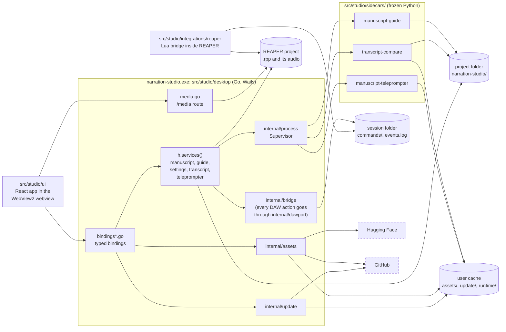

# Codebase map

Narration Studio names every top-level folder for the role of what is in it, and keeps its stable launch
and integration paths while organizing implementation around the product domain that owns its behavior.
The decision and the old-to-new path map are in
Repository layout.

## Repository layout

```text
src/
  studio/         the app and its integration points
    desktop/      Go/Wails desktop host (app.go, bindings*.go, internal/, cmd/, build/: icons and the Windows setup program definition)
    ui/           React + Tailwind app; its tests/ hold the Playwright visual and atlas suites
    sidecars/     Python programs frozen into the app and run on demand
      manuscript-guide/  manuscript-teleprompter/  transcript-compare/   (each: core/ CLI backend, tests/)
    libs/
      python/     narration_common, the cross-tool Python contracts
    integrations/
      reaper/     REAPER launcher and Lua bridge
      audacity/   placeholder notes for a future Audacity driver
    tests/
      audacity3/  the real-Audacity 3 runs of the desktop host's Audacity adapter
  web/            the GitHub Pages app: landing page, condensed guides, live demo, Storybook atlas
config/           shipped JSON: defaults, asset catalogs, roadmap
tests/
  fixtures/       manuscripts and other data used by tests across projects
tools/
  docs-site/      the public docs site: MkDocs config, include list and link hooks; reads docs/ in place
scripts/          repo automation, release and CI tooling
docs/             documentation, ADRs and the roadmap
```

Only these entries may exist at the repository root. `scripts/ci/layout.test.mjs` runs in `pnpm check` and fails
on any other top-level entry, or on a tracked file that still names a retired path; the allowlist and the
old-to-new path map live in `scripts/ci/layout.json`.

### Where tests go

Tests follow the toolchain. Colocate them where the toolchain wants that: Go `_test.go` beside the package,
Vitest `*.test.tsx` beside the component, Storybook stories beside the primitive, `node:test` files beside
the script. Otherwise a project has one `tests/` folder at its root (`src/studio/libs/python/tests`,
`src/studio/sidecars/<name>/tests`, `scripts/release/tests`). The Playwright visual, atlas and aria suites live in
`src/studio/ui/tests`, one folder each, because they drive the whole app or the whole Storybook rather than one file. Data shared by several
projects lives in `tests/fixtures`. Go code and tests name repo-relative locations through
`src/studio/desktop/internal/layout`, and `scripts/release/prepare-resources.py` keeps its own constants, so the
next move is a one-line change in each.

### Projects

Every folder above that has a `project.json` is an Nx project (all except `docs/`, `tests/` and `src/studio/integrations/audacity/`); `pnpm check` and CI run their
`lint`, `format`, `test` and `build` targets, and CI runs only the projects a change affects. See
[Nx projects and the quality gate](../operations/ci-and-releases.md#nx-projects-and-the-quality-gate).

## Product and technical names

The product is Narration Studio everywhere: the window title, About, Settings, update messages, installer texts, reports and docs, and the technical names too (`narration-studio` for the executable, release assets, module path, config and data folders; `NarrationStudio` for the uninstall key, the REAPER launcher and session folder and the default projects folder). The product's earlier name was retired before the first public release, with no migration, and `scripts/ci/old-name.test.mjs` fails if it appears in any tracked file or in the built site.

## Stable boundaries

- `src/studio/desktop/` is the Go/Wails desktop host, on Wails v3 beta ([ADR 0001](../adr/0001-the-app-is-written-in-go.md)). It exposes generated, typed Wails
  bindings and native events only; it has no loopback HTTP surface, port, or
  browser fallback. `main.go` creates the application and its one window, and every other call into Wails
  (events, the window, file dialogs, the browser, quitting) goes through `wailsapp.go`. Its Go module path is still
  `github.com/countrymanprime/narration-studio/shell`; nothing imports it.
- `src/studio/ui/` is the React application. It communicates only through the
  typed API facade; feature components do not import HTTP transport code.
- `src/studio/sidecars/*/core/` remain stable Python CLI entrypoints for DAW integrations.
- `src/studio/integrations/reaper/` is the REAPER-only bridge. Its field order and protocol are
  compatibility contracts. A checkout finds the sidecars, catalogs and launcher relative to
  `src/studio/integrations/reaper` (four levels up is the repo root); packaged builds use `resources/`.
  `src/studio/integrations/reaper/tests/` is the Lua bridge harness (see [the REAPER bridge](reaper-bridge.md)).
- `src/studio/libs/python/narration_common/` contains only cross-tool contracts such
  as canonical manuscript access, settings, logging, progress, and bridge
  encoding, and `narration_common/ports`, the provider ports' Protocols, registries and conformance suites
  (see [provider ports](provider-ports.md)), and `narration_common/recording`, the format of a recorded take (a PCM WAV
  that never overwrites a file) and the engine-neutral recorder any capture row records through
  ([capture_wasapi.py](../../src/studio/sidecars/manuscript-teleprompter/core/capture_wasapi.py)).
  Feature-specific analysis stays with its tool.

### Dependency rules

- Every new analyzer emits the shared finding format ([findings contract](findings-contract.md)) before it gets a bespoke UI.
- The dashboard consumes findings but does not reproduce analyzer algorithms.
- Take creation requires narrator approval, explicit target item identity, and an undoable REAPER action.
- Character reference analysis only uses clips explicitly approved by the narrator.

## How the parts connect

Everything runs on the narrator's machine. The things that leave it are the two dashed boxes at the bottom, each started by the narrator (a confirmed download or update) or switched off in Settings (the update check), and the narrator-keyed Merriam-Webster lookup, which is drawn in no box ([threat model](threat-model.md#what-the-app-sends-off-the-machine), row 15). The diagram is a container view: one box per running thing or store, one arrow per call that crosses a boundary; the table under it says what each arrow is. The [threat model](threat-model.md) walks the same boundaries one by one, and the flows that need a sequence are drawn beside the doc that owns them.



| Arrow | What it is | Read more |
| --- | --- | --- |
| `src/studio/ui` to `bindings*.go` | One Wails binding call per action through the generated `src/studio/ui/wailsjs/` TypeScript (`pnpm --dir src/studio/desktop run bindings`), a JSON string back; events (`teleprompter:event`, `teleprompter:state`, `transcript:state`, `coverage:state`, `job:ended`, `manuscript:dropped`, `update:status`, `system:*`) go the other way | [wire contracts](wire-contracts.md) |
| `src/studio/ui` to `media.go` | The webview asks `/media` for a track's audio by `?path=` (Range requests), which serves only a source file that the current project's `.rpp` names, or for a voice sample's clip by `?sample=<id>`, which serves only a clip the project's `samples.json` lists, unchanged since it was saved | [Threat model](threat-model.md) |
| `services` and `media.go` to the project file | The host reads the `.rpp` (tracks, items, source files) and never writes it; REAPER's own Lua bridge changes the project (markers, regions, item data), one undo block per command | [Tracks](../utilities/tracks.md) |
| `services` to `internal/process` to a sidecar | `exec.CommandContext` with an argv slice, no shell, inside a Windows Job Object; results come back on stdout (NDJSON for the teleprompter) and in files | [Manuscript Teleprompter](manuscript-teleprompter.md) |
| sidecars to the stores | Read the manuscript and write results in the project folder; load a model with `--model-dir` from the user cache, local files only | [first-use provisioning](first-use-dependency-provisioning.md) |
| `internal/bridge` and `src/studio/integrations/reaper` to the session folder | The host writes `commands/NNNNNNNN.cmd` atomically; the Lua bridge appends `events.log`; nothing listens on a socket | [the REAPER bridge](reaper-bridge.md) |
| `internal/assets` to Hugging Face and GitHub | Pinned URLs, size and SHA-256, staging then rename, only after the narrator confirms | [first-use provisioning](first-use-dependency-provisioning.md) |
| `internal/update` to GitHub | The release list once a day at most; a download only after two clicks; the program is replaced on Windows | [in-app update](in-app-update.md) |

The settings, the recents list and the host log live in `%APPDATA%/narration-studio`, beside the user cache (`%LOCALAPPDATA%/narration-studio`); `services` reads and writes them and no arrow is drawn for it. *Verified 2026-09-21 against `src/studio/desktop/app.go` (`configureLocked`, `packagedResources`), `bindings.go`, `bindings_assets.go`, `media.go`, `internal/process/`, `internal/bridge/`, `internal/assets/`, `internal/update/`, `src/studio/integrations/reaper/NarrationStudio_Launcher.lua` and `src/studio/ui/index.html` (the fonts are bundled, #238, so the webview asks no other host). A box names the folder or file that owns it, a dashed arrow or box is a request the narrator did not ask for or a host that is not ours, and a label names the mechanism, not the intent.*

## Go host ownership

`src/studio/desktop/bindings.go` is the auditable generated-Wails binding index. The native app does not expose HTTP routes.

Every binding reads the project-scoped services (manuscript, Story Bible, settings, transcript, teleprompter) through `h.services()` in `src/studio/desktop/services.go`, never off the `Host` directly, because a project switch replaces them; `hostguard_test.go` fails `go test` otherwise. The asset registry (voices, Whisper and spaCy models) is not project-scoped: it is built once at start and never replaced, so the asset bindings read it without a snapshot. See [host binding concurrency](host-binding-concurrency.md).

- `system` owns health, bootstrap, settings, diagnostics, and shutdown.
- `manuscript` owns canonical text, reader state, notes, and import jobs.
- `story_bible` owns guide entities, relationships, audio preview, and build jobs.
- `transcript` owns comparison lifecycle, review results, and marker export.
- `tts` owns the approved voice catalog (`config/tts-assets.json`) and the Piper preview voices; `whisper` owns the transcription model catalog (`config/whisper-assets.json`) and `spacy` the Story Bible language model catalog (`config/spacy-assets.json`). None of them downloads anything itself: each is a catalog on top of the asset manager below.
- `assets` (`internal/assets`) is the one lifecycle every downloadable asset shares: install into a staging folder, verify size and SHA-256, rename into place, resume, repair, verify and remove, with a manifest in each install folder, the free-space check, archive unpacking and the cache location. See [first-use dependency provisioning](first-use-dependency-provisioning.md) and [First-Use Dependency Provisioning](first-use-dependency-provisioning.md).
- The host files that put the asset manager in front of the UI: `assetcache.go` (the per-user cache location, stale-staging cleanup, and the registry built once at start), `assetregistry.go` and `assetproviders.go` (one provider per kind of asset: voices, Whisper models, spaCy models; [The asset registry (implemented)](first-use-dependency-provisioning.md#the-asset-registry-implemented)), `bindings_assets.go` (`AssetsList`, `AssetsInstall`, `AssetsInstallState`, `AssetsInstallCancel`, `AssetsVerify`, `AssetsRemove`), `installjobs.go` (the one install job every asset uses, with real bytes; a second start joins the running job; [The asset registry (implemented)](first-use-dependency-provisioning.md#the-asset-registry-implemented)) and `jobs.go` (the `job:ended` event every host job finishes with). `guidegate.go` is the Story Bible first-use gate: it decides whether a build gets an installed spaCy model, must ask first (`asset_required`) or runs rules-only this once ([guidegate.go](../../src/studio/desktop/guidegate.go)).
- `update` (`internal/update`, with `update.go`, `update_job.go`, `update_install.go` and `bindings_update.go` in the host) checks GitHub for a newer release of this repository at most once a day (two hours after a failed check), downloads and stages one only after a click, and on Windows replaces the running program ([in-app update](in-app-update.md)). `version.go` holds the stamped version.
- `smoke.go` is the packaged-app smoke test, `narration-studio --smoke`: it runs before the window exists, checks what a release carries and exits non-zero on a failure ([CI and releases](../operations/ci-and-releases.md#the-packaged-app-smoke-test)).
- `src/studio/desktop/cmd/seed-assets` is the developer-only seeding command behind `pnpm run assets:seed`; it installs approved catalog assets into the same per-user cache through the same managers. `cmd/manuscript-import` is the standalone importer entry point, `cmd/spike-globalhotkeys` is a throwaway proof of concept that no CI job builds and the release does not ship, `cmd/spike-storage` is a throwaway storage benchmark in its own Go module (run only by a manual workflow), and `cmd/narration-studio/` holds only the embedded UI bundle and sidecar resources that the release build fills in.
- `src/studio/desktop/build/windows/installer/project.nsi` is the Windows setup program definition (NSIS, per user; [The Windows setup program](../operations/ci-and-releases.md#the-windows-setup-program)). Wails regenerates the rest of `build/windows/` on every build.
- `tracks` owns reading a project's `.rpp` file (discovery, selection, track/item metadata). `src/studio/desktop/media.go` serves those tracks' audio to the webview through the asset server's `/media` route (see [Threat model](threat-model.md)); it is the only non-frontend content the asset server serves.
- `findings` implements the [findings contract](findings-contract.md) record (validation, stable IDs, review state); analyzers emit it without importing REAPER APIs. The `Findings*` bindings (`src/studio/desktop/bindings_findings.go`) serve Proof, `src/studio/ui/src/components/proof/` (`ProofPage` composing `frame/`, `checkcard/`, `notes/`, `inspector/` and `spot/`), which lists, sorts and decides them; `bindings_navigation.go` lets its Inspector go to a finding in the DAW through `bridge.Navigator` (an Editing check candidate also loops one), and `bindings_marker.go` adds one take marker for a finding. The chapter workspace at `/proof/:chapterId` (`ProofChapterPage`) stays until the Editing swap.
- `stages` holds the chapter stage recommendations contract: the tri-state `Signal`, the `Provider` interface signal owners implement, the pure engine that turns a chapter's required signals into a suggestion the narrator confirms, and the service that keeps the narrator's confirmations, dismissals and reverts in `narration-studio/stage-decisions.json` and sets a confirmed status through the manuscript (see [stage recommendations](stage-recommendations.md), [The engine](stage-recommendations.md#the-engine) and [The narrator's decisions](stage-recommendations.md#the-narrators-decisions)). The host builds the service per project and `bindings_stages.go` reaches it (`StageRecommendations`, `StageConfirm`, `StageDismiss`, `StageRevert`).
- `production` is production tracking (the guide is [Production](../guides/using-the-app/production.md)): the stage timer and its time log in `narration-studio/production/sessions.json`, PFH and the effective rate from logged hours and measured recorded time only ([pfh.go](../../src/studio/desktop/internal/production/pfh.go)), and `BuildOverview`, the Production page's board, figures and Next up order ([overview.go](../../src/studio/desktop/internal/production/overview.go)), and `Burndown`, the book's logged hours by day: data only, for a future chart primitive. The host builds the service per project and `bindings_production.go` reaches it (`ProductionOverview`, `ProductionStartTimer`, `ProductionStopTimer`, `ProductionBurndown`); the page is `src/studio/ui/src/components/production/`: `ProductionPage.tsx` composes `overview/` (the KPI row, stage bar, This week, recording check card, chart), `pipeline/` (the header, pipeline table, Next up, DAW banner, empty state, stage timer hook), `target/` (the target pace popover), `report/` (the status report dialog), `readiness/` (the readiness chip and slide-over) and `measured/` (the `MeasurementsPort` answers); `useChapterTools.tsx` keeps the features the Studio Next mock has no equivalent for (the row menu's chapter track, status override and checks, the credits, the Restore list). The Schedule page at `/schedule` is `src/studio/ui/src/components/schedule/`.
  `productionreport` builds the Production page's exported status report from exactly the same `Overview` the page just read plus the plan's milestones, the pickup list and the last judged measurement: hours by stage, book PFH, the deadline and milestone status, and chapter readiness counts, rendered as JSON and as a self-contained HTML page, deterministic apart from `generated_at`. Each section (words, stages, milestones, open pickups with held-back chapters, the delivery check with readiness, and the contracted amount and rate) is written only when the narrator ticks it, and the money one is off by default ([Status report](../guides/using-the-app/production.md#status-report)). The host writes it into `<project>/narration-studio/production/reports/` (`ProductionStatusReport`, `src/studio/desktop/production_report.go`).
- `measure` reads WAV files (whole, or a source-time `Range` of one) directly and computes loudness, RMS, peaks, noise floor and clipping, plus `Evaluate` against a caller-supplied profile; its validation against the EBU loudness test set, a test that runs only when `NARRATION_EBU_DIR` is set, is recorded in [delivery-measurement-validation.md](../research/delivery-measurement-validation.md). `MeasureTake` turns one take of a `tracks.Item` into per-category take evidence (clipping, noise, level consistency, duration, pause profile), each measured or unavailable with a reason, and no combined score ([takemetrics.go](../../src/studio/desktop/internal/measure/takemetrics.go)); the take comparison is its first caller. `MeasureFile` measures a file (or a range) with a context, real progress (`Progress`, the audio bytes read) and the `Fingerprint` of the whole file (size, modified time, SHA-256), and the host runs it over the files the narrator picked as a job (`src/studio/desktop/measure_job.go`, `MeasurePickFiles/Analyze/State/Cancel`, [Threat model](threat-model.md)). Master & QC (`src/studio/ui/src/components/master/`, it replaced the Delivery page) starts and follows that job; every answer of it carries each measured file's `delivery_qc` findings, judged by `Evaluate` in the host against the narrator's Delivery settings as they are when it is read (`judgeMeasureJob` in `src/studio/desktop/delivery_report.go`, [settings_number.go](../../src/studio/desktop/settings_number.go)), and the page shows what they say.
  `Diagnose` runs the windowed analyzers in one pass: clip regions, a short-term loudness series and its level shifts, a silence map and its room-tone segments, and the pause profile when transcript timing exists. Their findings (`audio_quality`, and `pacing` only from transcript timing) are candidates against the narrator's thresholds, labelled raw recording or processed render. The host runs it as a job over the files picked for measuring (`src/studio/desktop/diagnostics_job.go`, `DiagnosticsAnalyze/State/Cancel`), and Master & QC's Diagnostics section (`src/studio/ui/src/components/master/DiagnosticsSection.tsx`) lists each file's `Summary` and its findings with their times, values and thresholds, read-only. The same pass also runs the silence cleanup classifier (`internal/measure/cleanup.go`, [cleanup.go](../../src/studio/desktop/internal/measure/cleanup.go)), against the narrator's own thresholds (`Cleanup` settings tool, `src/studio/desktop/cleanup_settings.go`). It classes silences (from the silence map), breaths and clicks into `Diagnostics.Cleanup`. `CleanupFindings` raises them as `silence_cleanup` findings, each with a `split_and_trim` action that needs confirmation, apart from `Findings`; `diagnostics_job.go` puts them on each file's `CleanupFindings` and the job's `CleanupThresholds`, and Master & QC's Diagnostics section lists them read-only in its "Silence cleanup candidates" panel.
  `deliveryreport` builds Master & QC's exported report from the last measurement and check, the limits, the review store and the installed assets: one model rendered as JSON and as a self-contained HTML page with the same finding IDs, deterministic apart from `generated_at`, with local paths left out unless the narrator includes them. The host writes it into `<project>/narration-studio/delivery/` (`DeliveryExportReport`, `src/studio/desktop/delivery_report.go`).
- `takecompare` compares the takes of one take-review group: it re-resolves each read in the saved project, runs `compare.py --take-divergence` over the group's span, measures each read with `measure.MeasureTake` and saves one `take_comparison` finding, evidence side by side and never ranked. The host runs it as a job (`src/studio/desktop/takecompare_job.go`, `TakeComparisonStart/State/Cancel`); Proof's `TakeComparisonView` showed it until the Editing swap deleted the chapter workspace (SN-E9); no page shows a group comparison now.
- `passagetakes` finds the takes of a chapter passage for the Editing page's takes under a line (the workspace's Takes panel before SN-E9) and carries out Use this take: from the saved project, the stored alignment and the findings store it lists the other takes of the item the passage was heard on, the other retakes of its line on a fixed-lane track and the reads of a take-review group that has a read on that item, and it chooses one only by an id it offered, through the DAW port (`set_active_take`, `pick_retake_lane`, `create_take`). Its `Evidence` answers each offered take's matched share, its source range's figures (each a value or a reason) and where its place came from. `takecompare` compares such a passage over its paragraphs (`Request.Passage`), through the same job (`src/studio/desktop/bindings_workspace_takes.go`, `WorkspaceTakes`, `WorkspaceTakeEvidence`, `WorkspaceTakesCompareStart`, `WorkspaceUseTake`; [From the Takes panel](reaper-bridge.md#from-the-takes-panel)).

- The provider ports ([Provider ports](provider-ports.md), [provider ports](provider-ports.md)) are one package each: `asrport` (speech engines, live and batch), `ttsport` (voice engines), `pronunciationport` (pronunciation sources), `captureport` (capture backends) and `encodeport` (encoders and packagers, declared with no rows), each a registry of `port.Registry[P]` rows with a conformance suite in its `<name>porttest` subpackage. `internal/port` is the vocabulary they share with `dawport` (`Level`, `Support`, `NotSupportedError`, `Registry[P]`). Host code asks a registry by the setting's name and never compares provider names; `providerguard_test.go` fails `go test` otherwise. `bindings_providers.go` serves them read-only as `ProviderCapabilities`. The built-in recorder, `internal/recording` ([Built-in recorder: what the app declares for it](../reference/daw/builtin-recorder.md)), records takes into the project's `Recordings` folder through its own `Engine` port, whose sidecar adapter runs the capture port's `wasapi` row by name (`live_asr.py --record --capture wasapi`); `bindings_recording.go` serves it to the Booth.
- `teleprompter` owns one live listening session: it runs the `manuscript-teleprompter` sidecar, relays its events as `teleprompter:event`, publishes phase changes as `teleprompter:state`, and keeps the last `script` and `position` so a page opened mid-session can catch up (see [Manuscript Teleprompter](manuscript-teleprompter.md)). The Booth page (which replaced the Teleprompter page and the Read aloud dialog) lives in `src/studio/ui/src/components/booth/` (see [usePacedCursor.ts](../../src/studio/ui/src/components/booth/usePacedCursor.ts)).

`src/studio/desktop/internal/` holds domain services and infrastructure. The Wails binding
surface is operation-specific; it does not accept arbitrary route names.

- `hostlog` is the host's local log (`SystemReportDiagnostic` writes to it); `persist` reads the files the host keeps without failing silently; `contractfile` pins the payloads the host sends for the UI's contract tests. How data is checked where it crosses a boundary is in [wire contracts](wire-contracts.md).

## UI ownership

Every payload the UI receives is validated by a Zod schema in `src/studio/ui/src/api/schemas/` through `parseWire` (`src/studio/ui/src/api/wire/`); a new binding, event or persisted file adds its schema and golden payload in the same pull request ([wire contracts](wire-contracts.md)).

Every call the UI makes to the host has a row in a catalog with a verdict against the interaction feedback standard (`src/studio/ui/src/interactionFeedback.catalog.ts`, checked by `interactionFeedback.test.ts`), so a new call adds its row in the same pull request; a control that starts something slow takes `pending`, and a host job that ends emits `job:ended` ([interaction feedback](interaction-feedback.md)).

The Studio shell and its data are three documents. [Studio shell and registries](studio-shell-and-registries.md) covers the command catalogue, keys, the jump menu, context menus, help, the overlay service, history and the rail (`src/studio/ui/src/input/`, `registries/`, `overlay/`, `components/layout/`). [UI state and the command journal](ui-state-and-journal.md) covers the read-model store, the journal and its undo rules, the ports and `usePort`, fixtures and the provider contract kit (`src/studio/ui/src/studio/`, `ports/`, `fixtures/`). [Extraction tiers](extraction-tiers.md) covers `src/studio/desktop/internal/extraction` and the sidecar modes behind it. The DAW result object and capability depth are in [DAW integration](daw-integration.md#the-daw-port).

The asset UI is `src/studio/ui/src/components/assets/` (`AssetInstallPrompt` is the first-use dialog every gated feature shows, `AssetFacts` the version, size, publisher, licence and destination it lists, the Settings > Models & downloads list is `settings/page/ModelsPane.tsx` over `settings/models/AssetsStore.tsx`) on the `useAssetInstall` hook (`src/studio/ui/src/hooks/`), which follows one install job to its end for every kind of asset; `api/assetInstallMock.ts` scripts install steps for the mock host ([The asset registry (implemented)](first-use-dependency-provisioning.md#the-asset-registry-implemented), [The models and downloads list (implemented)](first-use-dependency-provisioning.md#the-models-and-downloads-list-implemented)).

`src/studio/ui/src/api/contracts/` contains the TypeScript wire contracts by
domain. `src/studio/ui/src/types.ts` is a compatibility barrel over them. New feature
work should import from its owning contract module and keep component-local
state or hooks beside the feature. For example, Story Bible pronunciation
playback lives in `components/storybible/usePreviewAudio.ts`, while editing and
rendering remain in `GuideDetail.tsx`.

## Sidecar boundary

The Python sidecars retain their stable `core` CLI contracts and are frozen
as immutable packaged sidecars. Go supervises them; feature code must not add
a Python server or a browser transport.

Sidecars are Python because the models the app uses (speech recognition, extraction, pronunciation, voice synthesis, audio analysis)
already run there; it is a convenience, not a requirement. Anything that can run a model and speak the same command-line and
JSON/NDJSON contract could replace one, and the host would not change. Whichever way is most efficient wins.

A sidecar reaches an engine (Whisper, Moonshine, Piper, CMU, eSpeak, dshow and WASAPI capture) only through an adapter module in its
`core/` (`asr_adapters.py`, `capture_dshow.py`, `capture_wasapi.py`, `asr_batch.py`, `providers.py`) registered in the `narration_common.ports`
registries, and selects it by name through the registry; `src/studio/libs/python/tests/test_provider_guard.py` fails on a provider name
compared or listed anywhere else ([provider ports](provider-ports.md)).
