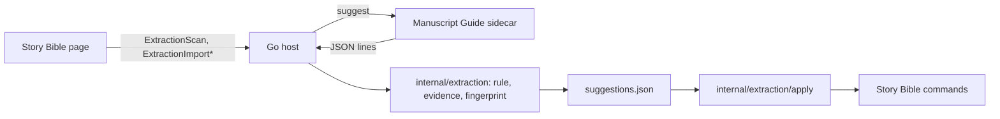

# Extraction tiers

**Status: rules baseline, GLiNER, BookNLP and the bring-your-own import are built in the host. The local language model is not built.**

Story Bible extraction finds entries, names, properties, relationships, claims and speakers in the manuscript and offers each as a suggestion. A suggestion is stored with its evidence and a status, and reaches the Story Bible only through the Story Bible's own commands. The review threshold is [ADR 0803](../adr/0803-an-extraction-suggestion-at-75-percent-or-more-is-applied-and-flagged-review-and-one-under-75-percent-needs-verification.md); the sources sit behind the extraction port of [ADR 0301](../adr/0301-providers-sit-behind-small-ports-with-a-registry-and-a-capability-descriptor.md).

## The tiers

The registry order is `rules`, `imported`, `local-model`, `gliner`, `booknlp` (`extractionport.NewRegistry`). The table says what each source is on this build. The registry's own table (name, label, icon, runs, assets) is in [provider ports](provider-ports.md#extraction-sources), which `TestTheSourcesTableInTheDocsMatchesTheRegistry` checks against the code.

| Tier | Source | State in the code | Where it runs |
| - | - | - | - |
| Rules baseline | `rules` | Built. Needs no download. A scan always includes it first (`extractionScanOrder`). | Manuscript Guide sidecar, `suggest` mode with no `--source` (`extraction_rules.py`) |
| Optional download | `gliner` | Built. Runs only when its asset `gliner` is installed. | Manuscript Guide sidecar, `suggest --source gliner` (`extraction_gliner.py`) |
| Optional download | `booknlp` | Built. Runs when `booknlp-small` or `booknlp-big` is installed; the larger one ranks higher. | Manuscript Guide sidecar, `suggest --source booknlp` (`extraction_booknlp.py`) |
| Local LLM, later | `local-model` | **Not built.** The row exists with no extractor and answers "No local model is installed." The asset catalog has a `local-llm` row with no files and an `unavailable` sentence. | Nowhere |
| Bring your own | `imported` | Built. Not started from a scan (`Runs()` is false); the narrator pastes a file. | In the Go host, `internal/extraction/importer` |

Each source offers `extractionport.Raw` values: a payload, a confidence or none, the quotes behind it, a chapter and an optional `duplicate` flag. A source sets no id, offset, status or fingerprint; `internal/extraction` and `internal/extraction/store` compute those, so a provider cannot decide what is accepted. `extractionporttest.Run` runs a shared suite over every registered row, and `TestARawSuggestionHasNoOffsetStatusOrFingerprint` pins the shape.

### Downloads and consent

GLiNER and BookNLP are catalog entries of the asset registry, kind `analysis` (`config/analysis-assets.json`, `internal/analysistools`). Their consent screen, install, verification and removal follow the one flow in [first-use dependency provisioning](first-use-dependency-provisioning.md#the-story-bible-analysis-tools); this page does not repeat it. Three facts bear on extraction:

- `extractionport.AvailableNow` answers "`<label>` is not downloaded." until one of the source's asset ids is installed. `Host.analysisToolInstall` also requires the row to be pinned and verified.
- A scan skips a source that is not available and says why in the job's messages (`runExtractionScan`). The rules still run.
- A catalog row is refused before any request when a file is `PENDING` or the row has a `pending` note (`analysistools.Tool.Available`). In the catalog on 2026-10-16 the `gliner`, `booknlp-small` and `booknlp-big` rows carry such a note, so the host refuses to install them until the owner pins the files.

### The local model

Nothing in the host runs a language model for extraction. `extractionport.LocalModel` is a registry row that never has an extractor, and `local-llm` in the analysis catalog cannot be installed. What exists is the place a model would plug in: one more `port.Entry` with an `Extractor`, which needs no change in any caller (`TestANewSourceIsOneRowAndNeedsNoChangeInAnyCaller`).

## The 75% threshold

`extraction.VerifyBelow = 0.75` is the only place the number is written (`TestThresholdLivesInOnePlace`). `extraction.ReasonsOf` returns, in a fixed order, why a suggestion cannot be accepted on its own:

| Reason (the stored sentence) | When |
| - | - |
| `No confidence was given.` | Confidence is nil |
| `Confidence is under the threshold.` | Confidence is below `VerifyBelow`; exactly 0.75 passes (`TestExactlyThreeQuartersIsAcceptedAuto`) |
| `quote not found` | The source gave a quote the evidence check could not find |
| `No evidence quote.` | A property, claim or speaker has no quote |
| `The entry is not in the Story Bible.` | An alias, property, relationship or claim has no entry yet |

`AutoStatus` is `needs-verification` when any reason applies and `accepted-auto` otherwise. The other statuses, `accepted` and `rejected`, are the narrator's decision. A source that gives no confidence at all (`Scored()` false) always needs verification.

An `accepted-auto` suggestion is applied to the Story Bible and flagged for Review, so the narrator can still check it. `ingestExtraction` stores a source's offers and then calls `apply.Applier.Settle`; a suggestion that cannot be applied is held as needing verification with the reason.

## The evidence check

`extraction.VerifyEvidence` finds a quote in the manuscript and computes where it is. It runs for every quote of every source, imports included (`store.build`).

- Typographic quotes and apostrophes and the non-breaking, thin and narrow no-break spaces are folded to plain forms before matching, one UTF-16 unit for one unit, so offsets still index the original text (`TestQuotesFoldTypography`, `TestPropertyFoldKeepsEveryOffset`).
- Search order is the hinted paragraph, the rest of its chapter, then the whole book (`TestSearchOrder`).
- `Start` and `End` are UTF-16 code units into the paragraph, the unit the UI uses (`TestOffsetsAreUTF16CodeUnits`). Offsets come from the manuscript, never from a provider.
- An empty or missing quote is not found, and the suggestion then needs verification (`TestEmptyQuoteIsNotFound`).

The rules, GLiNER and BookNLP adapters also drop an offer whose quote is not in the paragraph it names (`verified` in each package).

## Storing and applying

| What | Where |
| - | - |
| Suggestions file, `<project>/ManuscriptGuide/suggestions.json`, version 1 | `internal/extraction/store` |
| Duplicate recognition by `extraction.Fingerprint`: the same thing offered again, or one the narrator rejected, is skipped | `store.Service.Ingest` |
| A rejected suggestion stays as a tombstone | `store.Service.Reject` |
| Accept, reject, review, withdraw and settle, written through the Story Bible's own commands, so the lock rule of [ADR 0007](../adr/0007-story-bible-locked-entry-enforcement.md) holds | `internal/extraction/apply` |
| Bindings that carry only ids and the narrator's edited text | `ExtractionList`, `ExtractionAccept`, `ExtractionReject`, `ExtractionReview`, `ExtractionReopen` in `apps/desktop/bindings_extraction.go` |
| Sources and the scan job | `ExtractionSources`, `ExtractionScan`, `ExtractionScanState`, `ExtractionScanCancel` in `apps/desktop/bindings_extraction_scan.go`; the job in `apps/desktop/extraction_job.go` |

The file is removed with the Story Bible when the manuscript is replaced or project data is cleared. A corrupt file is kept aside and an empty list starts; a newer version is refused (`internal/extraction/store/doc.go`). The file's row in the data-files reference is [data files](../reference/data-files.md).

## Bring-your-own import

A narrator can paste a Story Bible written outside the app, in CSV or JSON. The format, `storybible-import` v1, is documented once in [the import format reference](../reference/storybible-import-format.md): five record types (`entry`, `property`, `relationship`, `claim`, `speaker`), a `confidence` from 0 to 1, and an `evidence` quote.

| Step | Binding | Behaviour |
| - | - | - |
| Prompt | `ExtractionImportPrompt` | Returns `importer.Prompt`, a prompt the narrator can give to any tool, including the threshold |
| Preview | `ExtractionImportPreview` | Parses and plans against the Story Bible, the manuscript and every stored suggestion; writes nothing |
| Commit | `ExtractionImportCommit` | Parses and plans again, never trusting the page's preview, and stores the rows that add or merge as `imported` suggestions in one write |
| Undo | `ExtractionImportUndo` | Removes what an import created; it refuses ids that are not `imported` |

The file is untrusted. `importer` imports no `os`, `io/fs` or network package, refuses a file over `MaxBytes` (2 MiB), `MaxRows` (5000) or `MaxFieldBytes` (8 KiB) before it builds a row, and stores every cell as text (`TestLimitsAreEnforced`, `TestNoFormulaOrPathIsEverFollowed`). A row's status comes from the same rule as a scan (`TestStatusFollowsTheSharedRule`), and a row already offered or rejected is skipped (`TestPlanSkipsWhatWasOfferedOrRejectedBefore`). Bindings take the file's text, not a path (`TestExtractionImportTakesTextAndOpensNothing`).

## What runs where

- The sidecar reads the manuscript and Story Bible paths the host passes, prints one suggestion per line and writes nothing (`manuscript_guide.py`, `suggest`). `rules`, `gliner` and `booknlp` are three adapters over that one sidecar command (`rules.Source`, `gliner.Source`, `booknlp.Source`), wired in `Host.extractionRegistry`.
- The host computes offsets, status and fingerprints and does all writing. The sidecar's lines are data.
- GLiNER and BookNLP run from the install folder of their analysis asset, passed as `--install`; nothing is downloaded at scan time.
- The import never leaves the host process.

## Related

- [Provider ports](provider-ports.md) for the registry pattern and the sources table.
- [First-use dependency provisioning](first-use-dependency-provisioning.md) for consent, downloads and the cache.
- [Import format reference](../reference/storybible-import-format.md).
