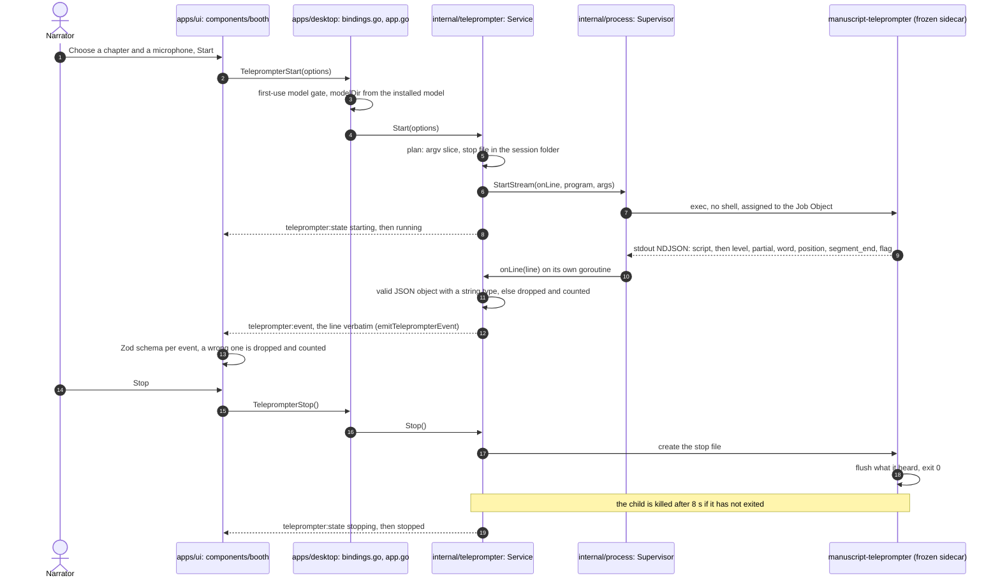

# Manuscript Teleprompter

**Status: Shipped.** The ASR sidecar, its Go host relay and the Booth page (which replaced the Teleprompter page and the Manuscript's Read aloud dialog) exist. This document is the design record; what the narrator sees is in the [Booth guide](../guides/using-the-app/booth.md). The sidecar follows the narrator's reading in a known script and reports suspected reading errors as flags. It never edits the manuscript or the audio. Open work, including the default engine ([ADR 0414](../adr/0414-the-teleprompter-default-engine-stays-whisper-tiny-until-a-real-time-ab-evaluation-runs.md)), is tracked in [#1476](https://github.com/countrymanprime/narration-utils/issues/1476).

## Position-tracking behavior

Neither a hard gate ("don't advance until you say it exactly right") nor a
blind expected-pace clock with rewind. Both were considered and rejected:

- A hard gate fights natural reading rhythm and turns every filler word or
  ad-lib into a stall.
- A pace-based clock has no grounding in what was actually said — it would
  drift for slow readers, dense/technical passages, or any pause, and
  "rewinding" implies the system is scoring against a timeline rather than
  against the narrator's actual speech.

Instead, use continuous alignment with pause/resume, the same shape as
PromptSmart's VoiceTrack (the closest shipped analog — a commercial
voice-following teleprompter; no public implementation, but its documented
behavior validates this shape): keep a sliding window of upcoming manuscript
words (current paragraph plus the next), fuzzy-match incoming recognized
words against that window using the same word-diff primitive already used
offline in `InlineDiffRow.tsx` / `compare.py`, and:

1. Match nearby in the window → advance the cursor, extend the window.
2. No match for a short debounce → pause (status → "Waiting…"), hold the last
   confirmed word, do not advance.
3. Match resumes anywhere in the window (forward = skip, backward = restart)
   → jump to it, resume advancing, and record the skipped/repeated span as a
   flagged item via the shared findings contract.

Timing is entirely driven by recognized speech — there is no assumed pace.

## ASR approach

**Port, do not depend on, WhisperLive's streaming core.**
[WhisperLive](https://github.com/collabora/WhisperLive) (MIT) already solves
the live-chunking problem: VAD-gated audio windows, rolling `faster-whisper`
decode, and real per-word timestamps (`word_timestamps=True`). That directly
answers the alignment-timing question better than fuzzy text-only matching.

Do not add it as a runtime dependency or run its WebSocket client/server:

- [daw-integration.md](daw-integration.md) explicitly rules out a loopback
  server, REST endpoint, or port for this app's Wails workspace — running
  WhisperLive's server component would reintroduce exactly that.
- It manages its own model cache, bypassing the existing versioned/hashed
  asset catalog in `apps/desktop/internal/whisper/catalog.go` and the
  [first-use dependency provisioning](first-use-dependency-provisioning.md)
  flow.
- Its own audio-capture client is redundant — mic capture and inference are
  both local here; no network client/server split is needed.

Instead, port its VAD-chunking + rolling-decode + word-timestamp loop into a
new Python sidecar module that captures the mic directly (consistent with
how `compare.py` already owns its own audio I/O via PyAV) and resolves its
model through the existing whisper asset catalog, not WhisperLive's
auto-download cache. See the license note below for the attribution this
requires.

**Vosk's grammar-constrained recognition was considered and rejected** for
the live matching signal specifically. Vosk (Kaldi-based, MIT, offline,
small models, true zero-latency streaming) can restrict decoding to a fixed
vocabulary — tempting since the upcoming script words are known in advance.
But a closed grammar force-fits whatever is said into the nearest allowed
word, which would mask genuine misreads — the opposite of what a review tool
needs. The existing `faster-whisper` `hotwords` mechanism `compare.py`
already uses is the right level of biasing (nudge probability, never
restrict vocabulary), and it carries over to the live case unchanged.

Karaoke-scoring games (UltraStar, SingStar-style pitch matching against a
fixed song score) were considered and ruled out — they score pitch against a
known melody, not free ASR against prose, and don't transfer.

Offline audiobook read-along prior art — Amazon Whispersync/Immersion
Reading, and open equivalents
[open-whispersync](https://github.com/jstriblet/open-whispersync),
[Storyteller](https://tildes.net/~books/1d3i/i_made_an_open_source_self_hostable_synced_narration_platform_for_ebooks),
[syncabook](https://github.com/r4victor/syncabook) — all do Whisper
transcription plus Levenshtein/DTW alignment against known text, which
validates the diff-based approach `compare.py` already takes, but all of it
is offline/post-hoc on a complete recording. It informs the existing
take-review side of the roadmap, not this live path.
[book-karaoke](https://github.com/liorwn/book-karaoke) (MIT) is the one
project doing live word-by-word karaoke rendering, but its alignment is
offline and Apple-MLX-specific — irrelevant here — though it confirms the
UI-rendering piece only needs a `{word, time}` event stream, decoupled from
whatever produces it.

## Prototype findings and live-engine direction

*Added 2026-09-19 after measuring the prototype on a real mic; supersedes the
"Port, do not depend on, WhisperLive" plan above wherever they disagree.*

**What was measured.** The first prototype decoded only after a confirmed
pause, which delivered a whole utterance at once and could not drive a live
highlight. It was replaced by a rolling re-decode of the open segment every
0.5s that emits a word only once two consecutive decodes agree on it
(LocalAgreement-2). On a real mic with `faster-whisper` `tiny` on CPU: word
lag behind the speaker had a median of about 1.2s (typically 0.5–1.5s, peaks
about 2.1s), and each decode took about 0.15–0.2s, so decoding keeps up.
Waiting for agreement puts a floor of roughly 1s on lag regardless of model
size, which is too slow to follow mid-sentence reading reliably.

**How comparable projects avoid the delay** (surveyed 2026-09-19; their
claims are unverified by us):

- [Autocue](https://github.com/EdNutting/autocue) (MIT): a streaming Vosk or
  Sherpa-ONNX engine plus a fuzzy script matcher that runs on every *partial*
  hypothesis as a speculative "what if" from the last committed position. The
  display advances but never moves backward on partials, and final results
  re-anchor it. The author claims sub-250ms.
- [whisper_streaming](https://github.com/ufal/whisper_streaming)
  (LocalAgreement): what the prototype adopted; its paper reports about 3.3s
  latency on long-form speech.
- [SimulStreaming](https://github.com/ufal/SimulStreaming) (AlignAtt): lower
  latency, but built on PyTorch and aimed at GPUs (its README calls CPU "too
  slow for real-time"). Not a fit for this stack.
- [Moonshine](https://github.com/moonshine-ai/moonshine) (MIT, English
  streaming models): caches encoder state instead of re-decoding, supports
  word timestamps in streaming mode and `set_context()` biasing toward the
  current script text, and ships a Windows wheel. Its accuracy and latency
  figures are the vendor's own.
- Browser Web Speech API teleprompters: cloud speech, excluded by the
  local-first boundary.

The earlier rejection of Vosk above applies only to grammar-constrained
decoding, which still masks misreads. Unconstrained streaming partials plus
fuzzy matching against the script is the ordinary open-source pattern.

**Direction, in order.**

1. **Speculative advance.** The cursor advances from the latest unconfirmed
   hypothesis (never backward on partials) and is corrected by confirmed
   words. This works with any engine and needs the sidecar to emit partial
   events in addition to confirmed words. Expected lag with Whisper: about
   0.5–0.8s.
2. **Two selectable live engines (decided 2026-09-19).** Support both
   `faster-whisper` and Moonshine behind one event contract, let the narrator
   choose in settings, and evaluate both against real manuscript scrolling
   and animation before picking a default. Engines only produce partial
   hypotheses (words with timestamps, replaced as the segment grows) and a
   segment-end signal; one shared layer applies the LocalAgreement rule to
   turn consecutive partials into append-only confirmed words, and one shared
   script tracker consumes both. Neither engine is baked into the tracker or
   the UI. The contract is implemented in `live_asr.py` as three NDJSON event
   types: `partial` (the whole current reading of the open segment, replaced
   each time), `word` (confirmed, append-only, never retracted) and
   `segment_end`. Both engines are implemented behind it
   (`--engine whisper|moonshine`). Two things the Moonshine adapter taught us:
   its line text is authoritative (its timing list can omit a word the text
   contains, so timings are aligned onto the text's words), and its word
   timestamps are noisy, especially in partials (on a synthetic clip, 6 of 23
   partials had out-of-order or inverted word times). The event contract
   therefore treats word times as advisory: only `end >= start` is
   guaranteed, and the script tracker must rely on word order and arrival
   time, not engine timestamps. Karaoke-style word animation should pace
   itself instead of trusting per-word times.

   The script tracker is implemented (`script_tracker.py`, enabled with
   `live_asr.py --script FILE`, which adds `position` events to the stream:
   `read` = index of the next script word, `committed`, `status` of
   listening / waiting / done, and `jump` restart / skip with the skipped
   span). It keeps a forward-only speculative cursor driven by partials and a
   committed position driven by confirmed words, ignores heard words that fit
   nothing nearby, and jumps elsewhere in the script only when 3 or more words
   match and beat the nearby alignment by 2. `replay.py` runs recorded
   Moonshine spike output through the real adapter, event layer and tracker
   offline. Replaying three real mic readings of a 55-word script (Small with
   context, Small without, Tiny): the cursor reached the end every time, with
   no false restarts or skips, 0 or 1 backward moves, and the speculative
   cursor reached each word a median of about 0.5s (p90 0.5 to 1.1s) before
   confirmed words alone would have. The one backward move was a real
   one-word correction (a partial heard a word that Moonshine's final line
   dropped), so the UI should not animate a one-word backward step. Pause
   status appeared 0 to 2 times per reading, detected at the next record
   after the pause.
3. **Spike results that shaped this** (Moonshine Small and Tiny Streaming, real
   mic and one synthetic recording, Windows CPU, 16–25 s of reading per run;
   small samples):
   processing cost about 0.26x real time (Small) and 0.17x (Tiny); word
   timestamps present on nearly every partial; partial updates every 0.5s by
   default; roughly 1 in 7 shown words later revised, worst in the first one
   or two words of a line; the final line was identical to the last partial in
   all 27 lines, so **Moonshine's own final result does not correct earlier
   mistakes**; word error rate 2–6% against the read script; download about
   215 MB (Small, including the 78 MB attention decoder that timestamps need)
   or 74 MB (Tiny). Estimated word lag is about 0.3–0.8s, but the probe's own
   lag metric was unreliable (it matched words by position) and needs fixing
   before comparing engines. Whisper with speculative partials is expected to
   land in the same range; Moonshine's expected edge is flat cost as a
   segment grows, cheaper short update intervals, and `set_context()`.
4. **Default engine.** The default stays Whisper `tiny` until a real-time
   A/B evaluation runs
   ([ADR 0414](../adr/0414-the-teleprompter-default-engine-stays-whisper-tiny-until-a-real-time-ab-evaluation-runs.md));
   the protocol is in [live engine evaluation](../research/teleprompter-engine-evaluation-protocol.md).
   `faster-whisper` stays for offline Transcript Compare either way.

## Flags

With a script, the sidecar also reports suspected reading errors as `flag`
events ([ADR 0115](../adr/0115-live-flags-are-suspected-judged-per-closed-segment-and-forgive-what-transcript-compare-forgives.md)):

```json
{"type": "flag", "id": 1, "kind": "misread", "start": 7, "end": 8, "heard": "chairs"}
```

`kind` is `misread` (script words `[start, end)` read as `heard`), `skipped`
(passed over), `extra` (`heard` said between two script words; zero-width,
`start == end` is the word after them) or `restart` (words read again, the
narrator's recovery after a flub). Indices are `script_words()` positions, the
space of `read`. `flags.py` wraps the tracker (`FlaggingTracker`) and reads its
alignment of a segment's confirmed words once the segment closes, so a flag
arrives after that segment's `position` events. Every flag is only suspected:
a wrong engine word looks exactly like a misread, and Transcript Compare over
the recorded take stays authoritative. The rules therefore favour precision:
confirmed words only; a discrepancy only between two matched script words,
never among a segment's first two words or at its ragged end; nothing a
spelling difference explains (numbers, hyphenation, homophones and
possessives from `narration_common.spoken_forms`, the same forms Transcript
Compare forgives, plus the tracker's own 0.8 spelling tolerance on the run, and
a word the engine split across a matched neighbour); no hesitation as an
extra, no single dropped article as a skip, no re-read under three words as a
restart, and no gap whose words start inside the audio of the word before
them (the engine confirmed the same audio twice). A seek is never flagged.

The Go host relays flags like any other event and keeps none in its snapshot:
`internal/liveflags` persists each flag as a suspected finding (`transcript_discrepancy`,
or `pickup` for a restart) when the session ends ([ADR 0117](../adr/0117-live-flags-are-kept-as-suspected-findings-merged-per-chapter-when-a-session-ends.md)), and that store, not the snapshot, is what a view
opened mid-session reads. `replay.py` replays a Moonshine probe recording or a
printed `live_asr.py` session (`--stream`) and reports flags per 100 heard
words by kind, which on a clean read is the false-flag rate. Nothing confirms a
flag after the session.

## Streaming subprocess support

`apps/desktop/internal/process.Supervisor.Start` drains stdout/stderr to `io.Discard`
for the two batch sidecars (Manuscript Guide, Transcript Compare) — see
`supervisor.go`. A live sidecar needs a second, additive code path, so
`stream.go` adds `Supervisor.StartStream`: it hands each stdout line to a
callback, keeps the tail of stderr for diagnostics, reads with `ReadString`
rather than a `Scanner` (the one-off `script` event describes a whole chapter
and can be very long), and returns a `StreamChild` with `Done`, `Kill` and
`StderrTail`. The batch path is untouched.

**Implemented in the desktop host (2026-09-19).**
`apps/desktop/internal/teleprompter.Service` owns one session: it builds the sidecar
arguments (`--engine`, `--model`, `--model-dir`, `--manuscript`, `--chapter`,
`--mic` or a developer `--wav`, `--stop-file`), relays every valid JSON line
verbatim as the Wails event `teleprompter:event`, publishes phase changes as
`teleprompter:state`, and keeps the last `script` and `position` events in its
snapshot so a view that opens mid-session catches up. The `Host` exposes
`TeleprompterStart`, `TeleprompterStop` and `TeleprompterState`. `TeleprompterStart` uses the same first-use model gate as
Transcript Compare and defaults to the `tiny` model, because live
transcription has to keep up with speech. It launches the engine the request
names (Whisper by default; Moonshine on Windows only, from its verified catalog
install), and its gate answer names the engine.

**Stopping.** Go cannot send Ctrl+C to the sidecar, and the other sidecars use
`.cancel` sentinel files, so the sidecar accepts `--stop-file`: once that file
exists the audio stream ends, the engine flushes what it heard, and the
process exits 0. `Stop` creates the file and kills the process if it has not
exited after a grace period. A live session also counts as busy, so the host
will not switch REAPER projects underneath it, and `Shutdown` stops it before
closing the supervisor (without holding the host lock, because the service's
state callback needs it).

**Auto-stop at Done ([ADR 0106](../adr/0106-a-teleprompter-session-stops-itself-five-seconds-after-the-tracker-reports-done.md)).**
The service reads the `status` of each `position` event it relays. The first
`done` position of a running session arms a 5 second timer (`autostop.go`,
longer than the tracker's 1.5 s `WAIT_SECONDS`) and says so in the state
message; any later position that is not `done` (the narrator re-read the last
line) cancels it, and repeated `done` positions do not restart it. When it
fires, the service stops the session through the same stop file and grace kill
as Stop, and the final message is "Stopped at the end of the chapter." A
sidecar that exits non-zero is still an error. The session's script and last
position stay in the snapshot after the stop.

**Evaluation timing.** `NARRATION_TELEPROMPTER_EVAL=1` (the same opt-in pattern as `NARRATION_DEBUG`) makes every
session the host launches add `--timing` and `--log <session dir>/teleprompter_<id>.log` to the sidecar's arguments
(`planSession`), whatever the engine, model or source. It is for developer evaluation only: nothing in Settings or the
UI turns it on, and it changes no contract the UI reads. [Live engine evaluation](../research/teleprompter-engine-evaluation-protocol.md)
says how its numbers are read.

**One session, step by step.**



*Verified 2026-09-21 against `bindings.go` (`TeleprompterStart`), `app.go` (`emitTeleprompterEvent`, `emitTeleprompterState`, `Shutdown`), `internal/teleprompter/service.go` (`plan`, `Start`, `onLine`, `Stop`, `watch`, `defaultGrace`), `internal/process/stream.go` (`StartStream`), `sidecars/manuscript-teleprompter/core/live_asr.py` (`--stop-file`) and `apps/ui/src/api/wailsClient.ts`. `Shutdown` stops a live session first and waits up to 12 s. A page opened mid-session catches up from the last `script` and `position` events the service keeps. The threats at each step are rows 4a to 4d of the [threat model](threat-model.md#4-the-go-host-to-the-sidecars-securitymd-bullet-4) ([ADR 0022](../adr/0022-live-sidecar-events-over-wails-and-stop-file.md)).*

**Packaging.** The sidecar is frozen as `manuscript-teleprompter` by
`scripts/release/prepare-resources.py` and required by
`scripts/release/verify-installable.mjs`. On Windows it carries the Moonshine
engine too ([ADR 0107](../adr/0107-moonshine-ships-inside-the-windows-teleprompter-sidecar-and-runs-only-from-a-verified-catalog-install.md)): `moonshine-voice` is pinned for Windows only, its
`ctypes`-loaded `moonshine.dll` and `onnxruntime.dll` are collected by hand and
required by `verify-installable.mjs`, and `narration-utils --smoke` runs
`manuscript-teleprompter --capabilities --verify` to prove they load
(this generic flag replaced the bespoke `--check-moonshine`; [ADR 0403](../adr/0403-the-capabilities-flag-reports-what-registered-not-what-loads.md)). The frozen
sidecar runs Moonshine only from a `--model-dir` holding every file of
`config/moonshine-assets.json` (`core/moonshine_engine.py`); it never uses the
library's downloader. Freezing it in cost 24.1 MB (+9.4%).

## Where listening runs

Inside the native Wails host, consistent with
[daw-integration.md](daw-integration.md)'s "no loopback server" rule. The
Python sidecar owns mic capture and inference (same ownership pattern as
Transcript Compare owning audio decode); Go owns process lifecycle, device
selection plumbing, and relaying streamed events to the React frontend.
REAPER Lua is not involved in the live loop at all — same boundary the DAW
integration doc already draws for take/marker mutation.

## Device enumeration

The question was whether PyAV can
list `dshow` devices without shelling out to ffmpeg directly; the
spike confirmed it can. `sidecars/manuscript-teleprompter/core/devices.py`
adds `--list-devices` to `live_asr.py`: it opens `dshow` with the
`list_devices` option (which always raises - that mode is a listing, not a
real capture) inside `av.logging.Capture`, which receives ffmpeg's own device
listing as the log text it would otherwise print to stderr, and parses that
into a device list. No ffmpeg subprocess, no log-file scraping.

**Log level.** ffmpeg prints the listing at INFO, and PyAV's default log
level is None (ffmpeg logging off), so the capture only receives it if the
level lets INFO through. `capture_dshow_log` raises the level to INFO for the
listing (leaving a more verbose level alone) and restores the previous level
in a `finally`, so the rest of the sidecar never relays ffmpeg's log. Without
that step the sidecar listed no devices at all on Windows, which the first
tests missed because they inject a finished capture; `test_devices.py` now
pins the level handling and, on a Windows machine with an active microphone,
runs the real PyAV listing.

Verified on the development machine (2026-09-22, real hardware): `ffmpeg
-list_devices true -f dshow -i dummy` and the PyAV spike agreed on the same
four devices (two audio, one video, one virtual "none" device); the sidecar
keeps only the "audio" ones. Both audio devices then opened successfully
through the exact `av.open(file=f"audio={name}", format="dshow")` call
`iter_microphone_chunks` uses (open, confirm the stream, close cleanly) - the
name that is listed is the name that opens, so no separate device-id mapping
is needed for Start.

**Duplicate device names.** ffmpeg disambiguates same-named devices with an
"Alternative name" line (a stable `@device_...` path); `devices.py` records
it (`Device.alternative_name`) but nothing opens a device by that path
instead of its friendly name, and no duplicate audio device names existed
on the development machine to test the collision case against. The
alternative name is not exposed over the wire (`Device.to_json()` returns only
`name`).

The Go binding (`apps/desktop/internal/teleprompter/service.go`'s `Devices`,
exposed as the `TeleprompterDevices` host binding) runs
the sidecar in `--list-devices` mode with a caller-supplied timeout and caches
nothing; a failure at any layer (bad exit code, unparseable output, a timeout)
comes back as an empty list plus a message, never a rejected call, so the UI
always gets a result to react to. `useTeleprompterSession.ts` calls it; the device is
chosen in Settings › Booth, and a session starts with the saved one.

## Input level and the meter

Every session reports the microphone's level beside its words:
`{"type": "level", "peak": -12.3, "rms": -24.1}` for every 100 ms of audio,
in dBFS from -100 (silence) to 0 (full scale), computed by `levels.py` on the
same 16 kHz chunks the recognizer decodes. Before Start, the microphone
popover runs a second, model-free child, `live_asr.py --meter --mic NAME`,
which prints only `level` events until its stop file appears
(`TeleprompterMeterStart` / `TeleprompterMeterStop`, `internal/teleprompter/meter.go`).
At most one meter runs, never beside a session: a session start stops it and
waits for it to release the device. Its levels travel on `teleprompter:event`
like a session's, and the host adds one `meter_stopped` event (with the
sidecar's last stderr line as `error` when it failed by itself) when it ends
([ADR 0247](../adr/0247-the-input-level-comes-from-the-sidecars-own-capture-and-a-model-free-meter-child-runs-before-start.md)).
Level events never enter the snapshot or the session model.

A running session can pause without ending: `TeleprompterPause(true)` appends
`{"cmd": "pause"}` to the control file (and `false`, `{"cmd": "resume"}`). While
paused the sidecar keeps the device open and reports its level, drops every
chunk before the engine and stands the tracker's clock still, so no `waiting`
is reported for the pause. The host's state stays `running` with `paused: true`
and no auto-stop is armed; flags are kept only when the session ends
([ADR 0248](../adr/0248-pause-is-a-pause-and-resume-pair-on-the-control-file-and-a-paused-session-stays-running.md)).

## The Booth page

The Booth (`/booth`, `apps/ui/src/components/booth/`) is the one read-along page
([ADR 0407](../adr/0407-a-new-page-replaces-its-old-counterpart-in-the-same-change-and-the-navigation-is-grouped-by-production-stage.md)):
it replaced the Teleprompter page, the Manuscript's Read aloud dialog and its booth dialog, and `/teleprompter`
redirects here keeping its query and hash. What the narrator sees and does on it is in the
[Booth guide](../guides/using-the-app/booth.md).

- **What owns what.** `page/BoothNextPage.tsx` owns what the Booth reads (`?chapter=<id>`, `&para=&at=` for Record from here,
  or `?credits=opening|closing`, `page/boothQuery.ts`) and loads the Story Bible entries, cues and spans for the text. It mounts
  one session per chapter, keyed by it, which holds the one `useTeleprompterSession` subscription; `page/useBoothPage.ts`
  composes the Record control (`record/`), the leave guard (`leave/`, ADR 0790), the resume offer (`resume/`), the passage-map
  writer (`passagemap/`) and the key commands. The frame is `frame/` (top bar, footer with the catalogue's key hints), the text
  `reading/BoothText.tsx`, the side panel `side/`. The Companion has its own route, `/companion` (`companion/CompanionPage.tsx`,
  `CompanionHost.tsx`), around `CompanionShell` (ADR 0401). It
  takes no argument: the narrow width and always-on-top are fixed in the host, a second Enter keeps the first saved
  bounds, an Exit with nothing saved does nothing, and the narrowed window is clamped on-screen when the screen it was
  on is gone (`bindings_companion_test.go`).
- **The highlight.** The current word is the `Cursor` kind of `Highlight`. The text does not reuse `ParagraphView`,
  which renders character-offset annotations, not words
  ([ADR 0024](../adr/0024-teleprompter-highlight-follows-the-sidecars-spans.md)).
- **Mock mode.** In the browser mock, Start replays a position stream recorded from the real tracker
  (`spikes/record_mock_stream.py`), and `?mockTeleprompter=listening|waiting|done|flagged|ended` boots part-way through
  a chapter for the visual suite (`ended` is a session that already stopped itself at the end of the chapter).

## Resume: where REAPER is and where the prompter was

The Companion opens a chapter with a compact **Where you stopped** prompt above the
text (`apps/ui/src/components/booth/ResumePrompt.tsx`); the Booth shows the same lookup as one line, "Resume at ¶ n"
(`resume/ResumeOffer.tsx`). It reconciles two
sources and asks only when they disagree (owner report of 2026-09-24: "find where
the track was, and find out where you were in the script, and if they match, you
keep going").

- **Where REAPER is.** `TeleprompterLocate` (`apps/desktop/teleprompterlocate.go`)
  finds the chapter's track and a time on it. With REAPER reachable, track state
  on and REAPER on the selected project, that is the live edit cursor when it sits
  on the track's playing items, otherwise the live end of those items, unsaved
  takes included (`resumelive.go`,
  [ADR 0349](../adr/0349-the-resume-locate-reads-reapers-live-cursor-and-items-first-and-falls-back-to-the-saved-project-never-to-a-guess.md)).
  Otherwise it is the end of the recorded audio in the saved `.rpp`. The 30 s
  before that time are transcribed and placed in the chapter by the sidecar
  ([ADR 0111](../adr/0111-the-resume-point-comes-from-transcribing-the-recorded-tail-and-placing-it-with-the-tracker.md)).
  While REAPER records onto the track, nothing is located (`recording`).
- **Where the prompter was.** The last word the tracker read, kept per chapter in
  `<project>/narration-utils/teleprompter/<chapter>.reading.json` when a session
  ends, and dropped when the chapter's text changes
  ([ADR 0205](../adr/0205-the-prompter-remembers-its-last-word-per-chapter-in-a-host-named-file-dropped-when-the-text-changes.md)).
- **The verdict.** `teleprompter.Reconcile` gives one of `agree` (within 10 words
  or the same sentence: Start is preset to REAPER's word with a one-line notice),
  `disagree` (a two-way choice), `complete` (recorded to the end: no resume),
  `daw_only`, `prompter_only` (offered, never taken silently) or `none`. The
  host decides and the UI only renders
  ([ADR 0206](../adr/0206-resume-reconciles-the-recording-with-the-prompters-last-word-in-the-host-and-asks-only-when-they-disagree.md)).
  A REAPER place reads "in REAPER now" when live and "as of the project's last
  save" otherwise.
- **It never sits there.** The prompt settles for the rest of the Booth's visit to the chapter
  on any choice or when a session starts, and does not come back after a session
  ends
  ([ADR 0187](../adr/0187-the-resume-prompt-is-a-compact-notice-that-settles-once-per-dialog-open.md)).
  It also goes away when REAPER starts playing or recording
  (`daw_transport_changed`, and the host follow below). While it shows for a
  track, the host follows REAPER: `TeleprompterResumeFollow` polls track state
  about once a second, never during a session, for at most 30 minutes, and pushes
  `teleprompter_resume_follow`. A `cursor_moved` event, sent once the edit cursor
  settles on the recording, makes the prompt look again (`resumefollow.go`,
  [ADR 0353](../adr/0353-the-resume-prompt-goes-away-when-reaper-plays-and-a-bounded-host-poll-follows-the-cursor-only-while-it-shows.md)).

Nothing here writes to REAPER; moving REAPER's cursor to a word is punch-and-roll
([ADR 0246](../adr/0246-punch-and-roll-moves-only-the-edit-cursor-and-anchors-words-by-a-polled-play-position.md)).

## Punch from here: where a word's time comes from

"Punch from here" on a flag (the old Booth's flags panel, removed with it in SN-O10; the bindings stay) previews a time before anything moves, and names its source
(`TeleprompterPunchPreview`/`TeleprompterPunch`, `apps/desktop/teleprompterpunch.go`):

- **`anchor`**: the live anchors the host records while a session reads the chapter (REAPER's play position polled
  every 3 s beside the word being read, `teleprompterpunchpoll.go`, `internal/teleprompter/anchors.go`), exact or
  interpolated between the two around the word.
- **`alignment`**: when no anchor brackets the word, the word is timed from the chapter's recording
  (`teleprompterpunchalign.go`): the resume prompt's track, REAPER's live items or the saved `.rpp`, the item holding
  the anchors' pace estimate (else the item that ends last), at most 120 s of it, and one run of the sidecar's
  `--align-word` mode (`core/align_word.py`: the locate's decode and placement, then a matching-blocks pass that maps
  each heard word to a script word). The answer is mapped back through the item's offset and rate. Nothing runs while
  REAPER records onto the track, and nothing is downloaded
  ([ADR 0560](../adr/0560-punch-and-roll-times-a-word-past-the-anchors-by-aligning-it-in-the-recording-before-falling-back-to-the-reading-pace.md)).
- **`estimate`**: the anchors' pace, only when the recording cannot answer.

A punch after its preview reuses the preview's alignment; a successful punch drops the anchors at or after the word.
What REAPER documents for an unsaved take's file, a `SECTION` source's file name and a take still recording is in
[REAPER: media sources and recording](../reference/daw/reaper.md#media-sources-and-recording); none of it has been run
in REAPER yet ([#1476](https://github.com/countrymanprime/narration-utils/issues/1476)).

## The passage map

The Booth writes a passage map while it records, so Editing can list a Booth-recorded chapter's passages without aligning
the audio (`PassageMapRecordRun` and `PassageMapList`, `apps/desktop/bindings_passagemap.go`,
`apps/desktop/internal/passagemap`; host API 95).

- **The file.** `<project>/narration-utils/passagemap.json`: `{ "schemaVersion": 1, "marks": [...] }`. Each mark is
  `{ id, run, chapterId, pid, word, sec, kind, prev?, itemGuid, takeGuid }`; `kind` is `start`, `roll` or `stop`, and a
  roll or a stop's `prev` is where the take before it ended. A run is one Record to Stop of one chapter: a start, any
  rolls, a stop. Run ids are `<chapterId>.<n>` in the order the chapter's runs were recorded, mark ids `<run>.<index>`.
- **Who writes what.** When a recording stops, the UI sends the run's marks (paragraph id, word index, seconds, kind,
  `prev`). The host refuses the whole run, with a sentence and nothing saved, when the chapter is not in the manuscript, a
  paragraph is not in that chapter, a word is past the paragraph's word count (runs of non-space characters), seconds are
  negative, not finite or over a day, a roll or stop has no `prev` (or a start has one), the kinds are not start, rolls,
  stop, or the marks are out of time order.
- **Limits.** At most 1000 marks a run and 200 runs a chapter; chapter and paragraph ids at most 64 bytes with no control
  characters. Every field is a number, an id or a kind, never a path or free text.
- **The Booth's writer.** `usePassageMapWriter` (`apps/ui/src/components/booth/passagemap`) keeps a take's marks in memory:
  `begin` writes the start at `placeOf` the reading position, `roll` adds a roll with `prev` the place the take had reached,
  and `stop` closes the run and sends it once. `sec` is the take's start offset plus its elapsed seconds, never wall clock.
  A run the host refuses is kept, its sentence is toasted once, and it is sent again, in order, at the next stop.
  `useBoothLeaveGuard` calls `flush()` after a confirmed stop and before navigating, so a take stopped by leaving is
  logged too.
- **Stamping.** The UI never sends an id the DAW gave. When the run is stored, the host reads them: with the built-in
  recorder, the take's name (`Take 004`) for the item and every take; with the DAW, the chapter's one linked track through
  the track state role (as Read Aloud does), its last item's GUID on every mark and that item's active take GUID. Mark `i`
  gets the `i`th take GUID the stamp lists, the last one covering the rest; the bridge reports only each item's active
  take, so today every mark of a run shares one take GUID. A chapter with no link, a DAW that does not answer within 3 s,
  or an id that breaks the limits leaves the run stored unstamped (`""`).
- **Read back.** The file is read through `persist` as narrator data: a corrupt file, or one holding a mark that breaks a
  rule, is kept aside as `passagemap.json.corrupt-<time>` and an empty map starts; a newer `schemaVersion` is refused and
  never overwritten. Writes are a temporary file and a rename.
- **Stale, never moved.** Every list checks each mark against the current manuscript. A mark whose paragraph, or whose
  `prev` paragraph, is gone from its chapter comes back `stale` with `paragraph_missing`; one whose word is past the
  paragraph's word count, `word_out_of_range`. Its stored place is never changed.
- **Cleared on replace.** A confirmed manuscript replace and Clear project data remove the file (`resetDerived`); a
  re-import without a reset keeps it, and the stale rule covers what it changed.
- **Editing reads it** (TK-1 part 2). A take begins at a mark and ends where the next mark of its run says the reading had
  got to; a take with a stale mark at either end is left out. `WorkspaceTakes` places a passage the map's takes read on
  the item of the earliest of them still in the saved project, so a later recording of the same text keeps the passage,
  and what Editing keyed by its id (a stack, a retry mode), where it was; only a passage the map does not cover is placed
  by the alignment. `WorkspaceTakeEvidence` answers `via: "map"` for a take whose item and take GUIDs a map take over the
  passage carries, and `"aligned"` otherwise (`apps/desktop/internal/passagetakes`). Editing's `useLines` asks for the takes
  of the paragraphs the alignment heard and of those two or more map takes read, a roll back included
  (`apps/ui/src/api/passageMapSpans.ts`). Because every mark of a run shares one take GUID today, only the take active when
  the run stopped is placed `map` on a DAW-recorded chapter.

## Third-party license note

Porting WhisperLive's streaming-inference logic is permitted: WhisperLive
is MIT-licensed, and MIT code may be included in this AGPL-3.0-or-later
repository ([ADR 0039](../adr/0039-the-project-is-licensed-agpl-3-or-later.md)).
The only condition is preserving attribution: the ported module needs a header
citing the source and copyright holder (`Copyright (c) 2023 Vineet Suryan,
Collabora Ltd.`), and this is the first entry of its kind (ported logic, not
a downloaded dependency) in
[local-dependency-evaluation.md](../research/local-dependency-evaluation.md).
This is engineering guidance, not legal advice — recheck upstream terms at
the exact commit ported from. The LocalAgreement policy added later comes from
[whisper_streaming](https://github.com/ufal/whisper_streaming) (MIT,
`Copyright (c) 2023 ÚFAL`) and is attributed the same way.

## Tracker placement and limits

- Script tracker placement and source: decided. The sidecar hosts it and reads
  the script from a chapter of the project's canonical `manuscript.json`
  (`--manuscript FILE --chapter ID_OR_TITLE`, narration chapters only): the
  chapter title, then each paragraph, split on whitespace. A one-off `script`
  event first carries the token count and each paragraph's span, and with
  Moonshine the chapter text is also used as biasing context. `--script FILE`
  remains for plain text; named with `--script-id ID --script-title TITLE` it
  also emits a `script` event, one paragraph span per line with words and no
  title span. That is how the opening and closing credits are read: the host
  renders them with the one credits renderer, writes them to a session file and
  starts the sidecar on it, and the UI sends only which credits
  ([ADR 0150](../adr/0150-the-teleprompter-reads-credits-as-a-host-rendered-script-file-not-a-chapter.md)).
  The frontend maps `read` onto words by tokenizing each
  paragraph exactly as `chapter_script.py` does and checking itself against the
  `script` event's spans (a paragraph that disagrees is shown untracked), and
  the chapter is chosen from a picker that starts on the reader's active chapter
  ([ADR 0024](../adr/0024-teleprompter-highlight-follows-the-sidecars-spans.md)).
- Tracker limits: word matching is normalization plus
  a close-spelling check, without Transcript Compare's homophone, number-word
  and hyphenation handling; invented names and spoken numbers are the likely
  misses. Flags forgive those forms (`narration_common.spoken_forms`, see
  "Flags" above), but position matching still does not; flags reach the
  findings contract through `internal/liveflags`.
