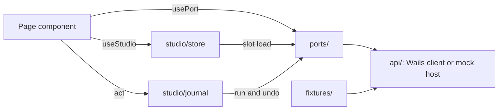

# UI state and the command journal

The UI keeps what pages show in a read-model store, changes things through a command journal that also drives Undo, reaches the host through ports, and takes sample data from fixtures. The Go host stays the source of truth: the store is a cache that can be emptied at any moment, and the journal lives in memory only. The decisions are [ADR 0770](../adr/0770-the-ui-store-caches-host-reads-and-journals-commands-and-the-go-host-stays-the-source-of-truth.md) (store, ports, fixtures) and [ADR 0771](../adr/0771-undo-is-one-in-memory-journal-that-refuses-with-a-reason-and-reaches-the-daw-only-for-its-last-action.md) (journal and undo). The ports described here are the UI's seam over the host; the backend provider ports are in [provider-ports](provider-ports.md) and the DAW's in [DAW integration](daw-integration.md).

All paths below are under `apps/ui/src/`.

## Where things live

## Rules the tests enforce

| Rule | Where | Test |
| --- | --- | --- |
| `studio/` imports ports and schemas, never `components/`, `App.tsx` or `main.tsx` | `.dependency-cruiser.mjs` rule `studio-does-not-import-components` | the `architecture` script of `apps/ui/package.json` ([ADR 0062](../adr/0062-ui-import-rules-are-a-dependency-cruiser-config-and-a-mark-scan-that-name-their-adr.md), [ADR 0770](../adr/0770-the-ui-store-caches-host-reads-and-journals-commands-and-the-go-host-stays-the-source-of-truth.md)) |
| `studio/`, `ports/`, `fixtures/` and `overlay/` never import `api/wailsClient` | rule `bridge-only-at-the-composition-root` | the `architecture` script of `apps/ui/package.json` |
| `ports/` and `fixtures/` import no component, `App.tsx` or `main.tsx`; `fixtures/` never imports `studio/` | rules `ports-and-fixtures-are-below-components`, `fixtures-do-not-import-the-store` | the `architecture` script of `apps/ui/package.json` |
| A selector imports types and other selectors only | rule `selectors-import-types-and-selectors-only` | the `architecture` script of `apps/ui/package.json` |
| No immer, Redux or Zustand | `package.json`, `apps/ui/package.json`, `pnpm-lock.yaml` | `studio/store/noStateLibrary.test.ts` |
| A page declares the port it uses; `useApi()` calls only fall | per-file ceilings in the test | `ports/useApiRatchet.test.ts` |
| Every entry left in the `useApi()` ratchet says why | `ratchetReasons.ts` (`KEPT`, `GAPS`) | `ports/useApiRatchet.test.ts` calls `unexplained()` |
| Every port file has a contract suite that calls the kit | `ports/*.contract.test.ts` | `ports/providerContractRegistration.test.ts` |
| Sample chapter titles, subtitles and speaker names are not literals in `components/` or `hooks/`; a file's count only falls | `fixtures/`, `api/mockFixtures.ts` | `sampleLiterals.test.ts` (a per-file ceiling, the pattern of `rawNatives.test.ts`, [ADR 0053](../adr/0053-icon-buttons-text-fields-and-selects-wrap-the-native-controls.md)) |
| `renderScenario` is imported by tests only | `fixtures/renderScenario.tsx` | `fixtures/scenario.test.ts` (`helper-is-test-only`) |

A rule taken from an ADR is a lint or test rule that names its ADR ([ADR 0046](../adr/0046-architecture-rules-taken-from-adrs-are-lint-and-test-rules.md)).

## The read-model store

`studio/store/createStudioStore.ts` holds read models, not the book. State has two maps: `slots` (the last good value of each slot, absent until its first load) and `errors` (the last failure of each slot, cleared by the next success; a failure never replaces a cached value).

| What | Where | Behaviour |
| --- | --- | --- |
| A slot | `SlotConfig` in `studio/store/createStudioStore.ts` | A `schema`, a `load` that reads through a port, optional `events`, `topics` and `refreshOnFocus` |
| Parsing | `load()` result goes through `parseWire` | A wrong shape fails loudly and is recorded in `errors` ([ADR 0069](../adr/0069-payloads-are-validated-with-zod-behind-parsewire-and-a-wrong-shape-fails-loudly.md)) |
| Staleness | `start()` | Host events named by a slot, and window focus for `refreshOnFocus` slots, reload the slot; `publish(topic)` reloads slots that list the topic |
| Races | `epoch` and a per-slot request counter | A reset, or a newer load of the same slot, makes an older answer write nothing |
| Project switch | `reset()` | Empties every slot and drops loads in flight |
| Focus source | `studio/store/focusSource.ts` | The window's focus and visibility by default; injectable |
| React | `studio/store/react.tsx` | `bindStudio()` makes the provider and `useStudio(selector)` over `useSyncExternalStore`; in development a selector that returns a new value for the same state is reported |
| Derived values | `studio/selectors/createSelector.ts` | Keeps its result's identity until an input changes |
| UI-only slices | `studio/store/copyOnWrite.ts` | `getIn` and `setIn` return a new object along the changed path and keep every other branch |

Only state two pages (or a page and the rail) show belongs in the store; state one component owns stays in it (ADR 0770, decision 5).

### Slots today

`studio/slots.ts` builds the registry with `createSlots` and exports the typed `useStudio`.

| Slot | Reads | Stale on |
| --- | --- | --- |
| `chapters` | `ManuscriptApi.manuscriptChapters` | host event `job:ended`, topic `MANUSCRIPT_CHANGED` (`manuscript:changed`), window focus |
| `bookmarks` | `BookmarksApi.bookmarksList` | window focus, and the bookmark commands after each change and undo |

A page that changes the chapters outside a job (a status or kind) calls `publish(MANUSCRIPT_CHANGED)`. `createHostEvents` maps the store's event names onto the host's typed subscriptions; today only `job:ended` has one, and any other name gets a no-op and a development warning.

### Composition

`studio/StudioProvider.tsx` creates the one journal and the one store, reaches them through `useJournal()` and `useStoreHandle()`, starts the store on mount, and on a project attach (`subscribeProjectAttach`) calls `store.reset()` and `journal.clear()`. `App.tsx` mounts it. A test can pass its own `journal` and `store`.

## The command journal

`studio/journal/createJournal.ts` exports `createJournal`. A page changes anything through `act(command)`. The command is `{ label, touches, daw?, dawAction?, run, undo?, notUndoableReason? }`. `act` runs `run`; a refusal is returned unchanged and journals nothing; success adds one entry. `studio/commands/bookmarks.ts` is the one command module so far (add, edit and remove a bookmark, each with the host command that takes it back); pages call it with `usePort('bookmarks')`, `useJournal()` and `useStoreHandle()`.

### Undo rules

The journal keeps the newest 40 entries (`JOURNAL_LIMIT`), in memory, and `clear()` empties it. Redo is not built. `undo(id)` checks, in this order, and the first match refuses with its sentence and leaves the entry in place:

| Code | When | Sentence starts |
| --- | --- | --- |
| `already-undone` | The entry is gone or its inverse is running | "Already undone." |
| `not-undoable` | The command has no `undo` | The command's `notUndoableReason`, else a default that names the DAW's Edit > Undo for a DAW entry |
| `daw-came-after` | A DAW entry with any later entry | "Undo '*label*' first. It came after this." |
| `daw-last-action` | A DAW entry whose DAW reports a different last action, or cannot say | "*DAW*'s last action is not this one, so it was left alone." |
| `same-thing` | A later entry touches an overlapping key | "Undo '*label*' first. It changed the same thing." |
| `undo-failed` | The inverse throws or answers a malformed result | "That change could not be undone." |

`undoLast()` answers `nothing-to-undo` on an empty journal. A refusal from the host's inverse is shown as the host sent it and the entry stays. After a successful undo the entry leaves the journal.

`touches` keys are `domain/id` or a whole `domain`; two keys overlap when equal or when one is a whole-segment prefix of the other (`bookmarks` covers `bookmarks/12`, `bookmarks/1` does not).

The journal imports neither the store, the overlay nor the DAW port. `StudioProvider` injects the DAW's name and a `dawLastAction` that asks `usePort('daw').lastAction(kind)` for the kinds in `DAW_ACTION_KINDS` and answers `unknown` for anything else. `entries()` returns the history newest first with the refusal each row would give now.

`studio/journal/leaveGuard.ts` lets a page stop a navigation and ask first: `setLeaveGuard` stores the guard, `checkLeave(next)` answers `allow` or a `ConfirmSpec`. The Booth registers it (`components/booth/leave/useBoothLeaveGuard.ts`) and `App.tsx` asks before it navigates.

Tests: `studio/journal/createJournal.test.ts`, `studio/journal/leaveGuard.test.ts`, `studio/commands/bookmarks.test.ts`, `studio/StudioProvider.test.tsx`.

## Ports and `usePort`

`ports/index.ts` holds two maps. `PortMap` has one entry per interface `NarrationApi` composes (`manuscript`, `bookmarks`, `system`, and so on), so `usePort('bookmarks')` returns `BookmarksApi` and a feature sees only the methods of the port it declares. `ClientPortMap` holds ports built over the api for a page that wants one result type per call: `daw` (`DawClient`), `measurements`, `alignment` and `takes`.

`ports/usePort.tsx` returns the api interface or builds the client once per api. It throws outside an `ApiProvider`. `PortOverrides` supplies clients in place of the built ones; `ports/dawPort.test.tsx` shows a test handing `usePort('daw')` the mock DAW client.

Port files with a mock and a host adapter: `daw.ts`, `measurements.ts`, `alignment.ts`, `takes.ts`, `fxchains.ts`, `editLog.ts`. The mock backend is `api/mockApi.ts` (`createMockApi(overrides, seed)`), which assembles the per-feature mocks under `api/mockHost/` and the `api/*Mock.ts` files; its shared state and seed type (`MockApiSeed`) are in `api/mockHost/state.ts`.

## The provider contract kit

`ports/providerContract.ts` exports `describeProviderContract(name, { mock, host }, cases, { goldens })`. One suite runs against the mock and a host adapter built over golden payloads from `tests/fixtures/contracts/`, so a mock cannot accept what the host refuses.

| Case kind | Runs | Fails when |
| --- | --- | --- |
| `check` | On each adapter as its own test | The assertion fails |
| `observe` | On both; answers are compared | One accepts and the other rejects, or the answers differ (`toStrictEqual`) |

A refusal belongs in an `observe` case: a `check` that does not assert the refusal passes on a mock that accepts everything. Goldens are read through `parseWire`. The kit's own tests are `ports/providerContract.test.ts`.

`ports/providerContractRegistration.test.ts` lists the `*.ts` files in `ports/` other than `index.ts`, the kit and tests, and fails for any whose sibling `<port>.contract.test.ts` does not import `./providerContract` and call `describeProviderContract`. Suites today: `alignment`, `daw`, `editLog`, `fxchains`, `measurements`, `takes`, plus `studio/commands/bookmarks.contract.test.ts` for the bookmark commands.

## Fixtures

`fixtures/` holds plain data and builders a port adapter, a story or a test reads. They are pure and deterministic (no clock, no random value) and import neither components nor the store.

| File | Holds |
| --- | --- |
| `chapters.ts` | `makeChapters` and `makeParagraphs` in the three heading shapes (`CHAPTER_SHAPES`) |
| `speakers.ts` | `sampleSpeakers`, the one list of sample speaker names |
| `daw.ts` | `DAW_SETUPS`: REAPER, REAPER off, the built-in recorder, Audacity with and without backups, as `DawCapabilities` |
| `dawUndo.ts` | The mock DAW's undo history behind `dawLastAction` and `dawUndoLast` |
| `measurements.ts` | Sample data for the mock measurements port; the host adapter never reads it |
| `boothStress.ts` | Seeds for the Booth's worst cases (`BOOTH_STRESS`) |

## Scenarios

`fixtures/scenario.ts` exports `makeScenario({ shape, chapters, daw })`: a chapter list, its paragraphs and a `seed` to pass to `createMockApi({}, scenario.seed)`. `SCENARIO_SIZES` is 12 and 40 chapters; `SCENARIO_DAW_SETUPS` is `reaper` (the default), `reaper-off` and `builtin`. A scenario changes the manuscript domain and the DAW only; the mock's other domains still read the Alice book. `fixtures/renderScenario.tsx` mounts a page (`renderScenario`) or the app at a route (`renderScenarioApp`) over a scenario.

Tests in `fixtures/scenario.test.ts`: `scenario-builds-valid-wire`, `scenario-is-deterministic`, `scenario-seed-reaches-the-mock`, `helper-is-test-only`. `fixtures/chapters.test.ts`, `fixtures/daw.test.ts` and `fixtures/speakers.test.ts` cover the other builders.
