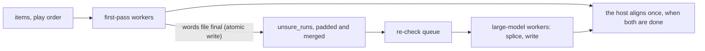

# Recording check pipeline

**Status: implemented, 2026-10-21.** Reference and explanation for how the model cascade and the item pool use the processors. The cascade itself is in [Recording Check](../utilities/recording-coverage.md#the-model-cascade).

## What changed

Before, each cascade stage was its own sidecar process: the first pass finished every item (`coverage_mode._collect_words`, one item at a time), then the host planned windows (`internal/coverage/plan.go`) and started `--recheck`, which also ran its windows one at a time, then an align-only sidecar run (now the host's own realign). Parallelism existed only inside one item longer than a chunk (`coverage_chunks.ChunkedTranscriber`).

Now, with `cascade_pipeline` on (default), a score line above 0 and a re-check model, the first stage is one process (`compare.py --coverage --recheck-model M --unsure-below U`, `core/coverage_pipeline.py`):

- An item enters the queue only after its first-pass words file is written; the re-check then splices into that item's in-memory words and rewrites the file atomically with `spans`. One job per item holds a lock, so a file has one writer.
- The passages the first pass left **missing** are known only after the whole chapter is aligned, so they cannot be pipelined. The host plans them from the pipelined report and runs `--recheck`, now with a window pool, then realigns the chapter itself (no sidecar; `internal/recordingcoverage` since the alignment moved to the host). The pipelined process reports what it re-checked in `COVERAGE_RECHECKED` lines, which the host adds to the stored `Recheck` label.
- Windows are padded and merged by the same rules as the host (`pad_window`, `merge_windows`; `tests/fixtures/recheck_windows.json` is read by both test suites). Past 60% of the played seconds, every item is re-checked whole.
- A passage, or a whole item, the large model already transcribed is never queued again: `checked_ranges` reads the words file's `spans` ([Incremental checks](../utilities/recording-coverage.md#incremental-checks)).
- Cancel keeps every finished item: each words file is written atomically. `cascade_pipeline` off, or no score line, runs the old stages, which are also the oracle for `tests/test_coverage_pipeline.py::test_the_pipelined_result_equals_the_sequential_one`.

## Processors

- **Item pool.** `_collect_words` and `run_recheck` run items on threads. A model is loaded once per process with faster-whisper's `num_workers` equal to its workers and `cpu_threads` equal to `cpus // workers`, so workers share one copy of the weights. The host sends the count it planned (`coverage.PlanWorkers`): Automatic is `cpus // 2`, from the earlier measurement that four workers on four processors was slower than two ([research note](../research/recording-coverage-batched-whisper.md)), and fewer when the model's copies would not fit the free memory ([Long chapters](../utilities/recording-coverage.md#long-chapters)). A long item still uses chunk processes, sharing the threads one item worker owns (`ChunkedTranscriber(cpus=...)`) and its share of the count.
- **Two models.** Each is planned alone, the large model capped by `MAX_WORKERS_BY_MODEL`. A `CpuGate` of `os.cpu_count()` tokens holds the threads of running calls, first come, first served. A first design split the processors statically by model cost; a simulated run (below) showed it idles the first pass's share once it drains and ran up to 0.6x of the staged run, so the split was dropped for the gate.
- **A budget.** `--cpus N` plans the workers and sizes the gate for `N` processors instead of the computer's (`coverage_pipeline.cpus_for`). The host passes it for a background check (`coverage.BackgroundCPUs`), whose sidecar also runs below normal priority.
- **GPU.** `--device cuda` gives one worker per model and one call at a time on one shared instance. The host never passes `--device` and the sidecar does not detect CUDA, so this path is untested on a GPU.
- **Not bounded.** The gate counts model threads only. ffmpeg decoding and the voice-activity filter run outside it. Several chapters at once (`parallel_chapters`) are separate processes, each with its own gate; the host names `cpus / chapters` workers for each, as it did for chunks.

## Progress and state

One denominator: seconds of first-pass work plus seconds of re-check windows, with 15% of the first-pass seconds reserved until the real windows are known. Percent never moves backwards, so it can pause when more windows turn up than reserved. `State.Pass` is `pipeline` while both models run ("First pass (tiny), re-checking as it goes (large-v3-turbo)"), then `recheck_windows` and `realign` if regions remain.

## Measured

Fake transcribers on a simulated machine (24 items, first pass 0.2 cpu-s per item, one 25 s re-check window per item, `scaling^a` = seconds divided by `threads**a`), 2 runs, median; the staged run is the old stages with one item at a time:

| Machine | Staged | Staged with item pool | Pipelined |
| - | - | - | - |
| 4 CPUs, a = 1.0 | 2.45 s | 2.45 s | 2.42 s |
| 4 CPUs, a = 0.6 | 4.23 s | 3.21 s | 3.19 s |
| 8 CPUs, a = 1.0 | 1.25 s | 1.24 s | 1.27 s |
| 8 CPUs, a = 0.6 | 2.81 s | 1.88 s | 1.92 s |

The simulation says the speed-up comes from the item pool where threads scale sub-linearly; with a CPU-bound model and the processors always busy, the pipeline matches the staged run and cannot beat it. What it adds is not in the simulation: one process start and the large model loading while the first pass runs, no tail where workers wait on the last item of a stage, and the large model's first results arriving early. No Whisper model or speech audio was available (the model host is blocked in this environment), so no real run at `parallel_workers` 0 or 4 was made; pending the owner.
