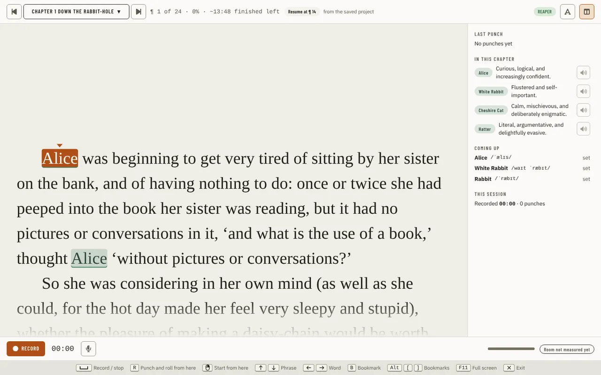
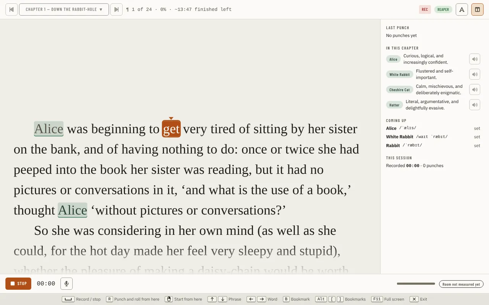
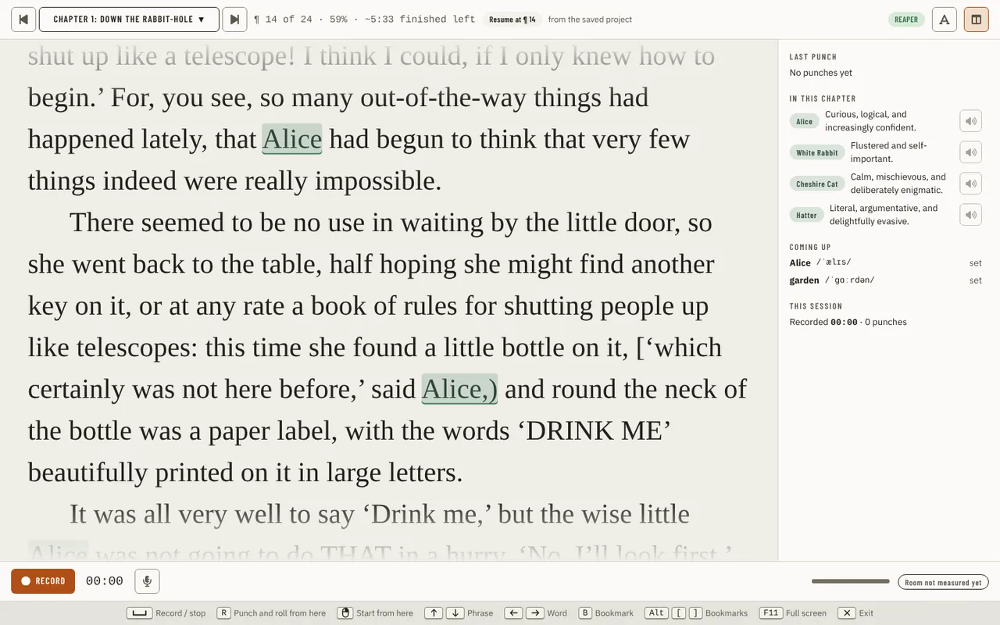
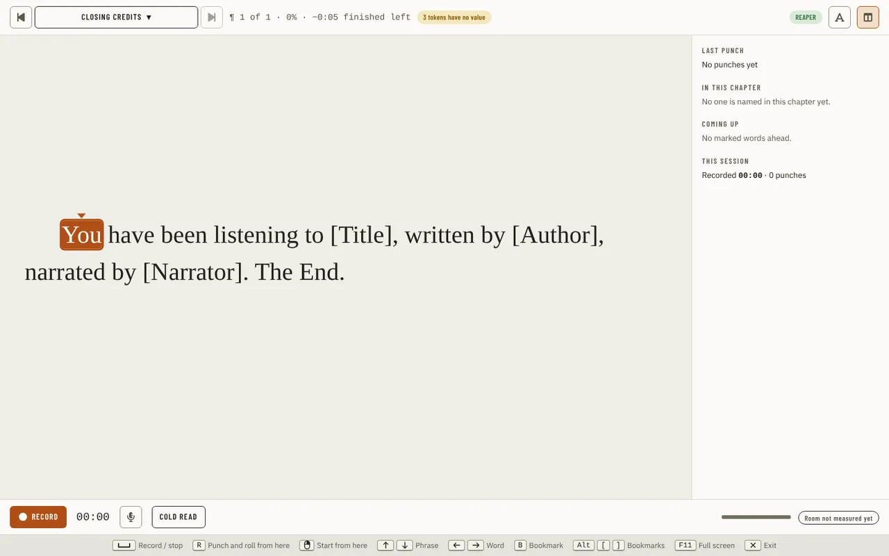
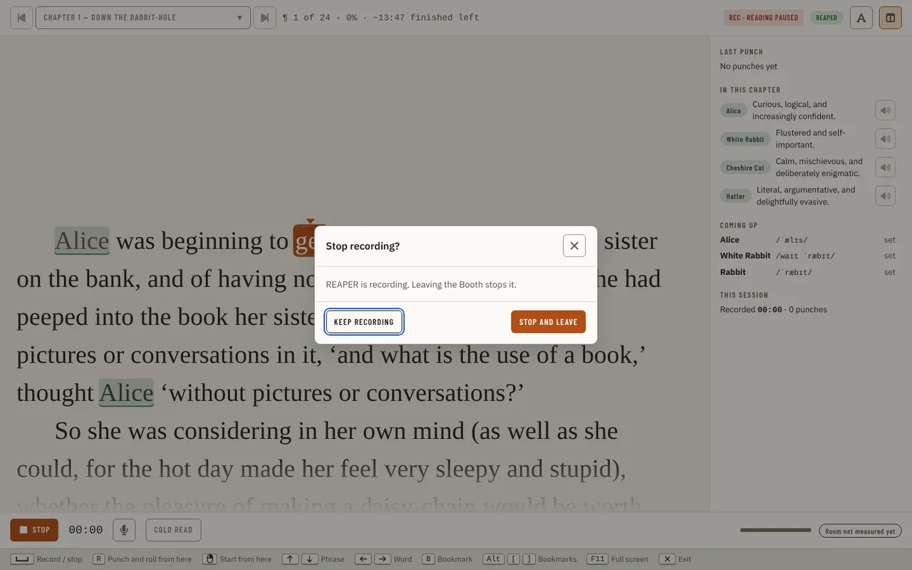

[Using the app](README.md) › Booth

# Booth

The Booth is where you record. It shows the chapter's text large, follows your voice through it with a local speech engine, and
starts and stops the take in your DAW (or the built-in recorder). It needs an [imported manuscript](production.md#importing-the-manuscript).
Open it from **Booth** in the navigation, or from **Record in Booth** on a chapter or credits card on [Script](script.md), which
opens it on that chapter. What the Booth is reading is part of its address (`/booth?chapter=…`, `/booth?credits=opening`), so Back
and a link land on the same chapter. The Booth fills the window and follows the app's theme, light or dark.

## The page

The top bar holds the chapter stepper (previous chapter, the chapter menu with the opening and closing credits, next chapter),
where you are (`¶ 1 of 24 · 0% · ~13:48 finished left`), the resume line, and a chip naming the recording setup (the DAW, or the
built-in recorder). The chip opens [Settings](settings.md) › Recording. The button at the right shows or hides the side panel; in a
window 1280 pixels wide or narrower the panel is a drawer that starts closed.

The text fills the middle, with speaker chips beside the lines a character speaks and Story Bible names marked. The word you
are on is marked with a caret; the text scrolls to keep it in view as you read. The mouse wheel and Page Up and Page Down move
the view without moving your place.

The side panel has **Voices in this scene** (the characters nearby, with their voice notes), **Coming up** (the next names with a
pronunciation), the suspected lines of this take, **Last punch** and **This session** (how long you have recorded and how many
punches).

The footer has **Record**, the take's timer, **Levels** (the input level and the microphone in use), a level bar and the room tone, and the keys the Booth answers, drawn from your keymap.

## Recording

Press **Record** (or Space, or a foot pedal mapped to Space) to start a take, and again to stop it. Record arms only the chapter's
track and starts at the end of the last item on it, so a take never records over an earlier one. When Record cannot start it is
disabled and the footer says why, in the DAW's own words: the DAW is not running, the record action is switched off in Settings,
the chapter has no track, or the DAW is already playing.

While a take runs, Record becomes **Stop**, a **REC** pill shows beside the setup chip and the timer counts. The chapter cannot be
changed until you stop.

**R** punches and rolls from the word you are on: the DAW plays in from a little before it and records from there, keeping the
earlier audio as a take. Where the DAW would replace the audio instead (Audacity without backups), the Booth asks first ("Roll
again from ¶ n?") and holds the take while it asks.

Click a word to start from it. **↑** and **↓** move by phrase, **←** and **→** by word, and **F11** takes the window full screen.

The engine and model the Booth listens with are chosen in [Settings](settings.md) › Booth. Nothing you say is sent anywhere.

## Where you stopped

When the chapter's track already has a recording, the top bar offers **Resume at ¶ n** and says where it read that from: the
DAW now, the saved project, or the Booth's own record of your last reading. Choosing it moves your place to where the recording
ends; nothing starts until you press Record.

## Suspected lines

While you read, the Booth marks places where listening suspects something went differently from the script, such as skipped
words or a restart. They are listed in the side panel, where **Dismiss** removes one from the list. Every
one is only suspected: Transcript Compare over the recording is the authority.

## The credits

The chapter menu also offers **Opening credits** first and **Closing credits** last, when your credit template library
([Settings, Credits](settings.md#credits)) has an opening or a closing template. The text is the first template of each kind filled
in with the project's values, exactly as Settings previews it. If a value is missing, for example no narrator name yet, the
placeholder shows in brackets (such as [Narrator]) and a chip on the top bar says how many tokens have no value; it opens the
Credits settings. You can still record.

## Companion mode

The Companion is a narrow panel pinned beside your DAW. Open it with **Open Companion** in the jump menu (its key is in the shortcut sheet): the
reading session, with REAPER's playhead in its header, the script in its own scroll box, the reading controls and the hotkeys
that work while the panel has focus. **Full app** (or Escape twice) brings the Booth back on the same chapter. **Pickups** in the
panel shows the [Pickups](pickups.md) list: how many are left and the one you last jumped to. The note at the playhead has its
place in the panel and is coming later.

## Leaving the Booth

Escape (when nothing is open on top of the Booth) takes you to Script. While a take is recording, every way out asks first
(Escape, Back, Forward, the setup chip, a link to another chapter): "Stop recording?" says the DAW is recording and leaving
stops it. The take is held while the question is open. **Cancel** stays; **Stop and leave** stops the recording and then leaves. If the DAW was already recording
when you came in, the Booth did not start that take and does not stop it, and the question says so.

---

[← Story Bible](story-bible.md) · [Index](README.md) · [Proof →](proof.md)
