[Using the app](README.md) › Booth

# Booth

The Booth is where you record. It shows the chapter's text large, follows your voice through it with a local speech engine, and
starts and stops the take in your DAW (or the built-in recorder). It needs an [imported manuscript](production.md#importing-the-manuscript).
Open it from **Booth** in the navigation, or from **Record in Booth** on a chapter or credits card on [Script](script.md), which
opens it on that chapter. What the Booth is reading is part of its address (`/booth?chapter=…`, `/booth?credits=opening`), so Back
and a link land on the same chapter. The Booth fills the window and follows the app's theme, light or dark.
While the chapters are being read, the Booth draws its top bar, text, side panel and footer as grey blocks, and the text appears in their place. If the chapters cannot be read, the page says so instead. A link to a chapter the list does not have shows the same blocks with the Booth title, **Checking this link…** and **Go to Production** (Escape also leaves) while the chapter list is read once more.

This page is for narrators. [Record a chapter](#record-a-chapter) is the short version; the sections after it describe
each part of the Booth in full, and [If something goes wrong](#if-something-goes-wrong) gathers what stops a take.

## Record a chapter

Before you start: a manuscript is imported, and the project records with REAPER, Audacity or the built-in recorder
([Getting started](getting-started.md) sets these up). The example records Chapter 1 of a book in REAPER.

1. **Open the Booth on the chapter.** On [Production](production.md), **Start session** opens it on the chapter being
   recorded. **Record in Booth** on a chapter's card on [Script](script.md) opens it on that chapter, and **Booth** in
   the sidebar opens it too.
2. **Check the chip at the top right.** It names the recording setup: **REAPER** once connected, with a note such as
   **REAPER · not running** while it is not ready. Click it to open the
   [audio engine panel](navigation.md#the-audio-engine-panel), where you link the project.
3. **The first time you open a chapter, choose its track.** A dialog titled with the chapter's name and "is not linked
   to a track" offers **Link track**,
   with the best match by name chosen, or **Create a new track**, which adds one named after the chapter. Save the
   REAPER project afterwards so a new track is kept. The built-in recorder needs no track.
4. **Press Record** (or Space, or Enter, or a foot pedal mapped to Space) and read. The text follows your voice, dims the
   words behind you, and keeps your place in view. The first take may ask to download the speech model; nothing
   downloads until you press **Download model**.
5. **Press Record again to stop.** In a DAW, a **Take saved** message offers **Undo**. The highlight stays on the last word the
   Booth heard, and the next take starts from there.
6. **Fix a mistake as you go.** Punch and roll is the narrator's retake: the DAW plays a moment of what you read before
   and records again from a chosen word. **R** does it from the word you are on: the DAW's cursor goes there and
   recording starts. Click a word to move your place, or use **Mark the start here** to choose where the next take starts; nothing is recorded until you press Record.
7. **Leave** with Escape, which goes to Script. Leaving during a take asks first, and what it asks depends on who started the take.

   - **Which ways out ask.** Escape, the setup chip, a link that opens another chapter, the jump menu (Ctrl+K, **Switch project…** included), Ctrl+, and the other shortcuts that open a page, and the Back and Forward of the browser, the mouse buttons and Alt+Left. Closing the window, reloading it, and a Back from the first page the window opened on are not asked, and the take keeps recording.
   - **A take you started with Record** asks **Stop recording?** and names where you are going: "REAPER is recording. Leaving the Booth for Script stops it and saves the take." An address the rail does not own, and Back and Forward, name no page: "Leaving the Booth stops it and saves the take." A link that opens another chapter of the Booth reads "Opening another chapter stops it and saves the take.", and **Stop reading?** names the page too. **Keep recording** stays in the Booth with the take still running. A Back pressed while a question or dialog is open does nothing more.
   - **After Stop and leave.** **Take saved** shows with its **Undo**, as after a plain Stop, and stays up for 5 seconds, or until you move on from the page you land on. In a pickup session it reads **Take saved · 1 pickup marked recorded**, and over suspected lines **Take saved · 2 suspected lines added to Pickups**, with no **Undo**. To take it back, undo the marks or lines first and then the take, from the [undo history](navigation.md#the-header-and-the-footer) (Ctrl+Shift+H). It is an ordinary 5-second message, so it can follow you to the next page for a few seconds.
   - **A Record that is still starting** counts as a take. The question is titled "Leave while a take is starting?" ("Open while a take is starting?" for another chapter), with **Stay** and **Stop and leave** (**Stop and open**). It says the DAW is starting a take, not that it records, and closes by itself if the start ends with no take, leaving you in the Booth with the press's sentence. If the start lands as a take while it is open, it is asked again as **Stop recording?**.
   - **Stop and leave waits for the start to land, then stops it.** The wait for a start and the writing of what the take left behind each give up after 8 seconds; a Stop you had already pressed, and the stop itself, each give up after 27, because a slow DAW that has taken the stop is waited for, as long as the Booth's own Stop is given. A stop that does not answer ends in **Could not stop the take** below, and a run that is not written in time does not hold you. **Stopping the take…** stays up while it waits, and comes back if you close it and try another way out. A take that the DAW itself reports as ended while it waits leaves with no **Could not stop the take**.
   - **A DAW that stopped answering.** If REAPER stopped answering during the take (the Booth says it can't tell whether the take is still running), the question is titled for the page, **Leave for Script?**, not **Stop recording?**, which would claim the take is running. It says "REAPER may still be recording. Leaving tries to stop the take.", with **Stay** (not "Keep recording", which would claim the take is recording) and **Stop and leave**. A link to another chapter, Next chapter, Previous chapter, the chapter picker and a chapter row of the jump menu ask **Open another chapter?** instead, with "REAPER may still be recording. Opening another chapter tries to stop the take." and **Stay** and **Stop and open** (you stay in the Booth, so it does not say leave). A DAW that goes quiet while the question is open, or during the wait, is not taken for an ended take: **Stop and leave** still tries the stop, and the stop's refusal question still asks, because that take may still be recording.
   - **A take you started in REAPER** and the Booth follows (see [Starting the take in REAPER](#starting-the-take-in-reaper)) is not the app's to stop. Leaving asks **Leave the Booth?**: "REAPER is recording and keeps recording after you leave. The app did not start this take, so it will not stop it; stop it in REAPER.", with **Leave** and **Stay**. For another chapter it reads **Open another chapter?** with **Open** and **Stay**. **Leave** stops the listening and leaves REAPER recording. The question goes by itself if you stop the take in REAPER while it is open. If REAPER goes quiet after that take ended, it stays REAPER's until REAPER answers again, so leaving still asks **Leave the Booth?** and never offers **Stop and leave**. A take REAPER holds that the Booth does not follow asks nothing, and leaving sends REAPER nothing for it (the input monitoring the Booth turned on is put back at a later entry or leave).
   - **The question follows REAPER while it is open.** If REAPER stops answering it is asked again as **Leave for Script?** with **Stay**. If REAPER then answers that it is not recording, the Booth lets go of your take; a take REAPER starts after that is REAPER's, so the question is asked again as **Leave the Booth?** and nothing is sent to stop it. The app never stops a take REAPER started.
   - **Enter and Space** do nothing for the first 0.4 seconds after a question appears, so a double Enter on a jump menu row does not answer the question that row raised. Holding Enter or Space does not answer it either: let go and press again. A key you held to answer it does not go on pressing the button focus returns to (Stop or Record) once the question has closed.
   - **A link to a chapter the manuscript lacks** does not take the Booth away during a take: it asks like any other chapter. A malformed address says what is wrong in a message, is put back to the address the Booth had and is ignored, so ending the take does not turn it into the "could not be opened" card. A second chapter link arriving while a question is open replaces the first, so **Stop and open** or **Open anyway** opens the one asked for last.
   - **When the DAW refuses the stop**, the Booth stays and says **Could not stop the take** with the DAW's words. **Leave anyway** then leaves with the take possibly still recording, the same way from each of those exits. From a chapter question it opens the chapter, with no second question: the refusal's button reads **Open anyway**, and **Stay** or Escape on a chapter question puts focus back on the chapter picker.
   - **Changing chapter inside the Booth** during a take is refused: the chapter picker, Next and Previous chapter and the jump menu's chapter rows say "Not while recording. Stop the take first." for a take you started with Record, and "REAPER started this take, so stop it in REAPER." for a take you started in REAPER. A link that opens another chapter (a Script card, a bookmark) asks instead, and for a take you started in REAPER it asks **Open another chapter?** with **Open** and **Stay**: **Open** shows the other chapter and sends REAPER nothing. When REAPER stopped answering it asks the question above instead.
   - **After you leave and come back** with your own take still running in REAPER, it is still your take and Stop stops it. After a reload the Booth cannot tell whose take it is, so it finds REAPER's take the way it finds one you started in REAPER (see [Starting the take in REAPER](#starting-the-take-in-reaper)): it follows it only in the linked project with this chapter's track armed, and Stop says to stop it in REAPER. If REAPER is not recording when the Booth is opened again, the Booth forgets your take, and the next take in REAPER is followed like any other.

[Recording](#recording) has the detail of each step, [Undoing a take](#undoing-a-take) what Undo can take back, and
[A cold read](#a-cold-read) how to read a passage through without recording it. Recording from the Booth is not
available in Audacity yet.

## The page

The top bar holds the chapter stepper (previous chapter, the chapter menu with the opening and closing credits, next chapter),
where you are (`¶ 14 of 24 · 57% · ~5:53 of audio left`; `At ¶ 14 of 24` once the chapter is recorded to the end), the resume line, and a chip naming the recording setup (the DAW, or the
built-in recorder). In a window shorter than about 26 rem (416 px), or shorter than 30 rem (480 px) and no wider than 30 rem, the progress line and the key hints under Record are not drawn (a screen reader still has them), so the side panel has room to read. The chip opens the [audio engine panel](navigation.md#the-audio-engine-panel) over the Booth, as the engine chip does on every other page; the take keeps running. The built-in recorder's chip, like the header's **Built-in** chip, opens Settings > Recording & DAW instead, since it has no DAW to link. The chapter is named by its number and title
(`Chapter 1: Down the Rabbit-Hole`). **Text settings** chooses the font, the same choice as the reader font on
[Script](script.md), the Booth's text size, 24 to 72 px (the same choice as **Booth text size** in [Settings › Appearance & keys](settings.md)), and the **Column width**, **Narrow**, **Medium**, **Wide** or **Full**,
the same choice as **Column width** in [Settings › Reader text](settings.md), drawn by the Script's own reading column: centred in the text area, the width's characters a line or the whole text area, whichever is less, so each choice narrows the text equally on both sides and the column follows the window up to that width; **+** and **-** change the size too, and the Booth opens at the size
and width you last chose. The width is the line length on both pages: **Medium** is 64 characters a line, **Narrow** 48, **Wide** 80 and
**Full** 100, and a line never runs past the text area, so at a large size or in a narrow window two widths can look the same. The button at the right shows or hides the side panel, and is drawn pressed while the panel is open; in a window 1280 pixels wide or narrower the panel is a
drawer that starts closed, and the top bar wraps onto a second row when it runs out of room: the status chips, **Text settings** and the
side-panel button move together and stay at the right edge. The chapter picker is as wide as the chapter's name, up to 340 pixels.
The resume line is not offered while you are already in the paragraph it would take you to.

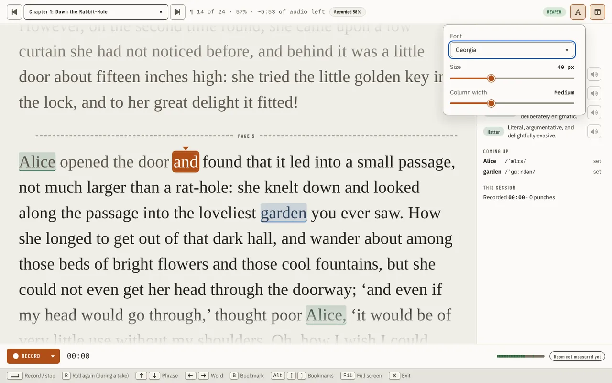

The chip says when the project's DAW is not ready: **REAPER · not linked**, **REAPER · not running**, or REAPER on
its own once connected. Click it to open the [audio engine panel](navigation.md#the-audio-engine-panel), where you link the project; **Recording settings** there leads on to [Settings](settings.md#link-your-reaper-project).

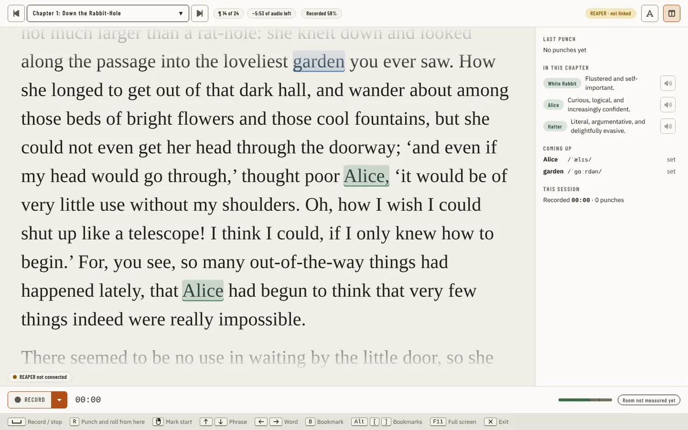

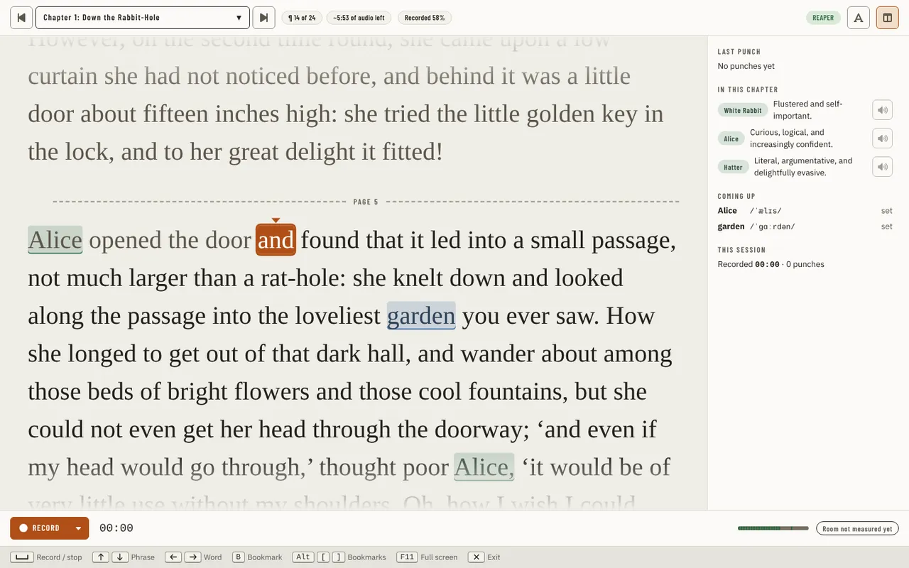

The text opens with the chapter's title, in bold, then its subtitle under it, a little smaller, each on a line of its own and in
the manuscript's own words ("Chapter 7", "Chapter 7: The Road"). These are the first lines you read, and the Booth follows them
like any other line: a take from the start of the chapter starts on the title, the caret moves through it as you say it, and its
words count in the progress line and the pages. A chapter with no subtitle has the title alone, and one with no title starts at
its first paragraph. Reading the heading is optional (see [Suspected lines](#suspected-lines)). It is not a paragraph of the
manuscript: the paragraph numbers start after it, and a bookmark or **Read to here** cannot be put on it (**B** there says so). The credits have no
heading line.

The text fills the middle, fading into the page at the top and bottom edges, with speaker chips beside the lines a character speaks, Story Bible names tinted and the words you
marked on [Script](script.md) drawn in their mark's colour and the line style you chose for it (a tint, a box, or a solid, double,
dotted or wavy underline), as they are on Script; a mark's note shows under its paragraph with a bar in the mark's colour. A
speaker chip takes its character's colour; a suggested speaker's chip is dashed until you confirm it, and a quote nobody is
matched to has a grey dashed **?** chip, by the same rule as on [Script](script.md). The chip's menu lists the entries whose
type speaks. A Story Bible name is tinted in its type's colour here, in the side panel's Reference chip and in the **In this
chapter** chips alike. Lines are left-aligned within the centred column and a paragraph starts at the column's edge, with no indent and a small gap above it, so a page of short paragraphs or
back-and-forth dialogue still shows many lines at the same text size. The word you
are on is marked with a caret; the text scrolls to keep it in view as you read. The mouse wheel and Page Up and Page Down move
the view without moving your place.

### Finding text in the chapter

**Ctrl+F** opens the jump menu, as on every page. Type two or more letters and the matches in the chapter on screen are listed under **In this chapter**, each with the words around it and its paragraph (**¶ 12**, or **Title** and **Subtitle** for the heading), the same search as on [Script](script.md). Choosing one marks every match in the text, rings the one you chose, and moves your place to it. While a take is recording your place belongs to your voice, so choosing a match only scrolls the text there and the recording is not disturbed; the text returns to your place when you click a word or step, as after the mouse wheel. While a search shows, the jump menu also offers **Next match**, **Previous match** and **Clear the search**.

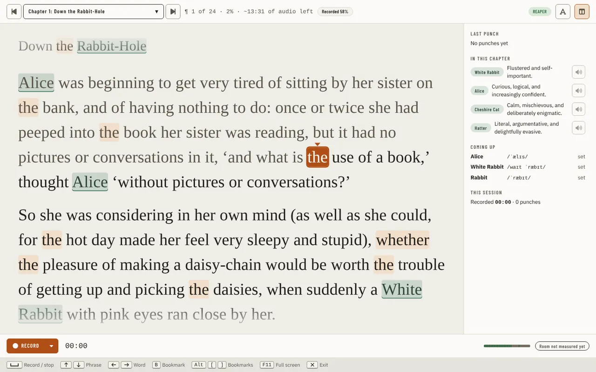

Clicking a Story Bible name, a marked word or a note shows it in the side panel's **Reference**, read-only: the entry, or the
mark with its note and its replies. A click on another word or on empty space clears it. The side panel also has the suspected
lines of this take, **Last punch**, **In this chapter** (the characters the chapter names or gives lines to, in the order they first appear, with their voice notes and their
[voice samples](#voice-samples)), **Coming up** (the next names with a pronunciation) and **This session** (how long you have recorded and
how many punches). The tinted names in the text, **In this chapter** and **Coming up** find a name by one rule: a whole word that is a Story Bible
entry's name or alias, spelt as the entry spells it (the speaking types, such as Character, are the people in **In this chapter**; **Coming up** looks only at the next phrases). In a [pickup session](#a-pickup-session) the pickup lines come first. Where the panel is a drawer, the text
behind it is dimmed while it is open, and a click on the dimmed text closes it; in a window under 480 pixels wide the drawer
takes the whole width.

The footer has one **Record** button with **Record options** attached to its side (the caret that opens a choice for what the button does, the
microphone in use and two sliders). The take's timer follows it, and in a chapter that records on voice folders the
[voice control](#recording-each-voice-on-its-own-track) sits to its left. A level bar and the room tone of that microphone are at the
right, then the keys the Booth answers, drawn from your keymap. One sentence at a time sits
between the controls and the level bar: why the text cannot follow your voice, or else why Record cannot start. In a window
narrower than 1024 pixels the sentence moves to its own line under **Record**; the level bar stays on Record's line.

The room tone is the level of the room when nobody speaks. The app measures it whenever it listens to the microphone: during a
take, and for as long as the Booth shows, with **Record options** closed or open. The level bar beside it follows the microphone the same way. Once it has heard five seconds, it takes the quietest tenth of the last twenty seconds,
which is the pauses between your phrases while you read and the room itself while you are silent. It keeps the last value for each
microphone, so the chip still shows it after you close **Record options**, record nothing for a while, or restart the app. It reads
**Room not measured yet** until something has measured that microphone; stay quiet for five seconds with the Booth open to measure
it. Point at the chip to see why it has no value. A muted or unplugged input (digital silence) is not counted as a room. If the app cannot read the value, the chip says
**Room tone unavailable**.

In **Record options**, **Monitor level (output)** sets how loud the DAW plays back to you (0 to 100, 70 is its normal
level; REAPER's first hardware output, so the files you render are not changed). **Input level** is shown but off, with the reason:
no DAW can set an audio interface's input gain, so set it in your interface's own control panel.
With REAPER, each slider has REAPER's own meter under it, read four times a second for as long as the Booth shows, so they are already moving when you open the menu. Under **Input level** is
the level of the first track armed for recording in REAPER, with that track's name; with no track armed the menu says so, because
the app never arms a track just to measure it. Under **Monitor level (output)** is what REAPER plays out, which moves while it plays,
records with monitoring on, or monitors the armed track. If REAPER stops answering for two seconds, the meters say how long ago
they last heard it instead of showing an old level. The meters and the monitor slider show whenever REAPER is linked and answering;
while it is not, each says why in REAPER's own words. No setting turns them on.

**Punch** shows the lead-in you hear before a punch. With REAPER it is REAPER's own pre-roll, the one the punch really uses, in
one line: whether it is on and its length, for example **Pre-roll off · 2 measures (4.0 s)**. The seconds are the measures at the
tempo at the edit cursor. Press the **i** beside it (or Tab to it and press Enter) to read what it does under the line: with pre-roll on, REAPER plays from the
bar line at or before that many measures before the word, then records from the word; with it off, a punch records from the word
with no lead-in. Change it in REAPER: "Pre-roll: Toggle pre-roll on record" turns it on or off, and it applies to every project.
The menu reads it again when you come back to the window. It needs no switch: the app only reads it.

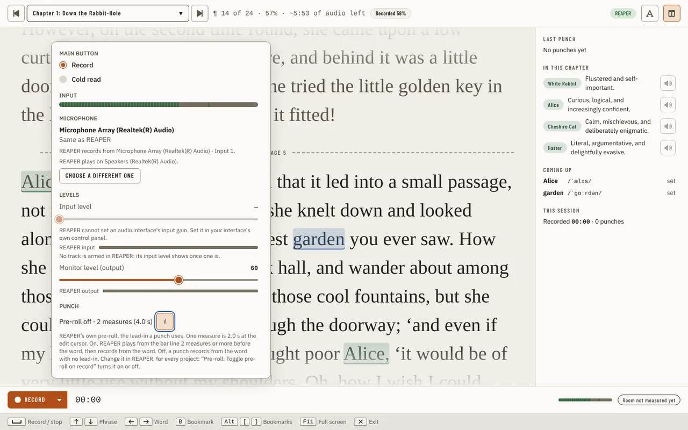

With a DAW that has no pre-roll of its own, **Punch pre-roll (seconds)** sets how long before the word **R** starts the DAW (0 to
10, in half seconds), for every project on this computer. It is the same setting as **Punch pre-roll** under **Set on a page** in
[Settings](settings.md#set-on-a-page). The built-in recorder does not punch, so the menu has no Punch part.

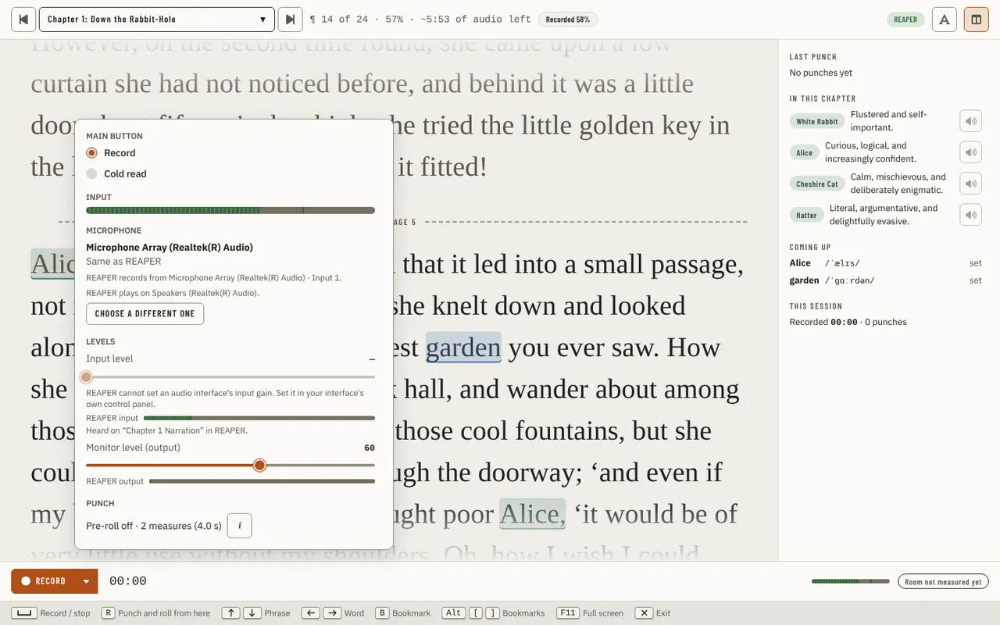

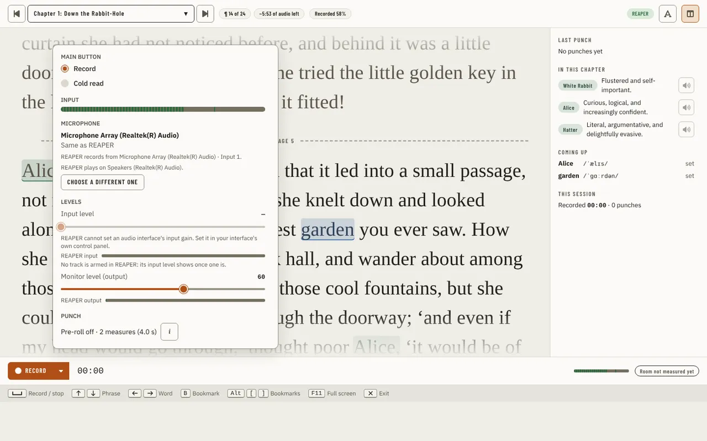

## Recording

Press **Record** (or Space, or Enter, or the numpad's Enter, or a foot pedal mapped to Space) to start a take, and again to stop it. Those keys do what the main button says: while **Main button** is set to **Cold read** (see [A cold read](#a-cold-read)), they start and stop a cold read instead of a take. Enter keeps its own job where it has one: with a button focused it presses that button, in a box you type in it is the box's, and while a popover, menu or question is open it belongs to that, so only an Enter pressed from the page itself records. A foot pedal is Space alone, and Space (unlike Enter) still wins over an open popover (see below). Record arms only the chapter's
track. It starts where your last take on that track stopped, as long as REAPER's edit cursor is still there. Otherwise it starts at
the end of the last item on the track, so a take never records over audio from a place you did not choose.

While any take is recording, whether the Booth started it or you started it in REAPER, Windows is asked not to turn the display off or put the computer to sleep, and is let go the moment the take ends, REAPER goes quiet or you quit the app. A cold read is not a take, so it does not hold the screen awake. Only Windows is asked: on other systems the Booth leaves the computer's own idle timers alone. With Audacity, or with REAPER's connection status turned off, the app cannot see a take recording, so it holds nothing then either.

Stop leaves you where you stopped. The highlight stays on the last word the Booth heard, and the next take, **Resume** and a cold
read start from there. In REAPER the edit cursor stays at the end of what you just recorded, whether you press Stop in the Booth or
in REAPER. REAPER on its own would put it back where the recording began, so the app moves it to the end itself and changes none of
REAPER's preferences. Going back is always your own choice: click a word, use **Mark the start here**, or punch and roll (**R**).
Audacity cannot record from the Booth yet. The built-in recorder has no edit cursor, so only the highlight stays.

Once a take has stopped, a message offers **Check recordings** for the chapter, which opens [the same check](production.md#checking-a-chapters-recording) the other pages run. It is only an offer: it goes after ten seconds, nothing is checked until you press **Check** in the dialog, and it is not shown while a take is recording or when the DAW cannot check.

When Record cannot start, it looks off and the footer says why, but you can still press it: the press opens the dialog that
fixes the problem, or, when there is nothing to fix from the Booth, a message that says why with **Check again**. Nothing
records, and the app does not start listening or play the start tone first. A refusal the DAW gives at the press (a full disk,
REAPER not confirming in time) is a message with **Check again** too.

Words you have read are dimmed one at a time, not by line or sentence: as the caret moves, every word before it turns grey, in the
sentence you are reading as well as in the ones behind it. The word you are on and everything after it stay in full colour, so the
text reads as a bright stretch ahead of a grey one that grows with you. A click, an arrow key or **Mark the start here** that moves the
caret back brightens those words again.

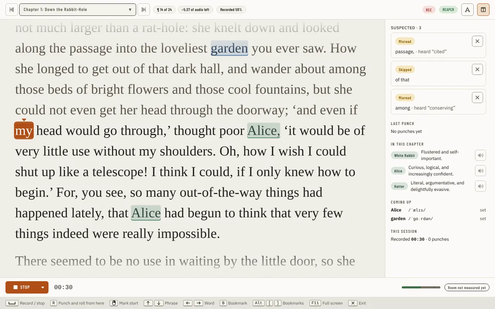

A chip under the text, above the footer, names each problem the Booth can fix and opens its dialog again. While it is up the
footer does not repeat the reason, and the setup chip on the top bar warns too (**REAPER · no track**, **REAPER · several tracks**, **REAPER · track missing**, **REAPER · other project**, **REAPER · not connected**, **REAPER · not armed** when no track is armed to record on, **REAPER · recording elsewhere** while REAPER records a take the Booth does not follow (another track is armed, several are, none is, or the Booth could not read which; the tooltip says which), or **not running** for a DAW that is not running):

- **Not linked to a track.** The chapter has no track in the DAW project, or several (the chip then reads **Linked to several tracks**), or the track it was linked to is no longer in the project (**Track missing**, as in the audio engine panel; **Folder missing** and **Linked to several folders** in a Voice folders project, where every word says folder). The dialog opens by itself the first
  time you open the chapter, and again each time you press Record. The Booth reads the project's tracks in the background as soon as it knows the chapter, and the
  dialog waits for them (a moment at most, with the **Not linked to a track** chip on screen) so it opens with them to choose from; if they are still being read, **Link track** says so on its tooltip until they arrive. It offers two fixes:
  - **Link track**: choose one of the project's tracks (the best match by name is chosen for you). A track linked to another
    chapter says so, and linking it here moves it.
  - **Create a new track**: REAPER adds a track named after the chapter at the end of the project and links it. With no tracks
    to choose from, this is the main button. Save the REAPER project afterwards so the new track is kept; the message after
    creating it reminds you.

  In a project whose layout is **Voice folders** ([Settings](settings.md)) the same messages say folder: **Not linked to a folder**,
  **Link folder**, **Create a new folder** (REAPER adds a folder named after the chapter with its tracks in it, below), the chip
  **REAPER · no folder**, and a message after creating it that names the folder and its Narrator ("Folder “Chapter 1” with a Narrator track added
  in REAPER and linked to Chapter 1"). Record then records on that Narrator, and the voice control lists it, before you save the REAPER project.

  Above **Create a new folder** the dialog lists what the folder is made with, in this order: the **Narrator**, which is always made, the
  project's known voices, and **Extras**, a track for sound that is not a voice (a crowd, a door, music). Untick any voice or Extras to leave it out;
  with two or more voices **All N voices** ticks or clears them together, and a long list scrolls inside its own box so the buttons stay in view. What
  you leave out is remembered for the next chapter, and a voice that appears later starts ticked; the same list is a row in [Settings](settings.md).
  Extras is not a voice: the Booth never arms it and the chapter's record progress does not ask for a take on it (a project that already gives characters to a track named Extras keeps it as a voice, so nothing already set up changes). The list holds up to 60 voices, and a line under it says how many more are not listed. What you tick in this dialog is remembered when you press **Create a new folder**; closing the dialog without creating leaves the last remembered choice (the Settings row keeps a tick as you make it). The list is read again when you press **Check again** or return to the window, and keeps your ticks. (The Engine panel's **Create a folder
  for this chapter** button makes the folder with the choice you made last).

  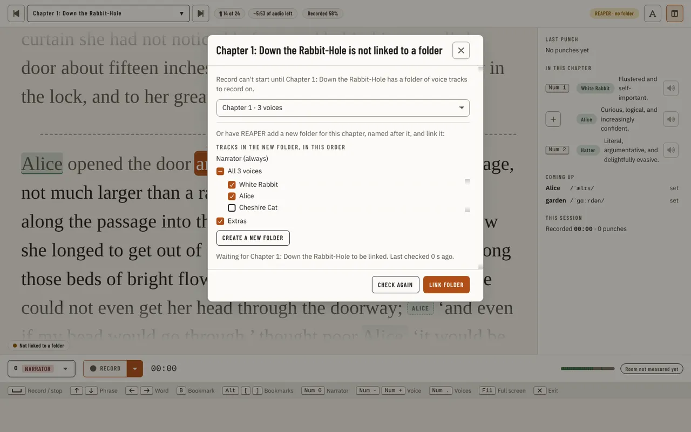

  Either way Record is ready at once. If the DAW cannot add the track (REAPER is recording or not connected), the dialog says
  why and links nothing. Audacity 3 adds the track too; Audacity 4 has no scripting, so there the dialog says to add the track in Audacity and link it.

  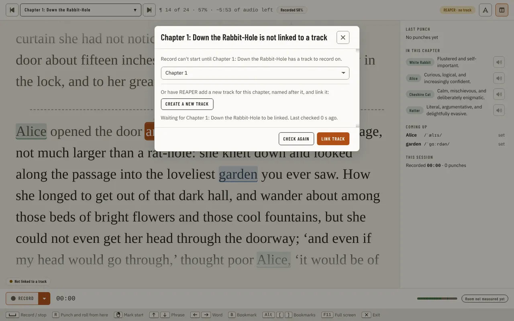

  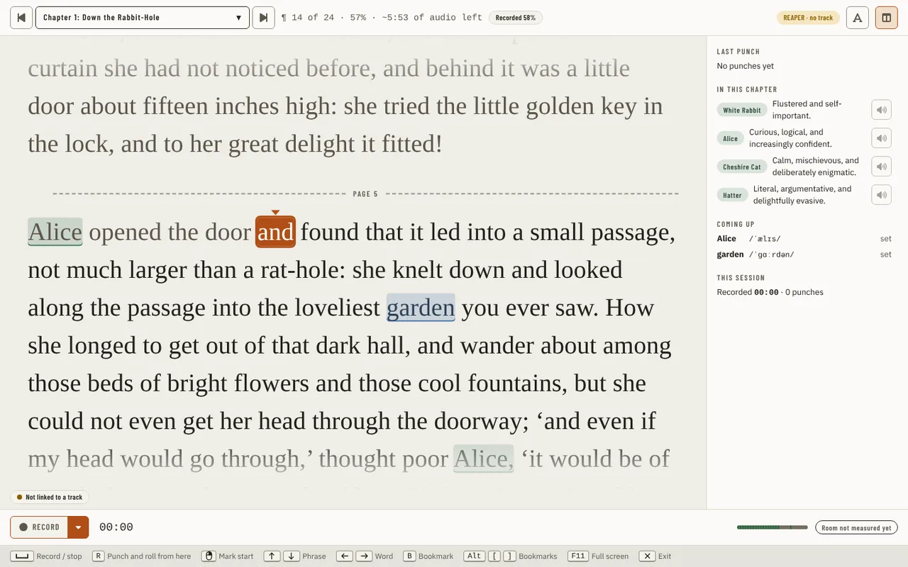

- **REAPER not connected** (or **REAPER not answering**). The app records in REAPER through its bridge, a small script
  that runs inside REAPER. You load nothing: the app puts the bridge in REAPER's Scripts folder by itself, and REAPER starts it
  each time it opens. When REAPER opens with the chapter's project, the app connects and Record turns on. When the project opens
  in the app and REAPER is not running, the app opens REAPER on the linked project by itself. Until it connects, a quiet mark
  above the footer says so ("Connecting to REAPER…" for the first few seconds, and "Starting REAPER…" while the app opens it, for up to 90 seconds), and a dialog opens by itself once, only if REAPER has not come up by then; the X
  closes it, and the mark or a press of Record opens it again. The dialog gives the host's reason, what still works, and what
  the app does. **Open in REAPER and connect** opens the linked project in REAPER, or connects the REAPER you already have open.
  If no REAPER project is linked yet, **Start REAPER** is off and **Link project file…** is the main button: it is the same link action as the one in [Settings > Recording & DAW](settings.md), and every page follows it without a reload. A refusal or a start that never
  answers is written in the dialog. The Booth never offers the built-in recorder while REAPER is linked.

  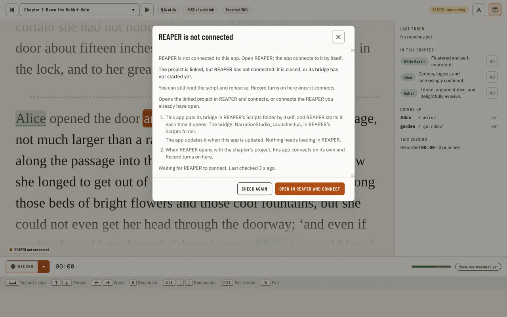

  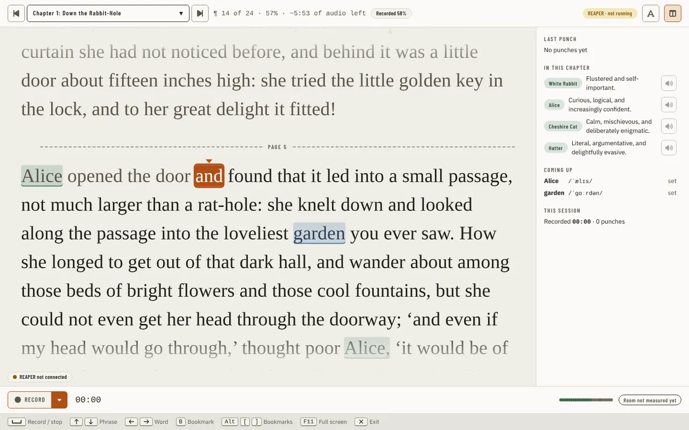

  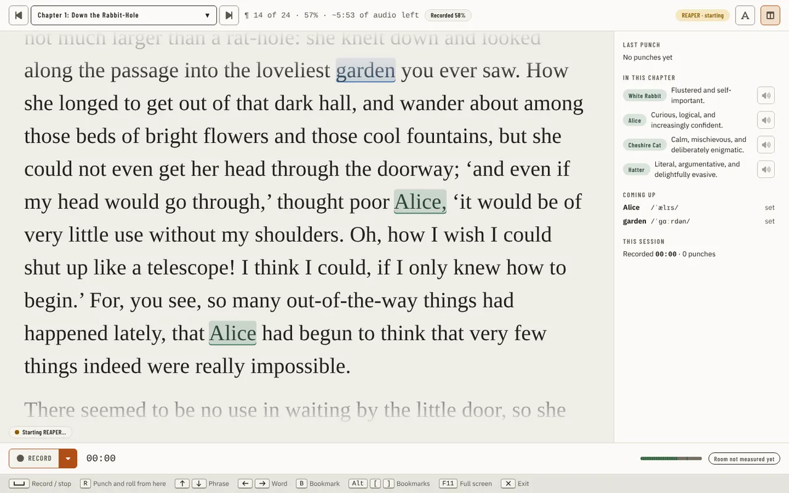

  The dialog says what it is waiting for ("Waiting for REAPER to connect") and when the app last looked ("Last checked 4 s
  ago"). The Booth asks again by itself every few seconds while it waits, when you come back to its window, and when you press
  **Check again**. If REAPER stops answering, the dialog says it cannot tell instead of showing an old answer as fact.

  If the app is busy (an import, a build or a download is running) when REAPER starts and hands over its project, the app
  keeps the project it has and says so in the dialog, which opens again for it. Finish or cancel what is running, then press
  **Open in REAPER and connect** again.

  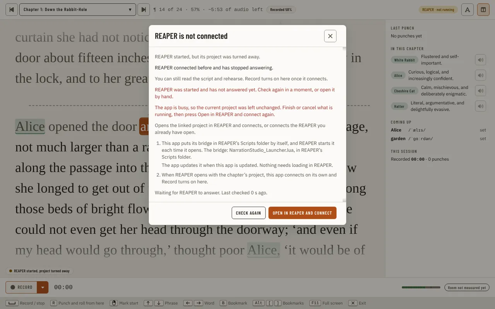

- **REAPER has a different project open.** REAPER answers, but the project it has open is not the one linked here, so a take
  would not land where the book expects it. The dialog opens by itself, and again when you press Record. **Link the open
  project** opens the project picker (choose the file REAPER has open); or open the linked project in REAPER and press **Check
  again**. **DAW settings** shows which file is linked. The setup chip on the top bar reads **REAPER · other project**. The Booth also asks again every few seconds while the chip is up, and by itself every 15 seconds otherwise, because
  REAPER sends no message when another project is opened. The dialog says what it waits for and when the app last looked.

  **Link the open project** is the same action as the link button in the audio engine panel and in Settings: only one file picker is open at a time, so pressing it while another is open does nothing.

  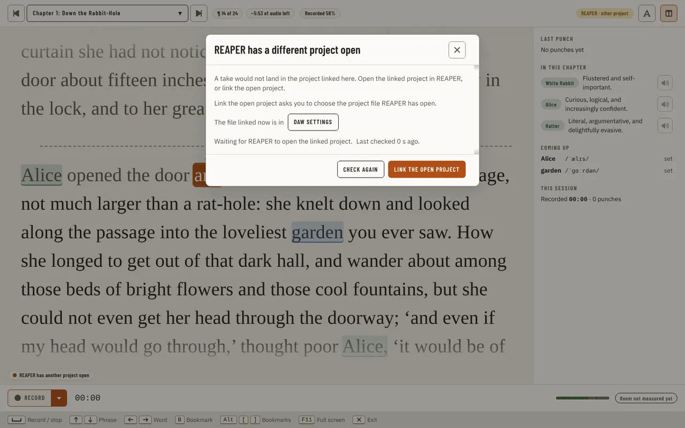

  When REAPER already has a take running that the Booth does not follow (another project open, or this chapter's track is not the
  only one armed), a press of Record says so as a message with the reason, with **Check again**: "REAPER is already recording on another track, so the Booth is not following it. Stop it in REAPER before recording here." (or "with several tracks armed", "with no track armed", or "while no project file is linked here. Link a project file, then record here."). With another project open the sentence about the project adds "REAPER is recording a take now.", and the dialog says so too. Record is ready again as soon as the
  problem is fixed, without a restart.

  A message is never drawn over the chips: it rises above them. The same sentence is one message however often it is asked
  for, and a message about REAPER starting goes as soon as Record is ready.

### Recording without a DAW

A project can record with the built-in recorder instead of a DAW: choose it in [Settings](settings.md) > Recording. It records on
Windows only. The setup chip reads **Built-in**, Record needs no track or DAW project, and each take is saved as a new audio file
in the project's `Recordings` folder (`Take 001.wav`, `Take 002.wav`, …); an earlier take is never overwritten.

- **The microphone.** The take records on the microphone you chose in **Record options**. With none chosen it uses the one the project
  last recorded with if it is still plugged in, then the only one the computer lists. **Record options** names that same microphone, so
  what it shows is what the take records on. With several listed and none chosen, **Record options** shows **Choose a microphone…** and
  Record says **Choose the microphone in Record options, then press Record**; with none listed it says **No microphone found** and why. A microphone Windows
  will not let the app open (another program has it, or the privacy setting blocks it) is refused in the recorder's own words and
  nothing records.
- **The recorder's own level.** While **Record options** is open, its **Input** meter shows the level the built-in recorder hears on the
  microphone chosen under it, before a take and during one, and the line under it gives the peak (**Peak −14.2 dB**). No file is
  written. Choosing another microphone moves it to that one; a microphone the recorder does not list is not metered. The recorder
  lets go of the microphone when you close **Record options**, leave the Booth or press Record. While the app is in the background the meter
  is paused, and the line under it says so. If the recorder refuses the microphone, or does not answer within 15 seconds, the line
  says **The meter did not start.** with **Check again** beside it, and a message gives the recorder's reason.

  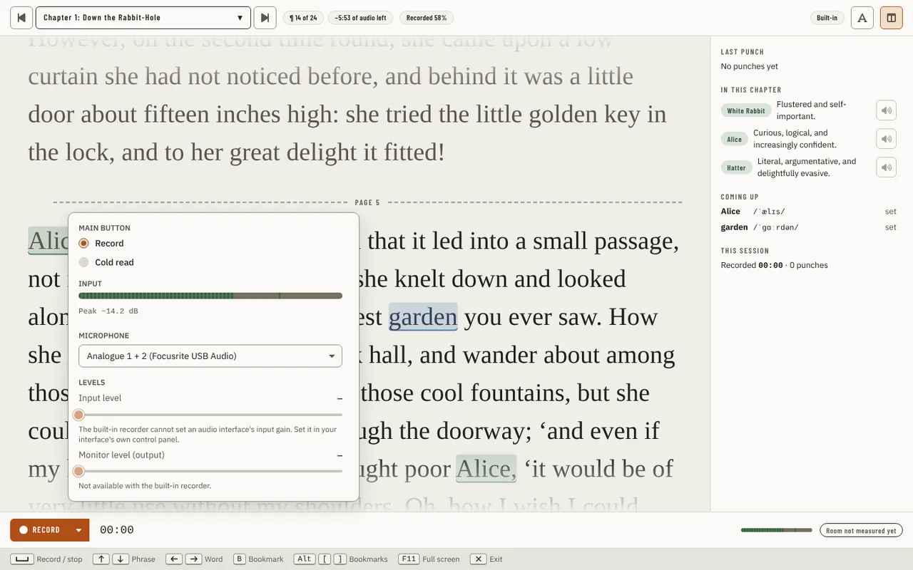

- **A take.** Record becomes **Stop** and the **REC** pill shows, as with a DAW.

  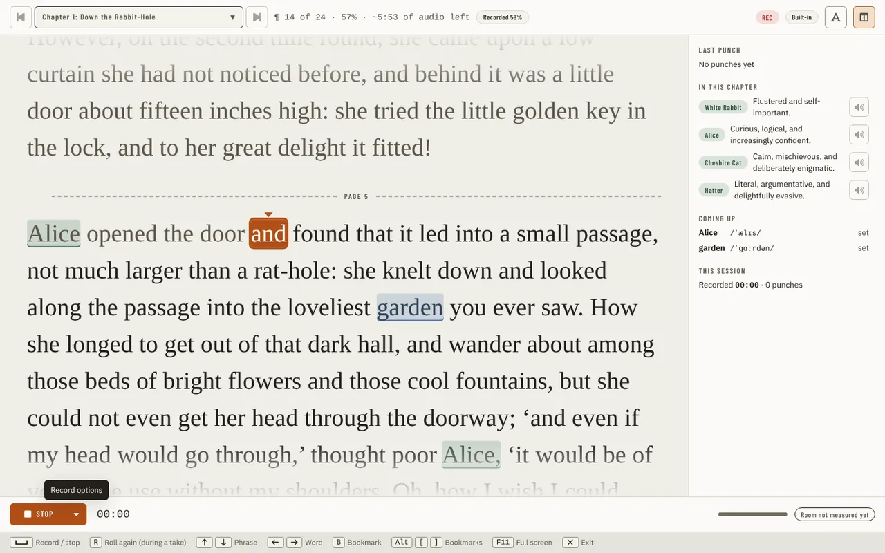

- **A take that ends by itself.** If the microphone is unplugged or the disk fills, the take stops and a message says why and
  that the audio before it is kept in the `Recordings` folder (a take cut short keeps a `.partial` name and is listed as
  unfinished). Record is ready for the next take.

  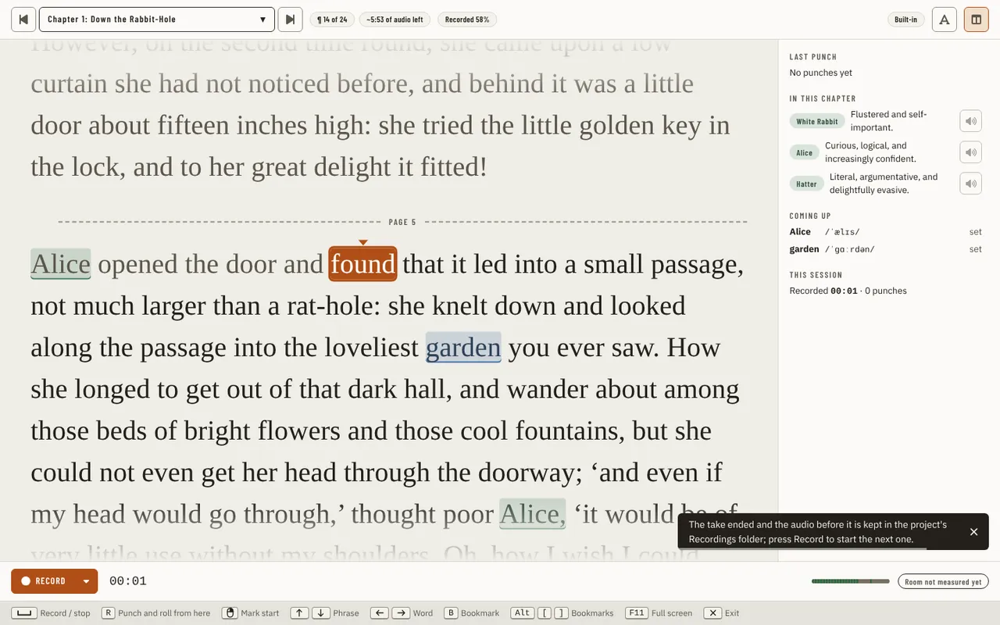

- **Leaving.** Leaving the Booth during a take asks "Stop recording?", as with a DAW. Reloading the window during a take picks the
  take up again, and Stop still stops it.
- **A marked start.** A DAW that cannot punch in, the built-in recorder among them, cannot record over the phrase you marked with **Mark the start here**.
  Marking sends the DAW nothing; when you press Record, the Booth looks the phrase up once and says "Recording from the end of what is already there
  instead", and the take starts from the end. Pressing Space, **R** or Record again while it looks joins that press, with the one message; a phrase
  nobody recorded starts the take from the end straight away. If the lookup does not answer within 8 seconds or fails, nothing is recorded, the
  Booth says why once, no start stays marked and Record is ready.
- **Not yet.** **R** (punch and roll) is not available with the built-in recorder, and the footer's Record options cannot set an audio
  interface's input gain: set it in the interface's own control panel.
- **Where the takes go.** The Booth does not link a take to its chapter. Assign it in the native takes of the
  [chapter view of Proof](proof.md#the-chapter-view), which is also where the keeper is chosen.

### Starting the take in REAPER

You can also start the take in REAPER itself. When the project REAPER has open is the linked one and this chapter's track is the one armed, the Booth treats it as a take: it starts listening, the text follows your voice, the REC pill (it reads **REC · REAPER**, so you can see whose take it is) and the clock show, and Record becomes Stop. The clock counts from the moment the Booth found the take, and the passage map starts where REAPER's play head was when the take began, if the Booth heard it start, or where it was when the Booth found the take. Stop and **R** do not stop or roll a take REAPER started: they say "REAPER started this take, so stop it in REAPER." (or "roll again in REAPER", or "change the voice in REAPER" for a voice key), the footer's Space and R hints are struck through, as are the hints of the voice keys that choose a voice (Num 0, Num − and Num +; **Num .** still opens the list of voices, and picking a voice there says to change it in REAPER), and the Booth goes on listening. Adding a voice, a cold read and playing a voice sample say "REAPER started this take, so stop it in REAPER." in place of "Not while recording. Stop the take first." At the end of the chapter the listening stops by itself and REAPER keeps recording; the page keeps showing Stop and the REC pill, with nothing listening, until you stop the take in REAPER. While REAPER records, the Booth only reads from it: it does not move REAPER to the chapter, arm or select anything until the take is over. When you stop the take in REAPER, a short message says "The take ended in REAPER." (a take that read over suspected lines or pickups says "The take ended · 1 pickup marked recorded" with its **Undo**, not "Take saved", since the app did not save it); the take is not in the app's undo history, since the app did not start it.

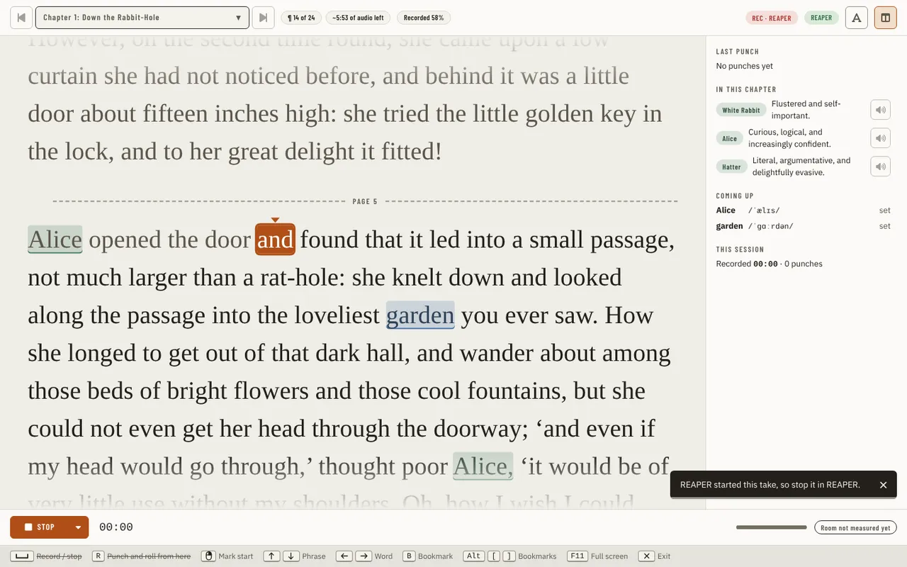

If another track is armed, several or none, or another project is open, the Booth does not follow the take. The setup chip says which, and so does the sentence under Record ("REAPER is already recording on another track, so the Booth is not following it. Stop it in REAPER before recording here."); with another project open the dialog says REAPER is recording a take now. The Booth does not arm a track while REAPER records a take it did not start: it arms the chapter's track once, when that take ends. If REAPER starts recording another track or has another project open while the Booth follows a take, the Booth stops listening and says so in one sentence ("REAPER is recording another track now, so the Booth stopped listening."); REAPER keeps recording. The sentence stays up while the Booth is not listening, and nothing says the take ended: no **Take saved**, no offer to check the recording. When the linked project is open again and this chapter's track is the one armed, the Booth follows the take again.

If you stop a take in the DAW itself, the Booth sees it and says so, and Record is ready for the next take. If REAPER stops
answering mid-take, the Booth says it can't tell whether the take is still running, and to check REAPER, instead of keeping a REC
pill it cannot vouch for. Another project opened in REAPER mid-take does not stop it: for a take you started with Record the footer says what changed, and for a take the Booth follows from REAPER the Booth stops listening (above).

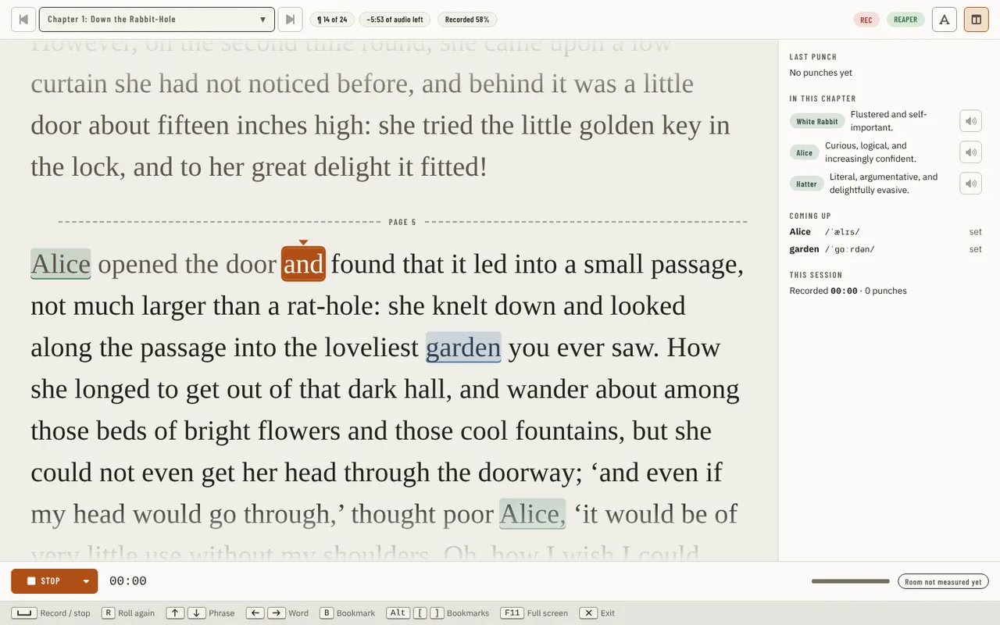

While a take runs, Record becomes **Stop**, a **REC** pill shows beside the setup chip and the timer counts. The timer is the
clock's: a window that slept or sat in the background shows the true time when you look at it again. A question that holds the
reading ("Stop recording?", a menu) does not stop the DAW: the pill then says **REC · reading paused** and the timer goes on. The
chapter cannot be changed until you stop, and the chapter arrows and the chapter list say so when you hover or focus them. Nor can it be changed while a take is still starting (the arrows say "Not while a take is starting."). A link to another chapter (a Script card, a bookmark, Back) asks the same leave question while a take is starting as while one records. A screen reader hears nothing when a take starts, so the Booth never speaks into an open microphone (turn on **Start tone** in [Settings](settings.md) for a beep before each take); once the take stops it says "Stopped. Recorded 00:42." When listening reaches the last word of the chapter and stops, the take stops with it and a message says
**Take saved**. Reading on past the end keeps the take running.

### Undoing a take

When you stop a take in a DAW, a message says **Take saved** with **Undo**, and the take is in the [undo history](navigation.md) as
"Recorded a take of <chapter>", so `Ctrl+Z` or Undo in the jump menu reaches it from any page. Undo takes the take back in the DAW, as
its own Edit > Undo would: the recorded audio is gone, and an earlier read the take split is whole again. The take's length also leaves **This session**, however you undid it. It works only while the
take is still the DAW's last action. Once you change something in the DAW after it, Undo leaves the take alone and says to use
Edit > Undo in the DAW. A take you started here and stopped with the DAW's own Stop button is in the History too, and Undo takes it back. A take you start and stop in the DAW itself is not in the app's History, and neither is a built-in
recorder's take; its file stays in `Recordings`.

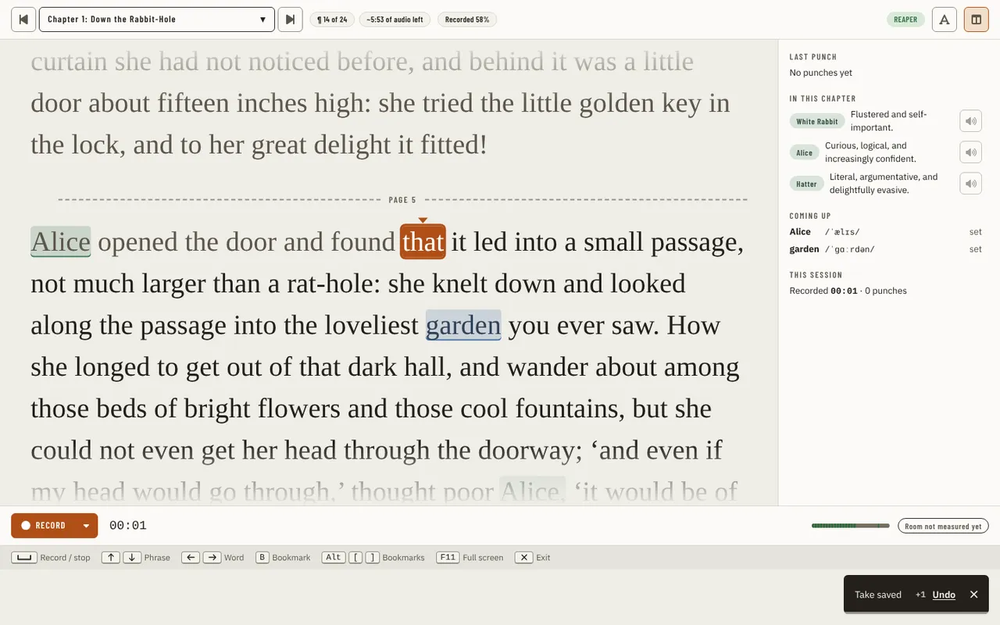

**R** punches and rolls. With a take running it records again from the word you are on, or from the phrase you chose with **Mark the start here**, keeping the earlier audio as a take. With no take running it is Record: it starts the take from where the text shows (the next paragraphs say how the Booth finds the spot), so you never press Record first. The only lead-in is the DAW's own pre-roll (see **Punch** under Record options); the
Booth adds none. With no take running, the spot is where that passage was recorded before, found in the last recording check and the DAW's items (on a Voice folders project, on the voice that read it, which becomes the voice for the take), and the take records over exactly that spot, after a message that names the track being recorded over ("Recording over ¶ 3 on Hero."); a passage nobody recorded continues from the end of the chapter's audio on every voice, and the Booth says so ("¶ 3 was not recorded before, so the take goes on from the end of the chapter's audio."). When the check is missing or out of date, part of the passage was cut, or it was recorded on two voices, the Booth says so and starts nothing. From the press until the take starts, **Record** shows a spinner. Pressing Space, **R**, Record or **Mark the start here** again on the same start meanwhile waits for the same answer and starts nothing more. Where the DAW can punch, **Mark the start here**, **R** or **Punch and roll** on another phrase while a take is starting is ignored with a message ("A take is already starting, so that press was ignored."), and so is **Mark the start here** during a plain press (no start chosen): it looks nothing up and does not move the text, and the take that was already starting goes on. Where the DAW can punch, while a take is starting, **Resume at**, the arrow keys, **Next phrase**, **Back one phrase**, a click on a word, **N** (next pickup) and a jump to a bookmark are ignored too ("A take is already starting, so the reading stays where it is."): the take records at the spot the press chose, so the text stays there. A find jump only scrolls to the match and leaves the reading where it is. They work as before once the take has begun or the start was refused. If you leave the Booth or change chapter while it waits, the press is dropped and no take begins. No wait in a press lasts for ever, and each ends with one error message and **Record** free to press again: the lookup above gives up after 8 seconds, as does the check that the DAW has the linked project open ("REAPER could not confirm the open project in time, so no take was started."); the choice of the voice a passage was recorded on gives up after 45 seconds, since the DAW may take that long to arm it ("The voice for this passage could not be set in time, so no take was started."). Starting the listening gives up after 45 seconds: the take that ran meanwhile is taken back and the Booth says "The take was taken back because the text could not follow your voice in time.", and the DAW's own start after 14 seconds, 25 seconds when the app's own recorder is the engine ("The Booth gave up waiting for REAPER to start recording."). If the DAW starts recording after the Booth gave up, that take is stopped, so the DAW is not left recording behind a take you cannot see; what it recorded in that time stays in the DAW's project. The check that the speech model is on this computer never ends a press: a model it found there is not waited for again on the next press (the list is read again behind the press), and a check that has not answered after 54 seconds (the time to read every model in full on a slow disk, once) lets the take go on, since starting the listening says so when the model is missing. A check that gives up never opens its download question afterwards, for a cold read as for a take, so no question appears over a take you started. A voice choice that answers after it gave up may still leave that voice chosen on the project's track. A Stop the DAW has taken is waited for, so on a slow DAW the take ends when the stop lands and nothing is said meanwhile; a DAW that is closed or never took the stop says so within about 3 seconds. A Stop the DAW took and has not confirmed after about 23 seconds says "REAPER took the command but did not confirm it in time, so what it did may not match. Check REAPER." (the take may still be recording, or may stop a moment later; pressing Stop asks again). If the app itself gets no answer at all, the Stop gives up after 26 seconds ("Stop did not go through: REAPER did not answer in time. Check REAPER before pressing again."). The stop of a take dropped because its listening failed gives up after 26 seconds too, and taking that short recording back after 29: the Booth then says "The take could not be stopped: REAPER did not answer in time. Stop it in REAPER." or the same for taking it back, and Record is free again. A stop that answers after it gave up leaves that short recording in the DAW, where you were told to look. A roll the DAW never answers gives up after 8 seconds too ("REAPER did not answer the roll in time. The take may still be recording from before; check REAPER, then press R to roll again."), and **R** works again. A roll that lands after that is never answered by the Booth stopping anything, because it cannot tell that recording from your own take: it says "A roll the Booth stopped waiting for has landed. REAPER may be recording, and a take in progress may have been cut. Check REAPER." (the same short sentence whatever else the Booth can tell of your takes). It replaces the "did not answer the roll in time" sentence, which goes by itself when the take ends or you leave the Booth. A roll that answers inside its limit after you pressed Stop, left the Booth or started a newer take says the same sentence and logs no punch, moves nothing and does not say "Rolling again", because the DAW's roll stops, moves and records again and may have left it recording. A roll that fails outright says "Rolling again did not go through: ..."; one that fails or is refused when no take records says nothing, and a roll that times out after REAPER already ended the take does not add that the take may still be recording. A refusal that lands while a take records is said without blaming that take ("A roll the Booth stopped waiting for was refused, so nothing was rolled: ...") and not at all after a later roll went through. When the Booth itself stops a take (its listening failed, or you chose **Stop and leave**), it does not also say that REAPER stopped recording: only the stop you were told about is said; if that stop does not go through, a take that ended meanwhile is said as usual. Each wait that hit its limit is written to the run log as `ui.record.limit` with the stage's name. Pressed again within a moment, it rolls once, not again. Where the DAW would replace the audio instead (Audacity without backups), the Booth asks first ("Roll
again from ¶ n?") and holds the take while it asks. **R** is always record: with **Main button** set to **Cold read** it still starts a real take, because only the button, Space and Enter follow the mode. A press that ends without a take says why once, as one message: the footer does not repeat the sentence (Record keeps it as its description for a screen reader), the note the press made on the way ("Recording over ¶ 3 on Hero.") goes when it ends that way, and a second refusal replaces the first. This holds for the refusals of the phrase lookup (including its 8-second limit), of the choice of the voice and of a roll as well; each is an error message that stays until you dismiss it or 20 seconds pass. Starting a take, or pressing again to start one, takes an earlier refusal away, so no "no take was started" (or its **Retry**) is left beside a take that runs; a refusal with no words says a plain sentence in its place (for example "The DAW did not start recording."). In a window narrower than 24 rem (384 px), the only message showing puts its action (**Retry**, **Check again**) and its dismiss button on a row under the text, so the sentence has the whole width of the message; a longer message scrolls inside it, from its first line, and stays inside the window.

Click a word to start from it. **↑** and **↓** move by phrase, **←** and **→** by word, **=** and **-** change the text size, and
**F11** takes the window full screen. Hold an arrow and the reading position keeps travelling; Record and Stop (**Space**, **Enter**, the numpad's Enter and the foot pedal) act once, however long they are held. A press on Stop within a second of the take starting (a double click) is ignored, and the Booth says "Recording just started. Press Stop again in a moment if you meant to stop."

Right-click the text for **Mark the start here** (on a phrase), **Bookmark here** (on a word), **Next phrase**, **Back one phrase**,
**Punch and roll**, **Larger text**, **Smaller text** and **Exit Booth**. **Mark the start here** only marks where the next take starts: the phrase is tinted and its first word is marked, in the text itself (the cursor's fill while the cursor is on it, an underline once the cursor has moved on), and the text moves there (during a take the voice keeps the cursor, so the underline shows where the start is). It sends the DAW nothing, arms nothing and records nothing; the take starts when you press **Record** (or Space), from the mark, and **R** is the press that marks and starts in one go. The mark is for that one take: when the take ends, "Next roll starts from" goes and the next Record starts where the recording ends. A take is held while the menu is open.

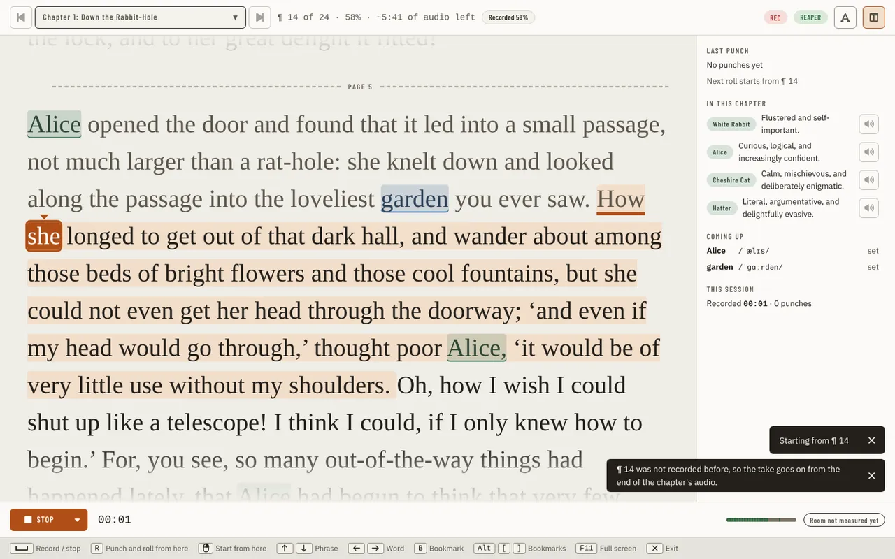

One rule decides where a take starts: where you chose, else where the recording ends, else the beginning. Any move of your place chooses the start: **Resume at**, a click on a word, the arrow keys, **Next phrase** and **Back one phrase**, a find jump, a bookmark jump (in this chapter or another), a jump to a pickup, **Record from here** on the Script and a pickup session's first line. **Record** (Space) starts from where the text now shows you: it looks the place up and records over it as the Record section describes. A move away from a start you chose moves the start with it, and a move that does not move the text (an arrow at the end of the chapter, or a step inside the phrase) changes nothing. Going back to the place where your recording ends chooses nothing: the take simply continues from there, as it does when you open a partly recorded chapter, which opens on that place. A chapter with no recording opens where you last left it, else at the beginning; a place you left a chapter at counts as one you chose. During a take the voice keeps the cursor, so a move then only drops a start you chose before it.

While a popover or a menu is open (Record options, Text settings, a speaker, the chapter list, a right-click menu), a foot pedal's Space still starts or stops the take: it closes the popup, as Escape would, and records. The exception is a box you can type in (the speaker search): Space types a space there until focus moves. A choice under **Main button** keeps Space too: on a focused **Record** or **Cold read** it selects that choice and starts nothing. A question ("Stop recording?") or the jump menu keeps every key, Space included, until you answer it. Escape closes the one on top and returns you to the control that opened it.

The engine and model the Booth listens with are chosen in [Settings](settings.md) › Booth, for a take and a [cold read](#a-cold-read) alike. Nothing you say is sent anywhere.

### The microphone the Booth listens to

Nothing has to be set. Everything that listens (the text following your voice, a [cold read](#a-cold-read), the level bar and the
room tone) uses one microphone:

- **With a DAW, the DAW's own input.** The Booth asks the DAW which input it records from and listens to the same device.
  **Record options** shows it with **Same as REAPER**, what REAPER records from (its audio device and, for a linked chapter, the track's
  input, such as **Focusrite USB ASIO · Mic/Line 1**) and the device REAPER plays on. Change the input in REAPER and the Booth
  follows it the next time it asks: when you open the Booth, change chapter or come back to the window.
- **When the DAW's input could be several microphones** (two inputs of one audio interface), **Record options** says so and shows one button
  for each. Press the one REAPER uses; until then the Booth listens to the first of them.
- **Choose a different one** in **Record options** or in [Settings](settings.md) keeps another microphone over the DAW's, for every project,
  until you press **Use REAPER's input**.
- **When the DAW cannot say** (REAPER has no audio device open, its device matches no microphone here, or the DAW is Audacity,
  which cannot report its input), the Booth listens to the microphone you chose in **Record options**, else the first one this computer lists,
  and **Record options** says why with a list to choose from.

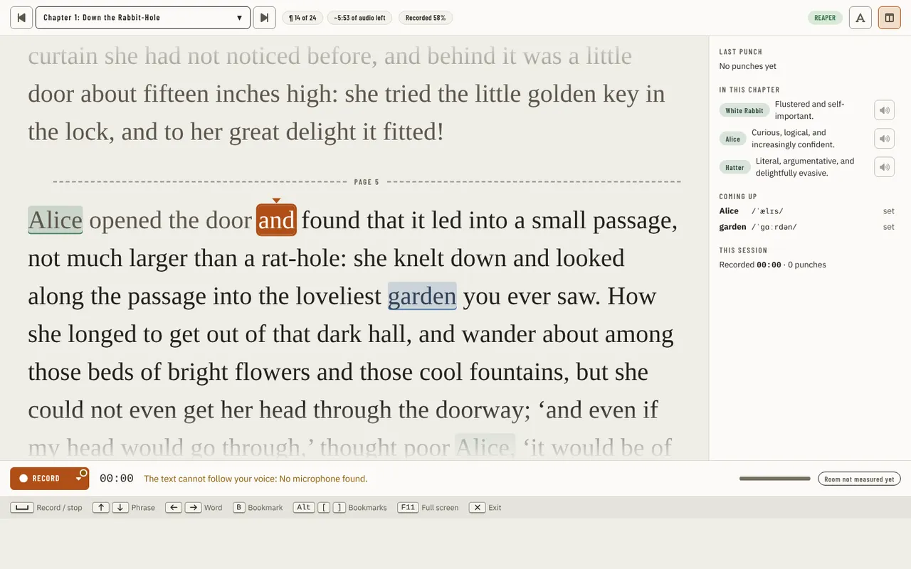

If the speech model is not downloaded yet, the footer says so before you press Record ("The text cannot follow your voice yet"),
and the first take asks to download it, says how large it is and where it goes, and
downloads nothing until you press **Download model**. While the text cannot follow (no microphone listed, or the listening failed
to start), the footer says why. Listening starts at the same time as the DAW, so REAPER's pre-roll plays while the speech model loads instead of after it. A take is never kept with the text unable to follow, unless you stopped it: if listening fails to start, the Booth stops the recording, takes back anything it recorded, and says why. With REAPER's pre-roll on, the failure comes inside the pre-roll and nothing was recorded. With it off, the first second or so of a take is recorded before the text can follow it. The built-in recorder has no pre-roll, so it starts once listening has. A second press while a take is starting starts nothing more. **Stop** pressed while listening is still starting stops the DAW at once, and a take you stopped is kept, never taken back: if listening comes up afterwards it is let go and nothing is said; if it fails, the Booth says "The take you stopped is kept, but the text could not follow your voice during it." and the take stays in the DAW.

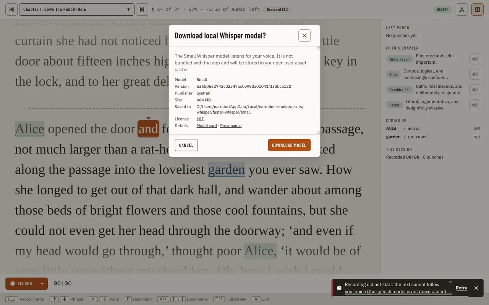

### A cold read

To read a passage through before recording it, open **Record options** (the caret on the side of **Record**) and choose **Cold read** under **Main button**. The button now reads **Cold read**, outlined in blue so it cannot be mistaken for a take, and its hint says that Space starts a cold read and that nothing is recorded. Press the button, Space or Enter to start. Choosing **Record** there again switches the button back. A cold read records nothing and needs no voice: while the button reads **Cold read**, a voice key, a pick from the voice list (a voice or a character with no track), **Num +** / **Num −** and a key with no track change nothing at the DAW, add no track and say so, and the voice control shows no armed dot. Choose **Record** to pick a voice again. The choice is not kept: when you open the Booth again the button reads **Record**, so a lone Space records, and changing chapter while a cold read listens ends it and puts the button back on **Record** too. Choosing **Start cold read** in the jump menu (Ctrl+K) does both steps at once. **Ctrl+Alt+Space** (not Alt+Space, which Windows keeps for the window menu) switches the button to the other mode and starts it at once: from **Record** it starts a cold read, from **Cold read** it starts a take, with the same checks and messages as pressing the button. While a take records or a cold read listens, or while a popover or question is open, Ctrl+Alt+Space does nothing, and holding it starts once. The shortcut sheet (**?**) lists it (the app always names modifiers in the order Alt, Ctrl, Shift, so it shows **Alt Ctrl Space**: the same chord), and **Settings** > **Appearance & keys** > **Shortcuts** can change it. The Booth listens as it does during a take, with the engine and model chosen in Settings, and nothing you say leaves this computer. Nothing is recorded. While it listens, the top bar shows **Mic on · cold read** in the recording colour, drawn dashed.

A second cursor, the **ghost**, follows your voice: the word you have reached has a dashed outline and a muted tint, with a dashed tick above it. The text keeps the ghost in view, so you can read on without touching anything. The real cursor, a filled word with a caret, stays where you left it: the next take starts from there. The progress line and the resume line follow the real cursor too. A click, an arrow key or **Mark the start here** moves the real cursor, not the ghost. What you read during a cold read is not kept: it never moves the real cursor, sets where you stopped, adds a suspected line or touches a bookmark.

Listening never carries over from a press you walked away from. If you leave the Booth or change chapter while a take's listening is still starting, that listening is ended when it comes up, and it does not cut off the listening of a take you start after it. If you press Record while a session is still ending, the Booth waits for it to end and then listens afresh. If the host never finishes ending it, the Booth gives up waiting after a few seconds and asks for a new session; if that is refused the take is taken back and the Booth says the text cannot follow your voice. A cold read whose speech-model check or start finishes after you left starts nothing, or is ended when it comes up, and says nothing on the page you are on now. A take that starts late in a Booth you left does not stop the take you started after it. If you press Record while listening from an earlier press is still starting, the Booth waits for it: if it comes up, the take goes on; if it fails, the take is taken back and the Booth says why, as for any take whose listening failed; and pressing Stop ends the wait at once. A cold read keeps listening until you stop it: press the button, which now reads **Stop**, press Space or Enter, or leave the Booth. It does not stop at a pause or at the end of the chapter. The choice under **Main button** is off while a cold read listens or a take records. Changing chapter ends the cold read, and Escape leaves without asking, since nothing would be lost.

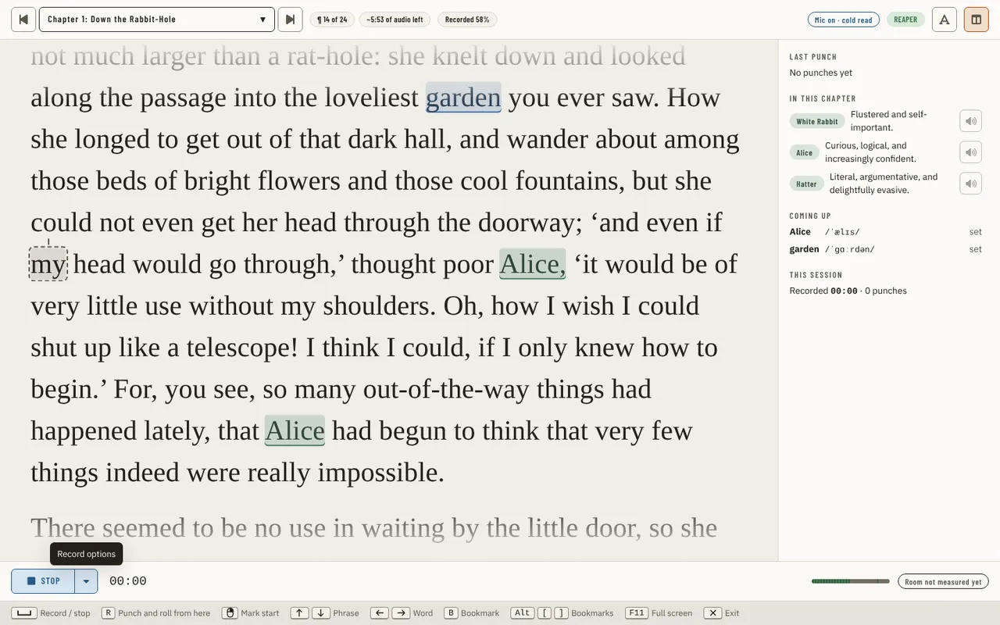

### Recording each voice on its own track

In a project set to **Voice folders** ([the audio engine panel](navigation.md#voice-folders)), or whenever a chapter is linked to a REAPER folder
that holds only tracks of its own (none another chapter is linked to), the chapter records on one of the folder's tracks, its voices, so an effect on a character's track covers every line of that character. The footer then shows the
voice a take records on, to the left of **Record**: its number-pad key (the number alone, "2") and the track's name, with a red ring when REAPER reports that track
armed, and a warning sign when REAPER has several tracks armed (Record arms only the voice). Until you choose another, it is the track
named **Narrator**. A track another chapter is linked to is never one of the voices, in either layout, so Record never arms another chapter's track. Nor is a track you turned off with its **Voice** switch on the [Voices card](navigation.md#voice-folders) (a music bed): it is not listed and Record never arms it. When you choose a voice while nothing is recording, REAPER arms that voice's track at once and disarms the others, so the Booth and REAPER agree. If REAPER refuses (it is recording something else, or the track is gone), the Booth still records on the voice you chose and a message says REAPER's armed track did not change. The other way works too, with REAPER (not yet checked by hand in REAPER): arm another of the chapter's voice tracks there, with or without disarming the current one, and within a few seconds the Booth's voice becomes that one. It does not during a take, in a cold read (which needs no voice) or when two other tracks are armed at once (it would be guessing which you meant).

Press the voice control, or **Num .**, for the folder's voices in REAPER's order, each with its key and the characters it records. Type to
narrow the list by key, track or character, and press **Enter** or click a voice to choose it. A search also lists characters, the chapter's first and then every character of the story, so a wrong attribution never blocks a pick: a character with a track chooses that track, one without asks who records it. When nothing matches, the list offers **Add a track**, which asks who the next new track is for, so you need not know which keys are taken. **Num 0** chooses the Narrator track, **Num 1** to **Num 9** the others in order (hold **Shift** to add ten: **Shift Num 1** is the 11th voice, **Shift Num 0** the 10th), and **Num +** and **Num −** the next and
previous voice. With no take running, a voice key (**Num 0** to **Num 9**, **Num +**, **Num −**) also starts the take on that voice once REAPER has accepted it; choosing from the list only selects. Either way the next **Enter** or **Space** is Record's: a voice key or a pick from the list leaves focus on the page, not on the voice control, so it does not reopen the list. During a take a voice key switches the recording at once and REAPER keeps recording: the take is one item on each voice
and one undo point, and about a twentieth of a second at the switch is recorded on neither track, so press the key in a pause between
lines. A key pressed before the last one is answered is sent next, so the voice you end on is the one you pressed last. While the main button reads **Cold read** the words of the voice hints in the footer are struck through, and hovering one says why: a cold read needs no voice, so Num 0, Num + / Num − and Num . only say so, and the list does not open (a click on the voice control says so too). In a chapter with no voice folders the sentence is just that a cold read needs no voice. A key with no track
behind it asks who is in it ([below](#adding-a-voice-track)). Each chapter keeps the voice you chose until you close the app or open another project, and the
control shows the voice the app will record on, also after you leave the Booth and come back. In a
chapter that records on one track, or that is not linked to a folder of voices yet in a Voice folders project, the voice keys say which it is and why they do nothing, and **=** and **-** still change the text size. If the chapter is linked to a folder whose every track you turned off with the Voice switch (see [the Voices card](navigation.md#the-audio-engine-panel)), in either layout, the keys and **Record** say so and name the Voices card, and in a Flat project also say to link the chapter to a track of its own; **Record** starts nothing until one is back on. If the chapter is linked to a track REAPER no longer has (deleted there), the keys say so in either layout, and the Engine panel shows it as **Track missing** (**Folder missing** in a Voice folders project). The Booth reads the tracks from REAPER as they are now, as the Engine panel does, not from the last save, so a voice you rename, add or delete in REAPER shows within a few seconds. The characters you chose for a voice follow the track when you rename it in REAPER to a name no other voice has, and the Narrator stays number key 0 under its new name. A voice's characters are kept by the voice's name, so they are the same in every chapter that has a voice of that name: rename a track to a name another voice already has and it takes that voice's characters.

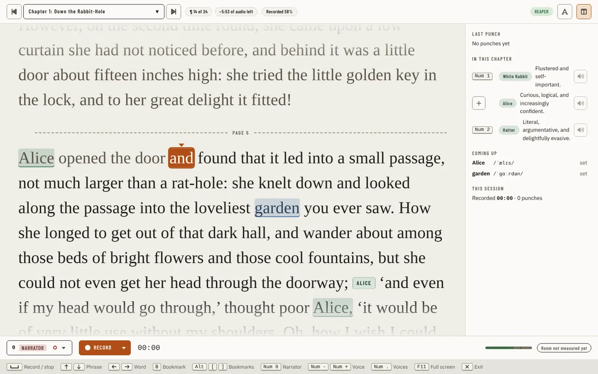

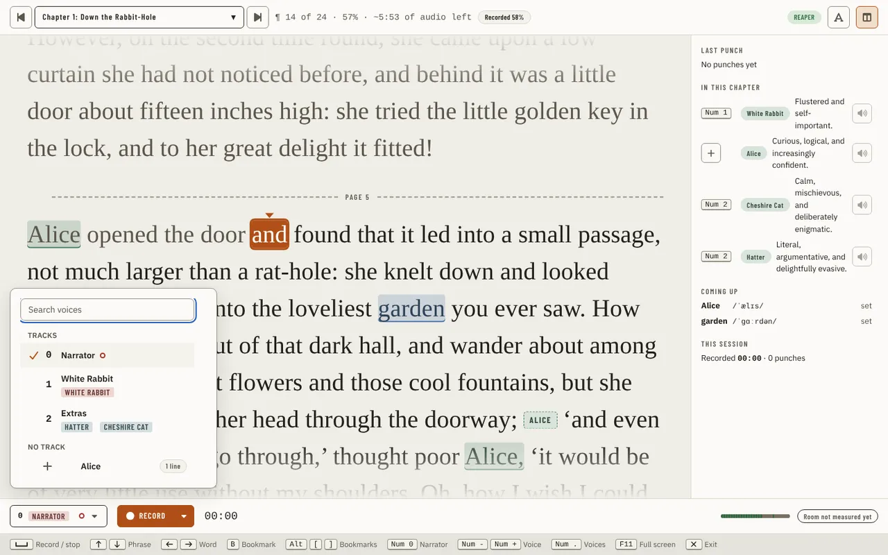

#### Adding a voice track

A number key with no track behind it opens **Who is in Num 7?**. During a take, the Booth first stops the take as **Stop** does, so what
you recorded is kept on the voice it recorded on, and then asks. If you press another key before the take has stopped, the Booth uses
that key, and a key with a track is then simply chosen. Choose how to record them:

- **A new track**: tick the characters it is for. The chapter's characters come first, with their lines in the chapter or the key of the
  voice that already records them, and the speakers with no track are ticked for you. The rest of the book follows. The name is the
  character's when one is ticked, else **Extras**; type another if you like. **Add track** adds it in REAPER as the folder's last track,
  so it takes the next free key, not necessarily the one you pressed, and chooses it for the next take.
- **An existing track**: the ticked characters are added to the track you pick, and it is chosen.
- **The Narrator, this time**: the Narrator track is chosen and nothing is assigned.

A new track is one undo point in REAPER, after the take's own, so undoing it never takes the recording with it. The app lists the track
at once. Save the project in REAPER to keep it: until you do, the saved project does not have it, though the Booth records on it.

The voice list shows the chapter's speakers with no track under **No track**, each with its lines. Choosing one while stopped asks
**Who records the King of Hearts?**, with the same three answers. During a take it asks nothing: the Narrator track records the
character at once, and the voice control shows **King of Hearts → Narrator** with a warning sign. After the take, two buttons beside it
add a track for the character or put it on an existing one. In the side panel, **In this chapter** shows each character's voice key, or
an add-track button for a speaker with no track.

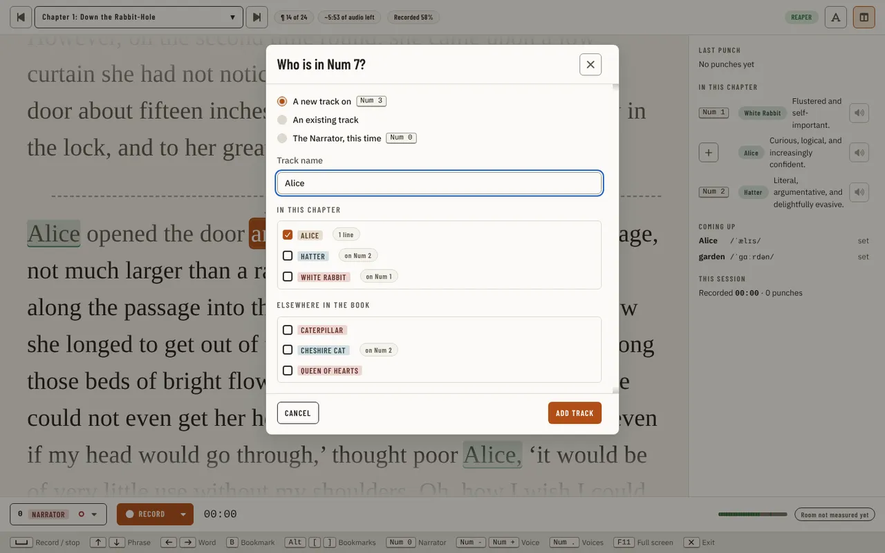

## Where the Booth opens in your DAW

When your DAW is connected and following is on, the Booth and the DAW stay together at the start:

- **Opened with no chapter** (from the sidebar, say): the Booth opens on the chapter you last left in this project, at the place [Where you stopped](#where-you-stopped) describes. With none kept, or the chapter gone from the book, it opens on the chapter whose track is selected in the DAW; with no track selected, several selected, or a track no chapter is linked to, it opens where it would have.
- **Opened at a chapter** (from the Script, Pickups or a bookmark), or **going to another chapter** inside the Booth (the chapter arrows, the jump menu, a bookmark): the DAW goes to that chapter as well. It selects the chapter's track and, when the chapter is a folder of voices, the tracks inside it, so you see the chapter and its voices together. The chapter the Booth opened on because the DAW was on it is not moved to, since the DAW is already there; the chapter you last left is moved to only when the DAW is not already on it, so coming back from another page keeps the cursor you placed. After a restart the Booth takes the DAW to that chapter if the DAW is running within about 20 seconds of the Booth opening; a DAW that starts later is brought back the next time the app window gets focus. With only a chapter, its cursor goes to the end of the track; with a line, to where that line was recorded before (found in the last recording check, on whichever voice read it; a line nobody recorded goes to the end of the chapter's audio, and when there is no current check the Booth estimates the place from the text's length), so you can punch from it.
- **The other chapters go quiet.** With REAPER, while the Booth is on a chapter, the app also solos that chapter's track (Audacity does not do this), so the other chapters are silent and none of their tracks is touched. A track you muted stays muted, and one you soloed is left alone. Another chapter you soloed yourself stays audible beside this one. If you solo this chapter again yourself while the Booth is on it, leaving the Booth takes that solo off. Leaving the Booth, closing the app or turning **DAW follows your chapter** off takes off only the solo the app set. If REAPER does not answer when the solo should come off, a message says so; the app tries again when you come back to its window, and the message goes away when it works. If the other chapters stay silent after you leave the Booth, unsolo the chapter's track in the DAW. If you save in REAPER while the Booth is open (Ctrl+S or REAPER's autosave), the chapter may still be soloed when you open the project again: unsolo it. If you switch to another project in REAPER and back, the solo comes off while you are away and is not set again until you go to a chapter in the Booth. If REAPER closes while the chapter is soloed, the solo comes off the next time REAPER opens or the app connects to it, and that includes a solo you made yourself in between. If the app crashes or is forced to quit while REAPER stays open, the chapter stays soloed until you open the Booth on a chapter and leave it. A pickup session does the same for the chapter of each line.
- **Record** after **Mark the start here**, and **Punch and roll** from a line, move the text there, move the DAW's cursor to that spot and record from it, so you never have to find the place in the DAW with the microphone live. **Mark the start here** alone moves nothing in the DAW.

The DAW may still be connecting when the Booth opens; the Booth tries for about 20 seconds and then stays where it is. A DAW that cannot follow is left alone without a message. When you come back to the app after selecting something else in the DAW, the DAW's selection is put back on the Booth's chapter and your cursor stays where it is. Nothing moves if the DAW is already on the chapter or is recording. To keep the DAW where you put it, turn off **DAW follows your chapter** in [Settings](settings.md) (Recording & DAW); the Booth then never moves the DAW or quiets a chapter.

The same switch arms your voice, in REAPER only: Audacity has no record arm or input monitoring to set, so the Booth leaves it alone, and a cold read arms nothing.

- **Entering a chapter:** opening the Booth on a chapter, or going to another, arms the track the next take records on (the voice you chose, else the Narrator voice, or the chapter's one track) and disarms every other track, so only one records. It also turns that track's input monitoring on if it is off, so you hear yourself before you press Record. A track you already monitor, in either of REAPER's modes, is left as it is.
- **Choosing another voice:** it arms that voice and puts the earlier voice's monitoring back.
- **Adding or creating a track:** a voice you add with **Add track** is armed and monitored at once, as if you had chosen that voice (with the switch off it is armed without monitoring). When the track of the chapter the Booth is open on appears (you made it with **Create a new track** (**Create a new folder**), linked it there, or made it from the Engine panel or Chapter links while the Booth stays open), it is armed and monitored once it is linked, as when you enter a chapter; that needs the switch on. A track made for another chapter, or when the Booth is not open on its chapter, arms nothing, because arming one track disarms the others. A voice added while you chose another meanwhile, or while a take starts or runs, is listed but not armed. If REAPER will not arm it, the track is still added and a message says so.
- **Leaving:** leaving the Booth, or closing the app, puts back only the monitoring the Booth turned on, and only where you have not changed it since. If you switch a monitored track off and on again yourself, the Booth cannot tell it from the one it turned on and puts it back to off.
- **During a take:** the Booth arms and changes nothing while REAPER records, and says nothing during a take the app runs. A toast appears only when REAPER itself refuses, as it does for a recording you started by hand. A voice you choose during a take is armed as soon as it stops (and monitored, with the switch on). Leaving mid-take puts the monitoring back after the stop, unless you come back to the Booth first.
- **REAPER cannot be reached when you leave:** a toast says your input monitoring may still be on; turn it off in REAPER. If you do not, it goes off when the app's script next starts: when REAPER opens, or with **Start the launcher script with REAPER** off in [Settings](settings.md), when the app next connects. That toast comes once when REAPER cannot be reached at all; if REAPER answers but cannot put the monitoring back, it tells you again each time you leave, until a leave works. It says nothing when the Booth never turned monitoring on.
- **With the switch off:** entering a chapter arms nothing and turns no monitoring on; choosing a voice still arms it, and leaving still puts back whatever the Booth turned on. If you turn it off partway through a visit, a voice the Booth already monitors stays monitored until you leave.

## Where you stopped

Each chapter opens where you left off in it, in this order:

1. **A place you came for**: a pickup session's line, a line a link names (from Script, Pickups, Editing, Proof or a bookmark), or
   **Mark the start here**. It always wins.
2. **Where the recording ends**: the word after the last one recorded, so a chapter recorded half way opens at the half. The app
   reads this from the chapter's current [Proof](proof.md) check, from the takes the Booth followed, or, with neither, from the
   length of the chapter's track against its words, which is an estimate. Takes that skipped ahead (a pickup half way through)
   do not count: it is how far the chapter is recorded from its top. A chapter recorded to the end has nothing left to record and
   opens at the next step instead.
3. **The word you last read to in that chapter**, per project, on this computer: switching chapters, leaving the Booth and
   restarting the app keep it for every chapter, not only the last one. Open the Booth from the sidebar and it returns to the
   chapter you last left.
4. **The top of the chapter**, for a chapter with nothing recorded that you have not opened before.

A chapter edited since it was recorded loses the places that named its old words: the Booth then uses the track's length, or the
word you last read to, or the top. If the browser's storage is blocked, step 3 is skipped.

On a chapter linked to a folder of voices, a track in it that you marked as not a voice (a music bed) is left out of all of this, whether REAPER is open or not: where the Booth reads the chapter's recording to end, where it places you from the recording, which recording a passage mark is stamped with, and the recording the word-times view and a pickup's lookup read. Starting a take at the end of the chapter's audio inside REAPER itself still counts the bed.

The top bar's progress is a row of chips (**¶ 38 of 71**, **~8:10 of audio left**); they show the share read only while the chapter has no recording, so the top bar never says a percent twice. It says how far the chapter is recorded: **Recorded 45%**, or **Complete**, in green, once the recording reaches
the end. A chapter recorded to the end shows only where you are reading (`At ¶ 1 of 24`), with no share or time left. Its tip quotes the last words recorded, for example *Recorded through "said the Queen" (45%)*, and says *about* when the
figure comes from the track's length. It is one number on every page, the chip, the chapter menus here, on Editing and on Proof, the Companion's resume line and Production's Record cell: a chapter with a recorded second on its track never reads 0% (the host rounds the share of words, so a chapter's first take can be at 0% of its words), audio under one second counts as none and reads 0% (the Companion's **This chapter** says **Recorded 0:00** there, and Production **None yet**), and only a chapter recorded to the end reads 100% (the chip and the menus say **Complete** then). The reading line (`¶ 1 of 24 · 0% · ~13:47 of audio left`) is where you are reading, not how much is recorded, and can read 0% beside **Recorded 1%**.
The chapter menu lists the same figure after every chapter's name, as the chapter menus on [Editing](editing.md) and
[Proof](proof.md) do.

A resume prompt that finds the chapter's track missing or linked twice has a **Link a track** or **check the link** button that opens the audio engine panel over the Booth.

A chapter that is partly recorded opens at the word after the recording ends, so **Recorded through …** and the reading position
agree and no resume line is drawn. Once you move elsewhere in the chapter, the top bar offers **Resume at ¶ n** and says where it
read that from: the DAW now, the saved project, or the Booth's own record of your last reading. Choosing it moves your place back to
where the recording ends; nothing starts until you press Record. With none of those, it offers the place the chapter opened at,
*where your recording ends* or *where you left off*, so you can go back to it.

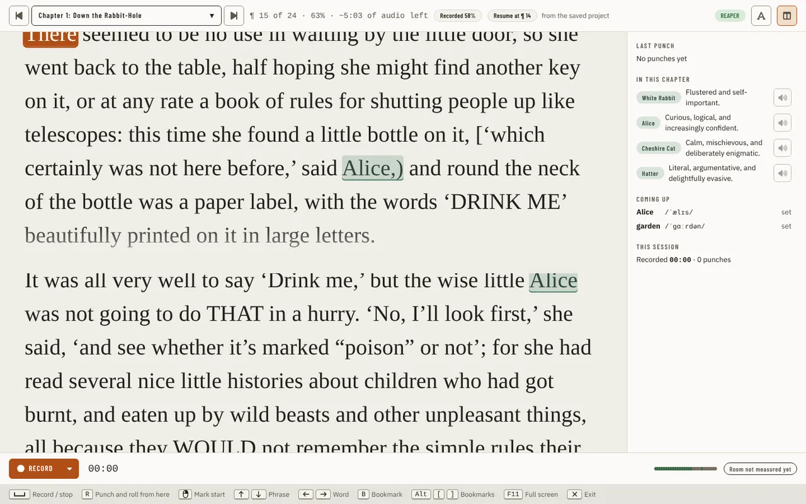

## Voice samples

A voice sample is a stretch of your own recording that you marked in [Editing](editing.md#marking-a-voice-sample) as how a character
sounded; the [Story Bible](story-bible.md#voice-samples) lists them. The Booth lets you hear one without leaving the text, so you can sound the same
in chapter 19 as in chapter 3.

- **Speaker picker.** Press a speaker chip. The characters who speak in this chapter are listed first under **In this chapter**, then
  **Everyone else**. A character with samples shows how many, and a play button at the right of the row plays its primary sample (the starred one in the
  Story Bible); a character with none says "no sample". The picker has the arrow keys now: **Up** and **Down** move the highlighted row and
  **Enter** chooses it. **Ctrl+Enter** plays the highlighted character's primary sample without choosing it, and **Esc** stops it.
- **Side panel.** Each character in **In this chapter** is one row: its speaker chip in the character's own colour, the Story Bible's note on how they talk, and the
  speaker button at the right, **Hear the reference clip**, which plays the primary sample. A voice with a sample also has a count below the row; press the count to list every
  sample with its length, and press one to hear it. A voice with none keeps the button, switched off, and its hint says "No voice sample yet. Mark one in Editing." Press the button, or a sample, again to stop it.

A sample does not play while the DAW is recording, on this page or on any other: it says "Not while recording. Stop the take first.", and one already playing stops when a take starts, so it never reaches the microphone.

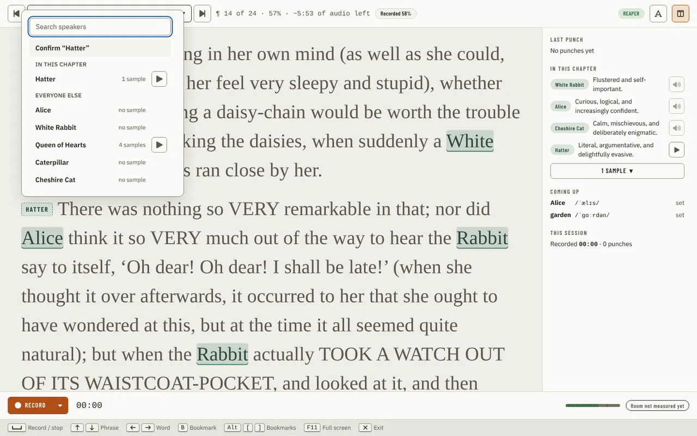

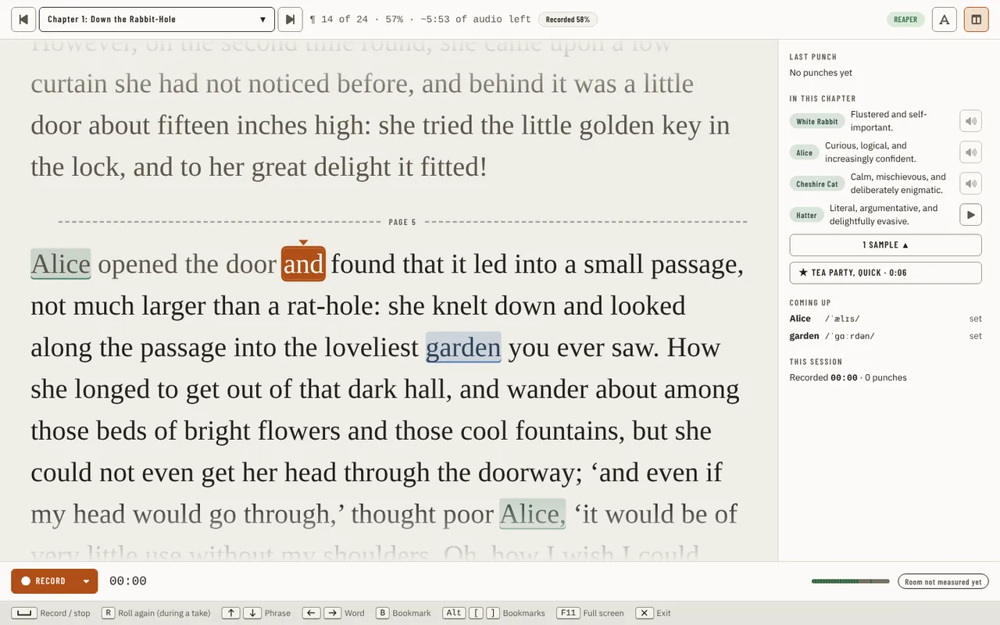

A sample plays through the computer's own speakers or headphones, never through the DAW, and it does not move the text or REAPER's cursor. Only one plays
at a time, and playing another stops the first. While the text is following your voice, listening pauses for the sample: the Booth asks the session to
pause, starts the sound about a third of a second later, and takes the pause back a third of a second after the sample ends or is stopped, with the note
**Listening paused while a voice sample plays**. A session you paused yourself stays paused. If you press Resume while a sample plays, the Booth leaves it resumed.

A sample is refused, with a sentence, in two cases:

| Shown | What it means | What to do |
| --- | --- | --- |
| "Not while recording. Stop the take first." | A take is recording, and a sample through your speakers would be heard by the microphone. The play buttons are off, and their hint says so. | Stop the take. |
| "Can't tell whether a take is recording (last heard 12 s ago)." with **Check again** | The DAW has gone quiet, so the Booth cannot tell whether it is recording. | Press **Check again**, or look in the DAW. |

A sample whose audio file is missing is listed with **Audio file missing** and does not play; the Story Bible says what to do. If a sample cannot be loaded, it
stops with a message.

**V** plays the primary sample of whoever speaks the phrase the reading is on, with no need to open the picker; a phrase with no quotation is Narration's. Press **V**
again to stop it. It plays nothing and says why in a message when that speaker has no sample ("No voice sample for Alice yet. Mark one in Editing."), when the phrase's
speaker is not known yet ("Choose who speaks this line first: press its speaker chip."). Choosing a speaker on a chip is a history entry you can undo, as on Script, or during a take. **Esc** stops a sample that is playing; the next **Esc**
leaves the Booth, as it always did. The key is in the shortcut sheet and in **Settings > Keyboard** under Booth, where you can change it.

When the Booth opens, it loads the primary samples of the characters who speak in the chapter, and Narration's, in the background, so the first press does not wait
for the file; nothing plays by itself, and nothing is loaded while a take records.

## Bookmarks

The chapter's [bookmarks](script.md) show as ribbons in the right margin of the text, beside their words; hover one for its label
and note, and click it to edit it. A bookmark whose line changed since it was made is a warning mark at the top of the margin.
**B** bookmarks the word you are on, with **Undo** on the message. **Alt+]** and **Alt+[** move to the next and previous bookmark,
into another chapter when needed; during a take they move only within the chapter, and a bookmark in another chapter waits until you stop recording. Right-click a ribbon for **Edit bookmark** and **Delete bookmark**.

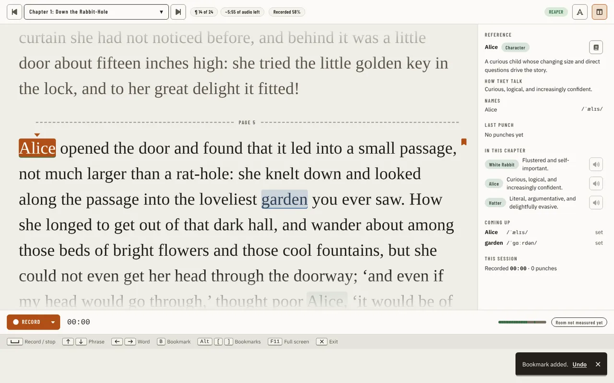

## Pages and your stopping place

The Booth marks where a page breaks: a dashed line across the text above the page's first line with **Page 2**, **Page 3** and so on in its middle, drawn the same way as the "End of chapter" line on the [Script](script.md) page. A page is at least 250 words, counted from the start of the chapter (the title and subtitle included), and never breaks inside a paragraph: when the count reaches 250 partway through a paragraph, the page runs on to that paragraph's last word and the next page starts with the next paragraph, counting again from there. A paragraph longer than a page makes one long page. The last page of a chapter has no break after it, so a chapter of one page, or of a single paragraph, has none. Change the figure for this project with **Words per page** in [Settings › Project](settings.md#project). Each page's first paragraph has extra space above it for the line, and the line itself takes no room, so nothing moves as you read, record or change the text size.

To mark where you mean to stop, right-click a word, or a page's label, and choose **Read to here**. The place gets a chequered-flag ribbon, also shown in the Script and in the jump menu (**Read to here: …**), with **Undo** on the message. A chapter has one stopping place: setting another moves it, and **Undo** puts it back where it was. It only marks the place: nothing stops, pauses or ends a take when you reach it. Right-click the flag for **Edit stopping place** and **Remove stopping place**.

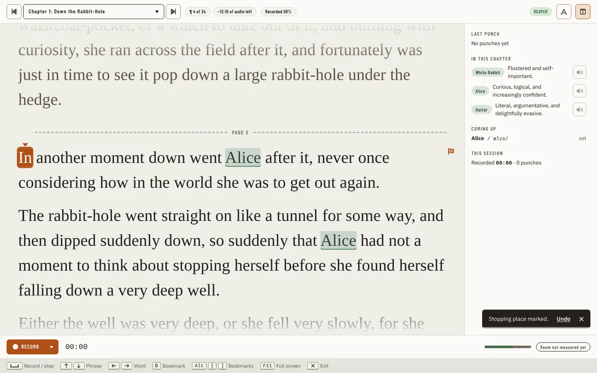

## A pickup session

**Open N in Booth** on [Pickups](pickups.md#pickup-session) opens the Booth on the chosen lines, at the first line's chapter. A
**Pickups · N open** chip on the top bar counts the lines still open, and the side panel lists them first, each with its chapter
and time on a card of its own: a chip says **Open** or **Recorded**, and the line you are on is framed. In the text, each pickup
line has a bar down its left side and starts a little further in. Click a line, or press **N** and **Shift+N**, to go to the next or previous one, in another
chapter when needed (not during a take). A line the recording check found is tagged **Automatic**; dismissing it removes it from
[Pickups](pickups.md) as well.

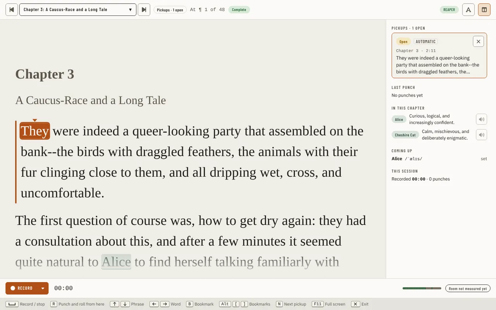

When a take stops, the lines it read over are marked recorded, and the message says how many ("Take saved · 2 pickups marked
recorded") with **Undo**. With a DAW, that **Undo** takes the take back in the DAW first, then opens the lines again.

## Suspected lines

While you read, the Booth marks places where listening suspects something went differently from the script, such as skipped
words or a restart. They are listed in the side panel as cards, a chip naming what was suspected above the line, where **Dismiss** removes one from the list. Every
one is only suspected: Transcript Compare over the recording is the authority.

With Moonshine as the listening engine and the tiny Whisper model installed, a second listen rechecks each stretch you finish
reading a few seconds later. A suspicion it also hears gets a **Confirmed** chip, and its hint in the text says "A second listen
heard it too." A suspicion it does not hear, because it read the script there, gets a **Not confirmed** chip and a dimmed card
with no Dismiss button, leaves the count, and is no longer marked in the text. A stopped take does not put it on Pickups, and it is
not kept as a finding. Nothing waits on the second listen: the highlight follows you as before, and without the model or with the
Whisper engine a suspicion stays as listening raised it.

A dismissal, and the suspected lines a stopped take puts on Pickups, are each one entry in History, so **Undo** in the toast, Ctrl+Z
and History all take them back.

The chapter heading, its title and subtitle, is the first line you read, and reading it is optional. Nothing you say in it, or
before the chapter's first word, is a suspected line, so "Chapter Twelve, the Storm Breaks" for "Chapter 12: The Storm Breaks"
or leaving the heading out adds no pickup. The checks of the recording on Proof and Editing treat the heading the same way.
The credits have no heading: their first line is checked like any other.

## The credits

The credits are chapters, so the chapter menu lists **Opening credits** first and **Closing credits** last, when your credit template library
([Settings, Credits](settings.md#credits)) has an opening or a closing template. The text is the first template of each kind filled
in with the project's values, exactly as Settings previews it. If a value is missing, for example no narrator name yet, the
placeholder shows in brackets (such as [Narrator]) and a chip on the top bar says how many tokens have no value; it opens the
Credits settings. You can still record.

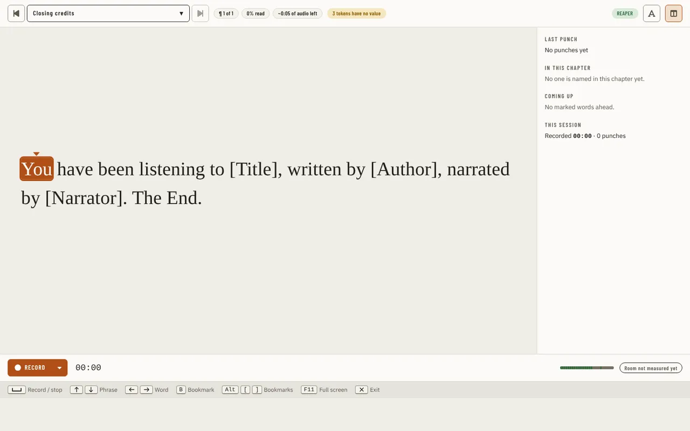

If the address asks for credits that have no template (for example an old link to the closing credits after the closing template was
deleted), the Booth shows a panel instead of text: **The closing credits are not set up**, with **Set up credits in Settings** and
**Back to the chapters**, which opens [Script](script.md), the chapter list, as Escape does with a chapter open. A link to a chapter the book no longer has shows the
same panel with **Back to the chapters**. An address the app cannot read at all, or one that names a chapter or line the book lacks, shows "This link could not be opened" with **Open Booth** and **Go to Production**; Escape leaves it as it leaves the Booth: for [Pickups](pickups.md) when the link still names pickups ("Open 3 in Booth"), otherwise for [Script](script.md).

If the book's chapters cannot be read when the Booth opens, it shows "This page could not be loaded" with the reason and **Retry** (an answer the app cannot read is "The app received data it could not read."; the technical text is behind **Details** on the card, with a copy button, and in the host log); Retry shows the Booth's grey blocks again while it reads, then the page or the reason again. **Leave the Booth** beside it goes back (to [Script](script.md), or to [Pickups](pickups.md) for a pickup session). Escape does the same, both from that panel and while the grey blocks are showing.

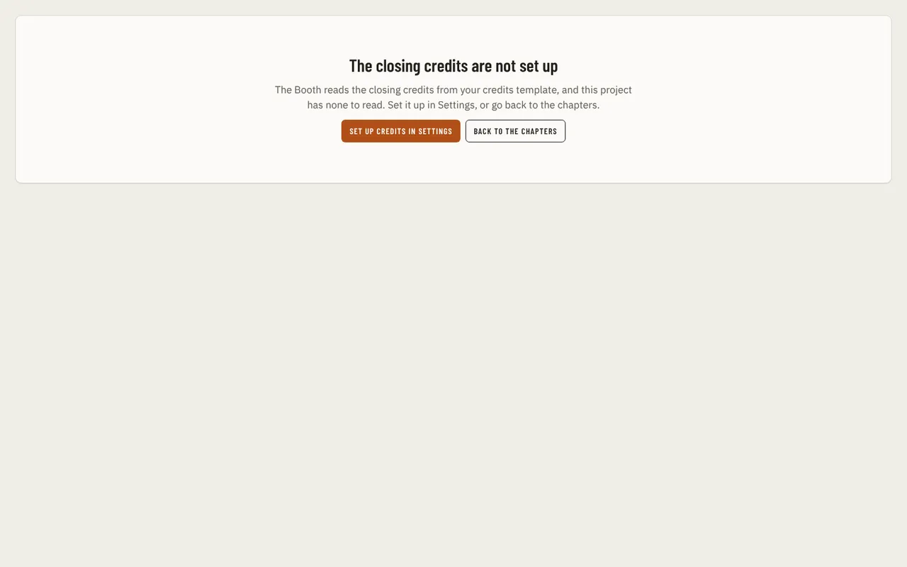

## Companion mode

The Companion is a narrow panel pinned beside your DAW. Open it with **Open Companion** in the jump menu or with `Ctrl+Alt+C`: the
reading session, with a badge in its header, the script in its own scroll box, the reading controls and the hotkeys
that work while the panel has focus. The badge follows REAPER (**Recording**, **Playhead** with its time, or **Playhead stopped**); while the app reads along and REAPER is stopped it says **Reading**, or **Paused**. **Play** (or **Pause**) and **Stop reading** are icon buttons; hover one for its name and key. A chapter recorded part way opens with *Continuing at "…the next words"*, the same place the Booth opens it at (the word after the last one recorded), and **Play** starts there. **Change** listens to the end of the recording to find a different start (the choices below), and **Start from the top** reads from the beginning. A chapter with nothing recorded, or recorded to the end, goes straight to those choices. After **Stop reading**, the "Where you stopped" choices come back above the text for the next start. **Full app** (or Escape twice) brings the Booth back on the same chapter. **Pickups** in the
panel shows the [Pickups](pickups.md) list: how many are left and the one you last jumped to. The note at the playhead has its
place at the foot of the panel and is coming later. The script's box has a frame and fades at its foot while there is more to
scroll. The script is set in the same reader column as the Script and the Booth, at the Column width you chose in Settings › Reader text. The chapter's name above the script reads "Chapter 3: Title", the same way as everywhere else in the app.
While its chapters are being read, the panel shows its title and grey blocks, and if the credits you asked for have no text it opens the Booth instead.

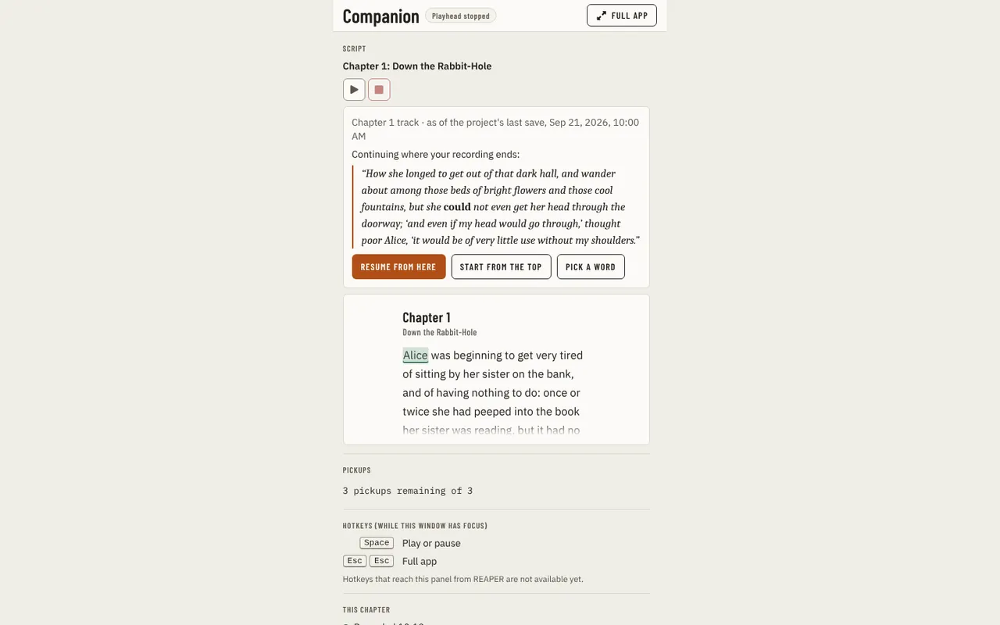

## Checking what you recorded

With **Check recordings in the background** on (Settings > Speech to text > Background checks), the app listens back to each
take you record and marks skipped or misread words for [Editing](editing.md) and [Pickups](pickups.md), so you do not have to
press **Check recordings** chapter by chapter.

- **It asks first.** The first time a recorded chapter is ready to check, **Check recordings in the background?** names the
  models it would use (`tiny`, with `small` double-checking what `tiny` was unsure of). Nothing is checked until you choose
  **Check in the background**; **Not now** turns background checks off.
- **It waits for you.** It never runs while REAPER is recording. About 45 seconds after you stop a take, it checks what you
  just read, while you read ahead, and the Booth keeps following your voice.
- **It checks only new audio.** Earlier takes are not checked again unless you change a model or the recording changes.
- **It stays out of the way.** It uses half of this computer's processors, a quarter while the Booth follows your reading, and
  runs below everything else.
- **You can see and stop it.** Its progress shows at the bottom left on every page, with the chapter, how far it has got and
  how many chapters wait. **Pause** turns background checks off (the message that follows has **Resume**), and **Cancel** stops
  this check until the chapter changes again. **Hide** folds it to a one-line chip; in the Booth it starts folded, so it never
  covers the text you read, and pressing the chip opens it.

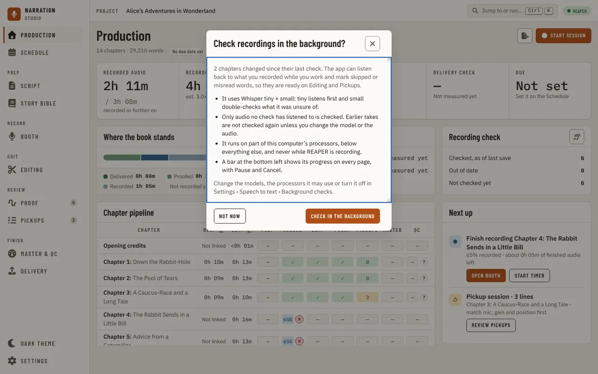

## Leaving the Booth

Escape (when nothing is open on top of the Booth) takes you to Script. A [cold read](#a-cold-read) ends without a question. While a take the app started is recording, the ways out that go through the app ask first (Escape, Back, Forward, the jump menu and the shortcuts that open a page, the setup chip, a link that opens another chapter, and a Record that is still starting); closing or reloading the window and a Back from the first page the window opened on do not. "Stop recording?" says the DAW is recording and leaving
stops it and saves the take. The take is held while the question is open. Focus opens on **Keep recording**, so Enter stays; **Stop and leave** stops the recording and then leaves (**Stop and open** when the way out is another chapter, since you stay in the Booth). When the question closes, focus is where it was before it opened, so Enter never moves you to another chapter mid-take; a question asked from the chapter picker puts focus back on the picker. If the DAW was already recording
when you came in and the Booth follows that take (the linked project, this chapter's track the only one armed), leaving asks **Leave the Booth?** and does not stop it; a take the Booth does not follow asks nothing.

If the stop does not go through, the question stays open with the DAW's sentence and **Leave anyway** (**Open anyway** for another chapter), and the take may keep recording. What the Booth recorded of where in the text the take was read is kept for the chapter the take began in, up to the moment you left; the chapter you opened gets none for it, whatever the DAW does with the take afterwards. A DAW that is slow has taken the stop and not yet confirmed it: the app waits for it, so the take ends when the stop lands and nothing is reported meanwhile. A stop the DAW took and has not confirmed after about 23 seconds leaves the question open with "REAPER took the command but did not confirm it in time, so what it did may not match. Check REAPER."; if the app gets no answer at all in 27 seconds the sentence is "REAPER did not answer in time." (each with the connected DAW's name). A stop or an undo that cannot reach the DAW at all says "REAPER could not be reached." in the same places. When that way out is to another chapter while the take's listening was still starting, and that listening then fails, never answers, or comes up after you left (and is let go), the other chapter shows the take as recording and, once nothing is listening to it, the Booth says "The text could not follow your voice for the take that is still recording. Press Stop, then record again." The page decides from what it shows then: it says nothing if the take already ended (in the DAW or by you), if the listening it started for the take is running or is still being started (a take the page picks up from the DAW after the failure gets a listening of its own, after ending a cold read if one is running), if you pressed Record again meanwhile, or if its own listening already said it could not follow. It stops nothing itself, because that take is yours to end, and the sentence goes when the take ends. It says nothing when the way out was to another page (the sentence names a Stop that is not on that page).

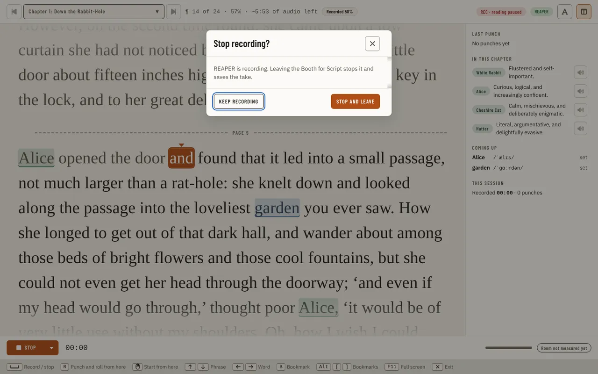

## If something goes wrong

| What you see | What it means and what to do |
| --- | --- |
| Record looks off and the footer says why | Press it anyway: it opens the dialog that fixes the problem, or a message with **Check again**. Nothing records. |
| **Not linked to a track**, **Linked to several tracks** or **Track missing** (**Folder missing** and **Linked to several folders** in a Voice folders project) | The chapter has no track in the DAW project, several, or one the project no longer has. **Link track** or **Create a new track** ([Recording](#recording)). |
| **REAPER not connected** or **REAPER not answering** | REAPER is closed or its bridge has not answered. **Open in REAPER and connect** starts it on the linked project. With no project linked yet, **Link project file…** is the main button and links one. |
| **REAPER has a different project open** | **Link the open project**, or open the linked project in REAPER and press **Check again**. **DAW settings** shows which file is linked. |
| "REAPER is already recording on another track, so the Booth is not following it. Stop it in REAPER before recording here." (or the same with several tracks armed, with no track armed, or while no project file is linked) | A take the Booth does not follow is running (another track armed, several or none, or another project open). Stop it there; Record is ready again at once. |
| "REAPER started this take, so stop it in REAPER." | The Booth follows a take you started in REAPER. Stop it there. |
| "The text cannot follow your voice yet" | The speech model is not downloaded, or no microphone is listed. The first take asks to download the model; see [The microphone the Booth listens to](#the-microphone-the-booth-listens-to). |
| "The Booth could not stop listening, so your microphone may still be open. Press Retry." (in the Booth and in the Companion) | The Booth asked the listening to stop, was refused, and asked once more. Press **Retry** in the message: it says it is trying again, then "Listening stopped.". It asks again only if that listening is still the one running. The message stays up to a minute. |
| "…Quit and reopen the app to be sure." on the page you landed on | You left with **Stop and leave** (or Exit) and the stop was refused twice, so the microphone may still be open. Quit and reopen the app. |
| **Undo** says to use Edit > Undo in the DAW | You changed something in the DAW after the take, so the app leaves the take alone ([Undoing a take](#undoing-a-take)). |
| The Booth does not record in Audacity | Recording from the Booth is not available in Audacity yet. Record in Audacity, or choose the built-in recorder in [Settings](settings.md). |

## What next

- [Checking what you recorded](#checking-what-you-recorded): let the app listen back to each take in the background.
- [Editing](editing.md): a chapter's takes, what was heard against each word, and clean-up.
- [Proof](proof.md): every check's notes on the recording, and your decision on each.
- [Pickups](pickups.md): the lines to record again, and a [pickup session](#a-pickup-session) back in the Booth.

---

[← Story Bible](story-bible.md) · [Index](README.md) · [Editing →](editing.md)
