[Using the app](README.md) › Delivery

# Delivery

Delivery is the last step of finishing a book. It names the delivery profile the project is judged against,
checks every chapter against it, and builds the platform's package from the files you mastered and encoded in
[Master & QC](master-and-qc.md). It sits under **Finish**, after Master & QC, and needs an imported
manuscript: without one the page asks you to import one.
While the chapters are being read, **Before you build** shows grey rows in place of the chapter checks. On a wide
window the page keeps to one centred column about 1,500 px wide, the same as Master & QC and Pickups; in a narrow one the cards stack, with **Before you
build** straight after **Output**, so the list that explains the Build button is next to it.

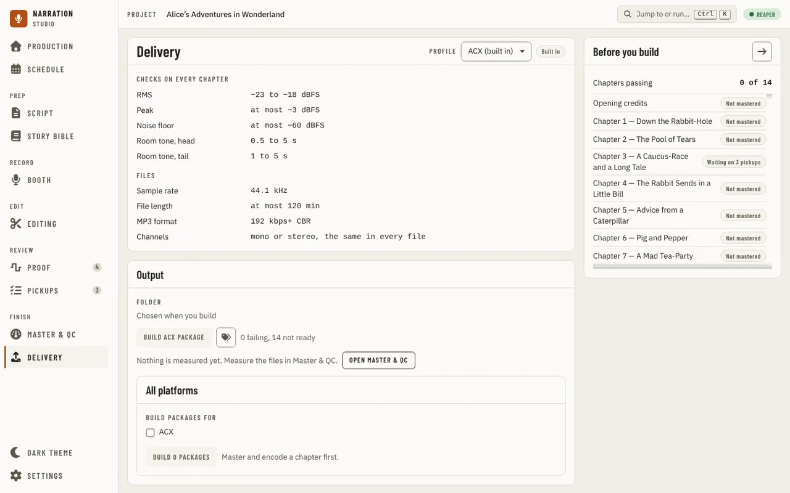

## Build the package for a platform

This page is a reference to everything Delivery shows. Here is the round from mastered files to a package; the
sections after it have the detail. The example builds for ACX.

1. **Choose the profile.** The **Profile** menu lists **ACX (built in)** and your own profiles. The one you choose is
   the project's ([The delivery profile](#the-delivery-profile)).
2. **Master and check the files** in [Master & QC](master-and-qc.md): master them with **Master all to spec…**, then
   measure them with **Check files…** ([Checking files](master-and-qc.md#checking-files)). Delivery judges the files
   **Check files…** measured. **Diagnostics** does not count, and nor does a prepared copy until you check it.
3. **Read Before you build.** Each chapter shows **Pass**, **Fails N checks**, **Not mastered**, or **Waiting on N
   pickups**. While Build is off, the line beside it names the first chapter in the way and why, for example "Chapter 8:
   noise floor −57.8 dBFS (limit ≤ −60 dBFS)" ([Before you build](#before-you-build)).
4. **Build.** Once every chapter passes, **Build ACX package** opens Windows' folder window; choose where the package
   goes. It cannot go inside the project's own folder ([Output](#output)).
5. **Optional: chapter tags.** **Embed chapter tags** adds chapter markers to an MP3 of the whole book you have
   rendered ([Embedding chapter tags](#embedding-chapter-tags)).

Where each rule comes from, and which ones you check by ear, is in [Profile rules](#profile-rules) and
[ACX delivery requirements](../../reference/acx-delivery-requirements.md).

## The delivery profile

The first panel's header holds the page title, **Delivery**, and on the right the **Profile** label, the profile menu
and, for a built-in profile, a **Built in** pill (**Locked while it builds** for either kind of profile while a
build runs, when the menu is dimmed and does nothing). The menu lists **ACX (built in)** and each custom profile.
Choosing one makes it the project's profile; the files already checked keep the profile they were checked
against until you check them again in Master & QC. **Checks on every chapter** lists the profile's
measured limits (RMS, peak, noise floor, room tone at the head and tail), and **Files** its sample rate,
longest file, MP3 format and channels. Each value sits right after its name. A built-in profile is read-only, and a one-sided limit reads in words ("at most −3 dBFS").

A custom profile's name, its limits (a lowest and a highest box each) and its longest file can be changed in
place (every lowest box, "to", highest box and unit stand in one column down the card); the change is saved when
you press Enter or leave the box, and a rule it turned off reads **Off**. A
blank name, a name over 80 characters or a limit that is not a number is ignored (a minus typed as "−" or "-" is
read as one, and "-0" is 0), a sentence under the card says so
("A profile needs a name, so the name was left as it was.") and the box shows the saved value again. The name box
sits on the same row as the title and the profile menu. If the lowest
is above the highest, or the host refuses the change for another reason, its sentence appears under the card
and the box shows the saved value again. To make a custom profile, duplicate ACX in [Settings, Delivery](settings.md);
turning a rule off and deleting a profile are there too. If you had set your own limits before delivery
profiles, they were moved into a custom profile named **Your limits** (or ACX, when they were ACX's numbers),
so your files are judged the same way as before.

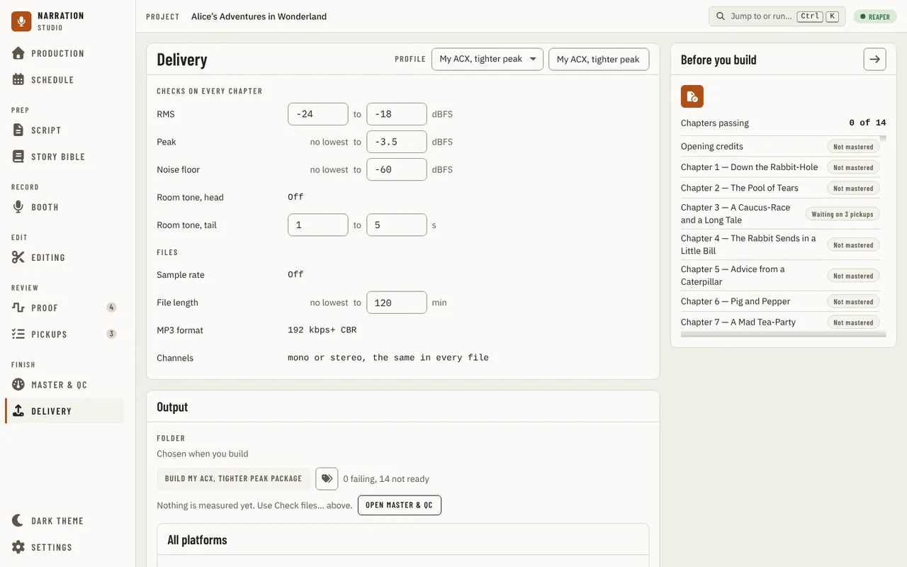

The card reads the profiles again when you return to the window, so a profile you changed or deleted in
Settings is picked up. If the profiles cannot be read, the card says so, when the host last answered, and
offers **Check again**.

## Before you build

**Before you build**, on the right, counts the chapters passing and lists each chapter, named as the
manuscript's headings name it, with the opening credits first and the closing credits last (they are chapters of the list like the rest, each judged by its
own file, "Opening credits.wav"). A long chapter name wraps to a second line, and a rule separates each chapter from the next. Each shows **Pass**,
**Fails N checks**, **Not mastered**, or, for a chapter that is not mastered and has open
pickups, **Waiting on N pickups** (counted from the Pickups list, as Production counts them). Pressing a
chapter opens its file in [Master & QC](master-and-qc.md); the arrow button in the panel's header opens Master & QC
itself. A book with more than a hundred chapters lists the first hundred and a **Show the other N chapters**
button for the rest, and the list is 20 rem tall at most and scrolls inside the panel once its rows fill that, which is sooner when long chapter names wrap (the count above the list is always the whole book).

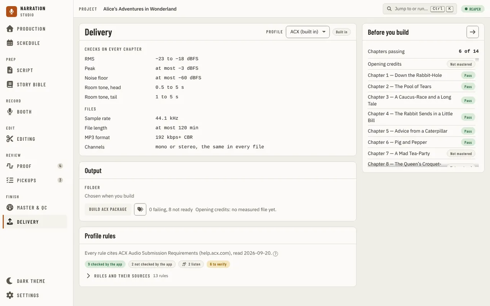

The icon button at the right of the panel's header, **Check files…**, starts a measurement from here: it is the same control Master & QC has over the same measurement, so you do not have to leave the page that blocks the build. It opens the file picker, measures what you choose and, while it runs, shows a progress bar with its message and **Cancel** under the title. Once files have been measured it reads **Re-check N files**, with **Choose other files…** beside it. Cancelling says where it stopped ("Measurement cancelled. 0 of 3 files were measured."). A result shows on both pages.

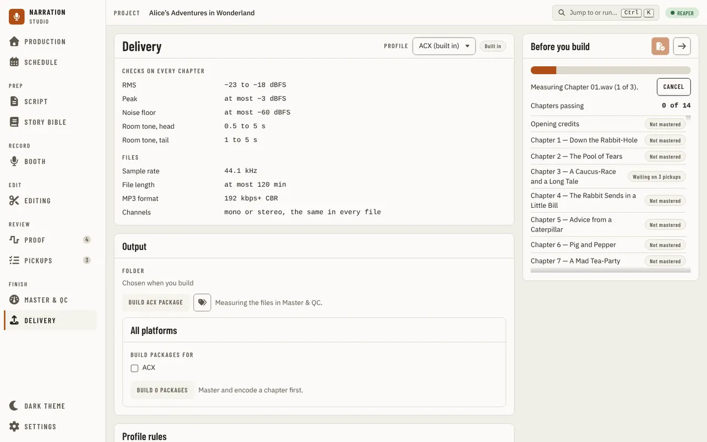

The list is read when the page opens, when you return to the window and when a measurement ends. While a
measurement is running, from here or from Master & QC, the panel says so and Build stays off. Nothing is judged until the
chapters, the credits and the measurement have each been read.

If any of them cannot be read, Delivery does not guess. It shows an error message at the bottom right of the window,
"Can't tell which chapters pass" with the reason, and offers **Retry**, which reads all three again. Nothing is added to the page, so
nothing under it moves. It reads the measurement again by itself every two seconds while the message is up, and the
chapters when you return to the window. If a list was already showing, it stays, and the message adds "The list below
may be out of date".

## Output

**Folder** says where the package went. Before a build it reads "Chosen when you build": Windows opens its own
folder window when you press **Build ACX package** (named for the profile), and the app never takes a typed
path. Pressing the button twice opens the window once. If you close it without choosing a folder, Delivery says
no package was built. A package cannot be saved inside the project's own <!-- brand:identity.projectFolder -->narration-studio<!-- /brand --> folder.

Build is on once every chapter passes, and files have been mastered and encoded in Master & QC. Until then it
says how many chapters fail and how many are not ready, that there are no chapters, that you must master all
to spec in Master & QC first, or that Master & QC is still preparing the files. While Build is off, the line beside it
names the first chapter in the way, so you do not have to open Master & QC to learn why. For a failing
chapter it gives the rule it misses, its value and the limit ("Chapter 8: noise floor −57.8 dBFS (limit ≤ −60
dBFS), and 1 more rule."). When no chapter fails, it names the first chapter that is not ready and why: it has no
measured file, its file is not measured yet or could not be read, or part of it could not be measured. Until
anything is measured, it says "Nothing is measured yet. Use Check files… above." with **Open Master & QC**
beside it, in the same row, so nothing under Output moves.

While Build is off it is dimmed but still reachable with Tab, and a screen reader reads the reason beside it as
its description. Hover or focus it to see the same reason as a tooltip. Pressing it builds nothing.

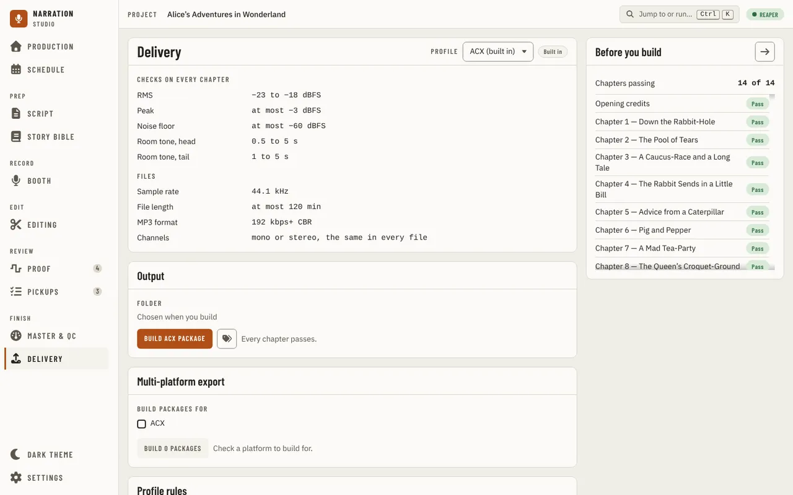

While the package builds, the button is busy, **Cancel** is offered, the line beside them says "Building the
package…" and a bar shows the work. A cancelled or failed
build leaves no files in the folder, so the same build can be started again; a package never overwrites a file that
is already there and says which one is in the way.

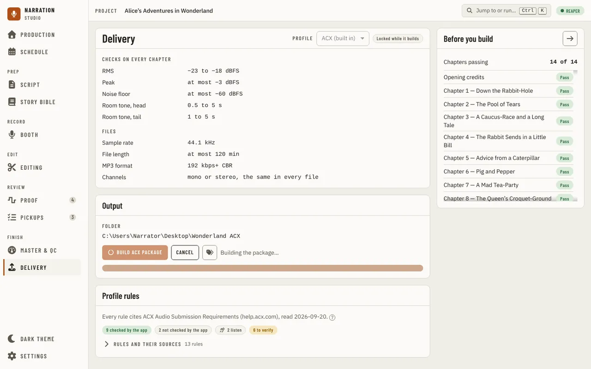

When the package is built, **Built** shows how many files were written and where, with a **Written** mark after each
file's name. The folder button at the end of that line (**Open the folder**) opens that folder in Explorer. The list shows only for the
profile that built it: choose another profile and it goes away until you build again.

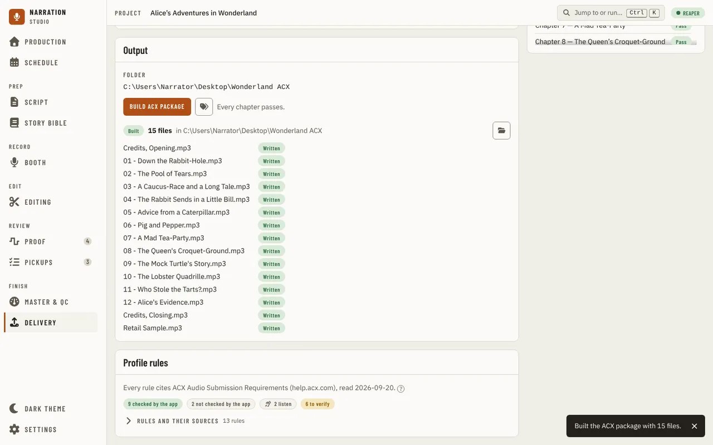

If the host refuses or the build fails, Delivery shows its words in an error message at the bottom right of the window, and
writes nothing; beside Build it says "The last build did not finish." The message stays until you dismiss it. If the
folder will not open, that is a message too. A file that was encoded
empty or is gone is named and refused before anything is written ("is empty (0 bytes); encode it again"), and so
is a chapter whose title makes a file name longer than Windows allows.

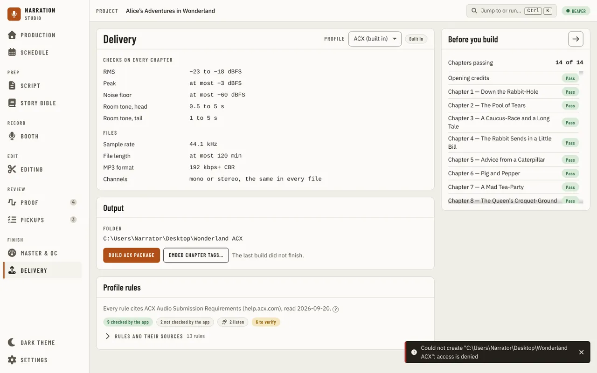

If the host stops answering while a build runs, Delivery shows an error message, "Can't tell how the build is going"
with the reason, and **Retry** on it. **Retry** reads again at once, and the message goes when the host answers. The build keeps running on the host and **Cancel** is still there. Beside Build the
sentence about the build ("Building the package…") is left out until the host answers again.

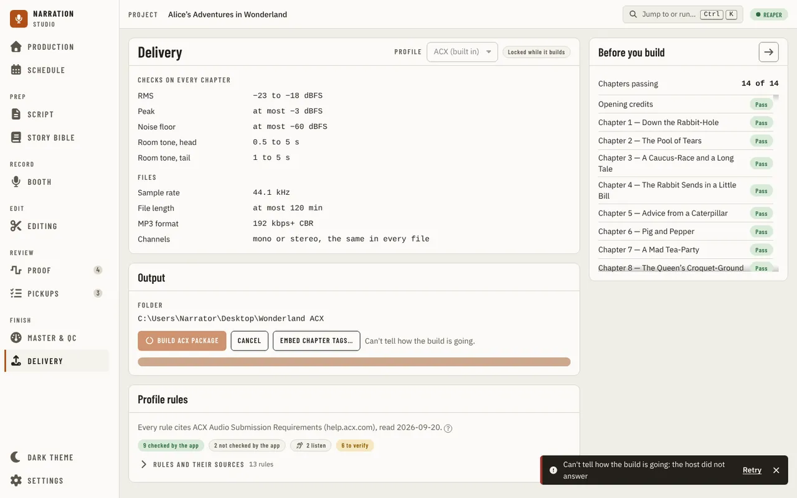

**Cancel** with a quiet host cannot be confirmed, so Delivery says "Cancel was sent, but the host did not confirm
it, so the build may still be running." and keeps the quiet message. It says "Packaging cancelled." only when the
host reports that the build ended; **Retry** on the quiet message asks for that.

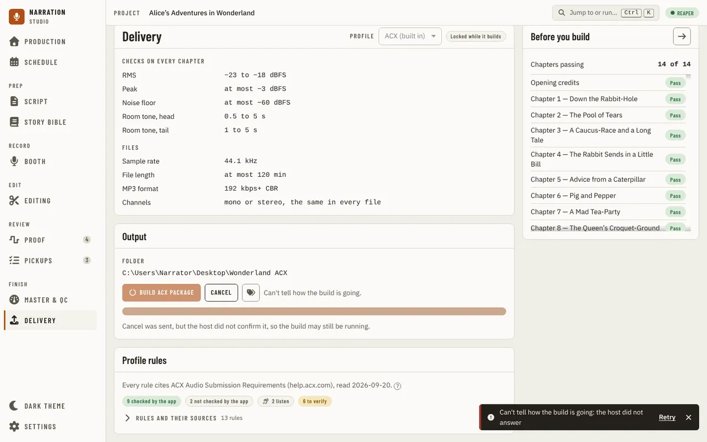

### Embedding chapter tags

The tags icon button, **Embed chapter tags**, beside **Build**, adds ID3 chapter markers to an MP3 of the whole book that you have already rendered, timed from the chapter files of your last chapter render. It is on whatever the build says, with any DAW or none, because it never talks to REAPER. **Embed chapter tags** in the dialog is off, with its reason in the hint, until there is a chapter render, a file and the confirmation. The dialog lists those chapters and marks any that are "not rendered yet"; every one must exist first. With no chapter render configured it says so and points to **Prepare chapter render…** in **DAW tools** on [Editing](editing.md#the-daw-tools-menu), [Proof](proof.md#the-daw-tools-menu) or [Master & QC](master-and-qc.md). Enter the path of the combined book MP3 and tick the confirmation: the file you name is never changed, and a new, tagged copy is written beside it. The dialog says it is reading the last render before it lists anything. Spaces around the path are ignored. If the app does not answer within 15 seconds when it reads the render, the dialog says so and offers **Check again**. If it does not answer within a minute while writing, the dialog says so, **Cancel** and Esc work again, and **Embed chapter tags** stays off until the app answers, so the same file is not written twice; if the copy arrives late, its path is shown. Changing the path or the confirmation clears the last result.

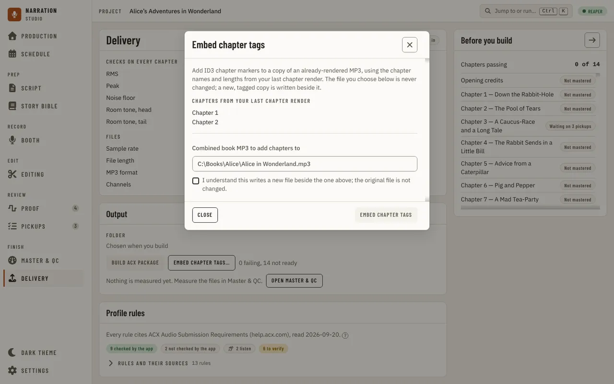

## Building packages for several platforms at once

If you deliver to more than one platform, **All platforms** (inside Output, under the build) lets you build
all of them from the one source you already mastered and encoded, without re-encoding unless a platform
needs a different file format. Under **Build packages for**, check the box for each profile you want a
package for, then **Build N packages**; it stays off, with "Master and encode a chapter first." beside it, until files are mastered and encoded (hover or focus it to see the same reason as a tooltip). This does not change which profile the page's checks are judged against (that is the project's profile,
chosen in the profile card above); the checkboxes only choose what to build packages for.

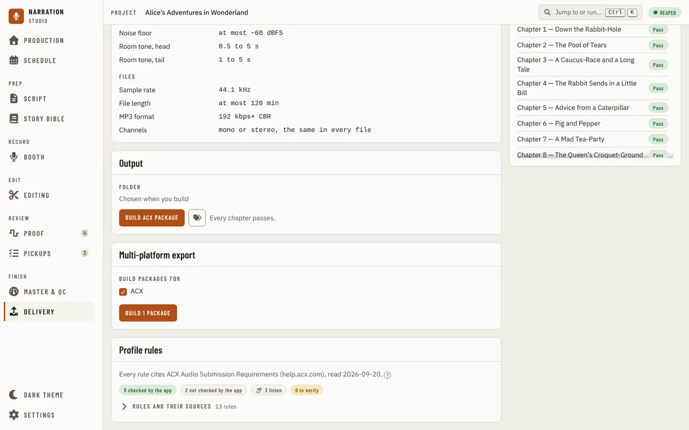

You are asked for one folder once, and each platform's package goes into its own correctly named subfolder
of it. Two platforms that both take the same file format (most do: MP3 at the same bitrate) share the one
set of already-encoded files; a platform that needs a different format (an M4B audiobook file, say) is
encoded for just that once, however many platforms need it, not once per platform. Cancel stops the build
before its next platform starts; platforms already built keep their packages, and one not yet reached is
left waiting.

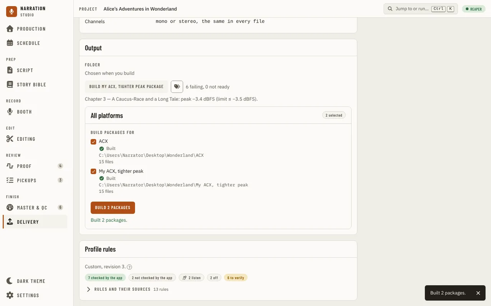

While it builds, and once it finishes, each platform says how it went under its own checkbox: **Building…**,
**Built** with its folder and how many files it wrote, or why it could not be built (such as a required file being
missing for that platform).

## Profile rules

**Profile rules**, below Output, says where the rules come from and how many of them the app checks, how many
it does not check, how many are for you to listen for, how many are off and how many are still to verify.
Open **Rules and their sources** for every rule with what the platform requires, how the app checks it,
and whether that requirement was read on the platform's own page (**Verified**), is still **To verify**,
or has **Conflicting sources** (room tone at the head of a file: ACX's page was read as 1 to 5 s, current
guides say 0.5 to 1 s, so the app judges the looser 0.5 to 5 s). The **?** beside the source line says how a file is
judged, rule by rule, and that a rule the app cannot check is listed and never counted as met. The profile is a
measurement, not ACX's approval.

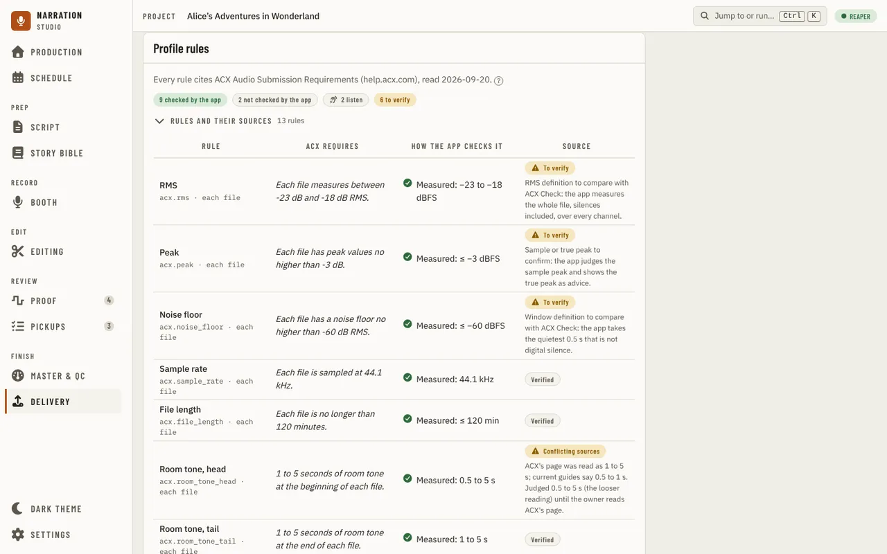

## What next

- [Master & QC](master-and-qc.md): fix a chapter that fails a check, and master it again.
- [Pickups](pickups.md): record the lines a chapter is waiting on.
- [Settings: Delivery](settings.md#delivery): the render length tolerance and the default profile for new projects.

---

[← Master & QC](master-and-qc.md) · [Index](README.md) · [Settings →](settings.md)
