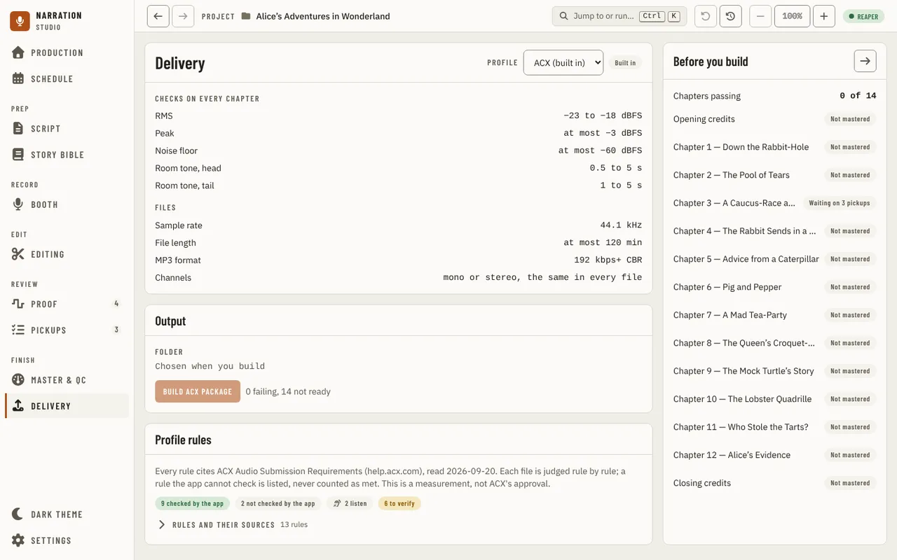
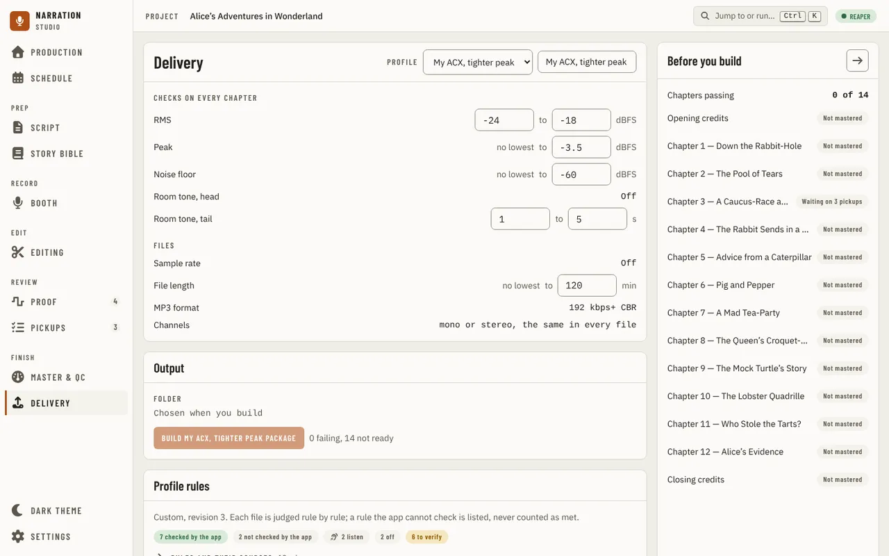
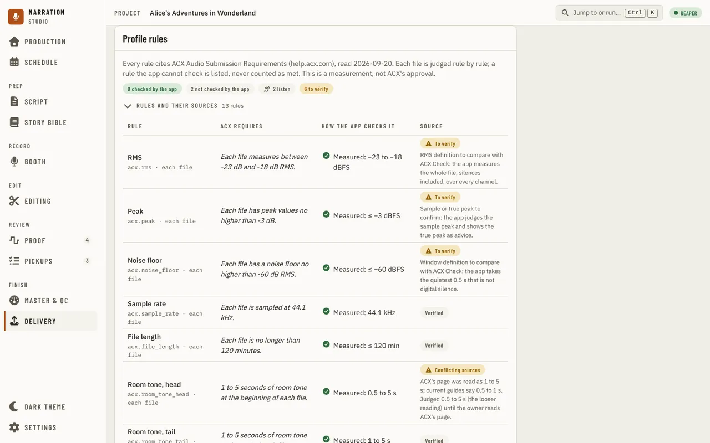
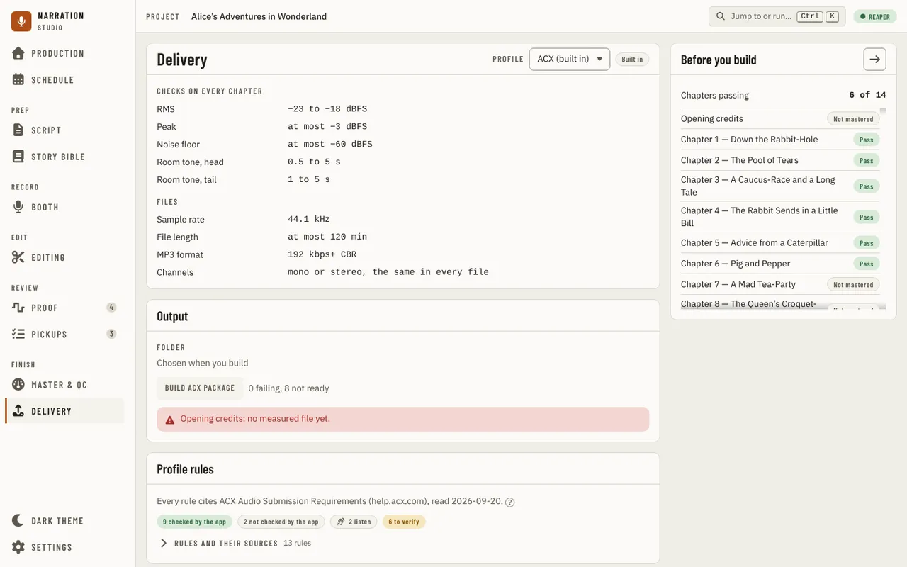

[Using the app](README.md) › Delivery

# Delivery

Delivery, below Master & QC under **Finish** in the navigation, chooses the profile, checks every chapter against it and
builds the package. It needs an imported manuscript: without one its navigation entry is locked.

**Delivery profile** names the project's profile in a menu: **ACX (built in)** and each custom profile.
Choosing one makes it the project's profile; the files already checked keep the profile they were checked
against until you check them again in Master & QC. **Checks on every chapter** lists the profile's
measured limits (RMS, peak, noise floor, room tone at the head and tail), and **Files** its sample rate,
longest file, MP3 format and channels. A built-in profile is marked **Built in** and is read-only. A
custom profile's name, its limits (a lowest and a highest box each) and its longest file can be changed in
place; the change is saved when you press Enter or leave the box, and a rule it turned off reads **Off**.
To make a custom profile, duplicate ACX in [Settings, Delivery](settings.md); turning a rule off and
deleting a profile are there too. If you had set your own limits before delivery profiles, they were moved
into a custom profile named **Your limits** (or ACX, when they were ACX's numbers), so your files are judged
the same way as before.

**Profile rules**, below Output, says where the rules come from and how many of them the app checks, how many
it does not check, how many are for you to listen for, how many are off and how many are still to verify.
Open **Rules and their sources** for every rule with what the platform requires, how the app checks it,
and whether that requirement was read on the platform's own page (**Verified**), is still **To verify**,
or has **Conflicting sources** (room tone at the head of a file: ACX's page was read as 1 to 5 s, current
guides say 0.5 to 1 s, so the app judges the looser 0.5 to 5 s). The profile is a measurement, not ACX's
approval.

**Before you build**, on the right, counts the chapters passing and lists each chapter, named as the
manuscript's headings name it, with **Pass**, **Fails N checks**, or **Not mastered**; pressing one opens
Master & QC. In **Output**, **Build ACX
package** (named for the profile) builds the package once every chapter passes, from the files mastered
and encoded in Master & QC; until then it says how many chapters fail and how many are not ready, or that
you must master all to spec in Master & QC first. The build asks for a folder, shows its progress with
**Cancel**, and then lists the folder and every file written. The folder button beside the list
(**Open the folder**) opens that folder in Explorer.

---

[← Master & QC](master-and-qc.md) · [Index](README.md) · [Settings →](settings.md)
