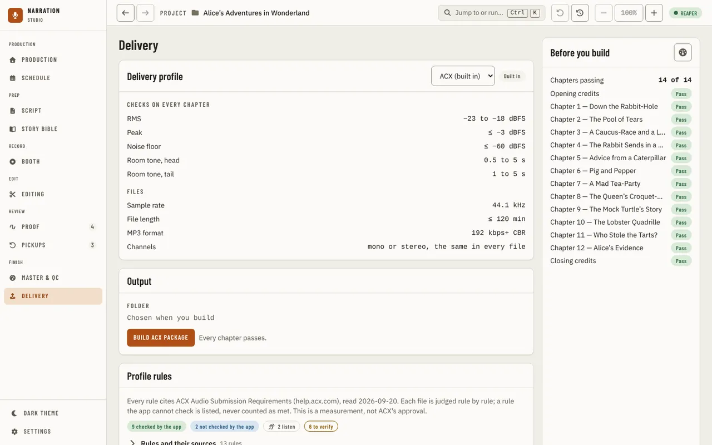
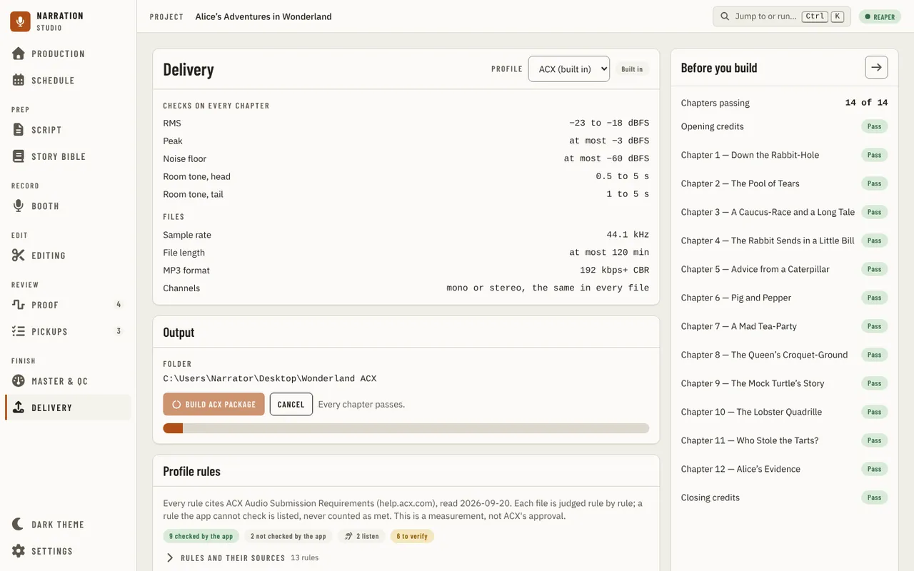
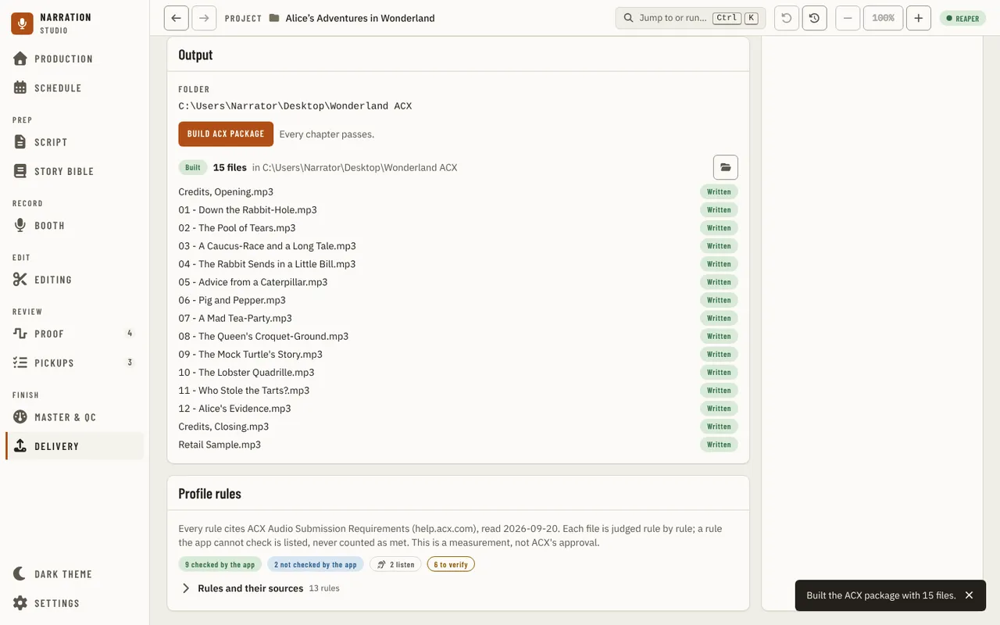
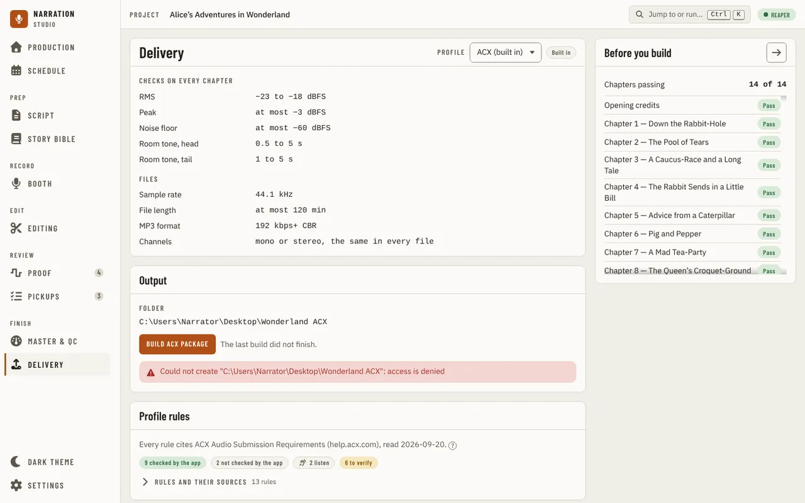
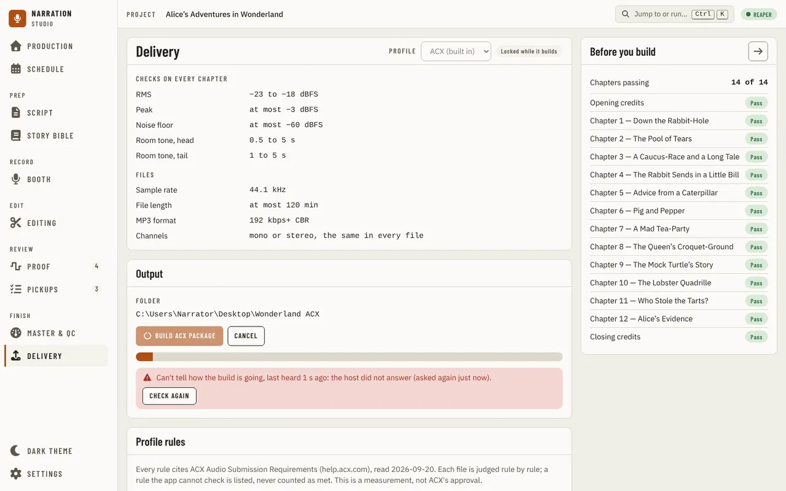

[Using the app](README.md) › Delivery

# Delivery

Delivery is the last step of finishing a book. It names the delivery profile the project is judged against,
checks every chapter against it, and builds the platform's package from the files you mastered and encoded in
[Master & QC](master-and-qc.md). It sits under **Finish**, after Master & QC, and needs an imported
manuscript: without one its navigation entry is locked and the page asks you to import one.

## The delivery profile

**Delivery profile** names the project's profile in a menu: **ACX (built in)** and each custom profile.
Choosing one makes it the project's profile; the files already checked keep the profile they were checked
against until you check them again in Master & QC. **Checks on every chapter** lists the profile's
measured limits (RMS, peak, noise floor, room tone at the head and tail), and **Files** its sample rate,
longest file, MP3 format and channels. A built-in profile is marked **Built in** and is read-only.

A custom profile's name, its limits (a lowest and a highest box each) and its longest file can be changed in
place; the change is saved when you press Enter or leave the box, and a rule it turned off reads **Off**. A
blank name or a limit that is not a number is ignored and the box shows the saved value again. If the lowest
is above the highest, or the host refuses the change for another reason, its sentence appears under the card
and the box shows the saved value again. To make a custom profile, duplicate ACX in [Settings, Delivery](settings.md);
turning a rule off and deleting a profile are there too. If you had set your own limits before delivery
profiles, they were moved into a custom profile named **Your limits** (or ACX, when they were ACX's numbers),
so your files are judged the same way as before.

The card reads the profiles again when you return to the window, so a profile you changed or deleted in
Settings is picked up. If the profiles cannot be read, the card says so, when the host last answered, and
offers **Check again**.

## Before you build

**Before you build**, on the right, counts the chapters passing and lists each chapter, named as the
manuscript's headings name it, with the opening credits first and the closing credits last (each judged by its
own file, "Opening credits.wav"). Each shows **Pass**, **Fails N checks**, or **Not mastered**. Pressing a
chapter opens its file in [Master & QC](master-and-qc.md); the button in the panel's header opens Master & QC
itself.

The list is read when the page opens, when you return to the window and when a measurement ends. While a
measurement is still running in Master & QC the panel says so and Build stays off. Nothing is judged until the
chapters, the credits and the measurement have each been read.

If any of them cannot be read, Delivery does not guess. It says "Can't tell which chapters pass", when the host
last answered and why, and offers **Check again**, which reads all three again. It reads the measurement again
by itself every two seconds while the message is up, and the chapters when you return to the window. If a list was
already showing, it stays, marked "The list below may be out of date".

## Output

**Folder** says where the package went. Before a build it reads "Chosen when you build": Windows opens its own
folder window when you press **Build ACX package** (named for the profile), and the app never takes a typed
path. Pressing the button twice opens the window once. If you close it without choosing a folder, Delivery says
no package was built. A package cannot be saved inside the project's own `narration-utils` folder.

Build is on once every chapter passes, and files have been mastered and encoded in Master & QC. Until then it
says how many chapters fail and how many are not ready, that there are no chapters, that you must master all
to spec in Master & QC first, or that Master & QC is still preparing the files.

While the package builds, the button is busy, **Cancel** is offered and a bar shows the work. A cancelled or failed
build leaves no files in the folder, so the same build can be started again; a package never overwrites a file that
is already there and says which one is in the way.

When the package is built, **Built** shows how many files were written and where, with a **Written** mark for each
file. The folder button beside it (**Open the folder**) opens that folder in Explorer. The list shows only for the
profile that built it: choose another profile and it goes away until you build again.

If the host refuses or the build fails, Delivery shows its words and writes nothing. A file that was encoded
empty or is gone is named and refused before anything is written ("is empty (0 bytes); encode it again"), and so
is a chapter whose title makes a file name longer than Windows allows.

If the host stops answering while a build runs, Delivery says "Can't tell how the build is going", when it last
heard, and offers **Check again**; the build keeps running on the host and **Cancel** is still there.

## Profile rules

**Profile rules**, below Output, says where the rules come from and how many of them the app checks, how many
it does not check, how many are for you to listen for, how many are off and how many are still to verify.
Open **Rules and their sources** for every rule with what the platform requires, how the app checks it,
and whether that requirement was read on the platform's own page (**Verified**), is still **To verify**,
or has **Conflicting sources** (room tone at the head of a file: ACX's page was read as 1 to 5 s, current
guides say 0.5 to 1 s, so the app judges the looser 0.5 to 5 s). The profile is a measurement, not ACX's
approval.

---

[← Master & QC](master-and-qc.md) · [Index](README.md) · [Settings →](settings.md)
