[Using the app](README.md) › Editing

# Editing

Editing is where you hear a chapter against its script and edit it. The chapter's script is the editor: each word
shows how it was heard, each line has its takes under it, and what you select is what you play, delete or put an
effect on. Open it from **Editing** in the sidebar's Edit group, from a linked chapter's **Open in Editing** in the
[audio engine panel](navigation.md#linking-chapters-to-tracks), from a recording check's **Open in Editing** on
[Production](production.md#checking-a-chapters-recording), or from **Manage takes in Editing** on a note in
[Proof](proof.md#a-note-and-your-decision). Its address is `/editing/<chapter>`; `/editing` opens the first chapter.

With no manuscript imported yet, the page says so and offers **Import manuscript**, which goes to
[Production](production.md#importing-the-manuscript).

## The page

The header has the chapter step (the previous and next chapter buttons, Alt+↑ and Alt+↓, and the chapter list), a
legend of the marks in the text, the recogniser that heard the words (**Flagged by**), and the button that opens the
drawer.

Words carry what the last [recording check](production.md#checking-a-chapters-recording) heard:

- **Not in the script** (Extra): words heard that the script does not have, between the words they followed;
- **In the script, not read** (Not read): words of the script nothing was heard for;
- **Misread**: a word heard differently, with what was heard;
- **Low confidence**: a word the recogniser was unsure of.

Each line starts with its time in the chapter. A line with more than one take has a takes chip under it: how many
takes, the one that plays, and whether one was chosen yet.

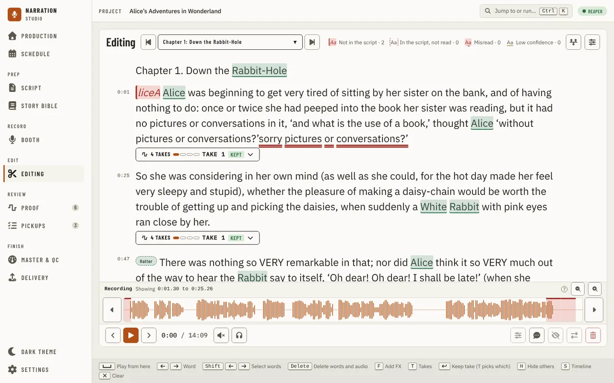

The bar at the foot plays the chapter in the app, from its recorded audio with each item's trims, so it works with the
DAW closed. It shows the time, and what is selected with its start, end and length. The key hints under it come from
your keyboard settings ([Settings](settings.md)), so a key you rebound shows its new key.

The word playing is lit, and the text scrolls to keep it in sight until you scroll by hand; the next play scrolls it
again. When you play the project in the DAW instead, the lit word follows the DAW's play position, as long as the DAW
reports one and the app is not playing its own audio. When the DAW stops, its last word stays lit until you move the
cursor.

A chapter has to be linked to a track (see [Linking chapters to tracks](navigation.md#linking-chapters-to-tracks)) for
its words to carry the times they were heard at. A chapter with no audio to edit says so in a banner over the script
and shows the script plain, with no word marked "not read": it names the cause (no track linked, the linked track is
not in the saved project, or the track is empty) and opens the audio engine panel, where **Link chapters…** is. With
the built-in recorder there is no track to link, so the banner points at recording the chapter in the Booth. A chapter
that was never checked has no heard words; run the check on Production first.

## Selecting words

Click a word to place the cursor there. Shift+click another, drag across the text or press Shift+← and Shift+→ to
select a run of words. A toolbar floats under the selection with **Play**, **FX**, **Mute** and **Delete**; the bar
offers the same actions. The line's audio shows under it while the cursor is on it. Right-click a word for its menu:
play, copy, delete or mute the words, mark them for a pickup, add a note.

A flagged word opens its card: what the script says and what was heard, and the choice to keep the word as read, which
clears the mark (with Undo in the message that confirms it).

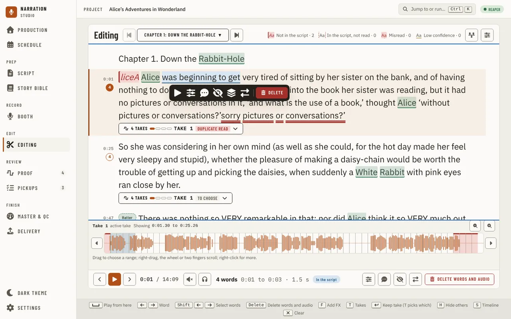

## Deleting words and their audio

**Delete words and audio** (Delete) asks first. The question names the words, where the cut starts and ends (moved to
the nearest zero crossings), the track, and what happens to the gap: close it, so later audio on the track moves up, or
leave room tone of the same length so the timing does not move. You also choose the crossfade at the join, how much audio to keep at each
edge of the cut, and whether the cut audio is kept on a muted track named Cuts. The DAW makes the cut as one undo step; the recording file is not
touched. **Mute** keeps the audio and silences the words.

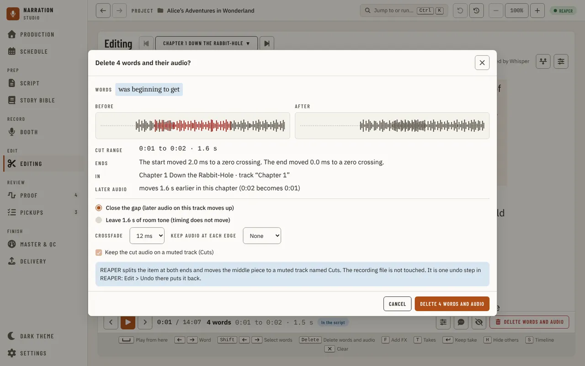

## Effects on words

**Add FX** (F) lists your FX chains from the DAW. Choose one and the question shows how the item will be split around
the words, where the splits fall, the fades at the joins and what the DAW does: it splits the item at both ends and puts
the chain on the middle piece only. Nothing else moves, and one undo step in the DAW takes it off. The words with an
effect are underlined, and the drawer's Effects tab lists them.

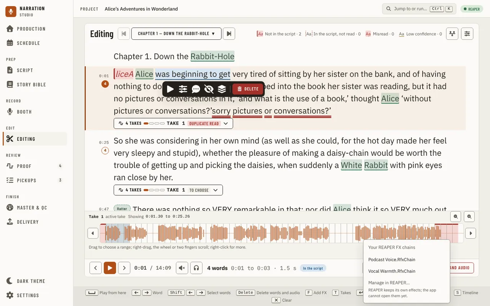

The Effects tab shows how much of the chapter effects cover against a cap, 10% unless you change it in the tab's **Cap**
field (a whole percent from 1 to 100, kept for the project). Over the cap the tab warns, and Add effect asks again
before it goes ahead.

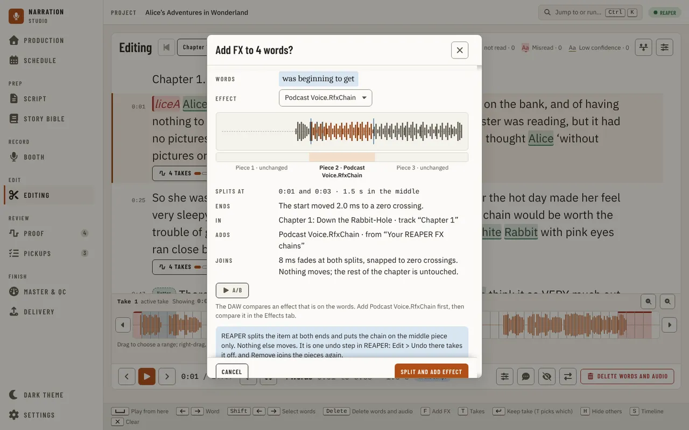

## Takes

Click a line's takes chip (T steps to the next take) to open its takes under it. The suggested take comes first, with
why it is suggested and the steps that would make the comparison surer: **Trim white space**, **Trim breaths** and
**Normalise**, each asking before it changes anything in the DAW. Then each take, with its waveform, what share of the
script it read as written, and its pause, level, noise, clarity and breaths. Play a take to hear it; **Keep take**
(Enter) makes it the one that plays, and **Hide others** (H) hides the other takes from the lanes.

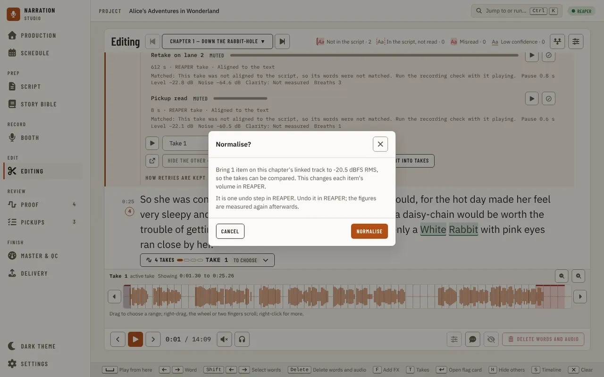

**How retries are kept** decides, for the line or the whole chapter, whether a line read again later in the chapter is
stacked as a take of the first read or left where it was. With Stack, **Stack retries as takes** shows the plan before
the DAW moves anything.

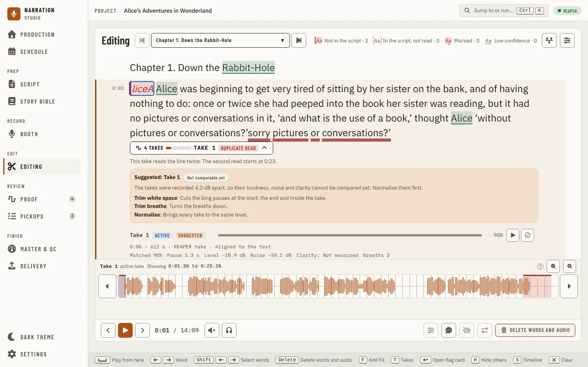

## The drawer

The drawer button (Ctrl+Shift+C) opens the drawer beside the text, or over it on a narrower window.

### Cleaning up

**Clean up** lists what was found in the chapter (words not in the script, not read, misread and of low confidence,
each with **Review** to step through them) and the clean-up findings by kind: gaps, breaths, clicks, plosives and noise.
Pick a strength, preview the change and apply it to the findings you selected. Clean-up actions that are still
experimental stay off until you turn them on in [Settings](settings.md).

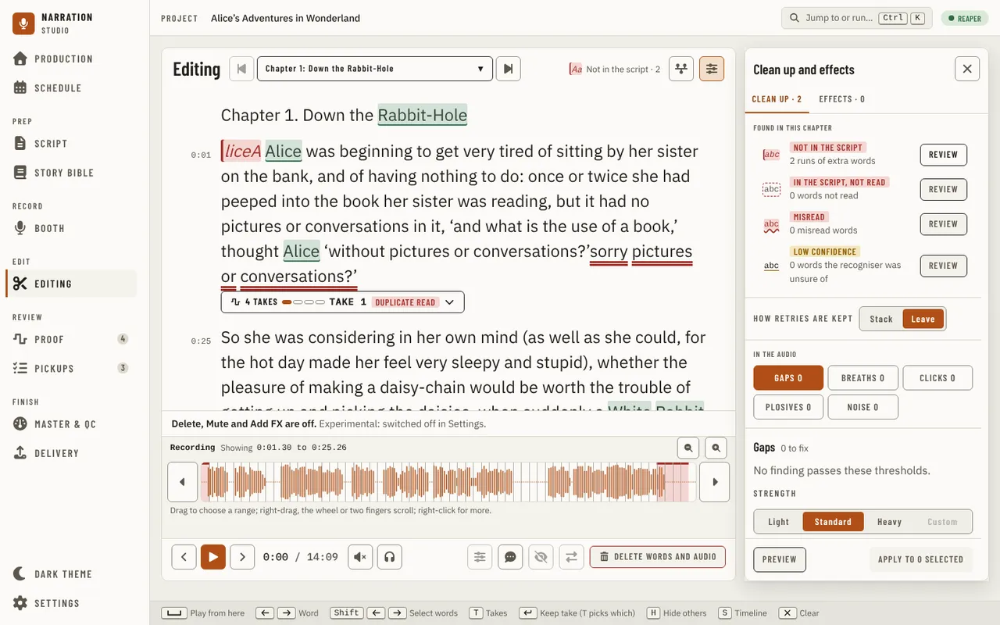

### Effects, Backups and Timeline

**Effects** lists the effects on words in this chapter and adds one. **Backups** shows only with a DAW that keeps
backups of its project. **Timeline** shows the line the cursor is on as the chapter's audio and one lane per take on
one time axis; on a wide window it is a strip under the text instead (S).

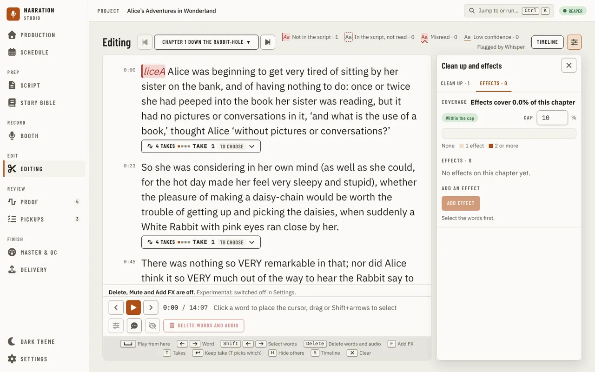

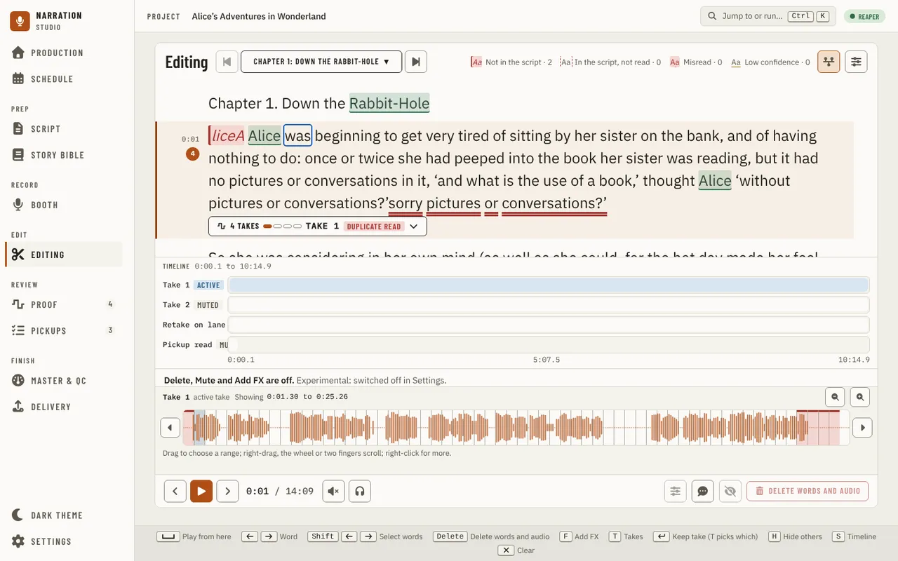

## When the DAW is not connected

A banner at the top says the DAW is not answering, or that the chosen DAW is not supported here yet, and why, with
**Retry**. You can still read, select and play; the
actions that change the DAW (delete, mute, effects, keeping a take) wait until it is back.

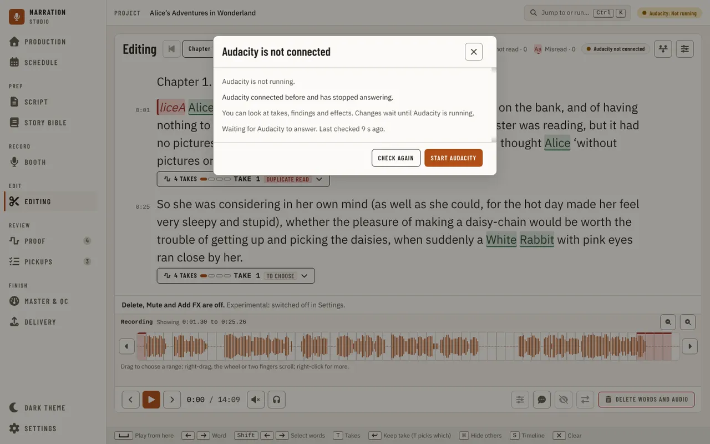

## When the chapter has no audio

With no track linked to the chapter there is nothing to edit yet. A banner at the top says why and opens the audio
engine panel, the legend reads **No audio to edit**, and the script shows no word as not read.

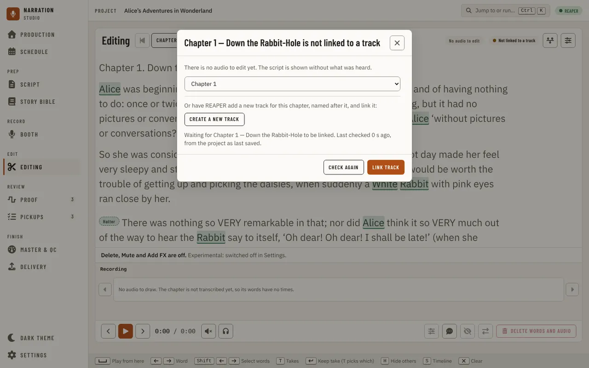

---

[← Booth](booth.md) · [Index](README.md) · [Proof →](proof.md)
