[Using the app](README.md) › Editing

# Editing

Editing is where you hear a chapter against its script and edit it. The chapter's script is the editor: each word
shows how it was heard, each line has its takes under it, and what you select is what you play, delete or put an
effect on. Open it from **Editing** in the sidebar's Edit group, from a linked chapter's **Open in Editing** in the
[audio engine panel](navigation.md#linking-chapters-to-tracks), from a recording check finding's **Open in Editing** on
[Proof](proof.md#one-chapter), or from **Manage takes in Editing** on a note in
[Proof](proof.md#a-note-and-your-decision). Its address is `/editing/<chapter>`; `/editing` opens the first chapter.

With no manuscript imported yet, the page says so and offers **Import manuscript**, which goes to
[Production](production.md#importing-the-manuscript).

## The page

The header sits inside the one bordered card that holds the script, so the title, the chapter step (the previous and
next chapter buttons, Alt+↑ and Alt+↓, and the chapter list), a legend of the marks in the text with how many of each,
the recogniser that heard the words (**Flagged by**, written out when the card is wide enough and always in the legend's name and hint), the timeline strip button (a timeline icon, on a window 1360 px
wide or more) and the button that opens the drawer are all in it. Where the header is too narrow for the whole legend, the kinds with nothing marked are the ones left out.
While the chapters and the chapter's lines are being read, the header stays and the script is drawn as grey blocks; if the chapters cannot be read, the page says "This page could not be loaded" with the reason and **Retry**, and if one chapter cannot be read, the same appears under the header and the chapter stepper. Retry shows the grey blocks again while it reads, then the page or the reason again. A link to a chapter the list does not have shows the title and the same blocks with **Checking this link…** while the chapter list is read once more.

Words carry what the last [recording check](production.md#checking-a-chapters-recording) heard. Each kind is drawn the
same way on every page of the app, and the legend shows a sample of each beside its count, so the shape tells two red kinds apart
without the colour:

- **Not in the script** (Extra): words heard that the script does not have, in italics on a red tint with a red bar at their left;
- **In the script, not read** (Not read): words of the script nothing was heard for, in muted text inside a dashed red box;
- **Misread**: a word heard differently, with a wavy red underline and what was heard on hover. Its card's **Confidence** is how likely
  it is a real misread: a word heard as one that sounds like it ("MBA" as "NBA") scores low, because the recogniser may have
  misheard a correct read, and a word heard as something unlike it scores high;
- **Low confidence**: a word the recogniser was unsure of, with a thin amber underline.

Red means the words are wrong, amber means the recording or the recogniser is in doubt. The same colours mark the matching
spans on the waveform, the kind chip on a word's card, the rows of the drawer's found list and, in a take's line, the words
the take left out (as not read) and added (as extra). A cut word is struck through, and a selected or playing word keeps its own fill;
the mark's underline stays under both.

Each line starts with its time in the chapter (a chapter with nothing heard yet has no times, and its text starts at the
card's edge). Every line that has takes, one with a single take included, has a takes chip under it: how many takes, a bar for each take with
the playing one filled, the one that plays, and where the choice stands: **Kept**, **Stacked** (the later reads sit on the
first read's spot), **Duplicate read** (the take reads the line twice) or **To choose**. Tab visits one chip, the one on the
line the cursor is on (the first before there is a cursor), so the script is not forty stops; **T** opens the takes of the
cursor's line (and folds them again on a line with one take), and a click on a chip opens any other. The takes list
lays every take out in the same columns: its name and state, a bar for its length, how much of the script it read as
written, then Play and Keep.

The script also shows what the Story Bible and your marks say about it, read from the [Script page](script.md)'s data. A
quoted stretch starts with a chip naming the speaker, in the character's colour (dashed when the Story Bible only suggests
the speaker, and grey with a question mark when it does not know); the speaker is changed on the Script page. A word that is
part of a Story Bible name is tinted and underlined in its entry type's colour, a word you marked wears the colour and line
of its mark type, and the notes you left on a line show under it as the mark type's name and the note.

The bar at the foot plays the chapter in the app, from its recorded audio with each item's trims, so it works with the
DAW closed. It shows the time, and what is selected with its start, end and length. The key hints under it come from
your keyboard settings ([Settings](settings.md)), so a key you rebound shows its new key.

Beside the clock, the **Output** group sets what you hear, not what is recorded. **Silence output** mutes the app's sound; it is not the
**Mute** that silences the selected words in the recording. **Show volume and output device** opens a popover with the speed (0.75× to 2×, with the pitch of the voice kept), the volume and the output device: the system
default, or one of this computer's outputs. A speed other than 1× is also written beside the buttons. The choices apply to the chapter and to a take you play on this page, and are kept for this
computer, not for the project. A saved output that is not connected stays chosen with "(not connected)", the sound plays on the system default meanwhile, and **Check again** reads the list; a
computer that names no outputs turns the choice off and says so. With REAPER connected and **Set the monitor level** on in [Settings](settings.md), the popover also has REAPER's monitor level,
which sets REAPER's own output when REAPER plays and does not change the app's sound.

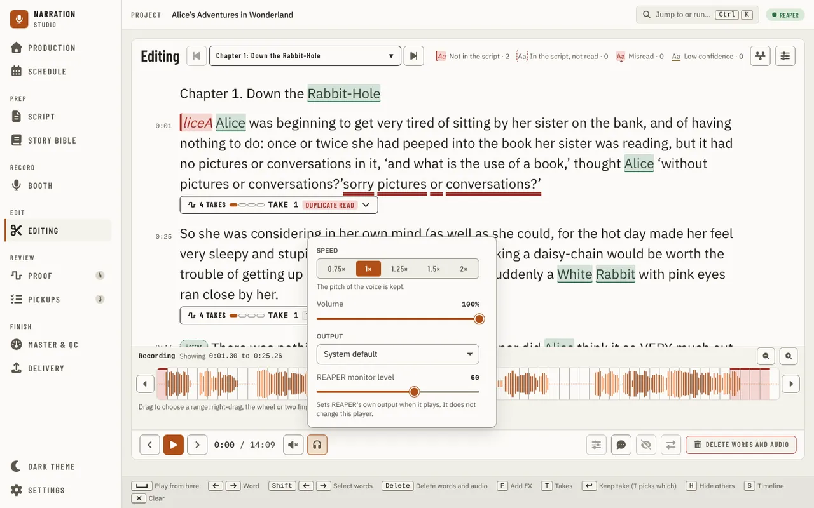

The word playing is lit, and the text scrolls to keep it in sight until you scroll by hand; the next play scrolls it
again. When you play the project in the DAW instead, the lit word follows the DAW's play position, as long as the DAW
reports one and the app is not playing its own audio. When the DAW stops, its last word stays lit until you move the
cursor.

A chapter has to be linked to a track (see [Linking chapters to tracks](navigation.md#linking-chapters-to-tracks)) for
its words to carry the times they were heard at. A chapter with no audio to edit shows the script plain, with no word marked
"not read". When the cause is a link (no track linked, or the linked track is not in the saved project), a dialog opens by
itself, once for the chapter: it names the chapter, offers the REAPER tracks the app found in a dropdown, with the best match chosen, and
**Link track** links the one you pick, after which the page reads the chapter at once. **Create a new track** has REAPER add a
track named after the chapter and links it instead (the main button when the project has no tracks); save the REAPER project
so the page can read the new track. If you close it with the X, the
**Not linked to a track** mark in the header opens it again. The page also reads the chapter again whenever you come back
to its window, so a link made in REAPER or the audio engine panel shows without a reload. When the track is empty, or with the
built-in recorder (which has no track to link), a note over the script says to record the chapter, with **Read again**.
A chapter
that was never checked has no heard words: the page shows its script plain, with a **Not transcribed yet** note and a
**Check recordings…** button beside it that opens [Check recordings](production.md#checking-a-chapters-recording), the one recording
check every page opens, with this chapter ticked. When the dialog closes the page reads the chapter again, so
what the check found shows without a reload. Opening Editing never starts a check.

A chapter you recorded since its last check may be checked in the background, whatever page is open
([Checking what you recorded](booth.md#checking-what-you-recorded)). While one runs, the bottom left of the page names the
chapter, how far it has got, the models and how many chapters wait, with **Pause** and **Cancel**. When it finishes, the
words it heard show the next time you open the chapter.

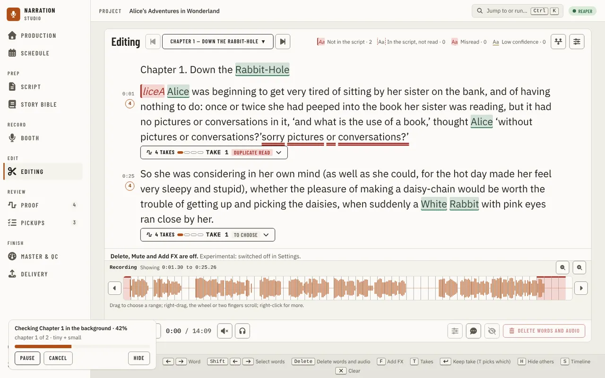

## Selecting words

Click a word to place the cursor there. Shift+click another, drag across the text or press Shift+← and Shift+→ to
select a run of words. Hold ← or → (with Shift to select) and the cursor keeps travelling along the text; Up and Down hold
the same way, a phrase at a time. Every other key does its job once, however long you hold it. A toolbar floats over the first line of the selection (under it when the selection starts at the top of the view) with **Play**, **Add FX**, **Voice sample**, **Mute**, **Takes of this
line** (on a line with more than one take) and **Delete**; the bar offers the same actions, with **Delete words and
audio** in full on a wide window. In a narrow window the bar keeps them at the right of the transport and moves what is
selected to a line of its own under it. **Delete**, **Mute** and **Add FX** stay on the bar but are off while the DAW cannot make
the change (it is not answering, or it cannot do that edit); a line above the bar then says so
and why, the same sentence is in each button's hint, and the key hints leave out Delete and Add FX. The chapter's audio is the waveform docked above the bar, always in view (see [The waveform](#the-waveform)). Right-click a word for its
menu, in groups under headings: the word count over play the selection; **Edit** (**Add FX**, which opens a list beside it,
mute, delete or replace the words, remove an effect); **Mark** (**Mark as**, add a note, mark them for a pickup, **Mark as
voice sample…**); **Takes** (show or keep the line's takes, hide the others, and **Split into takes** on a line whose one
take reads it twice); then copy. A row's key, such as **T** or **H**, is drawn at its right end.

With a screen reader, the script is one read-only text box. Each time the cursor stops, the screen reader says the word it is on
(with ", not in the script" for a word that was only said), or "3 words selected, 0:23 to 0:24" for a selection, and "Selection cleared"
when Esc lets the selection go. It waits for a quarter of a second without a key before it speaks, so holding ← or → says where the
cursor stopped, not every word it passed. A flagged word says what its card says instead. When a dialog opened from the text closes
(**Add note…**, **Mark as voice sample…**, and the delete, mute and effects dialogs), by Esc, **Cancel** or **Save**, focus is back on the text
and the selection is as you left it. Playback says "Playing" when it starts and "Stopped" when it ends.

The key hints at the foot of the page name what **Enter** does where the cursor is: **Open flag card** on a flagged word, **Keep take (T picks which)** on any other word, and **Keep take** once T has opened the line's takes. Enter on a word that is not flagged keeps the take the keys are on, or the line's active take if T has not been pressed.

A flagged word opens its card: what the script says and what was heard, and the choice to keep the word as read, which
clears the mark (with Undo in the message that confirms it). When [Proof](proof.md) has a note on the same words, keeping
them as read marks that note **Fine as read** too, so it is cleared on Proof and leaves [Pickups](pickups.md); the message
says so, and Undo puts the note back as it was. This holds for a note already decided **Needs pickup** too: its line
leaves Pickups.

**Mark for pickup** on a word that Proof has a note about decides that note **Needs pickup**, so the line on Pickups is the
note's own and Pickups can take you back to it; the message says "Added to Pickups, with its note on Proof." A word with no
such note, or one whose note is fixed in the edit (words said and not written), is added to Pickups as a line of its own.

### A line said twice

Words heard that say the script beside them again are a second take, not words outside the script: a retake of the end of a
line ("once more", then the last words again), or a restart (the first words, "sorry", then the line in full). At least three
words of the script must be said again, or a whole line, so a stutter is not one. The recording check finds them, and a take
of its own is checked the same way. Their card says **Read twice** and when the second read starts, and offers:

- **Stack as 2 takes**: splits the take at the pause before the second read, in the DAW. A line that is not one take the DAW
  can split (a chapter recorded in one pass) says so and changes nothing.
- **Hear both reads**: plays the second read with as long again on either side, so both reads are heard.
- **Leave in place**: closes the card.
- **Delete second read…**: asks first, then cuts the second read's words and audio.

Proof lists the same words as **Said twice** with an **Open in Editing** link, which opens this card.

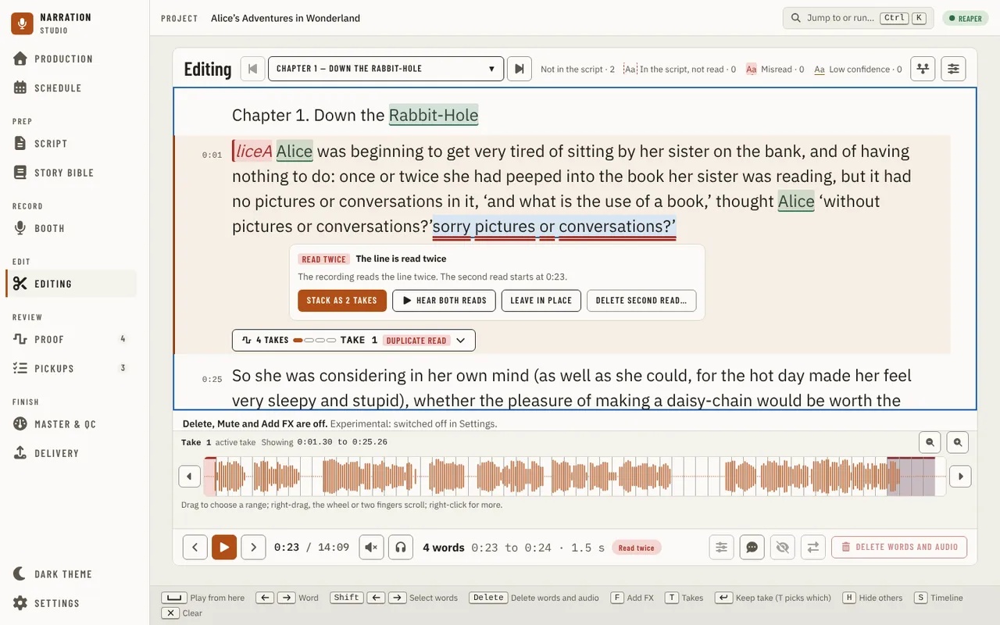

## The waveform

The page has one waveform, docked above the bar so it is always in view. It shows the chapter's audio and opens on the line the cursor is on;
when the cursor moves to a line that is not on screen, or playback reaches one, the waveform moves to it. Its first row names the take that
plays (or "Recording"), the stretch it shows, a **?** that lists the waveform's gestures when you point at it or Tab to it, and **Zoom out**
and **Zoom in**. The line under the waveform shows a range's time and words; with no range it is blank, not a set of instructions.

Each thin bar is how loud that moment is, drawn from the middle line. The height is in decibels against the chapter's own loud level (the
level 99 in 100 of its sounding moments stay under), over 30 dB: a loud syllable fills the lane, a quiet one is still a clear bar, and a pause
is a hairline. A chapter recorded quietly draws as tall as one that was normalised, the way REAPER's view looks once you normalise, and one
click or plosive does not make the rest small. The bars are the peaks, not the RMS: the host keeps each 20 ms's highest and lowest sample.
While the chapter plays, the bars already played are in the accent colour and the rest grey, and a swell travels with the playhead, like a
stadium wave: the bars just ahead of it rise, the ones under it stand up to half again their own height and the ones behind settle back, so
the shape of the audio stays the same under it. While the waveform is still being read, a low row of grey bars stands in its place with a
swell crossing it from left to right about every second and a half. With **Motion** set to reduce in Settings (or Windows asking for
it), nothing moves.

**Scrolling.** Hold the right button and drag to move the audio along, or use the wheel or two fingers on a trackpad or touch screen. The
arrows at either end move a whole window back or forward; there is no scrollbar. With the waveform focused (Tab to it), **←** and **→**
scroll a tenth of what shows, **Shift** or **Page Up** and **Page Down** a whole window, **Home** and **End** go to either end of the
chapter, and **+** and **-** zoom. While you scroll, the script marks the lines now on screen in the waveform (a blue bar at their left) and
brings them into view; the cursor stays where it was, and moving it lets the waveform return to its line. Drawing or moving a range keeps
the waveform where you scrolled it.

**The waveform's menu.** A right click without a drag (a long press on a touch screen, or the menu key or **Shift+F10** with the waveform
focused) opens its own menu: **Play from** that moment, **Play the range** and **Clear the range** when there is one, **Put the cursor on**
the word there, **Select this line**, **Zoom in** there, **Zoom out**, **Show the whole line** and **Show the whole recording**.

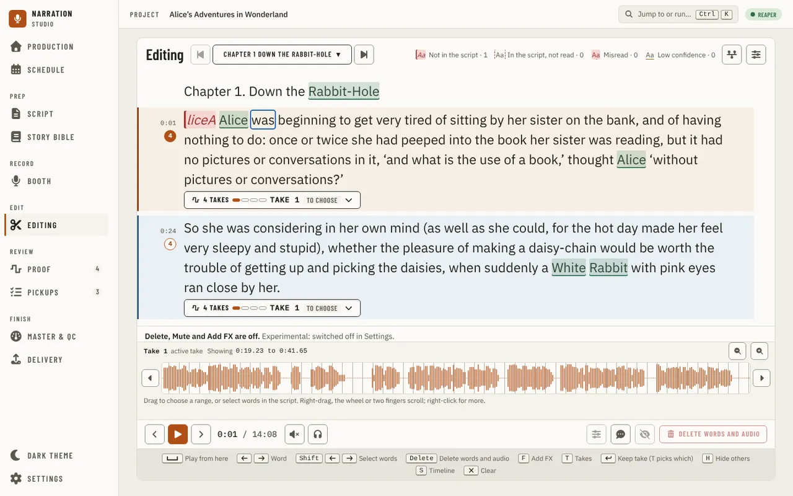

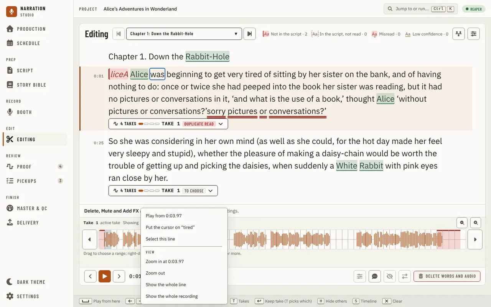

## Choosing a range on the waveform

The waveform is also a place to choose by time. **Drag** on it with the left button (or one finger) to draw a range with a handle on each edge; the
words it covers are selected in the script (a word is selected when the range lies over at least half of it), and selecting words in the
script sets the range to their span. **Drag a handle** to move one edge, or **drag inside the range** to move all of it; a drag stops at the
edge of what is on screen, a range can cross from one line to the next, and it never gets narrower than 50 ms. Hold **Alt** while dragging to snap to the nearest word boundary (the start or
end of any heard word). A tap without a drag puts the cursor on the word under it.

With a handle focused, **←** and **→** move that edge by a hundredth of what is showing (at least 10 ms), **Shift** by ten times
that, and **Alt** to the next word boundary. The handles are sliders named "Start of range" and "End of range"; each announces its time, the range, its length
and its words, and the range is announced when it is set.

**Zoom in** and **Zoom out** step the view from the whole chapter down to one second; **Ctrl+wheel** (or a trackpad pinch) zooms about the
pointer. The view follows the playhead; scrolling it by hand while the chapter plays stops that until playback stops. One second is the
closest view because the host keeps 50 peaks a second, 20 ms each: closer, the picture would only get bigger.

**Delete** and **Add FX** still work on whole words, because the DAW takes a range as its first and last word. When an edge is inside a word, the line under the
waveform names the word and how much of it the range covers, and the question before a cut or an effect shows "Sub-word edge, shown as a preview" with
both ranges; the cut or effect goes on the whole words. Making it exact needs a time-based command in the DAW bridge, which is not built.

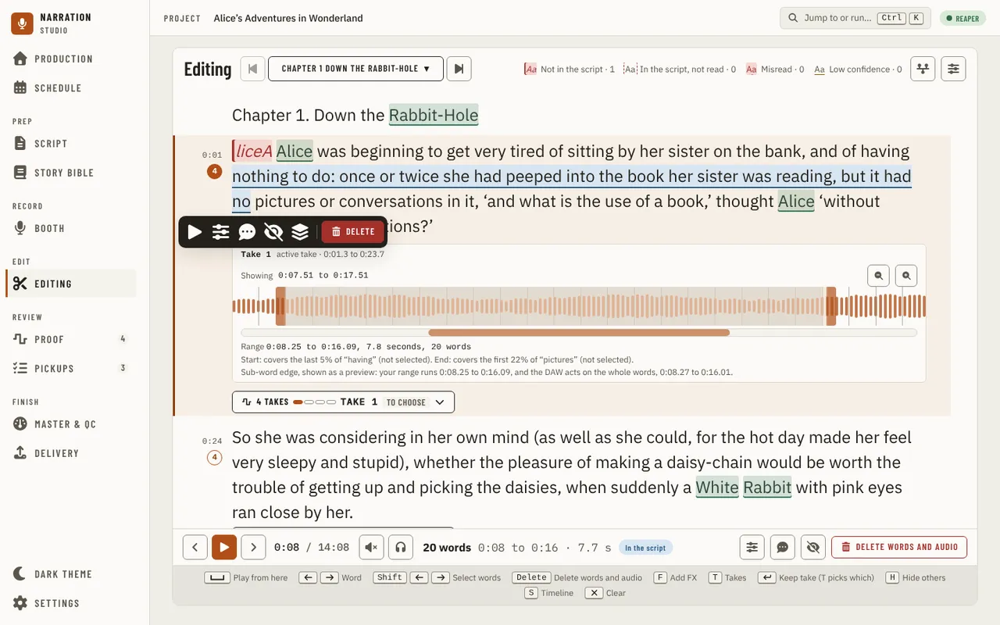

## Deleting words and their audio

**Delete words and audio** (Delete) asks first. The question names the words, where the cut starts and ends (moved to
the nearest zero crossings), the track, and what happens to the gap: close it, so later audio on the track moves up, or
leave room tone of the same length so the timing does not move. You also choose the crossfade at the join, how much audio to keep at each
edge of the cut, and whether the cut audio is kept on a muted track named Cuts. The DAW makes the cut as one undo step; the recording file is not
touched. **Mute** keeps the audio and silences the words. The DAW names words by the script's words, so a word that was only said (in italics, not in the script) at the edge of your selection is left out: the question says so ("“um” was only said and is not in the script, so its audio stays.") and counts only the words that will be cut. A word that was only said between two script words is cut with them.

Every question on this page keeps **Cancel** at the bottom left and its action at the bottom right, in view however far the
question scrolls; when more of it is below them, a shadow over that row says so.

## Effects on words

**Add FX** (F) lists your FX chains from the DAW; from the bar the list opens upward, over the script. Choose one and the question shows how the item will be split around
the words, where the splits fall, the fades at the joins and what the DAW does: it splits the item at both ends and puts
the chain on the middle piece only. Nothing else moves, and one undo step in the DAW takes it off. The words with an
effect are underlined and end with an effects marker: click it to select the words or remove the effect. The question
also has **A/B**, which plays the words in the DAW without the chain and then with it, and puts the chain back as it was.
A/B compares a chain that is already on the words, so it is off, with the reason beside it, until the chain you picked is
on them; the Effects tab's **Compare** does the same for any effect in the list. The word menu (right-click) has **Add FX**
with your chains in a list beside it, and **Remove** with the chain's name on words that carry an effect. The drawer's
Effects tab lists them.

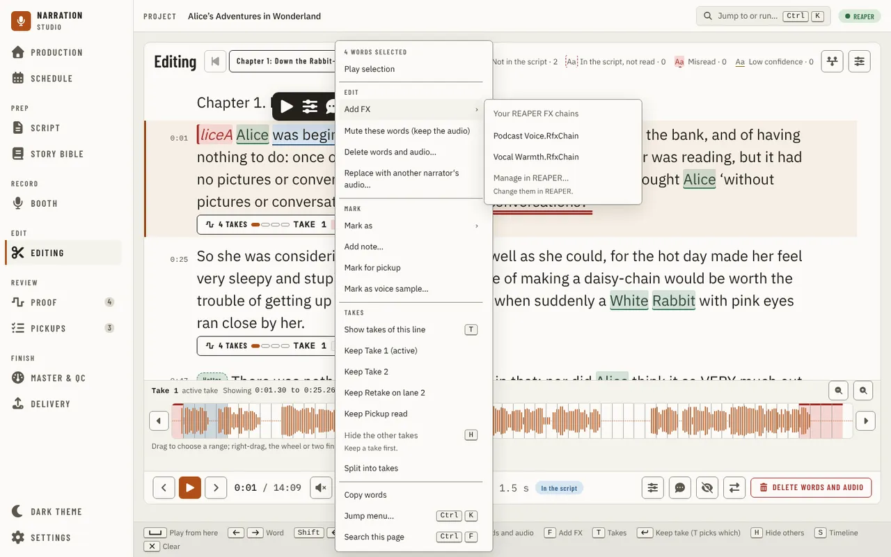

The Effects tab shows how much of the chapter effects cover against a cap, 10% unless you change it in the tab's **Cap**
field (a whole percent from 1 to 100, kept for the project). Over the cap the tab warns, and Add effect asks again
before it goes ahead.

**FX in REAPER** lists the plug-ins on the project's tracks and its master track as REAPER holds them now: where each one
sits, its name, and whether it is switched on there. It reads REAPER and changes nothing, so a plug-in you add or bypass in
REAPER shows here when you come back to the app or press **Check again**; the list says when REAPER last answered. If REAPER
cannot be read the section says why instead of showing an old list. To put a plug-in on words, use **Choose in REAPER…**
(below), or save it in REAPER as an FX chain, which **Add an effect** then lists.

### Choose any plug-in in REAPER

**Choose in REAPER…**, beside **Add effect** in the Effects tab, puts any plug-in REAPER has on the selected words, chosen
in REAPER's own FX window. Select the words first; they must come from one take of one paragraph, as for Add FX. The app
asks REAPER to split the item at both ends of the words, which is one undo step in REAPER, and REAPER opens its FX window on
the middle piece. For words with no plug-in yet, that is REAPER's **Add FX** browser, with every plug-in you have installed:
pick one there and click **Add**. If the item already had plug-ins, REAPER shows its FX chain window instead: click **Add**
in it. You can add more than one, and set them up there as you would any plug-in in REAPER.

While REAPER's window is open, the Effects tab shows what REAPER has chosen so far and checks every second or two, and when
you come back to the app. Close REAPER's FX window when you are done, and the app adds what you chose to the words as an
effect, named after the plug-ins. **Keep it** adds it straight away with the window still open. **Cancel** takes off
anything you chose and joins the item back together, and the app records nothing. **Check again** asks REAPER now. If
REAPER stops answering, the panel says it cannot tell what is chosen and when REAPER last answered, rather than showing an
old answer.

An effect chosen in REAPER works like any other in the Effects tab: Compare, bypass, its settings and **Remove this
effect** act on the plug-ins you chose, not on any the item already had. Undo in the app takes it off and joins the words
back. Removing it can only be undone in REAPER (Edit > Undo), because only REAPER knows the plug-in and its settings.

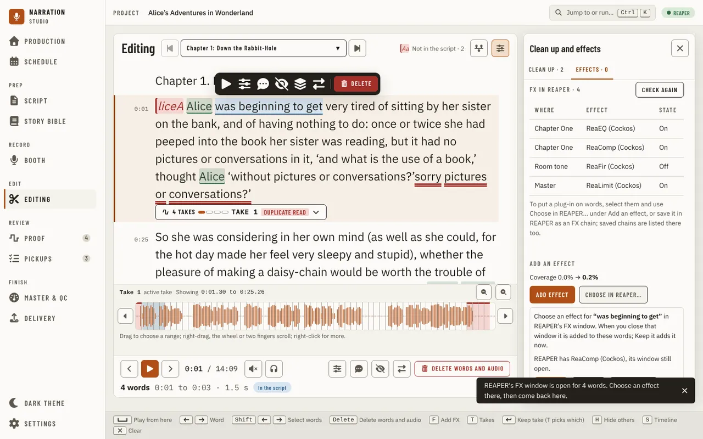

## Replacing words with another narrator's audio

In a duet, or where a stand-in read a line, you can play another narrator's audio in place of some of your words. Select the
words and choose **Replace with another narrator's audio** on the toolbar, or **Replace with another narrator's audio…** in the
word menu. It needs REAPER linked and answering; with another DAW the action is off and says why.

The first time in a project, the dialog asks for the other narrator's name. You name each one once for the project; their name
is what the script shows on the words their audio replaces. **Add a file of theirs…** opens a file dialog for their recording
(WAV, FLAC, MP3, OGG or AIFF). REAPER puts it on a muted track of its own, named for them, and plays it from where it is: the
file is not copied into the project folder, so keep it where it was. A file that was moved or changed since is marked in the
list, and Replace stays off until you put it back or add it again.

Under **Their stretch**, drag across their waveform to choose the part of their file that replaces your words, or type **From**
and **To** in seconds. A file that is not a WAV shows a ruler instead of a waveform. The stretch can be 50 ms to 5 minutes long.

The app then measures their stretch and shows its loudness against the project's target (**Loudness another narrator's audio is
set to**, in Settings > Editing, -20 LUFS unless you change it), with the level change that brings it there. You can change the
level, up to 24 dB either way. When their level cannot be measured, for an MP3 without the audio encoder or a stretch too short
or too quiet, the dialog says why and their stretch keeps its own level unless you set one. **Length** compares your words with
their stretch: when they differ, the later audio on the track moves earlier or later by the difference. **Fade at each seam** is
10 ms unless you choose another.

**Replace** moves your audio for those words to the muted Cuts track and plays theirs in its place, in one undo step in REAPER.
Your recording and their file are not changed. Words that are cut, already replaced, or were only said and are not in the script
cannot be replaced, and the toolbar says which.

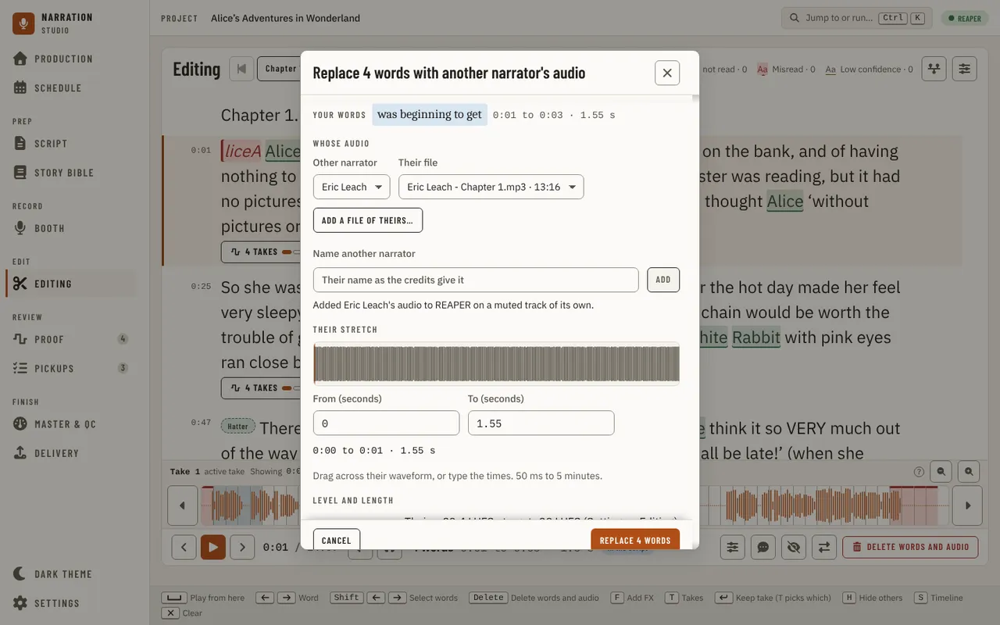

After the last replaced word the script shows the other narrator's name. Click it, or reach it with **Tab** and press
**Enter**, for their stretch, the level change and **Put my audio back**. A dashed name says the words changed since their
audio was put there. **Undo** takes a replacement back while it is still REAPER's last action; after that, and after a restart,
**Put my audio back** (on the name, the toolbar or the word menu for the replaced words) puts your audio back where it was.
A replaced stretch is not a take: it does not appear in the line's takes.

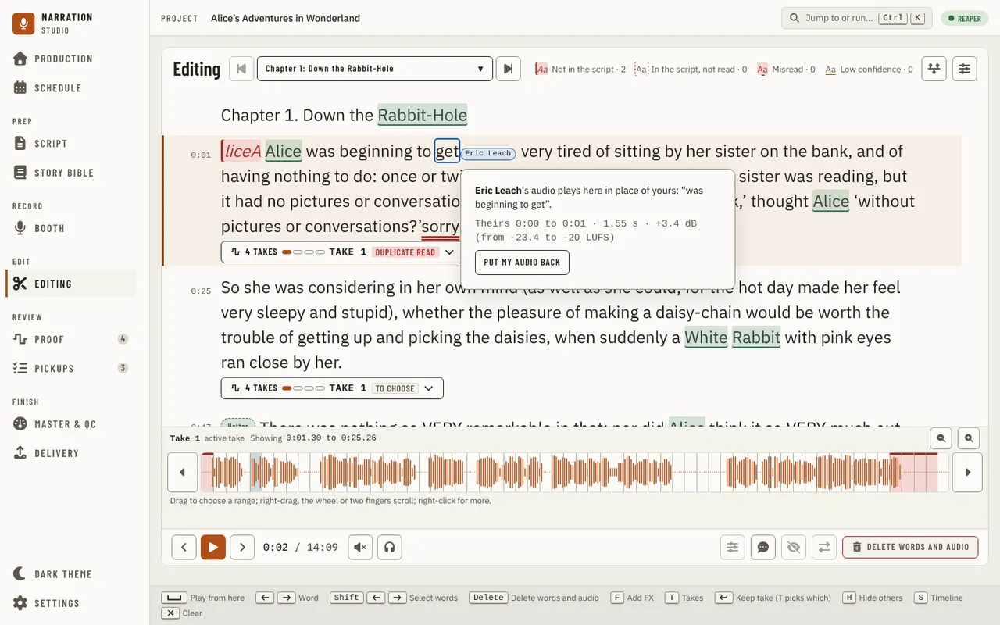

## Marking a voice sample

Select the words where a character's voice came out right and press **V** (or **Voice sample** on the toolbar, or **Mark as
voice sample…** in the word menu). The dialog offers the characters who speak in this chapter first, with the speaker of the
first word chosen, then every other character, then **Narration**. Under the character it counts that character's samples ("3 of
20 samples"); a character with 20 has to lose one first. **Play range** plays the words from the recording. Give the sample a
label and a note if you like ("Furious, to the court", "pitch up, no breaths"), and leave **Make primary** on if this should be
the one that plays first for that character; it is on by default for a character's first sample. **Enter** saves, **Ctrl+Enter**
saves from the note, and **Esc** closes. So with the right character already chosen, marking a sample is **V**, then **Enter**.

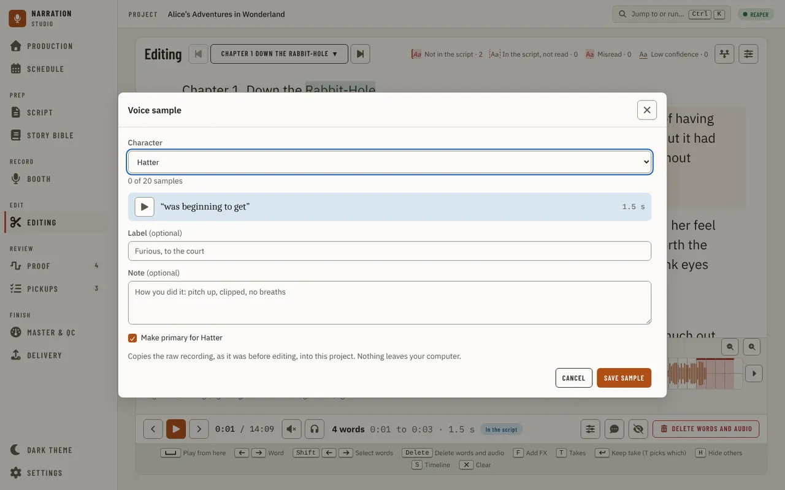

Saving copies the raw recording of those words, as it was before editing, with a short margin either side cut at a quiet point,
into <!-- brand:identity.projectFolder -->narration-studio<!-- /brand -->/voice-samples in the project folder. Nothing leaves your computer, and the clip does not change if you
later cut, re-record or move the chapter. A message says "Saved voice sample for" the character, with **Undo** for ten seconds, which removes
the sample again. Marking the same words again for the same character says it is already a sample instead of making a second.

The dialog says why it cannot save, in one sentence, and saves nothing: the words are not in the recording, they run across two
takes ("Choose words inside one take"), the recording changed since the chapter was checked ("Check it again, then mark the
sample"), some of the words are cut ("Restore the cut words or choose words without them"), the clip would be under half a
second or over 30 seconds, the recording is not a WAV file, the audio file is missing, the saved REAPER project cannot be read,
the character has 20 samples, or samples already use the 200 MiB a project may hold. Play, rename and manage a saved sample under
**Voice samples** on the character's entry in the [Story Bible](story-bible.md#voice-samples), and hear them in the
[Booth](booth.md#voice-samples).

### Samples in the script

A small dot after the last word of a marked stretch says it is a voice sample. It is grey for Narration, and a number in it says
how many samples end on that word. **Tab** reaches it in reading order; **Enter**, **Space** or a
click opens what was marked there: the character, the label, the length, the words that were marked and any note, a play button, and **Open in Story
Bible** for a character who has an entry. The play button plays the saved clip, not the recording as it is now, and stops
Editing's own playback while it plays; the same button reads **Stop** and ends it, and **Esc** closes the list. Rename, move and delete
stay in the Story Bible.

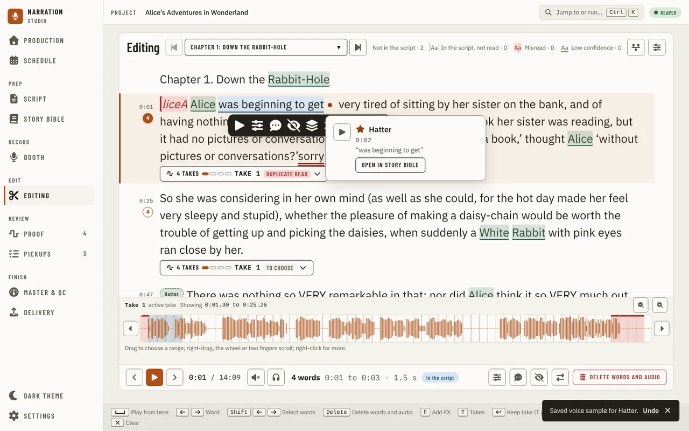

A dot with a hollow ring says the words changed since the sample was marked; the sample still plays. A dashed ring says the audio
file is missing or changed; it cannot play, and the Story Bible has **Check again** and **Delete**. A sample whose last word is no
longer in the chapter is drawn once above the script as "A voice sample whose words moved". Unlike the Booth, Editing does not
check whether a take is recording before it plays a sample, so do not play one while you record.

## Takes

Click a line's takes chip or its badge (T steps to the next take) to open its takes under it. Escape folds them again and leaves focus on the chip. A take that reads its line twice says so at the top of the takes, with where the second read starts. The suggested take comes first, with
why it is suggested and the steps that would make the comparison surer: **Trim white space**, **Trim breaths** and
**Normalise**, each asking before it changes anything in the DAW. Then each take, with its waveform, what share of the
script it read as written, and its pause, level, noise, clarity and breaths. A take's second line says where it begins, how long it lasts and what the DAW calls it
(a REAPER take, an Audacity clip or a recorder take). A take reads **Kept**, **Active**, **Muted** or, once you hide the others and look at them again, **Hidden**; the first read of a stacked line wears **First read**. Play a take to hear it: with REAPER linked it plays through REAPER, outside the project and without changing it, so you hear its output and level; if REAPER cannot preview it now, the app plays it and a message says why. With the built-in recorder or Audacity the app plays it. Nothing plays while REAPER is recording. A take longer than a minute plays its first minute. **Keep take**
(Enter) makes it the one that plays, and **Hide others** (H) hides the other takes from the lanes. **Show in the DAW**
moves the DAW to the line, on a DAW that can move to a place in the project.

**How retries are kept** decides, for the line or the whole chapter, whether a line read again later in the chapter is
stacked as a take of the first read or left where it was. With Stack, **Stack retries as takes** shows the plan before
the DAW moves anything.

## The drawer

The drawer button (Ctrl+Shift+C) opens the drawer beside the text, or over it on a narrower window. **Esc** closes it,
from the text once nothing is selected or from the drawer itself, and leaves focus on the button when it was pressed inside the drawer.

### Cleaning up

**Clean up** lists what was found in the chapter (words not in the script, not read, misread and of low confidence, each
with the kind's sample mark and **Review** to step through them) and, under **In the audio**, the clean-up findings by kind: gaps,
breaths, clicks, plosives and noise. The tab's count adds the words found to the findings that pass the thresholds, and the
Backups tab counts this chapter's backups.
The kinds sit in three equal columns; under them, the chosen kind's heading says how many are left to fix, then its
findings. Pick a strength, **Preview** to hear the first three findings with two seconds either side, and apply the change to
the findings you selected. **Preview** and **Apply** stay at the foot of the drawer while the settings above them scroll. A gap reads **Fixed** once the chapter's cuts hold its trim (from here or from **Trim the gap**
on Proof), so a gap is never trimmed twice. A finding decided **Needs pickup** or **Fix in edit** on Proof is still to be fixed, so it stays in the list. A clean-up action
the DAW cannot do is off, with the DAW's reason.

### Effects, Backups and Timeline

**Effects** lists the effects on words in this chapter and adds one. Under **Add an effect** the DAW's own chains and plug-ins are listed under their source, each name with a **Favourite** button at its right. A favourite is listed first here, in the Add FX menu and in the question that asks before an effect goes on; the buttons edit the global list, the same one as **Favourite effects** under **Set on a page** in [Settings](settings.md#set-on-a-page), which can also set it for one project. A name with a comma in it cannot be a favourite. Pick an effect in the list to see it under the list; with words selected in the text, the effect on them is the one shown, and its row is marked. Its header has **Previous effect** and **Next effect** (off at the first and last), and **Show in REAPER** (or your DAW's name), beside **Preview** and **Compare**, moves the DAW to the effect's first word, or says why it cannot. **Backups** shows only with a DAW that keeps
backups of its project; with one that edits the audio itself, the app backs the words up before each delete, effect or
stack, and refuses the edit if the backup fails. The Backups tab is also where this project's backup settings can be changed (the window either side of an edit, and **Keep backups for (days)**; Audacity keeps backups whenever it answers). It is a shortcut to the same settings as the Audacity backups under **Set on a page** in [Settings](settings.md#set-on-a-page), which also sets them for every project (Global); the tab edits this project only. **Timeline** shows the takes of the line the cursor is on, one lane each,
on one time axis (the line's audio is the waveform above the bar). On a window 1360 px wide or more it is a strip under the text, which the header's
timeline button (S) shows and hides; on a narrower window it is a tab of the drawer. Each lane names its take with
the take's state (**Active** or **Muted**) under the name.

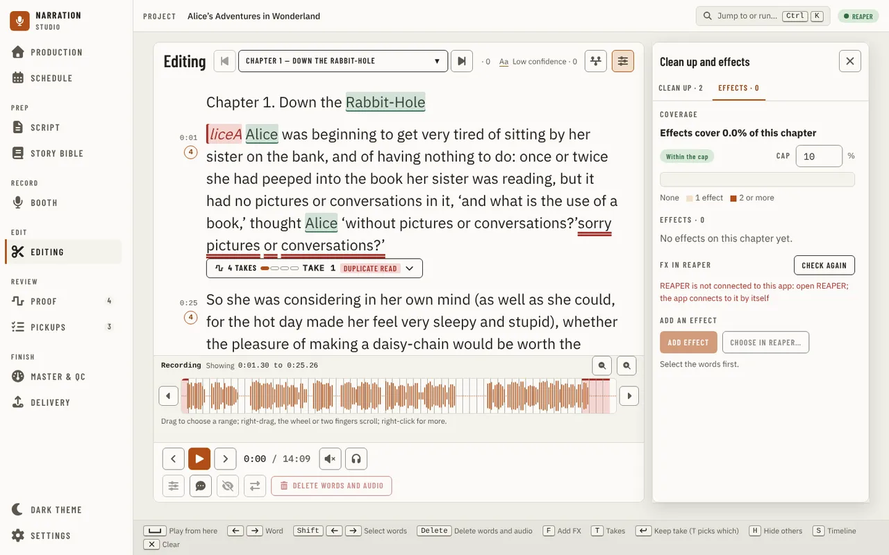

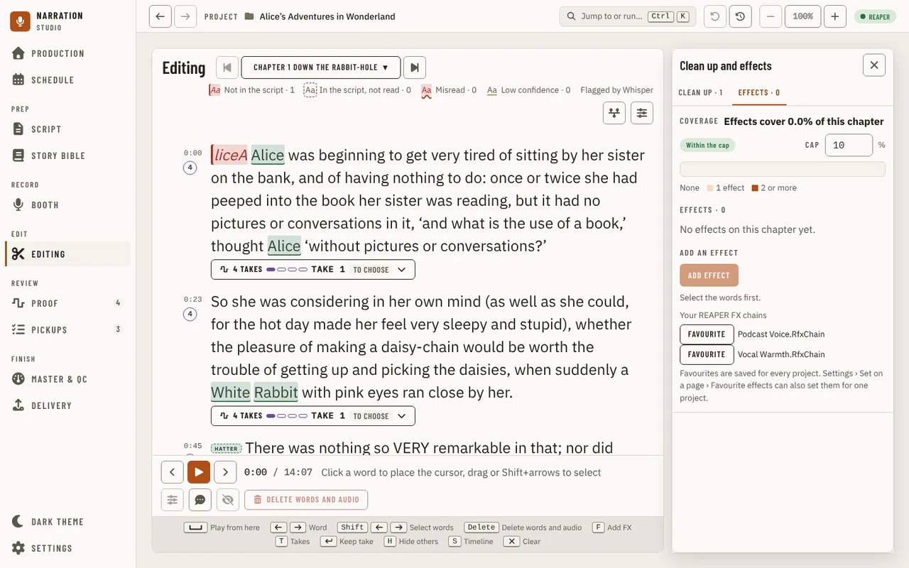

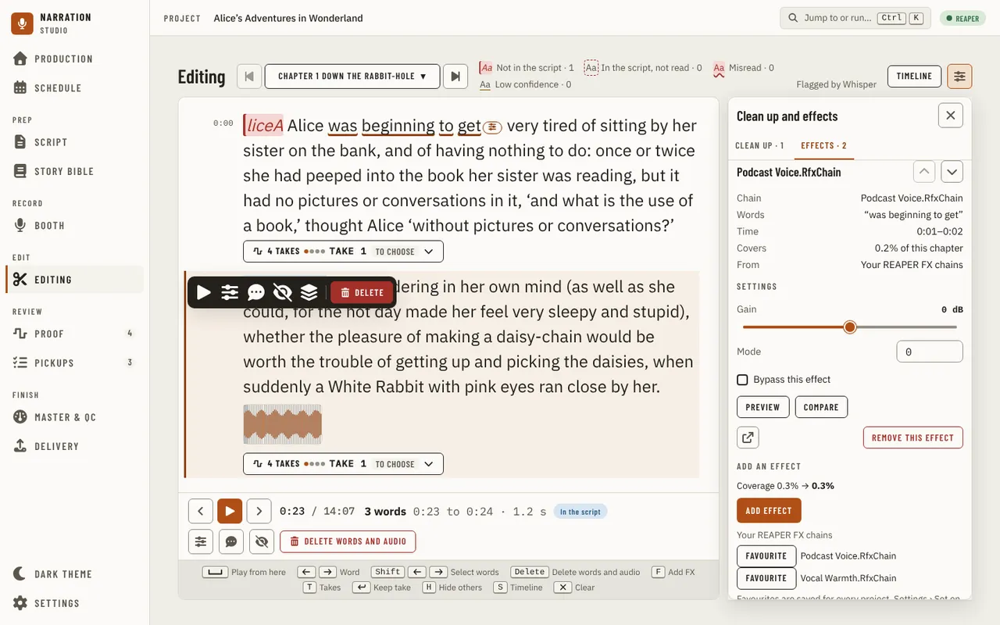

## Playing with REAPER

With REAPER linked and open on this book's project, the page and REAPER's transport follow each other (no setting turns this on):

- Clicking a word, or moving the cursor to it, puts REAPER's edit cursor at that word. Moving REAPER's edit cursor puts the page's cursor on the word there.
- **Play** (Space) starts REAPER from the cursor and the app stays silent: the sound comes through REAPER's output and level. The lit word and the waveform follow REAPER's play head, about four times a second. **Stop** stops both.
- Pressing Play or Stop in REAPER lights the word it is on, or stops the page, the same way.
- A word with no place in the project (the audio before a trim, a stretch after a cut, a gap between paragraphs) moves nothing, and REAPER's cursor on such a place moves nothing on the page.

While REAPER can play, the page plays the chapter through REAPER and never through the computer's output, so what you hear has REAPER's FX and level. The same holds for a take under a line and for the Voice sample dialog's **Play range**. If REAPER cannot play now (it is not connected, it has another project open, the switch is off, the word is not in its project, or it refuses), the app plays the same words itself and a message says why, for example "REAPER is not answering. Played in the app instead." While REAPER is recording nothing plays, so the room stays quiet. Until REAPER first answers, Play waits and says it is checking. If REAPER stops answering while it plays for the page, playback stops and says so. With the built-in recorder, or Audacity, the app plays the audio itself, with no message.

## When the DAW is not connected

A dialog says the DAW is not connected, in the app's own words: the DAW's reason ("REAPER is not running."), what the host
knows (the project is linked but REAPER has not connected; it connected before and stopped answering; no project file is
linked, so it cannot be started from here), what still works, and when the app last checked. **Start REAPER** runs the
launcher, and **Check again** asks the DAW now. It opens by itself once per lost connection, a few seconds after the app
opens so a DAW that connects on its own never shows it; the X closes it, and the **REAPER not connected** mark in the header
opens it again. A setting that keeps Delete, Mute and Add FX off is the line above the bar, never this dialog. You can still
read, select and play; the actions that change the DAW (delete, mute, effects, keeping a take) wait until it is back.

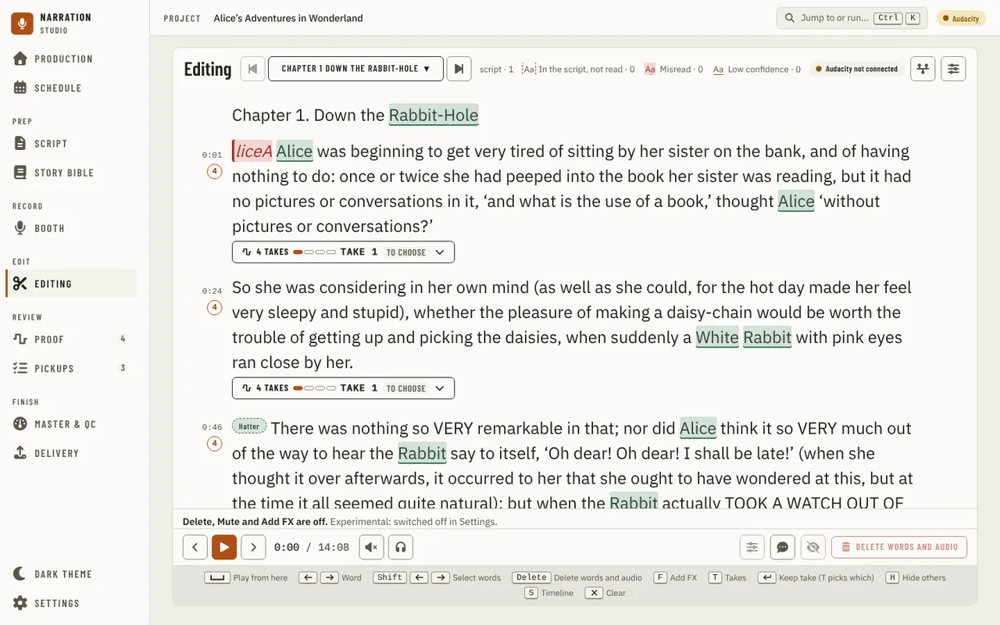

## When the chapter has no audio

With no track linked to the chapter there is nothing to edit yet. The legend reads **No audio to edit**, the script shows no
word as not read, and the dialog described above lists the tracks to link.

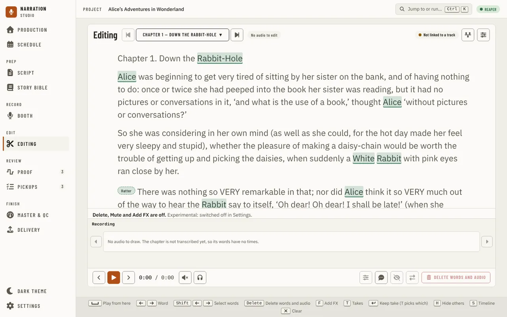

---

[← Booth](booth.md) · [Index](README.md) · [Proof →](proof.md)
