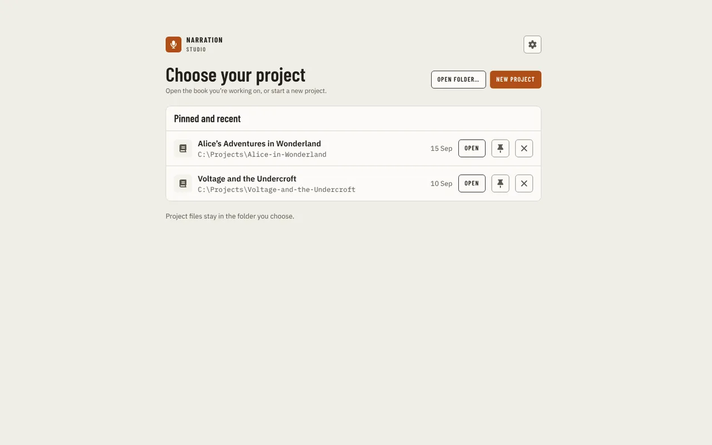
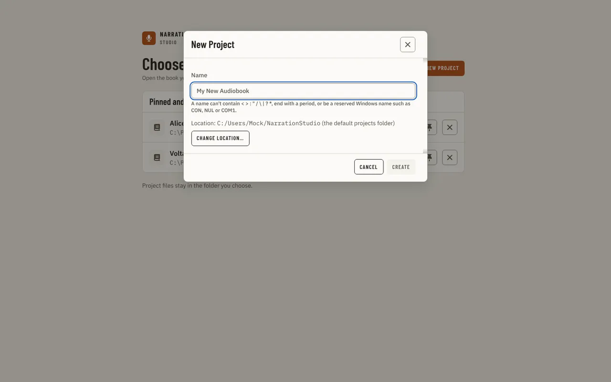
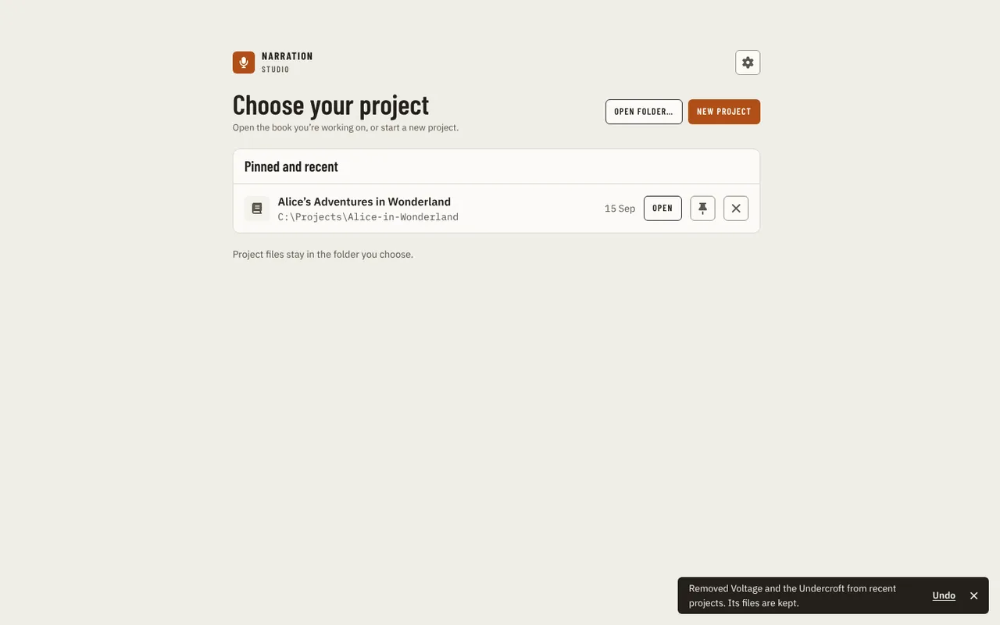
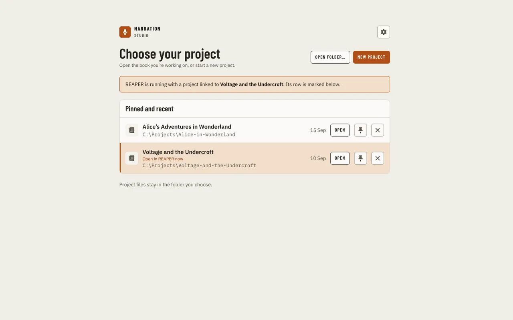

[Using the app](README.md) › Getting started

# Getting started

This page takes you from a freshly installed app to your first recorded take. It is written for someone who has
never opened the app; if you have, skip to [The project picker](#the-project-picker) for what each part of the first
screen does.

By the end you will have a project for your book, the manuscript imported into it, a recorder chosen for it, and one
take recorded in the [Booth](booth.md). The example below uses a book called *The Lighthouse Keeper*; use your own.

## Before you start

You need:

- **The app**, installed from a release ([Install on Windows](../../../README.md#install-on-windows)). It runs on Windows x64.
- **The manuscript** as a Word (`.docx`), EPUB (`.epub`), Markdown (`.md`) or plain-text (`.txt`) file. PDF is not
  supported yet. The app keeps a copy in your
  project and never changes the original.
- **A recorder.** The app works with REAPER, with Audacity 3, or with neither:
  - **REAPER**: you set nothing up inside it. The app puts its bridge, a small script, in REAPER's Scripts folder by
    itself.
  - **Audacity 3**: see [If you record in Audacity](#if-you-record-in-audacity) for its own Start Menu entry and what
    it can do yet.
  - **Neither**: the app's built-in recorder records on Windows and saves each take as a file in the project; see
    [Recording without a DAW](booth.md#recording-without-a-daw).

The steps below use REAPER as the worked example, since it is the recorder the app does most with. Where Audacity or
the built-in recorder works differently, the step says so.

## Your first project, step by step

### 1. Start the app

Start **<!-- brand:name -->Narration Studio<!-- /brand -->** from the Start Menu. With no project open, the app shows
**Choose your project**. The first time, the list says "No recent projects yet."

### 2. Create the project

Press **New project** and type a name, for example `The Lighthouse Keeper`. **Location** shows where the project's folder
will go: the default projects folder (<!-- brand:identity.defaultProjectsFolder -->NarrationStudio<!-- /brand --> in
your user folder) unless you choose another with **Change location…**. Press **Create**.

The app makes a folder named after the project, here `The Lighthouse Keeper`, and opens it. That folder is the project:
the book's project files stay in it. The app does not make a project in your DAW for you; that is step 4.

### 3. Import the manuscript

The new project opens on [Script](script.md), which says "This project has no manuscript yet. Import one to begin."
Press **Import manuscript**. It takes you to [Production](production.md), where the import runs in two steps:

1. **Choose your manuscript**: drop the file on the zone, or press **Choose a file…** and pick it.
2. Review what the app found: the chapters, each with a switch to leave it out of the recording, and the character
   suggestions. Then run the import from the dialog's footer.

[Importing the manuscript](production.md#importing-the-manuscript) shows both steps with screenshots and explains each
option. Until a manuscript is in, the sidebar shows the pages that need one off, with a lock; after the import they all
open.

### 4. Choose how you record

Open [Settings](settings.md) (at the bottom of the sidebar) and go to **Recording & DAW**. **Record with** chooses
**REAPER**, **Audacity** or the **Built-in recorder** for this project, and each option says whether that program was
found on this computer.

Until you choose, a project with no REAPER file in its folder records with the built-in recorder, and a REAPER file in
the folder makes the project start on REAPER.

- **Built-in recorder**: choose it and you are done; there is nothing to link. Go to step 5.
- **Audacity**: choose it and follow the **Set up Audacity** checklist on the card; see
  [Settings: Recording & DAW](settings.md) for each step.
- **REAPER**: the app records into a REAPER project file (`.rpp`) that you link to the book once. Linking also
  chooses REAPER.
  1. In REAPER, start a new project and save it into the book's folder from step 2, for example as
     `The Lighthouse Keeper.rpp`.
  2. Back in **Recording & DAW**, with one `.rpp` in the project folder, the card reads **REAPER not linked** and
     offers **Link** with the file's name (**Link The Lighthouse Keeper.rpp**). Press it. A REAPER file kept somewhere
     else works too: **Choose a project file** picks it.

[Link your REAPER project](settings.md#link-your-reaper-project) shows the card before and after. Once linked, it reads
**REAPER linked** while REAPER answers, or **Not running** with **Start REAPER** while REAPER is closed. From now on,
opening this project in the app opens REAPER on the linked file if REAPER is not running.

### 5. Record your first take

On Production, press **Start session**. The Booth opens on the chapter being recorded.

1. With REAPER, the first time you open a chapter the Booth asks which track it records on. A new REAPER project has
   no tracks, so press **Create a new track**: REAPER adds a track named after the chapter and links it. Save the
   REAPER project afterwards so the track is kept. The built-in recorder needs no track. The Booth cannot start a take
   in Audacity yet.
2. Press **Record** (or Space) and read. The text follows your voice with a speech model that runs on this computer.
   If the model is not downloaded yet, the first take asks to download it, says how large it is, and downloads nothing
   until you press **Download model**.
3. Press **Record** again to stop. The highlight stays on the last word the Booth heard, so the next take starts there.

If Record looks off, the footer says why, and pressing it anyway opens the dialog that fixes the problem.
[Recording](booth.md#recording) lists each problem the Booth can fix and what to do.

## What next

- Build the [Story Bible](story-bible.md): the import does not fill it, so use **Scan the manuscript** there to list the
  characters, places and organizations, and note how you say each name.
- Prepare the text on [Script](script.md): marks, speakers and bookmarks before you record.
- Learn the rest of the [Booth](booth.md): where you stopped, pickups, voice samples and companion mode.
- Find your way around with [Navigation](navigation.md): the sidebar, the jump menu and the audio engine panel.

## The project picker

**Choose your project** is the first screen whenever no project is open. With a project open, the project name in the
header (its hint says **Switch project**) brings you back to it. **Open folder…** and **New project** are at the top; the pinned and recent projects are below them, each
with an **Open** button.

- **Open** opens that project. The date is when you last opened it.
- **Open folder…**, beside **New project**, opens a folder chooser for a project that is not in the list.
- The pin on a row moves that project under a **Pinned** heading at the top of the list, above **Recent**, and keeps it on
  the list after ten newer projects have been opened. Press it again to unpin.
- With no recent projects the list says so and offers **New project** in it.
- **×** on a row takes the project off the list. Its files are kept, and a message offers **Undo** for a few seconds.
- A project whose folder has been moved or deleted drops off the list by itself.
- The **Settings** button at the top right opens [Settings](settings.md#before-a-project-is-open) without a project, to
  download models, check for an update or change what belongs to this computer. Its **Back to project picker** returns
  here.

### When REAPER already has a project open

When REAPER is running with a project that is linked to one of your recent projects, a bar above the list says so and
that project's row is marked "Open in REAPER now"; its **Open** opens it. If that project is not in the list, the bar
offers **Open** itself. The app can tell only while it has a connection to REAPER, so the bar appears when you open the
picker from **Switch project** with REAPER open on a different project, not when you start the app on its own.

## Where new projects go

**New project** asks for a name. The line under the field lists what a name cannot be: any of `< > : " / \ | ? *`,
ending with a period, or a reserved Windows name such as CON, NUL or COM1. A name that breaks a rule shows the reason
under the field as you type, and **Create** stays off until it is fixed. **Location** shows the folder the project goes
in: the default projects folder (<!-- brand:identity.defaultProjectsFolder -->NarrationStudio<!-- /brand --> in your
user folder) until you pick another with **Change location…**.

A new project opens on [Script](script.md), which says it has no manuscript yet. **Import manuscript** takes you to
[Production](production.md), where the import runs.

## If you record in Audacity

The installer adds a second Start Menu entry, **<!-- brand:name -->Narration Studio<!-- /brand --> for Audacity**. Pin
it next to Audacity's own shortcut. It opens the app in Audacity mode on the picker above, and the project you pick or
create opens as an Audacity project. Audacity cannot start other programs, so there is no Audacity macro or plug-in to
install.

- Audacity support targets **Audacity 3.x**. Audacity 4.0 has no scripting pipe, and the app needs that pipe to reach
  Audacity.
- Bringing findings into Audacity works once the project is [linked in Settings](settings.md#daw-integration) and
  Audacity answers; nothing else needs turning on. See [Proof](proof.md#going-to-a-note-in-the-daw) for what a review
  does in Audacity. A capability the app has not built for Audacity says "Audacity support is not available yet" instead
  of trying to reach REAPER.
- If the app is already open, the entry brings its window forward and leaves the open project and mode as they are.

## If something goes wrong

| What you see | What it means and what to do |
| --- | --- |
| **Create** stays off in New Project | The name breaks a rule; the reason is under the field. Change the name. |
| "a project named … already exists in that location" | A folder with that name is already in **Location**. Pick another name or location, or open the existing project with **Open folder…**. |
| "Couldn't load recent projects." | The app could not read its list of recent projects. **Open folder…** and **New project** still work. |
| A project is missing from the list | Its folder was moved or deleted, or it was removed with **×**. Open it with **Open folder…**; it returns to the list. |
| No **Link** button in Settings, Recording & DAW (REAPER) | The project folder has no `.rpp`, or several. Save the REAPER project into the folder, or use **Choose a project file**. |
| **REAPER not connected** in the Booth | REAPER is closed or its bridge has not answered yet. **Open in REAPER and connect** in the dialog starts it; see [Recording](booth.md#recording). |

---

[Index](README.md) · [Navigation →](navigation.md)
