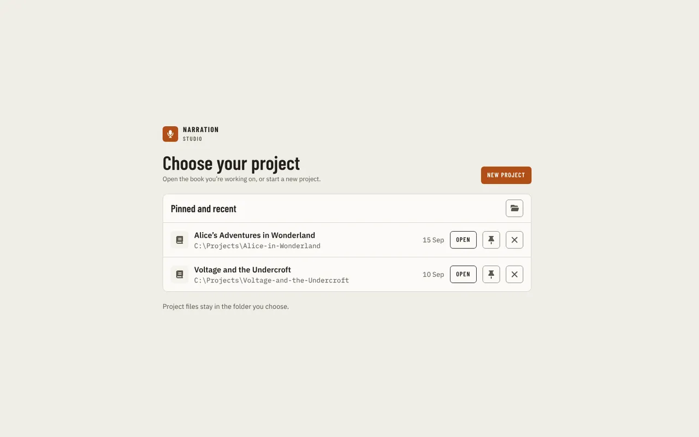
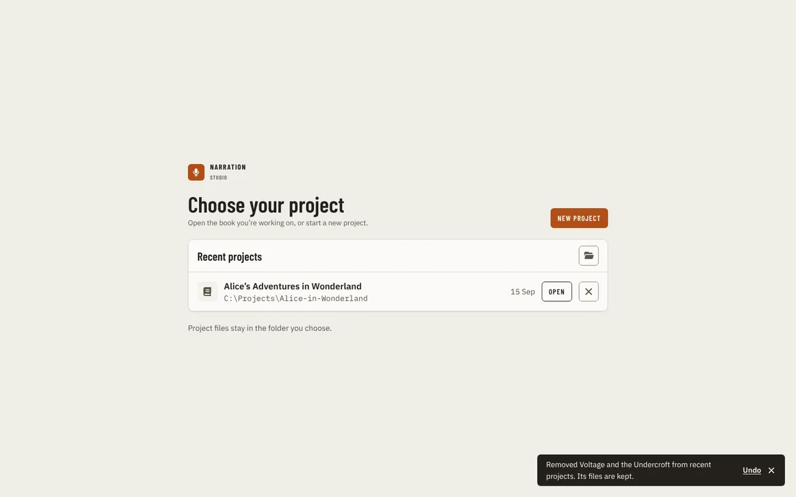
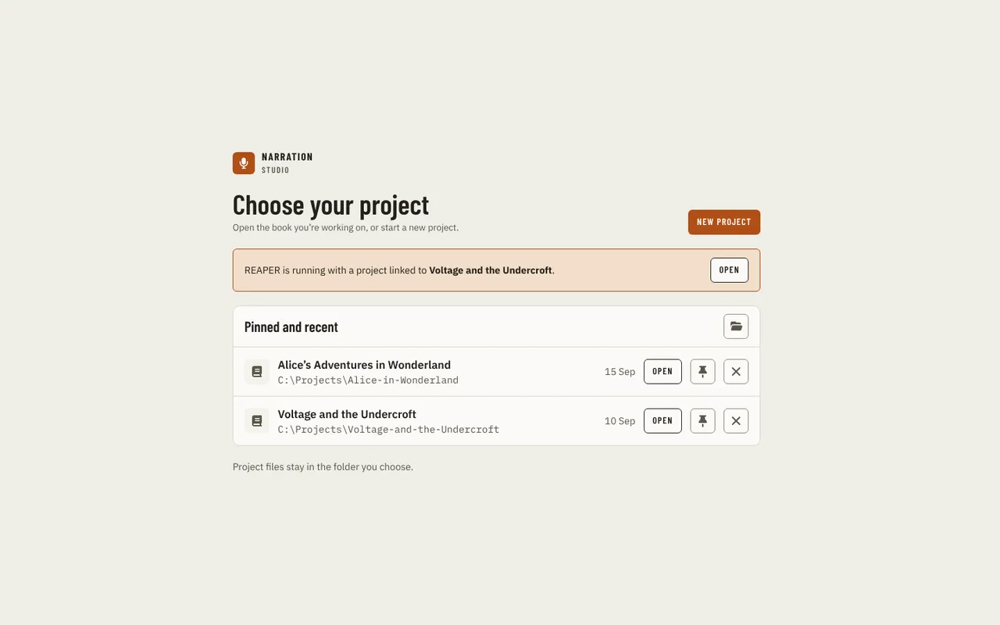
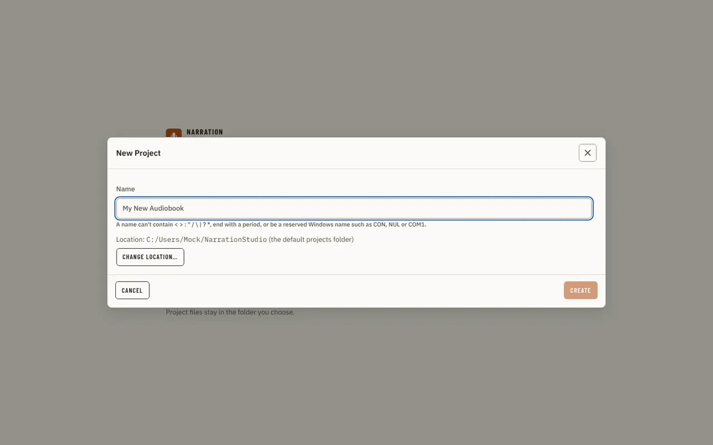

[Using the app](README.md) › Getting started

# Getting started

Launching the app without a project folder attached shows **Choose your project** instead of the workspace: **Open folder…** and
**New project** at the top, and the pinned and recent projects below it, each with an **Open** button.

- **Open** opens that project. The date is when you last opened it.
- **Open folder…**, beside **New project**, opens a folder chooser for a project that is not in the list.
- The pin on a row moves that project under a **Pinned** heading at the top of the list, above **Recent**, and keeps it on the list
  after ten newer projects have been opened. Press it again to unpin.
- With no recent projects the list says so and offers **New project** in it.
- **×** on a row takes the project off the list. Its files are kept, and a message offers **Undo** for a few seconds.
- A project whose folder has been moved or deleted drops off the list by itself.

When REAPER is running with a project that is linked to one of your recent projects, a bar above the list says so and that project's
row is marked "Open in REAPER now"; its **Open** opens it. If that project is not in the list, the bar offers **Open** itself.
The app can tell only while it has a connection to REAPER, so the bar appears when you open the picker from **Switch project** with
REAPER open on a different project, not when you start the app on its own.

## Where new projects go

**New project** asks for a name. The line under the field lists what a name cannot be: any of `< > : " / \ | ? *`, ending with a period,
or a reserved Windows name such as CON, NUL or COM1. A name that breaks a rule shows the reason under the field as you type, and **Create** stays off until it is fixed. **Location** shows the folder the project goes in: the default projects folder
(<!-- brand:identity.defaultProjectsFolder -->NarrationStudio<!-- /brand --> in your user folder) until you pick another with **Change location…**.

A new project opens on [Script](script.md), which says it has no manuscript yet. **Import manuscript** takes you to
[Production](production.md), where the import runs.

## If you record in Audacity

The installer adds a second Start Menu entry, **<!-- brand:name -->Narration Studio<!-- /brand --> for Audacity**. Pin it next to Audacity's own shortcut. It opens
the app in Audacity mode on the picker above, and the project you pick or create opens as an Audacity project. Audacity cannot
start other programs, so there is no Audacity macro or plug-in to install.

- Audacity support targets **Audacity 3.x**. Audacity 4.0 has no scripting pipe, and the app needs that pipe to reach Audacity.
- Bringing findings into Audacity works once the project is [linked in Settings](settings.md#daw-integration) and Audacity
  answers; nothing else needs turning on. See
  [Proof](proof.md#going-to-a-note-in-the-daw) for what a review does in Audacity. A capability the app has not built for
  Audacity says "Audacity support is not available yet" instead of trying to reach REAPER.
- If the app is already open, the entry brings its window forward and leaves the open project and mode as they are.
Once a project is open, the [sidebar](navigation.md) takes you to each page, and
[Production](production.md) is where you import the manuscript that most other pages depend on.

---

[Index](README.md) · [Navigation →](navigation.md)
