[Using the app](README.md) › Master & QC

# Master & QC

Master & QC is where a book is finished: it checks your rendered chapter files against the delivery
profile of the platform you upload to, rule by rule, says why a file fails, and masters and encodes the
files to spec. [Delivery](delivery.md), beside it in the navigation, builds the platform's package. Out of
the box every project is judged against **ACX (September 2026)**, ACX's audio submission requirements as
the app recorded them. Your files are only read, never changed: mastering, encoding and packaging each write
new files. Master & QC is always in the navigation, under **Finish**, and needs no DAW project. It needs an imported
manuscript: without one the page says **This project has no manuscript yet** and offers to import one.
While the profile and the chapters are being read, the **Delivery package** panel shows grey blocks in place of its checks and its count of failing and not-ready chapters, so a count of zero never appears before anything has been read. If the chapters or the delivery profile cannot be read, an error message at the corner of the window says so with the reason and **Retry**; Retry reads again, and the grey blocks show while the chapters are read.

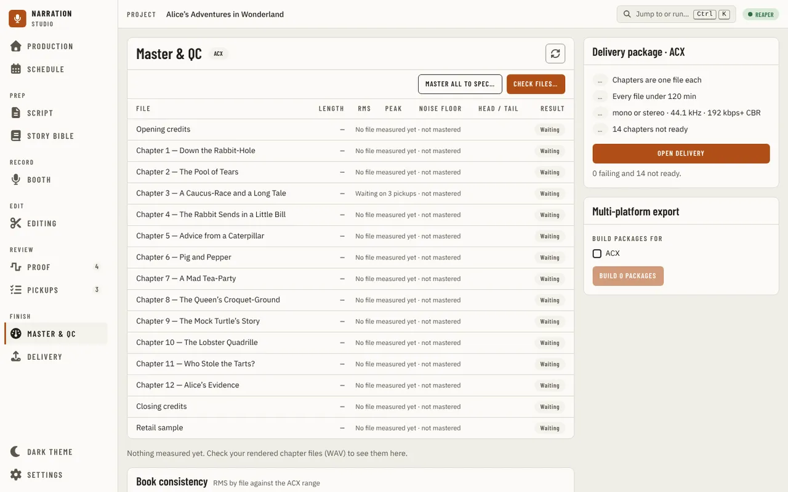

The header of the files panel holds the title, the chapter bar, a pill naming the profile the files are
judged against (**ACX** for the built-in profile, a custom profile by its name) and one refresh icon,
**Check the files again**. Pressing the pill opens [Delivery](delivery.md), where the profile is chosen and
edited. The run buttons are icon buttons beside it, named by their tooltips (**Master all to spec…**, **Check files…**). The main column holds the files and their checks, **Book consistency**, the
[mastering chain](#the-mastering-chain), [Diagnostics](#diagnostics) and the [report](#exporting-a-report);
the column on the right holds the [delivery package](#the-delivery-package) and
[Multi-platform export](#building-packages-for-several-platforms-at-once).

## Checking files

Press the **Check files…** icon button and pick one or more rendered chapter files. Only WAV files are measured for now;
a file in another format, or one that cannot be read, is listed with the reason and does not stop the
others. The bar, in the table's card under the button, shows how much of the audio has been read so far,
with the file being measured (its row reads **Measuring**), and **Cancel** stops the check: files already measured keep their results. You can leave the page while it
runs; Master & QC shows the last check when you come back. If the app stops hearing how the check is going,
the page shows an error message, **Can't tell how the measurement is going**, with a **Retry** button, and keeps
trying every couple of seconds (the message goes when the host answers); the check itself keeps running. Once files are checked its tooltip reads
**Re-check 3 files** and it measures the same files again (after a new render, say); the **Choose other files…** icon button
picks others.

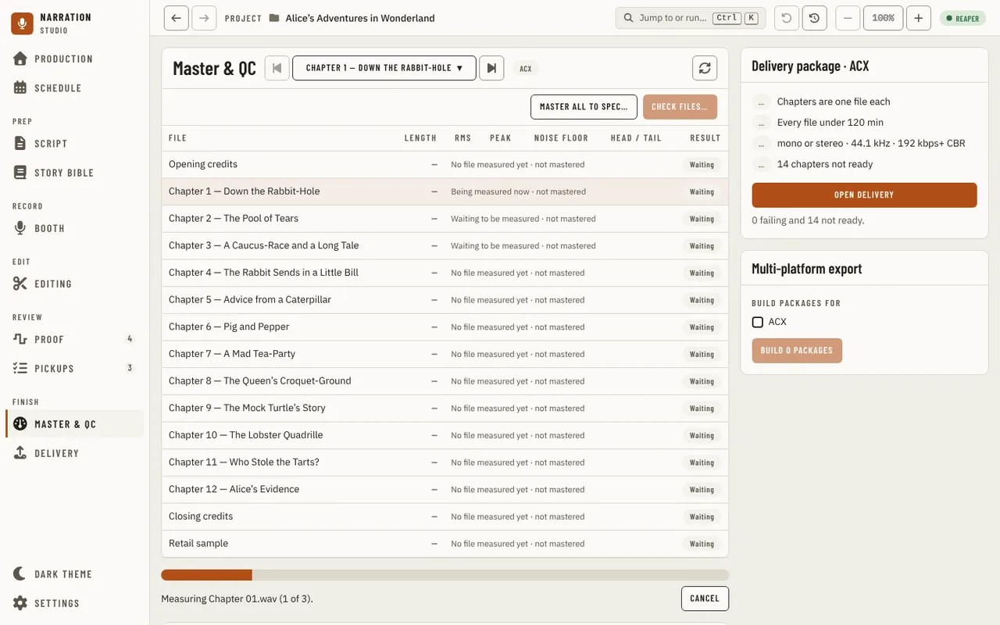

The chapter stepper (Alt+Up and Alt+Down) reaches the opening and closing credits like any chapter. The table is 26 rem tall at most and scrolls inside its card once its rows fill that, under a header that stays put; in a card narrower than 44 rem (a narrow window) each file is a block, its name and **Result** on one line and its measurements, each labelled, under them. The files table has a row per chapter, then one for the opening and closing credits and one for the retail
sample, whether or not each has a file, so it is never empty. A row with no file shows a neutral **Waiting**
pill and says what it waits on in place of its values: **Waiting on 3 pickups · not mastered** when the
chapter has open pickups (the number the Pickups page lists), else **No file measured yet · not mastered**.
What several rows have in common is said once, above the table, not on each row: **Nothing measured yet**
before any check, then lines such as **12 rows marked Waiting: no file measured yet · not mastered.** or,
after a check that stopped, **2 rows marked Not measured: the check stopped before these files**. A row
whose reason is its own (its pickups, a file that could not be read) keeps it in the row.
A row with a file shows its **Length**, **RMS**, **Peak**, **Noise floor** and the room
tone at its **Head / tail** in seconds, then its **Result**: **Pass**, **Fail**, **Not judged** (a value the
profile needs could not be measured), or **Waiting** / **Not measured**. The table has no
Clicks or Text column: the measurement reports clipping, not clicks, and does not compare the audio with the text, so
nothing is drawn for them. A value that misses the
profile's rule is red with a cross; a value the app could not measure (a silent render, or a file too
short) is a dash, never a number, and never counted as met. A file not measured yet, or one that could not
be read, says so in place of its values. If the measurement itself breaks on a file, its row says the
measurement stopped unexpectedly on that file, and the technical error goes to the app's run log, not
the screen. A long reason wraps inside its own columns: the columns stay where they are whatever the rows say.
If the chapters or the delivery profile cannot be read, an error message at the corner of the window says so, with **Retry**. The table opens on the first file that fails; the arrow keys move between files and Enter
selects one. Right-click a row for the same actions as the buttons below it.

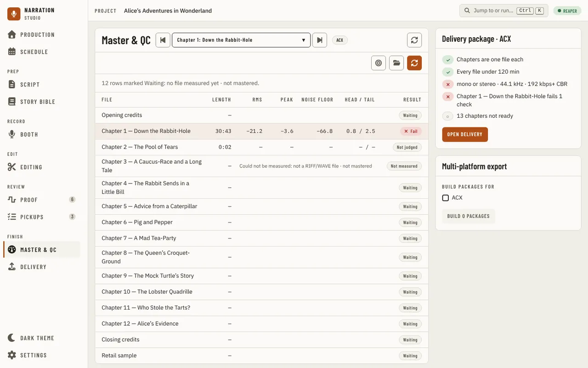

### Why it fails

Below the table, the selected file shows **Why it fails** (or **Checks** when it passes, **Not mastered**
when it has no measurements): every rule the app measured for it with **Pass** or **Fail**, the value
measured and the profile's limit. A rule the app could not measure has no row here. Of the buttons
beside the heading, **Play the quietest 5 s** plays the 5 seconds around the quietest stretch the measurement found, through your DAW
without adding anything to the project, and **Open in** your DAW shows the file in the DAW's own file browser without
importing it. Both are on while the DAW is linked and answering; while it is not, or with a DAW that cannot do it, they stay
off with the reason on hover. A file with no quiet stretch says so, and a file from an earlier
check asks you to check the files again. Pressing either button twice while the DAW has not answered sends one request. The buttons
follow the DAW as it connects or changes, and when the window regains focus; if the app cannot read what the DAW can do, the buttons stay
off and the page says **Can't tell what your DAW can do right now**, with **Check again**.

Under it, the same file against the profile rule by rule: the result (**Met**, **Not met**, or why it was
not judged), this file's value, and what the platform requires with its source under it: whether that requirement was
**Verified** on the platform's own page, is still **To verify**, or has **Conflicting sources**. Met is
green, Not met is red, To verify and Conflicting sources are amber, and a rule the app does not check is grey, as the same words are on every page. The
rules the app could not judge are listed too. Integrated loudness (LUFS) and the true peak are shown at
the top for information: ACX's page, as recorded, sets no LUFS rule. **Close** hides it until you select
another file.

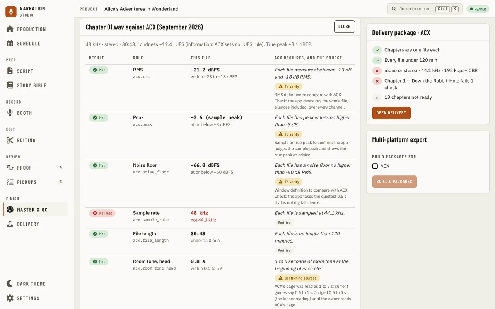

### Book consistency

**Book consistency** draws each measured file's RMS as a tick against the profile's RMS range, with a
failing file's tick in red, and says how far the files spread in dB. The retail sample is left out. With
nothing measured it says **No measured files yet** rather than a zero.

### The delivery package

**Delivery package** on the right lists the package checks drawn from the profile's rules (chapters as one
file each, every file under the profile's longest length, the channels, sample rate and MP3 format), the files that
fail and how many checks each fails, and how many chapters are not ready (the same count Delivery's **Before you
build** gives: the opening and closing credits files count like a chapter). A retail sample that is measured is checked against the profile's range and named with it, as **Retail sample 4:40 (1 to 5 min)**; a profile that gives only a maximum reads **(up to 5 min)**. A rule the profile lacks or
has turned off has no row. The MP3 format cannot be judged from a WAV render, so that row waits (with "the MP3
format is checked on the MP3 you upload") instead of showing a tick. A check not judged yet has a hollow circle (**○**)
where a tick or a cross will go. **Open Delivery** goes on to build the package; it waits while the profile and the
chapters are still being read. The card stays in view at the top of the right column as you scroll the page; in a
narrower window, where the page is one column, it comes straight after the files and their checks.
On a very wide window the page stays one centred column about 1,500 px wide, the same as Pickups and Delivery.

A link from another page can name a file. If that file is not in the check (or nothing is measured yet), the page
says so in a **Link not found** note with **Show the first file instead**, and a link followed while the page is open
moves the selection to the file it names.

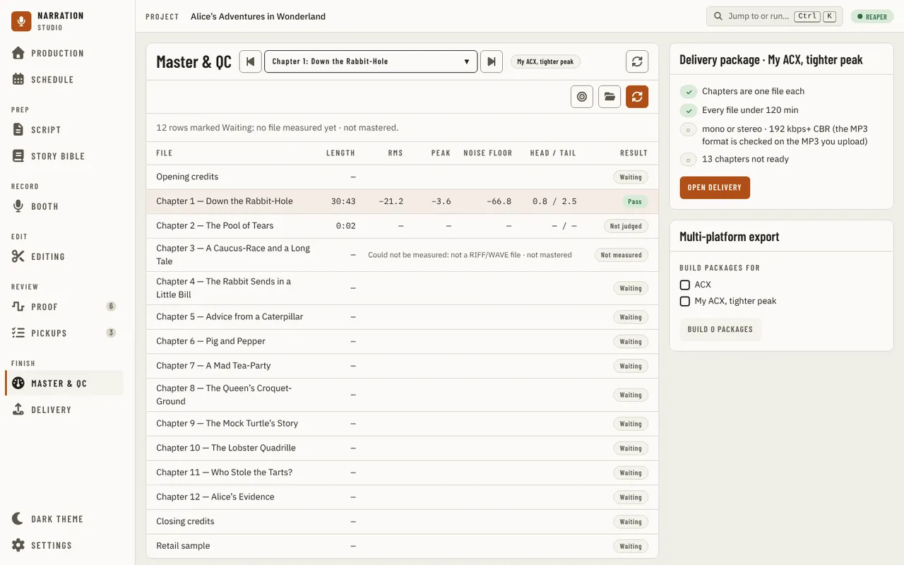

## The mastering chain

**Mastering chain** shows the chain the book masters with, as its steps in order: the built-in chain's
**EQ** (a high-pass at 80 Hz), **Limiter** (peaks held 0.5 dB under the platform's peak limit) and **Gain**
(toward the platform's RMS target). It is one chain for the book, the same for every platform, with each
platform's own numbers. It is fixed and cannot be edited. The app does not yet play a file raw and mastered
side by side.

## Mastering to spec

The **Master all to spec…** icon button, beside **Check files…**, picks the rendered files to master and encode and opens
**Master to spec** with a row per file; **Add files…** adds more and **Remove** drops one. Give each its
**Role** in the package (**Chapter**, **Opening credits**, **Closing credits** or **Retail sample**) and
each chapter its **Title** (the other roles take none, shown as a dash), then press **Master & encode**, at the top
of the panel beside **Add files…**: with **Master before encoding** on (the
default) each file is mastered by the [chain](#the-mastering-chain) to the chosen platform's numbers, then
encoded; turn it off and the button reads **Encode**. The bar shows the files' progress, **Cancel** stops
it, and each row's **Status** pill says whether it waits, is mastering, is encoding, is ready or failed, with the
reason under a failure. Every stage writes a new file next to the app's own output: your renders are never changed.
When it ends, the line under the bar says how many files were prepared. They are new copies, so the chapter table
and [Delivery](delivery.md) still go by the files you checked: the check icon beside that line (its tooltip reads
"Check the prepared files so Delivery counts them") opens the file picker to check the copies, and a chapter counts as
mastered once its file passes.

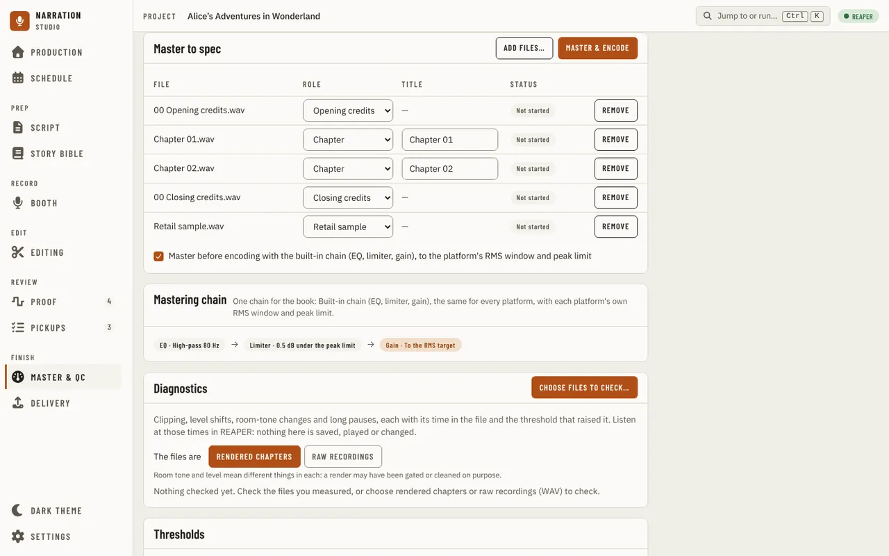

## Building packages for several platforms at once

If you deliver to more than one platform, **Multi-platform export** (under the delivery package) lets you build
all of them from the one source you already mastered and encoded, without re-encoding unless a platform
needs a different file format. Under **Build packages for**, check the box for each profile you want a
package for, then **Build N packages**; it stays off until files are mastered and encoded. This does not change which profile the page's checks are judged against (that is the project's profile,
chosen on Delivery); the checkboxes only choose what to build packages for.

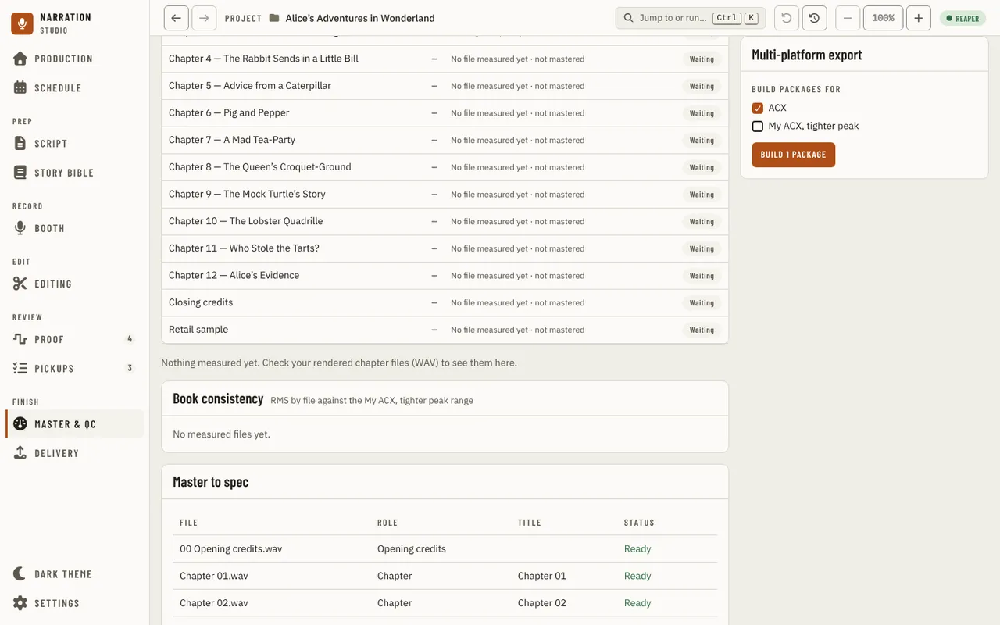

You are asked for one folder once, and each platform's package goes into its own correctly named subfolder
of it. Two platforms that both take the same file format (most do: MP3 at the same bitrate) share the one
set of already-encoded files; a platform that needs a different format (an M4B audiobook file, say) is
encoded for just that once, however many platforms need it, not once per platform. Cancel stops the build
before its next platform starts; platforms already built keep their packages, and one not yet reached is
left waiting.

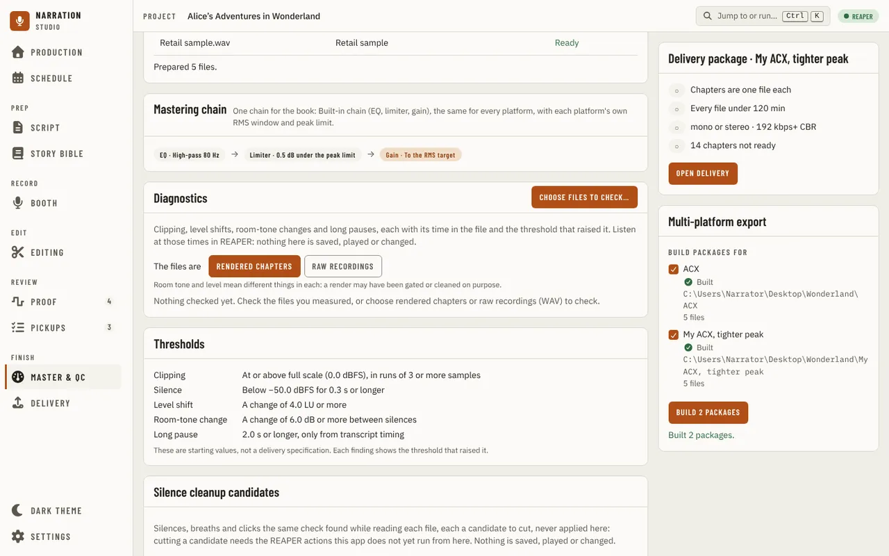

While it builds, and once it finishes, each platform says how it went under its own checkbox: **Building…**,
**Built** with its folder and how many files it wrote, or why it could not be built (such as a required file being
missing for that platform).

## Diagnostics

**Diagnostics**, below the chain, checks the same kind of files for clipping, level shifts, room-tone
changes and long pauses. Press **Check the 3 measured files** (named for how many you measured) to check
what you just checked, or **Choose files to check…** to pick others. First say what the files are, **Rendered chapters** or **Raw
recordings**: room tone and level mean different things in each, because a render may have been gated or
cleaned on purpose, so a room-tone change in a render is only information. The bar shows the audio read so
far, and **Cancel** keeps what was already checked.

Each file gets a line with its length, how many clip regions and level shifts it has and how much of it is
silence. Pacing and the speaking rate need the transcript's word timing, so a file checked here says **Not
available** with the reason, and no long pause is guessed from silence alone.

A file not checked because the check stopped first says **Not checked**; when several do, the line above the
table says why once.

Under it, each finding gives its time in the file, what it is with its severity (**Warning** or **Info**) and why it was raised, what was measured, the
threshold that raised it, and the file and the kind of source it was measured in. Listen at those times in
REAPER: the section plays nothing, changes nothing and saves nothing, so every finding is a candidate to
listen to, not a verdict. When nothing reaches a threshold, the section says so without calling the file
a pass. **Thresholds**, below it, lists every threshold the check uses, even before you check anything. They are
fixed in this version; only the silence cleanup values below can be changed. Each of these cards has a **?** by its buttons that says in a
line what it lists; the rest is here, not on the page.

**Silence cleanup candidates**, below that, lists the silences, breaths and clicks the same check found in
each file, each a candidate to cut. Nothing is cut from here. The values the check used are listed under the
candidates. Their thresholds are set in Settings, under Silence cleanup; **Open Settings**, at the top of the card, goes there. For this project
only, **Jump to or run** (Ctrl+K) has **Open Silence cleanup options**, a dialog with the hold kept at each side of a
cut silence, the shortest and longest run read as a breath, how far below the speech level a breath sits and how far
above the silence around it a click stands. A change is saved at once and applies to the next check, not to the
one on screen; **Reset** on a changed setting hands it back to the computer-wide value or the default.

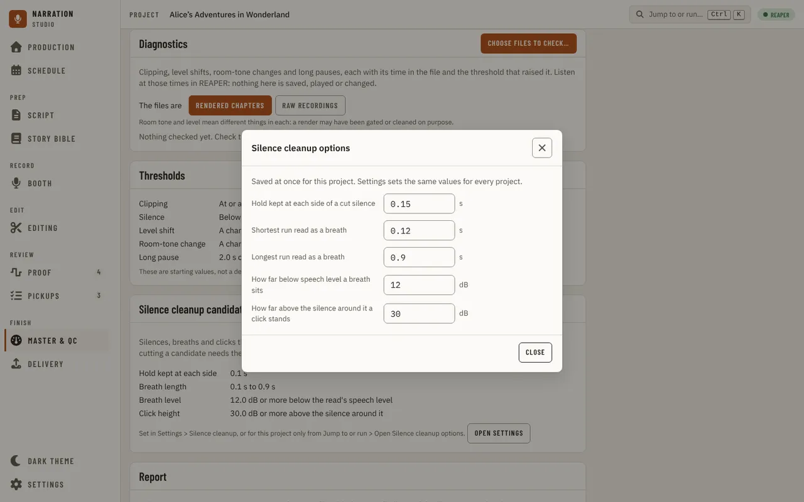

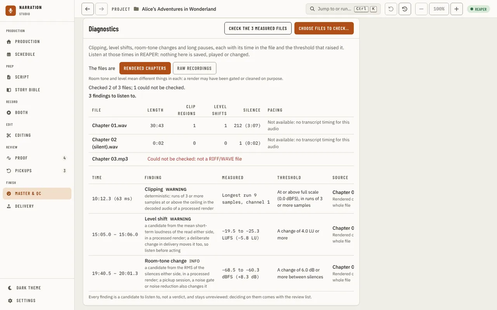

## Exporting a report

**Export report**, at the foot of **Report** at the bottom of the page under its one option, is off until some files are
measured (the reason is written beside it, and the option is off with it), then writes the last check and the last diagnostics to two files
in your project's <!-- brand:identity.projectFolder -->narration-studio<!-- /brand -->/delivery folder: an HTML page a reviewer can open in any browser without
the app, and a JSON file with the same findings for tools. Each export gets its own name from the time it
was made (`delivery-report-20260923-140000Z.html`), so an earlier report is never overwritten, and nothing
is ever written next to your audio.

The report lists every file you checked, and says for each one whether it was measured and checked, and if
not, why. It names the profile and its version, and lists every rule with what the platform requires, how
the app checked it, how it was verified and how many files met it. Each finding has an ID, its file, its
time in the file, what was measured against which threshold, and its review state. The HTML and the JSON
use the same IDs, and the rules not met in the files table are those same findings: they are on
[Proof](proof.md#delivery-checks) too, so a decision you make there is the report's decision. It is a
measurement, not a distributor's approval.

Files are named only by their file name unless you tick **Include each file's full location**. No audio and
no manuscript text is ever written into the report. Export needs a project open and files measured, and
is refused while a check or diagnostics run is running.

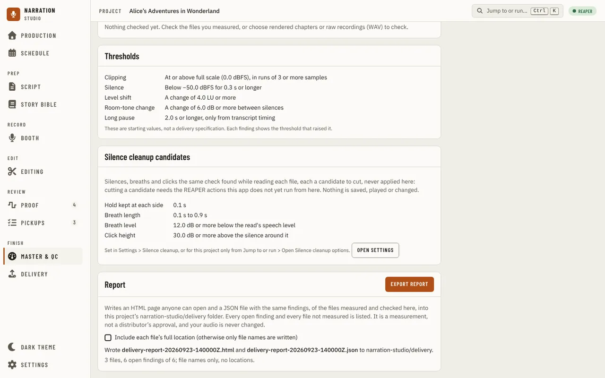

---

[← Pickups](pickups.md) · [Index](README.md) · [Delivery →](delivery.md)
