[Using the app](README.md) › Navigation

# Navigation

The sidebar on the left is grouped by production stage, the way a narrator's week runs: **Production** ([Production](production.md), [Schedule](schedule.md)),
**Prep** ([Script](script.md), [Story Bible](story-bible.md)), **Record** ([Booth](booth.md)), **Edit** ([Editing](editing.md)),
**Review** ([Proof](proof.md), [Pickups](pickups.md)) and **Finish** ([Master & QC](master-and-qc.md), [Delivery](delivery.md)).
From 1360 px wide each group but the first shows as a heading over its pages; Production and Schedule sit straight under the logo. Below that the rail shrinks to icons, grouped by a thin line,
and below 860 px it hides behind a hamburger menu that opens it as a slide-in drawer with the headings back. [Settings](settings.md) lives at the bottom of the sidebar, in every layout, below every group, under a **Dark theme** / **Light theme** item that switches the theme. **Proof** carries a count of
the notes still open plus the open pickups no note stands for (the same number as the Proof page's open count), **Pickups** the open lines of the Pickups list and **Master & QC** the chapters whose file fails a delivery check; a zero, or a count the app cannot read, shows no badge. The Proof and Pickups counts move as soon as you decide a note on Proof or change the Pickups list, not only when you leave the page.

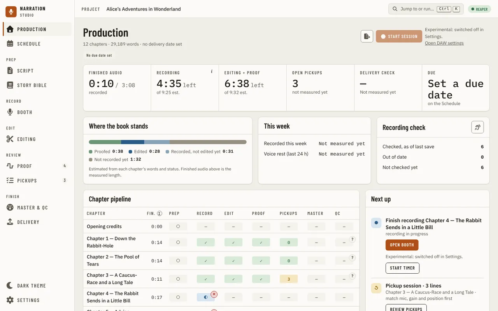

The page you are on is marked with an accent-coloured bar down the left edge of its item, on a slightly darker background; in the icon layout the bar still shows beside the icon.

In the icon layout the rail shows only the icons, centred, with a thin line where each group's heading would be.

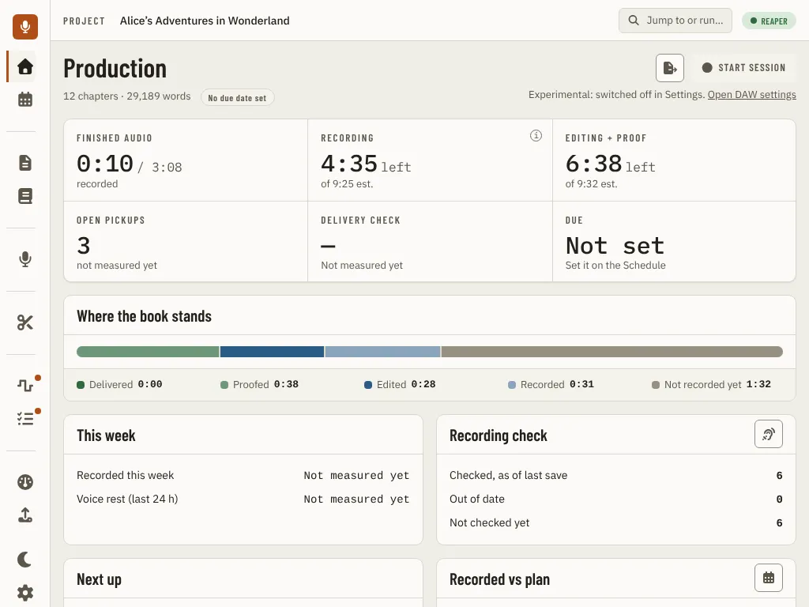

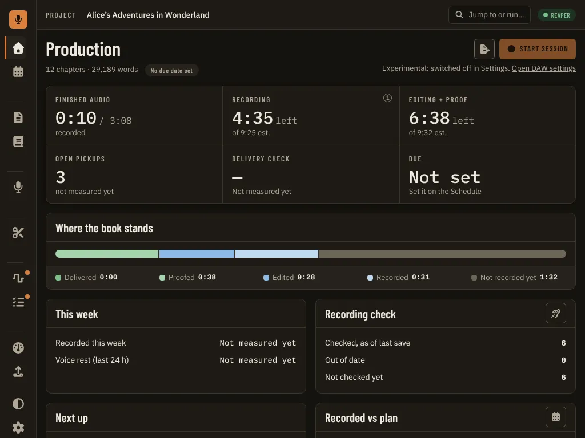

Hover the rail (or tab into it) and it opens over the page with every label; nothing moves.

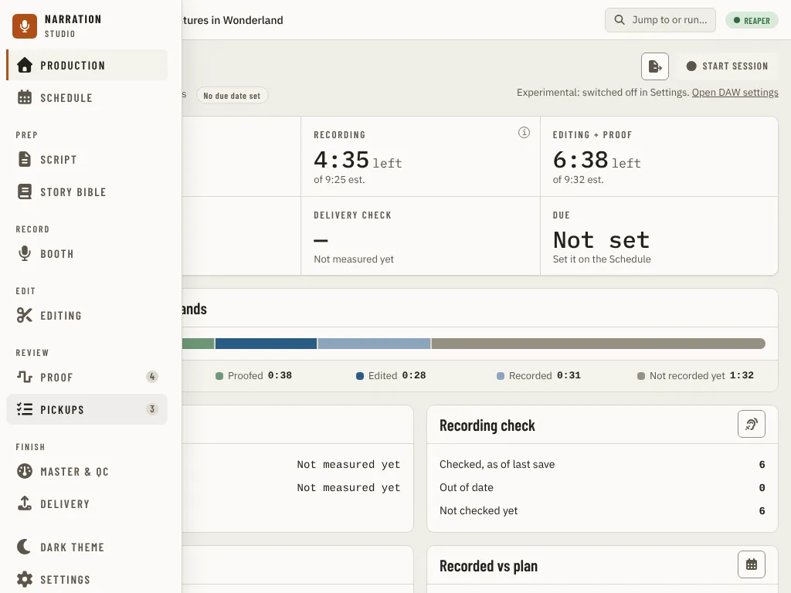

With no manuscript yet, the pages that need one are shown off, with a small lock: **Schedule, Script, Story Bible, Booth, Editing,
Proof, Pickups, Master & QC** and **Delivery**. **Production** (where the import is), the theme item and **Settings** stay on.
Rest the pointer on an off item for under half a second, or tab to it, and a hint says "Import a manuscript to unlock this page." Press it (or press Enter on it) and a
small note opens beside it with the same reason; nothing on the page moves, and Escape closes the note. An off item is still in
the tab order and keeps its name, so a screen reader reads "Proof, Import a manuscript to unlock this page." The jump menu lists the
same pages off, with the reason under each, and choosing one does nothing.

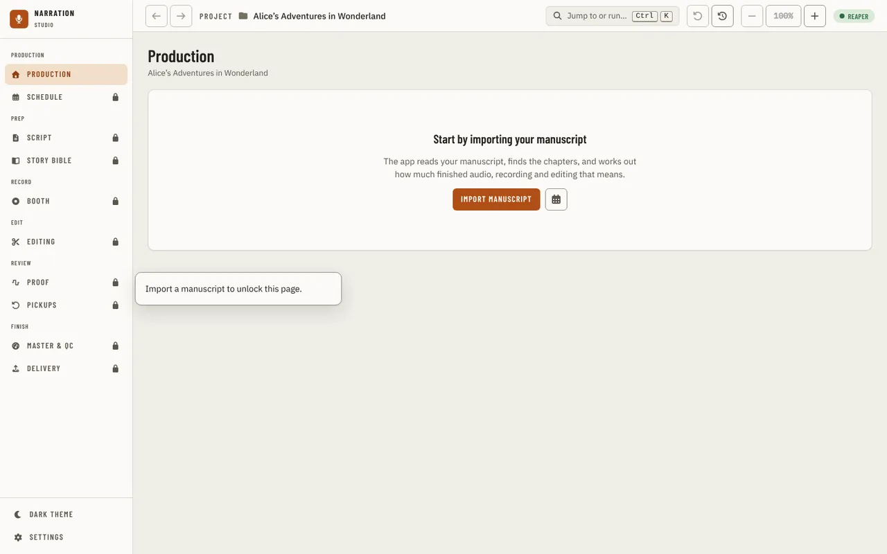

Off only decides what the rail offers. A page you reach another way (a typed address, Back, a link) opens and says so itself, with
**Import manuscript**, which goes to [Production](production.md#importing-the-manuscript); none opens the import or moves you by itself.
If the manuscript goes while you are on one of these pages, the page stays and asks for it, its rail item turns off where it is, and the
rail shows no note counts, since the notes and pickups the project still holds belong to an earlier manuscript.

## Skipping the sidebar and changing page

The first `Tab` on any page lands on **Skip to content**, a link that is hidden until it has focus and then shows at the top left. Press `Enter` on it and focus moves into the page, past the sidebar and the header.

When you move to another page (a sidebar item, **Jump to or run…**, `Alt+Left` or `Alt+Right`, `Ctrl+,` for [Settings](settings.md), or the drawer), the window title becomes the page's name, for example "Proof · <!-- brand:name -->Narration Studio<!-- /brand -->", and a screen reader announces the name. Focus moves into the page, so the next `Tab` goes to the page's own controls rather than the item of the page you left. Opening a different chapter on the same page changes neither the title nor focus. From the drawer, focus goes back to the hamburger button as before, and the title and the announcement tell you where you are.

## The header and the footer

The header is short, and the same on every page. Left to right: the **Project** label (hidden on a narrow window), the project's name, a zoom chip when you are zoomed,
**Jump to or run…** (`Ctrl+K`), and the engine chip. The zoom chip appears on the left of the jump button, in the header's empty middle, so the jump button and the engine chip do not move when it comes or goes. Below 860 px a hamburger button at the far left opens the sidebar as a drawer.
The project's name is a button (**Switch project**): it opens the project picker over the project you have open, with **Back** to return to it, and opening a
recent project there switches to it.

On a page with keys of its own (Script, Proof, Editing), the keys are listed in a footer along the bottom of the window, the full width of the page like the header, under the page's own content. It stays put while the page scrolls. The Booth fills the window, and its keys are the bottom row of the Booth.

There are no Back and Forward, Undo or History buttons, folder icon or always-visible zoom controls in the header, and no timer chip. Reach them from **Jump to or run…** or by key: Back and Forward are `Alt+Left` and `Alt+Right`, Undo is `Ctrl+Z`, the undo history is `Ctrl+Shift+H`, and zoom is `Ctrl+=`, `Ctrl+-` and `Ctrl+0` ([the table below](#jump-to-or-run) lists each command and when it is off).

### Jump to or run

Jump to or run… opens the jump menu: type to find a page, a chapter or a command, or type `>` to list commands only. Escape, or a press anywhere outside the menu,
closes it, and focus returns to where it was. The menu is a list box: a screen reader hears the page's name when it opens ("On the Script page"), then the number of results as you type. The header has no other buttons, so everything else you might look for there is a command in the menu, with its key beside it; a command that cannot run now stays listed, off, with the reason under it:

| Command | Key | Off when |
| --- | --- | --- |
| Back, Forward | `Alt+Left`, `Alt+Right`, or the mouse's back and forward buttons | there is no earlier or later page |
| Undo: <the last change>, named | `Ctrl+Z` (not in a text box, which keeps its own undo) | the journal has nothing to undo (it reads plain Undo) |
| Open the undo history | `Ctrl+Shift+H` | never |
| Zoom in, Zoom out, Reset zoom to 100% | `Ctrl+=`, `Ctrl+-`, `Ctrl+0`; also Ctrl+scroll | already at the largest or smallest size, or already at 100% |
| Switch project… | none | never |
| Settings: <category>, one for each Settings category | none | never |
| Import manuscript…, Replace manuscript… | none | the project already has a manuscript (Import), or has none (Replace) |
| Toggle dark theme | none | never |
| Set zoom to N%, one for each zoom step | none | already at that level |

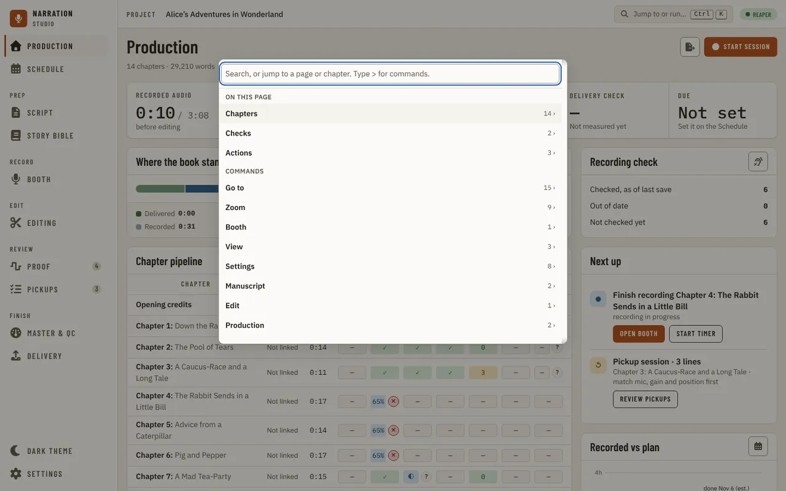

### On this page

The menu knows the page you are on. What the page offers right now is listed first, under **On this page**, one row per group (with nothing typed) or the matching items (when you type), and the commands above come after it. What a page offers follows what is on it, not only which page it is, and an item that cannot run now stays listed, off, with the reason. A chapter the page lists is not listed again under **Chapters**.

| Page | Offers |
| --- | --- |
| Production | **Chapters** (scrolls to its row), **Checks** (check recordings, read the stage suggestions again), **Actions** (export the status report, start a session, stop the timer, off while none runs) |
| Script | **Chapters**; **Story Bible** entries (found by any of their names); **Mark types** (mark the selected text; off until some is selected); **Search**, while a search is showing ([Searching the script](script.md#searching-the-script)) |
| Story Bible | **Entries**, found by any of their names; choosing one opens it, and clears a search or filter that hides its row |
| Booth | **Chapters** (off during a take), **Transport** (record or stop, punch and roll, next and back one phrase), the pickup steps when a pickup session is open |
| Editing | **Chapters**; **Selection** (delete, mute and add FX, off with the reason until words are selected or when the DAW cannot); **Checks** (check the recording); **Drawer** tabs the DAW offers |
| Proof | **Chapters** with their open-note counts; **Selected note** (needs pickup, fix in edit, fine as read, defer; off until a note is selected); **Checks** |
| Pickups | the open **Pickups** lines (shows and selects the line), **Chapter** (show every chapter or only one), **Actions** (check recordings, open in the Booth, add as markers in the DAW) |
| Settings | **Categories**, and every setting by its label under its category, including the settings that live on another page; a setting that does not apply to this project's recording tool is off with the reason |

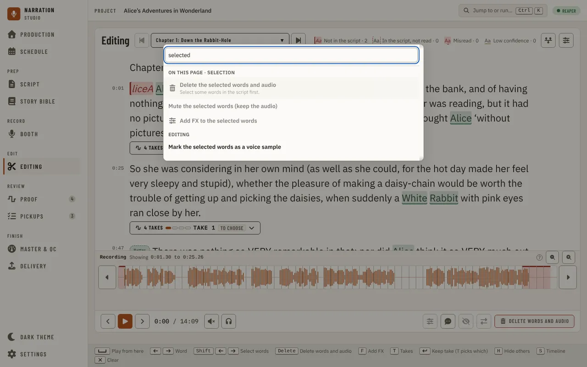

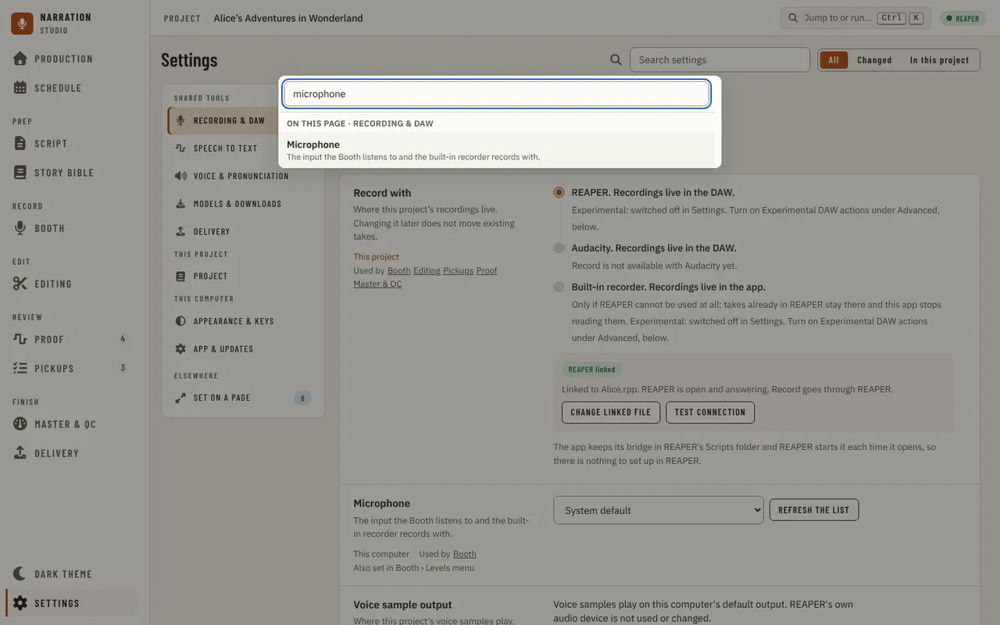

`Ctrl+F` opens the same menu searching only the page: its items and its text, no pages or commands. `Backspace` on an empty field widens it to everything. On a page that offers nothing, `Ctrl+F` opens the whole menu. It does the same on every page; on [Proof](proof.md) the page's search includes the notes. Items that need the DAW or the host are added a moment after the menu opens, and the menu never waits for them.

Undo takes back the last change you made in the app, and says why when it cannot. The undo history lists the changes you can undo, each with the time it was made, in a panel that slides in from the right; it keeps the newest 40 and says so when it is full, and `Ctrl+Z` works with the panel open too, and the list follows.
The **Undo** on a message beside a change goes away once it would no longer be true: when you undo that change another way (`Ctrl+Z`, the jump menu or the history), open another page or chapter, or switch project.
A running [production stage timer](production.md#the-stage-timer) is not in the header: its clock and chapter ("0:42:07 · timer on Chapter 6") sit beside **Stop timer** at the top of the Production page, and only there.

Right-clicking empty space in a page opens a menu with a **Go to** submenu of the eleven pages (the one you are on is checked), **Jump menu…** (`Ctrl+K`), **Search this page** (`Ctrl+F`) and a **View** submenu of the zoom steps and the theme.

The engine chip at the right of the header names the audio engine the project records with (REAPER, Audacity or Built-in), with a
dot for how it is doing, and says in words when something needs you. Hover it for the detail, and click it to open the
[audio engine panel](#the-audio-engine-panel), where the project's `.rpp` file is linked or changed:

- **Green dot, "REAPER"**: the DAW is running with the linked project open.
- **Amber dot, "REAPER: Not running"**: the DAW is not running. Open it to carry on.
- **Amber dot, "REAPER: Other project"**: the DAW has another project open than the linked one. Link the open project instead,
  or switch the DAW to the linked file.
- **Quiet dot, "REAPER: Not linked"**: nothing is linked yet.

On a narrow window the chip drops the DAW's name and keeps the words ("Other project").

- **Audacity**: the dot follows the Audacity link. The chip's hover text gives the next step (turn scripting on, start Audacity on the linked project, close and start it from the app, or close the dialog it may be waiting on). The panel then shows the Audacity link card instead of the REAPER project and tools, with the [track list](#tracks) read from Audacity.
- **Built-in**: the project records in the app. Choose it with the **Recording** radios in [Settings](settings.md), where it can be chosen only when the app can capture audio.

## Moving around: Back and Forward

Two jump-menu commands walk the pages you have visited in this project, the way a browser's Back
and Forward do: **Back** (`Alt+Left`, or your mouse's back button) returns to the page you came from; **Forward**
(`Alt+Right`, or your mouse's forward button) goes there again after a Back. Each is listed off — with the reason
under it — when there is nowhere to go: Back on the first page you opened in this project, Forward until you
have gone Back at least once. Switching to a different project starts a fresh history; Back does not cross into
the project you left.

Back and Forward respect the same checks the nav does: leaving unsaved changes in [Settings](settings.md) asks
first, and leaving a chapter's [Proof view](proof.md#the-chapter-view) while a comparison is under way or
showing results resets it the same way. They only move between pages — closing a slide-over, the previous
chapter, or the previous Story Bible entry are not Back steps.

A link the app cannot open (a typed address it cannot read, or one that names a chapter or line the book does not have) shows
**This link could not be opened** with **Open** *page* (the solid button) and **Go to Production** (quieter); both replace the link, so Back does not return to it.
A link to a chapter the list does not have yet is checked first: the list is read once more, and meanwhile Proof, Editing and the Booth show their title and grey blocks with **Checking this link…** (the Booth, which has no sidebar, adds **Go to Production**). If the chapter turns up the page opens; if the list cannot be read, the page opens as well.
The [Booth](booth.md#the-credits) fills the window and has no rail, so there Escape also leaves the message: for [Pickups](pickups.md) when the link still names pickups, otherwise for [Script](script.md).

## Zoom

The jump menu has three zoom commands that make the whole app bigger or smaller: **Zoom out** (`Ctrl+-`), **Zoom in** (`Ctrl+=`) and
**Reset zoom to 100%** (`Ctrl+0`). They step through 100%, 110%, 125%, 150%, 175% and 200%; zoom out is off at 100%, zoom in at 200%, and reset at 100%, since there is
nothing to reset. The numpad's `+`, `-` and `0` keys do the same as their main-row equivalents.

While the zoom is anything but 100%, a **zoom chip** with the level ("125%") appears in the header, just left of **Jump to or run…**. Press it and the
jump menu opens already on the Zoom commands. At 100% the chip is not there.

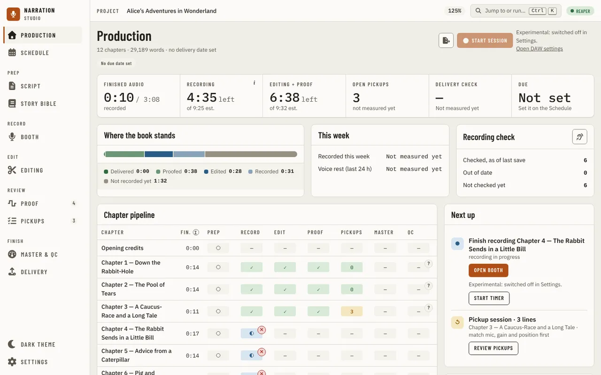

This is the app's real zoom — the same one a Ctrl+scroll or a touchpad pinch already does — not a text-size
setting, so it reflows the whole layout through the sidebar, icon rail and drawer breakpoints exactly as a
narrower window would. Ctrl+scroll and pinch keep working at any level, including below 100%; the chip
follows them. A level pushed above 200% by Ctrl+scroll or pinch is brought back to
200% automatically, since layouts below the app's minimum window width get cramped past that point. A change is
announced once, for a screen reader, after the level settles — not on every wheel notch.

Zoom is one setting for the whole app, not a page or a project. It is not [Script](script.md)'s own text settings (font, size, line spacing and column width),
which stay independent and multiply with app zoom.

The level is remembered across launches: quit at 125% and the app opens at 125% next time, with no flash at
100% first. It is a machine-wide setting like the microphone the Booth listens to ([Settings](settings.md)), not a project one, so it
follows you between projects rather than resetting when you switch.

## The audio engine panel

Click the chip at the right of the header to open the audio engine panel over whatever page you are on.
It holds everything about the REAPER project itself rather than one stage of the work: the linked project
file, the REAPER tools, chapter sync, the project's tracks and each chapter's link to its track. Close it
with its close button, Escape or a click beside it. Every "Open the audio engine panel" pointer in the app, in a message or a dialog, opens it over the page you are on and closes the dialog it was in. (It replaced the Tracks page; an old link to that page
opens [Proof](proof.md) with this panel open over it.)

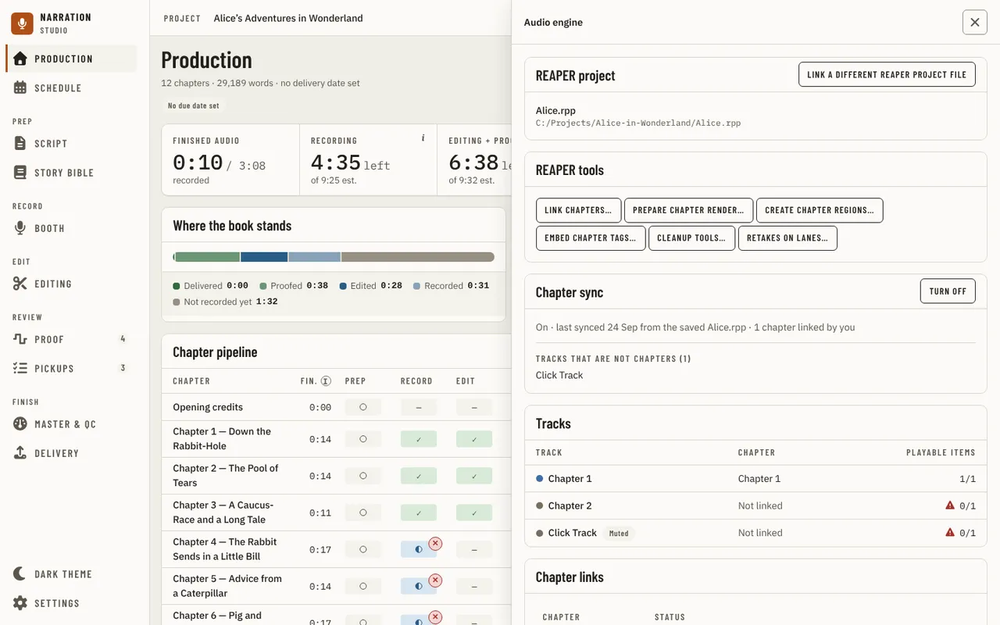

### The REAPER project

The panel reads the project's REAPER project file (`.rpp`) directly, so it needs neither REAPER running
nor an imported manuscript; its [REAPER tools](#reaper-tools) are the exception. It shows the file it read
and, beside the heading, **Link file…** (or **Change file…** once one is linked): the link a chapter's [Proof view](proof.md#comparing-the-recording-with-the-script) needs,
and the same one [Settings](settings.md#daw-integration) makes. The file can be anywhere: in the project
folder or a subfolder of it (the link then survives moving the whole project), or in a separate folder or
drive kept for REAPER (a short note says where the file and the project are). When REAPER has a different project
open than the linked one, a warning box in the card says so: link the open project, or switch REAPER to the linked file. It
says what it is waiting for ("Waiting for REAPER to open the linked project") and when the app last checked ("Last checked 4 s
ago"), and has two buttons: **Link the open project…**, which picks the file REAPER has open, and **Check again**, which reads
the project's state from the app again at once.

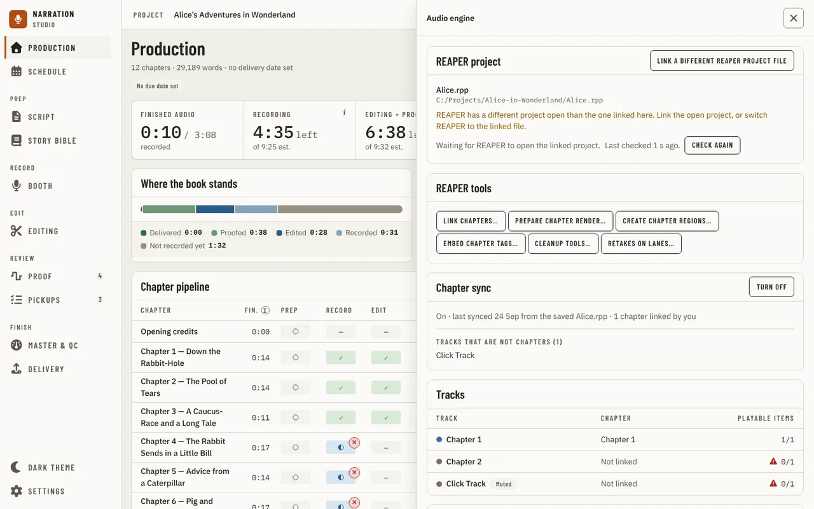

If the project folder holds more than one `.rpp` file, the panel asks which one to read: each file is a row with its name
first and its folder under it, and pressing the row reads that file. Backup copies
(`.rpp-bak`, or files inside a subfolder such as Backups) aren't offered. The choice is remembered for the
project.

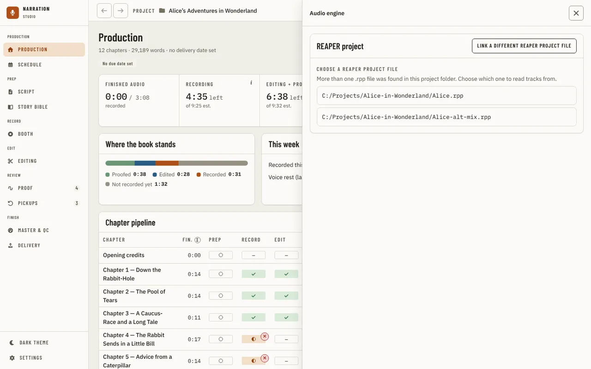

If the folder has no `.rpp` file at all, the panel says so. Save the REAPER project into the project folder
and open the panel again.

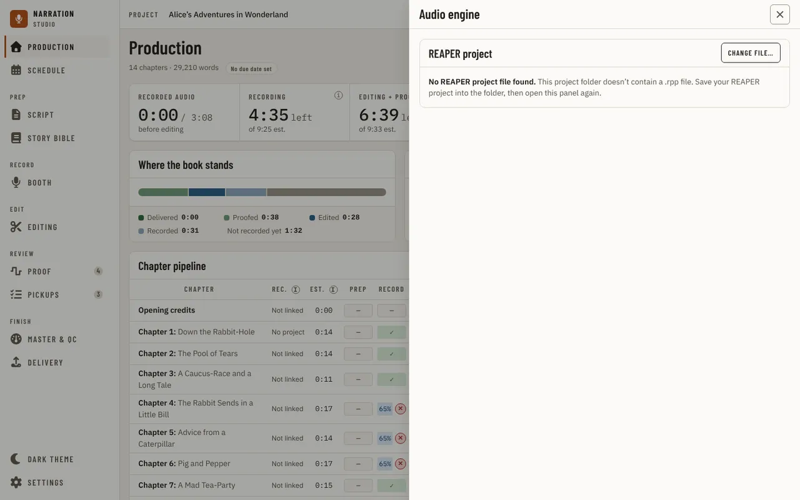

### An Audacity project

When the project records with Audacity, the **Audacity project** card replaces the REAPER project section and the REAPER tools are not shown.
The Tracks list below it comes from the snapshot the app takes while Audacity answers, and refreshes when the card hears from Audacity (a
change, or **Check again**). Until Audacity has answered with the project open, the panel says no tracks have been read from Audacity yet.

### Tracks

The Tracks list shows each track of the project with its colour, a Muted badge when it's muted, the chapter
it is linked to (or Not linked), and how many of its items have playable audio (for example `1/1`). A
warning triangle marks a track with an item whose audio file can't be found on disk, or that isn't audio at
all (such as a MIDI item). To hear a chapter, open it on [Editing](editing.md).

### REAPER tools

When the project has tracks, the REAPER tools sit in their own card under the project. **Link chapters…** and
**Prepare chapter render…** change the project open in REAPER, through the app's bridge
REAPER starts when it opens; nothing is written until you press the dialog's action button. The app puts the
bridge in REAPER and connects to it without you running anything in REAPER.

**Link chapters…** (shown once a manuscript is imported) stamps each chapter's identity onto the REAPER
items that hold its recording. It opens with the links the **Chapter links** list shows, the opening and
closing credits included, and the two stay in step: choosing a track here links the chapter, **Not linked**
clears the link, and either shows in the other at once. **To stamp** shows how many of that track's items will
carry the chapter's identity, and **Stamp N items** writes it. The credits are linked here but not stamped. What the stamp did, or why it failed, shows at the top
of the dialog. An item already stamped with a
different chapter is left alone unless you tick **Overwrite items already stamped with a different
chapter**, and items REAPER no longer has are listed as stale. **Read current stamps** lists what the
project carries now, with each item's status (OK, Text changed since stamping, Manuscript re-imported
since stamping, Chapter no longer in the manuscript, and so on); if reading fails, the reason shows there, under
the button. This is not the same as the
[Chapter links](#linking-chapters-to-tracks) list below: that list is kept by the app and changes
nothing in REAPER, and the dialog starts with every chapter Not linked whatever the list says.

The lines to record again have their own page, [Pickups](pickups.md); a proofer's CSV sheet is imported on
[Proof](proof.md#the-notes).

**Prepare chapter render…** sets REAPER's render to every chapter region, names each file after its
region, and saves into the **Output folder** (a `renders` folder in the project to start with). Press
**Configure render** and it lists the files the render will create. It never renders anything itself:
press Render in REAPER (Ctrl+Alt+R or File > Render) to create the files. Once it is configured, **Close** is the main
button. If the project has no chapter regions yet, it warns you and offers **Create chapter regions…**, which opens
that tool in its place.

**Create chapter regions…** plans one REAPER region per chapter with a confirmed track link, plus an
**Opening credits track** and **Closing credits track** you choose in the dialog, and shows the plan
before writing anything: each row's title, track, start, end and status (New region, Already exists,
Moves an existing region, or Several regions share this title). A chapter or credits track with nothing
to plan is listed under **Not planned**, one line per reason naming its chapters (for example, "No track is linked to this
chapter. Chapter 2, Chapter 3").
Tick **Move an existing region that shares a chapter's title, instead of adding a second one** to move a
same-titled region instead of adding another; left unticked, a region that would move or is ambiguous
still gets a new one alongside it. **Create N regions** writes the plan in one step and reports what
happened, naming only the counts that aren't zero ("Sent 3: 2 created, 1 already existed."); **Close** then becomes the
main button. While REAPER is not answering, **Create N regions** stays disabled and says why. The plan's column names stay in view while you scroll a long plan, as they do in
**Link chapters…**.

**Embed chapter tags…** adds ID3 chapter markers to an MP3 of the whole book that you have already
rendered, timed from the chapter files of your last chapter render. It lists those chapters and marks
any that are "not rendered yet"; every one must exist first. Enter the path of the combined book MP3 and
tick the confirmation: the file you name is never changed, and a new, tagged copy is written beside it.
This one does not talk to REAPER.

**Cleanup tools…** opens a repair tool in REAPER on the items you have selected there. Select the items
in REAPER first, then press **Open** beside the tool. **Repair Pops/Clicks** is REAPER's own dialog
(REAPER 7.80 or later); **Magnolius DeClick** is a free third-party script for mouth clicks, and works only
if you installed it in REAPER yourself (ReaPack, or Actions > Load ReaScript). The app never
installs it. Opening a tool changes nothing: you apply or cancel the repair in its own window, and REAPER's
Undo takes it back. What happened shows under the tool you opened; if nothing is selected, the tool is missing, or
your REAPER is too old, it says so there.

**Retakes on lanes…** is for retakes recorded into REAPER's fixed item lanes. It lists every line of
the manuscript (linked with **Link chapters…**) that has retakes on more than one lane of a track, with
each retake's lane, its item name and whether that lane plays in the saved project. Press **Play this
lane** beside the retake you want: that lane becomes the only one playing on its track. The lane that already plays is
highlighted, marked **Plays**, and its button is off. A lane plays
across the whole track, so every other lane of that track goes silent, not only for this line.
Nothing else changes, and one Undo in REAPER puts the previous lanes back. The app never turns
lanes on, converts takes to lanes or builds a comp: if a track is not in fixed-lane mode, or the retake
has changed since you last saved, the dialog says so and changes nothing.

### Tracks in folders

The Tracks card lists the project's tracks with the chapter each one is linked to. When the REAPER project groups
tracks in folders, the card draws them as REAPER does: an indented tree with a guide line for each level, a caret to
open or close a folder, a folder icon in the track's colour and the number of tracks directly inside. A folder's
Chapter cell says how many of the tracks below it are linked ("5 of 10 linked"), so a link inside a closed folder is still
found without opening it. A folder with a track of its own audio shows its playable items like any track, and a
folder with none shows a dash.

Up to 30 tracks every folder starts open. Above that only the folders on the way to a linked track start open. What
you open or close is not saved. The two icon buttons in the card's header open or close every folder, and the
search box shows only the tracks whose name has your text, with the folders above them open. The list scrolls
inside the card, under its header, so the page itself does not move.

Click a caret, or use the keyboard: Up and Down move through the rows, Right opens a folder (or steps into an open
one), Left closes it (or steps to the folder above), and Home and End jump to the first and last row. The whole tree is one
stop in the Tab order. A project with no folders shows the plain list it always did, and so does an Audacity project,
which has no folders.

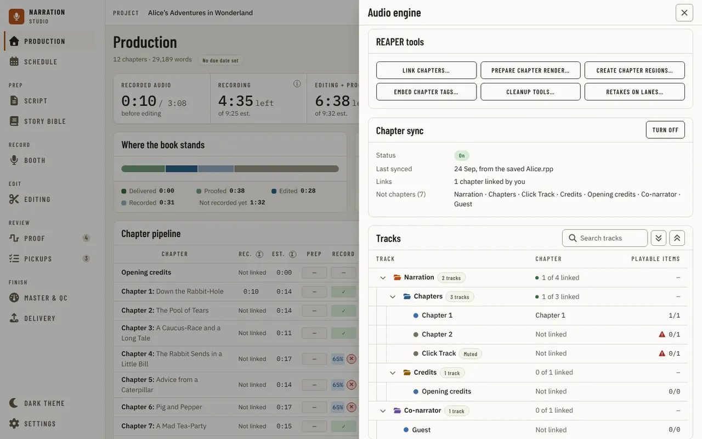

### Linking chapters to tracks

Below the track list, Chapter links shows every narration chapter (not a chapter removed from recording) with the track it's confirmed
to, so checks that need to know "which audio is this chapter" (the [editing check](#editing-check)
below, an evidence view) don't guess by name. Each row is the chapter, its status, its track and its actions. A chapter
starts **Not linked** with its track list on **Choose a track**: pick a track, then press Confirm, which stays off until you
have picked one. A track another chapter already has is marked in the list with the chapter that has it. When the project has folders, the list is the same tree in a popover: the matcher's best match comes first with its folder path, a search box flattens the list to the matches with their paths, and a folder with no audio of its own is shown but can't be chosen (a folder that holds audio can). A confirmed chapter shows **Linked** with the track's name, and Change or Clear. Change
replaces the chapter's link, so a chapter is never left linked to two tracks; a track already
linked to another chapter moves to this one. Clear removes every link the chapter has. If the
confirmed track is deleted, or the project points somewhere else, the chapter shows **Track
missing** until it's relinked or cleared. The list starts with **Opening credits** and ends with **Closing credits** (when the Script page has them), which link, change and clear the same way; their menu is a chapter's (**Open in Editing**, **Open in Proof**, **Editing check…**). These links are kept in the app's own project data and never
change the REAPER project.

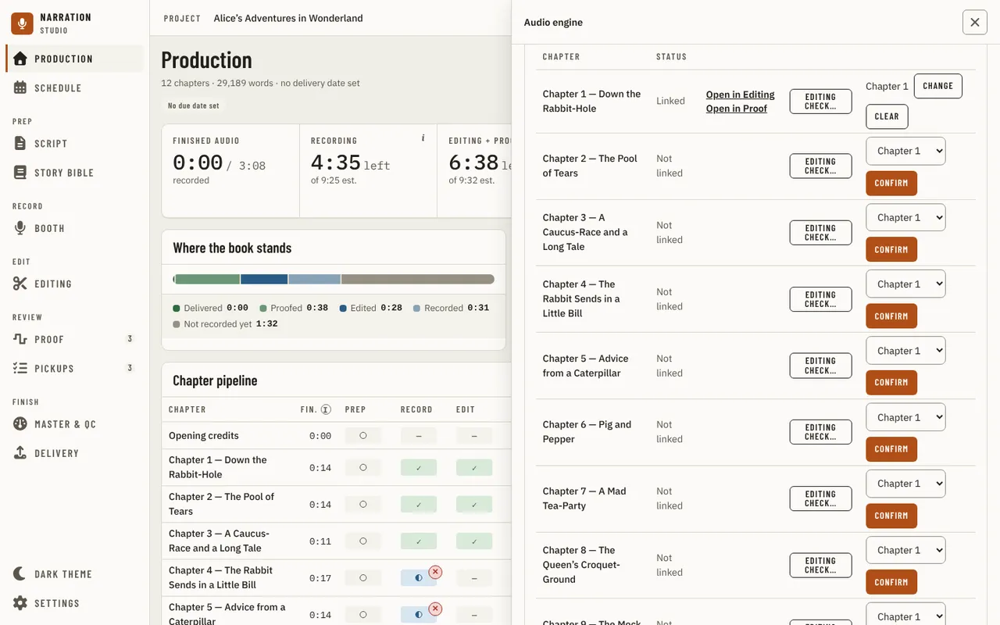

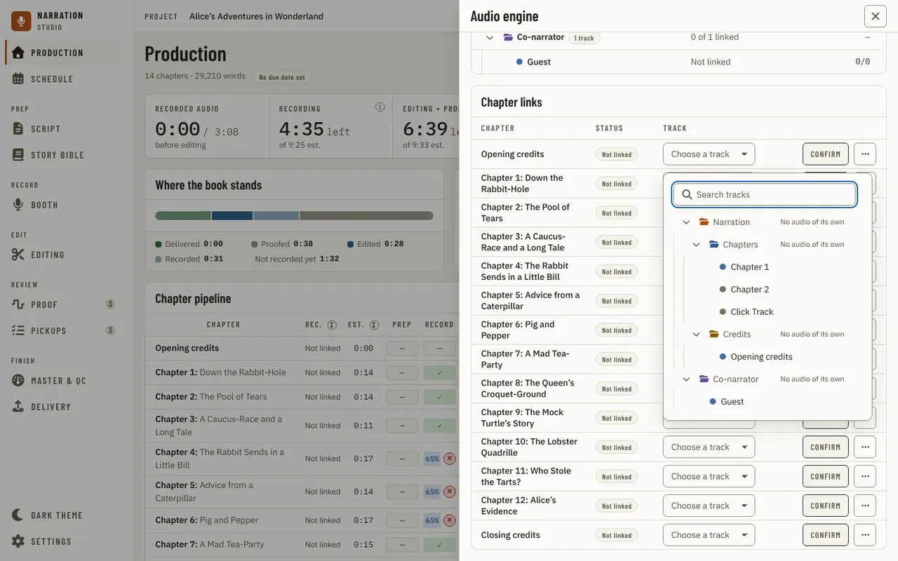

The **More actions** button (**⋯**) at the end of each row holds the rest. For a linked chapter it has **Open in Editing**, which opens
the chapter on [Editing](editing.md) to hear it against its script and edit it, and **Open in Proof**, into the chapter's
[Proof view](proof.md#the-chapter-view), where its recording is compared with the manuscript. Every row's menu has
**Editing check…** ([below](#editing-check)).

In a narrow window each row takes two lines: the chapter and its status, then the track and the actions.

When one or more chapters have a [Production](production.md#stage-readiness) stage suggestion that can't be
computed because its track link is missing or not yet confirmed, a line above Chapter links says so
("N chapters can't get a stage suggestion until their track links are confirmed below") and points
at this same list - link or confirm the chapter there to let its suggestion be computed on the next
read.

### Editing check

Each chapter's **More actions** menu in Chapter links has **Editing check…**, opening its own panel over this one, as wide as it, with **Back to the audio engine** at its top: whether
empty space, clicks and breaths still need trimming out. The same panel opens from
a chapter's [stage suggestion](production.md#stage-readiness) on Production when the editing signal
names it as the way to resolve what's unknown.

The panel never starts a check on its own: opening it only reads what the last check already
found. **Check editing** (**Check again** once one has run) runs the scan with real progress and
**Cancel** on the same line as the progress; items already checked are cached, so re-checking after a small edit is
fast. A cancelled check says how far it got ("Stopped after 1 of 3 items"), and while a check runs the results under it
are headed **Previous result**. A line under the source choice says what the analysis includes: for items, "Analysis
of source audio; take FX, item gain and fades are not applied", since REAPER's own processing isn't part of what's
analyzed.

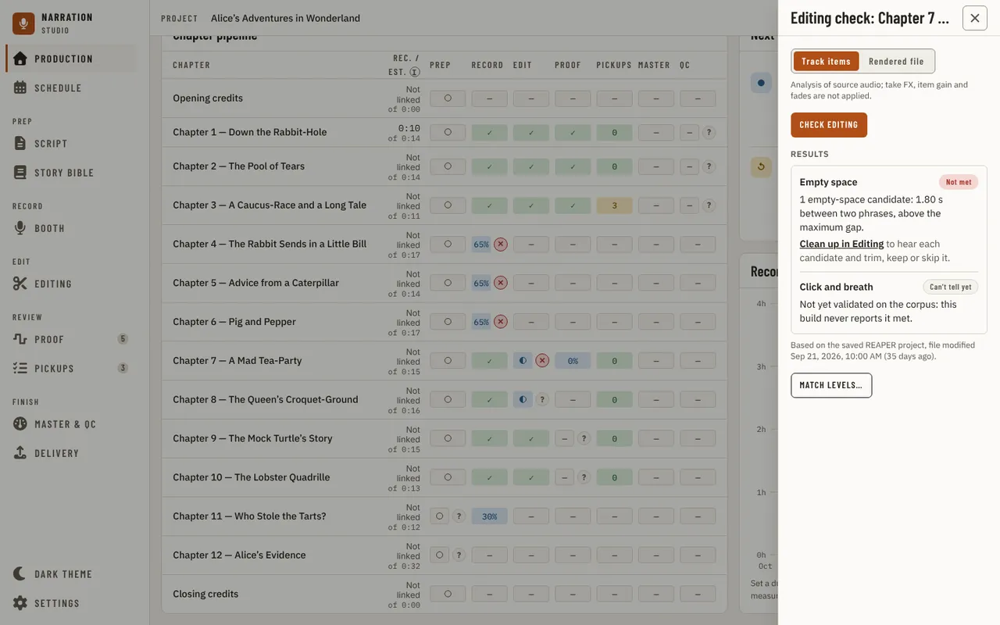

A chapter's analysis source is your choice: **Track items** (the default) or **Rendered file**, a
toggle at the top of the panel. Editing happens on items, so items stay the default; choosing the
render is an explicit second check, and the render check needs a rendered file already chosen for the
chapter (see [Proof](proof.md#delivery-checks) for choosing one). If the render changes, or
becomes older than a later edit to the chapter's items, the render's own check reads "Can't tell
yet" until you check it again.

The results list one row per class — Empty space, Click, Breath — each with a badge for its state: **Met** (checked, no
open candidate remains), **Not met** (one or more open candidates), or **Can't tell yet** with why
(not checked yet, changed since the last check, no track linked, a maximum gap not set in
[Settings](settings.md), an item this build can't analyze, or the check running). Click and
breath share one row reading "Not yet validated on the corpus" until their detectors are validated on a labeled
corpus — a class this build cannot vouch for is never shown as done. Once a check has run, one line under the list
says which saved REAPER project it was based on.

Outside the Editing stage a class shows how many candidates the last check found instead of a state. The candidates
themselves are heard and worked on the [Editing](editing.md#cleaning-up) page's Clean up tab: **Clean up in Editing**,
in the Empty space row whenever it has candidates, opens the chapter there with the drawer on Clean up. **Match
levels…** stays in the panel: it previews the linked track's items that are off the level target and, after you
confirm, changes their volume in REAPER in one undo step. While it is off, the reason shows under the button.

If the chapter isn't linked to a track yet, the panel shows only the same track picker the recording
check does, right in place; the check and its results come back once the chapter is linked.

### Chapter sync

The first time a REAPER project is linked with a manuscript already imported, a dialog asks **Sync
chapters to tracks?**. It shows what would happen without changing anything yet: which chapters will
be linked by a confident, matching track name, which need you (two tracks look alike, or the closest
one isn't a confident match), which have no track yet, and which tracks name no chapter. **Sync**
turns chapter sync on and links the confident matches; **Not now** leaves every chapter as it was and
asks again only if you unlink and relink the project. The same question can come up from any of the
ways to link a project (this panel's link button, choosing a project here, an import, or reopening a linked
project).

Once on, the Chapter sync section lists one fact per row: **Status** (On), **Last synced** (when, and from which
saved project file: "10:42, from the saved Alice.rpp"; for an Audacity project, the linked Audacity project: "10:42, from
Book One.aup3 in Audacity", or "from the open Audacity project" when none is linked), **Links** (how many chapters it linked on its own and
how many you linked: "8 chapters linked automatically, 1 by you"), **Background checks** while they are waiting
("Waiting: REAPER is recording.", or Audacity for an Audacity project), and **Not chapters** (below). **Turn off**, beside the heading, stops it (chapter
links you already made are kept); while it is off the same place has **Turn on**, which asks again. Its own Needs you list
says why each chapter wasn't linked ("Two tracks match: … A chapter is checked from one track.", or
"Closest track … is not a confident match, so it was not linked on its own.") and lets you pick the
right track and press **Link**, the same link Chapter links below records. A track sync doesn't
recognize as any chapter's is listed under **Not chapters** so it isn't mistaken for a
missing link. When REAPER has changes you haven't saved yet, a line says so: sync reads the saved
project, so it picks them up when you save.

The log of what each sync did, with **Undo** on a link sync made, is in Settings: [Recording & DAW > Sync activity](settings.md).

---

[← Getting started](getting-started.md) · [Index](README.md) · [Production →](production.md)
