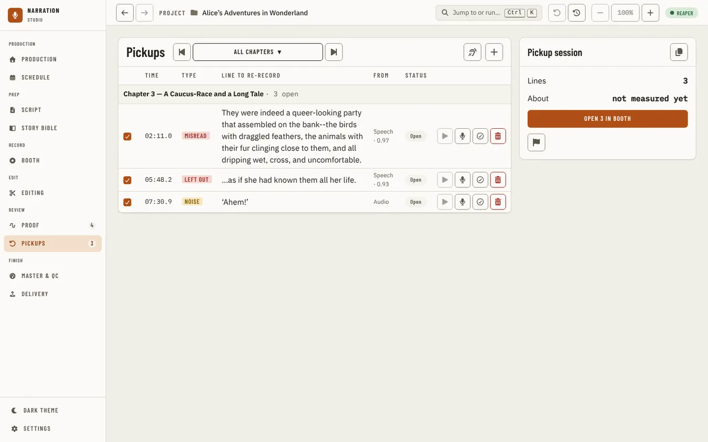
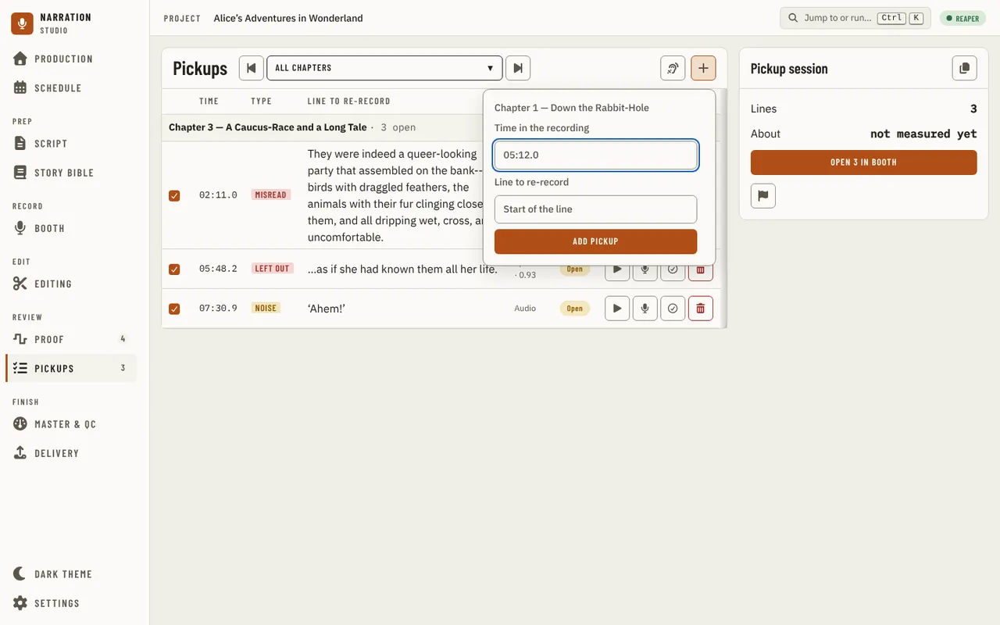
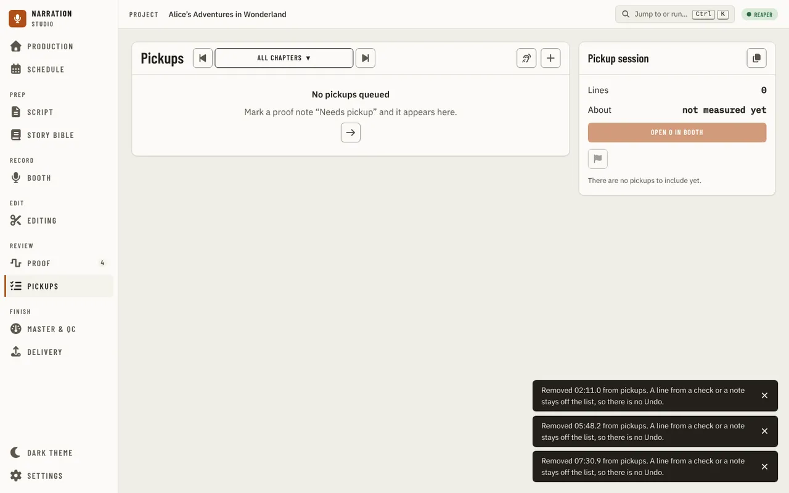
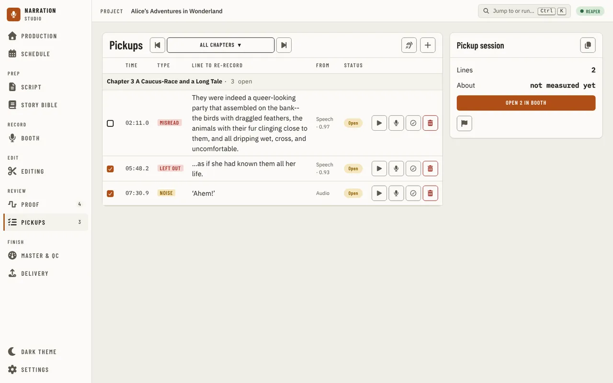

[Using the app](README.md) › Pickups

# Pickups

Pickups lists every line to record again, so you can gather them into one session in the [Booth](booth.md). It sits
under **Review** in the sidebar, after [Proof](proof.md). The page records nothing itself: it has no punch and does not
move the DAW's cursor. Each line opens in the Booth, where you record it.

## Where the lines come from

The list is built each time the page opens, from four places. The **From** column says which:

- **Speech**: a gap the [recording check](proof.md#one-chapter) found in a chapter (a missing passage, extra words, a
  misread), with the check's score, or **no score** and why. Only a chapter whose check is current adds lines; an unread
  start or end of a chapter is unfinished recording, not a pickup.
- **Proof note**: a note you marked **Needs pickup** on [Proof](proof.md#a-note-and-your-decision).
- **Audio**: a note about a sound (a mouth noise, a plosive, a breath) that you marked the same way.
- **You**: a line you added by hand.

A gap you accepted on Proof's recording check card is one line, not two. The proofer's CSV sheet is imported and
exported on [Proof](proof.md#the-notes).

## The list

The chapter stepper at the top shows every chapter or one (Alt+Up and Alt+Down step it). The lines are grouped by
chapter, each group with how many lines are open, and each line has:

- a box that includes it in the next session, or leaves it out (Space on a selected line does the same);
- its time in the recording, its type, the line to re-record, where it came from and its status (**Open** or
  **Recorded**);
- **Open in Booth at this line** (Enter on a selected line), **Mark recorded** (or **Mark open again**) and **Remove from
  pickups**.

Right-click a line for the same actions, **Open this chapter in Script**, and **Go to the note in Proof** for a line that
came from a note. Up and Down move between lines.

A line is recorded once its pickup marker in the DAW says so: the marker is the record of what is done, and marking a
line recorded renames its marker. While the DAW is not answering, the app keeps the change and writes it to the marker
the next time it reads the list with the DAW answering.

Removing a line hides it from this list only; its note or check keeps its own record. A line you added by hand can be put
back with **Undo** on the message that follows; a line from a check or a note cannot.

**Check recordings** opens the recording check on the chapters whose check is not current, so their gaps can join the
list. It is off, with the reason, when the DAW is not reachable. **Add a pickup by hand** asks for the time in the
recording (`05:12.0`) and the line to re-record, and adds it to the chapter in view (with every chapter shown, the
last chapter you stepped to, or the first).

With no lines at all, the page says **No pickups queued**, with the way to Proof; a chapter with none says **No pickups
for this chapter**.

## Pickup session

The **Pickup session** panel beside the list counts the open lines in view that are not left out: **Lines**, and
**About** how many minutes they take to record, from the recordings' measured times (it says when there is no measured
figure). From there:

- **Open N in Booth** opens the Booth on those lines, starting with the first line's chapter (see
  [A pickup session](booth.md#a-pickup-session)).
- **Add N as markers in** the DAW puts a pickup marker at each line's place. It is off, with the reason, when the DAW
  cannot add markers.
- **Copy the pickup script** copies the lines, one per line as "chapter · time: line", to paste elsewhere.

## In the Booth's companion panel

The companion panel's **Pickups** section shows how many of the DAW's pickup markers are still open, out of the total. It
does not change them.

---

[← Proof](proof.md) · [Index](README.md) · [Master & QC →](master-and-qc.md)
