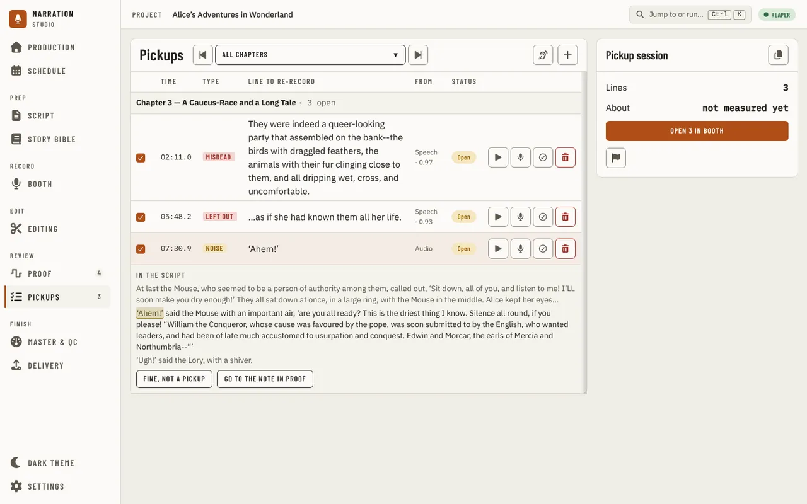
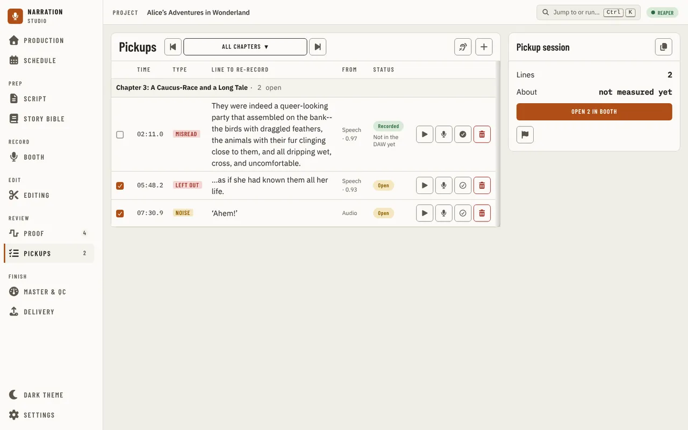
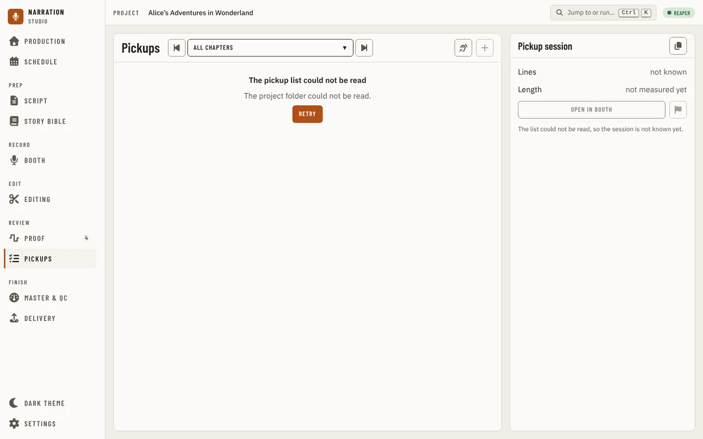

[Using the app](README.md) › Pickups

# Pickups

Pickups lists every line to record again, so you can gather them into one session in the [Booth](booth.md). It sits
under **Review** in the sidebar, after [Proof](proof.md). The page records nothing itself: it has no punch and does not
move the DAW's cursor. Each line opens in the Booth, where you record it.
While the list is being read, the table shows grey rows shaped like its lines under the page title, **Add a pickup by hand** is off, and the Pickup session panel shows blocks for **Lines** and **Length**, not a count; if it cannot be read, the page says so with **Check again**.

## Where the lines come from

The list is built each time the page opens, and again whenever you come back to the window, from four places. The **From** column says which:

- **Speech**: a gap the [recording check](proof.md#one-chapter) found in a chapter (a missing passage, extra words, a
  misread), with the check's score, or **no score** and why. Only a chapter whose check is current adds lines; an unread
  start or end of a chapter is unfinished recording, not a pickup.
- **Proof note**: a note you marked **Needs pickup** on [Proof](proof.md#a-note-and-your-decision).
- **Audio**: a note about a sound (a mouth noise, a plosive, a breath) that you marked the same way.
- **You**: a line you added by hand.

A gap you accepted on Proof's recording check card is one line, not two. The proofer's CSV sheet is imported and
exported on [Proof](proof.md#the-notes).

## The list

The chapter stepper at the top shows every chapter or one (Alt+Up and Alt+Down step it). Chapters are named as the
manuscript heads them. The lines are grouped by chapter, each group with how many lines are open, and each line has:

- a box that includes it in the next session, or leaves it out (Space on a selected line does the same); a line left out has its time and words greyed;
- its time in the recording, its type, the line to re-record, where it came from (a speech check's score under **Speech**) and its status (**Open** or
  **Recorded**). The type is drawn as that kind is everywhere in the app: a misread, a left-out line, extra words,
  a repeat and a long silence are red; a breath, click, noise or plosive is amber; a pronunciation is blue. **Open** is amber, a thing
  still to do, and **Recorded** is green;
- **Hear the original in context**, which plays the recording at this line with 3 seconds either side (press it again to
  stop; it is off, with the reason, for a line that has no place in the recording yet). With REAPER linked it plays through
  REAPER; when REAPER cannot play now, the app plays the line's recording and a message says why. While REAPER is recording
  nothing plays;
- **Open in Booth at this line** (Enter on a selected line), **Mark recorded** (or **Mark open again**) and, set apart after a
  rule, **Remove from pickups**.

Each line is a tall row with 36 px buttons on its first line of text, and each chapter's group row is tinted. The columns keep
their places when a line is recorded or left out. In a window narrower than the tablet width each line is a block instead: its box,
time, type, source, status and buttons on one line and the words under them (on a phone width the buttons take a line of
their own).

Select a line and, under it, **In the script** shows where it is: its paragraph with the line's words marked, and the
paragraphs before and after it, greyed. With it are two buttons for a line that came from a note on [Proof](proof.md):

- **Fine, not a pickup**, when you hear it and it was right after all. The note is marked **Fine as read** on Proof and the
  line leaves the list; **Undo** on the message puts the note back as it was. A line from a recording check's gap that a
  note was attached to leaves the list too, and stays off it as **Remove** would.
- **Go to the note in Proof**, which opens Proof on that note.

A line that came from no note (added by hand, or a check's gap no note was made for) has both off, with the reason; **Remove**
takes it off the list.

Right-click a line for the same actions (**Hear the original in context** too), **Open this chapter in Script**, **Fine, not
a pickup** and **Go to the note in Proof** for a line that came from a note. Up and Down move between lines. When you come back from the Booth with the browser's Back button after
opening one line, that line is selected again and has the focus.

A line is recorded once its pickup marker in the DAW says so: the marker is the record of what is done, and marking a
line recorded renames its marker. While the DAW is not answering, the app keeps the change and the line reads
**Recorded** with **Not in the DAW yet** under it; it writes the change to the marker the next time it reads the list with the DAW
answering.

Pressing a line's button again before the first press is answered does nothing, so a line is never removed or
flipped twice. A refusal appears as a sentence in a message at the bottom of the window.

Removing a line hides it from this list only; its note or check keeps its own record. A line you added by hand can be put
back with **Undo** on the message that follows; a line from a check or a note cannot, and its message says so. Several such
removals in a row are one message that counts them ("Removed 3 lines from pickups."). After a removal the focus moves to the next line as the page draws it (the previous one after the last), and to the Pickups region when no line is left.

### When the list cannot be read

If the list cannot be read, the page says why and offers **Retry**; it never shows "No pickups queued" for a list
it could not read. If a later read fails while a list is showing, the list stays and a line above it says **Can’t tell if
this list is current**, with the reason and when it was last read. The page tries again by itself every few seconds
while it cannot read, and whenever you return to the window.

**Check recordings** opens the recording check on the chapters whose check is not current, so their gaps can join the
list. It is off when the DAW is not reachable. An off button stays in the Tab order: focus it and the reason appears, and
a screen reader reads it as the button's description. **Add a pickup by hand** asks for the time in the
recording (`05:12.0`, or `5:12`; seconds run 00 to 59) and the line to re-record (one line, up to 500 characters), and
adds it to the chapter in view (with every chapter shown, the last chapter you stepped to, or the first); the form names that
chapter under its title, and **Close** or Escape leaves it. A time or
line the app cannot use is said under its box, which is marked as wrong until you change it, and in a short message; the
form keeps what you typed.

With no lines at all, the page says **No pickups queued**, with a **Go to Proof** button; a chapter with none says **No pickups
for this chapter**. If a chapter you were viewing is no longer in the manuscript, the page shows every chapter.

## Pickup session

The **Pickup session** panel beside the list counts the open lines in view that are not left out: **Lines** (**not known** while the list cannot be read), and
**Length**, about how many minutes they take to record, from the recordings' measured times (it says when there is no measured
figure, or **no lines** when the session is empty). In a wide window the panel runs down beside the list; in a narrower one it sits
under the list at its own width. From there:

- **Open N in Booth** opens the Booth on those lines, starting with the first line's chapter (see
  [A pickup session](booth.md#a-pickup-session)). With no lines in the session it is off (outlined), and the line under the
  buttons says why: there are no pickups yet, every line in view is recorded, or every open line is left out.
- **Add N as markers in** the DAW, the flag beside it, puts a pickup marker at each line's place and says "Pickup markers for N lines are in
  REAPER." (or that those markers were already there). It is off, with the reason, when the DAW cannot add markers. With
  Audacity the markers are labels on a label track named "<!-- brand:identity.audacityLabelTrack -->Narration Studio<!-- /brand -->", written `[nu:pickup open] …` (and
  `[nu:pickup done] …` once resolved): one label per line, with no colour. They are Experimental, so they stay off until the
  Experimental switch is on, and Audacity must be [linked and answering](settings.md#daw-integration). Edit one by hand and the
  app reads it as it stands; delete the `[nu:pickup …]` start and it is no longer a pickup.
- **Copy the pickup script** copies the lines, one per line as "chapter · time: line", to paste elsewhere. If the window
  does not allow the clipboard, it says so.

## In the Booth's companion panel

The companion panel's **Pickups** section shows how many of the DAW's pickup markers are still open, out of the total. It
does not change them.

---

[← Proof](proof.md) · [Index](README.md) · [Master & QC →](master-and-qc.md)
