[Using the app](README.md) › Production

# Production

Production is the page a project opens on, the first item in the navigation. It answers "am I on
pace?" for the book you have open: how much finished audio there is and how much recording,
editing and proofing is left, the open pickups, the due date and whether the pace reaches it, and
what to work on next. Its **Chapter pipeline** has one row per chapter and one column per stage; a chapter's name reads "Title: Subtitle" with the subtitle dimmed.
The book's dates, payment and milestones are on [Schedule](schedule.md), the item after Production in
the navigation.
While the production log is being read, the page keeps its title and buttons and shows grey blocks where the chapter and word counts, due date, verdict, figures, cards and pipeline will be (it never says "0 chapters" or "No due date set" before it knows); if it cannot be read, the page says so with **Retry**.

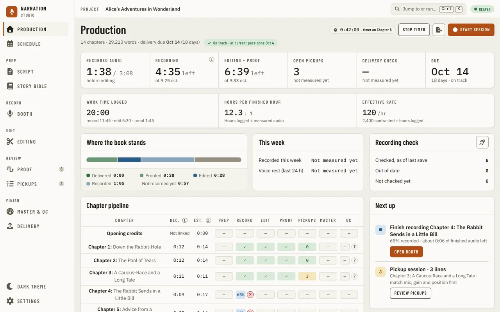

The header names the book's chapters, words and due date ("12 chapters · 29,189 words · delivery
due Oct 14 (18 days)"). The pill beside them is the verdict for the due date in a word and a mark
(on track, tight or behind, or "No due date set"); it opens [Schedule](schedule.md). **Export status report** (the export icon) opens the
[status report](#status-report), and **Start session** opens the [Booth](booth.md) on the chapter
being recorded. When the audio engine cannot record, one line under the buttons says why in the DAW's own words.

With no manuscript imported yet, the page is the import: **Import manuscript** opens the file
picker (see [Importing the manuscript](#importing-the-manuscript)), and the calendar icon opens
[Schedule](schedule.md) to set a due date first. To replace a manuscript later, use
[Settings](settings.md).

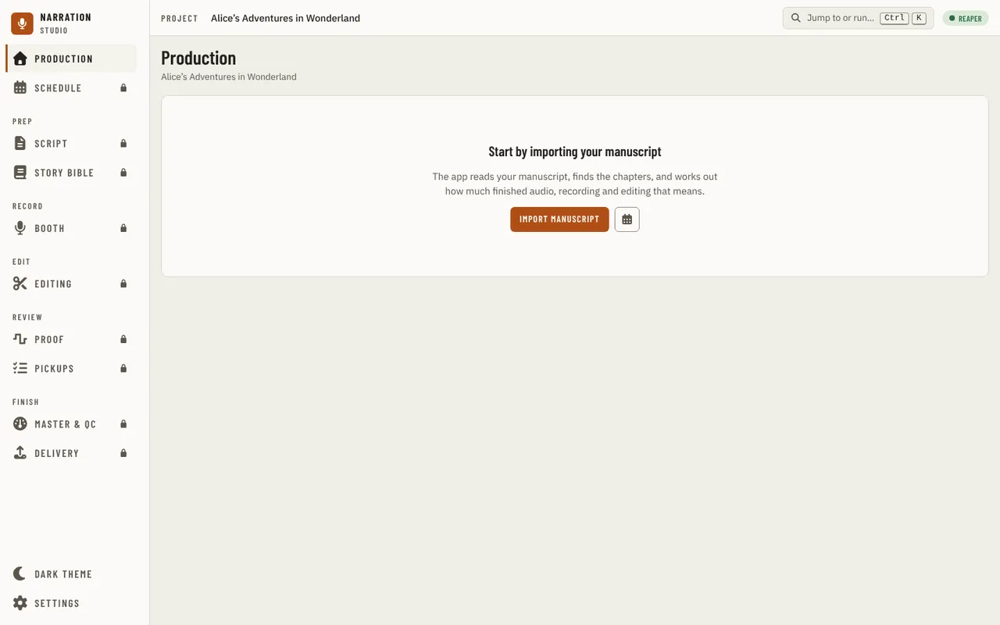

The app connects to the REAPER you have open by itself. For the first ten seconds after it opens, an
engine that is not connected yet shows a quiet "Connecting to REAPER…" line. If it has not connected by
then, a **REAPER not connected** mark takes its place, and a dialog opens once: the DAW's reason ("REAPER is not running."),
that progress that comes from it may be out of date until it is running again, and when the app last checked.
**Start REAPER** starts REAPER on the linked project, and **Check again** asks the DAW now. The X closes the dialog and the
mark opens it again; both go by themselves as soon as the engine connects. It never offers the built-in recorder:
switching recorders is a choice in [Settings > Recording & DAW](settings.md). Whether Record could work at all
is one answer on Production, the Booth and the Companion: the DAW's own sentence when it cannot.

If the production overview cannot be read when the page opens, Production keeps its title and says "This page could not
be loaded" with the reason and a **Retry** button, which reads it again.

## The figures

The six figures are one card; each opens the page it counts.

- **Recorded audio**: the audio on every chapter's confirmed track in the saved DAW project, out of
  the book's finished length estimated from its words. It is what is recorded, before editing: the
  app does not know from the audio whether it is edited, proofed or mastered.
- **Recording**, **Editing + proof**: the hours of work left at each stage, estimated from the
  words still to do. The info icon on **Recording** opens the target pace: the standard rate or
  your own, once enough chapters are measured. The basis you choose there sets the hours on this page and on
  [Schedule](schedule.md).
- **Open pickups**: the open lines of the [Pickups](pickups.md) list, and the booth time to redo
  them once a pickup session has been timed. Each chapter's **Pickups** cell in the pipeline counts
  the same lines, so the cells add up to the tile.
- **Delivery check**: chapters that pass, fail or are not checked yet. It reads "Not measured
  yet" until the host reports a check per chapter.
- **Due**: the due date and what the pace says about it, or **Not set** ("Set it on the Schedule") before one is set. It opens [Schedule](schedule.md).

Under the figures, **Where the book stands** splits the book's finished hours by stage, estimated
from each chapter's own progress in five parts: **Delivered** (the chapters mastered for delivery whose checks pass; a master that fails counts as Proofed until it is fixed), **Proofed**, **Edited**,
**Recorded** and **Not recorded yet**. A chapter still being recorded counts for the share of its audio measured so far, **This
week** says how much was recorded this week and in the last 24 hours (from the built-in recorder's
take log), and **Recording check** counts the chapters checked as of the last save, out of date,
and never checked; its icon opens **Check recordings** with the out-of-date and unchecked chapters
already chosen. **Recorded vs plan** draws the plan, what was recorded and where that pace ends; its calendar icon, **Open schedule**, opens [Schedule](schedule.md). Above 1280 px **Recording check** and **Next up** share the right-hand column, and the chart runs down to the foot of the pipeline, to at most 28 rem; a long book stretches the pipeline, not the chart. In a window 1280 px wide or less the three small cards become two, with **Where the book stands** across both, and below 640 px one; **Next up** and the chart sit side by side above the pipeline, so what to do next comes before the table.
A figure with nothing honest to work from says "Not measured yet" and why, rather than 0.

## The stage timer

The stage timer stays as it was. **Start timer**, on the Next up item of the chapter being
recorded, starts timing that chapter's current stage. While a timer runs, this page's header counts its time and names the chapter ("0:42:07 · timer on Chapter 6")
beside **Stop timer**; the app's top bar has no timer. Only one timer runs at a time: stop it before you start
another. Time is logged only while you run a timer, never from REAPER activity, and starting or
stopping a timer never changes a chapter's status.

Once time is logged, three figures sit under the card: **Work time logged** (split by stage),
**Hours per finished hour** (hours logged divided by measured audio) and **Effective rate** (the
contracted amount divided by the hours logged). Each stays a dash until it has something to work
from.

## Next up

**Next up** lists what to do next, ranked by the hours of work it puts at risk: finishing the
chapter being recorded (with **Open Booth** and **Start timer**), a pickup session when the
Pickups list has open lines (naming the chapters they are in), and the first chapter whose
measured file fails the delivery check, with each failed check, its value and its limit
("noise floor −57.8 dBFS (limit ≤ −60 dBFS)") and **Inspect failed check**, which opens
[Master & QC](master-and-qc.md). It reads "Nothing needs you right now" when there is nothing to list. Its percent recorded is the
same figure as the chapter's **Record** cell and the Booth's "Recorded through" note. Every total on this page counts the
narration chapters only: a chapter removed from recording, and reference material, are left out here and in [Schedule](schedule.md).

## Chapter pipeline

The pipeline has one row per narration chapter. In a narrow window the stages scroll sideways under the chapter names, which stay in view, with a shadow on the side that has more. **Rec.** is the audio
on the chapter's confirmed track in the saved project (`1:12`, or `<0:01` for under a minute), and **Est.** beside it (`1:20`) is the
chapter's finished length estimated from its words. Every column header is centred over its cells. When Rec. has no length, it says why: **None yet** (linked, nothing recorded),
**Not linked**, **2+ tracks** (keep one in the track panel), **Track gone** (the linked track is no longer in the project), **No
project** (no saved project could be read) or **Not read**. The Rec. cell's tip and its name for a screen reader also say how far the
chapter is recorded, the place the [Booth](booth.md#where-you-stopped) reopens it at: *Recorded through ¶ 12 (38%)*, or *Recorded to
the end*, with *about* when the figure comes only from the track's length.

**Record**, **Edit** and **Proof** follow the chapter's stage, which you set (the row's status, or **Confirm** on its
[readiness](#stage-readiness)); the app does not move a stage on by itself. They show a check mark (✓) for a stage done, a half
circle for the stage under way and a dash for one not started. Record is the one exception: once the chapter's track has audio, or the app knows part of it is recorded,
it shows the share recorded, even while the stage still says not started, and its tip says so. The share is how far the chapter is
recorded, the same figure as the Booth's, when the app knows it; otherwise it is the track's audio against the estimate.
**Prep** is the chapter's prep state from [Script](script.md): a check mark when prepped, a half
circle while in progress and a dash when not started. **Pickups** counts the chapter's
open lines once it is recorded to the end (0 when none are open). **Master** and **QC** come from
the files measured on [Master & QC](master-and-qc.md): mastered, and PASS or FAIL. A cell with nothing to
read says "Not measured yet". A cell's colour is the colour of its status everywhere in the app: green for done or passing, blue for under way,
amber for open pickups, red for a failed check, grey for not started. A cell opens its stage for the chapter: Script, the Booth, the editing
check, Proof, Pickups or Master & QC. The board grows with the chapter list, and the table scrolls sideways in a narrow window.

The round chip inside the chapter's current-stage cell, beside the stage, is its [readiness](#stage-readiness). A chapter that has not started has no chip: its Prep cell's tip says the verdict instead.

Right-click a row (or press the Menu key or Shift+F10 on one of its cells) for the chapter's menu:
**Open prep in Script**, **Open in Booth**, **Open Proof**, **Open Master & QC**, **Go to this
chapter in** your DAW (it selects the chapter's linked track there, and says why it is off when the
DAW cannot select a track or no track is linked yet), then the tools
the page kept: **Chapter track…** (see [A chapter's track](#a-chapters-track)), **Recording
check…** (see [Checking a chapter's recording](#checking-a-chapters-recording)), **Editing
check…**, and **Set status:** for each other status, which sets the chapter's status by hand.

The engine chip at the top right of every page says whether a REAPER project is linked and opens
the [audio engine panel](navigation.md#the-audio-engine-panel).

### A chapter's track

**Chapter track…** opens what the saved project knows about the chapter's track (its items, span,
recorded length, how the link was found and when, and whether you or chapter sync made it), and
**Another track…** and **Unlink**, the same link as in the [audio engine panel](navigation.md#linking-chapters-to-tracks).
A suggested track says it is not linked yet; a chapter two tracks look like says so and lists
them; a chapter linked to two tracks offers **Keep this one** on each and nothing else; a linked
track no longer in the saved project says it may have been deleted or the project saved elsewhere,
shows its figures as last known and offers no playback.

When the panel knows the chapter's track, it can play that track's recorded audio right there -
Play/Pause and skip 30 seconds back or forward - and **Select in REAPER** brings the track into
view in REAPER itself. Selecting needs REAPER linked and answering, and
changes nothing else: no undo point, and REAPER's own selection is all it touches.

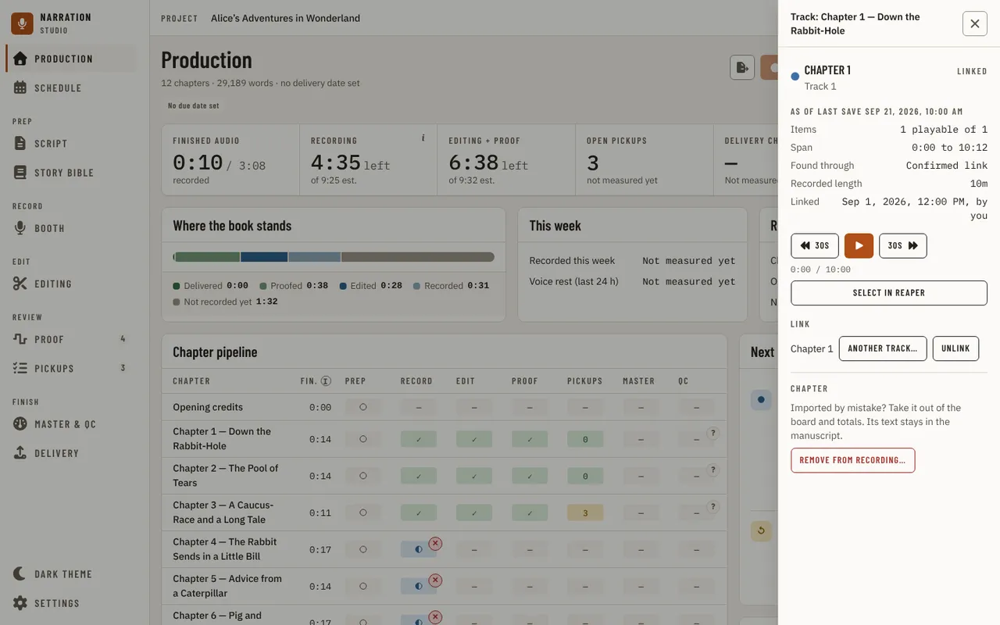

**Remove from recording…**, under **Chapter**, takes a mis-imported heading (a part title, an
epigraph or a false split that was read in as a chapter) out of the pipeline, the totals, the reader,
the Booth and the navigation, as **Not a chapter**. Nothing is deleted - its text stays in the
manuscript and its track link is cleared - and the last narration chapter can't be removed. A
removed chapter is listed under **Removed from recording**, below the pipeline, with **Restore** to
bring it back with its status and any notes intact.

### The credits

**Opening credits** and **Closing credits** are the first and last rows of the pipeline, before chapter 1 and
after the last chapter. They are chapters like any other, listed everywhere chapters are (the chapter pickers of [Editing](editing.md), [Proof](proof.md) and the [Booth](booth.md), Engine's chapter links, Delivery and Master & QC), and counted in the totals: each is
the first opening and first closing template in
[Settings, Credits](settings.md#credits), each with its own status; a manuscript that brings its own opening-credits chapter
lists that chapter in the opening row's place. Prep is a tick once no token is left to fill in, Record,
Edit and Proof follow the row's status, and a stage nothing measures yet is a dash. Right-click a credits row for the same menu as a chapter's (**Open Proof**, **Editing check…**, **Chapter track…** and the rest) plus **Credits…**, which shows the template's name, words and estimated length (including
room tone), a warning for an unresolved token (`[Author]` never filled in) with **Fill in under
Settings > Credits**, its status, its Recorded length (once its own track is linked - never an
estimate), and **Check recordings…** beside **Open in Script**. A kind with no template has no row; add one in [Settings, Credits](settings.md#credits).
Checking credits works the same as [checking a chapter's recording](#checking-a-chapters-recording)
below, against the credits template's rendered text rather than a manuscript chapter.

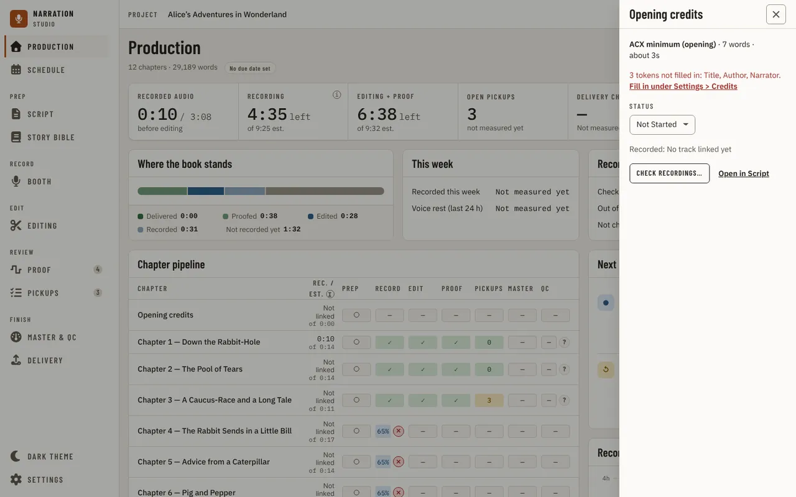

## Checking a chapter's recording

The recording check transcribes the audio items on a chapter's REAPER track with Whisper, then compares the words with the
chapter's text in order. Every way to start it opens the same **Check recordings** dialog, with the same options and the same
settings: the Recording check card's icon (with the out-of-date and unchecked chapters ticked), a row's **Check recordings…** in
the pipeline's row menu, a credits row's check, **Check recordings…** in a chapter's readiness, and the matching buttons on
[Proof](proof.md#one-chapter), [Pickups](pickups.md) and [Editing](editing.md) (each with its chapter ticked). Nothing runs until
you press **Check**. Save the project in REAPER before checking, because the check reads the saved file, not the open session.

**Speech model** is the first pass. **Look again with a larger model** adds a second pass: the **Larger model** transcribes again only
the passages that are missing and the words Whisper scored under the **Also look again at words scored under**
share. Three sliders set how a long chapter is read: **Chunk length** (10 to 120 s, in steps
of 5) cuts each recording into pieces, **Overlap between chunks** (0 to 10 s) is how much neighbouring pieces overlap, so a
word on an edge is whole in one of them, and **Parallel workers** (1 to 8) is how many recordings, or pieces of one long recording, are
transcribed side by side (each holds a copy of the model in memory). **Transcribe each recording whole** turns the chunks off and leaves one, and
**Automatic: plan it from the processors, the free memory and the model** hands the count back to the app. The line under it says what will run
and why, for example "Automatic: 3 transcriptions at once, using 6 of 8 processors for the Large v3 model. Set by the memory: …". A setting the sliders do not reach, such as a 5 min chunk from Settings, shows its real figure
and is kept until you move the slider. A line under the choices says what will run, in words. **Chapters at once** checks that many of the ticked chapters together, each with its own share of the
processors and the memory, and starts the next as each ends. The options start at the values in Settings, and the check runs exactly what the dialog
shows, so a chapter is checked the same way wherever you start it, including in the background. A model that is not installed yet
is marked **(not installed)** in the lists and named under the options; **Check** then asks before downloading it, with the model's
facts and the real download progress, and checks the same chapters once it is installed. When only the larger model of a second
look is missing, the question also offers **Check with … only**, which checks with the first pass alone (untick **Look again with a
larger model** for the same choice up front).

The chapters list each recorded chapter with its check state and last result. The options and the chapters scroll together when they do not fit, with a shadow at the edge that has more; **Audio to check** (the recorded time of the ticked chapters, or **Not measured**), the line that says what a check adds (skipped, changed or unclear lines become pickups) and **Cancel** and **Check** (it names how many chapters, as in **Check 1 chapter**) stay in view
under them. It gives no estimate of how long the check will take. While it runs, a box of fixed size shows what the check is doing, and each chapter has its bar under its name with its own count (its chunks done, and the passages its re-check has finished). The box holds the overall bar, the phase (**First pass**, **First pass and re-check**, **Re-check**, **Finishing**), the models, the time so far and three figures; hover or focus a figure's icon for what it means. **Chunks** is the pieces of audio transcribed so far out of all of them; a recording shorter than the chunk length is one piece, and the tooltip says so, because one piece cannot run side by side with anything. **Workers** is the transcriptions running now out of the number the check really runs (what **Automatic** chose, or the number you set when fewer can be used). **Re-check** is the passages the larger model has looked at out of those sent to it so far (a trailing **+** means more may still come while the first pass runs), **None** when nothing was doubtful, **Waiting** before the first pass has found any, and **Off** when the check has no second look. Its tooltip names the model and why: words the first model was unsure of, places where it heard nothing, or, when so much was in doubt, whole recordings. The time is a clock, not an estimate: the passages for the larger model are only known as the first pass goes, so no end time is shown. A run of one chapter keeps the box, stopped, above that chapter's result. **Stop checking**, beside the line naming the model, stops the run; the chapter's Recording check card on Proof has the same **Stop checking**. Escape while it runs asks first. A run of one chapter ends on that chapter's result in the dialog; a run of several closes it with a message giving the totals. A chapter with a stored check has **Show result** in its row. Opened with no chapter in mind (Proof's all-chapters view), the dialog ticks the chapters whose check is not up to date.

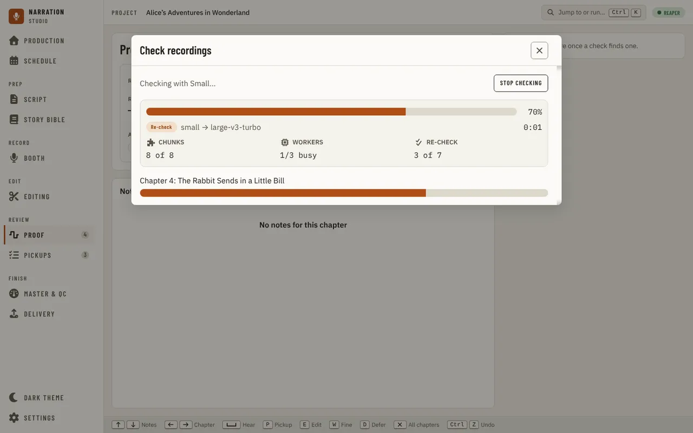

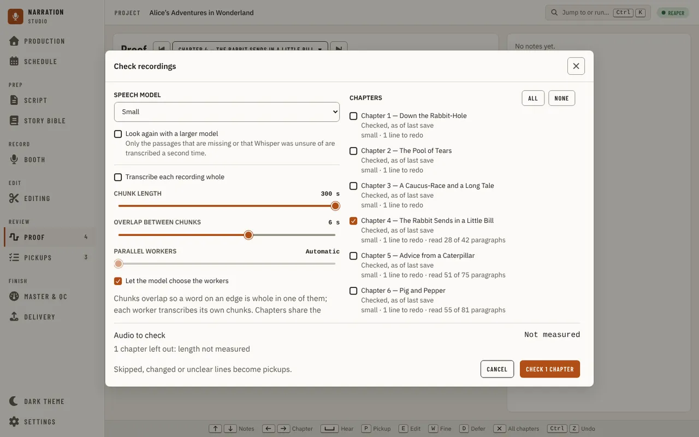

When a chapter cannot be checked, its row says why in plain words and where to fix it: a chapter that is not linked to its REAPER
track gets the track picker right there, a missing project file, a chapter linked to more than one track and a linked track that is gone each get an **Open the audio engine panel** button that opens the panel over this page (it does not leave the page),
[audio engine panel](navigation.md#the-reaper-project),
and a missing Transcript Compare tool points to [Settings](settings.md). The dialog stays open on a refused chapter so you can read it.

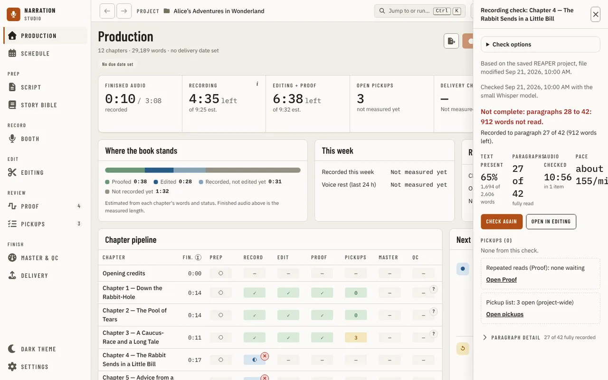

A chapter's result names the saved project file it was read from ("Based on the saved REAPER project, file modified ...") and reads
as a **chapter summary first**: "Passes the check", or "Not complete" naming the one thing that fails first ("Not complete:
paragraph 14: 9 words not read"), then an unread start or end stated in plain words ("Recorded to paragraph N of M"), then the
chapter's own figures (text present, paragraphs fully read, audio checked, pace in words a minute), two to a row, with **Check
again** and **Open in Editing**. Under that, **Pickups** lists only the check's own interior gaps worth reading again on their own —
a skipped block, a short read or different text read — each with its paragraphs, word count, first and last missing words, where
the gap sits in the audio, and **Go to paragraph** to open the manuscript there. An unread start or end is unfinished recording, not
a pickup, so it never appears in that list. Below the check's own gaps, **Repeated reads (Proof)** shows the chapter's unreviewed
take-review pickups as a count with **Open Proof**, or "none waiting", and **Pickup list** shows the open lines of the Pickups list
as one project-wide count with **Open pickups** ("open REAPER to count" when REAPER is not running). **Paragraph detail** stays
folded by default. **Back to chapters** returns to the form and **Done** closes the dialog. On Proof the same check's findings are
on the [Recording check card](proof.md#one-chapter), each to accept or ignore. Misreads, false starts, retakes and a spoken chapter
title never count against you. The check changes nothing: it never edits the project or moves a chapter's status.

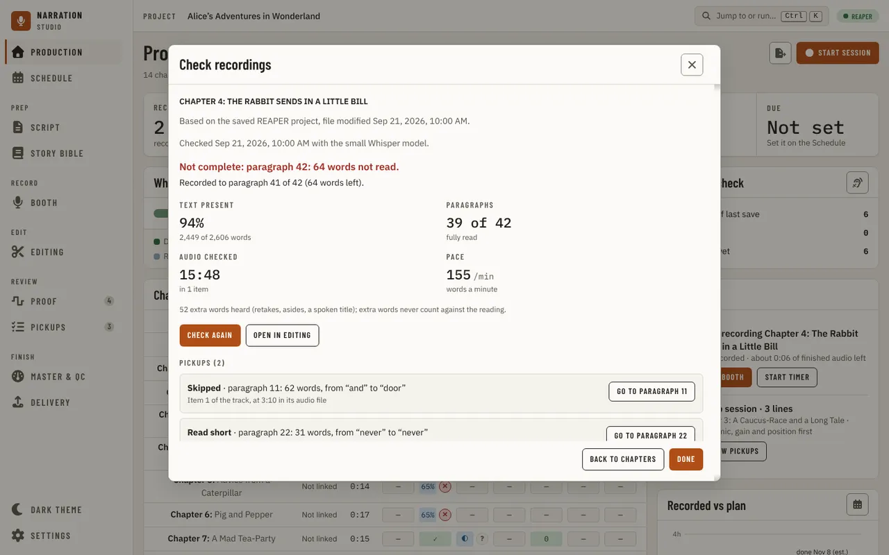

A result goes **out of date** when the saved project changes under it (an item added, removed, trimmed, moved, muted or switched
to another take, an audio file changed) or the chapter's text changes. The result says which, keeps the old counts labelled as
from then, and offers **Check again**; only the changed items are transcribed again.

With Settings' **Two-pass check** turned on ([Settings](settings.md)), a check runs a fast first pass, then re-checks only whatever it
reports missing with a stronger model: the result reads "Checked ... with the tiny Whisper model; 3 passages re-checked with the
large-v3-turbo Whisper model", with each re-checked pickup marked "Confirmed missing by ...".

A changed chapter can also be re-checked on its own, in the background, once REAPER has been quiet for a few minutes and the app
is not otherwise busy (**Check changed chapters in the background**, in Settings, or for this project in Production's **Open
Recording check rules**); starting a check yourself always pre-empts it.

On Production, **Jump to or run** (Ctrl+K) has **Open Recording check rules**: a dialog with what the check judges a chapter by, for this project: **Share of each paragraph that must be read**, **Longest run of missing words allowed**, **Longest misread still counted as read**, **Shortest match that counts as read** and **Check changed chapters in the background**. They are proposed values, chosen on synthetic recordings and not yet calibrated on real narration. A change is saved at once and the last check is read again; the first two only change how a stored check is judged, but the next two change which words count, so earlier checks read as out of date and those chapters need checking again. **Reset** hands a rule back to the computer-wide value or the default. Settings under **Set on a page** has the same five rules with a **Global** / **This project** switch: one store, two ways to reach it.

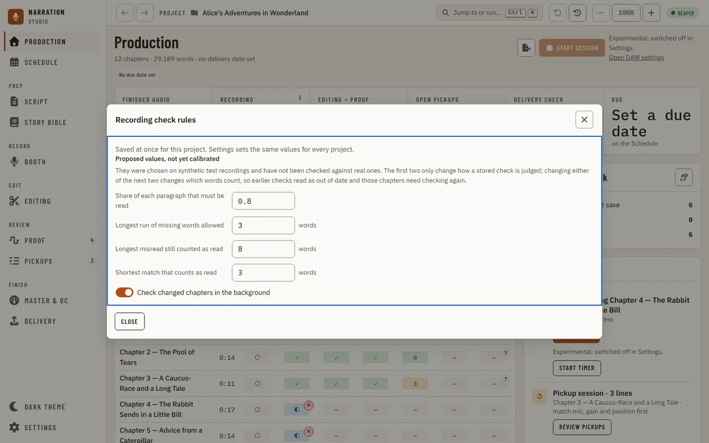

## Stage readiness

The app says when a chapter looks ready for its next stage, from evidence it already has, and never
changes a status on its own. A chapter in Recording is ready for Editing when its current recording
check finds every paragraph of its text in the recording, in order (misreads allowed). A chapter in
Editing is checked against its [editing check](navigation.md#editing-check). Missing evidence never
counts as done: a chapter nobody has checked reads as not checked, not ready.

The chip on a chapter's current-stage cell says the verdict; it opens the chapter's readiness at the
side of the page: the verdict in a sentence, each check with its state and reason, and the saved
REAPER project it was read from. Only the decisions that can be taken are shown, under the evidence. A chapter in Recording that nothing has checked yet reads as not checked and offers **Check recordings…**, which opens [Check recordings](#checking-a-chapters-recording) with that chapter ticked. **Confirm** moves the chapter to the next stage and records what
the evidence was, with **Revert** to move it back; **Dismiss** hides the suggestion until the
evidence changes. **Check now** reads the evidence again; it never starts a check. The readiness is
read again when the page opens, after an import, when a recording check ends, after you change a
status by hand, and when you switch back to the app after saving in REAPER (at most every 30
seconds).

If the evidence changes after you confirmed and a check that was met no longer is, the chapter says
the evidence changed since you confirmed and offers **Revert**; nothing moves on its own. If the
evidence changed while you were looking at it, Confirm and Dismiss are refused with a message and the
readiness is read again. If it cannot be read at all, every chapter says **Couldn't check**, with
the reason and **Retry** above the table.

### Choose what a suggestion waits for

**Jump to or run** (Ctrl+K) has **Open Stage suggestion options**, a dialog for this project's say in the suggestions (Settings under **Set on a page** has the same values with a **Global** / **This project** switch): a switch, **Suggest stage advances**, turns them off or on, and each readiness signal (the recording check, the editing signals, the pickups, and each check on the rendered file) is **Required** before a stage is suggested or **Ignored**. A change is saved at once and the suggestions are read again. **Reset** on a signal hands it back to the computer-wide value or the default. A rendered-file check counts only while the project's delivery profile has a limit for it, The two editing signals marked not yet validated, clicks and breaths, are offered like any other.

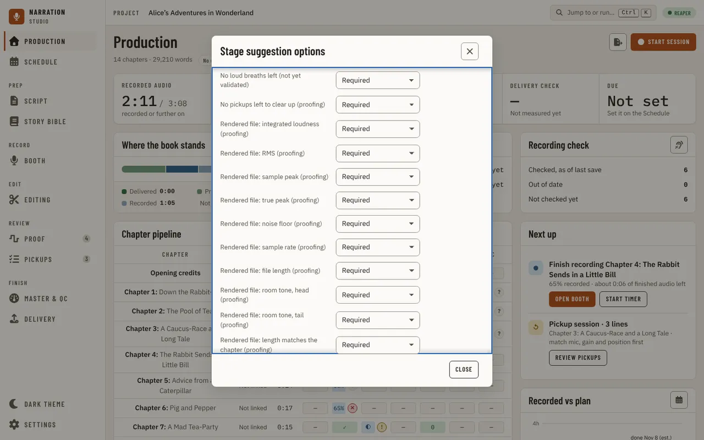

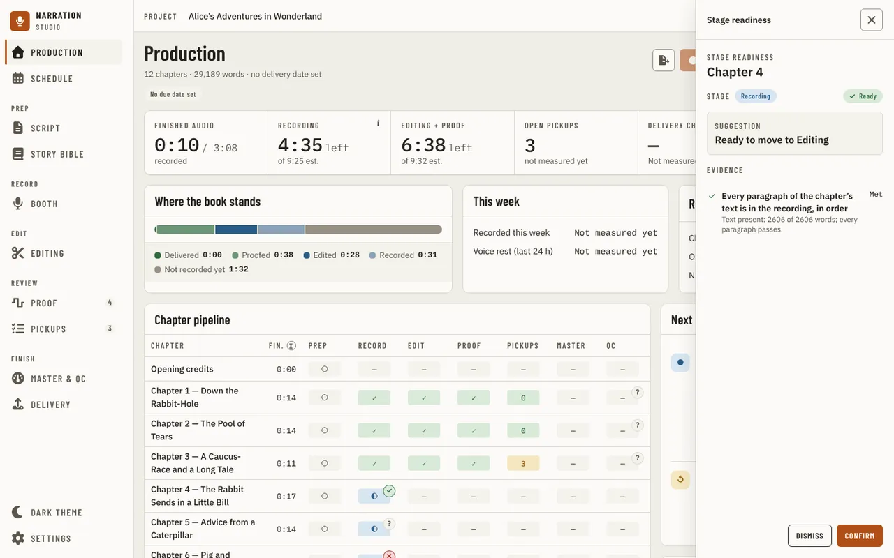

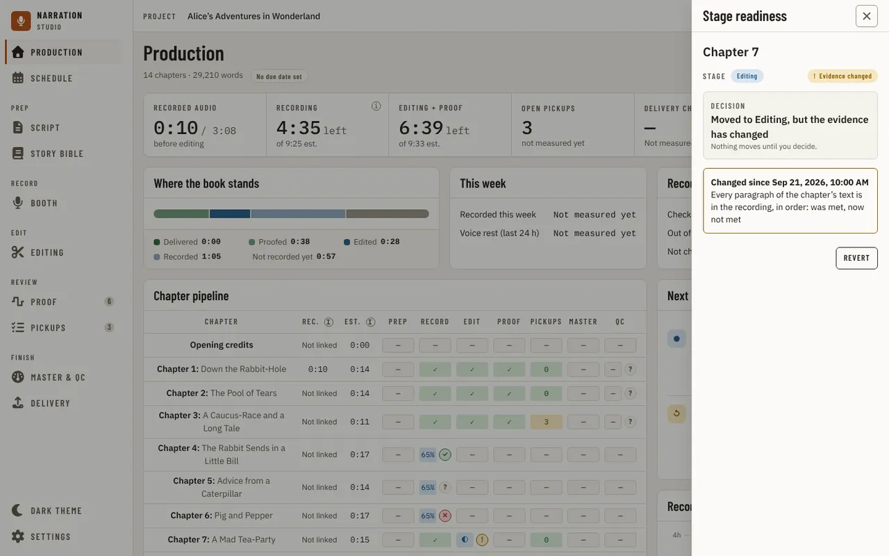

## Schedule

**Schedule**, the item after Production in the navigation, holds the book's due date, how it pays, the recorded audio against the plan, the work left and its milestones: see [Schedule](schedule.md).

## Status report

**Export status report** opens the report dialog in two panes. The form is on the left: an **Include**
checkbox for each section, the format (HTML or JSON) and the path the file will be written to. A tall
live preview of the host's own report is on the right, under the project's name and the date it is "as of".

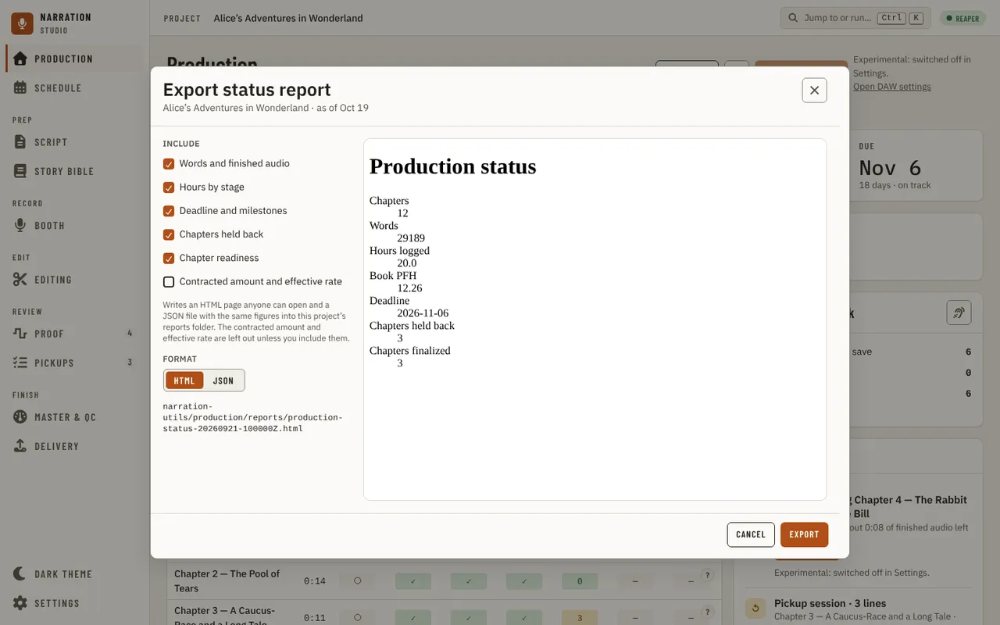

The sections are **Words and recorded audio**, **Hours by stage**, **Deadline and milestones**,
**Open pickups and chapters held back** (the lines still to record again, counted by chapter from the [Pickups](pickups.md) list, and
the chapters whose stage is held back, with the reason), **Delivery check and chapter readiness** (the files of the last measurement
made in this session, judged against the project's delivery profile, and the count of chapters by verdict; with nothing measured yet it
says so, and never reads that as a pass) and, when the book pays per finished hour and has an amount, **Contracted amount and effective rate**. Every section but the last is
ticked when the dialog opens. Ticking or unticking one rebuilds the preview, and **Export** writes exactly the sections that are
ticked: a section you leave out is missing from both the HTML page and the JSON file. The JSON file records which sections were
ticked, so a reader can tell a section left out from one that is empty.

**Export** writes the HTML page and the JSON file into this project's <!-- brand:identity.projectFolder -->narration-studio<!-- /brand -->/production/reports folder, under a name built
from when you exported it, and an export never overwrites an earlier one.

The contracted amount and effective rate are left out unless you tick their box: a
status report is often handed to someone else — a publisher, a collaborator, a rights holder
checking on progress — who has no need to know what the book pays.

## Importing the manuscript

**Import manuscript** (or **Replace manuscript…** in Settings, Project) first opens step 1 of 2, **Choose your
manuscript**: drop a file on the zone or press **Choose a file…** to pick a .docx, .md or .txt file. A copy is
kept in your project, and the original is read-only. The app checks a dropped file before it reads it: one file at a time, in a format
it can import. If it cannot use the file, it says why under the zone; press **Choose a file…** instead.

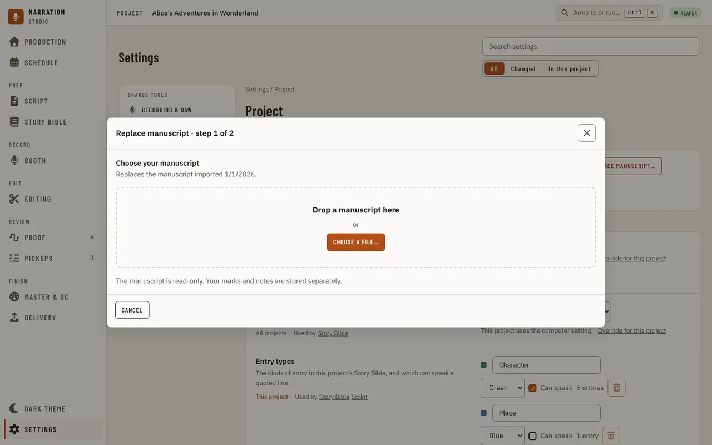

Choosing the file opens step 2 of 2. The chips at the top count what was found: chapters, paragraphs,
character suggestions and, when the importer repaired a heading, repairs. **Import options** come
next, above the list so an open list never hides them. For a Markdown file it holds the chapter
heading level (choosing another level reads the file again and drops the choices you made for the old
sections). **Subtitles** reads a heading's second line as the chapter's subtitle for the whole book;
turn it off and a title that was wrapped onto two lines is joined back together, and in a plain-text
file a line such as an epigraph goes back into the chapter's text so it is narrated.

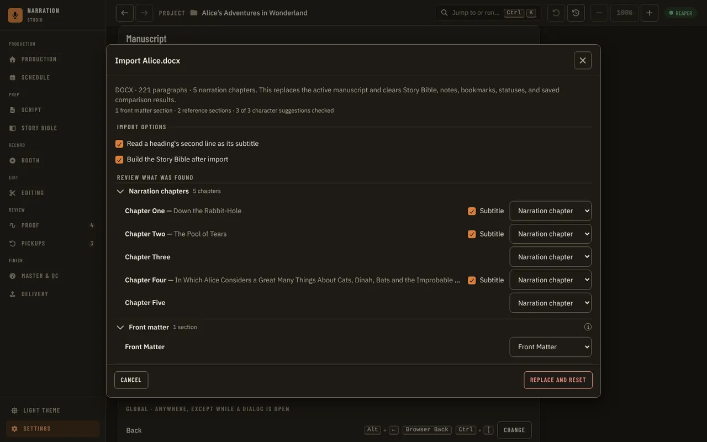

**Chapters** lists every chapter the importer found in two columns, each with a switch to the left of
its name. Switch a chapter off to leave it out of the recording. The chapter's subtitle sits under its
name on a smaller, dimmer line, and the number of words is at the right, level with the name. A heading with a label shows the
label in bold and the chapter's name after it ("CHAPTER VIII. Croquet", "8. Croquet" or "Chapter 8:
Croquet"). The book's title pages and reference material are never listed or asked about: they stay out of the
chapters, and the title and author in them are offered when you set up the credits. The character
suggestions are switches too, each with the number of times the character's first name appears in the
story; **Select all** and **Select none** change them at once. **Review what was found** is always in
view, and under it **Chapters**, **Character suggestions** and, when the importer repaired a heading,
**Repairs** are an accordion in one bordered box: every group's header is always in view, and opening one
closes the others, so the open group takes the room and scrolls (the only scroll bar), with the closed
headers above and below it. Resting the pointer on a chapter shows how it begins in the sample
pinned under the box, a fixed size so it never jumps, set in the same title and subtitle lines.

The footer has one secondary action, **Back**, and the import itself. The Close button at the top
cancels. **Close when the import finishes** (on by default, an app setting also under Settings, App &
updates) closes the import window as soon as the manuscript is written; turn it off to read the
activity log until you press Close. The import does not build the Story Bible: open
[Story Bible](story-bible.md) and use **Scan the manuscript** or **Import entries**.

Every dialog in the app can be used from the keyboard. Focus starts inside the dialog (on its
message, outlined when you opened it with the keyboard), Tab and Shift+Tab stay inside it, and the
page behind is hidden from a screen reader until it closes. Escape declines a confirm, and focus
returns to the button that opened it. Clicking the dimmed background closes a dialog that only shows something (the keyboard shortcuts, a
read-only view, a picker that applies each choice at once) and never closes a confirm or a form, so a
stray click cannot discard a decision or typed input. A running job (such as an import) ignores Escape
until it has finished. The red confirm button marks an action that destroys data. A step that
cannot be cancelled (an import while it writes to the project) says
so at the top of its dialog, offers no button while it runs, and shows Close when it finishes.

If the project folder contains a file named `manuscript.docx` or `manuscript.md` and nothing has
been imported yet, the page asks whether to import it. It is only ever an offer — nothing is
imported until you agree, and declining keeps it quiet for the rest of the session. **Import
manuscript** is always available to pick a different file.

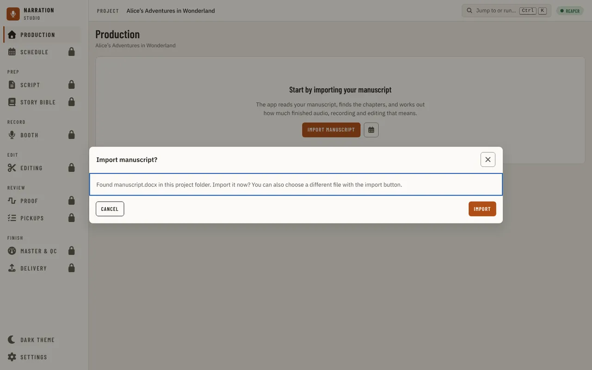

Once you confirm, importing runs in the background and reports what it is actually doing — copying
the source into the project, writing the manuscript, adding checked characters to the Story Bible —
in a live activity log, so the progress bar and log always match the real work.

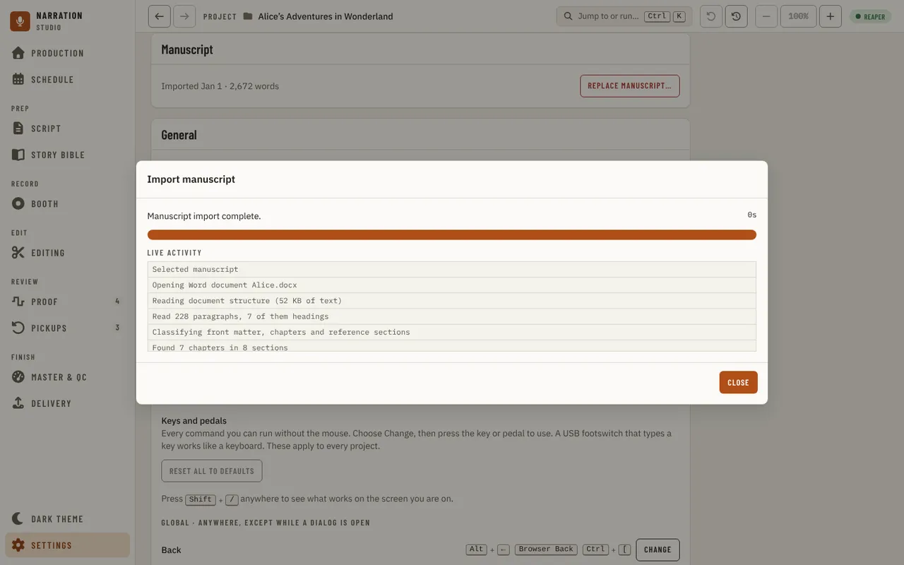

Once a manuscript is imported you can read it on the [Script](script.md) page.

The first time a project with an imported manuscript loads, and again right after an import
finishes, the page asks you to **Set up the credits** if the opening and closing credits still have
unresolved tokens. The dialog is prefilled from whatever the manuscript's own title page and
copyright line already say, with the source of each guess shown underneath; a field with nothing
detected starts empty. Save only writes the fields you confirm — nothing already set in
[Settings, Credits](settings.md#credits) is changed. **Not now** leaves it for this session;
**Don't ask for this project** stops it until you replace the manuscript. Either way, a banner
stays above the figures — and above the [Script](script.md) page's own Opening credits
card — with **Fill in** to reopen the same dialog for as long as a token stays unresolved.

---

[← Navigation](navigation.md) · [Index](README.md) · [Schedule →](schedule.md)
