[Using the app](README.md) › Proof

# Proof

Proof gathers what the app's checks found into one list of notes, so you can work through them in one place: the
differences a check heard between the script and the recording (the [recording check](#one-chapter) and the
[comparison](#comparing-the-recording-with-the-script)), the [Story Bible](story-bible.md) entries and pronunciations that
need a look, and the delivery rules your measured files did not meet ([delivery checks](#delivery-checks)). Each note waits
until you mark it **Needs pickup** or **Fix in edit**, waive it or defer it, and your decision is kept with the project.
Running a check again keeps your decision on a note whose evidence did not change.

The page has three parts: the Proof panel at the top (the chapters, and one chapter's recording), the notes under it, and
the Inspector on the right for the selected note. The keys you can press are listed along the bottom.

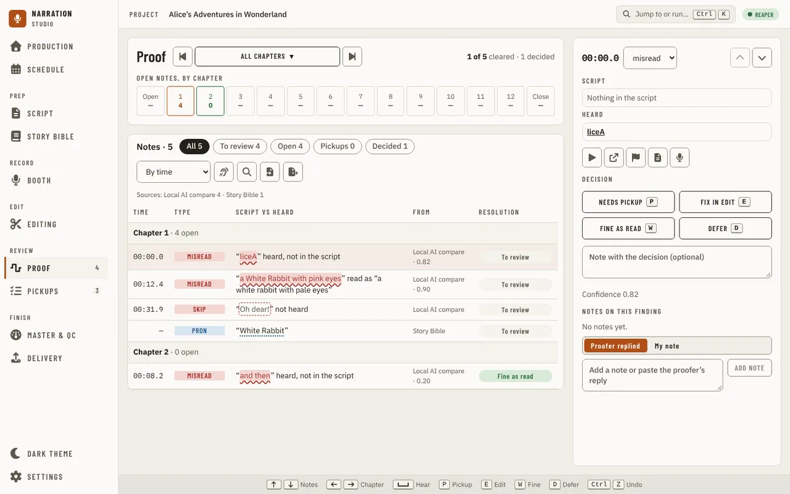

Proof is always in the navigation. Until a manuscript is imported it asks you to import one. Until a check has found
something, there is no ring, every chapter in the strip is empty and the Inspector says **No notes yet**.

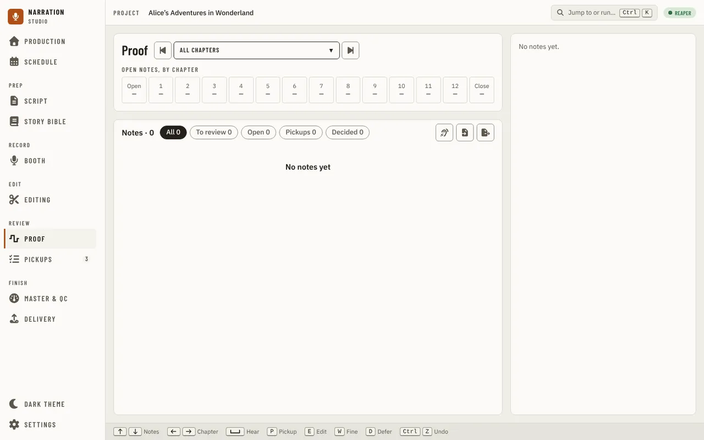

## All chapters or one chapter

The chapter stepper beside the title shows **All chapters** or one chapter. Choose a chapter from it, or step with its
arrows or the Left and Right keys. From All chapters, a step opens the last chapter you looked at in this project (the
first chapter until you have looked at one). The chapter is in the page's address (`/proof?chapter=<id>`), and Esc goes
back to All chapters.

On the right of the title, a ring and two counters say how far the notes in view have got: **12 of 14 cleared · 13
decided**, for example. A note is cleared once it is fixed, waived or dismissed; a deferred note, or one waiting for its
pickup, is decided but still open, so the ring cannot fill while a pickup is open.

### All chapters

Under the title, **Open notes, by chapter** draws one tile per chapter with how many of its notes are open. Choose a tile
to open that chapter.

### One chapter

A chapter shows its **Recording check** card and its recording:

- The card says whether the chapter's check is current, stale (and what changed since), running or not done yet; how much
  is recorded against the script's estimate; and what the check counted, against the script and in the audio. **Check
  recordings** runs it (with **Cancel** while it runs). It is off, with the reason, when the chapter has no recording or
  no text, or the DAW is not reachable. **Show the findings** lists what the check found, each with the suggested
  decision: **Accept** turns one into a note with that decision, and **Ignore** keeps it out of your notes and is
  remembered.
- The waveform window draws the chapter's recording with a pin at each note that has a time. Press a pin to select its
  note. Zoom in and out, or drag the window's edges, to see more or less of the chapter; the window follows the selected
  note.
- When the selected note's spot has more than one take, the take that plays is a band on the waveform and the others sit
  in lanes under it.

A chapter with no recording yet says **No recording for this chapter yet** where the waveform goes.

## The notes

The notes panel lists the notes in view, **Notes · 14** for example, with:

- chips that narrow the list: **All**, **To review**, **Open**, **Pickups** and **Decided**, each with its count;
- **In view**, on one chapter while the waveform window shows only part of it, to list only the notes in the window;
- the sort: **By time**, **By confidence** (lowest first, so the least certain come up first) or **By severity** (most
  serious first);
- **Find in notes** (Ctrl+F), which keeps only the notes whose text matches what you type; Esc closes it;
- **Check recordings…**, the same check the card runs, starting with the chapter in view;
- **Import proofer sheet** and **Export for proofer**: the proofer's CSV sheet. Import adds each row as a pickup marker in
  the DAW and says how many rows it skipped; Export saves the pickups still open as `pickups-for-proofer.csv` for the
  proofer. Both need the DAW.

Under them, **Sources** names the checks the notes in view came from, with a count for each. The table lists Time, Type,
Script vs heard, From and Resolution for every note; with All chapters it groups them by chapter, with each chapter's open
count. A note whose spot has more than one take has a takes badge.

## A note and your decision

Select a note in the table, or its pin on the waveform, and the Inspector shows it:

- its time and its type. The type is a list: if the check named the wrong kind of problem, choose the right one, and your
  choice is kept with the note;
- the arrows to step to the previous or next note;
- what the script says and what was heard, with the difference marked;
- **Takes at this spot**, when the spot has more than one take: each take with **Play** (from its own recording, without
  the DAW) and which one is active or kept. **Manage takes in Editing** opens the chapter's
  [chapter view](#the-chapter-view) on the note, where takes are chosen;
- **Show in the DAW**, **Add marker in the DAW** (see [Going to a note in the DAW](#going-to-a-note-in-the-daw)), **Open
  this chapter in Script** and **Open this chapter in Booth**, and **Reopen** once the note is decided;
- the decisions, **Needs pickup**, **Fix in edit**, **Waive** and **Defer** (keys P, E, W and D), an optional note with the
  decision (up to 2,000 characters), and the check's confidence, or why it has none.

A decision is saved at once and the next note is selected. A message says what was saved, with **Undo** to put the
note back as it was. **Waive** says the line stays as it was read. **Reopen** puts a decided note back
to review.

A decision is always made on the evidence you are looking at. If the check ran again after the note was shown and the
evidence changed, the decision is not saved: **The evidence changed** shows what you saw (**Before**) and what the check
hears **Now**, and keeps your note. Press **Use the new evidence**, look again and decide.

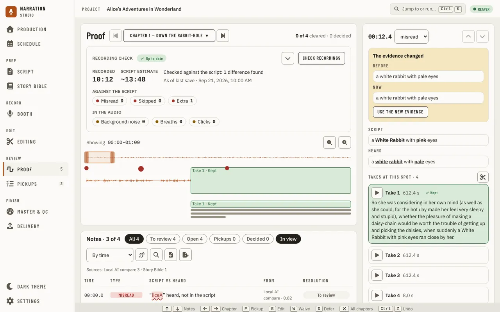

Right-click a note in the table, or its pin, for the same actions: the four decisions, **Reopen**, **Show in the DAW**,
and open its chapter in Script or the Booth.

## Going to a note in the DAW

**Show in the DAW** selects the note's item in the DAW and puts the edit cursor on its spot; the Inspector says where it
went. **Add marker in the DAW** puts one marker on the note's spot. It is off until you mark the note **Needs pickup** or
**Fix in edit**. The marker is named like the ones a chapter's [comparison
export](#comparing-the-recording-with-the-script) adds, so Export markers does not add it a second time, and if the spot
already has one nothing is added. It is the only control here that changes your project, and one Undo in the DAW removes
it.

Each follows what your DAW offers: when it does not offer one, or is not answering, the control is off and the reason is
under the row. A note found by an older check that did not record its item cannot be placed; run the check again. When
the DAW refuses (the note's item was deleted or trimmed, or REAPER is recording), nothing changes and the Inspector says
why.

## Keys

| Key | Does |
| --- | --- |
| Up and Down, or K and J | Previous and next note |
| Left and Right | Previous and next chapter (from All chapters, the last chapter you looked at) |
| P, E, W, D | Needs pickup, Fix in edit, Waive, Defer on the selected note |
| Esc | Back to All chapters |
| Ctrl+F | Find in notes |

The footer lists them, and you can change them in [Settings](settings.md). Space is not a Proof key.

Proof has no decision history list, no thread of notes and no **Play ±3 s**. Finding the lines you recorded more than
once and comparing their takes are not on Proof: choosing a take is in the [chapter view](#choosing-between-takes).

## Delivery checks

When you check rendered files on [Master & QC](master-and-qc.md), each rule a file did not meet, and each value the app
could not measure, becomes a **Delivery check** note here: one per rule per file, found by **Delivery measurement**. It
names the file where other notes name a chapter, and says the rule, the value and how it missed ("RMS −24.1 dBFS, below
the minimum of −23"). A rule's advice (a true peak above ACX's advice, for example) stays on Master & QC.

Pickup (here **Fix in edit**), Waive and Defer work as for every other note, and change nothing but your decision: not the
profile and not the measurement. Your decision holds while the same audio is judged against the same rule. After a new
render, or if you change that rule's numbers in a custom profile, the check comes back to review with your note kept.
When a file meets the rule again, its check is no longer in the latest run. Choosing another delivery profile judges the
last measurement again, and the list follows it.

## The chapter view

A chapter's Proof view, at `/proof/:chapterId`, is one screen to listen to a chapter's recording against its script, see
where the recording check found a problem, and click a word to hear it again. It stays at this address until the Editing
page replaces it. It has no nav item of its own; open it from a linked chapter's **Open in Proof** link in the
[audio engine panel](navigation.md#linking-chapters-to-tracks), a chapter's Proof cell or its recording check's **Open in
Proof** on [Production](production.md), from the Manuscript chapter header, or from **Manage takes in Editing** on a
note's [takes at this spot](#a-note-and-your-decision). A chapter has to be linked to a REAPER track first (see [Linking
chapters to tracks](navigation.md#linking-chapters-to-tracks)). Its notes and its recording check card are on
[Proof](#one-chapter), not here.

If the chapter hasn't been checked yet, the chapter view says so and offers **Check recording** — the
same check [Production](production.md#checking-a-chapters-recording) runs. There's no script or player until a check exists.

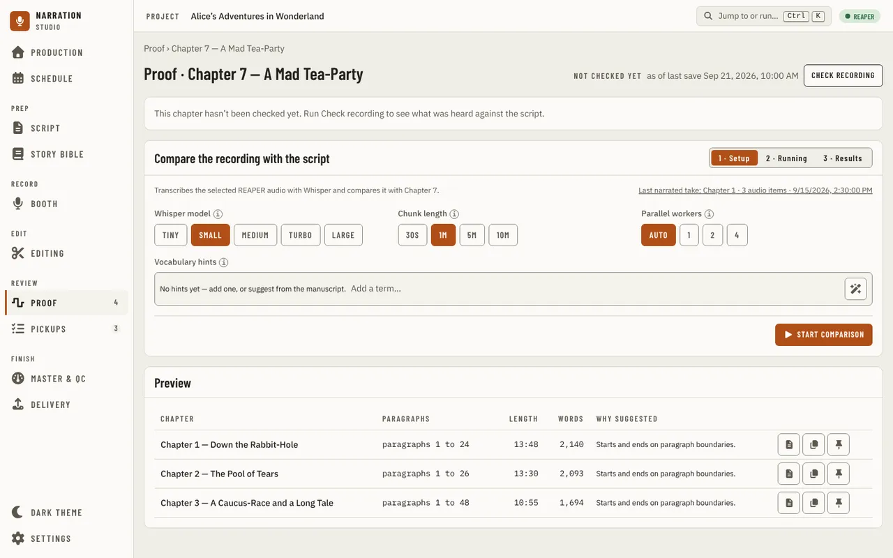

Under the heading "Proof · <chapter name>", once a current check exists, the chapter view shows the chapter's script, a
transport, and the check's flags. The header names the check's state (current, or stale if an item changed since), and
**as of last save** — the chapter view always reads the REAPER project as it was last saved, not whatever is open live
in REAPER right now.

The transport plays the chapter's recorded audio in the app itself, honouring each item's trims (the
same played range REAPER uses), so it works with REAPER closed. It has play/pause, skip back and
forward 5 seconds, and a playback speed from 0.75× to 2× that keeps pitch. Space bar toggles play and
pause; the left/right arrow keys move by word and up/down by paragraph; `[` and `]` move to the
previous and next flag. **Go to in REAPER** and **Loop in REAPER** on the transport bar go to, or loop, the word at the playhead in REAPER;
without a connection they are disabled and say why, and the rest of the page works the same either way.

As the chapter plays, the word being spoken is highlighted and the script scrolls to keep up. Scroll
the script yourself and it stops following until you scroll back to the highlighted word or press
**Resume following**.

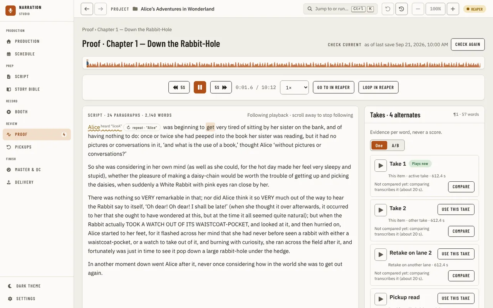

### Adding an effect to a passage

To put an effect on a few words, click the first word, then hold Shift and click the last: the words are
selected, and a line above the script says how many. (A plain click still plays from that word.) Right-click
in the script and choose **Add an effect to this passage…**. A right click on one word selects just that word.
The dialog names the passage and lists the effects REAPER has installed, your favourite effects first
(Settings, DAW). Press **Add effect** and REAPER cuts the passage out of its item and puts the effect on that
piece only. Nothing is sent until you press the button, and one Undo in REAPER takes back the cuts and the
effect together.

**Put an FX chain on the chapter's track…**, in the same menu, adds one of your saved FX chains to the whole
track the chapter was checked on, which changes how everything on it sounds; one Undo takes that back too.
A passage that spans two REAPER items is refused ("Select words from one item at a time"), and both items
are off, with the reason, when REAPER is not connected or is recording. After an effect is added the chapter
may need **Check again** before another effect goes on the same words, because REAPER has split the item.
The effect and its sound are for you to check in REAPER; this version has not been listened to on a real
chapter yet.

Flags mark what the last check found, in place in the text: a skipped word is struck through, a word
read short or differently is underlined, and a misread word shows what was actually heard beneath it.
A run of words the check couldn't match to anything in the script shows as a small "repeat" chip
between the words it followed. The Flags panel on the right counts each kind and steps through them
one at a time — clicking Next or Previous plays the app from that flag's word, if it has one (a
skipped word was never recorded, so there's nothing to play).

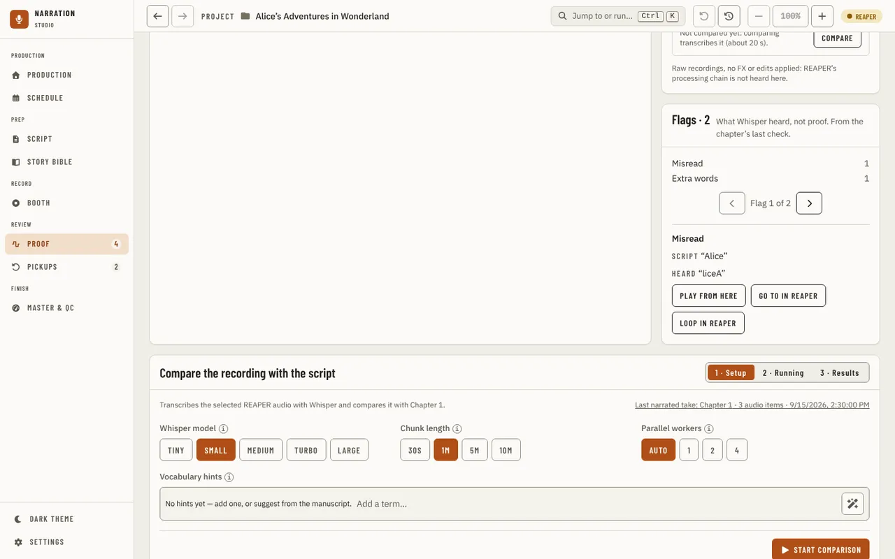

Clicking any word with a recorded time seeks the app's own player there (starting about a second
before it, so you hear it in context). A flag backed by a finding shows which check found it, and the
same **Pickup** (or **Fix in edit**), **Waive**, **Defer** and note controls as on [Proof's
notes](#a-note-and-your-decision) — a decision made here is the same decision Proof shows.

### Choosing between takes

The **Takes** panel, at the top of the right column beside the script, is for a paragraph that has more than one
take. It opens on the first paragraph the check heard; play or click a word in another paragraph and a **Show takes
for the paragraph at the playhead** button offers that one. The panel lists every take you can choose from for the
paragraph, each on its own card: **another take of this item**, **a retake on another lane** of a fixed-lane
track, or **a pickup read** that an earlier pickups and duplicates scan set beside it. The one REAPER plays now says
**Plays now**. Nothing ranks them: the panel says "Evidence per word, never a score."

- **Play** on a card plays that take from its own recording, without REAPER (raw source, no FX or edits, as in
  a take comparison). With **One** chosen, one take plays at a time. With **A/B**, the first two
  takes you play take slots A and B, and **Swap** switches between them at the same word: the word the takes were
  compared on, or the same distance into the paragraph before they were compared.
- **Compare** transcribes each take again and sets its words beside the script. A compared take then shows the
  words around where it departs from the script with the departure marked, and one line of evidence: what it misread
  or left out, its longest pause, and how loud it is against its neighbours. The full comparison (every word and the
  audio measurements side by side) appears under the script. A take that was never compared says **Not compared
  yet**, and comparing costs a transcription of each take, so it waits until you press it.
- **Use this take** makes that take the one that plays in REAPER, in one undo step (one **Undo** in REAPER puts the
  previous take back). For a retake on another lane it makes that lane the one that plays. For a pickup read from
  another item it asks first, because REAPER adds the read as a new take on the paragraph's item and then makes it
  active (two undo steps). It is off while REAPER is not connected, and the panel says why.

A take whose recording is missing, or whose item has moved since the scan, is listed with the reason and cannot be
heard or chosen. After you choose, save the project in REAPER so the recording check can read the change; the check
for that chapter is out of date until then.

## Comparing the recording with the script

**Compare the recording with the script**, below the flags, transcribes the chapter's recording and
compares it against this chapter's text. The Setup step picks the transcription model, chunk length,
and number of parallel workers before starting a comparison.

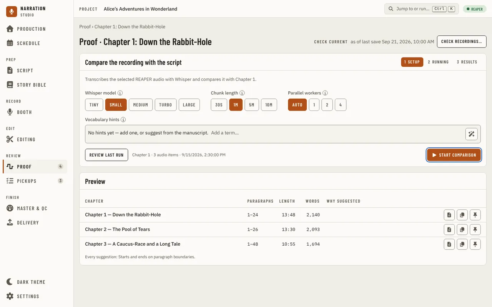

Model, chunk length, and worker count are independent selections — picking a slower, more
accurate model can force other settings to adjust (here, workers dropped to 1 because the
Large model doesn't support Auto).

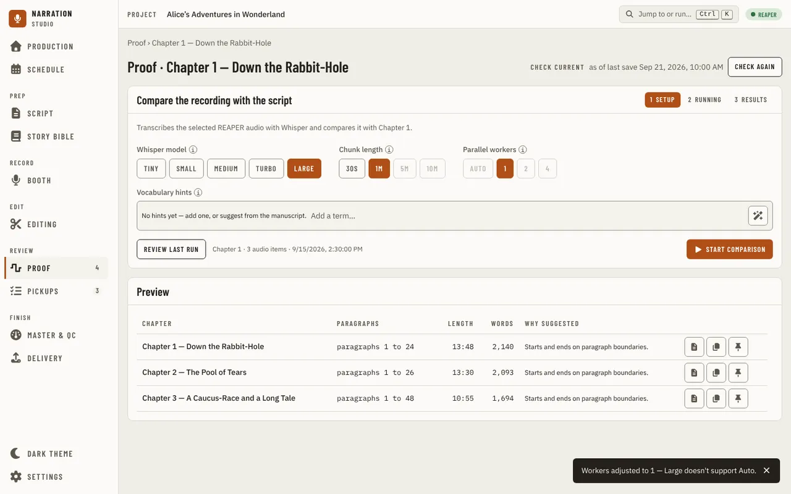

Vocabulary hints teach the transcription model unusual names it's likely to mis-hear. The pills box is
the input: type a name and press Enter or a comma to add it, click elsewhere to commit whatever you were
typing, or press Backspace in an empty box to remove the most recently added term. Pasting a list with
commas or line breaks adds every name in it at once. A name already there in any case is not added twice,
and a term over 64 characters is capped. The sparkle icon inside the box, "Suggest from manuscript",
proposes candidates from the [Story Bible](story-bible.md); accepted hints render as solid pills,
suggested-but-not-yet-accepted candidates as dashed outlines you click to accept. Names you locked or
added by hand are always offered; names the build was unsure about (Needs Review) are not, so review or
lock one to make it suggestible. The message after each click says what happened: no names found (build
the Story Bible or add entries), everything found is already accepted, the suggestions are already shown,
or how many new ones were found. If the saved hints cannot be loaded, a message says so and the page
stays usable.

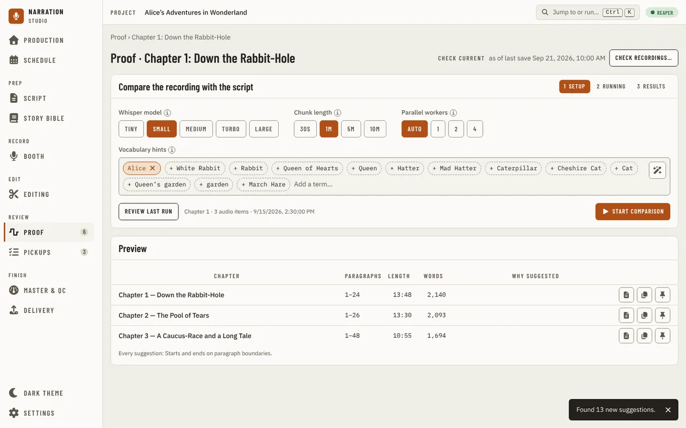

**Start comparison** needs a linked REAPER project and a connected REAPER; without either it is off,
with the reason in its place. Once it's running, its progress is real, from the transcription itself,
with **Cancel** to stop it.

Each discrepancy the run finds becomes a flag in the [Flags panel](#the-chapter-view) above — Misread,
Skipped or Extra words — instead of a table: select one to see the script and heard text side by side
inline, its marker state (**Ready to export**, **Exported**, or **Already marked**), **Show in
manuscript**, **Play recorded audio** and, for a single-word misread, **Add pronunciation
equivalence**.

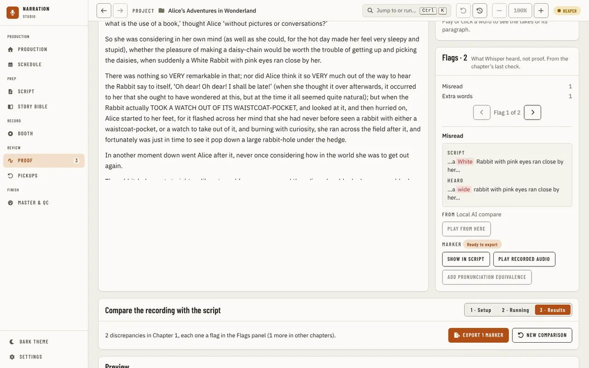

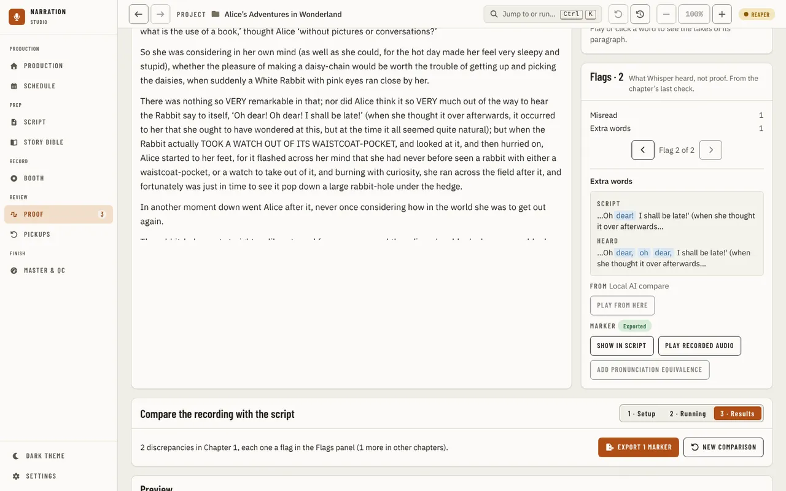

When it finishes, a summary reads "N discrepancies in \<chapter>, each one a flag in the Flags panel".
**Export N markers** adds a take marker in REAPER for each discrepancy not already marked, the same
marker [Add marker in the DAW](#going-to-a-note-in-the-daw) adds for one accepted note, so the two never
mark a spot twice. **New comparison** starts over. Without a connected REAPER, **Last narrated take:
…** reviews the last completed comparison instead, with Play recorded audio and Export off.

Leaving the chapter view while a run is under way or showing results resets the run, the same way
leaving used to reset the Proofing page's own run.

Above the compare run, the Preview panel suggests up to three five-minute excerpts from the manuscript
— one per chapter — so you don't have to scan the whole book to find a stretch worth listening to or
sharing. Each candidate lists its chapter, paragraph range, estimated length and word count, alongside
the reasons it was chosen (a mix of narration and dialogue, the Story Bible characters it touches, hard
words, starting and ending on a paragraph boundary). A candidate that falls short of the target length
even using the whole chapter says so, in words and an icon rather than colour alone. Open a candidate
in the manuscript reader, or copy its range and length to paste elsewhere; neither changes anything — a
suggestion is recomputed fresh every time you visit the page, never applied, exported or stored.

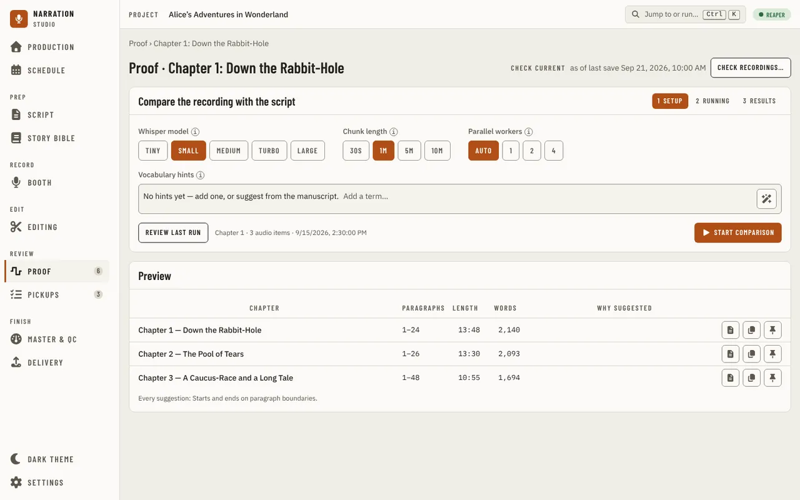

Pin a candidate to settle on it: the pin icon on a row keeps that window, shown in its own "Pinned
preview" section below the table with the same evidence, and the pin button on its row turns into
"Unpin". Move its edges by one paragraph at a time with the Start and End + and − controls — extending
or shrinking is disabled, not hidden, once an edge already reaches the chapter's own boundary or the
range is down to one paragraph. There is one pin per book: pinning another candidate replaces it. If the
manuscript text under a pinned paragraph changes since it was pinned or last adjusted, the section says
so in words and an icon, alongside its still-recomputed length and evidence; if a re-import drops the
paragraph entirely, the section names that instead and offers only to clear it. Clearing the pin (the ✕)
removes it; like everything else here, nothing is applied, exported, or ever changes the manuscript,
project, or audio.

Above the Preview panel, **Proofing readiness** shows only while this chapter's own status is Proofing:
its suggestion for Finalized — a badge if the evidence says it's ready, "Not ready" if a pickup is still
open, or "Can't tell yet" with what to check next. Confirm, Dismiss, and Revert work the same way they
do on [Production](production.md#stage-readiness); Why opens the same evidence view, listing what was checked
(pickups from every tracked analyzer, and any delivery check the narrator turned on) — an open pickup's
**Open this note** selects it in the Flags panel above without leaving the page, and an unmapped chapter
links to the [audio engine panel](navigation.md#the-audio-engine-panel).

Below the suggestion, **Rendered file** shows which file the delivery checks measure and lets you change
it: **Choose rendered file** opens a file picker and attests the file was made from the chapter as it is
now; **Clear** removes the choice; **Measure** runs the same measurement job [Master & QC](master-and-qc.md)
uses, with its real progress, and needs no second file picker. If the file changes on disk, or the
chapter's recorded audio changes, after you chose it, the section says so ("changed since you chose it")
and every delivery check reads unknown until you choose the file again and measure it — a stale render
never counts as a pass.

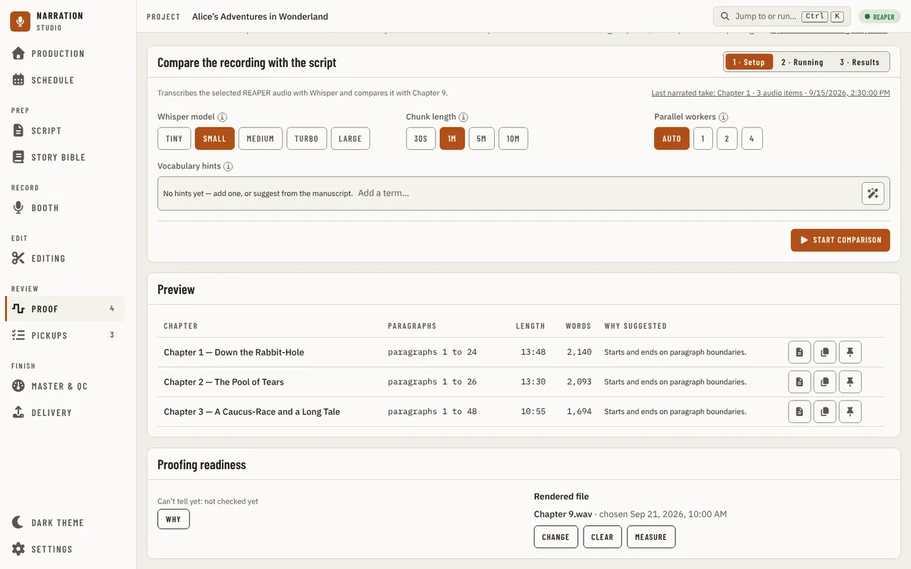

---

[← Booth](booth.md) · [Index](README.md) · [Pickups →](pickups.md)
