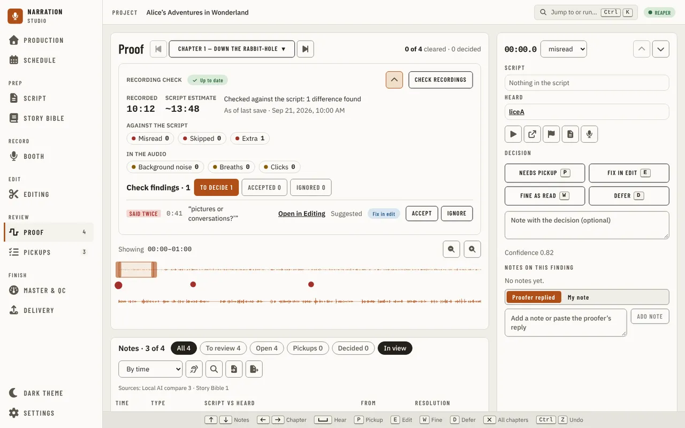
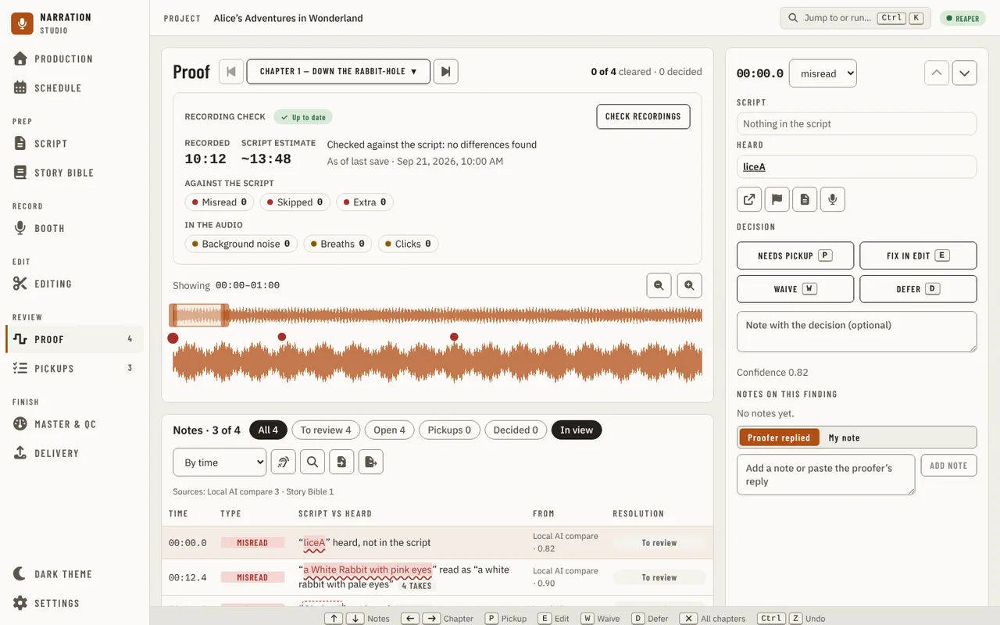
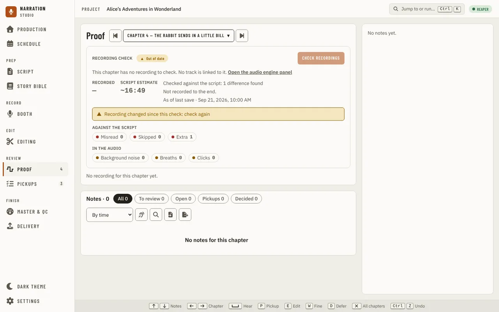
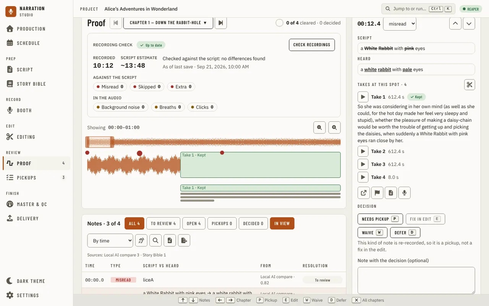
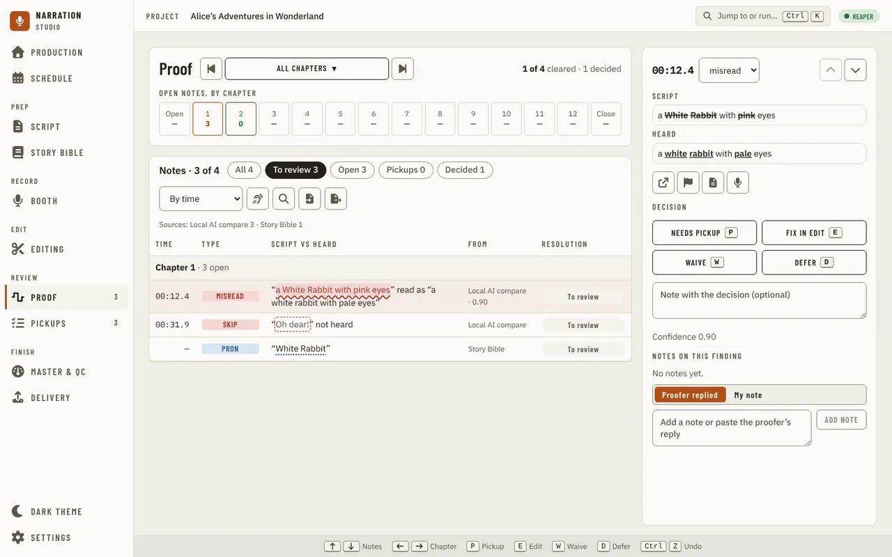
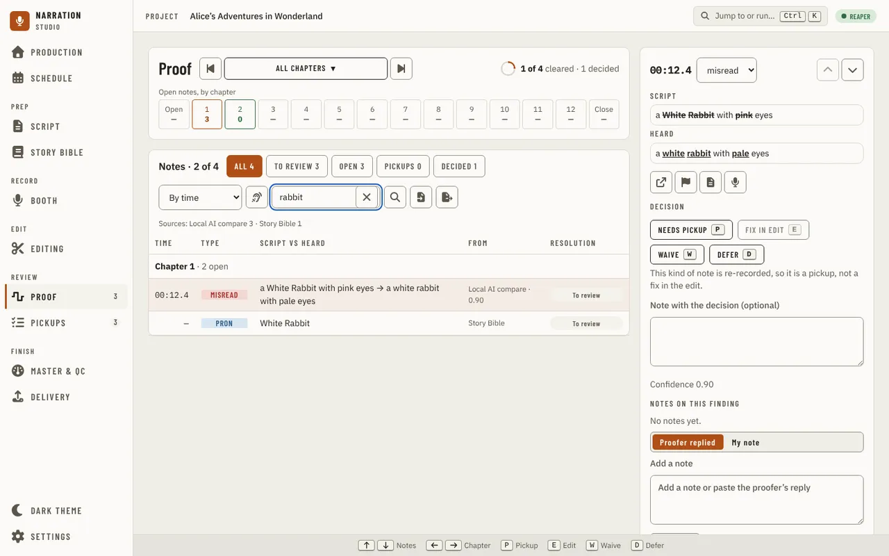
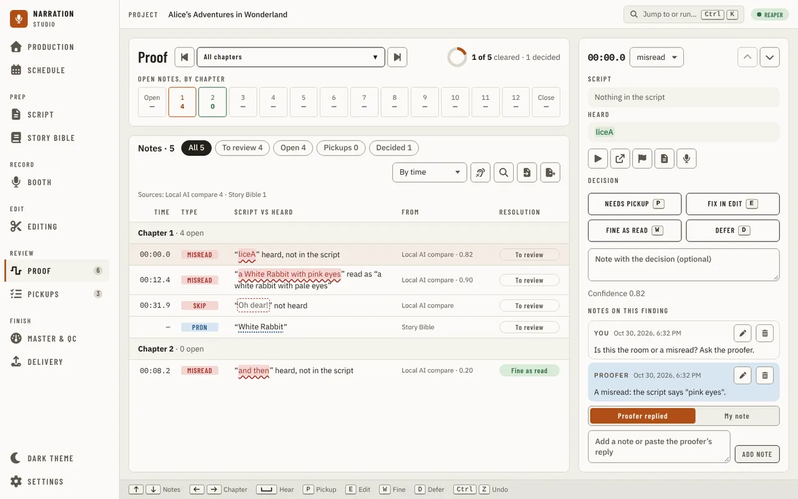
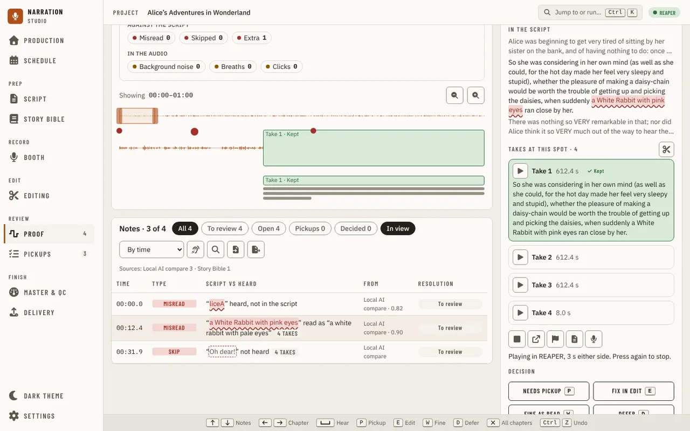
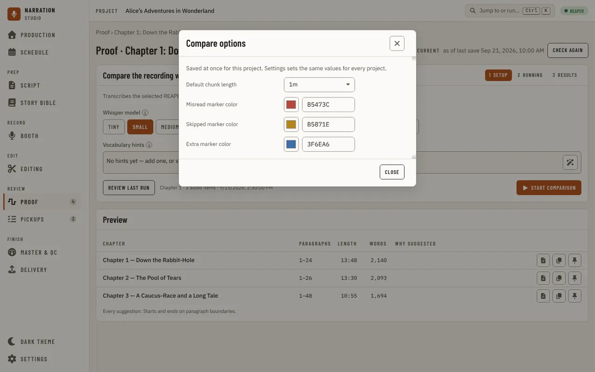

[Using the app](README.md) › Proof

# Proof

Proof gathers what the app's checks found into one list of notes, so you can work through them in one place: the
differences a check heard between the script and the recording (the [recording check](#one-chapter) and the
[comparison](#comparing-the-recording-with-the-script)), the [Story Bible](story-bible.md) entries and pronunciations that
need a look, and the delivery rules your measured files did not meet ([delivery checks](#delivery-checks)). Each note waits
until you mark it **Needs pickup** or **Fix in edit**, **Fine as read** or defer it, and your decision is kept with the project.
Running a check again keeps your decision on a note whose evidence did not change.

The page has three parts: the Proof panel at the top (the chapters, and one chapter's recording), the notes under it, and
the Inspector on the right for the selected note. The keys you can press are listed along the bottom.

Proof is always in the navigation. Until a manuscript is imported it asks you to import one. Until a check has found
something, there is no ring, every chapter in the strip is empty and the Inspector says **No notes yet**.

While Proof reads its chapters and notes, it keeps its title and shows grey blocks where the chapter strip, the notes and the
Inspector will be, and says **Reading the chapters and notes…**. A link to a chapter the list does not have first shows the same blocks with **Checking this link…** while the chapter list is read once more.

If the page's chapters or notes cannot be read when it opens, Proof keeps its title and says "This page could not be
loaded" with the reason and a **Retry** button, which reads them again. The rest of the app keeps working.

## All chapters or one chapter

The chapter stepper beside the title shows **All chapters** or one chapter. On **All chapters** the notes run in book order, chapter by chapter, and **J**/**K** follow that order. Choose a chapter from it, or step with its
arrows or the Left and Right keys. From All chapters, a step opens the last chapter you looked at in this project (the
first chapter until you have looked at one). The chapter is in the page's address (`/proof?chapter=<id>`), and Esc goes
back to All chapters. Each change of chapter is a step in the browser's history, so Back returns to the chapter or to All chapters you came from.

On the right of the title, a ring and two counters say how far the notes in view have got: **12 of 14 cleared · 13
decided**, for example. A note is cleared once it is marked fine as read; a deferred note, or one waiting for its pickup, is decided
but still open. A pickup on the [Pickups](pickups.md) list that no note stands for (a gap the recording check found, or a
line you added) also keeps the ring from filling while it is open.

### All chapters

Under the title, **Open notes, by chapter** draws one tile per chapter with how many of its notes are open, with **Open** and **Close** tiles
for the opening and closing credits at the ends. Choose a chapter's tile to open that chapter; a credits tile opens that
credits card on [Script](script.md), since Proof has no recording view for them.

### One chapter

A chapter shows its **Recording check** card and its recording:

- The card says whether the chapter's check is current, stale (and what changed since), running or not done yet; how much
  is recorded against the script's estimate; and what the check counted, against the script and in the audio. **Check
  recordings** runs it (with **Cancel** while it runs). It is off, with the reason, when the chapter has no recording or
  no text, or the DAW is not reachable. A chapter with no measured recording shows no check result, only why (no track
  linked, more than one, the linked track not in the saved project, or no saved project), with the audio engine panel
  where it can be fixed. **Show the findings** lists what the check found, each with the suggested
  decision: **Accept** turns one into a note with that decision, and **Ignore** keeps it out of your notes and is
  remembered. Words that say the script beside them again (a retake or a restart) are listed as **Said twice**, with the
  words said again and **Fix in edit**, not as extra words: they are a second take. **Open in Editing** opens the line on
  [Editing](editing.md#a-line-said-twice), where you hear both reads, delete one, or split the line into two takes when
  it is one take the DAW can split.

  

- A kind of finding is the same colour everywhere in the app, here in the card's counts, the findings, the notes' Type
  column and the waveform pins: red when the words are wrong (misread, skipped, extra, repeat, a long silence), amber when
  the recording is in doubt (breath, click, noise, plosive) and blue for a pronunciation. The word on the chip says which.
  A decision keeps its own tone: **Needs pickup** copper, **Fix in edit** blue, **Fine as read** green, **Defer** grey.
- The waveform window draws the chapter's recording with a pin at each note that has a time. Press a pin to select its
  note. It opens on a minute of the chapter; zoom in and out, or drag the window's edges, to see more or less of it. The
  window follows the selected note.
- When the selected note's spot has more than one take, the take that plays is a band on the waveform and the others sit
  in lanes under it.

A chapter with no recording yet says **No recording for this chapter yet** where the waveform goes.

## The notes

The notes panel lists the notes in view, **Notes · 14** for example, with:

- chips that narrow the list: **All**, **To review**, **Open**, **Pickups** and **Decided**, each with its count;
- **In view**, on one chapter while the waveform window shows only part of it. It starts on, so the list keeps to the
  notes in the window; press it to list the whole chapter;
- the sort: **By time**, **By confidence** (lowest first, so the least certain come up first) or **By severity** (most
  serious first);
- **Check recordings…**, the same check the card runs, starting with the chapter in view;
- **Find in notes** (Ctrl+F), which keeps only the notes whose text matches what you type; Esc closes it;
- **Import proofer sheet** and **Export for proofer**: the proofer's CSV sheet. Import adds each row as a pickup marker in
  the DAW and, when the DAW has answered, says how many pickups it added, how many were there already and how many rows
  it skipped. Export saves the pickups still open as `pickups-for-proofer.csv` and says how many it wrote; a pickup on the Pickups page with no
  marker in the DAW yet is not in the sheet, and the message says how many are missing and to add them as markers there first. Both need the
  DAW.

Under them, **Sources** names the checks the notes came from, with a count for each, before any chip or search narrows
the list. The table lists Time (minutes and seconds, `02:14.6`), Type, Script vs heard, From and Resolution (**To
review**, **Needs pickup**, **Fix in edit**, **Fine as read** or **Defer**) for every note. Script vs heard is the note's headline
sentence with the words in question marked in the note's own colour and form, for example “are” read as “our”; a note whose
spot has more than one take also has a takes badge. With All chapters the table groups the notes by chapter, each group a
tinted row with the chapter's open count.

## A note and your decision

Select a note in the table, or its pin on the waveform, and the Inspector shows it:

- its time and its type. The type is a list: if the check named the wrong kind of problem, choose the right one, and your
  choice is kept with the note;
- the arrows to step to the previous or next note on the list (a chip, the search or the In view filter can hide notes; the keys skip them);
- what the script says and what was heard, with the difference marked;
- **In the script**: the note's paragraph with its words marked, and the paragraphs before and after it, shorter and greyed,
  so you can see where the note sits without leaving Proof. When the script no longer has that paragraph, it says so;
- for words said twice, **Said twice** with the words said again, and **Open in Editing**, which opens the line's
  [Read twice card](editing.md#a-line-said-twice);
- **Takes at this spot**, when the spot has more than one take: each take is a bordered card with **Play** (from its own recording, without
  the DAW), its length and whether it is active or kept; the kept take's card is tinted green. **Manage takes in Editing** opens the chapter on
  [Editing](editing.md) with the note's words selected and the takes of its line open, where takes are chosen;
- **Trim the gap to 1.2 s**, on a gap note not decided yet (see [Trimming a gap](#trimming-a-gap));
- **Hear it** (Space), which plays the note with 3 s either side (see [Hearing a note](#hearing-a-note)), **Show in** and
  **Add marker in** your DAW, each followed by your DAW's name (see [Going to a note in the DAW](#going-to-a-note-in-the-daw)), **Open this chapter in Script** and **Open this chapter in Booth**, and **Reopen**
  once the note is decided;
- the decisions, **Needs pickup**, **Fix in edit**, **Fine as read** and **Defer** (keys P, E, W and D) as four equal buttons in two
  columns, each with its key, the decision taken outlined; an optional note with the decision (a box with a placeholder,
  up to 2,000 characters), and the check's confidence, or why it has none. All four work on any note. Whether a note
  counts as a pickup or a fix in the edit comes from its kind: a misread or a skipped word is re-recorded, a repeat or a gap
  is fixed in the edit, so **Fix in edit** on a misread saves your decision and the note still reads **Needs pickup**;
- **Notes on this finding**, the conversation about the spot (see [Notes on a finding](#notes-on-a-finding)).

A decision is saved at once and the next note is selected. If focus was on a note, it moves to that next note too, so the focused row, the panel and a screen reader agree; a decision made with focus elsewhere leaves focus where it is. A message says what was saved, with **Undo** to put the
note back as it was. On a window wide enough to show the panel beside the notes, the messages sit left of it, so they do not cover the decision buttons. The decision is also in the app's undo history, so Ctrl+Z, **Undo the last change** in the jump menu and the
[undo history](navigation.md) take it back too, as "Decision “Fine as read” at 00:12.4"; from another chapter, the undo opens the note's own chapter and selects the note. **Fine as read** says you heard it and the line stays as it was read: the note is cleared, and it is no longer a pickup. **Reopen** puts a decided note back
to review.

Leaving Proof for Booth, Script or Editing and coming Back opens the note you had selected, with the note you had typed for
it and not yet saved.

A decision is always made on the evidence you are looking at. If the check ran again after the note was shown and the
evidence changed, the decision is not saved: **The evidence changed** shows what you saw (**Before**) and what the check
hears **Now**, and keeps your note. Press **Use the new evidence**, look again and decide.

Right-click a note in the table, or its pin, for the same actions: **Hear it**, the four decisions (the one that does not fit the note
says why), **Reopen**, **Go to** your DAW, **Trim the gap** on a gap note, and open its chapter in Script or the Booth.

## Notes on a finding

Under the decision, **Notes on this finding** keeps a thread of notes on the spot: questions for yourself, or a
proofer's replies. Choose **Proofer replied** to paste in what the proofer wrote, or **My note** for your own, type it
and press **Add note**, which sits beside the box. Each note shows who wrote it, on the left, and when, on the right; edit it with the pencil, or delete it, with **Undo** to
bring it back where it was. The notes are kept with the project beside your decisions, are not a decision themselves,
and stay with the note when a check runs again.

## Trimming a gap

A note about a long pause (a gap) that is not decided yet has **Trim the gap to 1.2 s** in the Inspector and in its
right-click menu. It shortens that one gap the way [Editing](editing.md)'s Clean up does: the extra silence goes to the
muted Cuts track in your DAW as one change, with the DAW's own Undo, and the note is then decided **Fix in edit**. It is
off, with the reason, when the DAW cannot cut a range or the gap is already 1.2 s or shorter.

## Hearing a note

**Hear it** plays the note with 3 s of the recording before and after it, so you can judge by ear whether it needs a pickup
or is fine as read. With a DAW that can loop a note (REAPER, Audacity), it loops there, through your DAW's own output, until
you press the button again (it reads **Stop hearing it** while it plays) or select another note. When the DAW is not
connected or cannot place the note, the app plays the note's recording itself, once. The message under the row says
where it is playing. While the DAW is recording nothing plays, and the message says so; a note with no time in its
recording cannot be heard, and the button says why.

## Going to a note in the DAW

**Show in** your DAW selects the note's item there and puts the edit cursor on its spot; the Inspector says where it
went. **Add marker in** your DAW puts one marker on the note's spot, whatever you decided about the note. The marker is
named like the ones a chapter's [comparison
export](#comparing-the-recording-with-the-script) adds, so Export markers does not add it a second time, and if the spot
already has one nothing is added. Apart from **Trim the gap**, it is the only control here that changes your project, and one Undo in
the DAW removes it.

With Audacity there are no items: **Show in Audacity** selects the compared track and puts the cursor at the note's time, and a note
from a take review's grouped reads cannot be played read by read (Audacity keeps no takes).

Each follows what your DAW offers: when it does not offer one, or is not answering, the control is off and the reason is
under the row. A note found by an older check that did not record its item cannot be placed; run the check again. When
the DAW refuses (the note's item was deleted or trimmed, or the DAW is recording), nothing changes and the Inspector says
why.

## Keys

| Key | Does |
| --- | --- |
| Up and Down, or K and J | Previous and next note |
| Left and Right | Previous and next chapter (from All chapters, the last chapter you looked at) |
| Space | Hear the selected note, 3 s either side; again to stop |
| P, E, W, D | Needs pickup, Fix in edit, Fine as read, Defer on the selected note |
| Esc | Back to All chapters |
| Ctrl+F | Find in notes |
| Ctrl+Z | Undo the last change, a decision included |

The footer lists them, Ctrl+Z as Undo, and you can change them in [Settings](settings.md).

Choosing between takes is on [Editing](editing.md), not here.

## Delivery checks

When you check rendered files on [Master & QC](master-and-qc.md), each rule a file did not meet, and each value the app
could not measure, becomes a **Delivery check** note here: one per rule per file, found by **Delivery measurement**. It
names the file where other notes name a chapter, and says the rule, the value and how it missed ("RMS −24.1 dBFS, below
the minimum of −23"). A rule's advice (a true peak above ACX's advice, for example) stays on Master & QC.

Pickup (here **Fix in edit**), Fine as read and Defer work as for every other note, and change nothing but your decision: not the
profile and not the measurement. Your decision holds while the same audio is judged against the same rule. After a new
render, or if you change that rule's numbers in a custom profile, the check comes back to review with your note kept.
When a file meets the rule again, its check is no longer in the latest run. Choosing another delivery profile judges the
last measurement again, and the list follows it.

## The chapter view

A chapter's Proof view, at `/proof/:chapterId`, holds what the chapter page had besides its workspace, which the
[Editing](editing.md) page replaced: the recording check's state, the comparison with the manuscript, the Preview
panel, the readiness panel and, with the built-in recorder, the native takes. It has no nav item of its own; open it from a
linked chapter's **Open in Proof** link in the [audio engine panel](navigation.md#linking-chapters-to-tracks), a chapter's
Proof cell or **Open Proof** in its row's menu on [Production](production.md). Its
notes and its recording check card are on [Proof](#one-chapter); listening to the chapter against its script, its flags, effects and
takes are on [Editing](editing.md).
While the chapter is being read, the view shows the page title and grey blocks; an address for a chapter the manuscript does not have says so instead. If the chapter or its check cannot be read, the view says "This page could not be loaded" with the reason and **Retry**; Retry shows the grey blocks again while it reads, then the chapter or the reason again.

If the chapter hasn't been checked yet, the chapter view says so and offers **Check recording**, the same check
[Production](production.md#checking-a-chapters-recording) runs.

Under the heading "Proof · <chapter name>" the header names the check's state (current, or stale if an item changed
since) and **as of last save**: the check reads the DAW project as it was last saved, not whatever is open live in
the DAW right now. **Check again** runs the check once more.
The check panel has a closed **Check options** section with the same choices as [Check recordings](production.md#checking-a-chapters-recording): the speech
model, a second look with a larger model, chunk length, parallel processes, crossover and **Chapters at once**. **Check again** runs exactly what they show.

**Native takes.** With the built-in recorder, the chapter view has a Native takes panel beside the Recording check card. It lists the chapter's native takes grouped by line and lets you mark one take of a line as its keeper (a click; mark it again or choose another take to undo, and choosing one clears the others on that line). While the project records with the built-in recorder it also offers to assign a take that has no line to one of the chapter's paragraphs. A take already assigned, and its keeper mark, stays visible whichever recorder the project uses now. The panel never edits audio.

## Comparing the recording with the script

**Compare the recording with the script**, on the chapter view, transcribes the chapter's recording and
compares it against this chapter's text. The Setup step picks the transcription model, chunk length,
and number of parallel workers before starting a comparison.

Model, chunk length, and worker count are independent selections — picking a slower, more
accurate model can force other settings to adjust (here, workers dropped to 1 because the
Large model doesn't support Auto).

**Jump to or run** (Ctrl+K) has **Open Compare options**, a dialog with this project's defaults for a run: the **chunk length** a run starts
with and the colours of the three kinds of marker a comparison exports to REAPER (**misread**, **skipped** and **extra**,
each a colour picker and six hex digits). A change is saved at once for this project; **Reset** appears on one this project
changes and hands it back to the computer-wide value or the built-in default. Settings under **Set on a page** has the same
values with a **Global** / **This project** switch. The transcription model is not here: it is the
one default in Settings under Speech to text.

Vocabulary hints teach the transcription model unusual names it's likely to mis-hear. The pills box is
the input: type a name and press Enter or a comma to add it, click elsewhere to commit whatever you were
typing, or press Backspace in an empty box to remove the last term added. Pasting a list with
commas or line breaks adds every name in it at once. A name already there in any case is not added twice,
and a term over 64 characters is capped. The sparkle icon inside the box, "Suggest from manuscript",
proposes candidates from the [Story Bible](story-bible.md); accepted hints render as solid pills,
suggested-but-not-yet-accepted candidates as dashed outlines you click to accept. Names you locked or
added by hand are always offered; names the build was unsure about (Needs Review) are not, so review or
lock one to make it suggestible. The message after each click says what happened: no names found (build
the Story Bible or add entries), everything found is already accepted, the suggestions are already shown,
or how many new ones were found. If the saved hints cannot be loaded, a message says so and the page
stays usable.

**Start comparison** needs a linked REAPER project and a connected REAPER; without either it is off,
with the reason in its place. Once it's running, its progress is real, from the transcription itself,
with **Cancel** to stop it.

When it finishes, a summary reads "N discrepancies in \<chapter>", with how many more are in other chapters.
**Export N markers** adds a take marker in REAPER for each discrepancy not already marked, the same
marker [Add marker in the DAW](#going-to-a-note-in-the-daw) adds for one accepted note, so the two never
mark a spot twice. **New comparison** starts over. **Last narrated take: …**, at the top of the setup, reopens the last completed
comparison; Export markers is off while you review it.

**With Audacity,** the comparison reads the audio track you have selected in Audacity (click its name), exports it whole to a
WAV in the project's `narration-utils/audacity-session` folder (for a long chapter that takes a while), and compares that. The
project must be [linked in Settings](settings.md#daw-integration) and Audacity must be answering; the Audacity features here are
Experimental and stay off until the Experimental switch is on. **Export N markers** adds a label for each discrepancy to the
"Narration Studio" label track, named like `[nu:f0-12500] MISREAD: …`, and skips a discrepancy whose label is already there.
Labels have no colour, so the three marker colours in Settings do not apply. Audacity reports no unsaved-changes count, so the
"project may have changed" notice never shows. The label of **Add marker in Audacity** has the finding's words in it, not the
`[nu:…]` identity, so adding it for a spot an export already labelled can put a second label there.

Leaving the chapter view while a run is under way or showing results resets the run.

Below the compare run, the Preview panel suggests up to three five-minute excerpts from the manuscript
— one per chapter — so you don't have to scan the whole book to find a stretch worth listening to or
sharing. Each candidate lists its chapter, paragraph range, estimated length and word count, alongside
the reasons it was chosen (a mix of narration and dialogue, the Story Bible characters it touches, hard
words, starting and ending on a paragraph boundary). A candidate that falls short of the target length
even using the whole chapter says so, in words and an icon rather than colour alone. Open a candidate
in the manuscript reader, or copy its range and length to paste elsewhere; neither changes anything — a
suggestion is recomputed fresh every time you visit the page, never applied, exported or stored.

**Jump to or run** (Ctrl+K) has **Open Preview options**, which sets how the suggestions are made for this project: the target length, the tolerance around it, the preset (**Sample** or **Spot check**) and how much of each chapter's ending to leave out. A change is saved at once and the suggestions are computed again; **Reset** hands one back to the computer-wide value or the default.

Pin a candidate to settle on it: the pin icon on a row keeps that window, shown in its own "Pinned
preview" section below the table with the same evidence, and the pin button on its row turns into
"Unpin". Move its edges by one paragraph at a time with the Start and End + and − controls — extending
or shrinking is disabled, not hidden, once an edge already reaches the chapter's own boundary or the
range is down to one paragraph. There is one pin per book: pinning another candidate replaces it. If the
manuscript text under a pinned paragraph changes since it was pinned or last adjusted, the section says
so in words and an icon, alongside its still-recomputed length and evidence; if a re-import drops the
paragraph entirely, the section names that instead and offers only to clear it. Clearing the pin (the ✕)
removes it; like everything else here, nothing is applied, exported, or ever changes the manuscript,
project, or audio.

Below the Preview panel, **Proofing readiness** shows only while this chapter's own status is Proofing:
its suggestion for Finalized — a badge if the evidence says it's ready, "Not ready" if a pickup is still
open, or "Can't tell yet" with what to check next. Confirm, Dismiss, and Revert work the same way they
do on [Production](production.md#stage-readiness); Why opens the same evidence view, listing what was checked
(pickups from every tracked analyzer, and any delivery check the narrator turned on) — an open pickup's
**Open this note** opens it on [Editing](editing.md), its words selected, and an unmapped chapter
links to the [audio engine panel](navigation.md#the-audio-engine-panel).

Below the suggestion, **Rendered file** shows which file the delivery checks measure and lets you change
it: **Choose rendered file** (**Change** once one is chosen) opens a file picker and attests the file was made
from the chapter as it is now; **Clear** removes the choice; **Measure** runs the same measurement job [Master & QC](master-and-qc.md)
uses, with its real progress, and needs no second file picker. If the file changes on disk, or the
chapter's recorded audio changes, after you chose it, the section says so ("changed since you chose it")
and every delivery check reads unknown until you choose the file again and measure it — a stale render
never counts as a pass.

---

[← Editing](editing.md) · [Index](README.md) · [Pickups →](pickups.md)
