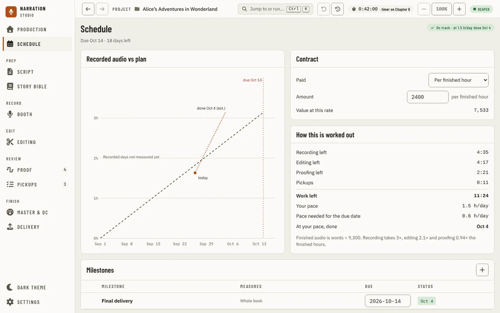
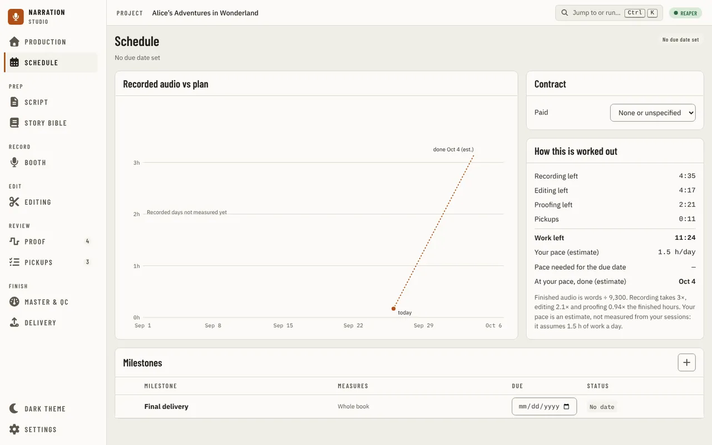
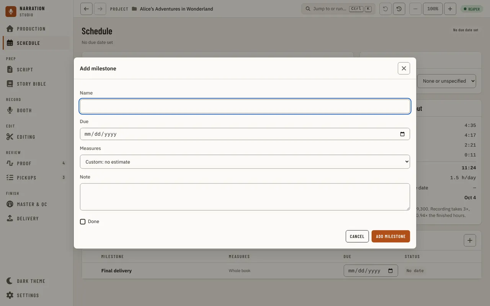

[Using the app](README.md) › Schedule

# Schedule

Schedule, the item after [Production](production.md) in the navigation, holds the book's due date and whether your
pace reaches it, the recorded audio against the plan, how the book pays, how the work left is worked out, and the milestones. With no manuscript it asks
you to import one first. Every change here is one step you can undo.

## The due date and the verdict

The due date is the date of the **Final delivery** milestone: type it in its **Due** box as `YYYY-MM-DD`. Under the
title the page says when the book is due and how many days are left. The pill at the top right gives the verdict
(**Early**, **On track**, **Tight** or **Behind**) with when your pace finishes the book and the hours a day the due
date needs. Until a due date is set, the page and the pill say **No due date set**.

## Recorded audio vs plan

The chart plots finished hours against dates: the dashed line is the plan from the start to the due date, the dot is
where you are today, and the dotted line runs on at your pace to the day it would finish (**done … (est.)**). The due
date is marked across it. Until recorded days are measured, the chart says so.

## Contract

**Paid** chooses how the book pays, such as **Per finished hour**, or **None or unspecified**. With a rate, **Amount**
holds it and **Value at this rate** shows what the book is worth at that rate.

## How this is worked out

**Recording left**, **Editing left**, **Proofing left** and **Pickups** add up to **Work left**, from what
[Production](production.md) measures. **Your pace** is the hours a day you have been working, **Pace needed for the
due date** what the due date asks, and **At your pace, done** the day the work left would be finished. The note under
them gives the sums: how finished audio is estimated from the word count, and how many times the finished hours
recording, editing and proofing take.

## Milestones

**Milestones** lists the dates the book is measured against: each with what it **Measures** (the whole book, for
example), its **Due** date and its **Status**, how many days late or early it stands. The **+** button opens **Add
milestone**: a **Name**, a **Due** date, what it **Measures**, a **Note** and **Done** for one already reached.

---

[← Production](production.md) · [Index](README.md) · [Script →](script.md)
