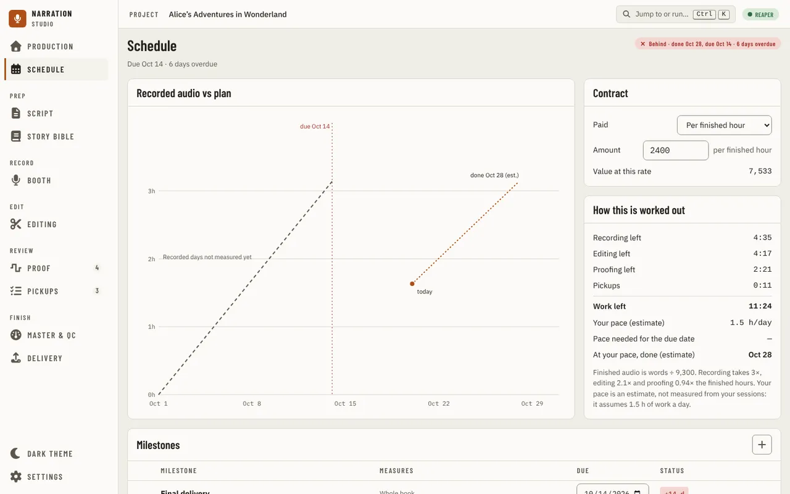

[Using the app](README.md) › Schedule

# Schedule

Schedule answers one question: will the book be done by its due date. It holds the due date, how the book pays, the
recorded audio against the plan, the work left and how it is worked out, and the book's milestones. It sits after
[Production](production.md) in the navigation. With no manuscript it asks you to import one first. Every change is one
step you can undo from the toast that follows it or from the undo history.
While the plan is being read, the page shows its title and grey blocks where the chart, the contract and the milestones will be; if the plan cannot be read, it says so with **Retry**.

## The verdict

The pill at the top right says **On track**, **Tight** or **Behind**, with when the work would finish at the pace ("at current pace done Oct 4", the 1.5 hours a day under **How this is worked out**) and, when you
are behind, the daily pace the due date needs. The days left to the due date set it: with three days to spare or more it is
on track, with less than three it is tight, and once the work needs more days than are left it is behind. A book whose chapters
are all delivered reads **Finished**, whatever the date.

The line under the title reads the days plainly: **8 days left**, **1 day left**, **today** (after the date), **2 days overdue**. Once the due
date is today or past, no daily pace can reach it, so the pill says how late instead of a pace.

## How it is worked out

**How this is worked out** lists the recording, editing and proofing left, the pickups still open, and their sum, **Work left**.
The numbers behind it are fixed, not measured from your sessions, so the page labels **Your pace** and **At your
pace, done** as estimates and says what they assume: finished audio is words ÷ 9,300 per hour, recording takes 3×
the finished hours, editing 2.1× and proofing 0.94×, a pickup takes 0.06 hours (3.6 minutes), and your pace is 1.5 hours a day. **At your
pace, done** is today plus the work left divided by that pace.

The chart, **Recorded audio vs plan**, draws the plan as a dashed line to the due date, the recorded days as a solid line when
the app can read them (otherwise a line under the chart says why it cannot), today (its label sits beside the dot, on the side away from the plan, estimate and due lines), and the
estimated finish as a dotted line. With no due date there is no plan or due line, and the line under the chart says **Set a due date to see the plan line.**

## Contract

**Paid** is how the book pays: per finished hour, a royalty share, or none or unspecified. Only a rate per finished hour carries
an amount. Type it in the **Amount** box and press Enter or leave the box; **Value at this rate** is the rate times the book's finished
hours. An empty box clears the amount. An amount is digits with an optional decimal part, and thousands commas only in groups
of three (`1,250.50`), up to 1,000,000,000,000. Anything else, such as `-5`, `1e3`, `1,5` (which could mean 15) or a rate larger than that, is
refused with a message and the box goes back to the stored amount. A refusal's message goes away when a later change is saved. Choosing a royalty share or none clears the amount.

## Milestones

The table lists your milestones by date, with the **Final delivery** row, the book's due date, at the end. With no other milestones, a line above it says so. The columns stay where they are whatever the milestones are called: a long name stops at two lines (hover it for the whole name, or open **Edit**). In a window narrower than 1024 px, what a milestone measures moves under its name; narrower still, the table scrolls sideways inside its card, with a shadow on the edge that has more to see, and Tab reaches it. Each row has:

- a name, what it **measures** (a custom milestone measures nothing), and its date.
- a status cell: **Late by 3 d**, **At risk** or **On track** with the estimated date, or **Not estimated** for a custom one.
  Hover or focus it for the full sentence. **Final delivery** reads **No date** until a due date is set.
- at the right, a **done** toggle (a done milestone reads **Done** and is never estimated), a note button (hover it to read the note; with no note it offers to add one), **Edit** and **Remove**. Removing offers Undo.

**Add milestone**, at the top of the table, opens a dialog for the name, due date (a date field: type the parts or open its calendar), what it measures, a note
and Done. The 15-minute checkpoint is offered only when the project's delivery profile asks for it. A book can have at most 100
milestones, a name is at most 200 characters and a note 2,000; when a save is refused the dialog says why and nothing changes.

## The due date

Set the date in the **Final delivery** row: it reads like the other dates until you point at it or Tab to it, then shows its box; type its parts or open the calendar. A whole, real date is saved as soon as it is written
or picked, and a screen reader hears the saved date and the verdict it gives ("Due date saved: Oct 10. Behind · done Oct 27, due Oct 10 · 9 days overdue."); a date still being typed, or a year before 1000, is not saved, and leaving the field puts the saved date back. To clear the due date, empty the field and press Enter, and the page says **No
due date set**, and a screen reader hears **Due date cleared**. A due date in the plan that is not a real date (the file was edited by hand) is named in the header and treated as no
due date.

## Staying current

The page reads again when you switch back to the app (at most every 30 seconds) and every minute while it is open, so a change
made elsewhere, and the day turning over at midnight, show up without a reload. If a later read fails, the page keeps what it
had and says so: **Couldn't read the schedule again**, why, how long ago it was read, and **Retry**. Every change
starts from what the project holds at that moment: a change to a row that was edited somewhere else since you saw it is refused with a
message instead of overwriting it, and two quick presses on the same row are one change.

---

[← Production](production.md) · [Index](README.md) · [Script →](script.md)
