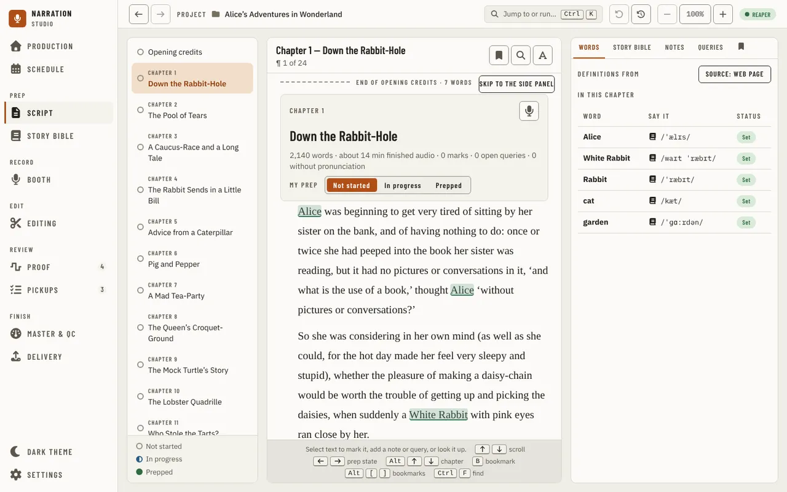
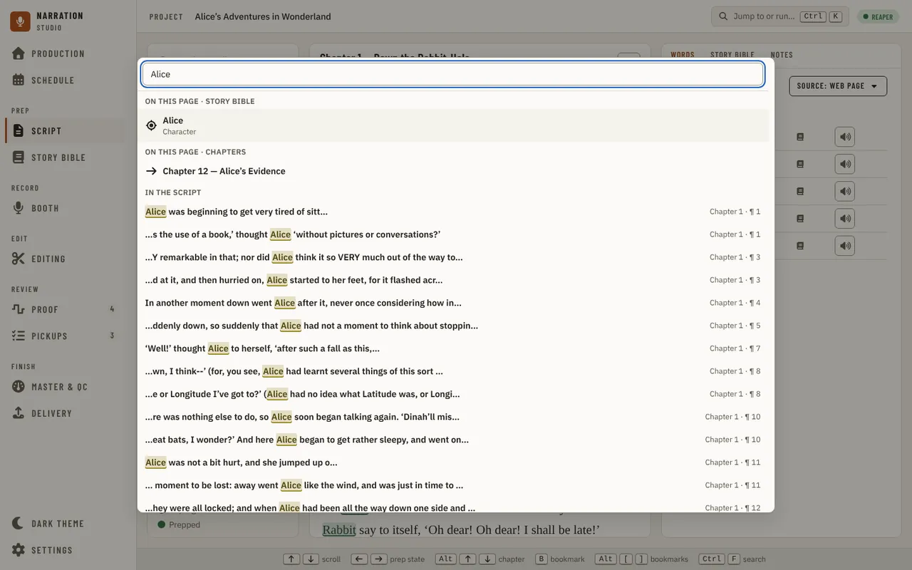
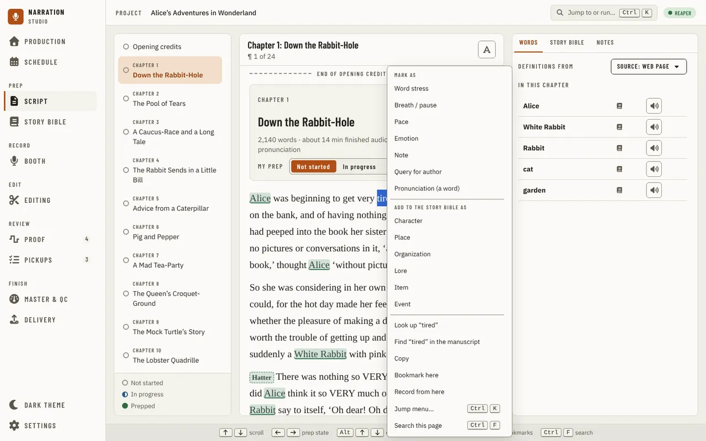
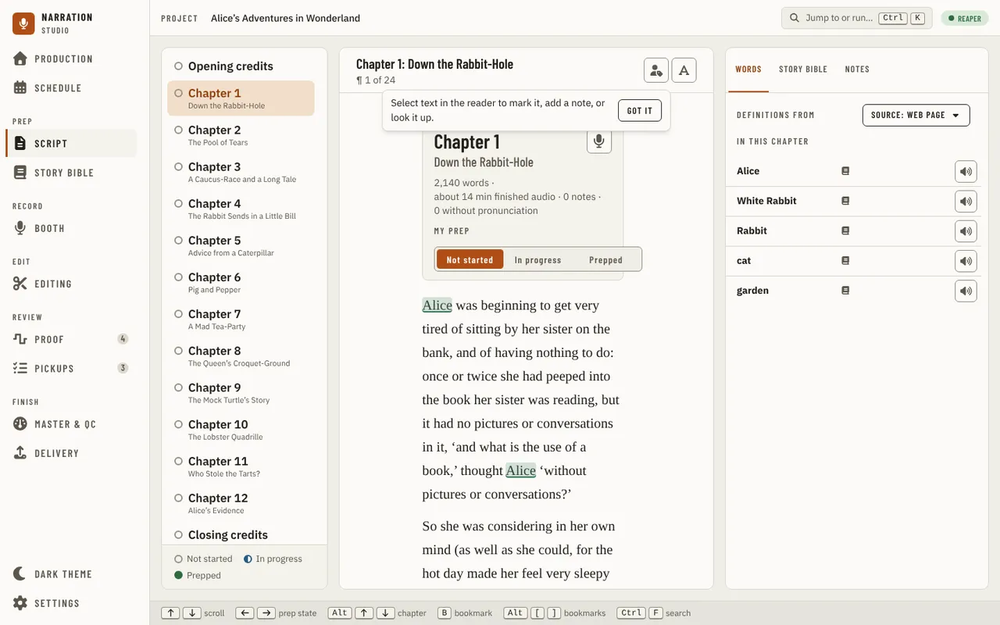

[Using the app](README.md) › Script

# Script

The Script page is where you prep the book before recording, under **Prep** in the navigation. On a wide window it has
three parts side by side:

- **Chapters** on the left: every narration chapter, the one in view marked, each with a dot for how far its prep is
  (**Not started**, **In progress** or **Prepped**; the key is under the list). Press a chapter to go to it. When the project has opening credits, an
  **Opening credits** row comes first, and when it has closing credits, a **Closing credits** row comes last; each goes
  to those credits in the reader, and its dot is the prep state you set on them.
- **The reader** in the middle: the whole book as one scrolling text. Each chapter starts with a dashed line that ends
  the one before ("End of chapter 1 · 2,140 words"), then a card with the chapter's label and title, its word count,
  its finished audio, its notes, and **My prep**, where you set the chapter's prep state.
  Your marks are drawn in the text in their own colours and lines. A Story Bible name is tinted and underlined in its
  type's colour, the same as in the Booth, and a name still marked Needs Review or Draft is amber. A word flagged for
  pronunciation has a blue dotted underline. A speaker's lines carry a chip with their name in the speaker's own
  colour: a dashed border means the speaker is only suggested, and a grey dashed chip with a question mark means nobody
  is set. Search matches are lit in their own yellow-green, and the current match has a ring. The header names the chapter in view and the line you are on, and has the **text settings** (font, size, line spacing, 1.7 at first, and column width). There is no search button: `Ctrl+F` searches the page through the [jump menu](navigation.md#jump-to-or-run) (see [Searching the script](#searching-the-script)).
- **The rail** on the right, with three tabs: **Words**, **Story Bible** and **Notes**. Bookmarks are not a tab: go to one from the [jump menu](navigation.md#jump-to-or-run) (`Ctrl+F`, then type *bookmark*), and add, edit or delete one from the right-click menu (see [Bookmarks](#bookmarks)).

While the manuscript is being read, the page shows the same three columns as grey blocks; if it cannot be read, the page says so with **Retry**.

The first time you open the page, a small tip over the reader says to select text to mark it, add a note, or look it up. **Got it** hides it for good, and so does selecting text; it is not shown again (see [First-use tips](#first-use-tips)).

A bar under the reader lists its keys: **↑** **↓** scroll;
**←** **→** change the prep state of the chapter in view; **Alt+↑** **Alt+↓** go to the previous or next chapter (the
credits included) and say where you land, such as "Chapter 2, The Pool of Tears, ¶ 1 of 26"; **B**
bookmarks the line, says "Bookmark added." and opens the bookmark's label and note (the selection toolbar's **Bookmark here** adds it with Undo instead), or says the spot already has one; **Alt+[** **Alt+]** go to
the previous or next bookmark; **Ctrl+F** searches the script; **F3** **Shift+F3** step the matches. A key you rebind
under **Keyboard & pedals** in [Settings](settings.md) shows its new key here.

Each chapter card has its own prep buttons and **Record in Booth**, so a keyboard user would pass four stops per chapter on the
way to the rail. The first Tab stop after the reader's header is **Skip to the side panel**, which is seen only while it has focus:
Enter moves focus to the open tab of the rail (or opens the rail, where it is a drawer).

## Searching the script

`Ctrl+F` opens the [jump menu](navigation.md#jump-to-or-run) searching only this page. Type at least two letters and the menu lists, in this order:
what the page offers that matches (**On this page**: chapters, Story Bible entries and the mark types), then **In the script**, **My marks** and **My words**.
Each match in the script shows the words around it with the matched part marked, and the chapter and paragraph it is in (**Chapter 3 · ¶ 12**);
the first 50 are listed and a last row says how many more there are. It reads the chapters the page has loaded.

Choose a match (`Enter` or a click) and the menu closes: every match of the word is lit in the text, the one you chose is ringed and brought into view.
**F3** and **Shift+F3** move to the next and previous match, wrapping at the ends; the same steps, with "3 of 12 for “alice”", and **Clear the search** are under **Search** in
the jump menu while a search is showing. `Esc` clears the search. `Ctrl+K` opens the whole menu, with **On this page** first, and `Backspace` on an empty field in `Ctrl+F` widens the search to every page and command.

**Find in the manuscript** on a Story Bible entry and **Find** in the right-click menu light the matches in the text the same way, without opening the menu.

At 1280 px and narrower the rail opens as a drawer over the text from the header's side panel button, and below 1180 px the
chapter list does the same from its **Chapters** button. A drawer opens inside the page, under the navigation, so the
navigation stays usable; a press anywhere outside the drawer, or on the navigation, closes it.

An old link to the Manuscript page (`/manuscript`, with a line or chapter after `#`) still works: it opens the Script
page at the same place, as do the links from Proof and the Story Bible.

## Select text

Select words in the reader and a dark toolbar appears over them:

- **Mark** puts one of your marks on them, with a note (a question for the author is a note you can reply to), marks a word for its
  pronunciation (**Pronunciation (a word)**), or opens **Define marks…**, where you name your marks and choose each
  one's colour and line.
- **Story Bible** makes a new entry of the kind you choose from the words; the kinds are the Story Bible's own types,
  including any you added there.
- **Bookmark here** (the bookmark button).
- **Record from here** (the record button) opens the [Booth](booth.md) on the chapter, starting at the words you selected.
- **Look up** opens the words in the rail: a Story Bible name on its **Story Bible** tab, any other word on **Words**.
  A word you have not marked yet gets **Add to my words** on its card, which marks the word you selected.

Right-click the text for the same actions, in labelled groups: **Mark as** (your marks and **Pronunciation (a word)**),
**Add to the Story Bible as** (left out when the words are already an entry's name or alias, where the entry's own row finds them),
then **Look up**, **Find** (lights the matches in the text), **Copy**, **Bookmark here** and **Record from here**. Where you click adds more: on a speaker's line, **Speaker: …** to change who
speaks it; on one of your marks, open it, change its type, resolve or reopen its thread, or delete it; on a marked word,
**Show in Words** or **Remove from my words**. Right-click a chapter in the list or its card in the reader to go to it,
record it in the Booth or set its prep state, and a word on the **Words** tab to show it or remove it. Click a marked
word in the text to open it on the **Words** tab.

## The rail

- **In this chapter** is the same list on **Words** and on **Story Bible**: who and what the chapter has, one row each with the name, its
  kind where it has one, and a **Hear** button where there is a pronunciation to play. It lists who is in the chapter, not who speaks,
  and it has no status column: a row without a **Hear** button has no pronunciation yet.
- **Words** lists the words marked for pronunciation in the chapter in view. A word's card has **How I will say it**
  with its source (a dictionary, eSpeak or the one you typed), the **Definition**, **Forvo** and **YouGlish** pages for
  it, and its definition from where **Definitions from** says: the web page (the default), the offline dictionary
  ([Settings, Models and downloads](settings.md#models-and-downloads)) or the online service on your own key. The choice is saved
  for every project, and Settings' **Definitions and pronunciations** panel changes the same one.
- **Story Bible** lists the entries met in the chapter, one row each with its type's swatch, its type, the chapter it first appears in (**Chapter 1**) and **Hear** where the entry has a pronunciation; a row opens the entry's summary. The entry's header is one row:
  its name, its type, **first:** and its chapter, then **Find in the manuscript**, **Add a note** and **Open in Story Bible**, which goes there.
  **Look up** on selected words with no entry shows them as a card instead, with their definition from where **Definitions from** says, **Create an entry**
  (the kinds are the Story Bible's own types) and the **Definition**, **Forvo** and **YouGlish** pages.
- **Notes** lists the chapter's marks, each a thread you can reply to, resolve or reopen, with the note and the replies; one goes to its
  place in the text. A question for the author is a note like the others.

A Story Bible name met in the chapter is listed on **Words** too, marked with the Story Bible icon and read-only there: its pronunciation is the entry's, edited in the Story Bible.

## Bookmarks

Press **B** to bookmark the line you are on (or use **Bookmark here** on the selection toolbar or the right-click menu). A ribbon in the reader's margin marks it; press the ribbon to edit its label and note, or right-click it for **Edit bookmark** and **Delete bookmark**. **Alt+[** and **Alt+]** go to the previous and next bookmark. The [jump menu](navigation.md#jump-to-or-run) lists every bookmark under **Bookmarks**, with **Bookmark here**, **Next bookmark** and **Previous bookmark**, so a bookmark is one search away.

## First-use tips

A tip is a short note over the page that explains something the first time you could use it. It shows once for you, not once for each project: **Got it** (or doing what it describes) hides it, and the page remembers. Script has one, about selecting text.

The reader follows the Light, Dark or System theme.

## Importing, credits and the retail sample

Importing keeps the storytelling formatting from a Word, Markdown, plain-text or EPUB manuscript —
italics, bold and underline — and line breaks inside a paragraph (verse, addresses), so the reader
matches the original. Chapter titles and subtitles that Word (or an EPUB's own table of contents)
stores separately are shown as a title with its subtitle. An EPUB's title pages, table of
contents and back matter (endnotes, glossary, and the like) are recognized from the book's own
markup and never imported as chapters; the title and author in them are offered when you set up
the credits. A Word document's title pages are treated the same way. A
plain-text file with no chapter markings, or an EPUB with no table of contents or headings,
still imports as one narration chapter rather than failing or importing nothing narratable — the
import log says so. Pages your manuscript heads as a Title Page, Half Title, Copyright, "Praise for…", "Also by…" or Opening Credits
are not imported, because an audiobook doesn't read them; the title and author in them go to the credits. A Dedication,
Epigraph, Foreword, Preface, Introduction, Prologue, Acknowledgements or About the Author stays a chapter, and you can
switch any chapter off in the import review. Those pages don't replace the Opening credits row below: that row stays above
Chapter 1. Replace the manuscript (**Replace manuscript…** under Manuscript in [Settings](settings.md)) to pick this up in an older project.

**Opening credits** sit above the first chapter and **Closing credits** after the last chapter's text, when the
credit template library (Settings, This Project, [Credits](settings.md#credits)) has an opening or a
closing template. The reader draws them as it draws a chapter: a dashed line ending what comes before, a
**Credits** card with the word count, the finished audio and **My prep** (kept with the project like a
chapter's), then the credits text with the project's values filled in. A token with no value yet stays in
brackets, in the amber of an entry still to review, and the card lists the unresolved tokens with a **Fill in** that opens the same "Set up
the credits" dialog Production offers — see [Production](production.md#importing-the-manuscript) for what it asks
and when. A banner above Opening credits does the same while any token stays unresolved and setup has not been
dismissed for the project. The credits are read-only and are not chapters: the search does not look in them. Record the
credits as their own files, as ACX expects, not inside a chapter file: a chapter's Proof view compares a
chapter's recording with that chapter's text only, so credits recorded inside it are reported as extra
words. Each credits card has a **Record in Booth** button once it has anything to read (see below).

The [retail sample](settings.md#retail-sample), once picked, is marked where it is: a **Retail sample**
tag above each chapter it is in, and a bar in the margin beside each of its lines.

A heading that isn't really a chapter (a part title, an epigraph or a false split your source read in
as one) is removed from recording from its track panel on [Production](production.md#a-chapters-track), not from here: choosing
**Not a chapter** takes it out of this chapter list and search too. Its text is untouched and **Restore** on Production brings it back as a
chapter.

Each narration chapter's card has a **Record in Booth** button (the microphone), as do the Opening
credits and Closing credits cards once they have something to read. It opens the [Booth](booth.md) on that
chapter or those credits.

The reader shows only the manuscript's narratable chapters. A table of contents or a Characters
section the importer recognized stays in the project's data (the Story Bible has the readable form
of Characters) but is never a page you page through in the reader, and a saved or shared link into
one tells you so instead of landing there.

---

[← Schedule](schedule.md) · [Index](README.md) · [Story Bible →](story-bible.md)
