[Using the app](README.md) › Script

# Script

The Script page is where you prep the book before recording, under **Prep** in the navigation. On a wide window it has
three parts side by side:

- **Chapters** on the left: every narration chapter, the one in view marked, each with a dot for how far its prep is
  (**Not started**, **In progress** or **Prepped**; the key is under the list). A **?** beside a chapter means it has
  questions for the author still open. Press a chapter to go to it. When the project has opening credits, an
  **Opening credits** row comes first, and when it has closing credits, a **Closing credits** row comes last; each goes
  to its credits card, and its dot is **Prepped** once those credits have no token left to fill in.
- **The reader** in the middle: the whole book as one scrolling text. Each chapter starts with its card, after the end
  marker of the chapter before: the chapter's title, shown once, with its word
  count, its finished audio, its marks and open queries, and **My prep**, where you set the chapter's prep state.
  Your marks are drawn in the text in their own colours, a speaker's lines carry a chip with their name, and Story Bible
  names are underlined. The header names the chapter in view and the line you are on, and has **Bookmarks**, **Find**
  (Ctrl+F) and the **text settings** (font, size, line spacing and column width).
- **The rail** on the right, with five tabs: **Words**, **Story Bible**, **Notes**, **Queries** and **Bookmarks**.

A bar under the reader lists its keys: select text to mark it, add a note or query, or look it up; **↑** **↓** scroll;
**←** **→** change the prep state of the chapter in view; **Alt+↑** **Alt+↓** go to the previous or next chapter; **B**
bookmarks the line; **Alt+[** **Alt+]** go to the previous or next bookmark; **Ctrl+F** opens Find. A key you rebind
under **Keyboard & pedals** in [Settings](settings.md) shows its new key here.

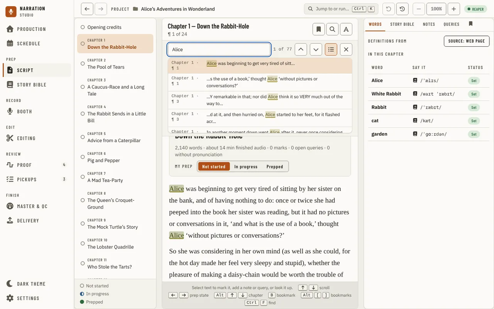

At 1280 px and narrower the rail opens as a drawer over the text from the header's side panel button, and below 1180 px the
chapter list does the same from its **Chapters** button. A drawer opens inside the page, under the navigation, so the
navigation stays usable; a press anywhere outside the drawer, or on the navigation, closes it.

An old link to the Manuscript page (`/manuscript`, with a line or chapter after `#`) still works: it opens the Script
page at the same place, as do the links from Proof and the Story Bible.

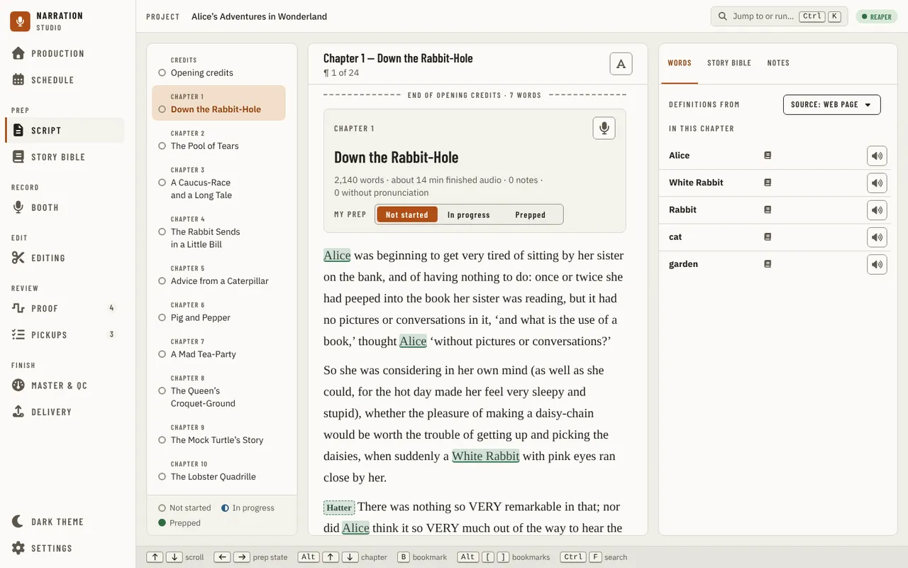

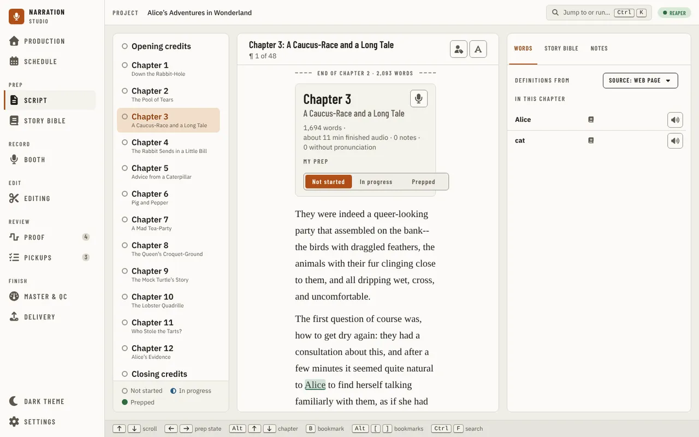

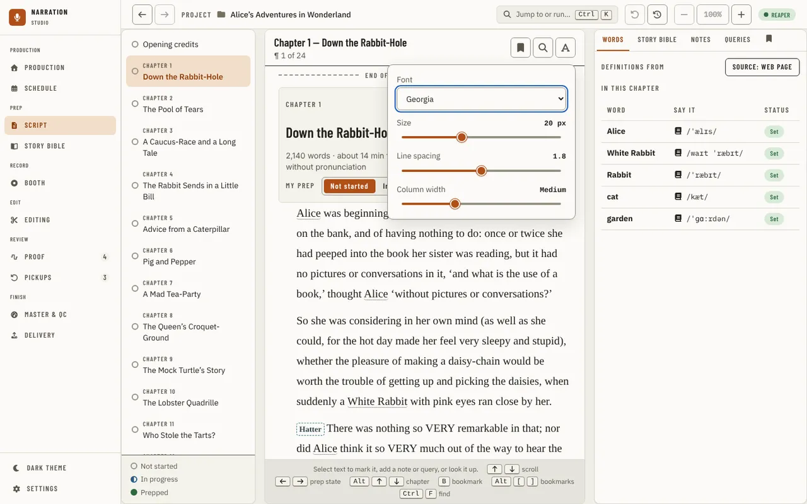

## Select text

Select words in the reader and a toolbar appears over them:

- **Mark** puts one of your marks on them, with a note (a query for the author is a mark too), marks a word for its
  pronunciation (**Pronunciation (a word)**), or opens **Define marks…**, where you name your marks and choose each
  one's colour and line.
- **Story Bible** makes a new entry of the kind you choose from the words.
- **Bookmark here** (the bookmark button).
- **Look up** opens the words in the rail: a Story Bible name on its **Story Bible** tab, any other word on **Words**.

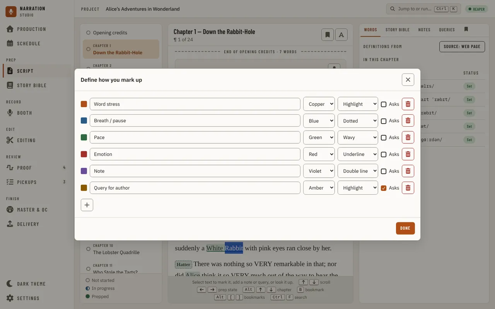

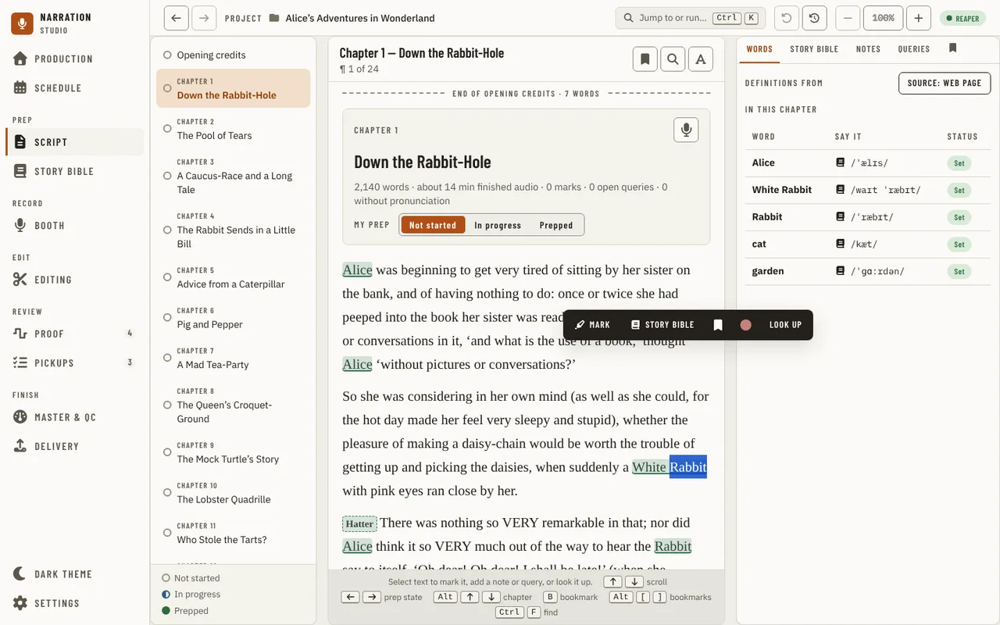

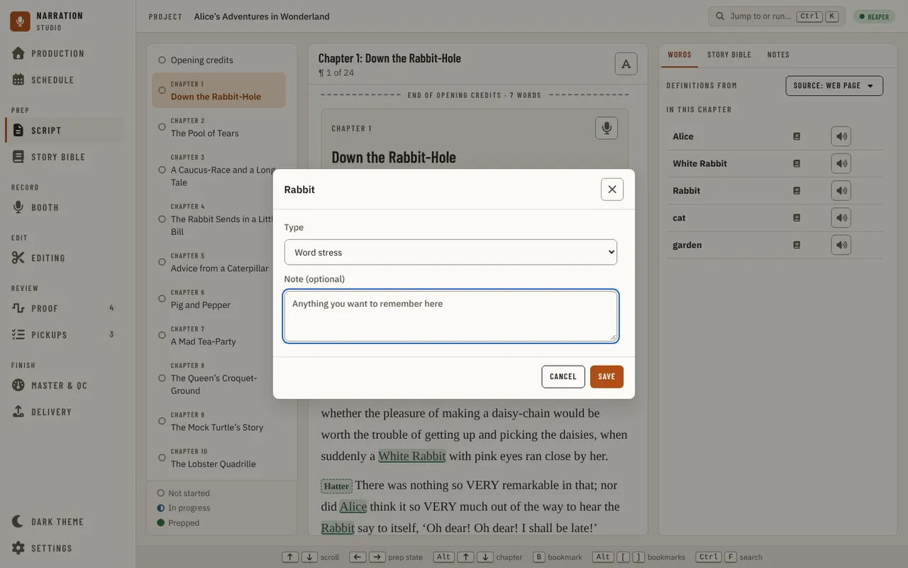

## The rail

- **Words** lists the words marked for pronunciation in the chapter in view. A word's card has **How I will say it**
  with its source (a dictionary, eSpeak or the one you typed), the **Definition**, **Forvo** and **YouGlish** pages for
  it, and its definition from where **Definitions from** says: the web page (the default), the offline dictionary
  ([Settings, Local assets](settings.md#local-assets)) or the online service on your own key. The choice is saved
  for every project, and Settings' **Definitions and pronunciations** panel changes the same one.
- **Story Bible** lists the entries met in the chapter; one opens its summary, and **Open in Story Bible** goes there.
- **Notes** and **Queries** list the chapter's marks with a note and its questions for the author; one goes to its
  place in the text.
- **Bookmarks** lists your bookmarks under their chapters, each with its line; one goes to its place, its pencil
  button edits its label and note, and its bin button deletes it. The reader's margin shows a ribbon where each one is.

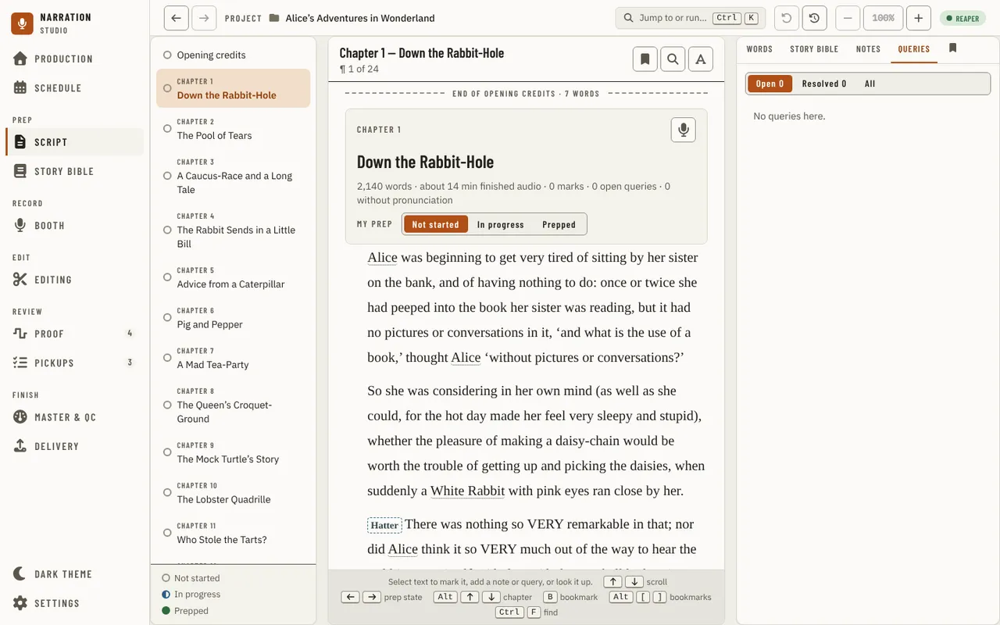

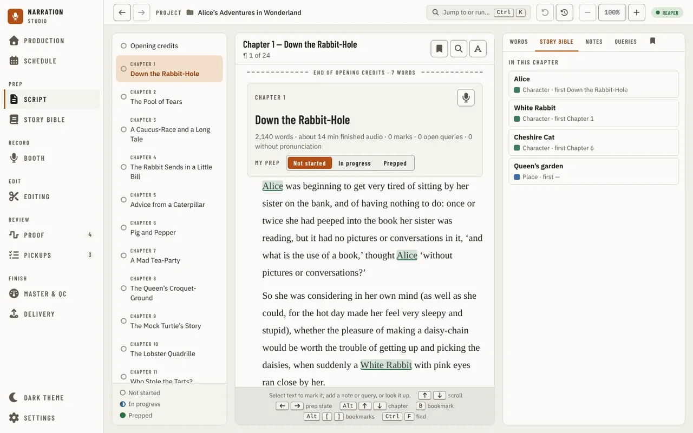

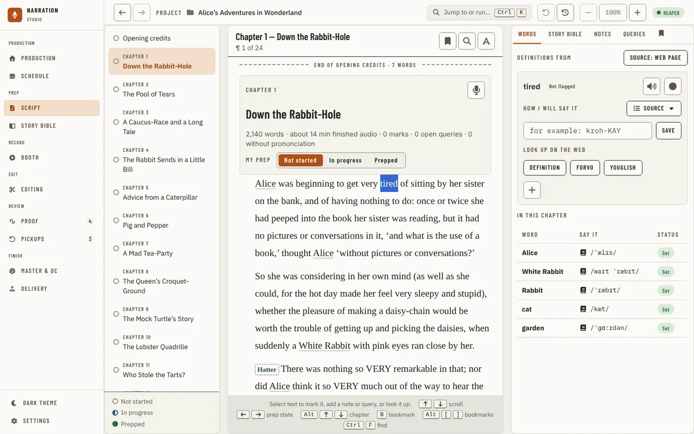

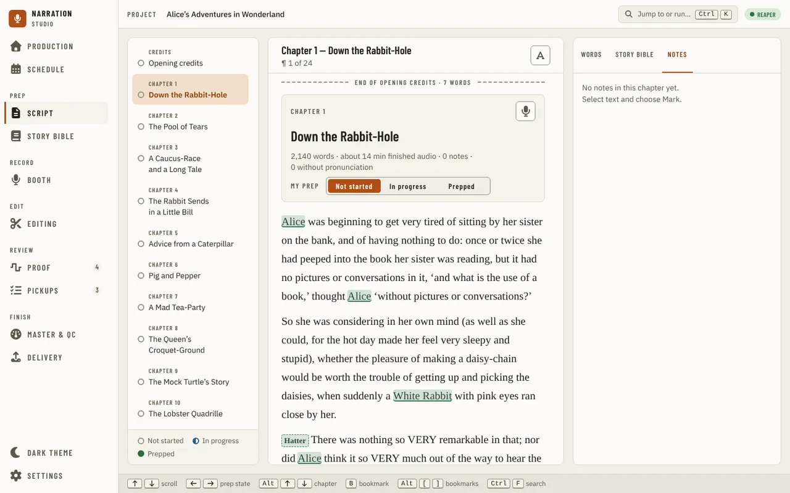

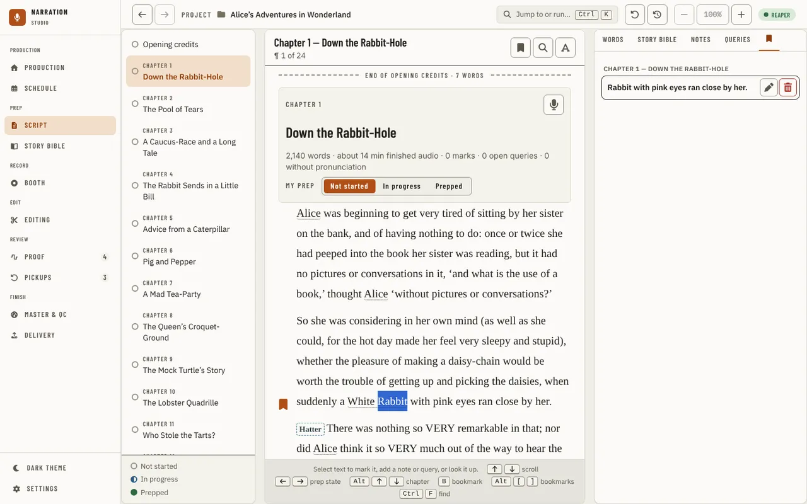

The reader follows the Light, Dark or System theme.

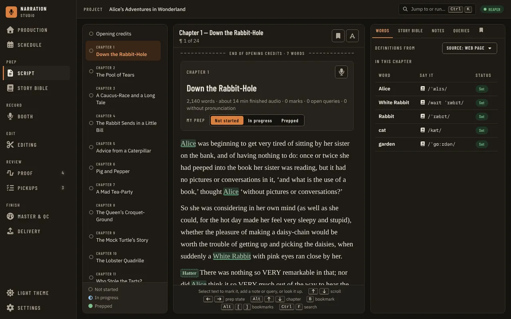

## Importing, credits and the retail sample

Importing keeps the storytelling formatting from a Word, Markdown, plain-text or EPUB manuscript —
italics, bold and underline — and line breaks inside a paragraph (verse, addresses), so the reader
matches the original. Chapter titles and subtitles that Word (or an EPUB's own table of contents)
stores separately are shown as a title with its subtitle. An EPUB's front matter, table of
contents and back matter (endnotes, glossary, and the like) are recognized from the book's own
markup and kept out of the narration chapters, the same as a Word document's front matter. A
plain-text file with no chapter markings, or an EPUB with no table of contents or headings,
still imports as one narration chapter rather than failing or importing nothing narratable — the
import log says so. Re-import a manuscript (Replace manuscript on [Production](production.md#importing-the-manuscript)) to pick this up in an older project.

**Opening credits** sit above the first chapter and **Closing credits** after the last chapter's text, when the
credit template library (Settings, This Project, [Credits](settings.md#credits)) has an opening or a
closing template. Each shows its word count and a read time, and opens and closes the same way a
chapter card does — press anywhere on its header, not just the title — with a chevron showing which
way it is set. Both are open by default, and the project remembers whether you left each open or closed. Open one to read the credits with the project's values filled in. A token
with no value yet stays in brackets, highlighted, and a line below lists the unresolved tokens, with a
**Fill in** next to it that opens the same "Set up the credits" dialog Production offers — see
[Production](production.md#importing-the-manuscript) for what it asks and when. A banner above Opening credits does the same while any
token stays unresolved and setup has not been dismissed for the project. These
entries are read-only and are not chapters: Find does not search them, and the chapter list has a row for
each. Record the
credits as their own files, as ACX expects, not inside a chapter file: a chapter's Proof view compares a
chapter's recording with that chapter's text only, so credits recorded inside it are reported as extra
words. Each credits
card also has a **Record in Booth** button once it has anything to read (see below).

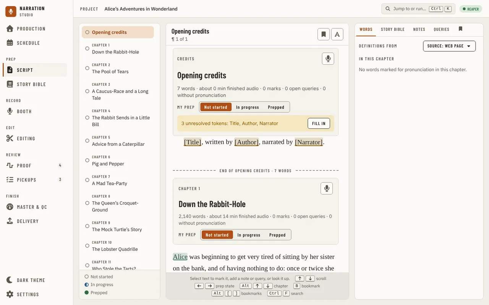

The [retail sample](settings.md#retail-sample), once picked, is marked where it is: a **Retail sample**
tag above each chapter it is in, and a bar in the margin beside each of its lines.

A heading that isn't really a chapter (a part title, an epigraph, or front matter your source read in
as one) is removed from recording from its track panel on [Production](production.md#a-chapters-track), not from here: choosing
**Not a chapter** takes it out of this chapter list and search too, and **Front matter** keeps it in the
list without recording it. Either way its text is untouched and **Restore** on Production brings it back as a
narration chapter.

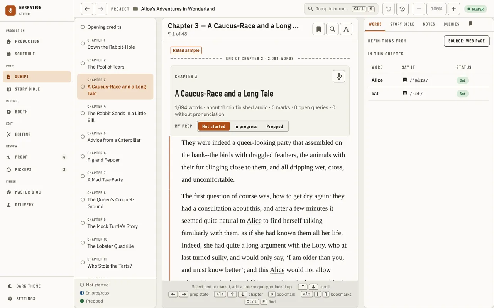

Each narration chapter's card has a **Record in Booth** button (the microphone), as do the Opening
credits and Closing credits cards once they have something to read. It opens the [Booth](booth.md) on that
chapter or those credits.

The reader shows only the manuscript's narratable chapters. A table of contents or a Characters
section the importer recognized stays in the project's data (the Story Bible has the readable form
of Characters) but is never a page you page through in the reader, and a saved or shared link into
one tells you so instead of landing there.

---

[← Schedule](schedule.md) · [Index](README.md) · [Story Bible →](story-bible.md)
