[Using the app](README.md) › Settings

# Settings

Settings is a page of eight categories, one shown at a time. The list sits at the left in three groups: **Shared
tools** (Recording & DAW, Speech to text, Voice & pronunciation, Models & downloads, Delivery), **This project**
(Project) and **This computer** (Appearance & keys, App & updates). **Set on a page** stands apart under
**Elsewhere**. In a narrow window the list folds into one **Category** button that names the current category and opens the
list.

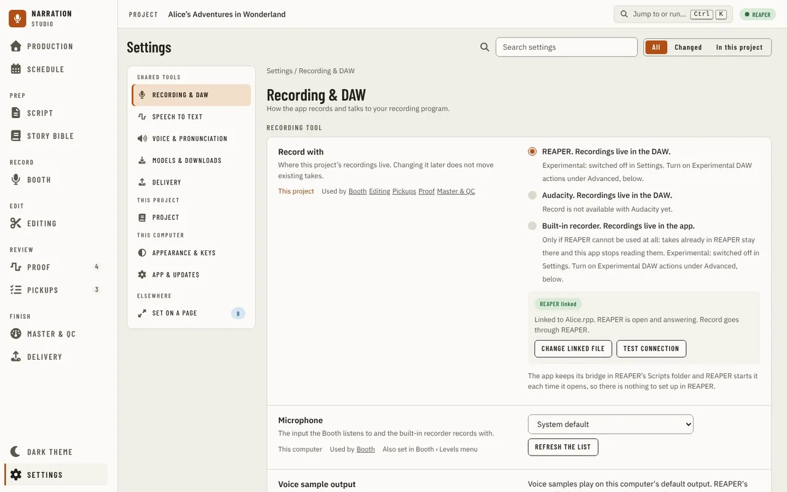

**Ctrl+,** opens Settings from any page. When a link from another page brings you here (the Booth's DAW settings,
a "fix credits" link, Master's silence cleanup), Settings opens on the setting, lights it up for a moment and
offers **Back to** the page you came from.

## Every setting says whose it is and who uses it

Each row has a name, one line on what it does (a **?** beside the name opens the details, where there are more), and under it:

- **This computer**, **This project** or **All projects**. A setting for **All projects** is one value for the
  computer that a project may override: under the control it says **This project uses the computer setting.** with
  **Override for this project**; once overridden the row says **overridden here**, shows **This project uses** with its
  own control, and **Use computer setting** goes back. A **This project** setting belongs to the open project only.
- **Used by** and the pages that read it. Each name goes to that page; the setting is changed here, once.
- **Also set in** where a quick control for the same value sits (the rail's theme button, the Script's Words tab).

A change applies at once, with no Save button. The row says **Saved** beside its control. A row that differs from its
default shows **Changed**, a bar at its edge and a reset button that puts it back; a category with changed rows shows
how many in the list and a **Reset to defaults** button beside its title. A change that costs something asks first: changing the
transcription model says earlier checks are marked out of date and run again. A value the host refuses keeps
the previous value and says why under the row; the page then notes that changes may not be kept until one succeeds.

Rarely changed settings sit under **Advanced** at the foot of a category, closed until you open it; the heading
says how many it holds.

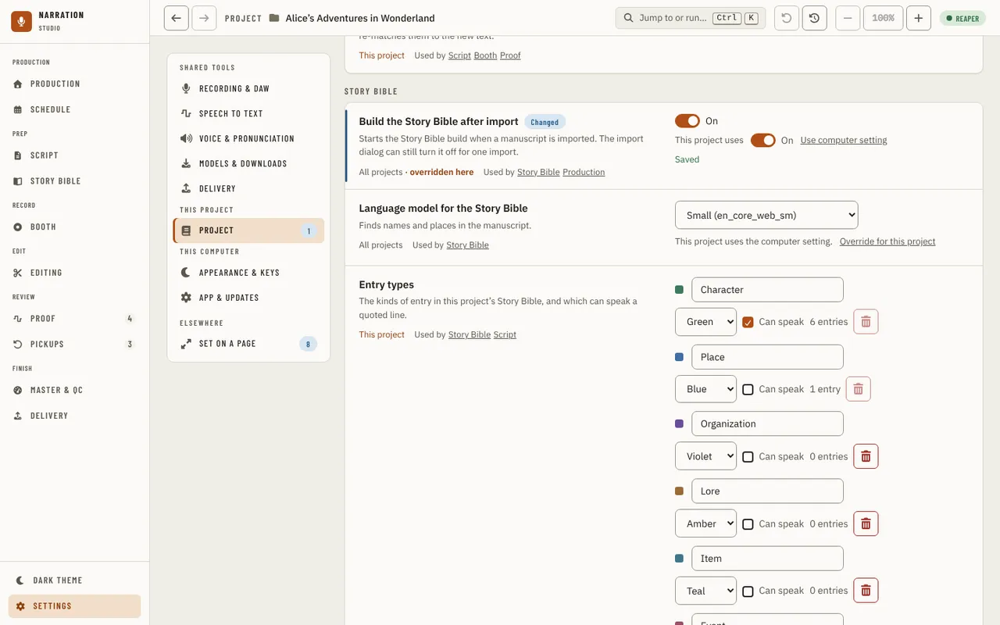

## Find a setting

At the top right, the **Search settings** box (a magnifier inside it, at its left) and the **All** / **Changed** / **In this project** control sit on one line (on a narrow window they take the full width). **Search settings** matches the name, the description, its details and words you might use instead (typing "whisper" finds the
transcription model; "breath" finds silence cleanup). Results are grouped under their category, each with a **Show the
whole category** button at the right of its header, and include matches from the Advanced sections. **Changed** lists everything that differs from
the default, wherever it is; **In this project** lists the settings this project owns or overrides. Each says so
when nothing is there; on a narrow window the folded category button reads **Search results** while results show. **Escape** clears the search.

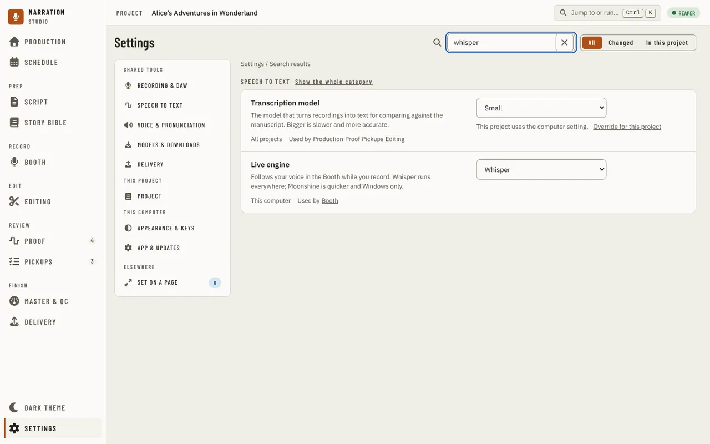

## Recording & DAW

**Record with** chooses where this project's takes are recorded: **REAPER**, **Audacity** or the **Built-in
recorder** (see [Choose REAPER](#choose-reaper)). The choice is saved with the project. A refused choice (no project open,
a take running, or the built-in recorder not available) says why under the radios, and the choice stays where it was.
While REAPER or Audacity is linked, choosing the **Built-in recorder** first asks **Stop recording with REAPER?** (or
Audacity): new takes would go to the project's own folder, takes already in the DAW stay there and the Booth, Editing and
Proof stop reading them, and the link is kept, so choosing the DAW again brings them back. **Keep REAPER** leaves the
project as it was. Use it only when the DAW cannot be used at all.

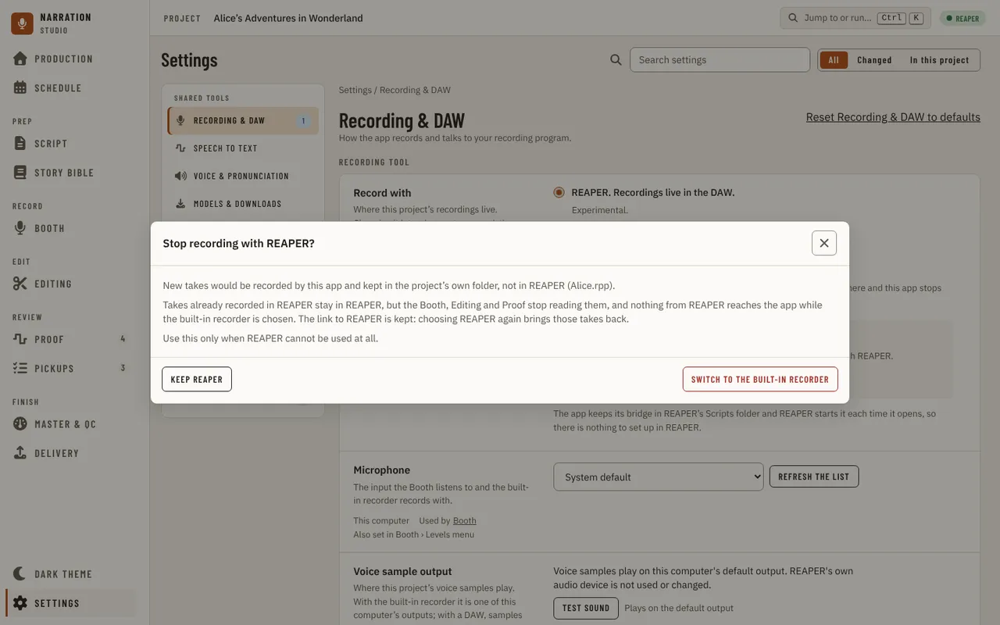

Under it, **Connection** says what the app can reach right now, with **Test connection**; after a test it says when it last checked ("Last checked 12 s ago").

You set nothing up in REAPER. The app puts its bridge in REAPER's Scripts folder by itself, and REAPER starts it each
time it opens; the card says so under **Connection**, or says what stopped it. When a project linked to REAPER opens and
REAPER is not running, the app opens REAPER on the linked project: **Connection** reads **Starting REAPER** with how
long ago it opened, until REAPER answers. If you close REAPER later the app does not reopen it; **Start REAPER** does.
If REAPER was already open before the app put its bridge there, the app runs the bridge in it for you.

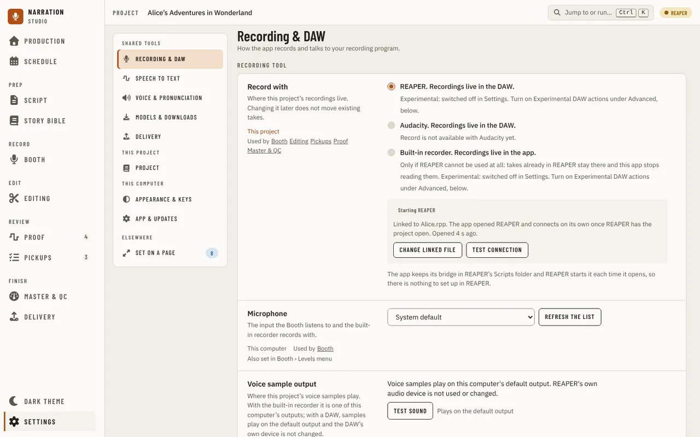

With **Audacity** chosen, **Connection** is **Audacity connection** instead: a status, one sentence that says what to do next, when Audacity was last heard from, and a **Set up Audacity** checklist. Audacity must be Audacity 3 with its scripting turned on. While Audacity is closed the app turns scripting on by itself and then starts Audacity on the linked project, once each time the project opens. Two things it cannot do for you, and the sentence says so: Audacity saves its settings when it closes, so if it is open with scripting off you close it and the app does the rest; and the first start of a new Audacity makes its settings and cannot load scripting, so that first time you close Audacity once after it opens. **Turn on scripting** and **Start Audacity** are still there to do either by hand. Once Audacity answers, **Link the open Audacity project** marks the project open in Audacity as this project's, with one label in a track named "<!-- brand:identity.audacityLabelTrack -->Narration Studio<!-- /brand -->"; **Choose Audacity project file** records the `.aup3` so **Start Audacity** opens it; **Unlink** forgets both and leaves the label in Audacity. **Check again** asks Audacity now. If Audacity may be waiting on a dialog, the card says so; close the dialog in Audacity and the app reconnects by itself. The same status shows on the header's engine chip and in the engine panel.

Also here: **Microphone**, the one the Booth listens to. With a DAW it shows the DAW's own input read-only (**Same as REAPER:**
and the device, with what REAPER records from and plays on) and needs nothing set; **Choose a different one** keeps another
microphone over it until **Use REAPER's input**, and when the DAW's input could be several microphones, one button picks each.
Audacity cannot report its input, so with Audacity, and with the built-in recorder, it is a list of the computer's inputs with
**Refresh the list** (**Automatic** is the first one listed; see [The microphone the Booth listens to](booth.md#the-microphone-the-booth-listens-to)). With REAPER chosen, **Start the launcher script with REAPER** and, under Advanced, **REAPER program** (neither is shown
for Audacity or the built-in recorder); and, under Advanced for any recorder,
**Capabilities** and, for REAPER, **Sync activity**. These are settings of this computer; a project has no override for them. **Voice sample output** names the
recorder the project uses (for example "Audacity's own audio device is not used or changed").

**Start tone** (under **Take cues**) is **Off** or **On**. On, the Booth plays a short beep when you press Record, for recording by foot pedal without looking at the screen, and the take starts when the beep ends, a fraction of a second later, so the beep is not on the recording. Turning it on plays it once. It is kept in this window, as Theme and Motion are, and there is no tone to stop a take.

**Voice sample output** chooses where this project's [voice samples](editing.md#marking-a-voice-sample) play, and is saved with the
project. With the **Built-in recorder** it lists this computer's outputs after **System default**; **Refresh the list** reads them
again, and **Test sound** plays a short tone on the one chosen so you can tell where a sample will come from. A sample always plays
in the app's own audio, so with a DAW the row is **Test sound** with a note under it: samples play on this computer's default output and the DAW's own audio
device is not used or changed. An output that is not connected stays chosen, with a notice that samples play on the system default
until it is back; the list is read again when the window gets focus and every few seconds while the notice shows. If the audio
system will not list its outputs, the row says so and the choice is off. Taking and read-aloud keep using the microphone and output
you chose elsewhere, and the row does not check whether a take is recording.

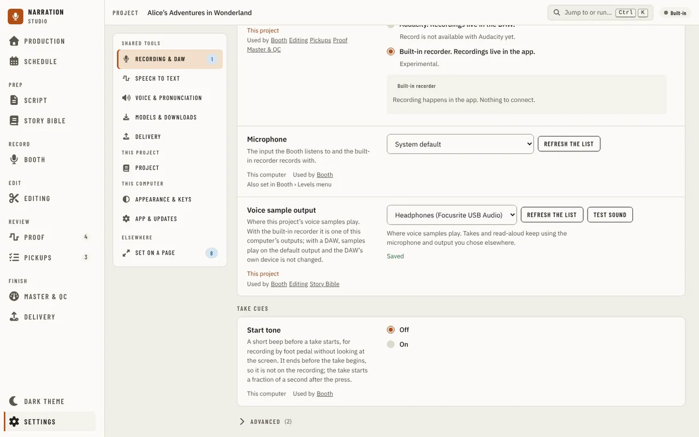

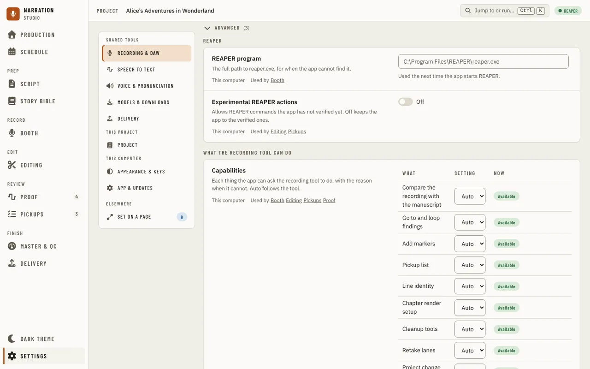

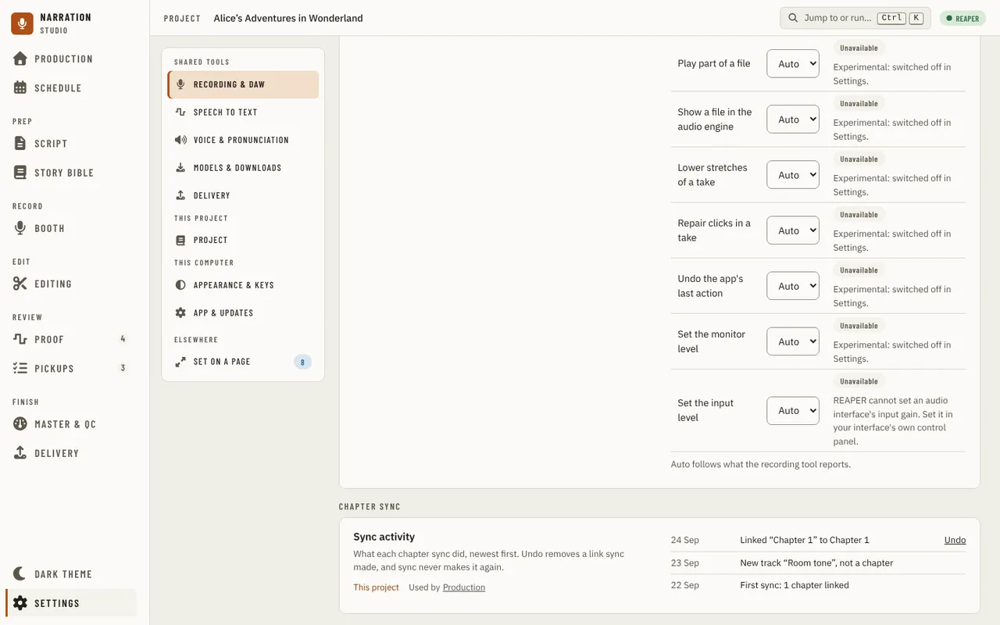

### Choose REAPER

Each radio says whether that program was found on this computer, or what stops it. A project folder holding a REAPER
project file (`.rpp`) starts on REAPER; pick another radio to change it.

### Link your REAPER project

Under the radios is the project's REAPER file. With one `.rpp` in the project folder it reads **REAPER not
linked** and offers **Link** with the file's name; **Choose a project file** opens a file dialog for any other
`.rpp`.

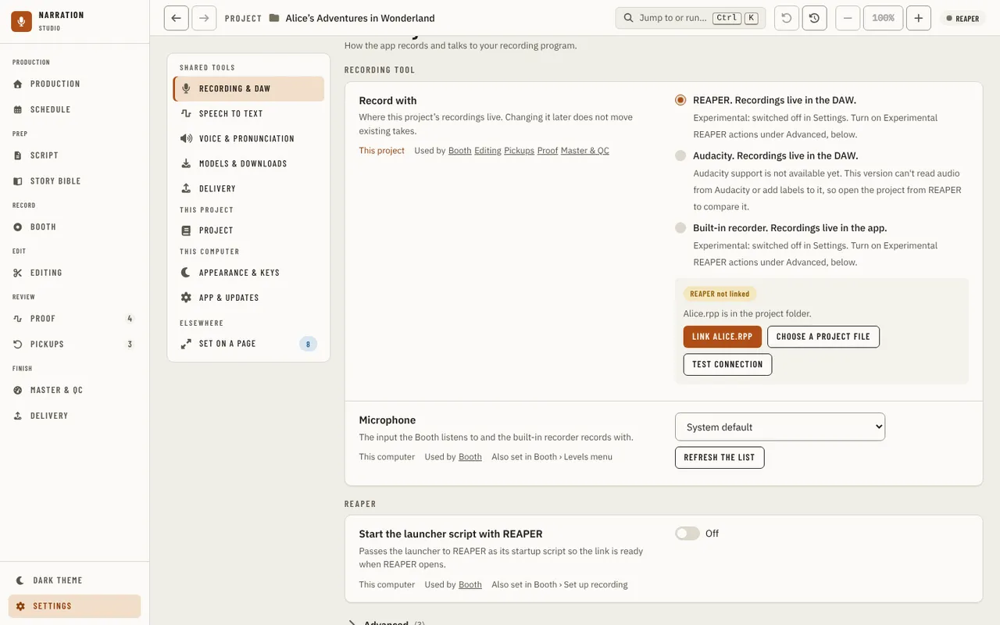

The file can be in the project folder, in a subfolder of it, or anywhere else, such as a folder or drive you keep
for REAPER. A file inside the project folder keeps working when you move the whole project. For a file elsewhere,
a note says where the file and the project are. Only a file that is not an `.rpp`, or no longer exists, is
refused. Linking also chooses REAPER. Once linked, the card names the file and reads **REAPER linked** while REAPER answers, or
**Not running** with **Start REAPER** while it is closed.

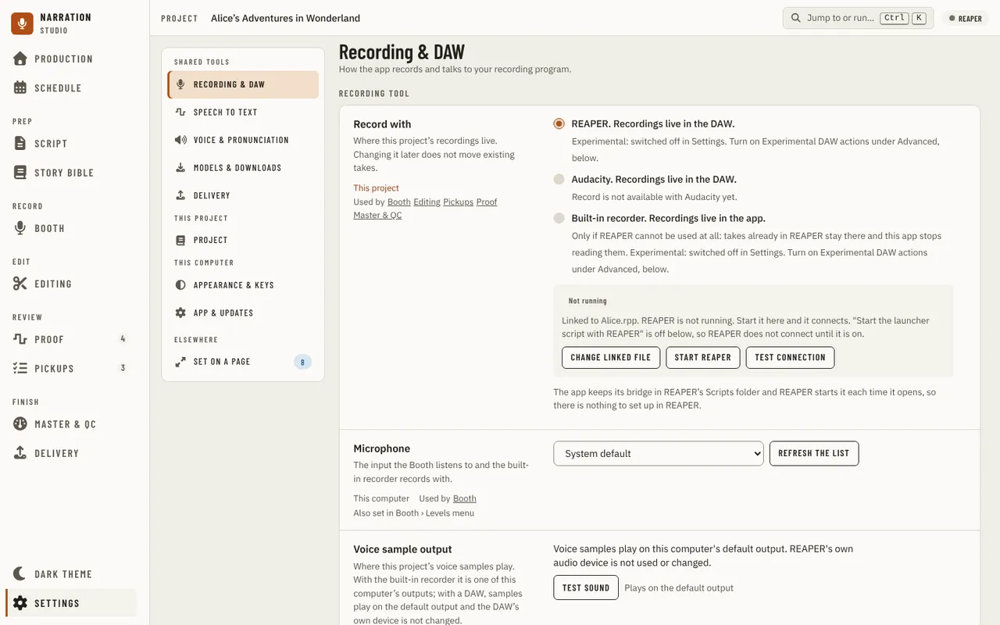

### DAW Integration

When REAPER is not installed, the card offers **Get REAPER**, which opens its download page in your browser; the
app never downloads or installs it for you. **Check again** looks again. A running REAPER has been heard from in
the last 5 seconds, and the card says whether its open project matches the linked one.

- **REAPER program** (Advanced): the full path to `reaper.exe`, for a REAPER the app does not find by itself. A
  value that is not a path to `reaper` or `reaper.exe` is refused where you type it, and the old one stays.
- **Start the launcher script with REAPER** (on by default): the app keeps its bridge in REAPER's Scripts folder and
  REAPER starts it each time it opens, so REAPER connects with no step in REAPER. Off, the app writes nothing into
  REAPER and REAPER does not connect.
- **Capabilities** (Advanced): a table, titled with the linked tool's name ("What REAPER can do"), of what the app can ask the
  recording tool to do, each with a **Now** column: **Available**, or **Unavailable** with the tool's own reason beside it
  (REAPER not answering, or something that DAW cannot do, such as "Audacity cannot set an audio interface's input gain").
  Nothing in it turns a capability on or off: what the linked DAW can do is on, all the time.
- **Sync activity** (Advanced, REAPER only): what each chapter sync did, newest first: the first sync, each
  chapter a later sync linked when you saved in REAPER, and each new track that isn't a chapter. A link sync made has **Undo**
  while the chapter still holds it; Undo removes that link and sync never makes the same one again.

The Audacity backups and the favourite effects are listed under [Set on a page](#set-on-a-page), where Settings edits them; [Editing](editing.md) has a shortcut to the same settings.

## Speech to text

**Transcription model** is the one default for comparing and checking recordings: Production's recording check,
[Proof](proof.md), [Pickups](pickups.md) and [Editing](editing.md) all use it. It is for all projects, and a project may override it.
Changing it asks first. Choosing a model that is not on this computer shows **Not on this computer** in the row, with **Download** and a link to **Models & downloads** on the line under it.

**Live reading in the Booth** holds the **Live engine** (Whisper, or Moonshine on Windows) and the **Live model** (`tiny`
or `small`) the [Booth](booth.md) follows your voice with. Under Advanced, **Recording check** holds the **Two-pass check**, its **First-pass model** and
**Re-check model**, **Run both models together**, **Parallel processes** and **Chunk length** ([how it works](../../utilities/recording-coverage.md#the-model-cascade)).
**Parallel processes** is how many recordings, or pieces of one long recording, a check transcribes side by side; each holds a copy of the
speech model in memory. 0 is Automatic: half this computer's processors, fewer when the chosen model's copies would not fit in the free memory. The
line under the box says what the value shown runs on this computer and what set it, for example "Automatic: 4 transcriptions at once, using 8 of
8 processors for the small model. Set by the processors: half of them, so each transcription has 2 processors." A number you type is kept up to
the processors and the memory, and the line says when it was cut down. The same number is how many chapters a Story Bible scan with GLiNER reads at once; BookNLP always reads the whole book, and when it runs beside GLiNER the scan keeps a quarter of the processors and BookNLP's memory for GLiNER's workers (on 4 processors GLiNER then reads whole).

**Background checks** holds **Check recordings in the background**, the **Model for background checks** (`tiny`) and the
**Double-check model for background checks** (`small`, or **None (one model)**), and under Advanced the **Processors for background
checks** (0 lets the app choose half of this computer's). These apply only to checks the app starts on its own
([Checking what you recorded](booth.md#checking-what-you-recorded)); a check you start in **Check recordings** keeps the models above. A larger
model, or more than half of the processors, shows a warning under the choice: it makes each check slower and keeps the computer busy
for longer.

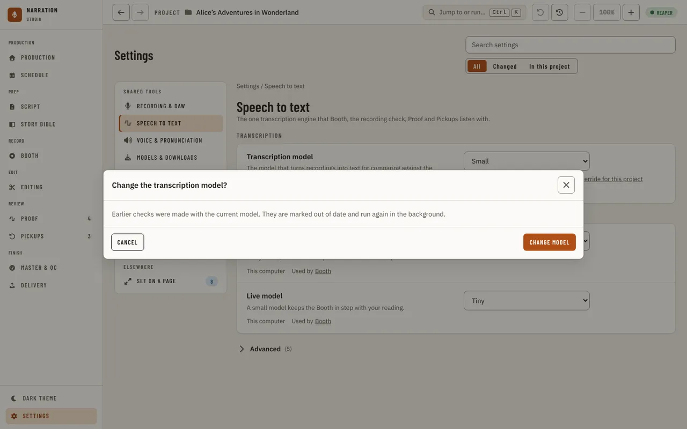

## Voice & pronunciation

- **Preview voice** is the voice that says a name or word when you ask for a [preview](story-bible.md#hearing-a-name). It does not narrate anything. The list holds every approved voice: LJ Speech (US English, the default), Cori (British English), Kristin (US English) and Norman (US English). Choosing one downloads nothing: a voice that is not on this computer shows **Not on this computer** with **Download**, and is also listed under [Models and downloads](#models-and-downloads).
- **Show definitions from** chooses where the Script page's **Words** tab shows definitions: the web page (the default), the local dictionary or the online
  service. The choice is the same one as the Words tab's **Definitions from** menu. The local dictionary shows **Installed** or **Not installed** with a button to download or remove it; the online service
  shows **Online**, **Offline**, or **No key saved**.
- **Pronunciation source for new names** is what a new name tries first (Automatic, CMU, Wiktionary or eSpeak); it never limits generating or replacing a pronunciation by hand for an entry.
- **Merriam-Webster key** (Advanced): an optional free key of your own (**Get a free key**, **Save key**, **Test key**, **Remove key**) that Look up online uses when no dictionary on this computer knows a name. It is kept apart from the other settings and never shown again after you save it; only the word you look up is sent.

## Models and downloads

One list of everything the app can keep on this computer: Whisper models, Moonshine models, the preview voices, the Story Bible language models, the dictionary, the wiktionary pronunciations and the MP3 encoder. Nothing downloads by itself, and
removing one never touches your projects. Above the list, the disk the installed ones use and the folder they are kept in, with **Open folder** to show it in the file manager. When the list cannot be read, the message offers **Retry** and **Open the folder**.
Which one is *used* is chosen in the category that uses it; here you only get, check and remove them.

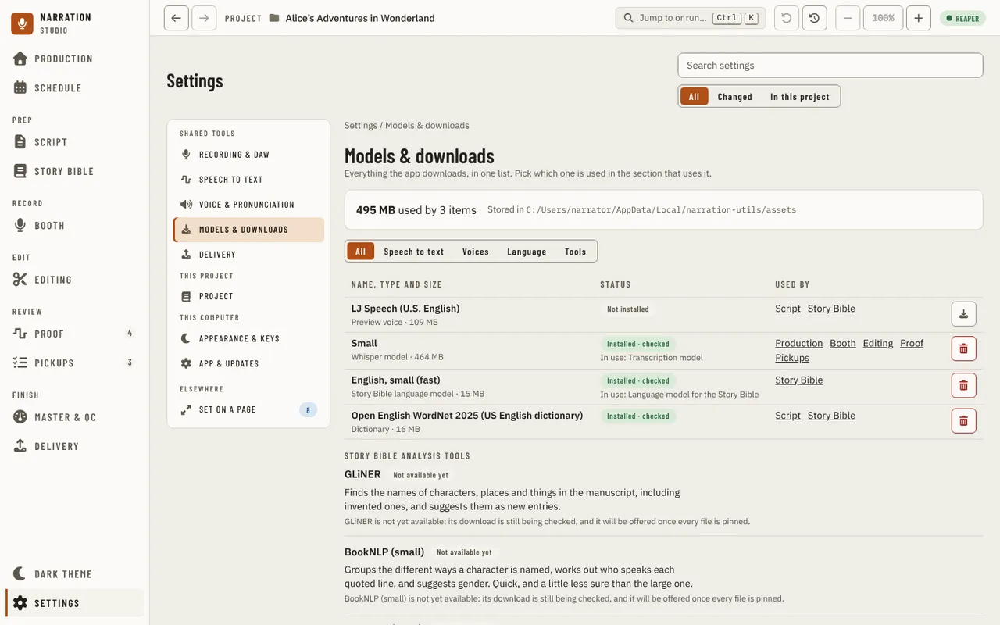

Each row says what it is, its type and size, its **Status**, **Used by** (pages) and **In use** (the settings that choose it), with its buttons at the right end of the row. On a narrower window each row is a card with its buttons beside the name. The status is one of:

- **Not installed**: **Download** starts the download. A bar shows the real bytes so far and **Cancel** stops it while bytes are arriving; the checks after the last byte cannot be cancelled. A download that is already running when you open the page (started by a Story Bible build, a preview or a comparison) is shown too, and leaving the page does not stop it.
- **Downloading** and **Checking the download**: the download itself, then the check of every file against its approved size and checksum.
- **Installed · checked**: **Remove** deletes that one asset after you confirm. The confirm names the settings that use it; they switch to the smallest other model you have, and checks made with it are marked out of date. When it is the only installed choice for a setting, the removal is refused and says so.
- **Needs repair**: some files are missing or no longer match, so the app will not use the asset. **Repair** downloads it again; **Remove** deletes it.
- **Download failed**: the row says so, the reason (no connection, not enough disk space) comes up as a message that stays until dismissed, and the row has **Retry** and **Dismiss**.
- **Not available yet**: the app lists the asset but does not offer it in this version. The row says why and has no buttons.

With nothing downloaded, the page offers **Download the recommended set** (the Small transcription model and the preview voice). Below the list, **Story Bible analysis tools** lists the optional tools that make the Story Bible scan better (GLiNER, BookNLP small and large), each with what it does, its size, where it downloads from and the memory it needs, and the **Offer better analysis when scanning** box. GLiNER (about 730 MB) finds the names of characters, places and things, including invented ones; BookNLP groups the ways a character is named and works out who speaks each line. **Download** asks first; a Story Bible scan then runs the basic rules and each tool you have (with both BookNLP sizes, the large one). **Remove** deletes a tool, and the scan goes back to the rules and whatever else is installed. A tool whose download failed says why in a message that stays until dismissed, and its row has **Try again** and **Dismiss**; when the files arrived and matched but could not be unpacked or saved, **Details** under the reason names the file and what went wrong, which is what to quote in a report. The download dialog that other pages open shows the same line under **Live activity**.

## Delivery

- **Delivery profile** picks the profile this project is judged against, on [Master & QC](master-and-qc.md) and [Delivery](delivery.md), the same choice as Delivery's own menu, with the limits of the chosen profile listed under it.
- **Default profile for new projects** is what a project that has not chosen its own is judged against (ACX until you change it).
- **Custom profiles** (Advanced) lists your profiles and the built-in ones to copy. **Duplicate** makes a custom copy and opens it in the editor, where you can rename it, turn a rule off, and change the lowest and highest of a rule that has a range (a length is in minutes); a rule with a fixed value can only be turned off, and a copy cannot add a kind of rule the app does not check. **Edit** and **Delete** work on a custom profile; a project that chose a deleted profile goes back to the default.

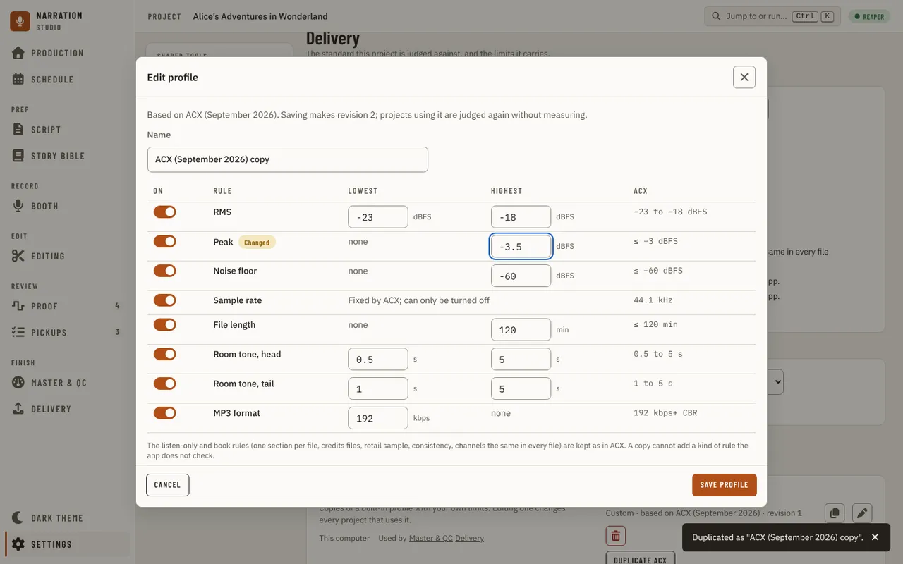

## Project

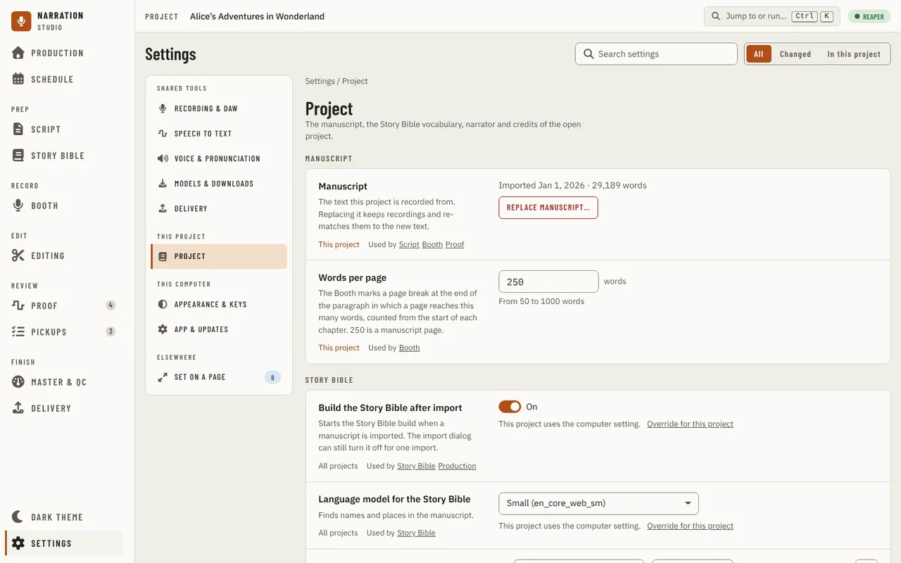

- **Manuscript** says when the manuscript was imported and how many words it has (or **No manuscript yet**), with **Replace manuscript…** (or **Import manuscript** when there is none). **Replace manuscript…** opens the same two steps as the [import](production.md#importing-the-manuscript); step 2 names what the replace clears.
- **Words per page** (this project, 250 by default, 50 to 1000) is where the [Booth](booth.md) marks a page break: at the end of the paragraph in which a page reaches that many words, counted from the start of each chapter, so a page never breaks inside a paragraph.
- **Build the Story Bible after import** and **Language model for the Story Bible** are for all projects, and a project may override them.
- **Entry types** lists the kinds of [Story Bible](story-bible.md) entry, each with its name, colour (the swatch is the colour the entries of that type are drawn in on every page), a **Can speak** box (entries of that type can be picked as the speaker of a quoted line, and the next Story Bible build attributes dialogue to them) and how many entries it has, on one line in a wide window (in a narrow one the colour, **Can speak**, the count and the remove button take a second line under the name). A type you add with **New type** does not speak until you tick the box. Rename a type in its box and every entry of it moves with it; change its colour; or remove one: the remove button stays off while entries use the type, and the last type cannot go. A taken or reserved name is refused, and says why under the list.
- **Marks** lists your mark types, each with its colour, and **tracks a reply** on a type that asks for one. **Edit marks…**, the pencil at the right of the marks, opens the same **Define how you mark up** dialog as the Script page.
- **Narrator name** fills the narrator's name in the credits, for all projects, and a project may override it. Under Advanced, **Room tone per credits file** (0 to 10 seconds, 0 by default) is the silence the [Production](production.md#the-credits) credits estimate adds to the opening and to the closing credits file, head and tail together (ACX asks for 1 to 5 seconds at each end of every file).
- **Credits**: see [Credits](#credits).
- **Delete Story Bible data** (Advanced) deletes this project's Story Bible and nothing else: the confirm names the project and counts every entry and every suggestion the manuscript scan made (accepted and rejected ones too, so a later scan offers them again), and says that the entries' names, pronunciations, notes, relationships, review flags and speaker colours, the types you added or changed (the default types come back) and who speaks each line of dialogue go with them. It opens on **Cancel** and there is no undo. The script, takes, recordings, settings, voice samples and voice references stay; a character's samples show in **Voice data** as samples for a character no longer in the Story Bible, and an entry added again under the same name has them again. It is refused, with a message, while a scan or a Story Bible build runs. This is the only place the Story Bible's data is deleted.
- **Clear derived data** (Advanced) removes the imported manuscript and its stored source, the Story Bible, proofing artifacts, reader notes and bookmarks, and saved comparison results for the current project, after you confirm. Its settings remain.

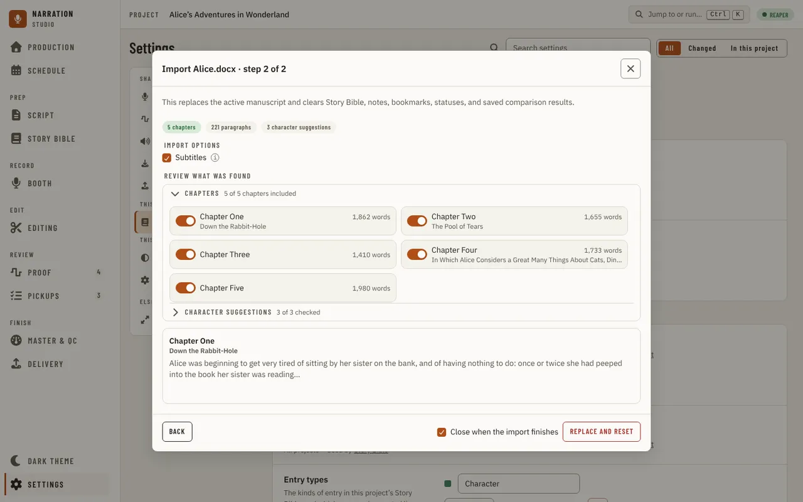

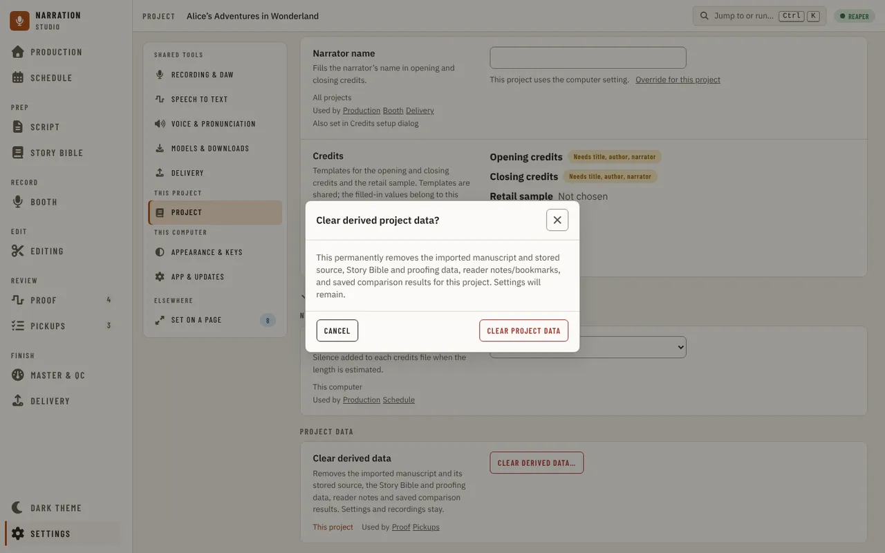

## Credits

**Credits**, under Project, shows in three lines whether the opening and closing credits can be read as they stand and whether a retail sample is chosen, each with a badge, and **Edit credits…**. The editor opens in place and holds the audiobook's opening and closing credits, an optional chapter announcement, and the retail sample. The templates are shared by every project; the filled-in values belong to this project.

- **Templates**: pick a template to edit its **Name**, **Kind** (Opening, Closing or Chapter announcement)
  and **Body**, then **Save template**. **New** starts a blank one, **Duplicate** copies the selected one
  and **Delete** removes it.
- **Tokens**: bracketed tokens in the body, such as `[Title]`, `[Author]` and `[Narrator]`, are filled
  from the project values. Wrap a part in braces to drop it, punctuation and all, when a token in it has no
  value: `[Title]{: [Subtitle]}` reads just the title for a book with no subtitle.
- **Chapter announcement**: what you read at the head of every chapter. `[Chapter]` is the chapter's
  heading as the manuscript names it ("Chapter 1") and `[Chapter Title]` its subtitle ("Down the
  Rabbit-Hole"), so `[Chapter]{: [Chapter Title]}.` reads "Chapter 1: Down the Rabbit-Hole." and just
  "Prologue." for a chapter with no subtitle. You record it inside each chapter file, so keep it to the chapter
  heading and subtitle: Proof expects the spoken chapter title there, and any other words are reported
  as extra.
- **Preview** shows the body with the values filled in, its word count, and any token that has no value
  yet, highlighted and listed as unresolved. A chapter announcement is previewed for the first chapter
  ("Shown for Chapter 1, one of 12 chapters"); it needs an imported manuscript.
- **Project values**: Title, Subtitle, Author, Series, Book number, Copyright, Year, Copyright holder,
  Publisher, and a Narrator that overrides the narrator name set under Project for this project only. A value
  is saved as you type. Where the manuscript suggests a title or author, **Use suggestion** fills it in.
- **Clear credits** empties every project value at once, after asking. The templates in your library stay,
  so the credits show their tokens in brackets again until you fill them in.

The first opening and closing templates appear in the [Script](script.md) reader and as the
credits rows on [Production](production.md#the-credits).

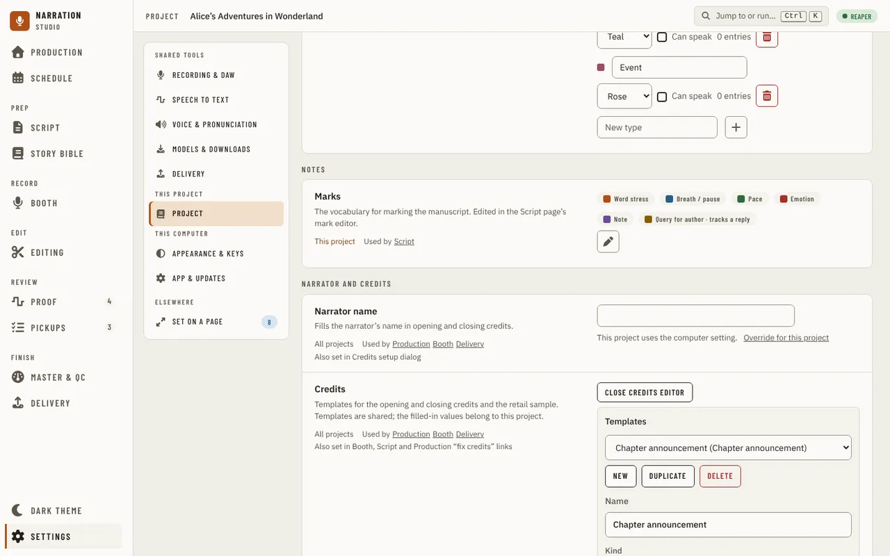

### Retail sample

**Retail sample** is the stretch of the book you pick for the retailer's sample: up to 5 minutes, from
anywhere in the book. Choose the chapter and line it **starts in** and **ends in** (the line numbers the
[Script](script.md) reader shows) and **Save sample**. The panel says where it runs ("Chapter 3: A Caucus-Race and a Long Tale, lines 1 to 3", naming a chapter once) and how long it
is at about 155 words a minute; a range longer than 5 minutes is refused with its length, and the sample
you had is kept. **Clear sample** removes it. The sample is a marker in the Script page's reader only: it adds
no time to the estimate, since it is read again from the finished chapter. It is kept with the project, so
replacing the manuscript keeps it; if its lines are gone, the panel says so and you pick it again.

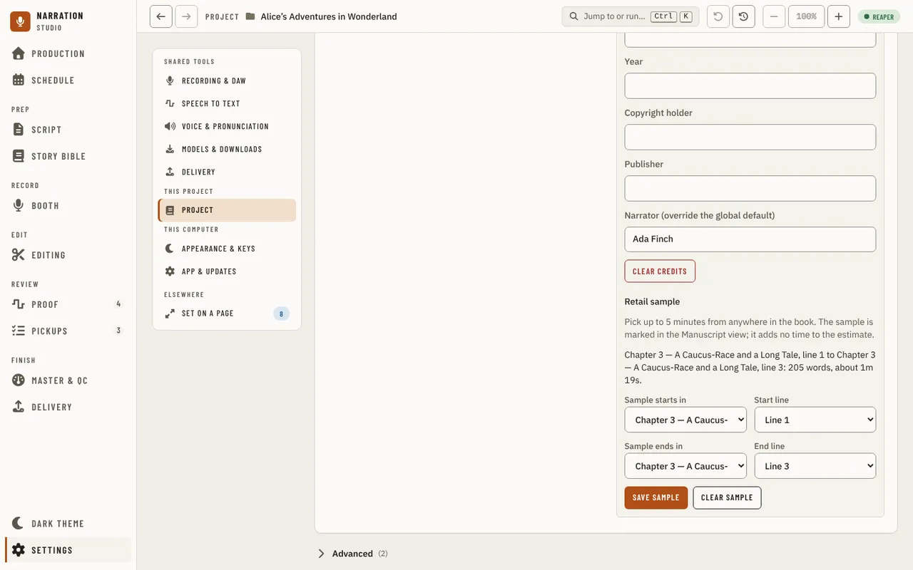

## Appearance & keys

- **Theme** sets **Match my system**, **Light** or **Dark**. The **Dark theme** / **Light theme** item at the foot of the sidebar switches it too. It is kept in this window, so the page calls it **This computer**.
- **Motion** is **Follow Windows** or **Reduce**. **Reduce** stops the app's slides, fades and highlights: menus, drawers and messages appear at once, and the Booth's cursor jumps from line to line. **Follow Windows** does that only when Windows' **Animation effects** setting is off. Like Theme, it is kept in this window.
- **Reader font**, **Reader text size**, **Line spacing** and **Column width** set how the [Script](script.md) reader draws the text, one row each, with a quote drawn in all four under **Column width**. These are the Script's own text settings, so a change here shows there and the other way round. The Booth keeps its own text size and uses the font and column width chosen here; its **Text settings** change the same font and width.
- **Note colour** is the colour that marks reader notes in the text; a project may override it.
- **Zoom** scales the whole window (100% to 200%, the steps the jump menu's zoom commands and **Ctrl+plus**, **Ctrl+minus** and **Ctrl+0** use); it follows those and sets the same level.
- **Shortcuts** lists every command you can run without the mouse, grouped by where it works, with a **Find a shortcut** box; each command's keys and its **Change** button sit at the right of its line, and the list is as long as the card. **Change** opens a recorder under the command: press the key or pedal (a USB footswitch that types a key works like a keyboard), then **Replace**, **Add as another key**, **Unbind** or **Reset to default**. A key another command already uses is named, and **Replace** takes it from that command. A changed command shows **Changed** and its own **Reset**; **Reset all to defaults** undoes every change. Each change saves at once.

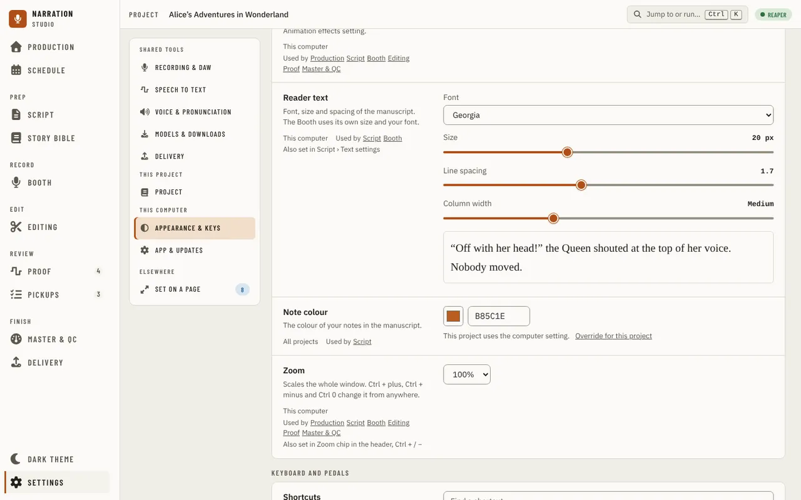

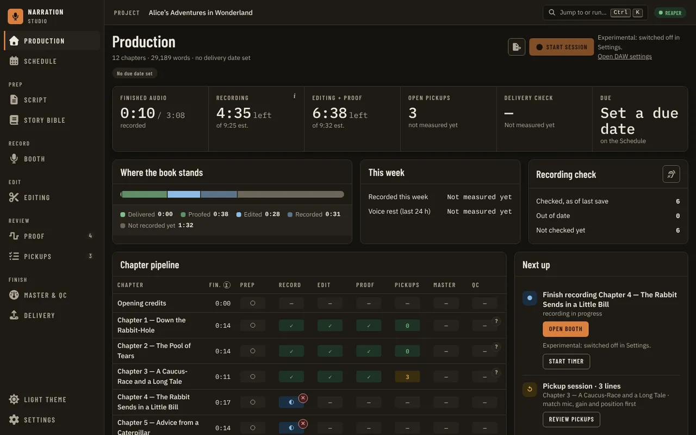

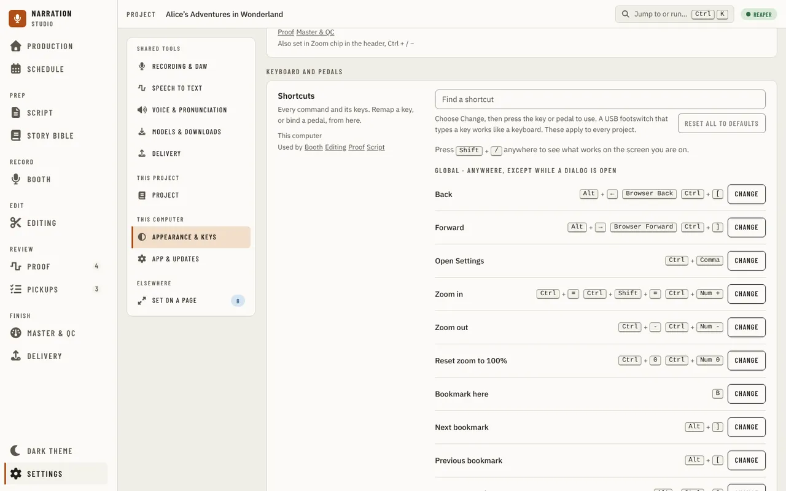

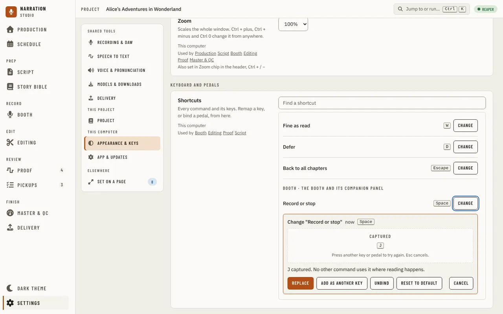

## App & updates

**Check for updates on startup**, **Update channel**, **Tell me when a long task finishes** (a Windows notification when a long job ends while the app is not in front; on by default) and, under Advanced, **Debug logging**, which writes the reasons behind the app's decisions to the run log: turn it on when asked to send a log. **This version** follows them (see [About and updates](#about-and-updates)).

### About and updates

Under the rows of **App & updates**, the **This version** section has two rows: the version of the app you are running,
and **Updates**, which says what the last check found in one line (the release, its size, whether it is downloaded and
the day the app last looked), any problem right under it, and the buttons in one row with **Check now** last.

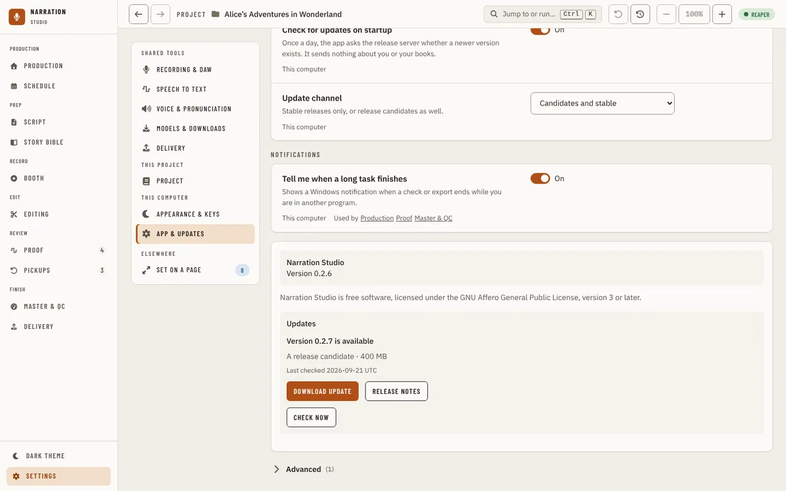

- **Check for updates on startup** (a row above, on by default): once a day, when the app starts, it asks GitHub which releases exist. That
  request sends nothing about you, your projects or your computer, and it never downloads anything by itself. Switch it off
  if you would rather look yourself with **Check now**. When that check finds a newer version, a message also pops up
  ("Version 0.2.7 is available. See Settings, About & updates.").
- **Update channel** (a row above): *Candidates and stable* (the default; every release so far is a release candidate) or *Stable only*.
- **Download update** asks first, then downloads the new version with a progress bar showing the megabytes received, and
  checks it against the release's checksum. You can cancel while it downloads; the checks and unpacking after it cannot be
  cancelled, and the dialog says so. If the download fails, the dialog says why and offers **Retry** beside **Close**,
  which starts the download again.
- **Install and restart** asks again, then closes the app and starts it again on the new version with the same
  project. It will not install while an import, a Story Bible build, a download, a comparison or a teleprompter session is
  running: finish or stop it and try again. If the new version does not start, the previous one comes back by itself.
- If the app is installed somewhere it is not allowed to change (for example under Program Files) it says so and
  offers **Show the downloaded file**, so you can replace the program yourself. It never asks for administrator rights.
- **Release notes** opens the release page in your browser.

The app runs on Windows only, for now, so updates are for Windows.
Releases are not yet signed, so Windows SmartScreen or your antivirus may ask about a new version the first time.

If the app will not start after an update and the program file is missing from its folder, rename
<!-- brand:identity.executable -->narration-studio<!-- /brand -->.exe.old back to <!-- brand:identity.executable -->narration-studio<!-- /brand -->.exe.

## Set on a page

Some settings only change what one page does, so they belong on that page, next to what they change: the recording check's rules (Production), silence cleanup (Master & QC), the preview suggestion and compare defaults (Proof), stage suggestions (Production), punch pre-roll (Booth), favourite effects and the Audacity backups (Editing). **Set on a page** lists them, each with where on that page it belongs and, on the line of **Change it here for now**, an **Open** button for that page. Settings always keeps every one of them: **Change it here for now** opens the panel with its **Global** / **This project** switch, **Save** and **Discard changes**, and leaving Settings with unsaved changes there asks whether to save or discard them. Five pages also have a shortcut to the same setting, which reads and writes the same keys: Master & QC's **Jump to or run** (Ctrl+K) has **Open Silence cleanup options**, a dialog for the open project only, the same as choosing **This project** in the Silence cleanup panel here (Diagnostics also keeps its **Open Settings** link to that panel); Production's **Jump to or run** has **Open Stage suggestion options** and **Open Recording check rules**, the same for the open project only; Proof's **Jump to or run** has **Open Preview options** and **Open Compare options**, which open a dialog for the open project only, the same as choosing **This project** in the panel here; the Booth's **Levels** menu has **Punch pre-roll (seconds)**, which is Global like the panel here, and Editing's **Backups** tab has the backup settings for the open project only, the same as choosing **This project** in the Backups panel here (that panel can also set Global). Editing's **Effects** tab has a **Favourite** button on each chain and plug-in the DAW lists, which edits the same favourite effects list as **Favourite effects** here, at the Global layer (that panel can also set This project). Search finds them too.

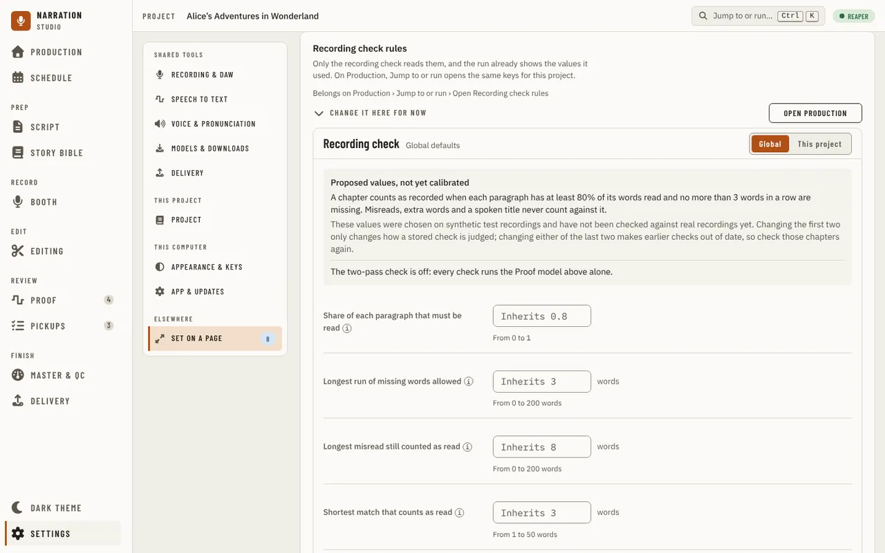

## When something is wrong

- While the settings are read, the pane shows grey blocks under its title and says **Reading your settings…**.
- If the settings file cannot be read, the page says **Your settings could not be read** and disables the controls until **Retry** works.
- If a change cannot be saved, the page says **Changes cannot be saved right now** and the row says why; the previous value is still in use.
- If the list of downloads cannot be read, Models & downloads says so with **Retry**; your downloads are not touched.

---

[← Delivery](delivery.md) · [Index](README.md)
