[Using the app](README.md) › Settings

# Settings

Settings is a page of eight categories, one shown at a time. The list sits at the left in three groups: **Shared
tools** (Recording & DAW, Speech to text, Voice & pronunciation, Models & downloads, Delivery), **This project**
(Project) and **This computer** (Appearance & keys, App & updates). **Set on a page** stands apart under
**Elsewhere**. In a narrow window the list folds into one **Category** button that names the current category and opens the
list. **Settings** is the page's one title; the category you are in is named by a smaller title above its sections.

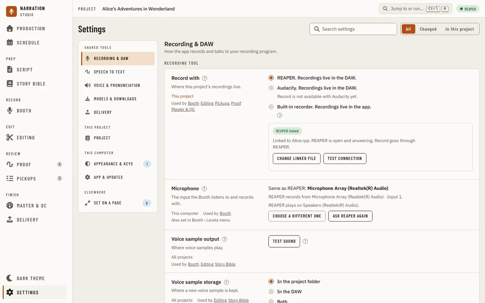

**Ctrl+,** opens Settings from any page. When a link from another page brings you here (the Booth's DAW settings,
a "fix credits" link, Master's silence cleanup), Settings opens on the setting, lights it up for a moment and
offers **Back to** the page you came from.

This page is a reference to every setting, category by category. If you came to do one thing, start from the list
below; each line goes to the section that has the steps.

## Common tasks

- **Record in REAPER**: [link your REAPER project](#link-your-reaper-project). Choose **REAPER**, **Audacity** or the
  **Built-in recorder** under **Record with** in the Recording & DAW category ([Choose REAPER](#choose-reaper)).
- **Choose the microphone** the Booth listens to: **Microphone** in the Recording & DAW category. With a DAW it
  follows the DAW's own input and needs nothing set.
- **Download a speech model, a voice or the Story Bible language model**: [Models and downloads](#models-and-downloads).
  Nothing downloads until you press **Download**.
- **Change the model that checks your recordings, or the one the Booth follows you with**:
  [Speech to text](#speech-to-text).
- **Replace the manuscript**: **Replace manuscript…** in [Project](#project).
- **Set up the opening and closing credits**: [Credits](#credits).
- **Change the theme, or the reader's font and text size**: Appearance & keys, under **This computer** in the category list.
- **Check for an update**: **Check now** in [About and updates](#about-and-updates).
- **Move the downloaded models to another disk**: [Models folder](#models-folder).
- **Find any other setting**: type in **Search settings** at the top right ([Find a setting](#find-a-setting)).

## Before a project is open

Settings does not wait for a project. On **Choose your project** the **Settings** button (the gear at the top right) opens
the same page in place of the picker, and **Ctrl+,** or **Settings: <category>** in the jump menu (**Ctrl+K**) opens it
there too. There is no navigation rail, since every page of the app needs a project. **Back to project picker** returns to
the picker.

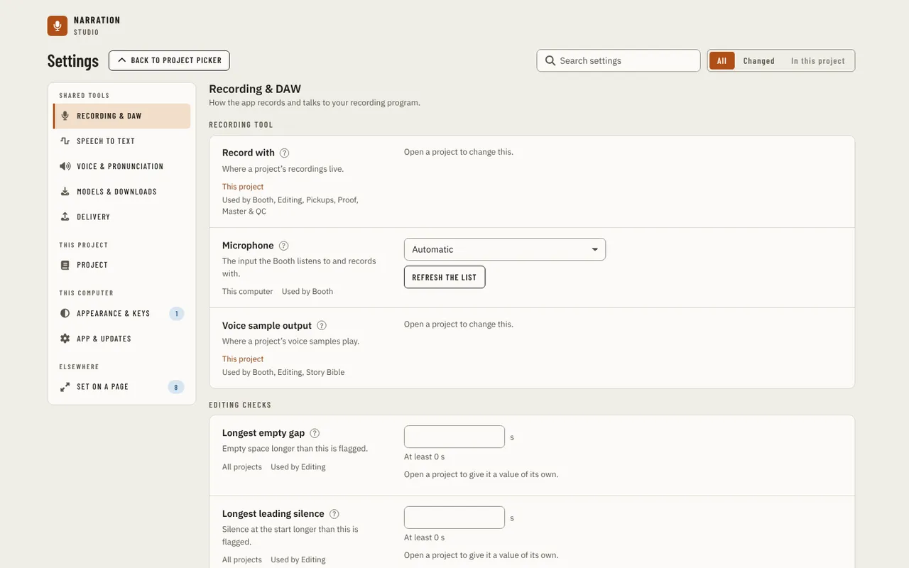

- Every row that is **This computer** or **All projects** works as it does with a project open: the microphone, the speech
  and voice settings, the Merriam-Webster key, the delivery default, appearance and keys, and updates.
- **Models & downloads** is the same list. Download, check, repair and remove a model or voice here before you choose a project.

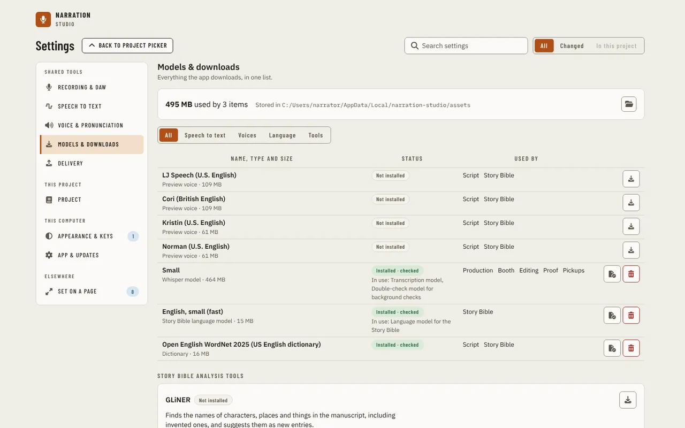

- **Check now** and **Download update** under **App & updates** work too. **Install and restart** brings the app back to the
  picker, or to the project it was started with.
- A **This project** row (Record with, the chapter layout, the project's manuscript and credits, its delivery profile) stays in
  its place, described as "a project's", and says **Open a project to change this.** It shows no value, since there is no project to hold one. A **Used by** list names the pages without
  links, **Also set in** is left out, and the **In this project** filter is off.
- A **Set on a page** entry that has a computer value and a project value edits the computer's, and says **Open a project to
  set these for a project.** Audacity's backups belong to the project alone and say **Open a project to change this.**

## Every setting says whose it is and who uses it

Each row has a name, one line on what it does (a **?** beside the name opens the details, where there are more), and under it:

- **This computer**, **This project** or **All projects**. A setting for **All projects** is one value for the
  computer that a project may override: under the control it says **This project uses the computer setting.** with
  **Override for this project**; once overridden the row says **overridden here**, shows **This project uses** with its
  own control, and **Use computer setting** goes back. A **This project** setting belongs to the open project only.
- **Used by** and the pages that read it. Each name goes to that page; the setting is changed here, once.
- **Also set in** where a quick control for the same value sits (the rail's theme button, the Script's Words tab).

A change applies at once, with no Save button. The row says **Saved** beside its control. A row that differs from its
default shows **Changed**, a bar at its edge and a reset button that puts it back (spaces around a value, and the capitals in an engine's name such as Piper, do not count as a change; the reset button is busy until its save is done); a category with changed rows shows
how many in the list and a **Reset to defaults** button beside its title. **Reset to defaults** puts back every changed row in the category: the computer's values, this project's overrides, the choices this window keeps (theme, text sizes, orders and the like), the shortcut list, the recording tool (back to REAPER) and the project's delivery profile (back to the global default). What you entered is not counted as changed and is never reset here: which character each voice track records, your own delivery profiles and your Merriam-Webster key. Each of those is changed or removed in its own row. **Reset to defaults** also leaves five changed rows to their own panels, because putting them back is not a value write: the **Models folder location** (it moves gigabytes and asks first, with its own reset), the default delivery profile, the Story Bible types, the mark types and the credits (it would erase what you wrote). A changed row of the choices this window keeps also has its own **Reset** button (named for the row, for example “Reset Booth text size to its default”) that puts back that one row and leaves focus on it. With **Changed** on, a row you reset leaves the list and focus moves to a neighbouring row, or to the page heading when none is left. A value edited by hand that the row does not list shows its unit (“240 s”) or “(invalid)”. A change that costs something asks first: changing the
transcription model says earlier checks are marked out of date and run again. A value the host refuses keeps
the previous value and says why under the row; the page then notes that changes may not be kept until one succeeds.

Rarely changed settings sit under **Advanced** at the foot of a category, closed until you open it; the heading
says how many it holds.

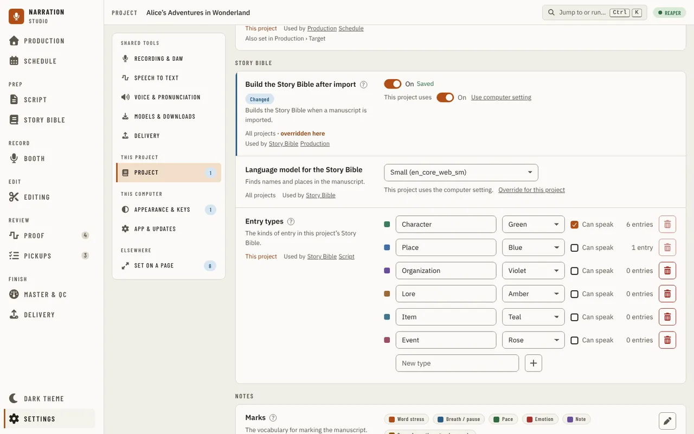

## Find a setting

At the top right, the **Search settings** box (a magnifier inside it, at its left) and the **All** / **Changed** / **In this project** control sit on one line (on a narrow window they take the full width). **Search settings** matches the name, the description, its details and words you might use instead (typing "whisper" finds the
transcription model; "breath" finds silence cleanup). Results are grouped under their category, each with a table icon (**Show the
whole category**) at the right of its header, and include matches from the Advanced sections. **Changed** lists every setting that differs from
the default: the host's settings, what this window keeps (Theme, Motion, Start tone, the waveform arrow step, Reader text), and Zoom, the
Shortcuts, the Merriam-Webster key, the recording tool (anything but REAPER), the delivery profiles (your own, or one chosen for this project), the default delivery profile
(when it is not the one the app ships with), the Story Bible types and the mark types (when they are not the six each starts with), and the credits (when a
shipped template was edited, deleted or added to, or this project has credit values of its own). It does not list
the rows that are not settings with a default: the capabilities report, the sync log, the manuscript, the Story Bible data and Delete project data. **In this project** lists the settings this project owns or overrides. Each says so
when nothing is there; on a narrow window the folded category button reads **Search results** while results show. **Escape** clears the search.

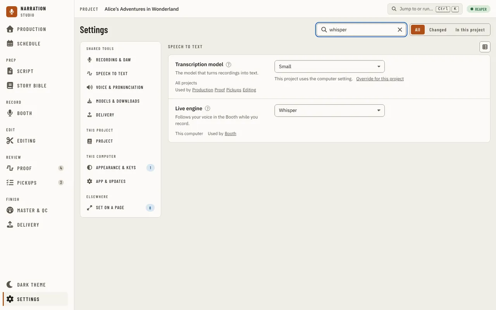

## Recording & DAW

**Record with** chooses where this project's takes are recorded: **REAPER**, **Audacity** or the **Built-in
recorder** (see [Choose REAPER](#choose-reaper)). The choice is saved with the project. A refused choice (no project open,
a take running, or the built-in recorder not available) says why under the radios, and the choice stays where it was. An option that cannot record yet, such as Audacity, says so under its radio, and the **?** beside it adds that choosing it still switches the project to it.
While REAPER or Audacity is linked, choosing the **Built-in recorder** first asks **Stop recording with REAPER?** (or
Audacity): new takes would go to the project's own folder, takes already in the DAW stay there and the Booth, Editing and
Proof stop reading them, and the link is kept, so choosing the DAW again brings them back. **Keep REAPER** leaves the
project as it was. Use it only when the DAW cannot be used at all; the **?** beside the **Built-in recorder** option says so.

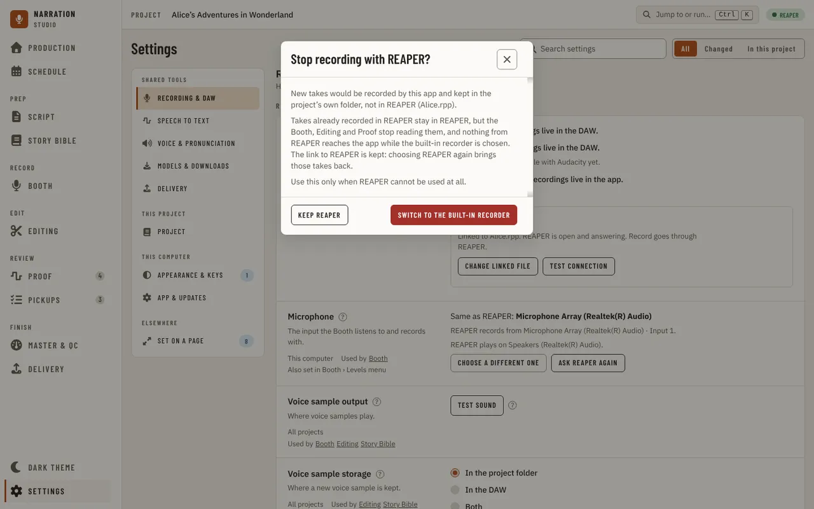

Under it, **Connection** says what the app can reach right now, with **Test connection**; after a test it says when it last checked ("Last checked 12 s ago").

You set nothing up in REAPER. The app puts its bridge in REAPER's Scripts folder by itself, and REAPER starts it each
time it opens; the **?** beside **Record with** says so, and the card says what stopped it when something did. When a project linked to REAPER opens and
REAPER is not running, the app opens REAPER on the linked project: **Connection** reads **Starting REAPER** with how
long ago it opened, until REAPER answers. If you close REAPER later the app does not reopen it; **Start REAPER** does, and it turns on the launcher first, as **Open in REAPER and
connect** does on the Booth.
If REAPER was already open before the app put its bridge there, the app runs the bridge in it for you.

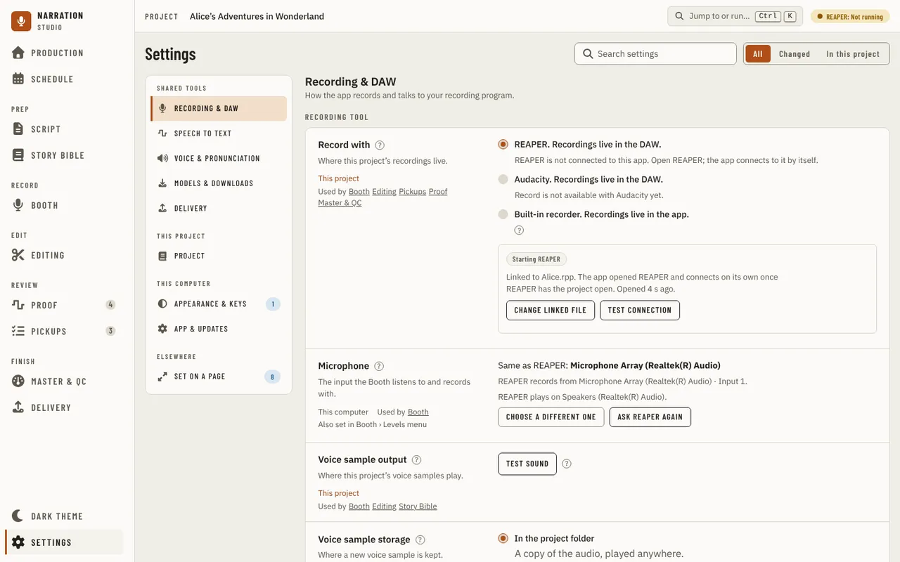

With **Audacity** chosen, **Connection** is **Audacity connection** instead: a status, one sentence that says what to do next, when Audacity was last heard from, and a **Set up Audacity** checklist. Audacity must be Audacity 3 with its scripting turned on. While Audacity is closed the app turns scripting on by itself and then starts Audacity on the linked project, once each time the project opens. Two things it cannot do for you, and the sentence says so: Audacity saves its settings when it closes, so if it is open with scripting off you close it and the app does the rest; and the first start of a new Audacity makes its settings and cannot load scripting, so that first time you close Audacity once after it opens. **Turn on scripting** and **Start Audacity** are still there to do either by hand. Once Audacity answers, **Link the open Audacity project** marks the project open in Audacity as this project's, with one label in a track named "<!-- brand:identity.audacityLabelTrack -->Narration Studio<!-- /brand -->"; **Choose Audacity project file** records the `.aup3` so **Start Audacity** opens it; **Unlink** forgets both and leaves the label in Audacity. **Check again** asks Audacity now. If Audacity may be waiting on a dialog, the card says so; close the dialog in Audacity and the app reconnects by itself. The same status shows on the header's engine chip and in the engine panel.

Also here: **Microphone**, the one the Booth listens to. With a DAW it shows the DAW's own input read-only (**Same as REAPER:**
and the device, with what REAPER records from and plays on) and needs nothing set; **Choose a different one** keeps another
microphone over it until **Use REAPER's input**, and when the DAW's input could be several microphones, one button picks each. **Ask REAPER again** asks once more and then shows when it last got an answer ("Checked 3:42:07 PM"), even when the answer is the same. **Test sound** is busy for the half second the tone plays.
Audacity cannot report its input, so with Audacity, and with the built-in recorder, it is a list of the computer's inputs with
**Refresh the list** (**Automatic** is the first one listed; see [The microphone the Booth listens to](booth.md#the-microphone-the-booth-listens-to)). With REAPER chosen, **Start the launcher script with REAPER** and, under Advanced, **REAPER program** (neither is shown
for Audacity or the built-in recorder); and, under Advanced for any recorder,
**Capabilities** and, for REAPER, **Sync activity**. These are settings of this computer; a project has no override for them. **Voice sample output** names the
recorder the project uses (for example "Audacity's own audio device is not used or changed").

**Chapter layout** (under **Chapter sync**, REAPER only) is **Flat** or **Voice folders**, saved with the project. Flat makes a chapter one
track (a chapter linked to a folder that holds only tracks of its own, none another chapter is linked to, still records on one of them); Voice folders makes a chapter a folder with one child track per voice. It is the same switch as the Layout row of the
[audio engine panel](navigation.md#the-audio-engine-panel): change it in either place and the other shows it at once. The **?** beside it says what each means.

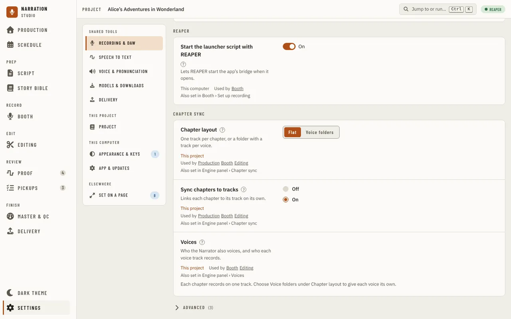

**Sync chapters to tracks** (also under **Chapter sync**) is **On** or **Off**, saved with the project. On, the app links each chapter to
the track named for it when the project is saved in the recording tool; off, nothing is linked on its own. Until you choose, neither is
picked and the app asks the first time it could sync. It is the same choice as **Turn on** and **Turn off** on the Chapter sync card of the
[audio engine panel](navigation.md#the-audio-engine-panel) and the question the app asks, and each shows the others' change at once.

**Voices** (REAPER only, under **Chapter sync**) is the Voices card of the engine panel on the page: with the **Voice folders** layout it
lists the voices of one chapter's folder with their keys, and the pencil beside a voice chooses the characters that track records, or, for
the Narrator, the one character it also voices. With the **Flat** layout the row says each chapter records on one track. Its tracks are the ones REAPER has now, as in the engine panel and the Booth, so a voice you rename in REAPER shows here before you save.

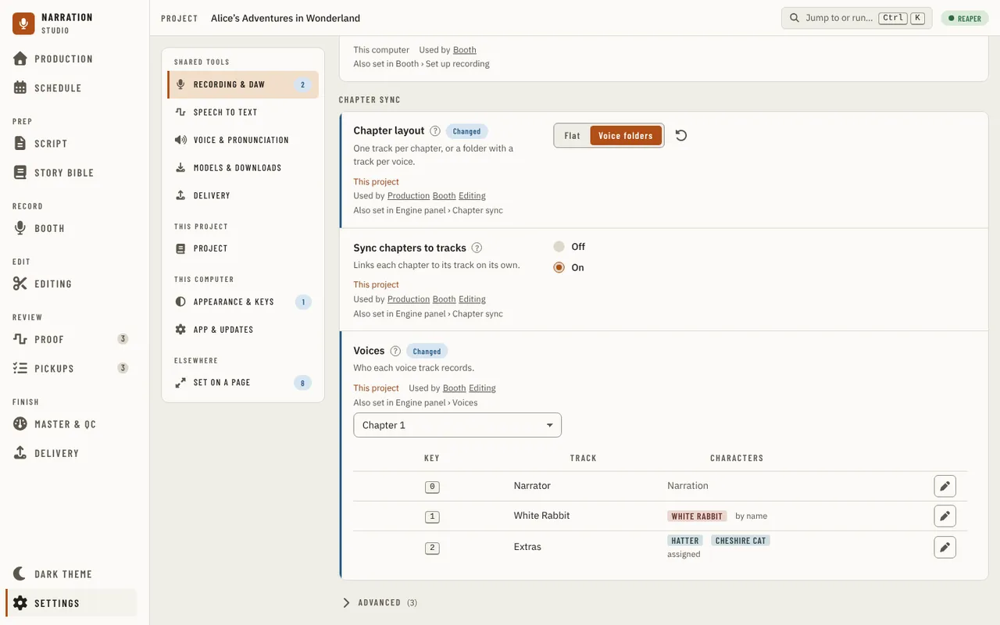

**Effects coverage cap** (under **Effects**) is how much of a chapter effects may cover before the [Editing](editing.md) Effects tab warns, a whole percent from 1 to 100 (10 until you change it). Set here it is this computer's value; **Override for this project** gives a project its own. The Effects tab's cap box always sets the project's own value, so typing there creates that override; **Use computer setting** removes it. The **?** says more.

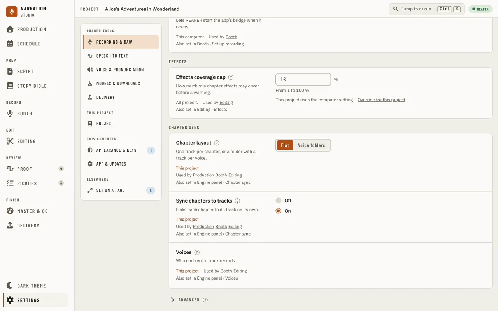

**Start tone** (under **Take cues**) is **Off** or **On**. On, the Booth plays a short beep when you press Record, for recording by foot pedal without looking at the screen, and the take starts when the beep ends, a fraction of a second later, so the beep is not on the recording. Turning it on plays it once. It is kept in this window, as Theme and Motion are, and there is no tone to stop a take.

**Voice sample storage** chooses, for every project on this computer, where a new [voice sample](editing.md#marking-a-voice-sample) is kept: **In the project folder** (the default) copies its audio into the project, **In the DAW** keeps only a region in REAPER's project, named for the character and label, and plays the audio under that region, and **Both** does both. Moving the region in REAPER moves the sample; deleting it ends the sample, and a region REAPER has not saved yet reads as "Not saved in REAPER yet". A recording tool that cannot keep a region (Audacity today) shows the two DAW choices off; hover or focus one to see why.

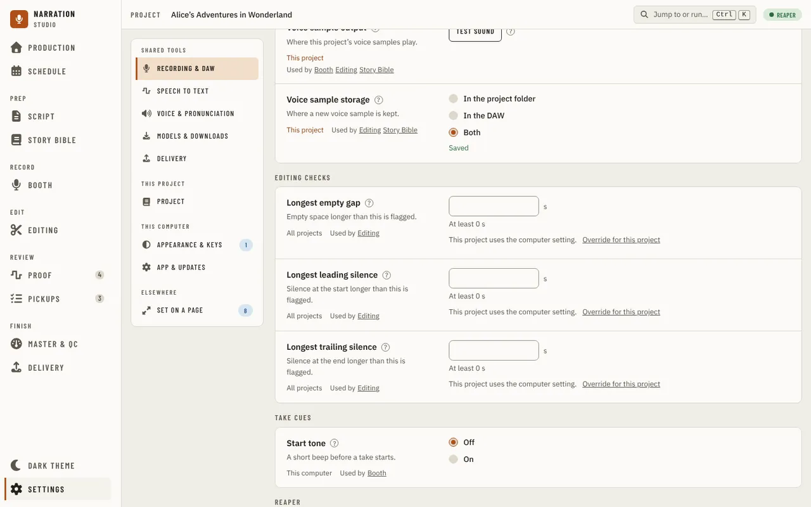

**Voice sample output** chooses where [voice samples](editing.md#marking-a-voice-sample) play, and is kept for every project on this computer. With the **Built-in recorder** it lists this computer's outputs after **System default**; **Refresh the list** reads them
again, and **Test sound** plays a short tone on the one chosen so you can tell where a sample will come from. A sample always plays
in the app's own audio, so with a DAW the row is **Test sound** with a **?** beside it: samples play on this computer's default output and the DAW's own audio
device is not used or changed. An output that is not connected stays chosen, with a notice that samples play on the system default
until it is back; the list is read again when the window gets focus and every few seconds while the notice shows. If the audio
system will not list its outputs, the row says so and the choice is off. The **?** beside **Test sound** says the same for the built-in list. Taking and read-aloud keep using the microphone and output
you chose elsewhere, and the row does not check whether a take is recording.

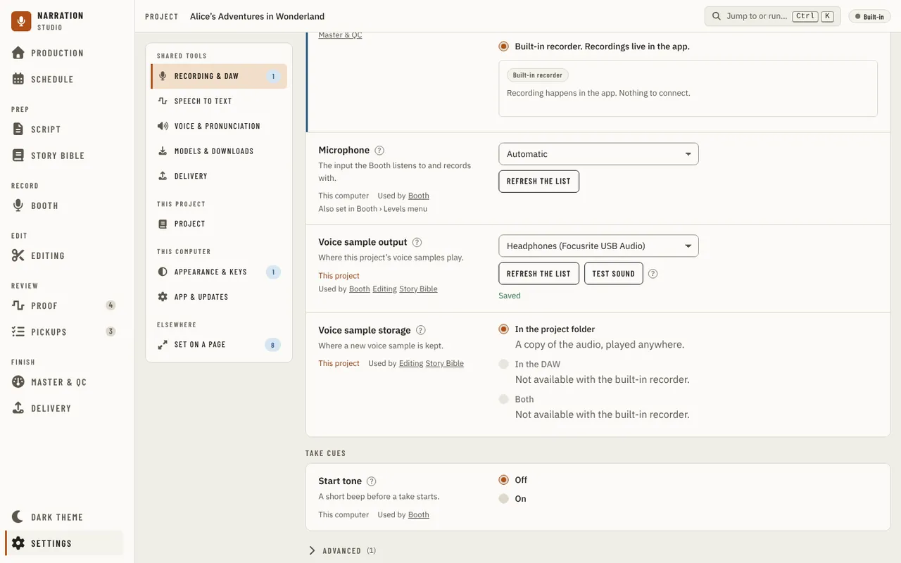

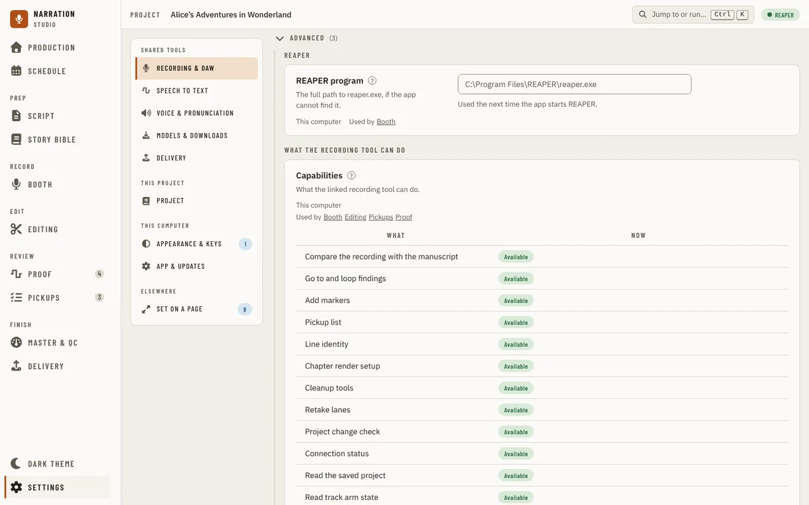

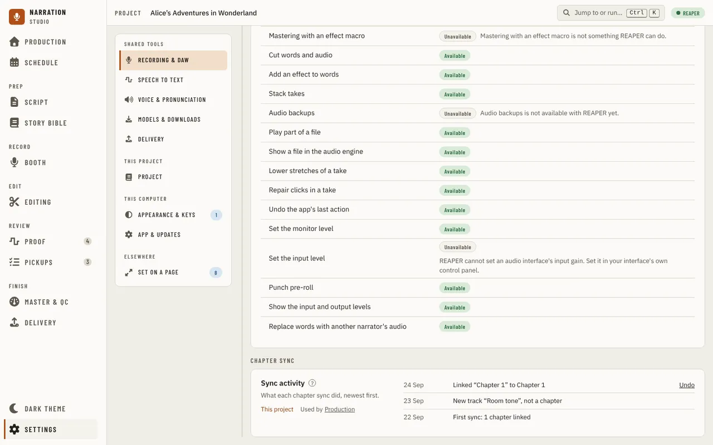

### Choose REAPER

Each radio says whether that program was found on this computer, or what stops it. A project folder holding a REAPER
project file (`.rpp`) starts on REAPER; pick another radio to change it.

### Link your REAPER project

Under the radios is the project's REAPER file. With one `.rpp` in the project folder it reads **REAPER not
linked** and offers **Link** with the file's name; **Choose a project file** opens a file dialog for any other
`.rpp`.

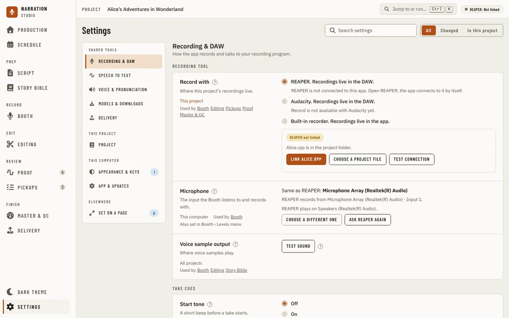

The file can be in the project folder, in a subfolder of it, or anywhere else, such as a folder or drive you keep
for REAPER. A file inside the project folder keeps working when you move the whole project. For a file elsewhere,
a note says where the file and the project are. Only a file that is not an `.rpp`, or no longer exists, is
refused. Linking also chooses REAPER. Once linked, the card names the file and reads **REAPER linked** while REAPER answers, or
**Not running** with **Start REAPER** while it is closed.

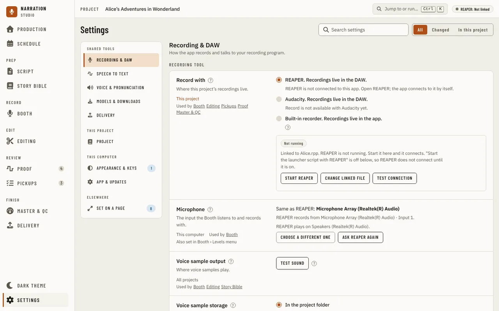

### DAW Integration

When REAPER is not installed, the card offers **Get REAPER**, which opens its download page in your browser; the
app never downloads or installs it for you. **Check again** looks again. A running REAPER has been heard from in
the last 5 seconds, and the card says whether its open project matches the linked one.

- **REAPER program** (Advanced): the full path to `reaper.exe`, for a REAPER the app does not find by itself. A
  value that is not a path to `reaper` or `reaper.exe` is refused where you type it, and the old one stays.
- **Start the launcher script with REAPER** (on by default): the app keeps its bridge in REAPER's Scripts folder and
  REAPER starts it each time it opens, so REAPER connects with no step in REAPER. Off, the app writes nothing into
  REAPER and REAPER does not connect.
- **Capabilities** (Advanced): a table, titled with the linked tool's name ("What REAPER can do"), of what the app can ask the
  recording tool to do, each with a **Now** column: **Available**, or **Unavailable** with the tool's own reason beside it
  (REAPER not answering, or something that DAW cannot do, such as "Audacity cannot set an audio interface's input gain").
  Nothing in it turns a capability on or off: what the linked DAW can do is on, all the time.
- **Sync activity** (Advanced, REAPER only): what each chapter sync did, newest first: the first sync, each
  chapter a later sync linked when you saved in REAPER, and each new track that isn't a chapter. A link sync made has **Undo**
  while the chapter still holds it; Undo removes that link and sync never makes the same one again.

The Audacity backups and the favourite effects are listed under [Set on a page](#set-on-a-page), where Settings edits them; [Editing](editing.md) has a shortcut to the same settings.

**Editing checks** are three limits the [Editing](editing.md) page measures a chapter against: **Longest empty gap** (silence between words), **Longest leading silence** and **Longest trailing silence**, each in seconds. They are empty until you choose them, and an empty limit is not checked. Each is for this computer, and a project may use its own.

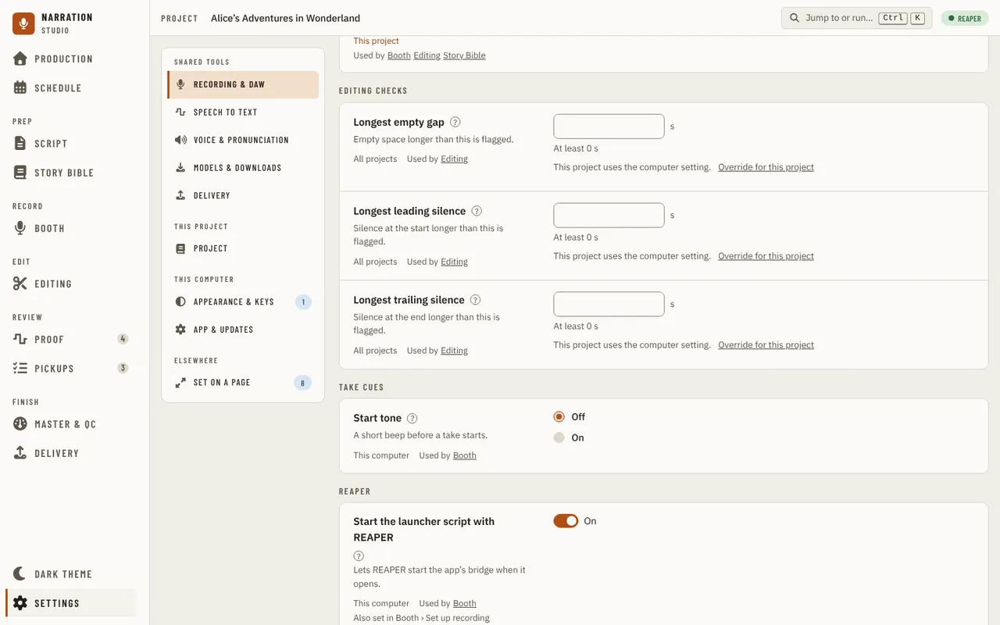

## Speech to text

**Transcription model** is the one default for comparing and checking recordings: Production's recording check,
[Proof](proof.md), [Pickups](pickups.md) and [Editing](editing.md) all use it. It is for all projects, and a project may override it.
Changing it asks first. Choosing a model that is not on this computer shows **Not on this computer** in the row, with **Download** and a link to **Models & downloads** on the line under it.

**Compare chunk length** (under Advanced) is how long a piece a [Proof](proof.md) comparison transcribes at a time (30, 60, 300 or 600 seconds; the default is 60). A run starts with it and can change it for itself. It is separate from **Coverage chunk length** below, which the recording check uses.

**Live reading in the Booth** holds the **Live engine** (Whisper, or Moonshine on Windows) and the **Live model** (`tiny`
or `small`) the [Booth](booth.md) follows your voice with. Under Advanced, **Recording check** holds the **Two-pass check**, its **First-pass model** and
**Re-check model**, **Run both models together**, **Parallel processes** and **Coverage chunk length** ([how it works](../../utilities/recording-coverage.md#the-model-cascade)).
**Coverage chunk length** cuts a long recording into pieces of that many seconds (60 by default; 0 checks each file whole) so they are checked side by side. **Parallel processes** is how many recordings, or pieces of one long recording, a check transcribes side by side; each holds a copy of the
speech model in memory. 0 is Automatic: half this computer's processors, fewer when the chosen model's copies would not fit in the free memory. The
line under the box says what the value shown runs on this computer and what set it, for example "Automatic: 4 transcriptions at once, using 8 of
8 processors for the small model. Set by the processors: half of them, so each transcription has 2 processors." A number you type is kept up to
the processors and the memory, and the line says when it was cut down. The same number is how many chapters a Story Bible scan with GLiNER reads at once; BookNLP always reads the whole book, and when it runs beside GLiNER the scan keeps a quarter of the processors and BookNLP's memory for GLiNER's workers (on 4 processors GLiNER then reads whole).

**Background checks** holds **Check recordings in the background**, the **Model for background checks** (`tiny`) and the
**Double-check model for background checks** (`small`, or **None (one model)**), and under Advanced the **Processors for background
checks** (0 lets the app choose half of this computer's). These apply only to checks the app starts on its own
([Checking what you recorded](booth.md#checking-what-you-recorded)); a check you start in **Check recordings** keeps the models above. A larger
model, or more than half of the processors, shows a warning under the choice: it makes each check slower and keeps the computer busy
for longer.

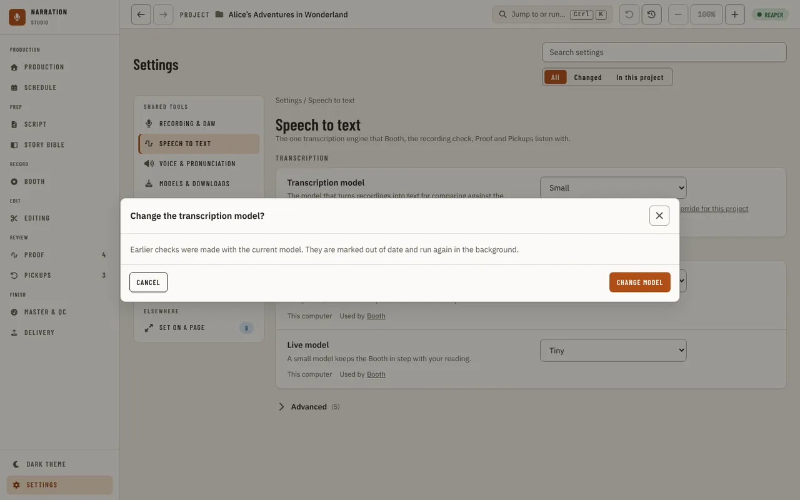

## Voice & pronunciation

- **Preview voice** is the voice that says a name or word when you ask for a [preview](story-bible.md#hearing-a-name). It does not narrate anything. The list holds every approved voice: LJ Speech (US English, the default), Cori (British English), Kristin (US English) and Norman (US English). Choosing one downloads nothing: a voice that is not on this computer shows **Not on this computer** with **Download**, and is also listed under [Models and downloads](#models-and-downloads).
- **Preview voices are made by** says Piper, the engine that speaks previews. It is the only engine the app has, so it is a fact with nothing to choose. It is marked **Changed** only if a hand-edited settings file stores a different value, so that stray value is not hidden. Its **?** says more. It becomes a choice if a second engine is added.
- **Show definitions from** chooses where the Script page's **Words** tab shows definitions: the web page (the default), the local dictionary or the online
  service. The choice is the same one as the Words tab's **Definitions from** menu. The local dictionary shows **Installed** or **Not installed** with a button to download or remove it; the online service
  shows **Online**, **Offline**, or **No key saved**.
- **Pronunciation source for new names** is what a new name tries first (Automatic, CMU, Wiktionary or eSpeak); it never limits generating or replacing a pronunciation by hand for an entry.
- **Merriam-Webster key** (Advanced; its **?** says what a lookup sends): an optional free key of your own (**Get a free key**, **Save key**, **Test key**, **Remove key**) that Look up online uses when no dictionary on this computer knows a name. It is kept apart from the other settings and never shown again after you save it; only the word you look up is sent. A key pasted and not yet saved is asked about like any unsaved setting when you leave Settings.

## Models and downloads

One list of everything the app can keep on this computer: Whisper models, Moonshine models, the preview voices, the Story Bible language models, the dictionary, the wiktionary pronunciations and the MP3 encoder. Nothing downloads by itself, and
removing one never touches your projects. Above the list, the disk the installed ones use, and under it the **Models folder location** row, which shows the folder they are kept in, has an **Open the folder** icon to show it in the file manager and [moves them to another folder](#models-folder). When the list cannot be read, the message offers **Retry** and **Open the folder**.
Which one is *used* is chosen in the category that uses it; here you only get, check and remove them.

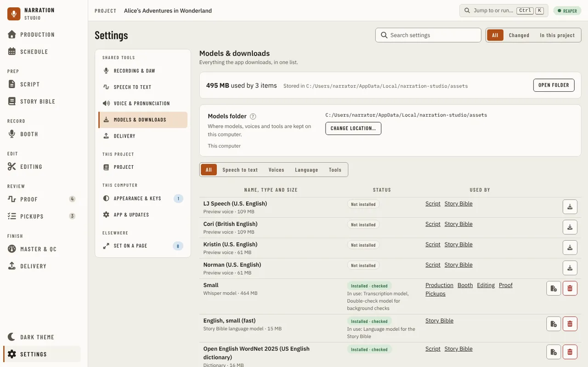

Each row says what it is, its type and size, its **Status**, **Used by** (pages) and **In use** (the settings that choose it), with its buttons at the right end of the row. On a narrower window each row is a card with its buttons beside the name. The status is one of:

- **Not installed**: **Download** starts the download. A bar shows the real bytes so far and **Cancel** stops it while bytes are arriving; the checks after the last byte cannot be cancelled. A download that is already running when you open the page (started by a Story Bible build, a preview or a comparison) is shown too, and leaving the page does not stop it.
- **Downloading** and **Checking the download**: the download itself, then the check of every file against its approved size and checksum.
- **Installed · checked**: **Check the files** (the check icon) reads every file of the asset again and compares it with its approved size and checksum; use it when a model that was working fails to load. A large model takes a few seconds, during which the row shows **Checking the files** and the check icon spins. If every file matches, the status reads **Installed · checked** with the time of the check. If a file is damaged, the row turns to **Needs repair** and the keyboard focus moves to **Repair**; if the files are gone, it turns to **Not installed** and the focus moves to **Download**. A screen reader hears each result. A check that cannot be made, or that gets no answer within two minutes, says so in a message, and the status then reads **Installed** without "checked" until a check passes or the asset is downloaded again. **Remove** is hidden while a check runs. **Remove** deletes that one asset after you confirm. The confirm names the settings that use it; they switch to the smallest other model you have, and checks made with it are marked out of date. When it is the only installed choice for a setting, the removal is refused and says so.
- **Needs repair**: some files are missing or no longer match, so the app will not use the asset. **Repair** downloads it again; **Remove** deletes it.
- **Download failed**: the row says so, the reason (no connection, not enough disk space) comes up as a message that stays until dismissed, and the row has **Retry** and **Dismiss**.
- **Not available yet**: the app lists the asset but does not offer it in this version. The row says why and has no buttons.

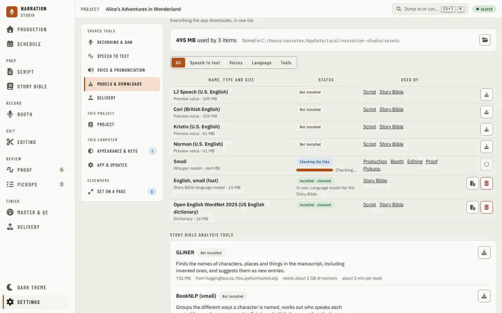

With nothing downloaded, the page (its **?** gives the size, about 600 MB) offers **Download the recommended set** (the Small transcription model and the preview voice). Below the list, **Story Bible analysis tools** lists the optional tools that make the Story Bible scan better (GLiNER, BookNLP small and large), each with what it does, its size, where it downloads from and the memory it needs, and the **Offer better analysis when scanning** box. GLiNER (about 730 MB) finds the names of characters, places and things, including invented ones; BookNLP groups the ways a character is named and works out who speaks each line. **Download** asks first; a Story Bible scan then runs the basic rules and each tool you have (with both BookNLP sizes, the large one). **Remove** deletes a tool, and the scan goes back to the rules and whatever else is installed. A tool whose download failed says why in a message that stays until dismissed, and its row has **Try again** and **Dismiss**; when the files arrived and matched but could not be unpacked or saved, **Details** under the reason names the file and what went wrong, which is what to quote in a report. The download dialog that other pages open shows the same line under **Live activity**.

### Models folder

Under the disk bar, **Models folder location** is where the downloads are kept: the folder in use, the **Open the folder** icon, **Change location…** and, once you have moved them, a reset button. It is also found by searching for "location" or "folder", and by the **Changed** filter once it is not the default. Its **?** says what a move does.

**Change location…** asks first (the question is below), then opens your computer's folder dialog. Choose an empty folder (make a new one in the dialog if you like; a folder inside the current one, or one that already holds files, is refused). The app copies everything it has downloaded, checks every copied file against the original, and only then uses the new folder, at once and for every kind of download. A bar shows the bytes of both passes and **Cancel** stops the move. A move is refused while a download runs, and no download starts during one.

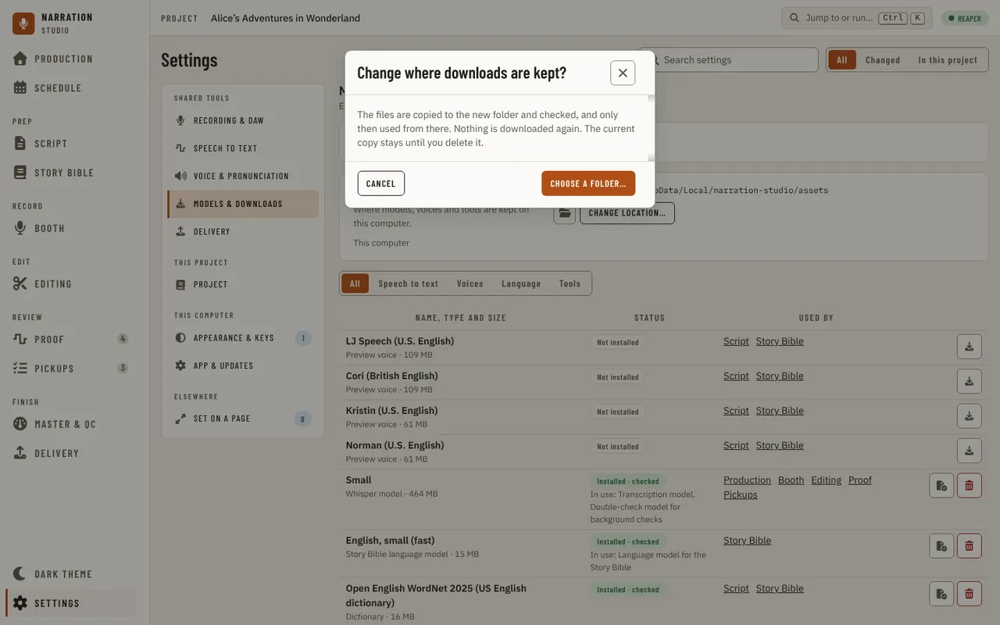

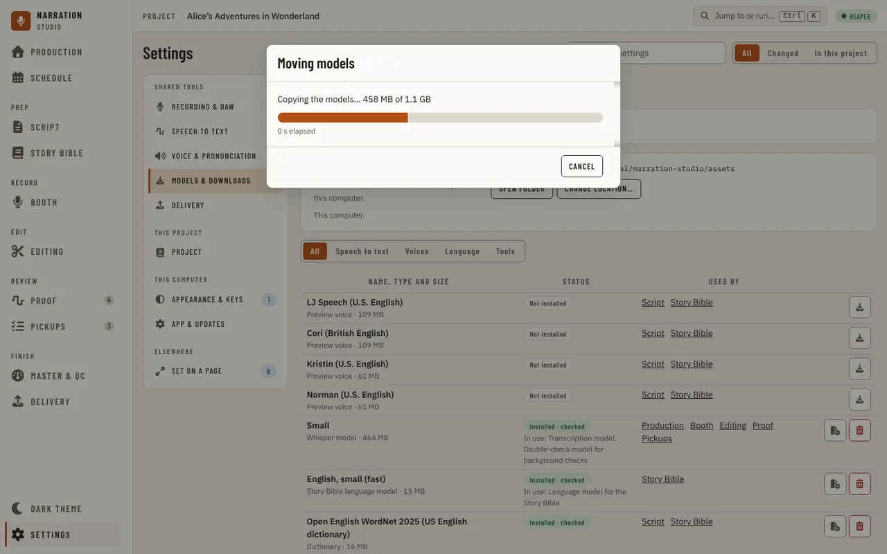

While a move runs the bar counts the bytes of the copy and then of the check, each against the size shown as used. When it ends, the dialog is titled by how it ended (**The models were moved**, **The move failed** or **The move was cancelled**) and has only **Close**. If you cancel, or anything fails (the folder is read-only, the disk is full, a disk is unplugged, a copied file does not match), the dialog says why and your models are exactly where they were: nothing is deleted, nothing changes, and a half copy is removed.

When a move has finished, the old copy is still on your disk. The row says so, with **Delete old copy…** and **Keep it**. Deleting asks first and removes only the downloaded models, voices and tools in that folder, never anything else you keep there. It is refused while something that may still read the old copy is running. **Keep it** leaves the folder alone and stops asking, and a message says where it is: there is no way back to the question, so delete that folder yourself when you no longer need it. Until you answer, **Change location…** and the reset button are off, with a tooltip and a line under the row saying why.

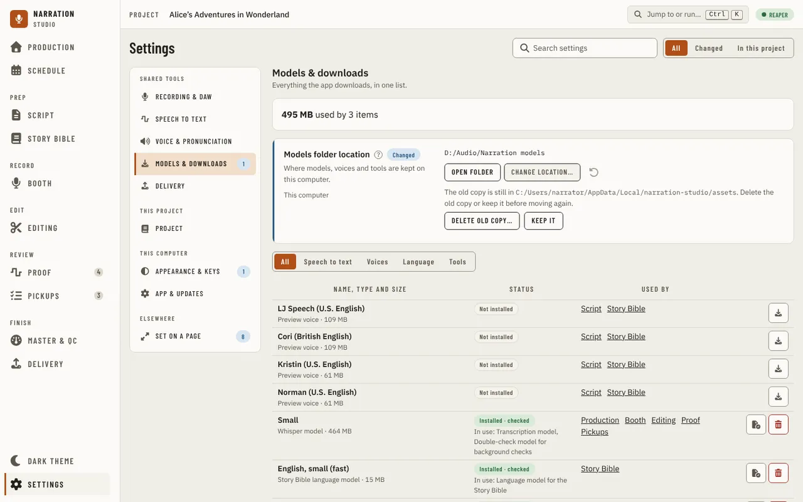

The reset button next to **Change location…** moves the downloads back to the default folder (the per-user cache folder) the same way: copy, check, switch, then offer to delete the copy you left.

## Delivery

- **Delivery profile** picks the profile this project is judged against, on [Master & QC](master-and-qc.md) and [Delivery](delivery.md), the same choice as Delivery's own menu, with the limits of the chosen profile listed under it.
- **Render length tolerance** (under **Checks**) is how many seconds a chapter's rendered file may differ in length from the chapter before [Proof](proof.md)'s render length check is not met. It is empty until you choose it, and then that check is not required; a project may use its own.
- **Default profile for new projects** is what a project that has not chosen its own is judged against (ACX until you change it).
- **Custom profiles** (Advanced) lists your profiles and the built-in ones to copy. **Duplicate** makes a custom copy and opens it in the editor, where you can rename it, turn a rule off, and change the lowest and highest of a rule that has a range (a length is in minutes); a rule with a fixed value can only be turned off, and a copy cannot add a kind of rule the app does not check. **Edit** and **Delete** work on a custom profile; a project that chose a deleted profile goes back to the default.

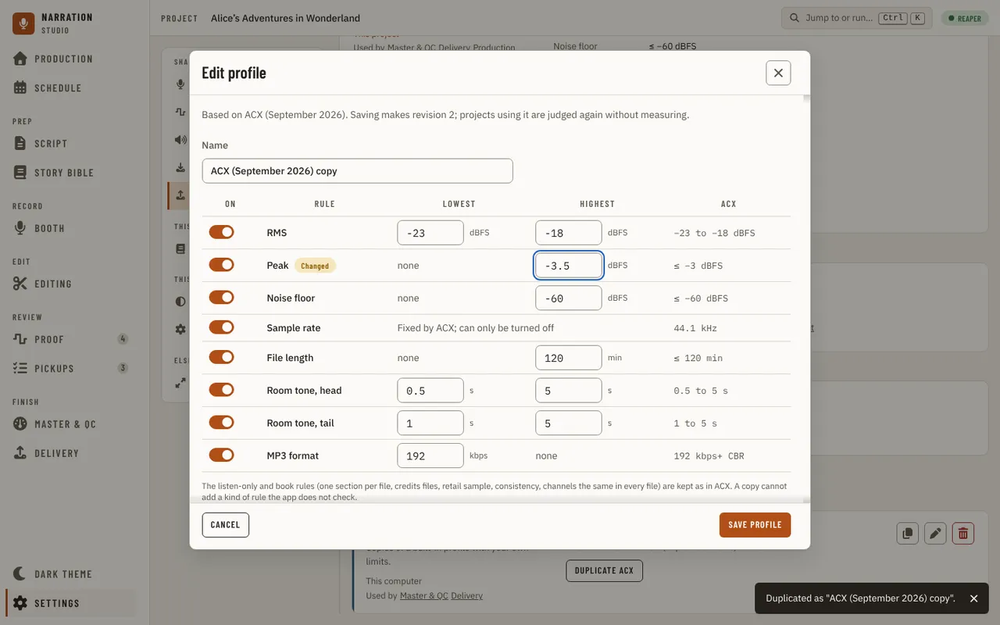

## Project

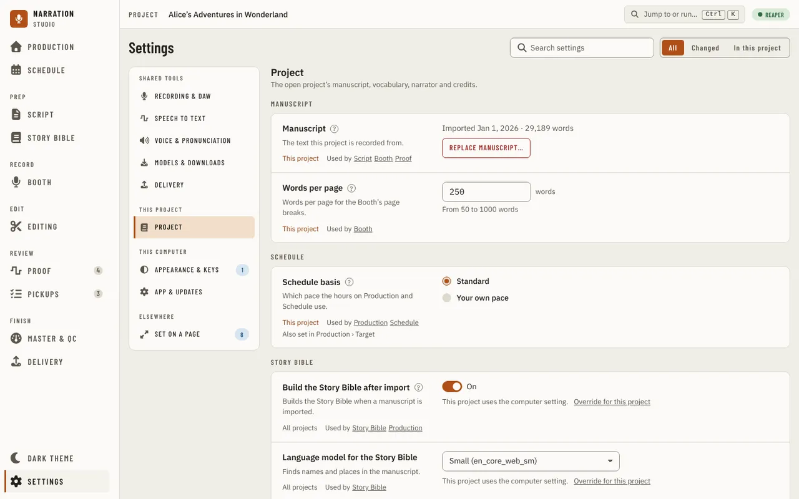

- **Manuscript** says when the manuscript was imported and how many words it has (or **No manuscript yet**), with **Replace manuscript…** (or **Import manuscript** when there is none). **Replace manuscript…** opens the same two steps as the [import](production.md#importing-the-manuscript); step 2 names what the replace clears.
- **Words per page** (kept for every project on this computer, 250 by default, 50 to 1000) is where the [Booth](booth.md) marks a page break: at the end of the paragraph in which a page reaches that many words, counted from the start of each chapter, so a page never breaks inside a paragraph.
- **Schedule basis** (this project, **Standard** until you choose) is which pace the hours on [Production](production.md) and [Schedule](schedule.md) use: the standard words per finished hour, or **Your pace**, which takes effect once enough chapters have a measured length (until then the standard is used). It is the same choice as the Schedule basis toggle in Production's target popover, so a change in either shows in the other. If the schedule cannot be read, the row says so and its choices stay off.
- **Build the Story Bible after import** and **Language model for the Story Bible** are for all projects, and a project may override them. **Build the Story Bible after import** (on by default) builds the Story Bible when a manuscript import ends and the Story Bible has no entries yet ([Built after an import](story-bible.md#built-after-an-import)).
- **Entry types** lists the kinds of [Story Bible](story-bible.md) entry, each with its name, colour (the swatch is the colour the entries of that type are drawn in on every page), a **Can speak** box (entries of that type can be picked as the speaker of a quoted line, and the next Story Bible build attributes dialogue to them) and how many entries it has, on one line in a wide window (in a narrow one the colour, **Can speak**, the count and the remove button take a second line under the name). A type you add with **New type** does not speak until you tick the box. Rename a type in its box and every entry of it moves with it; change its colour; or remove one: the remove button stays off while entries use the type, and the last type cannot go. A taken or reserved name is refused, and says why under the list.
- **Marks** lists your mark types, each with its colour, and **tracks a reply** on a type that asks for one. **Edit marks…**, the pencil at the right of the marks, opens the same **Define how you mark up** dialog as the Script page.
- **Narrator name** fills the narrator's name in the credits, for all projects, and a project may override it. Under Advanced, **Room tone per credits file** (0 to 10 seconds, 0 by default) is the silence the [Production](production.md#the-credits) credits estimate adds to the opening and to the closing credits file, head and tail together (ACX asks for 1 to 5 seconds at each end of every file).
- **Credits**: see [Credits](#credits).
- **Delete Story Bible data** (Advanced) deletes this project's Story Bible and nothing else: the confirm names the project and counts every entry and every suggestion the manuscript scan made (accepted and rejected ones too, so a later scan offers them again), and says that the entries' names, pronunciations, notes, relationships, review flags and speaker colours, the types you added or changed (the default types come back) and who speaks each line of dialogue go with them. It opens on **Cancel** and there is no undo. The script, takes, recordings, settings, voice samples and voice references stay; a character's samples show in **Voice data** as samples for a character no longer in the Story Bible, and an entry added again under the same name has them again. It is refused, with a message, while a scan or a Story Bible build runs. This is the only place the Story Bible's data is deleted.
- **Clear derived data** (Advanced) removes the imported manuscript and its stored source, the Story Bible, proofing artifacts, reader notes and bookmarks, and saved comparison results for the current project, after you confirm. Its settings remain.

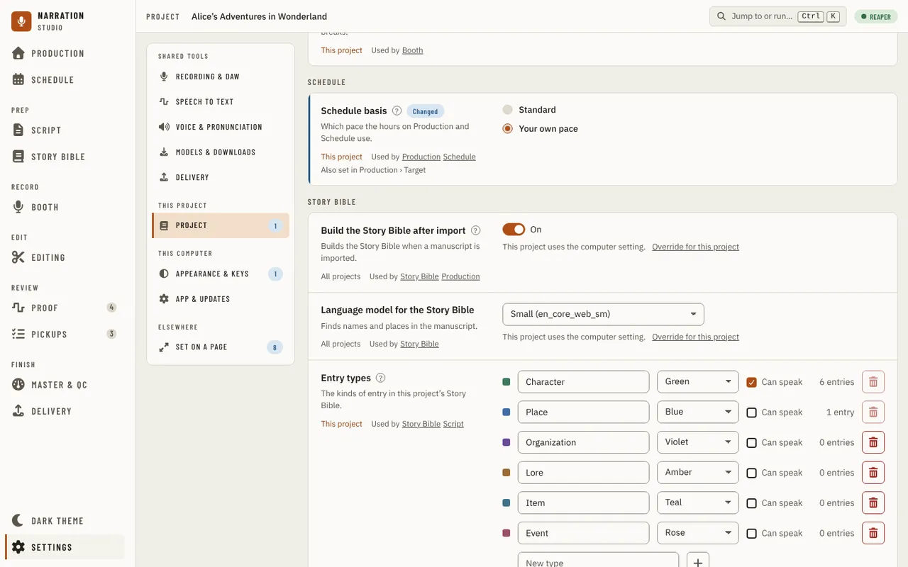

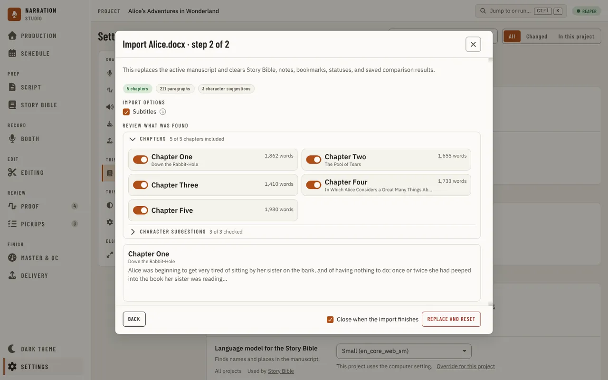

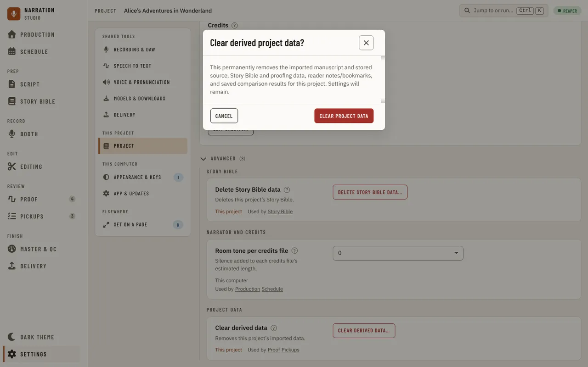

## Credits

**Credits**, under Project, shows in three lines whether the opening and closing credits can be read as they stand and whether a retail sample is chosen, each with a badge, and **Edit credits…**. The editor opens in place and holds the audiobook's opening and closing credits, an optional chapter announcement, and the retail sample. The templates are shared by every project; the filled-in values belong to this project.

- **Templates**: pick a template to edit its **Name**, **Kind** (Opening, Closing or Chapter announcement)
  and **Body**, then **Save template**. **New** starts a blank one, **Duplicate** copies the selected one
  and **Delete** removes it. Text typed in the template waits for **Save template**, so leaving Settings with it unsaved
  (the nav, Back, the jump menu or Switch project), or closing the editor, picking another template, **New**,
  **Duplicate**, another category, or the first letter typed in **Search settings** (or a filter other than All, which swaps the
  pane for the results), asks **Unsaved settings** first: **Save & continue** saves the template, **Discard & continue** drops
  it, and **Cancel** keeps the editor and the text. **Delete** removes the template and the text typed for it without asking.
  If a save does not answer within 15 seconds, the question says so and **Cancel** and **Discard & continue** work again; the
  text is still in the editor.
- **Tokens**: bracketed tokens in the body, such as `[Title]`, `[Author]` and `[Narrator]`, are filled
  from the project values. Wrap a part in braces to drop it, punctuation and all, when a token in it has no
  value: `[Title]{: [Subtitle]}` reads just the title for a book with no subtitle.
- **Chapter announcement**: what you read at the head of every chapter. `[Chapter]` is the chapter's
  heading as the manuscript names it ("Chapter 1") and `[Chapter Title]` its subtitle ("Down the
  Rabbit-Hole"), so `[Chapter]{: [Chapter Title]}.` reads "Chapter 1: Down the Rabbit-Hole." and just
  "Prologue." for a chapter with no subtitle. You record it inside each chapter file, so keep it to the chapter
  heading and subtitle: Proof expects the spoken chapter title there, and any other words are reported
  as extra.
- **Preview** shows the body with the values filled in, its word count, and any token that has no value
  yet, highlighted and listed as unresolved. A chapter announcement is previewed for the first chapter
  ("Shown for Chapter 1, one of 12 chapters"); it needs an imported manuscript.
- **Project values**: Title, Subtitle, Author, Series, Book number, Copyright, Year, Copyright holder,
  Publisher, and a Narrator that overrides the narrator name set under **Project** (Settings > Project, Narrator and credits) for this project only. A value
  is saved as you type. Where the manuscript suggests a title or author, the check icon (**Use this suggestion**) fills it in.
- **Clear credits** empties every project value at once, after asking. The templates in your library stay,
  so the credits show their tokens in brackets again until you fill them in.

The first opening and closing templates appear in the [Script](script.md) reader and as the
credits rows on [Production](production.md#the-credits).

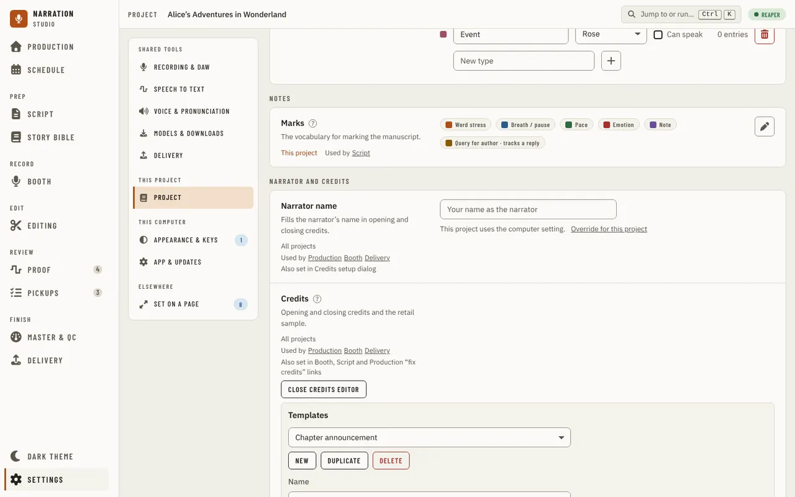

### Retail sample

**Retail sample** is the stretch of the book you pick for the retailer's sample (from the book's text, so the opening and closing credits are not offered): up to 5 minutes, from
anywhere in the book. Choose the chapter and line it **starts in** and **ends in** (the line numbers the
[Script](script.md) reader shows) and **Save sample**. The panel says where it runs ("Chapter 3: A Caucus-Race and a Long Tale, lines 1 to 3", naming a chapter once) and how long it
is at about 155 words a minute; a range longer than 5 minutes is refused with its length, and the sample
you had is kept. **Clear sample** removes it. The sample is a marker in the Script page's reader only: it adds
no time to the estimate, since it is read again from the finished chapter. It is kept with the project, so
replacing the manuscript keeps it; if its lines are gone, the panel says so and you pick it again.

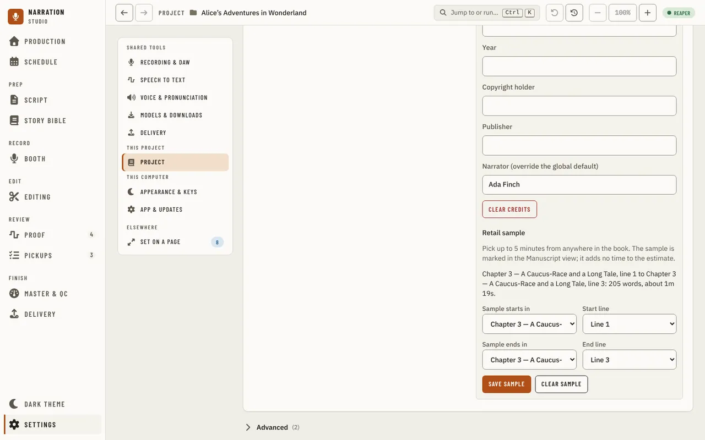

## Appearance & keys

- **Theme** sets **Match my system**, **Light** or **Dark**. The **Dark theme** / **Light theme** item at the foot of the sidebar switches it too. It is kept in this window, so the page calls it **This computer**.
- **Motion** is **Follow Windows** or **Reduce**. **Reduce** stops the app's slides, fades and highlights: menus, drawers and messages appear at once, and the Booth's cursor jumps from line to line. **Follow Windows** does that only when Windows' **Animation effects** setting is off. Like Theme, it is kept in this window.
- **Waveform arrow step** (under **Editing**) is how far an arrow at either end of the [Editing](editing.md) waveform moves it, from 15 to 30 seconds (20 until you change it). A click moves one step; holding scrolls at that many seconds a second. It is kept in this window, as Theme and Motion are.
- **Reader font**, **Reader text size**, **Line spacing** and **Column width** set how the [Script](script.md) reader draws the text, one row each, with a quote drawn in all four under **Column width**. These are the Script's own text settings, so a change here shows there and the other way round. The Booth uses the font and column width chosen here, and keeps its own text size: **Booth text size** (24 to 72 px in steps of 4, 40 until you change it) sets it, and the Booth's **Text settings** and its larger and smaller text keys change the same size. It is kept in this window, as the reader text is.
- **Story Bible order** (under **Look**) is which entries the [Story Bible](story-bible.md) lists first: **Name, A to Z** (until you change it), **Name, Z to A**, **Kind**, **Book order**, **Most mentioned**, and the reverse of each. The list's column headers and **Sort** menu keep the same order, so a change in either shows in the other, and a choice here replaces any header clicks that broke ties. It is kept in this window, as the Booth text size is.
- **Editing playback** (under **Listening**) is the sound the [Editing](editing.md) page plays: the speed (0.75× to 2×, the pitch kept), the volume, **Silence playback**, and the output it plays on. They are the same choices as the Editing page's **Output** controls beside the transport bar, kept in this window as Theme and Motion are; the Editing page reads them when it opens. A saved output that is not connected stays chosen, with a note and **Check again**, and the sound plays on the system default until it is back. With a DAW linked, Editing plays through the DAW and its own level, so these choices are for the sound the app plays itself.
- **Note colour** is the colour that marks reader notes in the text; a project may override it.
- **Zoom** scales the whole window (100% to 200%, the steps the jump menu's zoom commands and **Ctrl+plus**, **Ctrl+minus** and **Ctrl+0** use); it follows those and sets the same level.
- **Shortcuts** lists every command you can run without the mouse, grouped by where it works, with a **Find a shortcut** box; each command's keys and its keyboard icon (**Change the shortcut**) sit at the right of its line, and the list is as long as the card. **Change the shortcut** opens a recorder under the command: press the key or pedal (a USB footswitch that types a key works like a keyboard), then **Replace**, **Add as another key**, **Unbind** or **Reset to default**. A key another command already uses is named, and **Replace** takes it from that command. A changed command shows **Changed** and its own **Reset**; **Reset all to defaults** undoes every change. Each change saves at once.

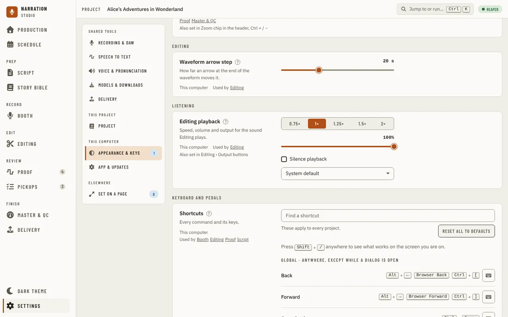

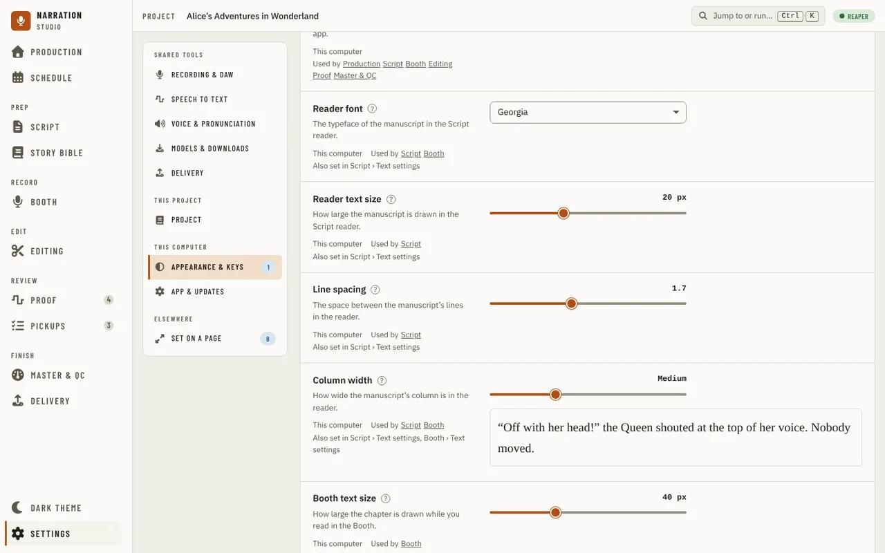

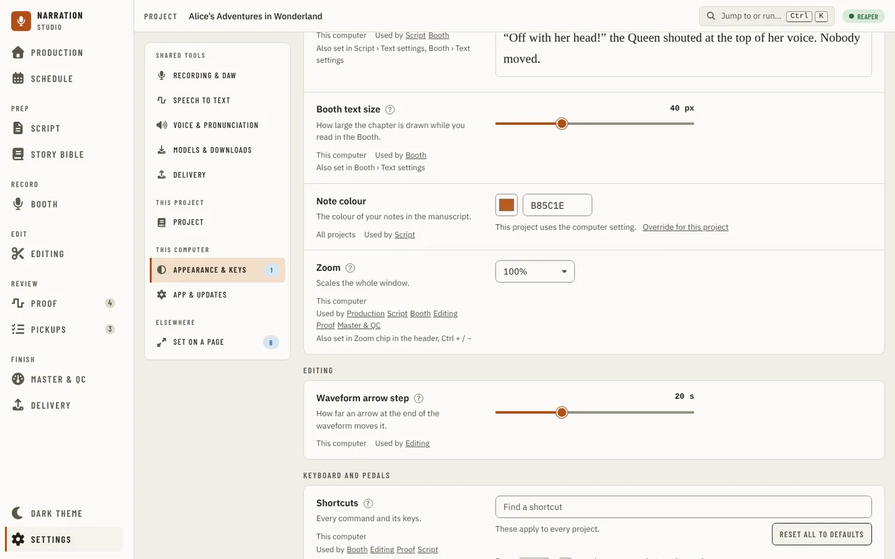

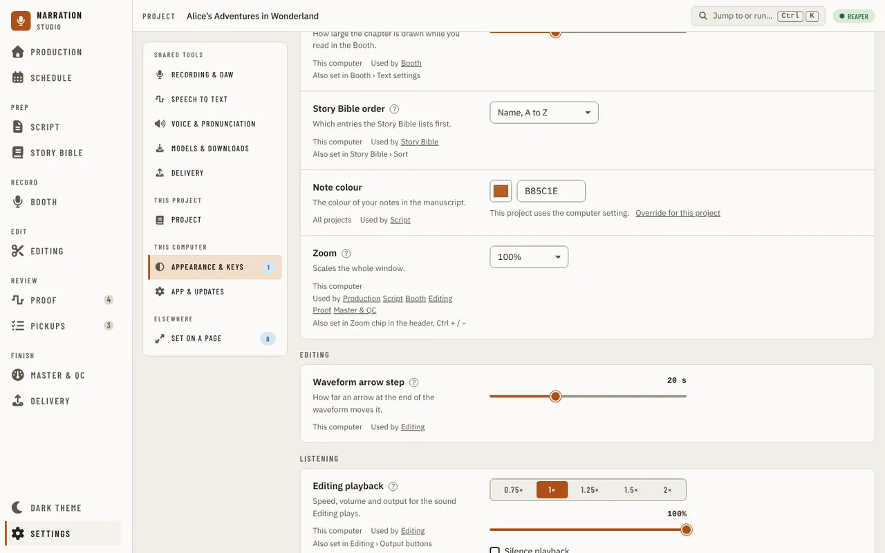

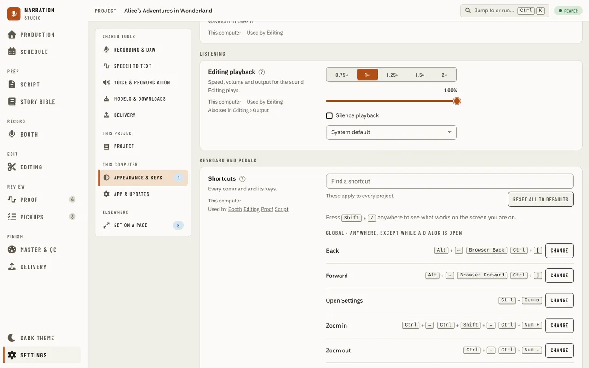

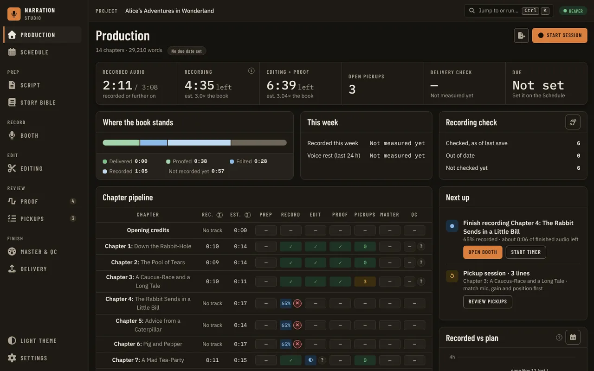

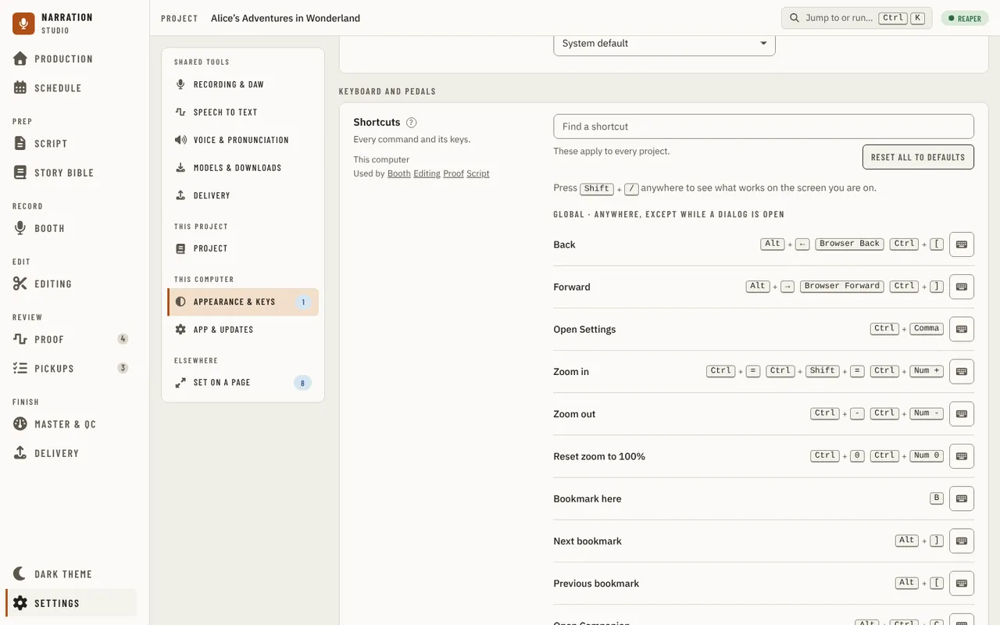

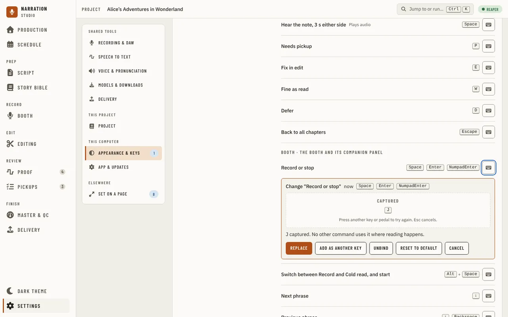

## App & updates

**Check for updates on startup**, **Update channel**, **Tell me when a long task finishes** (a Windows notification when a long job ends while the app is not in front; on by default) and, under Advanced, **Debug logging**, which writes the reasons behind the app's decisions to the run log (turn it on when asked to send a log), and **Activity trace**, which records how the app behaved (the DAW connection, tool runs, crashes it survived) to `logs/trace.jsonl` and never your text, names or file paths. A build run from source has the trace on. The folder button beside Debug logging (**Reveal the log folder in the file manager**) opens the folder the run log is in, so you can attach the log to a bug report. **This version** follows them (see [About and updates](#about-and-updates)).

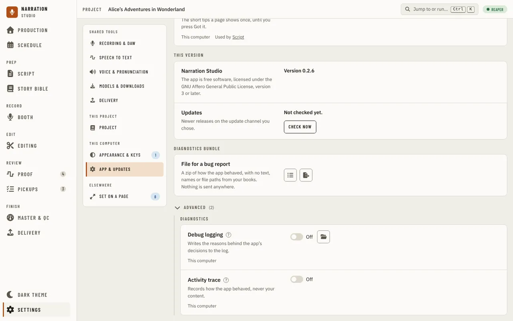

**First-use tips** (under **Tips**) shows how many of the short tips a page shows once you have dismissed with **Got it**, and the lightbulb icon button (**Show tips again**) forgets them all, so each shows once more. It is the same list for every project on this computer, and the icon is off while none are dismissed, with the reason in its tooltip. If the list cannot be read, the row says so and offers **Retry**.

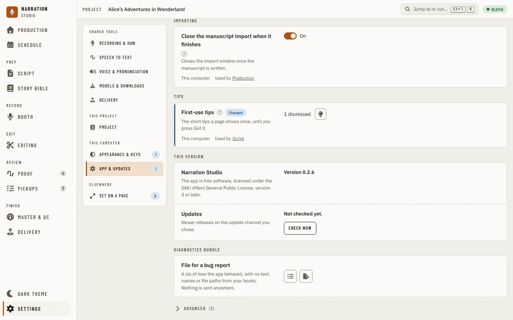

### Diagnostics

Below **This version**, the **Diagnostics bundle** section has one row, **File for a bug report**, with two icon buttons. **Preview the
diagnostics bundle** opens a window that lists the files the bundle would hold, what it leaves out and why (plain sidecar
output and the host log are not included), and how many lines the leak check dropped for naming
you or your project. It writes nothing. **Save the diagnostics bundle** asks for a folder, saves one zip there and copies its path;
attach the zip to a GitHub issue yourself, since the app sends nothing. The bundle holds how the app behaved (screens,
tool runs, the DAW connection, failures) and never your text, names or file paths. The **Activity trace** row above records
it to disk; with it off, the bundle holds only what the app kept in memory since it started.

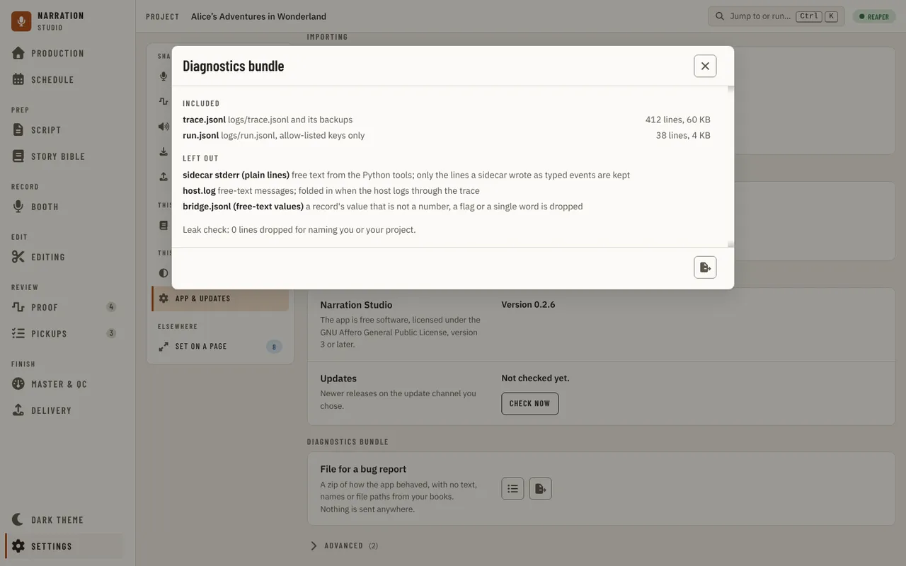

### About and updates

Under the rows of **App & updates**, the **This version** section has two rows: the version of the app you are running,
and **Updates**, which says what the last check found in one line (the release, its size, whether it is downloaded and
the day the app last looked), any problem right under it, and the buttons in one row with **Check now** last.

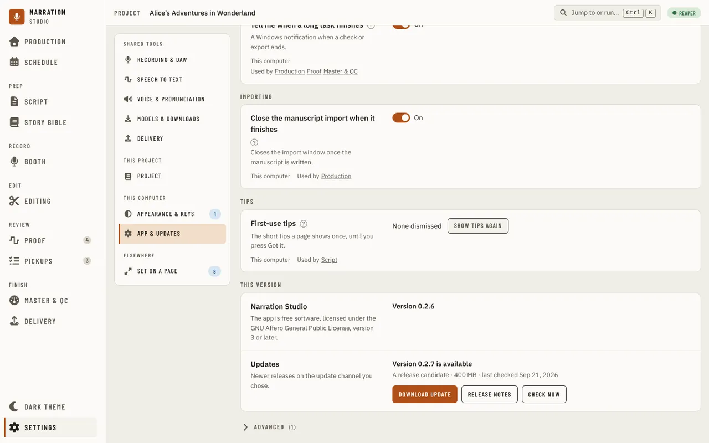

- **Check for updates on startup** (a row above, on by default): once a day, when the app starts, it asks GitHub which releases exist. That
  request sends nothing about you, your projects or your computer, and it never downloads anything by itself. Switch it off
  if you would rather look yourself with **Check now**. When that check finds a newer version, a message also pops up
  ("Version 0.2.7 is available. See Settings, About & updates.").
- **Update channel** (a row above): *Candidates and stable* (the default; every release so far is a release candidate) or *Stable only*.
- **Download update** asks first, then downloads the new version with a progress bar showing the megabytes received, and
  checks it against the release's checksum. You can cancel while it downloads; the checks and unpacking after it cannot be
  cancelled, and the dialog says so. If the download fails, the dialog says why and offers **Retry** beside **Close**,
  which starts the download again.
- **Install and restart** asks again, then closes the app and starts it again on the new version with the same
  project. It will not install while an import, a Story Bible build, a download, a comparison or a teleprompter session is
  running: finish or stop it and try again. If the new version does not start, the previous one comes back by itself.
- If the app is installed somewhere it is not allowed to change (for example under Program Files) it says so and
  offers **Show the downloaded file**, so you can replace the program yourself. It never asks for administrator rights.
- **Release notes** opens the release page in your browser.

The app runs on Windows only, for now, so updates are for Windows.
Releases are not yet signed, so Windows SmartScreen or your antivirus may ask about a new version the first time.

If the app will not start after an update and the program file is missing from its folder, rename
<!-- brand:identity.executable -->narration-studio<!-- /brand -->.exe.old back to <!-- brand:identity.executable -->narration-studio<!-- /brand -->.exe.

## Set on a page

Some settings only change what one page does, so they belong on that page, next to what they change: the recording check's rules (Production; the grey box above them says the values are proposed and not yet calibrated, and its **?** says why), silence cleanup (Master & QC), the preview suggestion and compare defaults (Proof), stage suggestions (Production), punch pre-roll (Booth), favourite effects and the Audacity backups (Editing). **Set on a page** lists them, each with where on that page it belongs (Proof's Preview and Compare options are in **Jump to or run** once a chapter is open on Proof) and, on the line of **Change it here for now**, an icon for that page (the one the navigation rail draws for it; hold the pointer on it for **Open** and the page's name). Settings always keeps every one of them: **Change it here for now** opens the panel with its **Global** / **This project** switch, **Save** and **Discard changes** (closing the group does not drop what you typed: it is still there when you open it again), and leaving Settings with unsaved changes there, by the navigation, Back or **Switch project**, asks whether to save or discard them. Five pages also have a shortcut to the same setting, which reads and writes the same keys: Master & QC's **Jump to or run** (Ctrl+K) has **Open Silence cleanup options**, a dialog for the open project only, the same as choosing **This project** in the Silence cleanup panel here (Diagnostics also keeps its **Open Settings** link to that panel); Production's **Jump to or run** has **Open Stage suggestion options** and **Open Recording check rules**, the same for the open project only; Proof's **Jump to or run** has **Open Preview options** and **Open Compare options**, which open a dialog for the open project only, the same as choosing **This project** in the panel here; the Booth's **Levels** menu has **Punch pre-roll (seconds)**, which is Global like the panel here, and Editing's **Backups** tab has the backup settings for the open project only, the same as choosing **This project** in the Backups panel here (that panel can also set Global). Editing's **Effects** tab has a **Favourite** button on each chain and plug-in the DAW lists, which edits the same favourite effects list as **Favourite effects** here, at the Global layer (that panel can also set This project). Search finds them too.

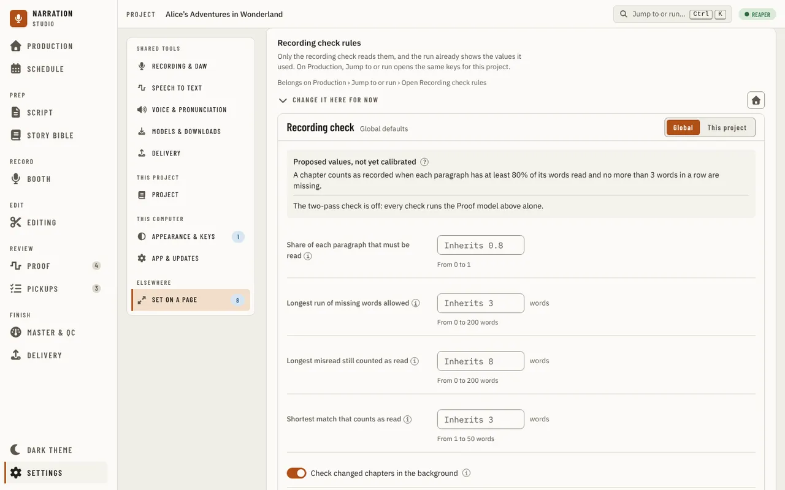

## When something is wrong

- While the settings are read, the pane shows grey blocks under its title and says **Reading your settings…**.
- If the settings file cannot be read, the page says **Your settings could not be read** and disables the controls until **Retry** works.
- If a change cannot be saved, the page says **Changes cannot be saved right now** and the row says why; the previous value is still in use.
- If the list of downloads cannot be read, Models & downloads says so with **Retry**; your downloads are not touched.
- If moving the models folder fails or you cancel it, your models are still in the folder they were in. The dialog says why; choose another folder, or free some space, and try again. If the new folder is on a disk that is later unplugged, the models read as not downloaded until it is back.

## What next

- [Getting started](getting-started.md): the first project from install to the first take, if you came here to set up.
- [Booth](booth.md): record with the recorder and microphone you chose.
- [Using the app](README.md): every page of the guide, and where each reader starts.

---

[← Delivery](delivery.md) · [Index](README.md)
