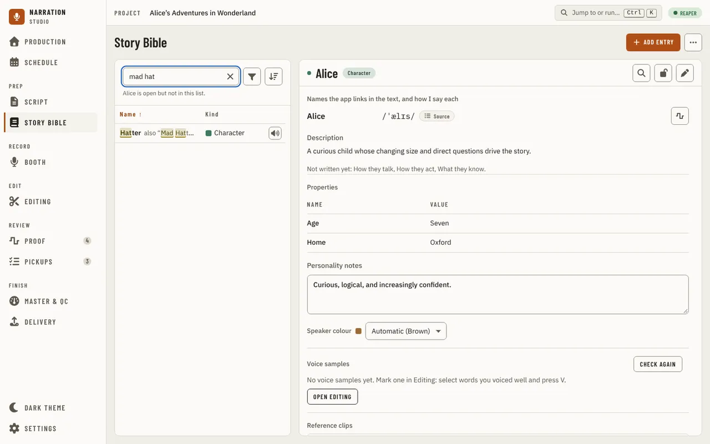
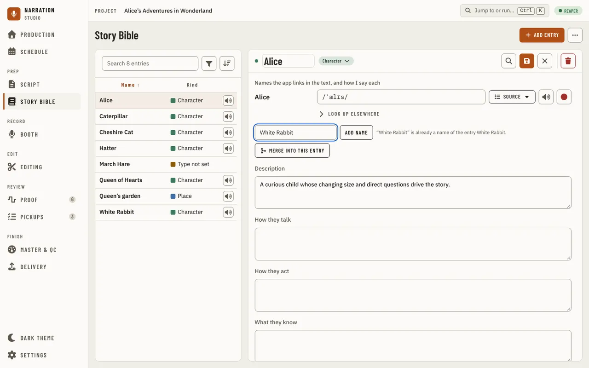
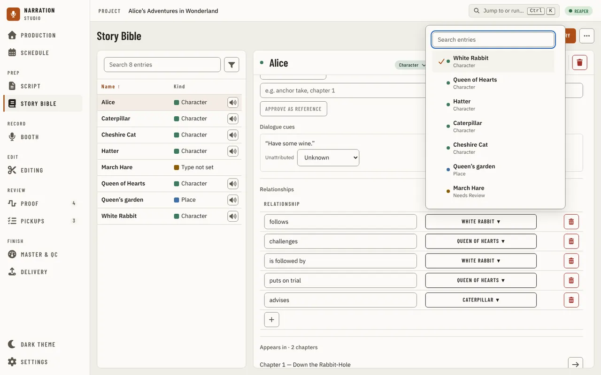
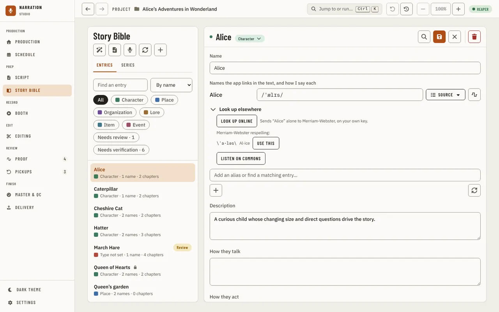
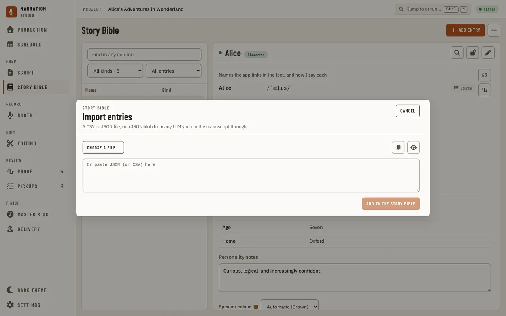
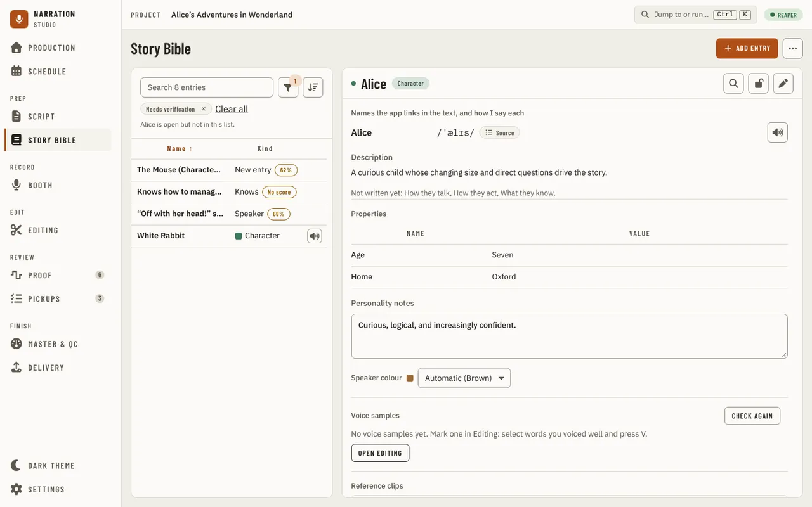
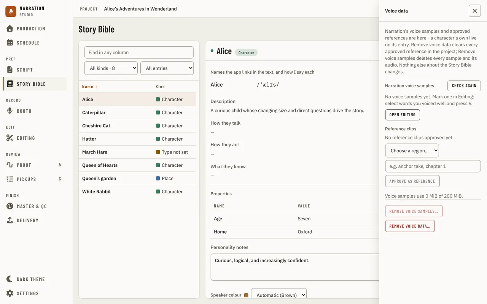
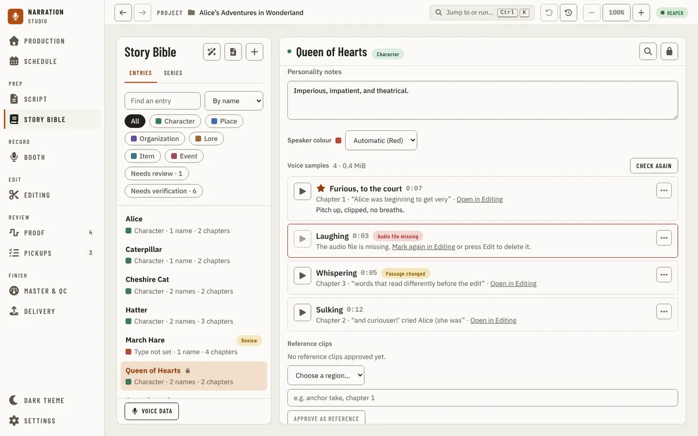
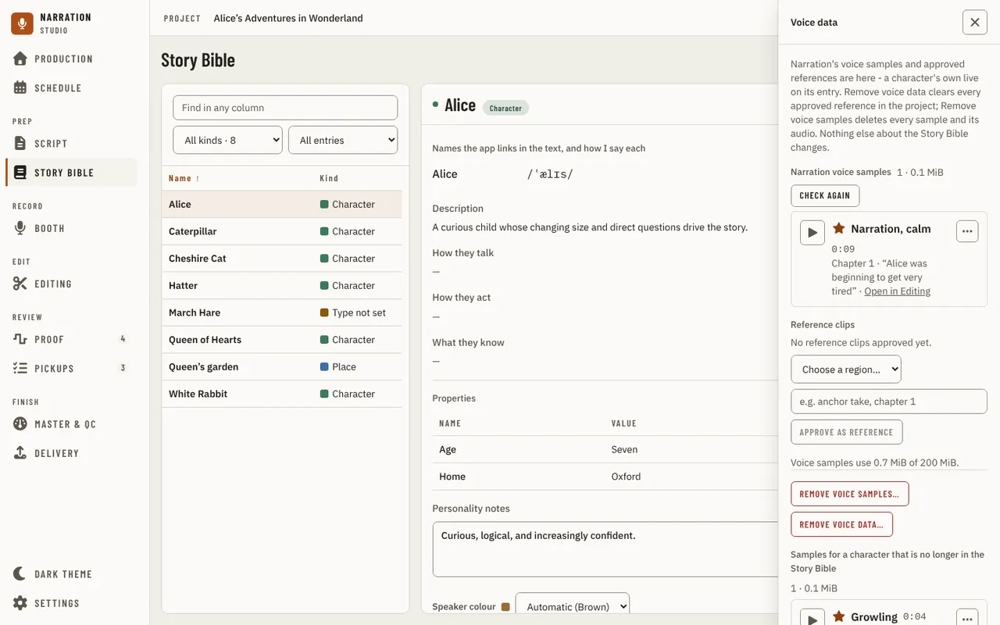

[Using the app](README.md) › Story Bible

# Story Bible

Story Bible tracks every character, place, and organization extracted from the manuscript,
with pronunciation, aliases, and narration notes. The page is a small table of entries on the left, about 30% of the width, and the open entry beside it as the main area (the entry under the table on a window narrower than 1024 px). The table has two columns: **Name** and **Kind** (in the kind's colour, which you set for the type in Settings; an entry whose kind the host could not tell says "Type not set"). An entry with a pronunciation has a **Hear** button at the end of its row: press it (or press Space on the row) to hear the name said, and again to stop. It plays the same preview as the entry's own play button and does not open the entry. If the voice it needs is not installed yet, the entry opens and asks to install it. When the table is narrow (under about 320 px), the Kind column shows only the colour dot. Press a header to sort by it and again to reverse it; the arrow shows the direction, and the column you sorted by before breaks ties. The sort is kept for next time. Over the table, the search box (its placeholder says how many entries it searches) finds an entry by its name or any of its other names, every word you type having to match. The letters it matched are marked, and a row found by another name shows it after the name (also “Mad Hatter”). Down in the box moves to the first row; Esc clears the box, and a second Esc leaves it. Beside the search, the **Filter** button opens a menu of three choices, each with its count: **Kind** (tick as many kinds as you like; none ticked shows every kind), **Pronunciation** (**Any**, **None yet** or **Has one**) and **Show** (**All entries**, **Needs review** or **Needs verification**, the last two offered only while some exist). The menu stays open while you choose. The button shows how many filters are on, and each filter on is a chip under the search: press a chip to remove that filter, or **Clear all**. Press a row to open its entry. Up and Down move between rows, Home and End go to the first and last, Enter opens the row, and Space opens it when it has nothing to play; Tab leaves the table. A book of hundreds of entries draws only the rows in view. Right-click a row (or press the Menu key on it) for **Open**, **Find in the manuscript**, **Mark reviewed** (when the entry needs it) and **Delete entry**; Delete asks first, and a locked entry says it has to be unlocked. **Add entry** at the top right is the page's one main action. The button beside it, **More actions**, holds **Scan the manuscript**, **Import entries** and **Voice data**. While a scan runs, its progress and **Cancel scan** show under the search, so nothing else moves, and the menu has no scan item. With no manuscript imported the page asks for one, and its **Import manuscript** opens the import on this page. If the list of kinds or the chapters cannot be read, a line under the search says so with **Retry**, and an entry that cannot tell whether its type speaks says the same; the rest of the page keeps working.
While the entries are being read, the table and the detail pane show grey blocks. A book with no entries says "No entries yet" and where to start; a search or filter that finds nothing says "No entries match." with **Clear filters**; an unreadable Story Bible says so with **Retry**. This app produces one book at a time, so the page has no series view.

Selecting an entry opens its detail panel, read-only at first: its names and how you say each, its
description, for a type that can speak **How they talk**, **How they act** and **What they know**, its
properties, its **Relationships** to other entries, and **Appears in**, the chapters it is in, each with a
button that opens it in the [Script](script.md). The kind beside the name is a plain label until you press Edit, when it becomes a menu that changes it, and the
magnifier button lights the name in the Script's text. Press Edit (the pencil) to change the entry, then Save
(or Cancel). Read-only, the entry shows no add-a-name box and no add-a-relationship row; Edit brings them in. Locked entries can't be edited until
unlocked. The scan is deliberately strict: it favors missing a name over listing ordinary
words, so add unusual names by hand with the + button.

Pressing Edit switches the entry to edit mode: the name in the header turns into a plain, large input (there is no separate Name field), and Save, Cancel and a red Delete appear on the far
side of the header, set apart from Save so it can't be mis-clicked. Lock only appears in the read
view: an entry can never be locked while it is being edited, so unlocking always returns you to a
read-only entry, never back into an edit in progress. Locked entries show only Unlock; a brand-new
entry starts unlocked and can be locked once it has been saved.

Each entry also has **Properties**: a list of labelled facts, such as "Codename: Wren" or "Abilities: flight",
that you keep in the order you give them. In edit mode each property is a row with a name and a value, buttons to
move it up or down or remove it, and an Add button below. A value needs a name, and no two properties may share
one (capital letters do not make a name different); Save says which row to fix. A row you add and leave blank is
dropped. Properties are kept when you scan the manuscript again, and the summary of an entry that opens from the
Script lists them too.

Entries the scan isn't sure what kind they are get the **Needs Review** kind, in amber (the colour of anything still to check);
choose the right kind from the menu beside the name. An entry or a name the scan flagged shows a
**Review** badge in its header and **Needs review** with a **Mark reviewed** button in its header. The
**Needs review** choice under **Show** in the **Filter** menu keeps only these entries and the ones with suggestions waiting.
An entry with suggestions still to verify shows **Mark reviewed** switched off, with the reason, until each is verified or rejected.

In edit mode, **Add a name** is one input: type a name and press Enter to add it as an alias. If another entry
already has that name, the line under the input says so and offers **Merge into this entry**, so a name mentioned under a
different spelling is merged into the entry it already belongs to instead of creating a duplicate. The merge can be undone from its toast. A name the
entry already has is refused with a line saying so.

## Relationships

**Relationships** lists what this entry is to another entry, one row each: the relationship (for example "serves") and the entry it is to.
A relationship written from the other entry's side ("The gardeners serve Queen of Hearts") shows an arrow, and its hint gives the whole sentence.
In edit mode a row changes in place:

- Type in the relationship box, or pick one of the suggestions (loves, hates, lives in and so on), and press Enter or leave the box. An emptied box goes back to what it was.
- Press the entry's name to open the picker: type to search by name or alias (it lists up to 50), press Enter to take the first match or press a row. The current one is marked.
- The trash removes the row. The **+** below the rows adds a blank row; nothing is saved until it has both a relationship and an entry, and its trash drops it.

A change is saved at once, like the other edits to names and relationships, not with Save. It is written as the new relationship and then the old one is removed.

## Hearing a name

The play button beside a name, or beside one of its aliases, speaks it with the local preview
voice. It only works once a pronunciation exists: with none, the button is dimmed and a hint
(reachable by keyboard, not just the mouse) says so. The first time you press play, the app asks
before it downloads the voice. If the preview fails, the message says why, and pressing play
again tries again; a failed run never leaves a broken recording behind.

| The message says | What happened, and what to do |
| --- | --- |
| "… could not be spoken: the voice produced no audio for it." | The name is only punctuation or symbols. Give it a pronunciation the voice can say. |
| "The preview voice could not be loaded (…)." | The voice's files did not load. In [Settings, Models and downloads](settings.md#models-and-downloads), Repair it, or remove it and download it again. |
| "The preview could not be saved (…)." | The recording could not be written. Close anything that has the file open and try again. |
| "The preview took longer than 2m0s and was stopped" | The voice did not answer in time; the first preview after starting the app is the slow one. Try again, and restart the app if it keeps happening. |
| The question about downloading the voice | The voice is not installed yet. |

## How you say each name

An entry lists **the names the app links in the text, and how I say each**: its first name, then each alias, one row
each. Read-only, a row shows how you say the name and where that came from. In edit mode a row has a **How I say**
field, a source tag, and beside the play button **Record my own clip** (for your own recording of the name):

- Type in the field and press Enter (or leave it) to use your own; the tag then reads **Entered by me**.
- Press the tag to choose a source instead: the CMU dictionary, Wiktionary (when it is installed), eSpeak NG, or
  Merriam-Webster online. The source is asked for that name alone; one with nothing for it says so and the value stays.
- When you replace a dictionary's answer with your own, or the other way round, the one replaced is kept: the tag's
  menu offers **Use mine** or **Use the dictionary's** to switch back.

A new scan keeps all of this. Which source a *fresh* pronunciation tries first (at scan time, or when you add an alias)
follows **Settings > Voice & pronunciation > Pronunciation source for new names**. A note written on a pronunciation shows under its
name. A question for the author is a mark on the [Script](script.md#select-text) page.

## Looking a name up online (Merriam-Webster)

When no dictionary on your computer knows a name, you can ask Merriam-Webster's online dictionary,
on your own free key. Get one from **Settings > Voice & pronunciation > Merriam-Webster key > Get a free key** (it opens
Merriam-Webster's sign-up page in your browser), paste it into **Your key** and press **Save key**.
On Windows the key is kept encrypted for your Windows account; **Remove key** deletes it.

Then, in edit mode, open **Look up elsewhere** under a name: **Look up online** sends that one name, and nothing else
from your book, to Merriam-Webster, and shows its answer in Merriam-Webster's own respelling (for example \krō-ˈkā\).
**Use this** puts it in the name's field. Every answer is kept on your computer, so looking the same name up again sends
nothing and works offline ("from this computer's copy"). **Look up elsewhere** also has the name's recordings on
Wikimedia Commons.

| Message | What it means | What to do |
| --- | --- | --- |
| "Add your own free Merriam-Webster key in Settings > Voice & pronunciation first." | No key is saved. | Save your key in Settings > Voice & pronunciation. |
| "Merriam-Webster refused the key ..." | The key was mistyped, or is not for the Collegiate Dictionary. | Copy it again from your dictionaryapi.com account page and save it. |
| "An online lookup sends one word or name only ..." | The name is longer than three words or has symbols. | Look up a shorter alias, or one word of the name. |

## Suggestions: scan and import

**Scan the manuscript** (in **More actions**) reads the book and suggests new entries and facts about the ones
you have: what a character says, does and knows, and details. The first time, when no analysis tool is installed, it
asks whether to use the basic scan now, download better analysis, or import from a file instead; nothing downloads
until you agree. **Import entries** opens a dialog headed Story Bible, Import entries, with Cancel at its right: a CSV or JSON file of entries you made elsewhere, shown as what it would add
before it adds anything. Nothing builds the Story Bible on its own, not even a manuscript import.

A suggestion the app is sure of is accepted on its own; one it is not sure of waits for you. **Needs verification**
in the filters shows only the entries with suggestions waiting, and lists above them the suggestions that have no
entry yet. An entry with suggestions waiting has a **Verify** count under **Show** in the **Filter** menu, its accepted facts, and a **Suggested**
list where you accept, edit or reject each one, with the quote it rests on (press the quote to go to the line in the
Script; a quote whose line the book no longer has is plain text that says so). An entry cannot be marked reviewed while it has suggestions waiting.

## Voice references and dialogue cue attribution

An entry whose type can speak (Character, unless you change it under **Story Bible types** in [Settings](settings.md)) has three more sections below
Personality notes: **Voice samples** ([below](#voice-samples)), **Reference clips** and **Dialogue cues**. None of them judges your reading - they only
track what you've marked or approved and who a line of dialogue is attributed to; there is no acoustic comparison or "drift" flag in the app yet.

**Reference clips** lists the REAPER regions you've approved as a voice reference for this
character. Choose a region from the picker (the regions of the saved REAPER project), add an
optional note such as "anchor take, chapter 1", and press **Approve as reference**. Approving the
same region again for the same character just updates its note in place. **Revoke** removes a
reference outright. If the region's name or time range changed in REAPER since you approved it, the
reference shows a **Changed since approval** badge - re-approve it once you're happy with the new
region, or revoke it. A reference clip has no play button; open the region by name in REAPER to hear it. To
hear how you voiced a character in the app, mark a [voice sample](#voice-samples) instead.

**Dialogue cues** lists the quoted lines the Story Bible scan attributed to this character, plus
any line left unattributed (three or more speakers active in a scene, or no speaker tag at all, are
left `unknown` rather than guessed). Pick a different speaker, or **Unknown**, from the dropdown
beside a cue to correct it. A correction survives the next scan - it is never
silently overwritten by a fresh, possibly-wrong, extraction.

**Voice data**, in **More actions**, opens a panel
for what isn't about one character: **Narration voice samples** and a reference for **plain narration**
(useful as a baseline separate from any character), the space the project's voice samples use, **Remove voice samples…**, and
**Remove voice data…**, which revokes every approved reference in the project - for every character and for narration - in one
action, after you confirm. Neither removal touches the manuscript, dialogue cues, or anything else in the Story Bible.

## Voice samples

A voice sample is a stretch of your own recording that you marked in [Editing](editing.md#marking-a-voice-sample) as how a character
sounded. Each character's entry lists its samples under **Voice samples**, above **Reference clips**: the primary one first (marked with a
star, and the one the Booth will play), then the newest. A row shows its label, its length, the chapter and the words it was marked on, and
your note. Press the play button to hear it, **Stop** to stop it (so does **Esc**); one sample plays at a time, and playing another stops the
first. **Open in Editing** goes to the sample's chapter.

The **⋯** menu on a row has **Rename…** (the label and the note) and **Make primary**, and both work on any entry, locked or not. **Move to a
character…** and **Delete…** appear only after you press **Edit** on the entry, so a stray click cannot remove a sample; unlock a locked
entry first. Delete asks first and says that the sample's audio is
removed and the recording it was copied from is not touched; afterwards the focus moves to the next sample. A character may have 20 samples,
and the section says so when it has them; moving a sample to a character that has 20 is refused.

When you merge an entry into another, its samples go with it: they are listed under the entry it was merged into, and that entry
keeps its own primary sample (an entry that had none takes the merged entry's primary). If the entry it merged into would have more
than 20, the primary and the newest move and the rest stay where they were, under **Samples for a character that is no longer in the
Story Bible** in **Voice data**. **Undo** on the merge moves them back, all but any you moved or deleted yourself since.

A row says what is wrong with it:

| Shown | What it means | What to do |
| --- | --- | --- |
| **Passage changed** | The words in that chapter are not the words the sample was marked on. The sample still plays. | **Open in Editing** goes to the chapter and tells you the marked words may have moved. |
| **Chapter removed** | The chapter is no longer in the manuscript. The sample still plays. | Nothing; delete it when you no longer need it. |
| **Audio file missing** or **Audio file changed** | The sample's audio in the project's <!-- brand:identity.projectFolder -->narration-studio<!-- /brand -->/voice-samples folder is gone or is not the file that was saved. It cannot play. | **Check again** reads the folder again. Then **Mark again in Editing** (offered while the words are as they were), or press **Edit** and delete it. |
| "Couldn't read the voice samples." | The host could not read the list. The last list that was read stays. | **Check again**. |

An entry with none says "No voice samples yet" with **Open Editing**. **Check again** beside the heading looks at every sample's file
again. The list also follows the project by itself: a sample marked in Editing, or deleted from another window, appears or goes without
you doing anything.

In **Voice data**, **Narration voice samples** work the same way, and **Move to a character…** and **Delete…** are always there. Under
**Samples for a character that is no longer in the Story Bible** are the samples of a character who was deleted, or whose type no longer speaks,
and any a merge could not move because the other entry already had 20; they are kept until you move them to a character or delete them. **Remove voice samples…** deletes
every sample in the project, with its audio, after you confirm, and says how many it removed and how much space came back.

| Message | What it means | What to do |
| --- | --- | --- |
| "... could not be spoken: the voice produced no audio for it" | The name is only punctuation or symbols, so the voice has nothing to say. | Preview an alias that has letters in it, or ignore the preview for this name. |
| "The preview voice could not be loaded" | The downloaded voice is damaged or missing files. | In Settings, under TTS, choose "Remove local voice", then press play to download it again. |
| "The preview took longer than 2m0s and was stopped" | The helper that speaks the name did not finish. | Try again. If it keeps happening, restart the app. |
| "configure the Manuscript Guide executable" | The helper that builds the Story Bible was not found. | Reinstall the app. A build run from source needs its Manuscript Guide sidecar built first. |

---

[← Script](script.md) · [Index](README.md) · [Booth →](booth.md)
