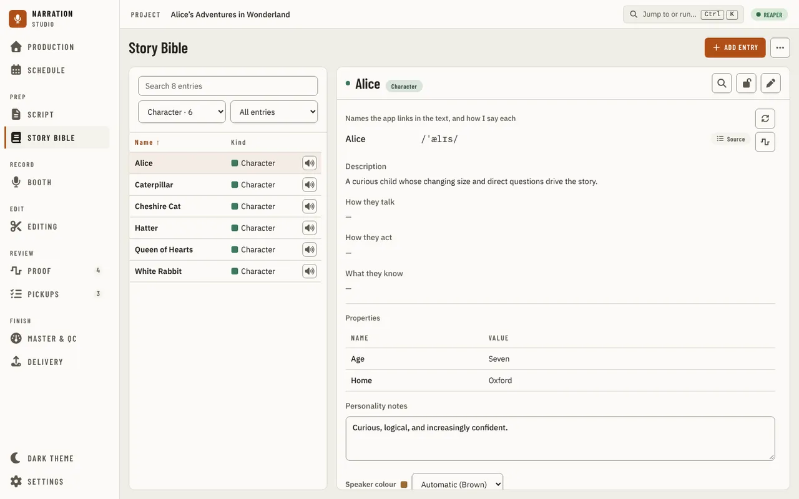
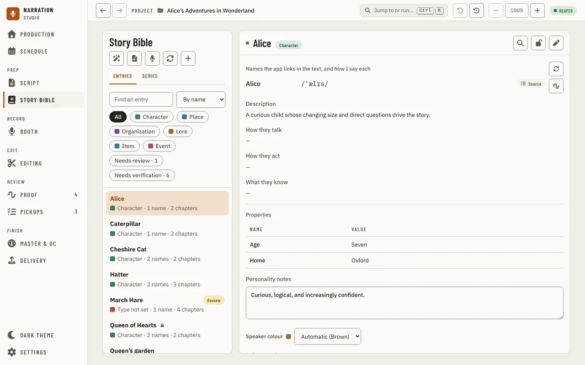
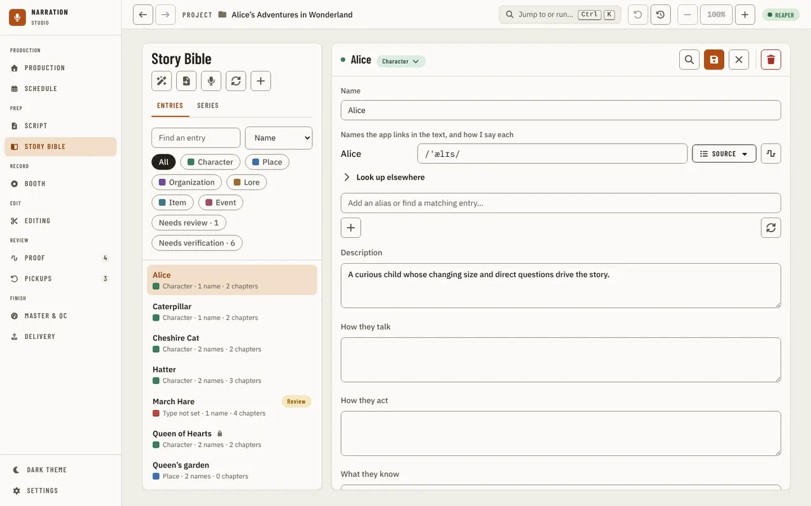
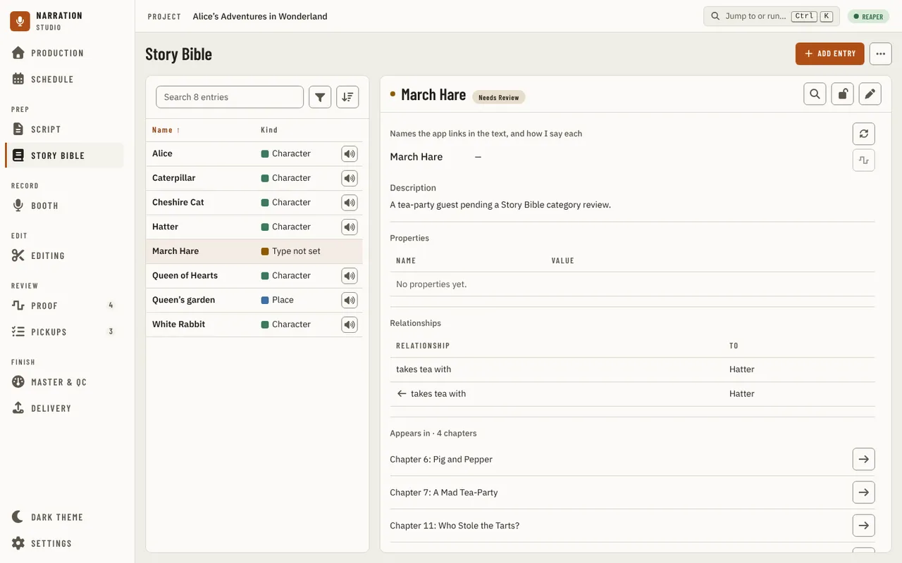
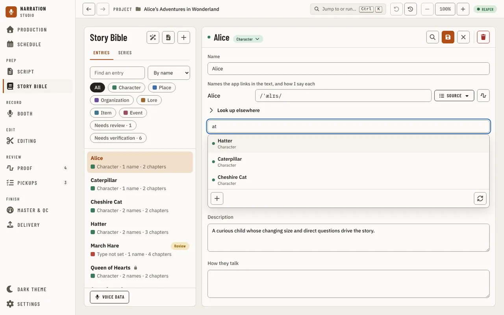

[Using the app](README.md) › Story Bible

# Story Bible

Story Bible tracks every character, place, and organization extracted from the manuscript,
with pronunciation, aliases, and narration notes. Each entry is a row of two lines: its name, then its kind in the kind's colour with how many names it has and how many chapters it appears in. The kind chips over the list filter it, the search box finds an entry by any of its names, and the Up and Down keys move through the rows. With no manuscript imported the page asks for one.

Selecting an entry opens its detail panel, read-only at first. Press Edit to change
pronunciation, aliases, and notes, then Save (or Cancel). Locked entries can't be edited until
unlocked. Rebuilding is deliberately strict: it favors missing a name over listing ordinary
words, so add unusual names by hand with the + button.

Pressing Edit switches the entry to edit mode, where Save, Cancel and a red Delete appear on the far
side of the header, set apart from Save so it can't be mis-clicked. Lock only appears in the read
view: an entry can never be locked while it is being edited, so unlocking always returns you to a
read-only entry, never back into an edit in progress. Locked entries show only Unlock; a brand-new
entry starts unlocked and can be locked once it has been saved.

Each entry also has **Properties**: a list of labelled facts, such as "Codename: Wren" or "Abilities: flight",
that you keep in the order you give them. In edit mode each property is a row with a name and a value, buttons to
move it up or down or remove it, and an Add button below. A value needs a name, and no two properties may share
one (capital letters do not make a name different); Save says which row to fix. A row you add and leave blank is
dropped. Properties are kept when you rebuild the Story Bible, and the summary of an entry that opens from the
Script lists them too.

Entries the build isn't sure about are filed under Needs Review, and their evidence is
highlighted in the review color so it is clear which entries still need a decision. "Go to line"
on an entry's evidence jumps to that spot in the [Script](script.md).

Typing into the alias field opens a dropdown of existing entries whose name or alias matches,
so a name mentioned under a different spelling can be merged into the entry it already
belongs to instead of creating a duplicate.

## Building with a language model

The first time you press Build / refresh, the app asks before it downloads anything. The Story Bible finds
people, places and organizations best with a language model (a small English model by default, chosen under
Settings, Story Bible). The question says what it is, its version and publisher, how much is downloaded and how
much disk it needs, where it will be kept, and its licence. You choose one of three:

- **Download model** downloads it with a progress bar you can cancel, checks it, and then builds. The next build
  does not ask again.
- **Build with rules-only** builds this once without a model. The result is lower quality (it finds fewer names
  and mistakes more ordinary words for names) and the build says so when it finishes. The model stays not
  downloaded, and the next build asks again.
- **Cancel** changes nothing: no build and no download.

If a download fails, the message says why (no connection, not enough disk space, or a file that did not match
the approved one) and you can try again. A download that was cut off carries on from where it stopped. Choosing a
model in Settings never downloads it, and Settings lists every approved model whether or not it is installed.

## Hearing a name

The play button beside a name, or beside one of its aliases, speaks it with the local preview
voice. It only works once a pronunciation exists: with none, the button is dimmed and a hint
(reachable by keyboard, not just the mouse) says so. The first time you press play, the app asks
before it downloads the voice. If the preview fails, the message says why, and pressing play
again tries again; a failed run never leaves a broken recording behind.

| The message says | What happened, and what to do |
| --- | --- |
| "… could not be spoken: the voice produced no audio for it." | The name is only punctuation or symbols. Give it a pronunciation the voice can say. |
| "The preview voice could not be loaded (…)." | The voice's files did not load. In [Settings, Local assets](settings.md#local-assets), Verify and Repair it, or remove it and install it again. |
| "The preview could not be saved (…)." | The recording could not be written. Close anything that has the file open and try again. |
| "The preview took longer than 2m0s and was stopped" | The voice did not answer in time; the first preview after starting the app is the slow one. Try again, and restart the app if it keeps happening. |
| The question about downloading the voice | The voice is not installed yet. |

## How you say each name

An entry lists **the names the app links in the text, and how I say each**: its first name, then each alias, one row
each. Read-only, a row shows how you say the name and where that came from. In edit mode a row has a **How I say**
field and a source tag:

- Type in the field and press Enter (or leave it) to use your own; the tag then reads **Entered by me**.
- Press the tag to choose a source instead: the CMU dictionary, Wiktionary (when it is installed), eSpeak NG, or
  Merriam-Webster online. The source is asked for that name alone; one with nothing for it says so and the value stays.
- When you replace a dictionary's answer with your own, or the other way round, the one replaced is kept: the tag's
  menu offers **Use mine** or **Use the dictionary's** to switch back.

A rebuild keeps all of this. Which source a *fresh* pronunciation tries first (at build time, or when you add an alias)
follows **Settings > Story Bible > Default pronunciation source**. A note written on a pronunciation shows under its
name. A question for the author is a mark on the [Script](script.md#select-text) page.

## Looking a name up online (Merriam-Webster)

When no dictionary on your computer knows a name, you can ask Merriam-Webster's online dictionary,
on your own free key. Get one from **Settings > Story Bible > Get a free key** (it opens
Merriam-Webster's sign-up page in your browser), paste it into **Your key** and press **Save key**.
On Windows the key is kept encrypted for your Windows account; **Remove key** deletes it.

Then, in edit mode, open **Look up elsewhere** under a name: **Look up online** sends that one name, and nothing else
from your book, to Merriam-Webster, and shows its answer in Merriam-Webster's own respelling (for example \krō-ˈkā\).
**Use this** puts it in the name's field. Every answer is kept on your computer, so looking the same name up again sends
nothing and works offline ("from this computer's copy"). **Look up elsewhere** also has the name's recordings on
Wikimedia Commons.

| Message | What it means | What to do |
| --- | --- | --- |
| "Add your own free Merriam-Webster key in Settings > Story Bible first." | No key is saved. | Save your key in Settings > Story Bible. |
| "Merriam-Webster refused the key ..." | The key was mistyped, or is not for the Collegiate Dictionary. | Copy it again from your dictionaryapi.com account page and save it. |
| "An online lookup sends one word or name only ..." | The name is longer than three words or has symbols. | Look up a shorter alias, or one word of the name. |

## Suggestions: scan and import

**Scan the manuscript** (the wand button at the top) reads the book and suggests new entries and facts about the ones
you have: what a character says, does and knows, and details. The first time, when no analysis tool is installed, it
asks whether to use the basic scan now, download better analysis, or import from a file instead; nothing downloads
until you agree. **Import entries** opens a CSV or JSON file of entries you made elsewhere and shows what it would add
before it adds anything.

A suggestion the app is sure of is accepted on its own; one it is not sure of waits for you. **Needs verification**
beside the filters shows only the entries with suggestions waiting, and lists above them the suggestions that have no
entry yet. An entry with suggestions waiting shows a **Verify** pill in the list, its accepted facts, and a **Suggested**
list where you accept, edit or reject each one, with the quote it rests on (press the quote to go to the line in the
Script). An entry cannot be marked reviewed while it has suggestions waiting.

## Voice references and dialogue cue attribution

An entry whose type can speak (Character, unless the type list says otherwise) has two more sections below
Personality notes: **Reference clips** and **Dialogue cues**. Neither judges your reading - they only track what you've approved and who a line of
dialogue is attributed to; there is no acoustic comparison or "drift" flag in the app yet.

**Reference clips** lists the REAPER regions you've approved as a voice reference for this
character. Choose a region from the picker (the regions of the saved REAPER project), add an
optional note such as "anchor take, chapter 1", and press **Approve as reference**. Approving the
same region again for the same character just updates its note in place. **Revoke** removes a
reference outright. If the region's name or time range changed in REAPER since you approved it, the
reference shows a **Changed since approval** badge - re-approve it once you're happy with the new
region, or revoke it. Playing a reference clip's audio in the app is not built yet; open the region
by name in REAPER to hear it.

**Dialogue cues** lists the quoted lines the Story Bible build attributed to this character, plus
any line left unattributed (three or more speakers active in a scene, or no speaker tag at all, are
left `unknown` rather than guessed). Pick a different speaker, or **Unknown**, from the dropdown
beside a cue to correct it. A correction survives the next Story Bible rebuild - it is never
silently overwritten by a fresh, possibly-wrong, extraction.

The **Voice data** button at the top of the Story Bible opens a panel
for the two things that aren't about one character: approving a reference for **plain narration**
(useful as a baseline separate from any character), and **Remove voice data**, which revokes every
approved reference in the project - for every character and for narration - in one action, after you
confirm. It doesn't touch the manuscript, dialogue cues, or anything else in the Story Bible.

## Series voice bible

If you're narrating a series, the **Series** tab (beside the **Entries** tab) shows a character's
approved reference clips across every book of the series, each labeled by the book it came from.
Name a series to start: type a name and press **Create series**. A series with only this one book
in it still shows - honestly - "no other books in this series yet"; add a sibling book's project
folder below (**Browse…**, or type its path) and press **Add** once it has approved references of
its own. **Remove** takes a book out of the series without touching that book's own project data.

There is no acoustic comparison here either - no drift evidence against another book, and no
audition. It's the same reference-clip bookkeeping as the Character entry's own Reference clips
section, just pooled across the books that share a character.

| Message | What it means | What to do |
| --- | --- | --- |
| "... could not be spoken: the voice produced no audio for it" | The name is only punctuation or symbols, so the voice has nothing to say. | Preview an alias that has letters in it, or ignore the preview for this name. |
| "The preview voice could not be loaded" | The downloaded voice is damaged or missing files. | In Settings, under TTS, choose "Remove local voice", then press play to download it again. |
| "The preview took longer than 2m0s and was stopped" | The helper that speaks the name did not finish. | Try again. If it keeps happening, restart the app. |
| "configure the Manuscript Guide executable" | The helper that builds the Story Bible was not found. | Reinstall the app. A build run from source needs its Manuscript Guide sidecar built first. |

---

[← Script](script.md) · [Index](README.md) · [Booth →](booth.md)
