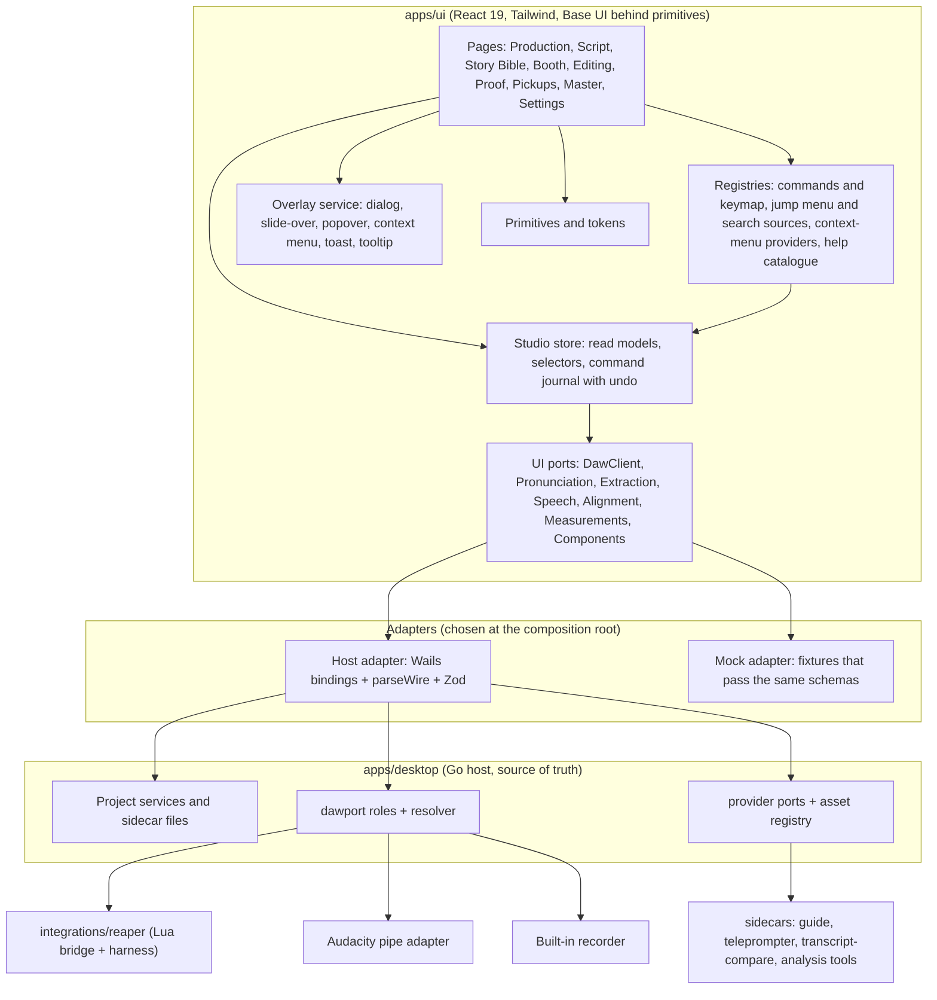
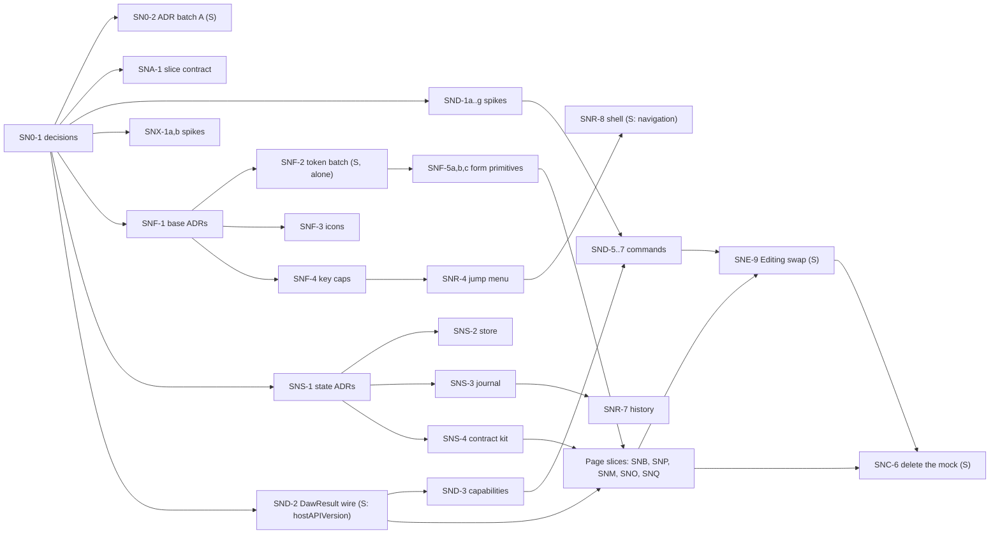
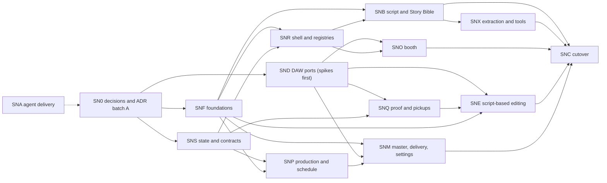

# Studio Next Rebuild: Evolve the Real App to the Studio Next Mock's Behaviour and Architecture

**Source:** owner request of 2026-10-10: "create a series of PRDs to get the existing repo functional around this design. That probably means rebuilding the mock's UI around the design principles we set up in the mock, with the interfaces and SOLID principles." Follow-up the same day: "I want the design to include agents and sessions running constantly", clarified as: the PRDs must be shaped so coordinator and worker sessions can run continuously on the rebuild (how the work is delivered, not an in-app feature). Citations are `path` at `550a7d1` (the commit that added the mock, PR #942).

**Builds on:** the working mock in [`docs/research/mockups/studio-next/`](../research/mockups/studio-next/README.md) (its [architecture contract](../research/mockups/studio-next/ARCHITECTURE.md) and the owner's rulings in `studio-next/research/repo-compare-decisions.md`); the repo's own ports and registries ([ADR 0300](../adr/0300-every-daw-is-reached-through-one-port-of-small-role-interfaces-and-callers-ask-a-resolver-what-it-supports.md), [ADR 0301](../adr/0301-providers-sit-behind-small-ports-with-a-registry-and-a-capability-descriptor.md), [ADR 0361](../adr/0361-app-commands-go-through-one-registry-and-keyboard-midi-and-hid-are-input-sources-bound-by-a-remappable-keymap.md), [ADR 0360](../adr/0360-studio-primitives-land-as-flat-leaf-files-after-one-token-batch-and-capability-gating-is-a-primitive.md), [ADR 0069](../adr/0069-payloads-are-validated-with-zod-behind-parsewire-and-a-wrong-shape-fails-loudly.md)); and the agent train ([`docs/operations/agent-train.md`](../operations/agent-train.md)).

**Extends, and in places asks to change:** [Which mocks are the spec](../operations/agent-train.md#which-mocks-are-the-spec) (D96), [ADR 0407](../adr/0407-a-new-page-replaces-its-old-counterpart-in-the-same-change-and-the-navigation-is-grouped-by-production-stage.md) (a new page replaces its old counterpart in the same change), [ADR 0388](../adr/0388-the-booth-is-a-page-keyed-by-its-address-and-only-exit-booth-stops-a-live-session.md), [ADR 0246](../adr/0246-punch-and-roll-moves-only-the-edit-cursor-and-anchors-words-by-a-polled-play-position.md), [ADR 0234](../adr/0234-fx-chains-go-on-tracks-and-a-passage-of-a-take-gets-one-plug-in-at-a-time.md), [ADR 0346](../adr/0346-a-pronunciation-carries-a-status-and-note-and-the-narrators-own-sits-beside-the-dictionarys-as-the-alternate.md). Every such place is a proposal for a new ADR, never a silent override (see "ADR conflicts" below).

**Status (2026-10-10):** draft. This is the overview of a series of 15 PRDs. No tracking issue is open yet; open one per PRD before its first slice ([Tracking work on GitHub](../operations/github-workflow.md)). Nothing in this series changes code until the owner answers the questions marked "gate" below.

## The series

| PRD | Code | What it delivers | Est. (people-weeks) |
| --- | --- | --- | --- |
| This file | SN0 | Vision, principles, gap analysis, ADR conflicts, strangler strategy, graph, gates, risks | 1 |
| [ADR Supersession Register](studio-next-adr-register.prd.md) | SNG | Appendix: every ADR classified keep, extend, supersede or discuss, and the 18 questions for the owner | 1 |
| [Agent Delivery](studio-next-agent-delivery.prd.md) | SNA | How slices are cut, issued, built, merged and watched by continuously running coordinator and worker sessions | 4 |
| [Foundations](studio-next-foundations.prd.md) | SNF | Tokens and layout rules, the missing primitives, the icon vocabulary, key caps and key hints, no raw controls | 6 |
| [App Shell and Registries](studio-next-app-shell-and-registries.prd.md) | SNR | Commands, keys, jump menu, search sources, context menus, help catalogue, overlays, history panel | 8 |
| [Domain, State and Wire Contracts](studio-next-domain-state-and-contracts.prd.md) | SNS | Typed UI store with undo journal, selectors, schemas, fixtures, the mock-versus-real parity kit | 7 |
| [DAW Ports and Capabilities](studio-next-daw-ports-and-capabilities.prd.md) | SND | Richer capabilities, `DawResult`, saved versus live, stale ids, new bridge commands (spikes first) | 14 |
| [Production and Schedule](studio-next-production-and-schedule.prd.md) | SNP | Payment type, milestones, delivery profile lookup, sourced numbers, target pace, readiness, report | 6 |
| [Script and Story Bible](studio-next-script-and-story-bible.prd.md) | SNB | Pronunciation sources, merge, review, appears-in, speaker colours, import, bookmarks | 7 |
| [Extraction and Analysis Tools](studio-next-extraction-and-analysis-tools.prd.md) | SNX | Suggestions with the 75% rule, optional GLiNER and BookNLP downloads, bring-your-own LLM | 9 |
| [Booth](studio-next-booth.prd.md) | SNO | Record preconditions, leave-while-recording, roll and punch, resume, suspected flags, key hints | 7 |
| [Proof and Pickups](studio-next-proof-and-pickups.prd.md) | SNQ | Cleared versus decided, decision history, stale guard, recording check, takes at a spot, gap taxonomy | 6 |
| [Script-Based Editing](studio-next-script-based-editing.prd.md) | SNE | The Editing page: words as the editor, takes inline, stacking, strip, drawer, range cut and FX | 12 |
| [Master, Delivery and Settings](studio-next-master-delivery-and-settings.prd.md) | SNM | Settings, Master and Delivery brought to the mock's capability-driven behaviour | 4 |
| [Cutover](studio-next-cutover.prd.md) | SNC | Parity audit, ratchets, deleting the mock and the steady-state docs | 3 |

Total about 95 people-weeks of one engineer familiar with the repo. The estimates are assumptions, not measurements: the agent train's throughput is set by usage bands and review, not by headcount ([Usage and autoscaling](../operations/agent-train.md#usage-and-autoscaling)).

## Problem Statement

The owner settled the product's behaviour in a runnable mock (22.9 thousand lines of source, about 45 test files) across a long series of rulings. The real app is a different code base that grew up under different rules. Three things are now true at once:

1. **The mock is where the owner's decisions live.** Pronunciation without a query workflow, cleared versus decided Proof counters, capability-driven DAW wording, script-based editing, optional extraction downloads: each is in the mock and in `studio-next/research/repo-compare-decisions.md`, and none of them is a recorded requirement the train can schedule.
2. **The mock was built without reading the repo** (its architecture contract says so), so it re-invents things the repo already has (stage readiness, status report, resume point, live flags, the recording check, pronunciation sources, speaker colours, the DAW port) and contradicts several accepted ADRs.
3. **The mock's own lifecycle is "deleted when the real app matches it"** ([README](../research/mockups/studio-next/README.md#status)). Without a plan that says what "matches" means, page by page, the mock either rots or gets copied wholesale into an app whose rules forbid that (global CSS, imperative overlays, raw key listeners, a whole-book client store).

The owner wants the real app (React front end, Go/Wails host, sidecars, REAPER bridge) functional around the mock's design, delivered by agents that run continuously.

## Evidence

**What the mock is** (`studio-next/ARCHITECTURE.md`, `studio-next/src/`):
- One typed store with undo history: `studio-next/src/state/store.ts` (`update`, `act(label, fn, {daw, restoreUi})`, `undoEntry`, `setChangeGuard`).
- Zod schemas as the domain: `studio-next/src/domain/schemas.ts`, `studio-next/src/domain/daw.ts`, `studio-next/src/domain/extraction.ts`, `studio-next/src/domain/components.ts`.
- Providers behind interfaces, each with a mock fed by fixtures: `studio-next/src/providers/` (pronunciation, speech, alignment, takes, measurements, components, extraction, fxchains, readiness, recordingcheck) and the DAW: `studio-next/src/state/daw.ts` (`DawAdapter`).
- Registries that pages plug into at import time: `studio-next/src/app/registry.ts` (context menus, commands, search sources, page keys).
- Data-driven config: `studio-next/src/config/`, `studio-next/src/fixtures/` (sample data lives there, never in a component).
- Custom primitives over Base UI with a test that forbids raw controls: `studio-next/src/ui/primitives/`, `studio-next/tests/no-raw-controls.test.ts`.
- One test file per decided behaviour: `studio-next/tests/` (about 45 files, for example `studio-next/tests/booth-daw.test.tsx`, `studio-next/tests/e-delete-range.test.tsx`).

**What the repo already has** (checked at `550a7d1`):

| Concern | Real app today | Where |
| --- | --- | --- |
| DAW port, roles, resolver, capability levels and reasons | Built, 24 capabilities, REAPER and Audacity adapters, conformance suite | `apps/desktop/internal/dawport/` ([ADR 0300](../adr/0300-every-daw-is-reached-through-one-port-of-small-role-interfaces-and-callers-ask-a-resolver-what-it-supports.md) to [ADR 0306](../adr/0306-mastering-is-a-provider-port-and-measurement-stays-one-in-process-judge.md)) |
| Provider ports (ASR, TTS, pronunciation, capture, encode) with registries and conformance | Built | `apps/desktop/internal/asrport/` and siblings ([ADR 0301](../adr/0301-providers-sit-behind-small-ports-with-a-registry-and-a-capability-descriptor.md)) |
| Capability gate and its hook | Built | `apps/ui/src/components/primitives/CapabilityGate.tsx`, `apps/ui/src/useCapability.ts` ([ADR 0360](../adr/0360-studio-primitives-land-as-flat-leaf-files-after-one-token-batch-and-capability-gating-is-a-primitive.md)) |
| Command registry, scopes, keymap, MIDI/HID sources | Built; 15 commands in the catalogue | `apps/ui/src/input/` ([ADR 0361](../adr/0361-app-commands-go-through-one-registry-and-keyboard-midi-and-hid-are-input-sources-bound-by-a-remappable-keymap.md)) |
| Wire contracts: Zod behind `parseWire`, goldens, contract test per binding | Built | `apps/ui/src/api/schemas/`, `tests/fixtures/contracts/` ([ADR 0069](../adr/0069-payloads-are-validated-with-zod-behind-parsewire-and-a-wrong-shape-fails-loudly.md)) |
| Backend injection with a mock (`NarrationApi`, split into per-domain interfaces) | Built | `apps/ui/src/types.ts`, `apps/ui/src/api/mockApi.ts` |
| Context menu, key caps and hints, toasts, tooltips, dialogs, slide-overs | Built as Base UI primitives | `apps/ui/src/components/primitives/` ([ADR 0705](../adr/0705-the-workspace-adds-an-effect-to-a-passage-or-a-chain-to-the-chapters-track-only-after-the-narrator-confirms-and-the-host-names-both-targets.md), [ADR 0620](../adr/0620-kbd-draws-plex-mono-caps-in-two-sizes-with-a-pressed-bottom-edge-and-keyhint-composes-one-with-its-action.md)) |
| Visual suite, atlas, axe, aria snapshots, Lua harness | Built | `apps/ui/tests/`, `integrations/reaper/tests/` |
| Findings with an append-only decision history keyed to an evidence version | Built | `apps/desktop/internal/findings/store.go` ([ADR 0120](../adr/0120-findings-are-read-and-decided-through-four-generic-bindings-and-a-decision-carries-the-evidence-version-it-was-made-against.md)) |
| Stage recommendations, status report, deadline tone, next-up order | Built | `apps/desktop/internal/stages/`, `internal/production/` ([ADR 0404](../adr/0404-production-next-up-ranks-chapters-by-held-back-readiness-then-stage-and-the-deadline-is-shown-not-projected.md), [ADR 0406](../adr/0406-the-status-report-leaves-out-the-contracted-amount-and-effective-rate-unless-the-narrator-opts-in.md)) |
| Pronunciation sources, speaker colours, resume point, live flags, recording check | Built | ([ADR 0405](../adr/0405-pronunciation-stays-local-first-behind-cmu-wiktextract-and-espeak-with-merriam-webster-as-the-one-narrator-keyed-online-source.md), [ADR 0367](../adr/0367-per-speaker-colours-alias-the-seven-entity-kind-hues-and-hash-by-speaker-name.md), [ADR 0349](../adr/0349-the-resume-locate-reads-reapers-live-cursor-and-items-first-and-falls-back-to-the-saved-project-never-to-a-guess.md), [ADR 0117](../adr/0117-live-flags-are-kept-as-suspected-findings-merged-per-chapter-when-a-session-ends.md), [ADR 0126](../adr/0126-recording-coverage-reads-the-take-markers-sequencematcher-alignment-and-folds-chance-matches-into-gaps.md)) |
| Workspace: word-level player, flags, takes panel, FX on a passage | Built inside the Proof chapter page | `apps/ui/src/components/proof/` ([ADR 0700](../adr/0700-the-takes-panel-lists-a-passages-takes-from-the-saved-project-and-chooses-one-by-an-id-the-host-offered.md), [ADR 0705](../adr/0705-the-workspace-adds-an-effect-to-a-passage-or-a-chain-to-the-chapters-track-only-after-the-narrator-confirms-and-the-host-names-both-targets.md)) |

**What the repo does not have** (each is a gap below): a UI domain store with a cross-page undo journal; a jump menu and search-source registry; a context-menu provider registry and a help catalogue derived from the command catalogue; an overlay service; `DawResult` (undo steps, steps taken) and capability `reason`, `destructive` and `mode` fields; capabilities for range cut, range FX, stacking and Audacity backups; bookmarks; milestone measure, estimate and done flag; a payment type; extraction suggestions with the 75% rule; optional analysis-tool downloads for extraction; the Editing page; the cleared-versus-decided counters; a mock-versus-real parity suite for providers.

## Proposed Solution

Make the real app behave as the mock does, and be built the way the mock is built, by **converging the repo onto the mock page by page and layer by layer**, not by porting the mock's code. The mock is the spec for behaviour and for the shape of the seams. The repo's ADRs stay the rules for how code is written, and where the two collide, an ADR is proposed and the owner decides.

Three outcomes:

1. **Seams first.** The ports, registries and store that the mock proves are added (or tightened) in the real app under existing pages, without changing what is drawn. Each seam ships with a contract test run against both the mock and the real implementation.
2. **Pages second.** Each page is rebuilt on the seams in one atomic change (the replacement rule of [ADR 0407](../adr/0407-a-new-page-replaces-its-old-counterpart-in-the-same-change-and-the-navigation-is-grouped-by-production-stage.md)), with screenshots against the Studio Next mock, and the owner's rulings turned into tests.
3. **Cutover last.** When every page has landed and the parity audit is green, the mock folder is deleted and the steady-state docs are written ([Studio Next Cutover](studio-next-cutover.prd.md)).

Throughout, the work is cut into **slices** small enough for one worker session, each with its own issue, so coordinator and worker sessions can run without pause ([Agent Delivery](studio-next-agent-delivery.prd.md)).

## Key Hypothesis

If every seam the mock proves is added to the real app as an interface with a mock implementation and a shared contract suite, then each page can be rebuilt by an independent worker without touching another page, and the mock can be deleted without losing a ruling. We will know we are wrong if a page slice needs to edit a seam it did not declare, or if a ruling in `repo-compare-decisions.md` has no test in the real app at cutover.

## What We're NOT Building

The owner's deferred and rejected list stands (`studio-next/research/repo-compare-decisions.md`). This series does not build:

- Time tracking in the mock's sense: the stage timer, hours log, PFH, effective rate and hours by stage. The real app already ships a timer chip and PFH ([ADR 0320](../adr/0320-pfh-and-the-effective-rate-come-only-from-logged-hours-and-measured-recorded-time.md)); whether to keep, hide or remove them is open question SN0-Q4. Nothing here extends them.
- The Companion. The real app's companion ([ADR 0381](../adr/0381-the-companion-panel-is-the-read-aloud-session-in-the-whole-window-and-follows-the-voice-not-the-daw-playhead.md), [ADR 0401](../adr/0401-companion-mode-resizes-and-pins-the-one-existing-window-and-never-opens-a-second-one.md)) is left exactly as it is; the mock's parked Companion page is not translated.
- A proofer CSV import or export; a proofer packet for a companion app.
- FX chains on whole takes (only a range of words, per the ruling, and only through the DAW's own saved chains).
- Audacity 4 (no scripting there yet; revisit when it exists) and any Audacity clip-takes except through the backups table.
- Redo. Undo reaching the DAW is a spike and an owner QA step, not a promise.
- The rejected items: query and confirm for names, stale-anchor detection, repo stress/breath/pause markup, evidence excerpts, derived prep completeness, chapter results in Find, the speaker coverage strip, prep sheet export, a Series tab (see SN0-Q5).
- A remote or hosted LLM by default; a hosted model is never required, and no narrator or author data leaves the machine ([agent-train D72](../operations/agent-train.md#owner-standing-rules)).
- macOS or Linux support ([ADR 0412](../adr/0412-windows-is-the-only-supported-platform-for-now.md)).
- A per-page long-lived feature flag in the shipped app (see "Strangler strategy").

## Success Metrics

| Metric | Target | Measured by |
| --- | --- | --- |
| Rulings with a test in the real app | 100% of agreed rulings in `repo-compare-decisions.md` at cutover | The ruling index in [Cutover](studio-next-cutover.prd.md), checked by a test that fails on an unmapped row |
| Provider interfaces with a shared contract suite run against mock and real | 100% of the ports in the provider map | `describeProviderContract` (see [Domain, State and Wire Contracts](studio-next-domain-state-and-contracts.prd.md)) |
| Raw `button`, `input`, `select`, `textarea`, `table` in `apps/ui/src` beyond reasoned ceilings | Ceilings fall to zero per migrated page | `apps/ui/src/rawNatives.test.ts` |
| `main` stays shippable | `Build (Windows)` and `ui-dist` green on every merged slice; no slice reverts | Merge log on #509 |
| Visual evidence | Every UI slice PR carries the Screenshots section against the Studio Next mock | The coordinator's merge check ([UI PRs show their screenshots](../operations/agent-train.md#ui-prs-show-their-screenshots)) |
| Continuous delivery | At least `TARGET` workers busy whenever a ready slice exists; no ready slice waits more than one coordinator pass | Status report in [Agent Delivery](studio-next-agent-delivery.prd.md) |
| Decisions that need the owner and are waiting | Under 10 open at any time, none older than 7 days without a default being applied | The decisions register |

## Open Questions

Each has a recommendation, taken by the agents as the default if the owner has not answered (implementation plan D22). "Gate" means no slice that depends on it is ready until it is answered or defaulted.

- [ ] **SN0-Q1 (gate). Which mock is the spec where Studio Next and the benchmark differ?** (A) Studio Next for every page it covers; the seven benchmark mocks for the style tokens and the pages Studio Next lacks (Series voice bible, companion). (B) The benchmark wins until a page is rebuilt. (C) Studio Next only. Recommendation: (A). It needs a change to [Which mocks are the spec](../operations/agent-train.md#which-mocks-are-the-spec), `apps/ui/tests/visual/mock-match/mocks.ts` and CLAUDE.md, which the owner makes.
- [ ] **SN0-Q2 (gate). Page replacement without a long-lived flag?** [ADR 0407](../adr/0407-a-new-page-replaces-its-old-counterpart-in-the-same-change-and-the-navigation-is-grouped-by-production-stage.md) says a new page replaces its old counterpart in the same pull request, with no period on `main` holding both. (A) Keep that rule: seams and components land first with no route, and one PR swaps the route. (B) Allow a time-boxed `studioNext` flag (dev and mock builds only, at most 3 weeks per page), recorded in a new ADR. Recommendation: (A) for every page, (B) only for Editing, whose rebuild is too large for one swap.
- [ ] **SN0-Q3. Is the UI store a cache of host state or a second source of truth?** (A) A read-model cache plus a command journal; the Go host stays the source of truth ([ADR 0041](../adr/0041-host-bindings-read-project-services-through-one-snapshot-accessor.md)). (B) Port the mock's whole-book client store. Recommendation: (A). See [Domain, State and Wire Contracts](studio-next-domain-state-and-contracts.prd.md).
- [ ] **SN0-Q4. What happens to the existing stage timer, PFH and effective rate** ([ADR 0320](../adr/0320-pfh-and-the-effective-rate-come-only-from-logged-hours-and-measured-recorded-time.md), the timer chip) given the owner deferred time tracking? (A) Leave them as built and out of this series. (B) Hide them behind a setting. (C) Remove. Recommendation: (A); the Production slices avoid reading them.
- [ ] **SN0-Q5. The Series tab and the series voice bible** ([ADR 0565](../adr/0565-the-series-voice-bible-pools-reference-clips-by-character-id-and-shows-no-books-until-a-second-book-has-data.md) to [ADR 0568](../adr/0568-a-sibling-books-character-names-are-read-through-a-new-plain-never-quarantining-guide-readonlynames.md), [ADR 0450](../adr/0450-series-storage-is-a-per-user-file-and-cross-project-reference-reads-never-write-into-a-sibling-project.md)) against "one book per app". (A) Keep the real series features untouched. (B) Remove. Recommendation: (A).
- [ ] **SN0-Q6. Schedule and Delivery as pages?** The mock has both; [ADR 0407](../adr/0407-a-new-page-replaces-its-old-counterpart-in-the-same-change-and-the-navigation-is-grouped-by-production-stage.md) decision 5 keeps them as panels of Production and Master & QC "until either needs a page". (A) Keep panels, move the mock's behaviour into them. (B) Make Schedule a page now. Recommendation: (A) first, (B) if the milestone table does not fit the Production page at 1024 px.
- [ ] **SN0-Q7. Breakpoints.** The mock collapses the rail at 1360, goes "medium" at 1280, "narrow" under 1180 and "tiny" under 860 by reading the zoomed viewport width. The visual suite checks 1440, 1024 and 768 (and 390 for Settings), the desktop minimum window is 960, and zoom is the host's ([ADR 0201](../adr/0201-app-zoom-under-wails-v3-on-windows-runs-from-100-to-200-percent-and-reads-the-level-back-from-the-window.md)). Recommendation: re-derive the mock's layout rules as container and media queries at the suite's widths; decided in [Foundations](studio-next-foundations.prd.md).
- [ ] **SN0-Q8. Who captures the mock's screenshots?** The Screenshots rule needs the mock beside before and after. The mock is a separate npm project (`npm ci`, Playwright scripts in `studio-next/e2e/`). Recommendation: a worker may run it in a session that has network for `npm ci`; if not, the slice's first PR commits no images and the owner captures them (listed on #510).
- [ ] **SN0-Q9. Agent-delivery deviations.** [Agent Delivery](studio-next-agent-delivery.prd.md) proposes changes to the train (a slice issue form, a decisions register, a lane-U territory extension). The owner confirms each, since the train's rules are the owner's.

Further per-PRD questions are in each PRD; none blocks another PRD's spikes.

## Users & Context

- **The narrator-owner** wants the app to behave as the mock does, with screenshots to judge it and no surprise regressions.
- **Worker sessions** (Sonnet by default, Opus for contracts, new Lua commands and semantic fixers) read `CLAUDE.md` (and the `.claude/rules/` files that load for the paths they touch), this series and their slice issue, and nothing else. A slice must be buildable from the repo alone.
- **The coordinator session** runs one pass every 30 minutes ([The coordinator's pass](../operations/agent-train.md#the-coordinators-pass)) and needs a ready list it can compute from the phase and slice tables.
- **Reviewers** (the owner, code-owner review) see small PRs with evidence.

## Solution Detail

### Principles, and what each means in this repo

| Principle | The mock's example | The real-app rule (and the existing anchor) |
| --- | --- | --- |
| Single responsibility | One module per idea: `studio-next/src/selectors/proof.ts` (counters), `studio-next/src/state/commands/notes.ts` (the only writer of `res`), `studio-next/src/format/headings.ts` (one heading formatter) | A selector module never writes; a command module never renders; a primitive never imports `src/api`. Enforced by the dependency-cruiser rules ([ADR 0062](../adr/0062-ui-import-rules-are-a-dependency-cruiser-config-and-a-mark-scan-that-name-their-adr.md)) and extended with `studio/` rules |
| Open/closed | New page keys, commands, context items and search sources register themselves (`studio-next/src/app/registry.ts`); adding a page edits no menu | Commands stay static descriptors in the catalogue ([ADR 0361](../adr/0361-app-commands-go-through-one-registry-and-keyboard-midi-and-hid-are-input-sources-bound-by-a-remappable-keymap.md)); the jump menu, help sheet and Settings key list are views of it; context items and search sources register by provider. Adding a feature adds a row or a provider, not an `if` |
| Liskov | `createMockPronunciation()` and a real provider answer the same `PronCandidate` (`studio-next/src/providers/pronunciation.ts`); a refusal is a value, never a throw | Every provider port has one contract suite that both the mock and the host-backed adapter pass; a mock may not be more permissive than the host |
| Interface segregation | Callers ask for a capability, not a DAW: `gateOf(mock, 'markers')` (`studio-next/src/selectors/daw.ts`) | The DAW stays many small roles ([ADR 0300](../adr/0300-every-daw-is-reached-through-one-port-of-small-role-interfaces-and-callers-ask-a-resolver-what-it-supports.md)); on the UI side `useApi()` stops returning the whole facade: a feature takes the one domain interface it needs |
| Dependency inversion | Pages call `daw()` and `pronunciation()`; nothing imports a bridge | Pages depend on UI ports (`apps/ui/src/ports/`), adapters live beside `api/`; the composition root picks host or mock ([ADR 0301](../adr/0301-providers-sit-behind-small-ports-with-a-registry-and-a-capability-descriptor.md), `ApiProvider`) |

### Provider map: the mock's seam to the real one

| Mock seam | Real owner today | Work |
| --- | --- | --- |
| `DawAdapter` (`studio-next/src/state/daw.ts`) | Go `dawport` roles behind Wails bindings | UI `DawClient` returning `DawResult`; Go capability and result extensions ([DAW Ports and Capabilities](studio-next-daw-ports-and-capabilities.prd.md)) |
| `PronunciationProvider` | `pronunciationport` and the Story Bible bindings | Align semantics (source plus manual, no query workflow) ([Script and Story Bible](studio-next-script-and-story-bible.prd.md)) |
| `ExtractionProvider`, `ComponentProvider` | Rules extraction in `sidecars/manuscript-guide`; the asset registry ([ADR 0079](../adr/0079-every-downloadable-asset-is-listed-installed-verified-and-removed-through-one-registry-of-providers.md)) | Suggestion layer; analysis tools become registry assets, not a second installer ([Extraction and Analysis Tools](studio-next-extraction-and-analysis-tools.prd.md)) |
| `SpeechProvider` | `asrport`, the coverage sidecar, live flags | Expose engines the host reports; Moonshine live in the Booth only ([Proof and Pickups](studio-next-proof-and-pickups.prd.md), [Booth](studio-next-booth.prd.md)) |
| `AlignmentProvider`, `TakesProvider`, `FxChainProvider` | Workspace alignment store ([ADR 0212](../adr/0212-the-workspace-alignment-reuses-the-coverage-results-store-and-joins-played-ranges-from-the-saved-project-on-read.md), [ADR 0242](../adr/0242-the-recording-check-writes-the-chapters-word-alignment-as-additive-lines-and-align-again-never-transcribes.md)), take metrics, `list_fx_chains` | Per-word times for the Editing page; range cut and FX ([Script-Based Editing](studio-next-script-based-editing.prd.md)) |
| `MeasurementProvider` (`Measured<T>`) | `measure`, `production.Recorded` | Value-or-reason answers for This week and room tone ([Production and Schedule](studio-next-production-and-schedule.prd.md)) |
| `ReadinessProvider` | `stages` engine ([ADR 0160](../adr/0160-stage-recommendations-are-computed-from-tri-state-signals-by-a-pure-engine.md), [ADR 0161](../adr/0161-stage-decisions-live-in-their-own-sidecar-and-confirm-writes-the-record-before-the-status.md)) | Re-skin; no second engine |

### Target architecture

### Gap analysis: headlines

| Area | Mock has | Repo has | Verdict |
| --- | --- | --- | --- |
| Transport DI, schemas, goldens | Zod domain, mock providers | Stronger (parseWire, goldens, per-binding row) | Keep the repo's; add a parity kit |
| DAW model | `DawResult`, capability reason, `destructive`, `mode`, saved/live, guid-stale | Port with levels and reasons; no result object, no range commands | Extend ([DAW Ports and Capabilities](studio-next-daw-ports-and-capabilities.prd.md)) |
| State and undo | One store, `act` with inverse patches, history panel | Per-feature state and per-feature undo (toast undo, host undo blocks) | New seam, host stays the truth |
| Registries | Commands, keys, context, search by import-time registration | Static command catalogue and keymap; per-area `ContextMenu`; no jump menu or search | Extend, reconcile with [ADR 0361](../adr/0361-app-commands-go-through-one-registry-and-keyboard-midi-and-hid-are-input-sources-bound-by-a-remappable-keymap.md) |
| Overlays | Imperative `openModal`, `popAt`, `toast` | Declarative primitives with fixed stacking ([ADR 0047](../adr/0047-the-ui-primitives-wrap-base-ui-and-app-code-never-imports-it.md), [ADR 0172](../adr/0172-popover-is-an-interactive-layer-above-the-dialog-and-escape-defers-to-the-topmost-one.md), [ADR 0630](../adr/0630-overlays-keep-the-mocks-frame-a-nested-dialog-dims-the-page-and-a-combobox-popup-is-a-listbox-not-a-popover.md)) | Thin service over the primitives |
| Primitives | Checkbox, Radio, Input, Textarea, Select, Slider, NumberInput | Most present; no Slider, NumberInput, Swatch | Add three; lower ceilings |
| Styles | One 633-line global `app.css` | No new global classes ([ADR 0009](../adr/0009-complete-tailwind-migration.md), [ADR 0017](../adr/0017-no-legacy-css-shadowing-tailwind.md)) | Do not port; re-express in primitives |
| Behaviours | Rulings listed per PRD | About half exist in other shapes | Converge page by page |
| Tests | One test per ruling, scenario books (3 heading styles, 40 chapters) | Visual suite, atlas, harness; fewer behaviour tests per ruling | Add ruling-indexed tests |

### ADR conflicts and the ADRs to author

None of these is overridden here. Each is a proposal; the owning PRD authors it as `Status: Proposed` and the owner accepts it.

| # | Conflict | Existing decision | Proposed ADR (owner PRD) |
| --- | --- | --- | --- |
| A1 | Which mock is the spec | D96, now in `.claude/rules/ui-spec-and-screenshots.md`: only the benchmark folder counts | Spec precedence, amends the rule (SNF/SNC) |
| A2 | Page replaced behind a flag | [ADR 0407](../adr/0407-a-new-page-replaces-its-old-counterpart-in-the-same-change-and-the-navigation-is-grouped-by-production-stage.md): same-PR replacement, no coexistence | Time-boxed flag for Editing only, if SN0-Q2 (B) (SNE) |
| A3 | Register keys with page handlers (`registerKeys`) | [ADR 0361](../adr/0361-app-commands-go-through-one-registry-and-keyboard-midi-and-hid-are-input-sources-bound-by-a-remappable-keymap.md): features never listen to `keydown`; static catalogue | Jump menu, context providers and help derived from the catalogue (SNR) |
| A4 | Imperative overlays | [ADR 0048](../adr/0048-every-dialog-is-one-modal-shell-and-confirms-are-alert-dialogs.md), [ADR 0172](../adr/0172-popover-is-an-interactive-layer-above-the-dialog-and-escape-defers-to-the-topmost-one.md), [ADR 0630](../adr/0630-overlays-keep-the-mocks-frame-a-nested-dialog-dims-the-page-and-a-combobox-popup-is-a-listbox-not-a-popover.md) | Overlay service renders the existing primitives (SNR) |
| A5 | Whole-book client store with immer patches | Host owns state ([ADR 0041](../adr/0041-host-bindings-read-project-services-through-one-snapshot-accessor.md), [ADR 0069](../adr/0069-payloads-are-validated-with-zod-behind-parsewire-and-a-wrong-shape-fails-loudly.md)); no immer dependency | Read-model store and command journal (SNS) |
| A6 | Undo spanning the DAW | None; owner's QA step; spike needed | Undo scope and DAW flag (SNS/SND) |
| A7 | `DawResult`, capability `reason`, `destructive`, `mode`; camelCase levels | Wire levels are `not_yet_available` snake case; refusal sentences by resolver ([ADR 0302](../adr/0302-dawport-roles-exchange-the-bridges-own-types-through-aliases-and-an-asynchronous-role-is-one-method-per-command.md)) | Result object and capability fields, keeping wire names (SND) |
| A8 | Roll as one DAW command keeping earlier audio as a take | [ADR 0246](../adr/0246-punch-and-roll-moves-only-the-edit-cursor-and-anchors-words-by-a-polled-play-position.md): punch and roll move only the edit cursor | Supersedes the roll part after a spike (SND) |
| A9 | Cut and FX on a range of words | [ADR 0234](../adr/0234-fx-chains-go-on-tracks-and-a-passage-of-a-take-gets-one-plug-in-at-a-time.md), [ADR 0705](../adr/0705-the-workspace-adds-an-effect-to-a-passage-or-a-chain-to-the-chapters-track-only-after-the-narrator-confirms-and-the-host-names-both-targets.md): chains on tracks, one plug-in at a time on a passage | Range exception, confirm first, one undo step (SND/SNE) |
| A10 | Leaving the Booth while recording asks to stop | [ADR 0388](../adr/0388-the-booth-is-a-page-keyed-by-its-address-and-only-exit-booth-stops-a-live-session.md) decision 3: the session keeps running; [ADR 0232](../adr/0232-arming-for-a-recording-remembers-the-narrators-arms-makes-no-undo-point-and-the-app-stops-only-the-recording-it-started.md): app stops only its own recording | Amends both (SNO) |
| A11 | Pronunciation without query or confirmed status | [ADR 0346](../adr/0346-a-pronunciation-carries-a-status-and-note-and-the-narrators-own-sits-beside-the-dictionarys-as-the-alternate.md), [ADR 0347](../adr/0347-the-pronunciation-query-export-is-csv-with-its-ids-last-and-a-formula-guard-and-is-a-download.md), [ADR 0352](../adr/0352-a-re-imported-query-answer-is-matched-by-entry-id-and-alias-index-and-a-blank-note-column-leaves-the-note-alone.md): status values, query CSV, re-import | Supersedes those parts; migrate old status (SNB) |
| A12 | Payment type, milestone measure, estimate, done | [ADR 0323](../adr/0323-production-deadlines-and-milestones-are-calendar-dates-on-the-project-manifest.md) milestones are dated checkpoints; [ADR 0320](../adr/0320-pfh-and-the-effective-rate-come-only-from-logged-hours-and-measured-recorded-time.md) | Extends the manifest (SNP) |
| A13 | Schedule and Delivery pages | [ADR 0407](../adr/0407-a-new-page-replaces-its-old-counterpart-in-the-same-change-and-the-navigation-is-grouped-by-production-stage.md) decision 5 | Only if SN0-Q6 (B) (SNP/SNM) |
| A14 | Suggestion layer, 75% verify rule, optional downloads | [ADR 0020](../adr/0020-entity-extraction-precision-over-recall.md) precision over recall; [ADR 0079](../adr/0079-every-downloadable-asset-is-listed-installed-verified-and-removed-through-one-registry-of-providers.md) one asset registry; provenance rules | Extraction suggestions and tiers (SNX) |
| A15 | Editing as a page that takes the workspace out of Proof | [ADR 0407](../adr/0407-a-new-page-replaces-its-old-counterpart-in-the-same-change-and-the-navigation-is-grouped-by-production-stage.md), [ADR 0470](../adr/0470-proof-follows-mock-04-pickup-edit-waived-are-words-over-the-stored-status-and-the-chapter-view-leads-with-its-notes.md) | Editing page replaces the workspace (SNE) |
| A16 | Breakpoints from zoomed width; icon vocabulary; key cap pictures | [ADR 0037](../adr/0037-visual-suite-captures-no-phone-viewport.md), [ADR 0201](../adr/0201-app-zoom-under-wails-v3-on-windows-runs-from-100-to-200-percent-and-reads-the-level-back-from-the-window.md); [ADR 0620](../adr/0620-kbd-draws-plex-mono-caps-in-two-sizes-with-a-pressed-bottom-edge-and-keyhint-composes-one-with-its-action.md) | Layout rules and icon vocabulary (SNF) |
| A18 | Proof counts decided and cleared; a note is open until fixed, waived or dismissed | [ADR 0525](../adr/0525-proofing-is-met-by-a-current-zero-open-pickup-source-and-every-required-delivery-check-confirmed-through-the-shared-stage-engine.md), [ADR 0470](../adr/0470-proof-follows-mock-04-pickup-edit-waived-are-words-over-the-stored-status-and-the-chapter-view-leads-with-its-notes.md): open means anything not dismissed | Proof counters and the cleared definition (SNQ) |
| A17 | New dependency `immer` | Knip and dependency policy ([ADR 0045](../adr/0045-dead-code-is-gated-at-zero-with-reasoned-ignores.md)) | Folded into A5 |

### ADR supersession register

The owner's rule: the Studio Next PRDs supersede existing ADRs wherever they conflict with the mock's design, except where following the mock would give the narrator a worse experience; those are flagged for discussion and not decided. The full register (every ADR classified KEEP, EXTEND, SUPERSEDE or DISCUSS, with the mock behaviour, the owning PRD and a working title for the superseding ADR) is the appendix [ADR Supersession Register](studio-next-adr-register.prd.md). Each focused PRD repeats its own rows in a "Supersedes / depends on ADRs" subsection.

**Migration-period rule.** On conflict the PRD, and the superseding ADR written when its phase lands, is the source of truth for the rebuild. The old ADR stays in force for code not yet migrated until the superseding ADR is merged. No ADR is edited or written by this series now; each is authored with the `adr-author` workflow when its code lands, with the next free number checked at merge time.

**DISCUSS items for the owner** (nothing that depends on them is built until answered):

| Q | Topic | One-line trade-off | Recommendation |
| --- | --- | --- | --- |
| DQ-1 | Spec precedence: benchmark mocks (and the ADRs measured to them) versus Studio Next | Measured fidelity versus the mock the owner now prefers | Studio Next for behaviour and layout; keep measured tokens unless a side-by-side differs |
| DQ-2 | ADR 0407: atomic page swap versus a time-boxed flag | Safety versus early review of a 12-week page | Atomic; a dev-only flag for Editing if wanted |
| DQ-3 | Shipped timer, PFH and effective rate versus "time tracking deferred" | Losing a working feature versus contradicting the ruling | Keep as built |
| DQ-4 | Deadline projection from fixed constants versus "shown, not projected" | A useful chart that can mislead | Project only from measured pace |
| DQ-5 | Implicit arming on Record versus ADR 0380's separate click | Fewer steps versus arming under the narrator's hands | Visible first time; setting default off |
| DQ-6 | Retiring Punch from the Pickups page | Losing a one-click action | Retire only when the Booth pickup session lands |
| DQ-7 | Stacking retries shifts later audio, versus ADR 0147 | Tidy takes versus slipping markers and other tracks | Confirm with the plan; REAPER first; refuse when sync-sensitive material is present |
| DQ-8 | Cleanup trims deleting audio versus "never delete" | Reversibility versus a cluttered project | Use the muted Cuts track |
| DQ-9 | Moonshine live in the Booth versus ADR 0414's Whisper-tiny default | A faster engine may follow worse | Keep the default until the owner's A/B |
| DQ-10 | Auto-apply extraction at 75% versus ADR 0020 precision over recall | Fewer clicks versus wrong entries sitting unnoticed | Entries only; the rest always verified |
| DQ-11 | Removing the pronunciation query workflow and its export | Narrators who query authors lose the export | Supersede as ruled; keep old data readable |
| DQ-12 | Series features versus "one book per app" | Dropping shipped cross-book data | Keep |
| DQ-13 | Companion: freeze or remove | Removing a shipped mode | Freeze |
| DQ-14 | Schedule and Delivery as pages versus panels | Room for the milestone table versus a new nav item | Panels first |
| DQ-15 | Suggested take versus ADR 0165 "never ranked" | A suggestion can anchor the narrator | Evidence first; chip; never preselected |
| DQ-16 | Proof percent capped at 99 versus honest counts | A made-up number | "Cleared n of m" |
| DQ-17 | Hand-scroll rule of ADR 0119 versus the ruling | Probably identical | Keep and confirm |
| DQ-18 | Audacity takes through backups versus ADR 0660 | Take controls could imply non-destructive editing | Capability-driven with the destructive notice |

Rulings that override old ADRs directly, and where each is recorded: FX on a range versus [ADR 0234](../adr/0234-fx-chains-go-on-tracks-and-a-passage-of-a-take-gets-one-plug-in-at-a-time.md) (A9), clip-takes for Audacity versus [ADR 0660](../adr/0660-audacitys-finding-detail-hides-reapers-take-management-instead-of-disabling-it-through-capabilitygate.md) (DQ-18), leaving the Booth versus [ADR 0388](../adr/0388-the-booth-is-a-page-keyed-by-its-address-and-only-exit-booth-stops-a-live-session.md) (A10), the proof percentage versus [ADR 0525](../adr/0525-proofing-is-met-by-a-current-zero-open-pickup-source-and-every-required-delivery-check-confirmed-through-the-shared-stage-engine.md) (A18, DQ-16), take suggestion versus [ADR 0165](../adr/0165-a-take-comparison-is-one-finding-per-group-over-its-one-span-built-from-the-saved-project-and-never-ranked.md) and [ADR 0140](../adr/0140-take-metrics-are-per-category-evidence-over-a-takes-source-range.md) (DQ-15), Moonshine live-only versus [ADR 0107](../adr/0107-moonshine-ships-inside-the-windows-teleprompter-sidecar-and-runs-only-from-a-verified-catalog-install.md) and [ADR 0414](../adr/0414-the-teleprompter-default-engine-stays-whisper-tiny-until-a-real-time-ab-evaluation-runs.md) (DQ-9), Pickups scope versus the shipped Punch (DQ-6), wheel browse versus [ADR 0119](../adr/0119-a-hand-scroll-pauses-following-until-the-current-word-is-back-in-the-band.md) (DQ-17), the Companion deferral versus [ADR 0381](../adr/0381-the-companion-panel-is-the-read-aloud-session-in-the-whole-window-and-follows-the-voice-not-the-daw-playhead.md) and [ADR 0401](../adr/0401-companion-mode-resizes-and-pins-the-one-existing-window-and-never-opens-a-second-one.md) (DQ-13), cleanup placement versus [ADR 0262](../adr/0262-cleanup-trims-are-found-by-matching-the-measured-file-to-a-live-item-and-applied-as-a-split-and-delete-inside-one-undo-block.md) and [ADR 0266](../adr/0266-the-editing-check-panel-reads-its-per-class-state-from-srs-stage-signals-and-keeps-progress-inline-so-candidates-stay-visible-while-it-runs.md) (Editing owns cleanup; DQ-8).

### Carried over from the old PRDs

The old PRDs in `docs/prds/` will be deleted once this series is in place, so nothing here relies on them staying. Each remaining (not complete) phase is either **carried over** to a slice of this series, or **explicitly dropped** from the series' scope (it was blocked, benched, deferred by the owner, or is release engineering unrelated to Studio Next; a dropped phase has no owner after deletion unless the owner asks for a successor PRD). To read an old PRD after deletion: `git log --diff-filter=D --format=%H -n1 -- docs/prds/<slug>.prd.md`, then `git show <that commit>^:docs/prds/<slug>.prd.md`.

| Old PRD (slug) | Remaining phases | Disposition | Where |
| --- | --- | --- | --- |
| `app-shell-vertical-overflow` | 1 anchor escaped content; 2 one scroll container (both partial, pending the owner's WebView2 check at 100, 125, 150% zoom) | Carried over | SNF-6 layout rules; the owner check on #510 |
| `audacity-integration` | 1 and 2 spikes (now the owner's verification pass); 4, 6, 7, 8 built, owner pass pending | Carried over | SND-1g, SND-8; owner pass on #510 |
| `audiobook-credits-templates` | 4 teleprompter (manual live check with a microphone) | Carried over | SNO-10 owner step |
| `booth-actions-enablement` | 6 verification part A (built, owner run pending); 7 verification part B and promotion; 8 steady state | Carried over | SND promotion plan (SND-10) and SNO-10 |
| `character-continuity-review` | 6 UI (partial), 7 intentional change and privacy, 8 acoustic backend, 10 series-anchored findings | Explicitly dropped (benched by D87; not Studio Next) | Owner may request a successor |
| `coreaudio-capture` | 2 hardware verification | Explicitly dropped (deferred by D74, Windows only) | |
| `credits-in-chapter-table` | 4 credits in REAPER chapter regions (partial) | Carried over, deferred ("regions later") | SND, after the roles exist; no slice yet |
| `daw-chapter-track-auto-sync` | 0 measure REAPER names; 3 consent and first sync, 4 watch, 6 status, 8 pickups interplay (host complete, UI pending); 5 live unsaved tracks (only if spike S6 = C) | Carried over | SNP-7 (UI halves), SND-4 (live state), owner measure on #510 |
| `delivery-platform-profiles` | 0 ACX spec validation (owner reading); 7 book checklist (UI complete) | Carried over | SNM-5 owner step |
| `diagnostics-delivery-and-cleanup-tools` | 3 EBU validation (owner run); 10 REAPER preview and apply (owner checklist); 11 clause split | Carried over | SNM-5 (EBU), SND owner pass (10), SNE-10 (clause split, Could) |
| `edit-and-proof-workspace` | 0 decisions and spikes (desk work done); 6 takes panel (partial); 7 follow REAPER; 10 consolidation (superseded by stage navigation) | Carried over / superseded | SNQ-7, SNE-10; consolidation is replaced by the Editing swap SNE-9 |
| `native-recording-suite` | 6 basic non-destructive editing in the recorder | Explicitly dropped (D86: record and organise only) | |
| `project-workspace-and-daw-link` | 5 launcher passes the project file (manual REAPER checklist) | Carried over | SNC-2 owner QA list |
| `read-aloud-control-bar` | 3 control bar (owner suite confirmation); 7 record in REAPER (partial) | Carried over | SNO-2, SNO-10 |
| `reaper-automation-follow-through` | 1 manual checklist; 11 per-chapter render config (partial); 23 cleanup launchers (partial); 25 retakes as fixed lanes (partial); 15 spike S4 play position; 16 S3 audio accessors; 17 S1 ReaStream; 18 S2 OSC; 19 S6 web interface; 20 transport ADR; 21 Go transport client (web/OSC) | 1, 11, 23, 25: carried over (owner REAPER checks); 15: carried over; 16 to 21: explicitly dropped (a web or OSC transport is not needed by any Studio Next page) | SND-1f for S4; SNC-2 for the owner checks |
| `release-readiness-provisioning-and-docs-site` | 9 and 11 Pages (partial; Pages paused, D75); 14 installer (partial); 15 code signing (deferred, D7); 16 first stable rehearsal (owner-run) | Explicitly dropped from this series (release engineering; tracked by the owner on #231) | |
| `review-dashboard-and-findings-adoption` | 6, 7, 8 REAPER navigation, host and UI, approved marker (built; owner checks pending) | Carried over | SNQ-9 owner step; SND owner pass |
| `teleprompter-engines-and-input-devices` | 8 engine evaluation and default ADR | Carried over | SNO-9 and DQ-9 (the A/B is the owner's) |
| `teleprompter-manuscript-integration` | 6 live flag events (partial); 11 live REAPER state (partial); 12 punch and roll (partial); 13 retire the standalone page (superseded by stage navigation) | 6, 11, 12 carried over; 13 already superseded | SNO-5, SND-4, SND-6a |
| `analysis-evidence-ledger` | 8 live change counter (Could, skipped by design) | Explicitly dropped | |
| `app-navigation-and-zoom-controls` | 4 macOS app menu | Explicitly dropped (D74) | |
| `typescript-7-and-typed-linting` | 3 retire the bridge (blocked upstream) | Explicitly dropped from the series (tooling, unrelated) | |

All other old PRDs have every phase complete.

### Continuous delivery model and the slice graph

The series is built to be delivered by the agent train without a pause. The detailed model is [Agent Delivery](studio-next-agent-delivery.prd.md); the facts that shape every PRD are:

- **Every PRD ends with a "Slices" table** (id, scope, depends on, parallel-safe, verification). A slice is one PR by one worker in one lane, with its own issue created just in time, a machine-readable header (`owns` globs, `depends`, serial points) and a `## Handoff` comment so a fresh session resumes from the repo and the issue alone.
- **Lanes are the train's lanes** (K contracts, A host, B adapters and sidecars, U primitives and input, C UI features, D documents, X exclusive); the series' new directories (`apps/ui/src/studio/`, `ports/`, `overlay/`, `registries/`) are proposed lane U territory.
- **The coordinator's pass is the train's pass** ([The coordinator's pass](../operations/agent-train.md#the-coordinators-pass)) plus a groomer launch when fewer than twice `TARGET` ready slices exist.
- **Owner decisions** arrive through a decisions register issue seeded from `repo-compare-decisions.md`; DISCUSS rows and ADR changes never default.

Slice graph at the level of the serial spine and the first parallel fan-out (S marks a serial-point slice):

| Wave | Slices that may run together | Spine slices in the wave |
| --- | --- | --- |
| 0 Decide | SN0-1, SNA-1, SNA-2, SNA-4, spike slices of SND and SNX, SNF-1, SNS-1, SNR-1, SNG-1 | SN0-2 (ADR block allocation) |
| 1 Seams | SNF-3, SNF-4, SNF-5a..c, SNF-6, SNS-2..5, SND-2..4, SNR-2..7, SNP-1, SNB-1, SNQ-1, SNO-1, SNE-1, SNM-1 start | SNF-2 (alone), SND-2 (bump), SNR-8 |
| 2 Pages | SNB-2..7, SNP-2..7, SNQ-2..8, SNO-2..9, SNM-1..4, SNX-2..6, SND-5..9, SNE-2..8 | the `hostAPIVersion` bump slices, one at a time |
| 3 Swaps and cutover | SNB-8, SNP-8, SNQ-9, SNO-10, SNM-5, SNE-9, SNC-3..6 | each page swap that touches navigation |

Parallel capacity is bounded by file ownership: at most one worker on each lane-K and lane-X territory, one on the token batch, one on `hostAPIVersion` at a time; leaf page slices in disjoint feature folders run side by side up to `MAX_WORKERS`.

### Deviations from the agent train

[Agent Delivery](studio-next-agent-delivery.prd.md) lists every place the series would extend or change the train (a slice issue per slice, a groomer session type, a stall rule, a daily cap and a program hold switch, a session cap per slice, lane U territory, a decisions register with seven-day defaults, a status issue, the worker template naming Studio Next mock files, an issue form). Each is a proposal needing the owner and, where it settles a rule, an ADR; until accepted the train runs as written.

### Strangler strategy

The repo's rule ([ADR 0407](../adr/0407-a-new-page-replaces-its-old-counterpart-in-the-same-change-and-the-navigation-is-grouped-by-production-stage.md)) forbids two versions of a page on `main`, so the strangler runs by **layer**, then swaps pages atomically.

1. **Layer strangling (invisible).** A seam is added under existing pages and one consumer moves onto it at a time: a context-menu provider replaces one page's `ContextMenu` items, a command moves to the catalogue, a store selector replaces one page's derived value. Each of these PRs changes behaviour in no way a narrator can see, so it needs no flag and the visual suite should show no diff.
2. **Build in the dark.** New page components are built as stories and tests under the page's feature folder before any route points at them. Knip gates dead code at zero ([ADR 0045](../adr/0045-dead-code-is-gated-at-zero-with-reasoned-ignores.md)); a story and its test count as use, and a slice that leaves an unrouted component for more than one wave is flagged by the coordinator.
3. **Atomic swap per page.** The last slice of a page PRD swaps the route, deletes the old page and its rows (state catalogue, drivers, aria snapshots, guide, doc screenshots), and carries the Screenshots section.
4. **Escape hatch.** Only for Editing, and only if SN0-Q2 (B) is accepted: `?studioNext=1` in mock and dev builds, never in the shipped build, removed by the cutover.

The app stays shippable because every slice leaves `pnpm check` green on its own base and none depends on a later slice to be correct.

### Verification approach

- **Provider contract suites.** Every UI port has `describeProviderContract(port)` run over the mock adapter and the host-backed adapter (the host side against the Go golden payloads). Every Go port keeps its `*porttest.Run` suite. A new port without both fails a test, as new bindings already do (`apps/ui/src/api/wireContracts.test.ts`).
- **Wire contracts.** Each new payload: Zod schema, golden written by a Go or Python test (`UPDATE_CONTRACTS=1`), a `wireContracts.test.ts` row, a mock that passes it, a `wire.go` row for REAPER events ([wire contracts](../architecture/wire-contracts.md)).
- **Ruling tests.** Each agreed ruling gets a test named for it, carried over from the mock's test where one exists (`studio-next/tests/`), indexed in a table the cutover checks.
- **Visual evidence.** Visual suite rows per state at the suite's viewports, looked at by the worker; atlas and axe for primitives; aria snapshots for dialogs and slide-overs; the Screenshots section against the Studio Next mock ([UI PRs show their screenshots](../operations/agent-train.md#ui-prs-show-their-screenshots)).
- **REAPER.** Harness test first for every new or changed command, mutation entries for guards, a spike script run in REAPER on a copy of a project with an isolated `-cfgfile` where behaviour is unverified; anything needing the owner is marked pending on #510 ([ADR 0066](../adr/0066-the-lua-bridge-is-tested-by-a-harness-under-lua-5-4-and-reaper-api-behaviour-is-checked-in-reaper.md), CLAUDE.md step 4).
- **Gates.** The worker contract is CLAUDE.md's: plan, `change-impact-scan`, TDD, `full-verification-gate`, `design-spec-guard`, `feature-cleanup`. CLAUDE.md step 4 and the `full-verification-gate` skill ask for the targeted checks for what a slice changed and let the PR pipeline be the full gate; this series keeps that and does not change it. The path-scoped rules in `.claude/rules/` load when a worker edits a file under their `paths:`.

### Unverified behaviours that must be spikes

These must be answered in a spike slice (script run on a copy, result written to `docs/research/`) before an implementation slice starts. They are all in [DAW Ports and Capabilities](studio-next-daw-ports-and-capabilities.prd.md) unless noted.

1. Whether a roll while recording can be made one command that keeps the earlier audio as a take in REAPER (record mode, new-take-on-stop), and what undo points it leaves.
2. Whether a cut of a word range (split twice, remove the middle) is one undo block that also keeps the piece on a muted track.
3. Whether a saved `.RfxChain` can be applied to a split piece of an item (take FX chain) with `TakeFX_AddByName`, and what the undo step is.
4. Whether stacking takes of one passage onto one item (moving items, adding takes) can be done in one undo block.
5. Whether an Audacity 3 scripting-pipe sequence can clone a time range into a backups track and restore it, and how long it takes for two minutes either side.
6. Whether the app's undo can reach the DAW (an app-side journal calling the DAW's undo is refused by REAPER's own history order).
7. Whether `play_position` over the file bridge is accurate enough for the Booth's resume anchor (REAPER spike S4 is pending audio hardware).
8. Extraction: licences and quality of GLiNER and BookNLP weights, and the calibration of the 75% rule on real manuscripts ([Extraction and Analysis Tools](studio-next-extraction-and-analysis-tools.prd.md)).

## Technical Approach

**Dependency order.** The graph below is the PRD-level graph; each PRD's "Slices" section holds the slice-level edges and [Agent Delivery](studio-next-agent-delivery.prd.md) turns it into the ready list.

**The serial spine** (one at a time, in order, because they touch the train's serial points): the design token batch (SNF-2), the shell navigation and header (SNR-8), `hostAPIVersion` bumps (every binding slice), the ADR index rows, `.github/` changes (SNA-3), and the cutover (SNC). Everything else is lane work that can run beside it.

**Parallel after the spine.** Once SNF-1..3, SNS-2 and SND-2 are on `main` (gate G1), the pages SNB, SNP, SNM, SNO, SNQ can run at the same time, each in its own files; SNE waits for SND range commands and SNQ's take lanes. SNX can start its spikes at G0.

**Phase gates.**

| Gate | Condition | Unblocks |
| --- | --- | --- |
| G0 Decide | Owner answers or defaults for SN0-Q1, Q2, Q3; ADR batch A written as Proposed; spikes listed | Any code slice |
| G1 Seams | Tokens and primitives (SNF-1..4), command/overlay/search seams (SNR-1..5), store core and parity kit (SNS-2..4), `DawResult` and capability fields (SND-1..2) on `main` | Page slices |
| G2 Pages | Each page PRD's swap slice merged with Screenshots | Cutover |
| G3 Cutover | Parity audit green, ruling index complete, owner QA items on #510 done or deliberately waived | Deleting the mock |

**Risks.**

| Risk | Likelihood | Mitigation |
| --- | --- | --- |
| The mock and the benchmark disagree and workers chase both | High | SN0-Q1 first; the slice issue names exactly one spec |
| Workers copy mock code that breaks an ADR (global CSS, raw keys) | High | The "port, do not copy" rule in the slice template; architecture tests (`apps/ui/src/architectureRules.test.ts`, `apps/ui/src/legacyCss.test.ts`) catch it |
| A rebuilt page regresses behaviour the mock never knew (it never read the repo) | Medium | Phase 0 of each page PRD is a characterization pass: list the real page's consumers and tests before changing it (`change-impact-scan`) |
| Spikes need REAPER or Audacity hardware | High | Scripted spikes on copies; hardware steps pending on #510 and never block ([D65](../operations/agent-train.md#owner-standing-rules)) |
| The slice count overloads the coordinator | Medium | Slices carry machine-readable dependency lines; the ready list is computed, not judged |
| Usage bands starve the train | Medium | Lane K and the spine first; the train's own scaling applies |
| The store becomes a second source of truth | Medium | Reducers write only through host commands; a test fails on state that is not derivable from a host read |
| Time estimates are wrong by 2x | High | Estimates are planning aids; the train measures real throughput and the status report says so |

## Implementation Phases

The phases of this overview are the program-level slices. Page and seam slices are in the other PRDs.

| # | Phase | Description | Status | Parallel | Depends | Est. (pw) | PRP Plan |
| --- | --- | --- | --- | --- | --- | --- | --- |
| 1 | Owner decisions | Put SN0-Q1..Q9 to the owner; apply defaults where unanswered; record in the decisions register (SNA-4) | pending | SNA-1 | - | 0.2 | - |
| 2 | ADR batch A | Write A1..A17 as Proposed ADRs, one per owning PRD, in their lanes' blocks | pending | 1 | 1 | 0.5 | - |
| 3 | Mock capture kit | A script that runs the mock for a named state and viewport and writes a PNG for the PR's Screenshots row (SN0-Q8) | pending | 2 | 1 | 0.3 | - |
| 4 | Agent train amendments | The owner-approved edits to `docs/operations/agent-train.md` that [Agent Delivery](studio-next-agent-delivery.prd.md) proposes | pending | - | 1 | 0.2 | - |
| 5 | Program close-out | Status cells, the series index in `docs/prds/README.md`, hand-over to [Cutover](studio-next-cutover.prd.md) | pending | - | all | 0.3 | - |

### Phase Details

- **Phase 1.** Docs only. The decisions register is the issue described in Agent Delivery; its seed is `studio-next/research/repo-compare-decisions.md`, copied by reference (the file is not moved).
- **Phase 2.** ADR numbers are allocated at write time and again before the last push, in blocks of ten above the highest existing number, recorded on #509 ([Lanes](../operations/agent-train.md#lanes)).
- **Phase 3.** A script under `scripts/dev/` that drives `studio-next/e2e/lib.mjs`-style navigation (the `shot.mjs` pattern) and writes `<state>-<viewport>.png`. It must work offline once `npm ci` has run.

### Parallelism Notes

Phases 1 and 4 start together. Phases 2 and 3 wait for Phase 1. Every other PRD's first slices (spikes, ADR drafting) may begin at Phase 1 because they write only docs and `docs/research/`.

### Parallel-session compatibility

| Phase | Files touched | Collides with |
| --- | --- | --- |
| 1 | the decisions issue, `docs/research/` | none |
| 2 | `docs/adr/` | every ADR-writing stream (number collisions: serial point) |
| 3 | `scripts/dev/` | none |
| 4 | `docs/operations/agent-train.md`, `.github/` (issue form) | the coordinator's own procedure; `.github/workflows` are not touched |
| 5 | `docs/prds/README.md` | the PRD index rows (add-only) |

### Slices

| Slice | Scope | Depends on | Parallel-safe | Verification |
| --- | --- | --- | --- | --- |
| SN0-1 | Phase 1 | none | yes | Register issue exists; each question has an answer or a logged default |
| SN0-2 | Phase 2 | SN0-1 | yes | `pnpm check` (ADR index generated); each ADR cites its PRD |
| SN0-3 | Phase 3 | SN0-1 | yes | Script produces a PNG for three mock states offline |
| SN0-4 | Phase 4 | SN0-1 | no (touches the train's procedure) | Docs link check and markdownlint; owner review |
| SN0-5 | Phase 5 | all slices | no | Index row present; link check green |

## Design check

Pass 1 of `solid-design-review` and `design-principles` for the whole series, written before any code. Each slice repeats the rows it touches in its issue; a row marked **at risk** names the slice that closes it.

| Principle | Where the series applies it | Status |
| --- | --- | --- |
| Single responsibility | One page folder per PRD (SNB, SNP, SNO, SNQ, SNE, SNM) with its own selectors and commands; the store core (SNS) holds no page logic | Met |
| Open/closed | Commands, keys, context and search are registries (SNR); a provider is added by registering it, not by editing a switch | Met |
| Liskov | A mock provider and the real one pass the same parity kit (SNS-4); a fake that behaves differently fails it | At risk until SNS-4 lands |
| Interface segregation | DAW work is split into role interfaces with a capability descriptor (SND); no page takes the whole adapter | Met |
| Dependency inversion | Pages depend on `apps/ui/src/api` and ports, never on Wails bindings or an adapter by name (SNS, SND) | Met |

## Principles check

| Principle (`design-principles`) | Series answer | Status |
| --- | --- | --- |
| 1. Findings suggest; the narrator decides | Extraction, speech flags and take suggestions are offered with evidence; nothing applies without a click (SNX, SNQ, SNE) | Met |
| 2. No download or project change without a click | BookNLP and GLiNER are optional downloads, asked on first use or in Settings (SNX) | Met |
| 4. Local-first | Rules baseline needs no network or LLM; every heavier tier is optional (SNX) | Met |
| 5. Unknown stays unknown | Confidence is nullable with a reason; the recording check is stale after a change (SNP, SNQ) | Met |
| 6. Precision over recall | Items under 75% confidence must be verified; claims are capped at 0.74 (SNX) | Met |
| 7. Identity, not position | Takes and pickups carry stable ids and a stale target is refused (SND, SNQ) | Met |
| 8. Ports for engines and providers | Every engine sits behind a provider with a mock implementation (SNS, SND) | Met |
| 9. Boundaries are contracts | Each new payload brings its schema, golden file and contract row, in the slice that adds the payload (see [`.claude/rules/wire-contracts.md`](../../.claude/rules/wire-contracts.md)) | At risk: no schema exists yet; each slice closes its own |
| 12. Acknowledge within 100 ms | Long work is a job with real progress; the booth and delivery jobs need the existing job events (SNO, SNM) | At risk: confirm in each slice |
| 13. Primitives own the look; the benchmark is the spec | The mock and the benchmark disagree today; SN0-Q1 picks the spec per page before a page slice starts | At risk until SN0-Q1 is answered |
| 14. Accessibility is tested | Each page slice runs axe and the ARIA snapshots | Met |

## Decisions Log

| Decision | Choice | Alternatives | Rationale |
| --- | --- | --- | --- |
| Port behaviour, not code (proposed) | The mock is the spec for behaviour and seams; code is rewritten to the repo's rules | Copy the mock's `src/` | The mock breaks several accepted ADRs and was built without reading the repo |
| Strangle by layer, swap pages atomically (proposed) | Seams under existing pages, then one swap PR per page | A long-lived per-page flag | [ADR 0407](../adr/0407-a-new-page-replaces-its-old-counterpart-in-the-same-change-and-the-navigation-is-grouped-by-production-stage.md) forbids two versions on `main`; SN0-Q2 may relax it for Editing |
| Host stays the source of truth (proposed) | The UI store is a read-model cache and command journal | Whole-book client store | [ADR 0041](../adr/0041-host-bindings-read-project-services-through-one-snapshot-accessor.md), [ADR 0069](../adr/0069-payloads-are-validated-with-zod-behind-parsewire-and-a-wrong-shape-fails-loudly.md); avoids a second persistence path |
| Reuse the repo's ports (proposed) | Extend `dawport`, `NarrationApi` and the asset registry | Rebuild them to match the mock's names | They already satisfy the principles; the gap is capability depth and results |
| Mock-first, as D67 | Every slice builds against a mock adapter that passes the schema | Wait for the backend | Keeps workers busy; D67 is the train's own rule |

## Research Summary

- Read: `CLAUDE.md`, `CONTRIBUTING.md`, `docs/prds/README.md`, `docs/operations/agent-train.md`, `docs/operations/github-workflow.md`, `docs/architecture/{wire-contracts,daw-integration,reaper-bridge,provider-ports,threat-model}.md`, the ADRs cited above, and the existing PRDs named in each series member.
- Mock: `ARCHITECTURE.md`, `README.md`, `research/repo-compare-decisions.md`, `research/studio2-work-plan.md`, the section headings of the other research notes, and the store, registry, command, key, overlay, layout, DAW, provider and domain-schema sources.
- Code: `apps/ui/src/{types.ts,App.tsx,input/*,components/primitives/*,api/*}`, `apps/desktop/internal/dawport/*`.
- Not done: nothing was built or run; the mock's tests were not executed here; REAPER and Audacity behaviours are unverified; the estimates are judgement.

## Visual Spec

The spec for every page in this series is the running Studio Next mock, [`docs/research/mockups/studio-next/`](../research/mockups/studio-next/README.md), subject to SN0-Q1. Until the owner answers, the benchmark mocks in `docs/research/mockups/audiobook-studio-benchmark/` remain the spec the train uses ([Which mocks are the spec](../operations/agent-train.md#which-mocks-are-the-spec)). A PRD of this series keeps no mock copies; it names the mock's page file and state.
