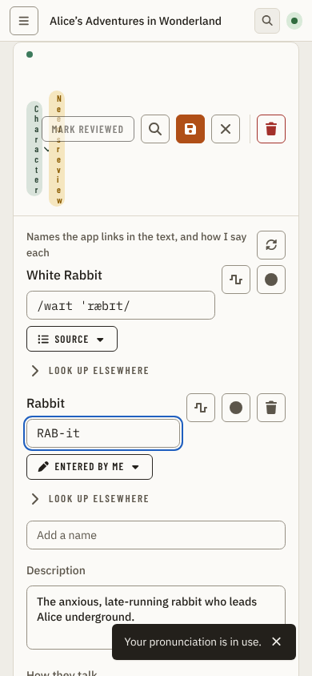
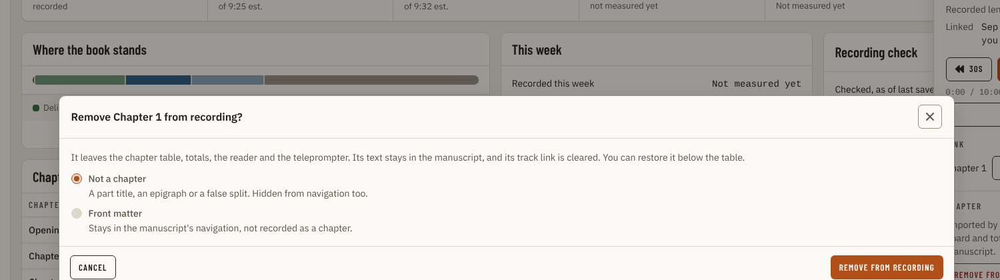
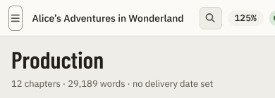
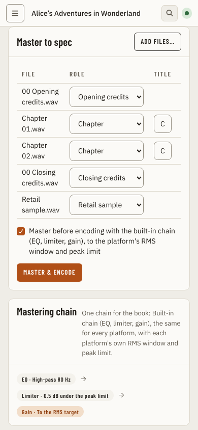
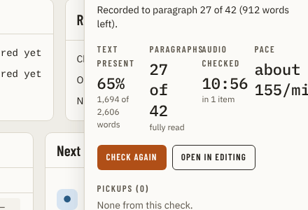
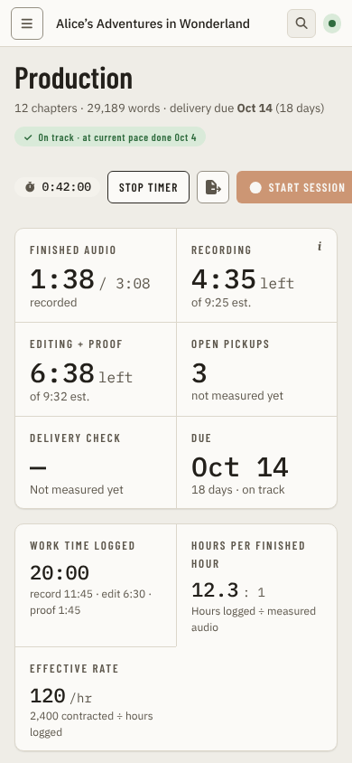
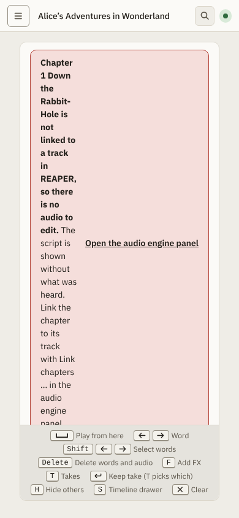
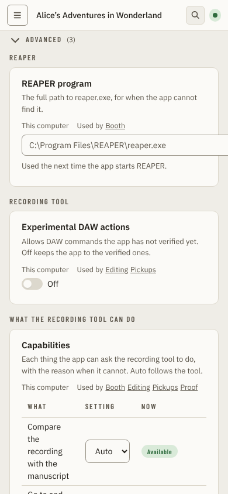
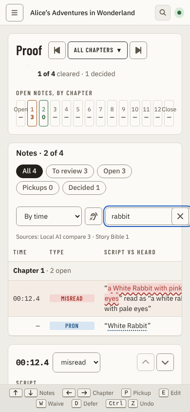
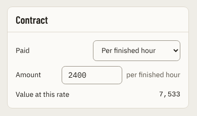

# Alignment and layout audit of every page (2026-10-23)

Researched 2026-10-21 to 2026-10-23 against `main` at `e0dc53f` (the mock-data app, the repo's own visual suite). The owner keeps finding alignment and layout defects one page at a time and asked for a full written list before anything is fixed. This note changes no application code and fixes nothing.

This is the second version. The first version (194 findings, lenient standard) was rejected by the owner: it called a messy table "wraps but readable", missed a pair of double-stacked buttons in the Story Bible, and gave the Audio engine panel six findings. This version re-did every page in three further rounds under a stricter standard and adds a rule-based DOM scan.

**Question.** What is misaligned, clipped, overlapped, unevenly sized, badly organised or off the design tokens on each page of the app, at each supported width, and which of it comes from a shared primitive?

**Answer.** 891 findings: 21 break use, 458 look wrong and 412 are polish. The count is not the number of defects: one shared cause (for example the `Dialog` width) appears once per page and state that shows it. The cross-page table below reduces them to 22 shared causes, and the top 20 ranks the defects a narrator meets first. Four things explain most of what looks weird:

1. The shared `Panel` header, `Dialog`, `Table` and form-row primitives have no grid. Titles collapse next to wide actions, every dialog is 70% of the window, tables size columns by content and re-flow between states, and label and control rows are two equal halves or `justify-between`.
2. Related things are not laid out together. The Audio engine's Chapter links table puts five columns of mixed controls in one panel; the Story Bible entry stacks a Rescan icon over the first name row's buttons; Settings leaves half of every tall card empty; the same warning is repeated two or three times on one screen.
3. Chrome that is on every page is inconsistent: the left rail (heavy padlocks, count badges that vanish below 1360 px), a top bar that mixes three control sizes, 22 px chips and 20 px hit areas, and page gutters that differ by 4 to 17 px.
4. The visual suite itself has blind spots: it drives each state once and only resizes, so layouts that exist below 1360 px (the Editing Timeline drawer) were never captured, and its viewport-sized screenshots hide the lower half of every long page.

Only 21 findings break use, and most of those are at 390 px, which the app reaches only by zoom. At the supported widths the defects are the kind the owner described: things that look weird.

## How to read this note

- This page: the method, the alignment rules, the scanner results, the ranked top 20, the shared causes, what was not covered, and an index of all 891 findings.
- [findings/](alignment-audit/findings/): one file per page with every finding in full (state, widths, what is wrong, owning file and line, severity, one-line fix, evidence). Most findings open with the reaction a person has ("why is this label cut off when there is room?"), then the measurement and the cause. [coverage](alignment-audit/findings/coverage.md) lists what each reviewer opened and what stayed unseen, and [corrections](alignment-audit/findings/corrections.md) lists where a later round corrected an earlier one.
- Severity: `breaks use` is content unreachable or unreadable, a collapsed control, or an overlap that hides content. `looks wrong` is something a narrator notices as messy or misaligned. `polish` is small (1 to 4 px) or subtle. A finding that says "may be intended" is a judgement call for the owner.

## Method

1. Read `CLAUDE.md`, `.claude/rules/ui-visual-verification.md` and `docs/design/design-system.md`.
2. Captured every catalogued `{page, state}` of the real app on mock data with the repo's visual suite (`apps/ui/tests/visual/app.spec.ts`, 736 states, installed headless Chromium, no `playwright install`):
   - light and dark at the repo viewports 1440, 1024 and 768 px and each row's extra viewports (`pnpm --dir apps/ui visual:page <pages>`; all 736 states passed in both themes, 2,872 PNGs);
   - light at 1920, 1440, 1280, 1024, 768 and 390 px with the viewport list replaced for those runs only (a local edit of `apps/ui/tests/visual/viewports.ts`, reverted each time; nothing under `apps/` is in this pull request), 2,714 PNGs per run, run twice. Two states fail the suite's own gates at 390 px (Story Bible `alias-pronunciation-editing`: input "Name" 10 px wide; Master `to-spec-picked`: inputs "Title for Chapter 0N.wav" 34.8 px wide); both are findings.
3. Wrote the alignment rules (next section) and a DOM scanner that checks them on every capture: 2,714 state-and-width records over 426 states, 39,197 raw hits in 1,286 distinct rule-and-selector groups. Hits are mechanical: many are false (inline reader words, intended clamps, content behind an overlay), so a reviewer judged each group real or false.
4. Four rounds of reviewers, each opening PNGs one at a time and reading the owning source:
   - round 1: eight reviewers, lenient. Rejected.
   - round 2: thirteen reviewers re-did every page under the strict standard ("why does this look weird?", no "readable" dismissals).
   - round 3: fifteen reviewers worked through each slice's unopened state-and-width cells and judged every scanner group.
   - round 4: eleven reviewers filled the gaps round 3 left (cells lost to image-read failures, dark, the lower halves of pages via 2,600 px tall captures of the default state, and the Master, Booth, Settings, Story Bible, Proof-chapter and shell gaps).
5. Counted tokens and spacing literals with `grep` over `apps/ui/src/components`.

All reviewers were AI models reading screenshots; pixel offsets are approximate (reviewers using contact sheets say they do not claim offsets under about 10 px). The lead re-opened a handful of screenshots and checked the shared-primitive claims against `Dialog.tsx`, `Panel.tsx`, `Select.tsx`, `TextField.tsx`, `Slider.tsx` and `HeaderChip.tsx`. The owner's own screenshots of the Audio engine Chapter links table and the Story Bible names row (real project data, dark theme) show the same defects the mock-data captures do.

## Alignment rules

A rule is checkable from the DOM, with a tolerance of 1 px unless stated. A failure is a candidate finding that a person then confirms by looking. Information organisation, hierarchy and rhythm are judged by the reviewers, not the scanner.

| ID | Rule | Raw hits | Distinct groups |
| --- | --- | --- | --- |
| A1 | Left edge: like rows in one container start at the same x | 295 | 15 |
| A2 | Right edge: like rows end at the same x | 319 | 16 |
| A3 | Repeated rows share a grid (each child starts at the same x) | 479 | 20 |
| A4 | Row actions share a right edge | 1,285 | 43 |
| A5 | Like rows have like heights unless content differs | 5,072 | 110 |
| A6 | Controls on one row have one height | 466 | 26 |
| A7 | Controls on one row share a centre line | 21 | 1 |
| A9 | No small controls stacked in a column beside their row | 1,234 | 19 |
| W1 | Buttons, badges, chips and tabs do not wrap their label | 5,368 | 193 |
| W2 | No truncation while free space exists beside the element | 0 | 0 |
| W3 | Nothing is clipped by an ancestor | 980 | 80 |
| W4 | No two text elements overlap | 5,272 | 504 |
| W5 | Nothing sits under a scrollbar | 0 | 0 |
| G1 | Sibling cards in a row have equal height and header height | 197 | 15 |
| G2 | A flush table's text starts where its card title starts | 1,059 | 9 |
| G3 | A selection bar spans the same width as its siblings | 0 | 0 |
| G4 | Gaps between like siblings are equal | 245 | 10 |
| G5 | Cards on one page share the page gutter | 0 | 0 |
| H1 | Hit area at least 24 px and covers the painted control | 16,337 | 201 |
| H2 | A hover or click wrapper spans its card | 432 | 12 |
| B1 | Blank space beside a taller neighbour | 136 | 12 |

Scanner results by slice, as the reviewers counted them (their grouping differs a little, so the totals are approximate): 643 groups judged real and 539 judged false across 15 slices, plus 12 unverifiable (below every captured viewport). The false groups are mostly content behind an open dialog or slide-over, text spans inside the Script reader, scrolled content under a sticky bar, and rows that are two lines by design. Real groups are either already a round-2 finding or a new one (the hit-area groups of the 22 px chips, 20 px text links and 15 px help icons are one finding per control). The per-slice tables are in [coverage](alignment-audit/findings/coverage.md).

## Top 20

Ranked by what a narrator meets first: severity, then reach across pages, then whether it is at a supported width (768 px and up). Rows 3, 4 and 15 are defects the owner named; the others fall in the categories of the original request. IDs in a row are the findings it merges.

| # | Findings | Where | Widths | What looks wrong | Severity | Fix |
| --- | --- | --- | --- | --- | --- | --- |
| 1 | SBX-7, XGL-4, ENX-29, XPC-5 | `Panel.tsx:97`, `panelStyles.ts:8,20` (every `PanelHeader` with actions) | 390 and 768 | The title block has a zero flex basis beside a wide action group, so a title breaks one letter per line (the Story Bible Name input is 8 px wide), or mid-word at 768. | breaks use | Give the title block a basis (`flex-[1_1_12rem]`) so actions wrap under it; `break-word`, not `anywhere`. |
| 2 | XPR1-16, XPR2-6, XSE1-10, XBO-7, XSC-1, XSL-4, SBX-23, R4SE2-3 | `Dialog.tsx:143-195` (every non-full dialog) | all | `max-w-[70vw]`: a one-line confirm is 1,006 px wide at 1440 and 1,342 px at 1920, a two-field form is 1,000 px, a command palette keeps its counts 970 px from its labels; at 390 it is 271 px and buttons wrap to 2 to 3 lines. Footers: three layouts, 1.6 px overhang, a lone Close on the left. | looks wrong | A width scale (confirm 28 rem, form 36 rem, palette 40 rem) capped at `100vw - 2rem`; one footer layout; one horizontal padding. |
| 3 | ENX-1 to ENX-8, R3EN1-4, R3EN1-5, R3EN1-7, R3EN2-1 | `ChapterLinksTable.tsx`, `MappingConfirm.tsx:44-85`, `Table.tsx:18` (owner example) | all | The Audio engine's Chapter links table has no column grid: "EDITING CHECK…" wraps in all 12 rows, CHANGE and CLEAR stack, "Not linked" breaks, two stacked links, rows of three shapes and heights, three columns without headings. Every unlinked chapter's select is preset to the first track, so Confirm links the wrong one. | looks wrong | Fixed columns (name, status badge, one action cell right-aligned); stop presetting the select. |
| 4 | SBX-1 to SBX-6, R4SB-1, R3SB1-6 | `GuideDetail.tsx:745-769`, `NamePronunciation.tsx:121-146` (owner example) | all | In the Story Bible entry a lone Rescan icon sits in the heading row with the first name row's play and record buttons stacked 7 to 9 px under it; IPA floats; the Source chip is up to 1,000 px from its text; rows with different button counts share no columns. | looks wrong | One names grid (name, IPA, source, actions) with Rescan in the section header. |
| 5 | XPR2-1, XPR1-1 | `RecordingCheckReport.tsx:106` | 768 to 1920 | Four stat tiles in a 300 px slide-over (`sm:grid-cols-4` follows the viewport): labels collide, "27 of 42" wraps to three lines, "155/min" is clipped. | breaks use | Two columns or a container query on the panel. |
| 6 | XSE1-1, XSE1-2, XSE1-3, XSE1-4, XSE2-3, XSE2-4, XSE2-35 | `SettingRowView.tsx:49`, `ValueControl.tsx:104,175` | 1024 to 1920 | Settings rows are two equal halves, so tall controls (Credits, Capabilities, Shortcuts, Reader text) leave the left half empty and the Capabilities table is jammed into the right; selects and boxes come in six widths; Shortcuts is a scroller inside a card inside a card. The design system describes a 12 to 16 rem label column that the page does not use. | looks wrong | `grid-cols-[minmax(12rem,16rem)_minmax(0,1fr)]`, wide bodies span both columns, one field width. |
| 7 | ENX-1, XMS-3, XMS-11, XPF-4, XPC-2, XSE1-5, XSC-25, R4MS1-3 | `Table.tsx`, `tableStyles.ts:12` | all | Tables size columns by content, so columns move between states, rows wrap with space free, actions do not share a right edge, text starts 6 to 10 px inside the card title, and file-rules is worse at 1280 than at 1024. | looks wrong | Column widths (`colgroup`) and a `valign` prop; first and last cell `px-4` in flush cards; scroll cue on every scroller. |
| 8 | XSL-1, XSL-2, XSL-7, XSL-8, XSL-18, XSL-19, XSL-21 | `AppShell.tsx:284-285`, `NavButton.tsx:37-41` | every page | The rail's padlocks are 20 px solid black beside the labels, the count badges and locks vanish below 1360 px so locked pages look available, icons are different weights, the dark sun looks like a second gear. | looks wrong | Size the lock separately; show counts as a corner dot in the collapsed rail. |
| 9 | XSL-3, XSL-11, XSL-12, XSL-13, R3SL-3, R3SL-5 | `AppShell.tsx:294,353`, `HeaderChip.tsx:21` | every page | The top bar mixes a 36 px hamburger, a 32 px Jump button and 22 px chips; chips are 20 px hit areas; it starts 4 px right of the page title; slide-over headers do not line up with it. | looks wrong | One control height and one hit-area rule; share the page gutter. |
| 10 | XED-3, XED-4, R3ED-1, XBO-19, R3SB2-8, XSC-6 | `DrawerLayout.tsx:5`, `ScriptColumns.tsx:17-18` | 1280 and below | Overlay drawers slice the script mid-word with no scrim, the Script selection toolbar floats over an open drawer, and the Editing Timeline drawer below 1360 px has never been captured (the suite drives once and resizes; the row needs `reloadPerViewport`). | looks wrong | Scrim or push layout; dismiss the toolbar on drawer open; capture the narrow layout. |
| 11 | XPR1-7, XPR1-8, XPR1-9, XPR2-5, XPR2-15, R4TA-5 | `ProductionPage.tsx:422,453`, `panelStyles.ts:10` | 1280 to 1920 | The Production board uses three column splits in four rows, sibling headers differ 50 to 59 px so rules stagger, cards stop short of their row, the right column ends 140 to 210 px above the pipeline. | looks wrong | One grid for the board; one header height per row; `fill` on Panel. |
| 12 | XSH-6, XPR1-25, XSC-3, XSC-39, ENX-20 | `Select.tsx:48`, `TextField.tsx:13` | all | `Select` is 40.8 px, `TextField` and `Button` are 36 px: neighbouring controls differ by 2 to 5 px in Contract, profile header, Find, Define marks, engine dialogs. | looks wrong | One control-height token. |
| 13 | XSH-1, XSH-3, XSH-5, R4SM-13, R4SM-14 | `ContractPanel.tsx:53-80`, `MilestoneTable.tsx:55-63` | all | The Contract "Paid" select starts 62 px right of the "Amount" box and, below 1280, 980 px from its label; Milestones columns sit at different x per state; the lower Milestones table has mixed indents, type sizes and cell heights. | looks wrong | Label/control grid; fixed table columns. |

| 14 | XMS-4, R4MS1-1, R4MS1-2, R4MS1-3, XMS-2 | `MasterPage.tsx:210-211,310`, `FilesTable.tsx:163,192` | 1280 to 1920 | Master's right quarter is bare for ten screens; one long error line wraps nearly every chapter name and folds the "Not measured" pills; file-rules Source is 130 px at 1280. | looks wrong | Sticky aside; wrap the message, not the names; floors on columns. |
| 15 | R3PR2-3, XGL-3, R3GL-2 | `KpiRow.tsx:24-33`, `Tooltip.tsx:46` (owner example) | all | The Production KPI tiles' hover fill and click area stop 32 px short of the tile edge: the `TooltipTarget` wrapper is content-width. | looks wrong | `className="size-full"` on the wrapper. |
| 16 | XBO-3, XBO-4, XBO-10, R4BO2-5, R4BO2-7, R4BO1-1 | `BoothTop.tsx:76,94`, `RecordSetup.tsx:27` | 768 to 1920 | Booth's top-bar tools jump to the left edge when the bar wraps and double-stack under Previous; the notice runs the full window and cuts the side panel short; the footer is three rows with the meter alone. | looks wrong | One right-aligned nowrap group; mount the notice in the text column. |
| 17 | XSC-11, XSC-13, XSC-19, XED-21, R3ED-5, XSC-12 | `ScriptColumns.tsx`, context-menu primitives | 1024 to 1920 | Script's three panel headers have rules at different heights, rail panels leave 450 to 700 px blank, and the right-click menus are 17 to 25 rows with no groups that open over the words they act on. | looks wrong | One header height; group and shorten menus; anchor beside the target. |
| 18 | XPF-4, XPF-7, R4TB-5 | `NotesTable.tsx`, `ProofPage.tsx` | 768 to 1920 | Proof's notes columns are content-sized, so rows wrap while columns sit half empty; the left column stops while the inspector keeps going, about 1,850 px empty at its end. | looks wrong | Column widths; align the two columns' ends. |
| 19 | XBO-2, XSH-10, R4BO2-4, R4SM-9 | `Toast.tsx:88` | all | Toasts cover content: over a dialog's Cancel and Download buttons, over the Milestones table rows, over a script line; three identical toasts stack. | looks wrong | Queue under a modal; collapse duplicates; reserve space. |
| 20 | XBO-5, XSC-15, ENX-22, ENX-26, XPR2-9, R4MS1-6, XPR2-44 | many | all | The same sentence shown two to five times on one screen (setup notice, credits warning, link error, disabled-Start reason, empty table). | looks wrong | Say it once, where the action is. |

**Breaking use.** 21 findings break use; all but three are at 390 px (the 390 px layout of import review, Start session while the timer runs, no-audio banner, takes chip, notes toolbar, tables with one-letter columns, the panel header, engine tables and dialogs, and the Production pipeline). They are listed per page. The three at supported widths are XPR2-1 (recording-check tiles), XSE2-1 (the REAPER program box at 1024) and R3ED-10 (Editing dialog bodies cut under the footer at 1280 and 1024).

## Fixes that apply across many pages

| # | Shared cause | Where | Findings it explains | Suggested fix |
| --- | --- | --- | --- | --- |
| A | `PanelHeader`: title `flex-1 min-w-0` with a zero basis and `overflow-wrap:anywhere`; header height follows its tallest child (59 px against 50 px); the frame has no `overflow-hidden` | `Panel.tsx:97`, `panelStyles.ts:6-20` | SBX-7, XGL-4, ENX-29, XPC-5, XPR1-8, XMS-8, XDL-5, XPR1-9, XPF-12 | Title basis; one header min-height for panels in a row; `overflow-hidden` on the frame. |
| B | `Dialog`: 70vw width, `overflow-x-hidden` body, footer `px-4` against `1.1rem`, description with no margin, headerless dialogs centred vertically, a lone footer button on the left | `Dialog.tsx:143,148-150,163,176,178-184,195` | rank 2 plus XPR1-18, XPR2-29, SB-10, ENX-15, XSL-5, XMS-13 | A size scale, a wrapping footer, one padding, `mb-3`, `actionsAlign="end"` for one action, top-anchored palette. |
| C | `Select` 40.8 px against `TextField` and `Button` 36 px | `Select.tsx:48`, `TextField.tsx:13` | rank 12 | One control-height token. |
| D | `Table`: auto layout, no column API, `px-2.5` cells in `px-4` panels, middle `valign`, `min-w` tables with no scroll cue, `overflow-wrap:anywhere` first columns | `Table.tsx`, `tableStyles.ts:12` | rank 7, XMS-1, XMS-1, XPF-12, XPK-5, ENX-1, ENX-2 | See rank 7. |
| E | Label and control rows written as `justify-between` or `flex-wrap` with a spacer: a wrapped group falls left, controls share no column | 62 files use `justify-between` | rank 13, XDL-1, XDL-10, XSE1-4, SBX-15, R3SB2-9, XPK-8, XBO-3 | `ml-auto` on the trailing group; a two-column grid for forms. |
| F | `Slider` track `px-[9px]`: inset from the label, value and select | `Slider.tsx:68` | XSE1-24, XSE2-13, XBO-20, XED-37, XSC-32, XED-37 | `-mx-[9px]`. |
| G | Hit areas: `HeaderChip` 22 px, toast close 17x20, text links 20 px, help icons 15 px, checkbox spans 16 px | `HeaderChip.tsx:21`, `Toast.tsx:72` | the scanner's H1 groups; XSL-12, R3SL-3, R3BO-8, R3BO-9 | Pad to 24 px without changing the look. |
| H | Icon buttons that give way instead of holding their size | `SlideOver.tsx:73`, `AppShell.tsx:295` | XPR1-24, XPR2-31, XSL-10 | `flex-none`. |
| I | Wrappers that pass no layout to the child: `TooltipTarget` is `inline-flex` and content-width | `Tooltip.tsx:46` | rank 15, XSL-10 | A `className` at each caller. |
| J | Page gutters and widths differ: bar 20 px, content 16 px; Editing 33 px; `LoadError` 720 px centred; Proof chapter `max-w-7xl`; Settings 1180 px left-aligned; Booth text 28 px, notice 20 px; toast 20 px | `AppShell.tsx:294,353`, `EditingBody.tsx:496`, `LoadError.tsx:56`, `ProofChapterPage.tsx:132`, `SettingsPage.tsx:207`, `BoothText.tsx:214`, `Toast.tsx:88` | XSL-11, XED-29, XED-30, XPC-17, XSE1-16, XBO-10, XBO-16 | One gutter and one max-width rule, applied in the shell. |
| K | Loading skeletons do not mirror the loaded layout; dark skeletons are nearly invisible | `ProductionSkeleton.tsx`, `BoothSkeleton.tsx`, `ScheduleSkeleton.tsx`, `ProofSkeleton.tsx`, `SettingsPage.tsx:158` | XPR2-40, XPR2-41, XBO-14, XSH-9, XSE1-26, SBX-19, R4BO2-9, R4DL-7 | Build skeletons from the page's own grid; raise the dark tone. |
| L | `ToggleGroup` default is a plain `flex` row; segmented is `inline-flex` | `ToggleGroup.tsx:35-37` | XPR1-26, ENX-10, ENX-12, XSC-4, XSE1-28, XSE2-27 | `gap-1.5 flex-wrap`, `whitespace-nowrap`. |
| M | `KeyHints` wraps with a centred orphan row; `ChapterStepper` width follows the data | `KeyHints.tsx:20`, `ChapterStepper.tsx:66-71` | XED-27, XPK-7, XPK-7 | Left-align; fixed minimum width. |
| N | Left rail: locks inherit the nav-icon size, counts hidden below 1360 px, `max-[1360px]` against `min-[1360px]` | `AppShell.tsx:284-285`, `NavButton.tsx:37-41` | rank 8, XSL-20 | See rank 8; use `max-[1359px]`. |
| O | Overlays with no scrim that cut the page: drawers, the relationship picker, selection toolbar over a drawer | `DrawerLayout.tsx:5`, `SlideOver.tsx` | rank 10, R4SB-2 | A scrim or a pushed layout. |
| P | Toasts over content | `Toast.tsx:88` | rank 19 | Queue under a modal. |
| Q | Repeated messages on one screen | many | rank 20 | Say it once. |
| R | Progress chart annotations print over gridlines and each other | `ProgressChart.tsx:118-161` | XSH-8, XPR1-15, XPR2-18, R4SM-1, R4TA-2 | Offset or halo the labels. |
| S | Unselected radios and checkboxes drawn as solid beige discs | `RadioGroup.tsx` | XSE1-25, XPR1-21 | The design system fills them on purpose; the owner may want a ring. |
| T | Inline text links and counts used as buttons (20 px) | `button.inline` underline links | the scanner's H1 groups | Pad the hit area. |
| U | Suite blind spots: one drive then resize; viewport-sized captures; no tall or drawer captures; toasts cover tables | `capture.ts:276-300` | R3ED-1, XED-4, XSH-10 | `reloadPerViewport` for layout-changing rows; tall captures for long pages. |
| V | The design-system "Settings rows" section describes `ScopedSetting.tsx`; the Settings page uses `SettingRowView.tsx` | `docs/design/design-system.md`, `SettingRowView.tsx` | rank 6 | Change the doc or the page. |

### Tokens and spacing

- The design system says new code should converge on `--space-*` (`--space-1` to `--space-6`, `apps/ui/src/styles.css:226-231`). No component references them: a search of `apps/ui/src` outside tests and stories finds the six definitions and no use.
- `apps/ui/src/components` holds 607 arbitrary pixel or rem values in class names (excluding stories and tests), 91 of them for padding, margin or gap. The most repeated are `px-[1.1rem]` (7), `px-[0.55rem]` (6), `py-[0.6rem]` (5), `p-[1.1rem]` (5) and `gap-[0.625rem]` (5). `1.1rem` is `--space-6`, so `Dialog` writes the token's value as a literal, and its footer then uses `px-4` instead (the 1.6 px overhang).
- Several findings are token drift made visible: 20 px bar insets against 16 px content, Editing's extra `px-4`, 10 px table cells in 16 px panels, and 3, 8 and 9 px one-off insets.
- The app's CSS never sets `scrollbar-gutter` (no match in `apps/ui/src`), so a scrollbar that appears on content change shifts the layout in any host that draws classic scrollbars. The scanner found no content under a scrollbar in the headless captures.

## What was not covered

- Cells the reviewers could not open. Image reads failed repeatedly on a request limit; every reviewer's file says exactly which cells were seen, failed or unopened ([coverage](alignment-audit/findings/coverage.md)). Large remaining gaps: Proof chapter (56 of 315 cells, mostly dark at 1024 and 768), Story Bible dialog states (45 of 103), most dark shell states at 1024 and 768, dark toast, tooltip and shortcut sheet, startup in dark, Settings at 390 for 31 states, and the 390 views of Story Bible's entry detail (the driver leaves only the list in view).
- The lower halves of long pages were seen only in the default state, from 2,600 px tall captures of ten pages; the on-pace Production board at 390 (Next up and the chart) was never captured. The long-name Milestones rows at 768, 1024 and 390 are covered by toasts in every capture.
- Two Settings rows sit below every capture (the Shortcuts list, "Use suggestion"); their findings rest on DOM measurement.
- The open navigation drawer below 860 px (no catalogued state), exactly 1360 px (source only), dark at 1920, 1280 and 390, hover and focus states beyond the catalog, real REAPER, the Wails host and WebView2 scrollbars, the Storybook atlas, axe and aria suites.
- Real data. Everything ran on the mock project (Alice in Wonderland, 12 chapters). The owner's real projects have more chapters and longer names; the defects in the owner's screenshots reproduce on the mock, but long-data defects may be worse than recorded.
- The Editing Timeline drawer below 1360 px: no capture exists (R3ED-1); the findings about it come from source.

## Index of findings

Every finding by page: ID, severity, widths and title. The full text is in the page's file.

### Production

155 findings (6 break use, 81 look wrong, 68 polish). Full text: [findings/production.md](alignment-audit/findings/production.md).

| ID | Severity | Round | Title |
| --- | --- | --- | --- |
| R4TA-1 | breaks use | 4 | Production, 390: the chapter table is silently cut at the card edge and chapter names break mid-word |
| XPR1-1 | breaks use | 2 | Import review rows at 390: chapter names vanish and the type select runs off the dialog |
| XPR2-1 | breaks use | 2 | Recording check stat tiles are jammed into 300 px |
| XPR2-2 | breaks use | 2 | At 390, Start session is cut off and the page scrolls sideways while the timer runs |
| XPR2-3 | breaks use | 2 | Import review at 390: chapter names vanish and the type select runs off the dialog |
| XPR2-4 | breaks use | 2 | Recheck-model dialog at 390: "CHECK WITH TINY ONLY" is stacked on four lines |
| R4SM-1 | looks wrong | 4 | Why does the little "Recorded vs plan" chart on Production print "today" on top of the grey note, with the dashed line striking through both? |
| R4SM-2 | looks wrong | 4 | Why does the Chapter pipeline at 768 squeeze every chapter title into 3-4 lines while the seven stage columns each carry 28 px of empty gutter? |
| R4SM-3 | looks wrong | 4 | Why at 390 does the pipeline table scroll sideways with the EDIT chip chopped in half and names broken inside words ("Caterpill / ar")? |
| R4SM-4 | looks wrong | 4 | Why does the pipeline at 1440 wrap chapter titles onto two lines while there is a 1280-wide layout that fits them on one? |
| R4SM-5 | looks wrong | 4 | Why do the little "?" and red "x" badges sit half outside the stage chips, in a different column on each row? |
| R4SM-6 | looks wrong | 4 | Why does the second strip of figures end in a lone "Effective rate" with half the row empty, and its divider stop mid-card? |
| R4SM-7 | looks wrong | 4 | Why does the START SESSION button run off the right of the screen at 390? |
| R4SM-8 | looks wrong | 4 | Why are the titles and rules of two cards side by side 4-9 px out of step? |
| R4TA-2 | looks wrong | 4 | Recorded vs plan: the "today" label is printed on top of the grey "not measured yet" sentence and the projection line |
| R4TA-3 | looks wrong | 4 | Production at 1280 and below: "Next up", the thing to do, is the very last block, 1500-2400 px down |
| R3PR1-1 | looks wrong | 3 | Missing-track panel still offers playback and healthy-looking facts under the red error |
| R3PR1-2 | looks wrong | 3 | Where-the-book-stands legend wraps at 1440 and leaves "Not recorded yet" alone on a second row |
| R3PR1-3 | looks wrong | 3 | Import review below 1180 px: preview and Import options fall to the bottom, after the character list |
| R3PR1-4 | looks wrong | 3 | Editing check: "Clean up in Editing" is separated from the Empty-space card it belongs to, and still invites hearing candidates when there are none |
| R3PR1-5 | looks wrong | 3 | Editing-check states do not say what state they are in |
| R3PR1-6 | looks wrong | 3 | Ambiguous track panel offers two competing ways to fix the same conflict |
| R3PR1-7 | looks wrong | 3 | Triple "no date" message at the top of every no-deadline state |
| R3PR1-8 | looks wrong | 3 | Pipeline table text starts 6 px left of the card title above it |
| R3PR1-9 | looks wrong | 3 | daw-not-linked looks the same as linked |
| R3PR1-10 | looks wrong | 3 | Credits panel shows an unfixable red error and a Recording check button for a row with no track |
| R3PR1-12 | looks wrong | 3 | Dark theme: "Light theme" sun and Settings gear look like the same icon |
| R3PR2-1 | looks wrong | 3 | Stage bar legend breaks onto a second row with one orphan item at 1440 |
| R3PR2-2 | looks wrong | 3 | Report dialog: Cancel and Export sit on the bottom edge on a 768-tall window |
| R3PR2-3 | looks wrong | 3 | KPI tiles: the clickable and hover area is only as wide as the text |
| R3PR2-4 | looks wrong | 3 | Recording-check result tiles: the four values sit on two different baselines |
| R3PR2-5 | looks wrong | 3 | Import review: the title of a row is drawn three different ways, and "is read as text" runs into the quote |
| R3PR2-6 | looks wrong | 3 | Import review: the same counts are said four times and the repairs are last |
| R3PR2-7 | looks wrong | 3 | Recording-check panel: one fact, two formats, two wordings |
| R3PR2-8 | looks wrong | 3 | Stage readiness: a run-on criterion, then the same criterion again, then a contradiction |
| R3PR2-9 | looks wrong | 3 | At 390 buttons wrap onto two lines in four places |
| XPR1-2 | looks wrong | 2 | Import review: chapter titles cut to "Chapter One — Do…" at 768 and 1024 while the select takes a fixed 166 px |
| XPR1-3 | looks wrong | 2 | Import review: words / Subtitle / select columns stagger between rows |
| XPR1-4 | looks wrong | 2 | Recorded vs plan / Next up keep two columns at 390 and the chart is cut off |
| XPR1-5 | looks wrong | 2 | Pipeline chapter column squeezed to 70-130 px at 768 and 390, names wrap to 3-5 lines |
| XPR1-6 | looks wrong | 2 | Pipeline rows have unequal heights at 1440 because chapter names wrap with space unused elsewhere |
| XPR1-7 | looks wrong | 2 | Board columns do not share one grid: three different column splits in four rows |
| XPR1-8 | looks wrong | 2 | Sibling card headers are different heights, so rules and titles stagger |
| XPR1-9 | looks wrong | 2 | Cards stop short of their row; legend band does not reach the card bottom; nub at the bar start |
| XPR1-10 | looks wrong | 2 | Credits banner sits 34 px above the KPI strip while every other gap is 16 px |
| XPR1-11 | looks wrong | 2 | Timer figures strip: lone third tile with a half-width rule, and unequal baselines at 390 |
| XPR1-12 | looks wrong | 2 | Header action note wraps while there is free space; button and note do not share a row |
| XPR1-14 | looks wrong | 2 | Next up action buttons re-flow differently at every width and mix three button looks |
| XPR1-16 | looks wrong | 2 | Every dialog is 70% of the viewport wide whatever it holds |
| XPR1-17 | looks wrong | 2 | Dialog footers wrap and mix widths at 390 |
| XPR1-19 | looks wrong | 2 | Dialog body shows a full-width blue focus box |
| XPR1-20 | looks wrong | 2 | Sync-consent dialog: lead paragraph runs into the first heading; two-column list has a blank middle |
| XPR1-21 | looks wrong | 2 | Remove-from-recording dialog: unselected radio is a filled grey disc |
| XPR1-22 | looks wrong | 2 | Track panel: buttons have no grid, header and facts misaligned |
| XPR1-24 | looks wrong | 2 | Slide-over headers differ: 63 px vs 67 px, close 36 vs 32 vs a 30 px sliver, titles break mid-word |
| XPR1-25 | looks wrong | 2 | Credits row panel: "Open in Script" link touches the status select; select is 40.8 px beside a text link |
| XPR1-26 | looks wrong | 2 | Editing-check panel: source toggle chips touch, wrap onto two lines, unequal widths; caption jammed under them |
| XPR1-27 | looks wrong | 2 | Editing-check panel: three near-identical cards form a wall of text |
| XPR1-30 | looks wrong | 2 | Credits setup dialog: huge inputs, hint and checkbox spacing inconsistent |
| XPR1-31 | looks wrong | 2 | Import review: right column starts above the list and leaves a large blank area; preview scrolls away |
| XPR2-5 | looks wrong | 2 | The top card row and the pipeline row do not share a column grid |
| XPR2-6 | looks wrong | 2 | Every dialog is 70% of the window whatever it holds |
| XPR2-7 | looks wrong | 2 | "Where the book stands" and "This week" are hollow, and the grey legend band does not reach the card bottom |
| XPR2-8 | looks wrong | 2 | The three sibling cards have different header heights, so rules and titles do not line up |
| XPR2-9 | looks wrong | 2 | The disabled-Start reason is shown twice, and the header note is a 3-line block beside 36 px buttons |
| XPR2-10 | looks wrong | 2 | Chapter names wrap to two lines at 1440 while the stage columns are 80 px wide for a 52 px cell |
| XPR2-11 | looks wrong | 2 | Pipeline table text starts 6 px left of the card title, and Fin. is a left-aligned header over right-aligned numbers |
| XPR2-12 | looks wrong | 2 | The readiness chips sit on the row dividers and in four different columns |
| XPR2-13 | looks wrong | 2 | At 1024 and 768 This week and Recording check become two full-width bars with 700 px between label and number |
| XPR2-14 | looks wrong | 2 | Next up: a grey sentence is wedged between its two buttons, so they sit on different rows |
| XPR2-15 | looks wrong | 2 | The right column of the lower board stops 210 px above the pipeline column |
| XPR2-16 | looks wrong | 2 | Timer strip: the third tile sits alone under a half-width rule at 1024 and 768 |
| XPR2-17 | looks wrong | 2 | Next up and Recorded vs plan stay side by side at 390 and the chart is cut off |
| XPR2-18 | looks wrong | 2 | Recorded vs plan: labels are struck through by lines, and the plot is inset 20 px from the card's title |
| XPR2-19 | looks wrong | 2 | Import review: the words column and the select stagger between rows, and long titles are truncated with room elsewhere |
| XPR2-20 | looks wrong | 2 | Import review: the preview card and the list start at different heights, and the right column is a loose stack |
| XPR2-22 | looks wrong | 2 | Import review below 1180 hides the preview and options under the list |
| XPR2-23 | looks wrong | 2 | Report dialog: content stops short of the dialog edge at 1920, and the headerless dialog has its own title and padding |
| XPR2-24 | looks wrong | 2 | Report dialog at 390: the preview and the Export button are below the first screen |
| XPR2-25 | looks wrong | 2 | Options dialogs: the label column is a fixed 224 px, labels wrap with 600 px free, and the lone Close is at the left |
| XPR2-27 | looks wrong | 2 | Stage suggestion options: 14 identical "Required" rows with "(proofing)" repeated on each, ungrouped |
| XPR2-28 | looks wrong | 2 | Dialog footers are not consistent: Cancel left and primary right in some, both right in the running dialog, a lone Close at the left in others |
| XPR2-30 | looks wrong | 2 | Model download dialogs: the facts are an unaligned list and the last line looks like plain text |
| XPR2-31 | looks wrong | 2 | Slide-over close button is squeezed to 22-28 px wide |
| XPR2-34 | looks wrong | 2 | Refused check: an unlabeled "Chapter 1" select next to a 36 px Confirm |
| XPR2-35 | looks wrong | 2 | Stage readiness: two disabled buttons always drawn, "Stage readiness" said twice, and nothing to do in the "can't tell" state |
| XPR2-46 | looks wrong | 2 | Report preview is an unstyled page, and a white slab in dark |
| R4SM-9 | polish | 4 | Why does the grey legend band in "Where the book stands" stop short of the card's bottom, leaving a white strip? |
| R4SM-10 | polish | 4 | Why is there a tiny dark-green sliver at the left of the stacked bar when "Delivered" is 0:00? |
| R4SM-11 | polish | 4 | Why does "Next up" lay out its two items differently, and why do the right column and the pipeline end at different heights at 1920? |
| R4SM-12 | polish | 4 | Why do "This week" and "Recording check" at 1024 and 768 span the full width for two or three short rows? |
| R4TA-4 | polish | 4 | Production at 1920: 480-600 px of nothing between a chapter name and its numbers, with no row guide |
| R4TA-5 | polish | 4 | Production: right column and table card never end together (extends XPR2-15) |
| R4TA-6 | polish | 4 | Production at 390: "HOURS PER FINISHED HOUR" breaks with an orphan "HOUR", and the book legend is three ragged rows |
| R3PR1-11 | polish | 3 | Closing credits row simply disappears when the closing template is missing |
| R3PR1-13 | polish | 3 | Import review: three left edges and a 12 px step before the first row |
| R3PR1-14 | polish | 3 | Remove-from-recording confirm is the primary orange while the other destructive confirm is a red outline |
| R3PR1-15 | polish | 3 | Section-header info icons: on two of four rows, detached at the far right, 15 px hit area |
| R3PR1-16 | polish | 3 | Header REAPER chip is a 67 x 22 px button |
| R3PR1-17 | polish | 3 | Stage readiness "?" and check chips are 20 x 20 px |
| R3PR1-18 | polish | 3 | Toast Undo (33 x 20) and Dismiss (17 x 20) are tiny and sit over the page they affect |
| R3PR1-19 | polish | 3 | "Open DAW settings" and "Settings > Credits" are inline text buttons 19.5 and 16 px tall |
| R3PR1-20 | polish | 3 | Import row title is a 20 px button inside a 40.8 px row |
| R3PR1-21 | polish | 3 | Settings-unset reason names "Settings > Editing" in plain text, not a link |
| R3PR1-22 | polish | 3 | Match-levels dialog says "1 item ... differ", and "1.80 s" splits over two lines |
| R3PR1-23 | polish | 3 | "Match levels…" is greyed out with its reason only in a hover tooltip |
| R3PR1-24 | polish | 3 | Slide-over leaves the page half-covered with cut-off header buttons |
| R3PR1-25 | polish | 3 | Import activity log numbers do not match the review that follows |
| R3PR2-10 | polish | 3 | Toast for a standing condition: covers the board at 1920, 1280 and 768, has a 17 px close and no refresh action |
| R3PR2-11 | polish | 3 | Load error: three headings, and a message that quotes itself |
| R3PR2-12 | polish | 3 | No-manuscript: the lock cue exists only in the expanded rail, and the project name is printed twice |
| R3PR2-13 | polish | 3 | Stage bar starts with a stray dark dot |
| R3PR2-14 | polish | 3 | On-pace header: "due Oct 14 (18 days)" and "done Oct 4" |
| R3PR2-15 | polish | 3 | Import review: the name is a 20 px button in a 41 px row |
| R3PR2-16 | polish | 3 | Info buttons are 15 px |
| R3PR2-17 | polish | 3 | "Check options" summary is 20 px inside a 38 px bordered box |
| R3PR2-18 | polish | 3 | Text links in the panels are 19.5-20 px tall |
| R3PR2-19 | polish | 3 | Toggle switches are 36 x 20 |
| R3PR2-20 | polish | 3 | REAPER status pill is a 22 px button in the top bar |
| R3PR2-21 | polish | 3 | Readiness chips are 20 x 20 buttons |
| R3PR2-22 | polish | 3 | Running dialog: three kinds of ellipsis, elapsed time at the far edge, Cancel in the primary slot |
| R3PR2-23 | polish | 3 | Model dialogs: the same size twice, and a button that names a model nobody mentioned |
| R3PR2-24 | polish | 3 | Refused check: the red box says the same thing twice and picks "Chapter 1" for Chapter 7 |
| R3PR2-25 | polish | 3 | Recording-check panel: options first, action last, and nothing marks the row it is about |
| R3PR2-26 | polish | 3 | Stage suggestion options: scroll edges with no padding and no lead-in |
| R3PR2-27 | polish | 3 | Dark theme: the "Light theme" sun and the Settings gear look alike |
| R3PR2-28 | polish | 3 | Pipeline Record column: 50%, 37% and a half-moon for the same state |
| XPR1-13 | polish | 2 | Deadline status is repeated three times at the top of the page |
| XPR1-15 | polish | 2 | Recorded vs plan chart: labels struck by lines, plot not on the card gutters |
| XPR1-18 | polish | 2 | Dialog footer is 1.6 px wider than header and body content |
| XPR1-23 | polish | 2 | Track panel fact row: wrapped value is left-aligned while the others are right-aligned |
| XPR1-28 | polish | 2 | Editing-check running: Cancel under the progress bar, Match levels cut off |
| XPR1-29 | polish | 2 | Gain-match confirm: orphan "dB." and a 1006 px dialog for two short sentences |
| XPR1-32 | polish | 2 | Import review: duplicate summaries and two stacked headings |
| XPR1-33 | polish | 2 | Import activity log: log box cut mid-row, close button right edge and "0s" baseline off |
| XPR1-34 | polish | 2 | Pipeline status badges hang off cell corners |
| XPR1-35 | polish | 2 | KPI info icon sits above the label baseline |
| XPR1-36 | polish | 2 | Toast covers page content and is not tied to the gutter |
| XPR2-21 | polish | 2 | Import review: group rows, names and info icons do not share edges |
| XPR2-26 | polish | 2 | Recording check rules: the first value has no unit while the other three say "words", and the intro is three different type styles with no gaps |
| XPR2-29 | polish | 2 | Dialog footer is narrower than the header and body, and the focused body shows a ring edge to edge |
| XPR2-32 | polish | 2 | Recording check slide-over uses two different disclosure styles |
| XPR2-33 | polish | 2 | Check options: five full-width selects and ten lines of help in one column |
| XPR2-36 | polish | 2 | Stage readiness evidence rows: "Met" / "Not met" sits 3 px above the first line, and the tick says it too |
| XPR2-37 | polish | 2 | Recording check result: pickup blocks and the Check again row put actions on different rows from the text, and the two dashed link cards look like err |
| XPR2-38 | polish | 2 | Running dialog: log rows have no top margin, log box is half empty, and the dialog has no way out in the header |
| XPR2-39 | polish | 2 | Toast covers the content it is about |
| XPR2-40 | polish | 2 | No-manuscript: the heading is smaller and 3 px higher than on the loaded page, and the calendar icon beside Import is unexplained |
| XPR2-41 | polish | 2 | Loading: a different layout from the page it becomes, and the header already claims "switched off" |
| XPR2-42 | polish | 2 | Load error: title and card are inset 40 px, a different page gutter from every other state |
| XPR2-43 | polish | 2 | KPI tiles: sub-lines are 1 px off between tiles 1-3 and 4-6, and the target "i" is a tiny serif glyph above the label line |
| XPR2-44 | polish | 2 | Header verdict pill sits on its own row, leaving the title block three lines tall beside one-line buttons |
| XPR2-45 | polish | 2 | Stage bar tones change order in dark |
| XPR2-47 | polish | 2 | Candidate dialog has both an X and a Cancel, and the whole sentence is one 750 px line |
| XPR2-48 | polish | 2 | Import review header paragraph ends in an orphan word, and the summary lines are three type sizes |

### Schedule

29 findings (0 break use, 14 look wrong, 15 polish). Full text: [findings/schedule.md](alignment-audit/findings/schedule.md).

| ID | Severity | Round | Title |
| --- | --- | --- | --- |
| R4SM-13 | looks wrong | 4 | Why does the Milestones table at 390 cut its date box mid-text and push the Status chip off-screen? |
| R4SM-14 | looks wrong | 4 | Why does the "Final delivery" row jump between a 14 px bold name and 11 px grey figures, and why is the heading row 22-30 px right of the card title? |
| R3SH-1 | looks wrong | 3 | Why does the Final delivery date box look like an empty form field in a grey card, and why is "No date" a different kind of chip from "Oct 4"? |
| R3SH-6 | looks wrong | 3 | Why does the three-toast stack also hide the Add "+" so the table can't be reached? |
| XSH-1 | looks wrong | 2 | Why are the Paid select and the Amount box not lined up? |
| XSH-2 | looks wrong | 2 | Why do Contract and "How this is worked out" turn into two huge, empty-looking cards at 1280 and below? |
| XSH-3 | looks wrong | 2 | Why do the table columns move from one state to the next? |
| XSH-4 | looks wrong | 2 | Why does the table text start way to the right of the card title? |
| XSH-5 | looks wrong | 2 | Why is the Milestones header taller than the Chart and Contract headers? |
| XSH-6 | looks wrong | 2 | Why is the dropdown a different height from the text boxes beside it? |
| XSH-7 | looks wrong | 2 | Why is a four-field form a 1000 px wide dialog? |
| XSH-8 | looks wrong | 2 | Why does the grey note sit on top of the 2h line? |
| XSH-9 | looks wrong | 2 | Why does the loading placeholder not look like the page that arrives? |
| XSH-10 | looks wrong | 2 | Why are three identical "Milestone added." toasts covering the table? |
| R3SH-2 | polish | 3 | Why do the "No due date set" pill and the verdict pill disappear against the page? |
| R3SH-3 | polish | 3 | Why is the side cards' content at 1920 sitting in a 1.3 m wide chart with the milestone table spread across 1790 px? |
| R3SH-4 | polish | 3 | Why do the hover-expanded and 1280 side cards line up as one tall page, with the Contract card missing a second row when there is no due date? |
| R3SH-5 | polish | 3 | Why does the first "Done" toggle have a border and a gap while the header cell above it is empty? |
| R3SH-7 | polish | 3 | Why is the 5-line milestone name row centre-aligned for everything except the name? |
| R3SH-8 | polish | 3 | Why does the chart's y-axis note touch the axis labels? |
| R3SH-9 | polish | 3 | Why is "Done" in the milestone dialog in a different type style from the other labels, with the buttons on their own row? |
| XSH-11 | polish | 2 | Why does the Final delivery row look like a different kind of row? |
| XSH-12 | polish | 2 | Why are the three row icon buttons jammed together? |
| XSH-13 | polish | 2 | Why is the verdict a tiny sentence in a pill, floating 4 px above the title? |
| XSH-14 | polish | 2 | Why is "Oct 4" in a different font from the other figures? |
| XSH-15 | polish | 2 | Why does the Schedule title jump into the middle of a card when there is no manuscript? |
| XSH-16 | polish | 2 | Why does the chart have a dead band on top and an uneven frame? |
| XSH-17 | polish | 2 | Why does the Milestones card look empty when only the Final row exists? |
| XSH-18 | polish | 2 | Why does the no-due-date chart look broken? |

### Script

58 findings (0 break use, 25 look wrong, 33 polish). Full text: [findings/script.md](alignment-audit/findings/script.md).

| ID | Severity | Round | Title |
| --- | --- | --- | --- |
| R3SC-1 | looks wrong | 3 | Chapter titles break with one orphan word ("... Long / Tale", "... Little / Bill", "... Croquet- / Ground") and make rows 56 vs 76 px |
| R3SC-2 | looks wrong | 3 | Right-click menu opens on top of the word that was clicked |
| XSC-1 | looks wrong | 2 | Mark dialogs are far too wide on desktop (a two-field form 1000px wide) |
| XSC-2 | looks wrong | 2 | Define-marks: trash button drops onto its own line at 768 and each mark takes three lines at 390 |
| XSC-3 | looks wrong | 2 | Define-marks rows have no headings, mixed control heights and an icon-only Add |
| XSC-4 | looks wrong | 2 | Queries filter is full width but its three buttons are bunched on the left |
| XSC-5 | looks wrong | 2 | Selection toolbar floats over other lines instead of sitting on the selected word |
| XSC-6 | looks wrong | 2 | Selection toolbar stays on top of the open Lookups drawer and hides its content |
| XSC-7 | looks wrong | 2 | Find results: the location label wraps in every row, rows are different heights and the list is cut mid-row |
| XSC-8 | looks wrong | 2 | Find bar at 390: the search box shrinks to about 90px |
| XSC-9 | looks wrong | 2 | Reader header cuts the chapter title to "Chapter 1 — …" at 390 |
| XSC-10 | looks wrong | 2 | The chapter card's stats line breaks in the middle of a fact ("… · 0" then "without pronunciation") |
| XSC-11 | looks wrong | 2 | The three panel headers do not line up: rules at y=133, y=107 and none |
| XSC-12 | looks wrong | 2 | Word card in the rail: the Add button sits alone on a row, two different "Source" controls, mixed button heights |
| XSC-13 | looks wrong | 2 | Rail panels end after a few rows and leave 450-700px of blank panel |
| XSC-15 | looks wrong | 2 | Credits setup shows the same warning twice with two different "Fill in" buttons |
| XSC-16 | looks wrong | 2 | Credits sentence is jammed under the card, indented by nothing, and the card has no top margin |
| XSC-18 | looks wrong | 2 | Retail-sample marker: the left rule is missing at 1440, broken into pieces elsewhere, and the chip is crammed |
| XSC-19 | looks wrong | 2 | Right-click menu is a 25-row wall that fills the whole window and covers the top bar |
| XSC-23 | looks wrong | 2 | Chapter list: the legend eats 90px, a chapter is cut in half and three entries are hidden |
| XSC-24 | looks wrong | 2 | Key hints are three centred, ragged rows |
| XSC-25 | looks wrong | 2 | Words table: columns jump between states and "White Rabbit" wraps while the next column has space |
| XSC-29 | looks wrong | 2 | Header and text column are on different axes from 1024 up |
| XSC-40 | looks wrong | 2 | Invalid-payload: the error appears twice and the card does not match the page it replaces |
| XSC-41 | looks wrong | 2 | No-manuscript: a short full-width card with a lock beside every nav item, including the current one |
| R3SC-3 | polish | 3 | The "Bookmark added" toast straddles the edge of the open Lookups sheet |
| R3SC-4 | polish | 3 | An open Lookups sheet hides the reader's title and toolbar, and the scrim dims only the reader |
| R3SC-5 | polish | 3 | Dark theme: dialogs and sheets have no elevation, so the page shows through at their edge |
| R3SC-6 | polish | 3 | Dark loading skeleton is almost invisible |
| R3SC-7 | polish | 3 | Reader text is sliced mid-line by the hint bar, with no fade |
| R3SC-8 | polish | 3 | Speaker chip is a 23 px-tall hit area inside body text |
| R3SC-9 | polish | 3 | "REAPER: Linked" pill is a 22 px control |
| R3SC-10 | polish | 3 | Toast dismiss "x" is a 17x20 target |
| R3SC-11 | polish | 3 | Toast "Undo" is a 33x20 underlined text button |
| R3SC-12 | polish | 3 | Bookmark ribbon is a 16x26 hit area stuck beside a highlighted word |
| XSC-14 | polish | 2 | Empty-state sentences sit 12px right of the other rail content and break with one-word orphans |
| XSC-17 | polish | 2 | Credits card padding and mic button are 4px off the chapter card beneath it |
| XSC-20 | polish | 2 | "Bookmark added" toast sits on top of the key hints and rail content |
| XSC-21 | polish | 2 | Bookmark ribbon is stuck to the reader border and to the first letter |
| XSC-22 | polish | 2 | Bookmark row: edit and delete buttons touch each other and the row border |
| XSC-26 | polish | 2 | Rail tab strip: bookmark tab is higher, wider than a text tab, and clipped at 390 |
| XSC-27 | polish | 2 | Rail table and list text is 10px right of its section label |
| XSC-28 | polish | 2 | Reader header text is 4px left of the content it heads |
| XSC-30 | polish | 2 | Chapter card repeats the title shown in the header right above it |
| XSC-31 | polish | 2 | MY PREP segmented control: different widths per option and 130px of dead space beside it |
| XSC-32 | polish | 2 | Text-settings: slider tracks are inset from labels and the select |
| XSC-33 | polish | 2 | Text-settings popover: off-centre at 390 and its top sits over the header rule |
| XSC-34 | polish | 2 | Drawers at 390 are lopsided |
| XSC-35 | polish | 2 | Skip-to-side-panel has no padding and lands on the divider |
| XSC-36 | polish | 2 | Dialog footers overshoot the content edge by 2px |
| XSC-37 | polish | 2 | Mark composer: the title is just the selected word, labels are a different style, and the textarea placeholder wraps at 390 |
| XSC-38 | polish | 2 | Selection toolbar: uneven item spacing and an unlabelled colour dot |
| XSC-39 | polish | 2 | Find bar: the input is a different height from the buttons beside it |
| XSC-42 | polish | 2 | Loading skeleton does not match the loaded page |
| XSC-43 | polish | 2 | Story Bible rail rows: dangling "first —", no action, kind column floats right |
| XSC-44 | polish | 2 | Chapter list: status circle floats between the eyebrow and title; credits rows are a different height |
| XSC-45 | polish | 2 | Sun icon next to the gear in the dark theme |
| XSC-46 | polish | 2 | Top bar and panels do not share an edge |

### Story Bible

74 findings (1 break use, 48 look wrong, 25 polish). Full text: [findings/storybible.md](alignment-audit/findings/storybible.md).

| ID | Severity | Round | Title |
| --- | --- | --- | --- |
| SBX-7 | breaks use | 2 | Entry header collapses beside its actions at 390 and wraps mid-word at 768 (Mark reviewed button overlaps the pills at 390) |
| R4SB-1 | looks wrong | 4 | Rescan: a lone refresh icon stacked 7-9 px over the first name row's trailing button (owner example), in name-clash, review-filter, voice-samples-empt |
| R4SB-2 | looks wrong | 4 | Relationship picker: a floating list with no scrim and no title, parked over whatever is nearest, detached from its trigger at 768 and 390 |
| R4SB-3 | looks wrong | 4 | Name clash: the Add-a-name field has no visible label, spans the whole panel, and its only company is a loud rust Merge button |
| R4SB-4 | looks wrong | 4 | Dialog footers use three layouts and the destructive action is the lighter button |
| R4SB-5 | looks wrong | 4 | Confirm dialogs cover the thing they confirm, or it is below the fold |
| R4SB-6 | looks wrong | 4 | Entries list scroll cuts the first visible row in half under the chip block |
| R4SB-7 | looks wrong | 4 | no-manuscript: a centred mini-card that stops 240 px down, a centred title unlike every other state, and lock glyphs that disappear in the icon rail |
| R4SB-11 | looks wrong | 4 | Header pills drop to a second line at 1024, and at 390 the status dot sits alone above the title |
| R3SB1-1 | looks wrong | 3 | Relationships: edit view shows two identical rows where read view shows an incoming arrow, and the arrow shifts one row's text 18 px |
| R3SB1-2 | looks wrong | 3 | Kind filter with no match leaves the detail panel on an unrelated entry and nothing selected in the list |
| R3SB1-3 | looks wrong | 3 | At 768 the stacked list is a 3-row window that hides the selected entry |
| R3SB1-4 | looks wrong | 3 | Loose-suggestion panel: one 80 px card in a 620 px card, and the same sentence printed twice |
| R3SB1-5 | looks wrong | 3 | At 390 the pronunciation breaks at the slash: `/` alone on one line, `'ælɪs/` on the next |
| R3SB1-6 | looks wrong | 3 | At 768 the header Delete trash sits 12 px above Rescan, forming a column of two unrelated squares (red above neutral) |
| R3SB2-1 | looks wrong | 3 | Series tab: title and tabs sit on the grey page, no card, no toolbar; the card is stretched to the bottom with 80-87% blank |
| R3SB2-2 | looks wrong | 3 | Series empty form: input and button stacked, input 1158px wide, button disabled with no reason |
| R3SB2-3 | looks wrong | 3 | Load-failed: card inside a card, headline says "page" about a series, five left edges |
| R3SB2-5 | looks wrong | 3 | Series populated: three nested boxes with one text style, ragged pills, buttons almost touching, staircase form, 390 row collapse |
| R3SB2-6 | looks wrong | 3 | Two filter chips are filled at once ("All" plus a status chip) |
| R3SB2-7 | looks wrong | 3 | Suggestion rows differ from entry rows (confirmed with measurements) |
| R3SB2-8 | looks wrong | 3 | Voice data drawer has no scrim and cuts the page mid-content |
| R3SB2-9 | looks wrong | 3 | Drawer controls: five control heights, stacked remove buttons of different widths, rule touching text, Check again moves |
| R3SB2-10 | looks wrong | 3 | Voice sample row: two layouts, three centre lines, 28px title offset, orphan link |
| R3SB2-11 | looks wrong | 3 | Search clear button is a bordered box nested in the field with a doubled right border |
| R3SB2-12 | looks wrong | 3 | Filtered list does not contain the open entry and nothing is highlighted |
| R3SB2-13 | looks wrong | 3 | List card height differs by width and by state next to a full-height detail card |
| R3SB2-14 | looks wrong | 3 | Names row at w390: IPA breaks after its opening slash, caption orphan word |
| R3SB2-15 | looks wrong | 3 | Download failed: success-looking bar, missing Retry, duplicated sentence, blank log |
| R3SB2-16 | looks wrong | 3 | Download confirm facts list has no value column |
| R3SB2-17 | looks wrong | 3 | Series empty dark: disabled button reads as enabled |
| R3SB2-18 | looks wrong | 3 | Small hit areas in the header and entry head (H1) |
| SBX-1 | looks wrong | 2 | Names section: the Rescan button sits alone in the heading row and the row's own buttons stack under it, so the right edge is a column of squares |
| SBX-2 | looks wrong | 2 | Source chip and IPA are detached from each other and from the name they describe (up to 1000px apart) |
| SBX-3 | looks wrong | 2 | Name rows: text sits 6px above the centre of the 36px button beside it (read view); in a flagged row the badge under the name makes it taller than its |
| SBX-4 | looks wrong | 2 | Name rows do not share columns: each row has a different number of trailing buttons, so inputs, Source buttons, play and record buttons all land at di |
| SBX-5 | looks wrong | 2 | The names grid, Add-a-name field, Properties and Relationships each use a different column template, so nothing lines up down the panel |
| SBX-6 | looks wrong | 2 | Entry header: the kind pill drifts 300px from the name in edit mode, drops 5px below the title line, and the toolbar jumps and mixes heights between m |
| SBX-8 | looks wrong | 2 | "Look up elsewhere" disclosure and its panel are indented to a third x position and lay out as ragged buttons |
| SBX-9 | looks wrong | 2 | Properties edit rows: three icon buttons in a right cell 100px from the inputs; at 390 the inputs shrink to 62px |
| SBX-10 | looks wrong | 2 | Relationships: the To picker's label is centred in a 285px button and its caret hugs the text; 71px dead gap before the trash button; read view puts T |
| SBX-11 | looks wrong | 2 | Reference-clip form: select, input and button are three stacked controls of different widths |
| SBX-15 | looks wrong | 2 | Voice sample rows: title offset by the star, row heights vary, and the Check again button jumps between the heading's right and its own row |
| SBX-16 | looks wrong | 2 | Entries list: filter chips wrap into five ragged rows (250px of the card), with the two filter groups never sharing a row |
| SBX-17 | looks wrong | 2 | Entries list: suggestion rows do not match entry rows (inset, type size, selected shape, right edge) |
| SBX-18 | looks wrong | 2 | Entries list footer: Voice data floats under a short list and leaves 350px of empty card below |
| SBX-20 | looks wrong | 2 | Series tab: title and tabs leave the card and jump 12px between Entries and Series; error panel is a card inside a card |
| SBX-24 | looks wrong | 2 | The record button is an unlabelled dark filled circle next to the play square |
| SB-9 | looks wrong | 1 | Every Dialog is 70vw wide, even a one-line confirm |
| R4SB-8 | polish | 4 | Download progress: the status sentence is repeated as the only log line in a 144 px box, and the dialog is the one without a close X |
| R4SB-9 | polish | 4 | Move dialog: intro sentence glued to the "Move to" label and an unexplained "1 of 20 samples"; control heights differ between Move and Rename |
| R4SB-10 | polish | 4 | Voice sample "Check again" overhangs the row controls by 14 px |
| R4SB-12 | polish | 4 | Dark theme: the "Light theme" sun glyph is drawn like a gear, directly above the Settings gear |
| R3SB1-7 | polish | 3 | Toasts sit on top of the content they refer to, and their dismiss X is a 17x20 hit area |
| R3SB1-8 | polish | 3 | Kind and status pills are 22 px buttons (or disabled buttons) and read like tags, not controls |
| R3SB1-9 | polish | 3 | Empty sections print scaffolding with nothing in it: three label-and-dash rows and a NAME/VALUE header over `No properties yet.` |
| R3SB1-10 | polish | 3 | In edit mode the name looks like heading text: the input has no visible box |
| R3SB1-11 | polish | 3 | Saving state dims three buttons and leaves every field, Source, play and Cancel looking live |
| R3SB1-12 | polish | 3 | Alias rows are not marked as aliases in read view |
| R3SB1-13 | polish | 3 | Import dialog: two unlabelled icon buttons at the far right, a pale peach primary, and (dark) a dialog the colour of its scrim |
| R3SB1-14 | polish | 3 | Delete confirm: Cancel is heavier than the destructive button |
| R3SB1-15 | polish | 3 | Load-failed state: the page title and card move into a narrow centred column |
| R3SB2-4 | polish | 3 | Series loading skeleton matches neither the empty form nor the populated list |
| SBX-12 | polish | 2 | Section rhythm differs: some sections are set off by a rule and 33px, others by 16px; "Speaker colour" is bold and inline while its siblings are mediu |
| SBX-13 | polish | 2 | Table content is 10px inside the section label and form fields; Add buttons start at two different x |
| SBX-14 | polish | 2 | Suggested-claim cards: 32px action buttons and a floating confidence pill misaligned with the text line |
| SBX-19 | polish | 2 | Loading skeleton does not match the loaded layout (rows 4px narrower, filter block 36px shorter, detail has no card frame) so the page jumps on load |
| SBX-21 | polish | 2 | Draft entries read "Needs Review" in the header pill but "Type not set" in the list, and the title casing differs from the status badge |
| SBX-22 | polish | 2 | Loose-suggestion panel: header is 50px with a 20px bold title while entry headers are 58px with a 26px title |
| SBX-23 | polish | 2 | Import dialog header and footer differ from every other dialog |
| SBX-25 | polish | 2 | Locked-entry notice bar hugs the header and leaves a bigger gap under it than above it |
| SB-10 | polish | 1 | Dialog description sits flush against the content under it |
| SB-11 | polish | 1 | Dialog footer buttons are inset 1.6px more than the header and body edges |
| SB-16 | polish | 1 | Stacked layout at 768: the entries list is a 3-row window with nested scrolling |

### Booth

62 findings (2 break use, 35 look wrong, 25 polish). Full text: [findings/booth.md](alignment-audit/findings/booth.md).

| ID | Severity | Round | Title |
| --- | --- | --- | --- |
| XBO-1 | breaks use | 2 | Setup notice plus footer crush the teleprompter to 60-100px at 390 and make it small at 768 |
| XBO-2 | breaks use | 2 | Toast sits on top of the dialog's Cancel / Download buttons |
| R4BO1-1 | looks wrong | 4 | Narrow footer stacks three status rows: controls, then the sentence, then a lone meter |
| R4BO1-2 | looks wrong | 4 | Built-in recorder notice talks about a DAW and about "waiting" for a setting inside this app |
| R4BO2-1 | looks wrong | 4 | The REAPER chip says "fine" or "linked" while the card and footer say it is not |
| R4BO2-2 | looks wrong | 4 | Primary action is a filled orange button in one notice and a plain outlined one in the next |
| R4BO2-3 | looks wrong | 4 | The sentence after the buttons belongs to the first button but sits after the second, and its row flips with width |
| R4BO2-4 | looks wrong | 4 | At 1280 the "busy" toast covers a line of the script |
| R4BO2-5 | looks wrong | 4 | A and panel buttons jump to the far left under Previous during a take, but sit right in setup |
| R4BO2-7 | looks wrong | 4 | The meter row is orphaned at 1280 as well; three footer rows at 1024 and 768 with a notice |
| R3BO-1 | looks wrong | 3 | Bookmark flag sits a line or two below the line it marks |
| R3BO-2 | looks wrong | 3 | Top bar: the two icon buttons that drop to row 2 land directly under the Previous-chapter button |
| R3BO-3 | looks wrong | 3 | Suspected lines: three identical 32px square X buttons stacked in a column for three one-line rows |
| R3BO-4 | looks wrong | 3 | Model-download dialog: facts are loose text lines, labels and values do not share a column, and the path breaks mid-word |
| R3BO-5 | looks wrong | 3 | Footer shows two different "why" sentences run together on one line, then the meter is dropped to a lone row |
| XBO-3 | looks wrong | 2 | The top bar's right-hand tools jump to the left edge as soon as the bar wraps |
| XBO-4 | looks wrong | 2 | Notice card runs the full window width: 1260px lines, 600px of empty space beside the buttons, and it cuts the side panel short |
| XBO-5 | looks wrong | 2 | The same message is said three times on one screen |
| XBO-6 | looks wrong | 2 | Buttons of different height inside one notice card |
| XBO-7 | looks wrong | 2 | Confirm dialogs: 1006px wide for one line at 1440, wrapped labels at 390, header/footer padding not matching |
| XBO-8 | looks wrong | 2 | Speaker picker covers Record and the timer; its "sample" column has no common right edge; empty search box |
| XBO-9 | looks wrong | 2 | The Levels (microphone) button and the meter it controls are on opposite ends of the footer |
| XBO-10 | looks wrong | 2 | Footer wraps into a lone, right-aligned meter row; key hints wrap into an orphaned centred second row |
| XBO-11 | looks wrong | 2 | Top-bar chips are three different shapes and heights side by side |
| XBO-12 | looks wrong | 2 | Pickup row shows "Th…" and ends short of its container |
| XBO-13 | looks wrong | 2 | Toast straddles the text/side-panel divider and sits 4px off the bars' right edge; close button is 17x20 |
| XBO-14 | looks wrong | 2 | Loading skeleton does not match the real frame; the two loading states do not match each other |
| XBO-15 | looks wrong | 2 | Empty / error states each use a different frame |
| XBO-16 | looks wrong | 2 | Companion Script box is cut mid-line with no bottom edge; the box looks different in default vs listening; heading is repeated |
| XBO-17 | looks wrong | 2 | Companion hotkeys block: two floating pairs, and the Space key is drawn two ways in one panel |
| XBO-18 | looks wrong | 2 | Text starts at 40 / 28 / 280 while every bar starts at 16, and the pickup bar is drawn 8px from the window edge |
| XBO-19 | looks wrong | 2 | Side panel as a drawer: overlays the text mid-word with no scrim, and at 390 leaves slivers |
| XBO-20 | looks wrong | 2 | Text popover uses the OS select next to a custom picker; slider track is inset 9px |
| XBO-21 | looks wrong | 2 | Levels popover mixes label styles and spacing |
| XBO-22 | looks wrong | 2 | Chapter picker clipped to 190px at 1280-768 with hundreds of px free in the bar |
| XBO-23 | looks wrong | 2 | "Coming up": the pronunciations are not in a column |
| XBO-24 | looks wrong | 2 | Bookmark ribbon is 30x40 in a 16x26 box and touches the window edge |
| R4BO1-3 | polish | 4 | The bar offers "Resume at paragraph 1" while the reading position already is paragraph 1 |
| R4BO1-4 | polish | 4 | Companion: the pickups count is monospace prose over a sans sentence |
| R4BO1-5 | polish | 4 | Dark skeletons nearly vanish, and the bars sit on a different grid from the page they stand in for |
| R4BO1-6 | polish | 4 | "Closing credits are not set up" card: buttons crowd the paragraph, dead padding around |
| R4BO1-7 | polish | 4 | The chip says "REAPER not running" but the card and the footer talk about something else |
| R4BO2-6 | polish | 4 | The line above a setup notice is sliced in half by the card's top edge |
| R4BO2-8 | polish | 4 | A 200-300px empty band above the first line, while a notice squeezes what is below |
| R4BO2-9 | polish | 4 | Loading skeleton is almost invisible in the dark theme |
| R4BO2-10 | polish | 4 | The saved position is shown three times in one strip |
| R4BO2-11 | polish | 4 | "finished left" reads as a typo |
| R4BO2-12 | polish | 4 | During a take the footer still shows an idle grey meter and "Room not measured yet" |
| R3BO-6 | polish | 3 | The reading text jumps up when a setup notice appears or goes |
| R3BO-7 | polish | 3 | Marked note says the same thing twice: inline note and the side panel's Reference |
| R3BO-8 | polish | 3 | Status chips in the top bar are 22px tall buttons |
| R3BO-9 | polish | 3 | Toast "Undo" is a 33x20 text link |
| R3BO-10 | polish | 3 | Companion read-along: every word is its own 6-23px wide button |
| XBO-25 | polish | 2 | Record becomes Stop and everything to its right moves |
| XBO-26 | polish | 2 | "1 SAMPLE" toggle is content-width above a full-width sample row |
| XBO-27 | polish | 2 | Notice inset 20px vs bars 16px |
| XBO-28 | polish | 2 | Footer meter sits 2px above the Room tone chip's centre |
| XBO-29 | polish | 2 | Hint strip content shifts and is centred while everything above is left-aligned |
| XBO-30 | polish | 2 | Side panel is mostly empty below its sections; text starts a third of the way down |
| XBO-31 | polish | 2 | Top-bar duplicates in a pickup session; pickups heading repeated |
| XBO-32 | polish | 2 | Companion sections: label-to-body gap varies (26 vs 29px), placeholder section occupies the prime position, wide window shows a narrow column |
| XBO-33 | polish | 2 | Marked-note card and reading text use different scales |

### Editing

60 findings (5 break use, 42 look wrong, 13 polish). Full text: [findings/editing.md](alignment-audit/findings/editing.md).

| ID | Severity | Round | Title |
| --- | --- | --- | --- |
| R3ED-2 | breaks use | 3 | At 390 the no-audio banner is a 610px column of one-word lines and the page behind it is unreachable |
| R3ED-10 | breaks use | 3 | Dialog bodies are cut under the footer at 1280 and 1024 and at 390 whole rows never show |
| R3ED-12 | breaks use | 3 | At 390 the takes card and chip are cut by the script scroller |
| XED-1 | breaks use | 2 | No-audio banner is one word per line and swallows the page at 390 |
| XED-2 | breaks use | 2 | Takes chip is wider than the script column at 390 and is clipped |
| R4TA-7 | looks wrong | 4 | Editing: the take count is shown twice for every paragraph, eight identical chips down the page |
| R4TA-8 | looks wrong | 4 | Editing: the key-hint bar advertises Delete, Add FX and Keep take while the note above it says they are off |
| R4TA-10 | looks wrong | 4 | Editing legend: the entry that is dropped at 768 and 1280 is the only one with a count |
| R3ED-1 | looks wrong | 3 | Timeline drawer was never captured below 1360, so its layout is unreviewed |
| R3ED-3 | looks wrong | 3 | The selection toolbar sits under the selection, hiding the next line, and for a line-start selection it hangs left over the time gutter |
| R3ED-4 | looks wrong | 3 | The Add FX popover and the saved-sample toast both land on the bar and the key hints |
| R3ED-5 | looks wrong | 3 | The word context menu opens over the words it was opened on, and its flyout opens over the menu or over the text |
| R3ED-6 | looks wrong | 3 | Below 1281px the drawer is an unscrimmed overlay that hides the button that opened it and the header |
| R3ED-7 | looks wrong | 3 | The effects table, the selection and the inspector disagree |
| R3ED-8 | looks wrong | 3 | Inspector actions on two rows and two settings layouts; primary actions cut by the drawer bottom |
| R3ED-9 | looks wrong | 3 | With the drawer open (1440) or at <=1024 the bar's actions drop to a second row directly under the transport buttons |
| R3ED-11 | looks wrong | 3 | Every dialog is `70vw` wide, so a two-sentence confirm is 1006-1340px wide, and the page title jumps between loading/error frames |
| R3ED-14 | looks wrong | 3 | Takes panel controls: mixed heights, one dark-outlined button, and the panel sits flush on the bar |
| R3ED-15 | looks wrong | 3 | No-audio states keep the 60px script indent with no gutter, show unexplained word boxes and carry the wrong banner copy |
| R3ED-17 | looks wrong | 3 | Dark theme: disabled looks and skeletons |
| XED-3 | looks wrong | 2 | The overlay drawer slices the script and the header, with no scrim, at 1280 and below |
| XED-4 | looks wrong | 2 | drawer-timeline at 1280 and below: capture shows no drawer (verification gap) and I could not see what is drawn |
| XED-5 | looks wrong | 2 | Legend is cut in half when the header is crowded |
| XED-6 | looks wrong | 2 | Header at 390 is three stacked rows with the drawer button stranded at the right |
| XED-7 | looks wrong | 2 | Status banners are above the header, so the page title jumps 66-76px between states |
| XED-8 | looks wrong | 2 | Timeline strip: lane names are cut off and the status chip is overpainted |
| XED-9 | looks wrong | 2 | Take rows do not share a grid |
| XED-10 | looks wrong | 2 | Drawer sections have three different left edges |
| XED-11 | looks wrong | 2 | Primary drawer actions are cut off at the bottom edge |
| XED-12 | looks wrong | 2 | Cleanup tab: ragged chip rows and an empty-state sentence between the chips and their own heading |
| XED-13 | looks wrong | 2 | Effects table: cramped, wrapping, overhanging and with no selected row |
| XED-14 | looks wrong | 2 | Effect inspector: two row layouts for settings, a duplicated title and actions split over two rows |
| XED-17 | looks wrong | 2 | Dialog facts: three different left edges, labels 3-4px low, squeezed at 390 |
| XED-18 | looks wrong | 2 | Add-FX dialog: piece labels are not under their pieces |
| XED-19 | looks wrong | 2 | Dialog footers are laid out four different ways |
| XED-20 | looks wrong | 2 | Dialog bodies are cut under the footer with no scroll cue |
| XED-21 | looks wrong | 2 | Word context menu is a 17-item wall with no groups |
| XED-22 | looks wrong | 2 | The toolbar's Add FX popover covers the bar's own Delete button and runs off the card |
| XED-23 | looks wrong | 2 | Floating selection toolbar covers the words it acts on and the time gutter |
| XED-24 | looks wrong | 2 | Voice-sample popover sits on top of the selection toolbar and is off-centre at 390 |
| XED-26 | looks wrong | 2 | Transport bar splits at 1024 and below: actions on a row of their own, prompt wraps with an orphan word |
| XED-27 | looks wrong | 2 | Key-hint footer wraps into centred rows with ragged left edges |
| XED-29 | looks wrong | 2 | Editing's card sits 33px from the sidebar; Script and Editing's own empty state sit 16px |
| XED-30 | looks wrong | 2 | Error and loading screens use five different frames |
| XED-31 | looks wrong | 2 | Active-line band and the 1000px text cap leave a dead strip at the right |
| XED-32 | looks wrong | 2 | Below 860px the 76px time gutter eats a quarter of the script width |
| XED-33 | looks wrong | 2 | At 390 the script is a 115px sliver under banner, header and bar |
| R4TA-9 | polish | 4 | Editing: the name highlight on "(Alice" swallows the opening parenthesis |
| R3ED-13 | polish | 3 | The edit-off band appears in some sibling states and not others |
| R3ED-16 | polish | 3 | Small hit areas on visible controls |
| R3ED-18 | polish | 3 | The sample dot reflows the paragraph and the Favourite buttons act before the thing they name |
| XED-15 | polish | 2 | Effects tab leaves the bottom half of the drawer blank under a stray rule |
| XED-16 | polish | 2 | Favourite buttons are nearly touching and the chain list has a different heading style |
| XED-25 | polish | 2 | Toast straddles the card edge and covers key hints |
| XED-28 | polish | 2 | The off-notice above the bar is unbalanced and not part of the bar |
| XED-34 | polish | 2 | Drawer header and card header are 4px apart in y |
| XED-35 | polish | 2 | Voice-sample dialog: 43px select over a 36px input, and a checkbox style that differs from the cut dialog |
| XED-36 | polish | 2 | Small alignments in the script |
| XED-37 | polish | 2 | Slider track starts 9px inside its label |
| XED-38 | polish | 2 | Focus ring on the script scroller is clipped (carried, not re-seen) |

### Proof

47 findings (1 break use, 22 look wrong, 24 polish). Full text: [findings/proof.md](alignment-audit/findings/proof.md).

| ID | Severity | Round | Title |
| --- | --- | --- | --- |
| XPF-1 | breaks use | 2 | Find box pokes out of the card and the toolbar loses its buttons |
| R3PF-1 | looks wrong | 3 | The takes view draws the same take twice and the waveform disappears under it |
| R3PF-2 | looks wrong | 3 | Locked pages look unlocked when the rail collapses |
| R3PF-3 | looks wrong | 3 | The check card's third "stat" is an unlabelled sentence aligned to the labels, not the values |
| R3PF-4 | looks wrong | 3 | The load-error toast repeats the card, its dismiss target is 17x20 and its edge stripe is square on a rounded box |
| R3PF-5 | looks wrong | 3 | The chapter strip's tiles are 19 px wide targets at 390 and "Open" and "Close" overhang them |
| R3PF-8 | looks wrong | 3 | One action, three names: Cancel in the card, Stop in the dialog, and a close X; and the two progress bars look unrelated |
| XPF-2 | looks wrong | 2 | Check recordings dialog hides half its form with no hint it scrolls |
| XPF-3 | looks wrong | 2 | The progress ring is a blank gap |
| XPF-4 | looks wrong | 2 | Notes table columns are sized by their content, so rows wrap while columns sit half empty |
| XPF-5 | looks wrong | 2 | The note thread squeezes each message into a 135px strip |
| XPF-6 | looks wrong | 2 | Add-note row: a short button hanging off a tall box, and a segmented control that does not look segmented |
| XPF-7 | looks wrong | 2 | Left column stops short while the inspector keeps going |
| XPF-8 | looks wrong | 2 | Under 1180px the cards stretch with blank space inside them and uneven gaps between them |
| XPF-9 | looks wrong | 2 | Under 1180px the inspector is the last thing on a four-screen page |
| XPF-10 | looks wrong | 2 | The loading skeleton is a different page from the real one |
| XPF-11 | looks wrong | 2 | Chapter strip labels spill out of their tiles at 390 |
| XPF-12 | looks wrong | 2 | Notes table is cut off at the right edge at 390 with no sign it scrolls |
| XPF-13 | looks wrong | 2 | The sort and icon toolbar jumps between left, below the chips and right |
| XPF-15 | looks wrong | 2 | Waveform: pins and window hang outside the card text edge, and the takes view is unlabelled |
| XPF-16 | looks wrong | 2 | Recording check card: half empty, says the same thing twice, and rows wobble |
| XPF-18 | looks wrong | 2 | Running check dialog: Stop is on another row than the progress, bars differ, name truncates at 390 |
| XPF-19 | looks wrong | 2 | Dialog footer buttons stack into two rows at 768 |
| R4TB-5 | polish | 4 | Proof's read-only Script and Heard boxes are drawn as text fields |
| R4TB-6 | polish | 4 | Three mark styles in Script vs heard, no key, and the dashed box looks like a button |
| R3PF-6 | polish | 3 | Waveform pins are 12 and 16 px targets, top-aligned so unequal dots do not share a centre line |
| R3PF-7 | polish | 3 | The REAPER status chip is a 67x22 target on every page |
| R3PF-9 | polish | 3 | The evidence-changed panel shows identical Before and Now text and greys the decision buttons without saying why |
| R3PF-10 | polish | 3 | "To review" pills and the Resolution column nearly vanish on the selected row |
| R3PF-11 | polish | 3 | In the collapsed rail the theme toggle (a sun) and Settings (a gear) look like twins |
| R3PF-12 | polish | 3 | Two filled chips look "selected" at once |
| R3PF-13 | polish | 3 | The "4 TAKES" chip floats inline after a sentence of variable length |
| R3PF-14 | polish | 3 | Two date formats in one view |
| R3PF-15 | polish | 3 | "Local AI compare · 0.90" breaks at its own separator |
| R3PF-16 | polish | 3 | At 1920 the no-manuscript card is 1670 px wide around a 400 px message |
| R3PF-17 | polish | 3 | The 390 keyboard-shortcut bar covers two rows of a touch-width page |
| XPF-14 | polish | 2 | Inspector controls are four different heights |
| XPF-17 | polish | 2 | Check card stat blocks stack into a tall column at 390 |
| XPF-20 | polish | 2 | Dialog form: inconsistent headings, help text far from its controls, sliders inset from the labels |
| XPF-21 | polish | 2 | Find field: nested box, redundant search button, blue focus ring |
| XPF-22 | polish | 2 | Table text starts 6px left of the card's own text |
| XPF-23 | polish | 2 | Time header is left, the values are right-aligned, the dash lands elsewhere |
| XPF-24 | polish | 2 | Row text and the Resolution pill are off the row's centre line by 2px |
| XPF-25 | polish | 2 | Selected and last table rows meet the card's rounded corners square |
| XPF-26 | polish | 2 | Error and manuscript screens use a different frame than the page |
| XPF-27 | polish | 2 | Empty and zero-note states keep live tools and say the wrong scope |
| XPF-28 | polish | 2 | In dark the card edges and the selected row almost disappear |

### Proof (chapter view)

40 findings (1 break use, 16 look wrong, 23 polish). Full text: [findings/proof-chapter.md](alignment-audit/findings/proof-chapter.md).

| ID | Severity | Round | Title |
| --- | --- | --- | --- |
| XPC-21 | breaks use | 2 | Native take name truncated to "T"; take row has no room (390) |
| R3PC-1 | looks wrong | 3 | Why do the empty Preview states just say a sentence and leave me nowhere to go? |
| R3PC-2 | looks wrong | 3 | Why do the three icon buttons in every Preview row look like a keypad? |
| XPC-1 | looks wrong | 2 | Why is there a gap under two of the three setup columns, and why does LARGE sit alone on a second row? |
| XPC-2 | looks wrong | 2 | Why are the pin/copy/open buttons not at the table edge, and why do the columns jump between states? |
| XPC-3 | looks wrong | 2 | Why does the table text start further in than the card title above it, and further in again in the pinned card? |
| XPC-4 | looks wrong | 2 | Why do the chapter names wrap, and one row get twice as tall, when there is empty space beside them? |
| XPC-5 | looks wrong | 2 | Why is the Compare header a tower of one-word lines next to the step strip? (390) |
| XPC-6 | looks wrong | 2 | Native takes: why are the buttons a screen away from the take they act on, and why do they have different widths and heights? |
| XPC-7 | looks wrong | 2 | Proofing readiness looks like an afterthought: a tiny grey line, a lone WHY button, then a second unrelated section |
| XPC-8 | looks wrong | 2 | Vocabulary hints box: why does the wand button drop to the bottom row, and why do the hint sizes not match? |
| XPC-9 | looks wrong | 2 | Compare results: the card says "Compare" but shows one sentence; the warning sits apart from the button it affects |
| XPC-10 | looks wrong | 2 | Compare options dialog is 1006 px wide for four short rows, with a Close button at the opposite corner from the X |
| XPC-12 | looks wrong | 2 | The title jumps between loading, error and loaded |
| XPC-13 | looks wrong | 2 | The never-checked banner repeats what the pill beside the title already says |
| XPC-15 | looks wrong | 2 | Compare "Start comparison" disabled with no visible reason |
| XPC-20 | looks wrong | 2 | Preview collapses at 390: one word per line, columns off-screen |
| R4PC-1 | polish | 4 | The "Last narrated take" link underlines two broken lines at 390 |
| R4PC-2 | polish | 4 | The load-failed card has nothing to go back to |
| R4PC-3 | polish | 4 | The "Why suggested" cell is a four-sentence wall with a warning glued on |
| R4PC-4 | polish | 4 | Start comparison has a thick double focus ring in some captures and not others |
| R3PC-3 | polish | 3 | Why is the Compare card's title bar taller than every other card's? |
| R3PC-4 | polish | 3 | The x on each vocabulary pill is a 16x19 target inside a 30 px pill |
| R3PC-5 | polish | 3 | The little (i) next to each setup label is 15x15 |
| R3PC-6 | polish | 3 | Clicking the empty part of the vocabulary box does nothing: the real input is a 19 px line inside a 54 px box |
| R3PC-7 | polish | 3 | The toast's dismiss X is a bare 17x20 glyph |
| R3PC-8 | polish | 3 | The REAPER chip in the top bar is a 22 px button |
| R3PC-9 | polish | 3 | "Last narrated take" is a 16 px high link that is 377 px wide |
| R3PC-10 | polish | 3 | Options dialog controls are three different heights, and the first label is not centred on its select |
| R3PC-11 | polish | 3 | In the slide-over, the OPEN THIS NOTE button is jammed against the line above it |
| R3PC-12 | polish | 3 | The PARAGRAPHS column says "paragraphs 1 to 24" in every row |
| R3PC-13 | polish | 3 | The loading skeleton does not look like the page it becomes |
| XPC-11 | polish | 2 | Stage slide-over: narrow close button, no dimmed page, two-line title pushes everything down |
| XPC-14 | polish | 2 | Compare step strip looks like tabs but does nothing, and is the only sentence-case control in the row |
| XPC-16 | polish | 2 | "Last narrated take" link reads as a footnote on the far right, away from Start |
| XPC-17 | polish | 2 | Page is capped at 1280 px and centred while the rest of the shell runs full width |
| XPC-18 | polish | 2 | Live activity log has square corners and sits 6 px under its toggle |
| XPC-19 | polish | 2 | Title row: status text and button are 3 px off the title's centre line |
| XPC-22 | polish | 2 | Pinned preview card: viewport-clipped capture hides its controls; inset card text does not line up with the table |
| XPC-23 | polish | 2 | Hairline rules double up inside the Compare card |

### Pickups

27 findings (0 break use, 12 look wrong, 15 polish). Full text: [findings/pickups.md](alignment-audit/findings/pickups.md).

| ID | Severity | Round | Title |
| --- | --- | --- | --- |
| R3PK-1 | looks wrong | 3 | The table's text starts 7 px left of the card title |
| R3PK-2 | looks wrong | 3 | Three toasts say the same long sentence and sit on the session card |
| XPK-1 | looks wrong | 2 | In tall rows the checkbox, time, type and buttons float in the middle of the paragraph |
| XPK-2 | looks wrong | 2 | "Speech / . 0.97" wraps with a leading dot even at 1920 |
| XPK-3 | looks wrong | 2 | Table columns move between states and leave widow words |
| XPK-4 | looks wrong | 2 | Session card: a flag button alone under the main button, and a stretched card under 1180px |
| XPK-5 | looks wrong | 2 | Pickups table at 390: columns cut off, words broken mid-word |
| XPK-6 | looks wrong | 2 | The Pickups card is shorter or taller than its session neighbour in five states |
| XPK-7 | looks wrong | 2 | Chapter picker changes width and glues its arrow to the label |
| XPK-9 | looks wrong | 2 | Add popover covers the table header, has no heading and spills past the card at 390 |
| XPK-10 | looks wrong | 2 | Empty state shows a lone, unlabelled arrow button |
| XPK-11 | looks wrong | 2 | Three toasts sit on top of the session card at 390 and 1024 |
| R4TB-7 | polish | 4 | Pickups and Delivery content stops at 60% of the window, and the Settings category card stops at 40% |
| R3PK-3 | polish | 3 | The disabled "Open 0 in Booth" button's label is almost invisible |
| R3PK-4 | polish | 3 | The chapter is written three ways |
| R3PK-5 | polish | 3 | The add popover writes into "Chapter 1" while the page says All chapters, and that is not a control |
| R3PK-6 | polish | 3 | A widow ("yet.") ends the unreadable session note |
| R3PK-7 | polish | 3 | A left-out line looks exactly like an included one |
| XPK-8 | polish | 2 | Toolbar buttons drop under the title at 390, and the stepper wraps differently by state |
| XPK-12 | polish | 2 | Group band reads "Chapter 3 A Caucus-Race..." and "3  open" in a different font |
| XPK-13 | polish | 2 | Last row's border pokes into the card's rounded corners |
| XPK-14 | polish | 2 | Session values are bold monospace sentences |
| XPK-15 | polish | 2 | Skeleton does not match the table, and toolbar buttons stay live while loading or unreadable |
| XPK-16 | polish | 2 | Delete sits 4px from "Mark recorded", all four buttons are unlabelled |
| XPK-17 | polish | 2 | A "LEFT OUT" type chip and a "left out of the session" checkbox use the same words |
| XPK-18 | polish | 2 | The right column is 358px on Pickups and 380px on Proof |
| XPK-19 | polish | 2 | Dark: cards nearly vanish into the page on Pickups too |

### Master & QC

72 findings (1 break use, 27 look wrong, 44 polish). Full text: [findings/master.md](alignment-audit/findings/master.md).

| ID | Severity | Round | Title |
| --- | --- | --- | --- |
| XMS-1 | breaks use | 2 | Why does this table fall apart into one-letter columns at 390? (File column and Title field collapse) |
| R4MS1-1 | looks wrong | 4 | Why does the Result column look different in cancelled and error than in every other state? |
| R4MS1-2 | looks wrong | 4 | Why does one long error message make every chapter name in the table wrap? |
| R4MS1-3 | looks wrong | 4 | Why does the file-rules table get worse when the window gets wider (1024 to 1280)? |
| R4MS1-11 | looks wrong | 4 | The disabled Export report button's reason sits 130px below it |
| R4MS2-5 | looks wrong | 4 | Master to spec: file names and "Not started" wrap in every row at 768 while the Title column sits empty |
| R4MS2-6 | looks wrong | 4 | A sentence hangs under the table card, outside every card, a few pixels off the card's text |
| R4TB-3 | looks wrong | 4 | Delivery package card: four identical "..." marks and the same count said twice |
| R3MS-1 | looks wrong | 3 | Why are progress and error messages in three different places on one page? |
| R3MS-2 | looks wrong | 3 | Why do column headings sit over blank cells while one sentence floats under two of them? |
| R3MS-3 | looks wrong | 3 | Why does the page say the same thing three or four times in the cancelled and error states? |
| R3MS-4 | looks wrong | 3 | Why do the Thresholds values start 20px left of the Silence cleanup values right below them? |
| R3MS-7 | looks wrong | 3 | Why do the locked-page padlocks and attention counts vanish when the rail collapses? |
| R3MS-14 | looks wrong | 3 | Why is the same package listed twice in Multi-platform export while building? |
| XMS-2 | looks wrong | 2 | Why do the chapter names break onto two lines when there is empty space in the row, and why are the rows different heights? |
| XMS-3 | looks wrong | 2 | Why do the table's columns jump around when the state changes, and why is the spacing between RMS, Peak and Noise floor so uneven? |
| XMS-4 | looks wrong | 2 | Why is the right quarter of the page empty for ten screens? |
| XMS-5 | looks wrong | 2 | Why is the "can I deliver?" answer at the very bottom of the page on a small window? |
| XMS-6 | looks wrong | 2 | Why are there ten same-looking panels with no grouping, and four orange buttons shouting at once? |
| XMS-7 | looks wrong | 2 | Why is the every-rule table cut off at 768 and why does the Source column become a tower of tiny text? |
| XMS-8 | looks wrong | 2 | Why do the Master to spec rows have a tall select, a short input and a button that does not line up with "Add files"? |
| XMS-9 | looks wrong | 2 | Why is the page title row split across two rows, and why does the table text start 6px left of the title? |
| XMS-10 | looks wrong | 2 | Why is Cancel at the bottom of a 16-row table, away from the Check button that started it? |
| XMS-11 | looks wrong | 2 | Why do two tables stacked in Diagnostics use different column grids, and why does the file name wrap with room to spare? |
| XMS-12 | looks wrong | 2 | Why do cells in the same finding row start on different lines? |
| XMS-13 | looks wrong | 2 | Why does the Silence cleanup dialog wrap its labels with 700px of empty space beside them? |
| XMS-14 | looks wrong | 2 | Why does the label move 11px right on the "Fail" row, and why are the labels 900px from the values at 1920? |
| XMS-19 | looks wrong | 2 | Why is the red error text outside every card, hanging off the page edge? |
| R4MS1-4 | polish | 4 | The rule-by-rule Result pills have ragged right edges and one of them folds |
| R4MS1-5 | polish | 4 | Why do four "..." chips sit beside the Delivery package checks when nothing is loading? |
| R4MS1-6 | polish | 4 | Why does the table repeat "No file measured yet · not mastered", "Waiting" and a dash on all fifteen rows? |
| R4MS1-7 | polish | 4 | The Result and metric headings wrap on different lines at 768 |
| R4MS1-8 | polish | 4 | Selected toggle and primary button are the same solid orange |
| R4MS1-9 | polish | 4 | The error line and its Retry sit in three places, none of them an edge |
| R4MS1-10 | polish | 4 | Table text inside Diagnostics starts 8px right of the card's own text |
| R4MS1-12 | polish | 4 | At 1920 each table row has a 270px blank run between the file name and its first value |
| R4MS1-13 | polish | 4 | OPEN DELIVERY becomes a banner-wide orange bar at 1024 and 768 |
| R4MS1-14 | polish | 4 | Silence cleanup options: the intro line is stuck to the first input |
| R4MS1-15 | polish | 4 | Thresholds has no way to change them while the next card has OPEN SETTINGS |
| R4MS2-1 | polish | 4 | Why are three sibling cards stacked in a column different heights in the header? |
| R4MS2-2 | polish | 4 | The output folder name is cut after "narration-" in the Report text |
| R4MS2-3 | polish | 4 | Export report is disabled at the top right and the reason is a plain line 700px away |
| R4MS2-4 | polish | 4 | The Delivery package card says "14 chapters not ready" and then "0 failing and 14 not ready" |
| R4MS2-7 | polish | 4 | "RMS by file against the My ACX, tighter peak range" |
| R4MS2-8 | polish | 4 | Multi-platform export lists each package twice and puts the results above the button that made them |
| R4MS2-9 | polish | 4 | While the package loads, Open Delivery is already live and the skeleton is wrong |
| R4MS2-10 | polish | 4 | At 390 the Mastering chain subtitle is squeezed into a 190px column beside the title |
| R4MS2-11 | polish | 4 | The per-file card's bottom edge is a doubled 2px line with square ends |
| R4MS2-12 | polish | 4 | The profile error repeats itself |
| R4TB-4 | polish | 4 | Report: the one button is in the header, its option and its precondition are at the bottom |
| R3MS-5 | polish | 3 | Why are disabled and running buttons a washed-out peach that looks like a different colour? |
| R3MS-6 | polish | 3 | Why does the page jump 68px at each side when there is no manuscript? |
| R3MS-8 | polish | 3 | Why does "Light theme" look like the Settings cog in dark mode? |
| R3MS-9 | polish | 3 | The "REAPER: Linked" pill is a 22px-high button |
| R3MS-10 | polish | 3 | The "ACX" profile chip next to the page title is a 36x22 button |
| R3MS-11 | polish | 3 | The custom-profile chip "My ACX, tighter peak" is a 110x22 button |
| R3MS-12 | polish | 3 | Why does "Master & encode" sit at the end of a sentence at one width and alone on a row at the next? |
| R3MS-13 | polish | 3 | Master to spec shows plain status words where Master shows pills |
| R3MS-15 | polish | 3 | Finding severity is a plain word glued after the title |
| R3MS-16 | polish | 3 | SILENCE and PACING headings are 21px apart while every other pair is 100-150px apart |
| R3MS-17 | polish | 3 | Paragraphs run 1,100px wide (about 150 characters per line) at 1920 |
| R3MS-18 | polish | 3 | Book consistency ticks run to the labels |
| R3MS-19 | polish | 3 | The chapter select's caret overlaps its truncated label at 390 (not seen) |
| R3MS-20 | polish | 3 | Dark dialog barely lifts off the page |
| XMS-15 | polish | 2 | Why does the Mastering chain header look taller and different from the panels around it? |
| XMS-16 | polish | 2 | Why do the check icons not line up in the Delivery package list? |
| XMS-17 | polish | 2 | Why are the header lines under the two columns not level? |
| XMS-18 | polish | 2 | Why do the saved folders break mid-word and why is the status row 4px off the checkboxes? |
| XMS-20 | polish | 2 | Why does the consistency chart float in the middle with unlabeled ticks? |
| XMS-21 | polish | 2 | Why does the button sit awkwardly at the end of a sentence in Silence cleanup and Diagnostics? |
| XMS-22 | polish | 2 | Why do "no manuscript" and loading look unfinished? |
| XMS-23 | polish | 2 | Diagnostics tables clip at 390 with no cue |

### Delivery

29 findings (0 break use, 13 look wrong, 16 polish). Full text: [findings/delivery.md](alignment-audit/findings/delivery.md).

| ID | Severity | Round | Title |
| --- | --- | --- | --- |
| R4DL-2 | looks wrong | 4 | "0 failing, 14 not ready" with no reason, where the neighbouring states name the chapter |
| R4TB-1 | looks wrong | 4 | "13 rules" under four chips that add up to 19 |
| R3DL-1 | looks wrong | 3 | Delivery is a 1,671px fluid page while Master is a 1,161px centred column |
| R3DL-3 | looks wrong | 3 | The most important host-quiet message is the last and the greyest |
| R3DL-4 | looks wrong | 3 | Why does the left column stop at y876 while the page keeps going? |
| R3DL-5 | looks wrong | 3 | The Profile rules table is cut off inside its card at 1024, a supported width |
| XDL-1 | looks wrong | 2 | Why are the limit boxes in the custom profile a ragged mess? |
| XDL-2 | looks wrong | 2 | Why is the profile name shown twice, in a tall select and a shorter box? |
| XDL-3 | looks wrong | 2 | Why are the labels at the far left and the values 700px away at the far right? |
| XDL-4 | looks wrong | 2 | Why is the "Before you build" list so loose, with names cut off, and an empty tail? |
| XDL-5 | looks wrong | 2 | Why do the rule table rows float, and why is Source clipped at 768? |
| XDL-6 | looks wrong | 2 | Why does the Build button say "14 not ready" while the explanation is four screens down? |
| XDL-11 | looks wrong | 2 | Cards run off the right edge at 390 |
| R4DL-1 | polish | 4 | The profile menu is locked during a build but looks exactly as live as before |
| R4DL-3 | polish | 4 | Two different outlined-button styles in one panel: Cancel is a dark outline, Check again a thin grey one |
| R4DL-4 | polish | 4 | The quiet-host notes give two different ages for the same press |
| R4DL-5 | polish | 4 | The running bar is a stub at the left edge that reads as "4% done" |
| R4DL-6 | polish | 4 | Rules table: the Source cell's badge is top-aligned with notes but centred when it stands alone |
| R4DL-7 | polish | 4 | Dark skeleton bars are close to invisible |
| R4TB-2 | polish | 4 | The source date breaks at its own hyphen |
| R4TB-8 | polish | 4 | Delivery "Before you build" at 768: fourteen identical "Not mastered" pills 600 px from the names |
| R3DL-2 | polish | 3 | Why does "Every chapter passes." sit beside a failed build? |
| R3DL-6 | polish | 3 | The toast dismiss button is 17x20px |
| R3DL-7 | polish | 3 | CHECK AGAIN changes position at every width |
| XDL-7 | polish | 2 | Why are the two top cards' header lines at different heights? |
| XDL-8 | polish | 2 | Why do the build messages hang off the button instead of sitting in a grid? |
| XDL-9 | polish | 2 | Built output: the folder button, the file list and the toast |
| XDL-10 | polish | 2 | Channels value drops under its label at 390 |
| XDL-12 | polish | 2 | Loading and no-manuscript |

### Settings

115 findings (1 break use, 65 look wrong, 49 polish). Full text: [findings/settings.md](alignment-audit/findings/settings.md).

| ID | Severity | Round | Title |
| --- | --- | --- | --- |
| XSE2-1 | breaks use | 2 | REAPER program box runs out of its card and off the window |
| R4SE2-1 | looks wrong | 4 | The search magnifier sits outside the search box, 8 px to its left |
| R4SE2-3 | looks wrong | 4 | Confirm dialogs grow with the window: 1340 px wide at 1920 for one sentence (extends XSE2-28) |
| R4SE2-4 | looks wrong | 4 | Voice sample output: the select, Refresh and Test sound rearrange at each width and the Test sound button is orphaned (new measurements for XSE2-8) |
| R4SE2-5 | looks wrong | 4 | Descriptions wrap to a single orphan word ("takes.", "below.", "app.") while the card has 120-250 px free beside them |
| R4SE2-6 | looks wrong | 4 | Capabilities table text sits 8-10 px inside the column it hangs from and fills only the left half at 768 |
| R3SE1-1 | looks wrong | 3 | Download / install dialogs say everything twice, and the elapsed seconds float off the text line |
| R3SE1-2 | looks wrong | 3 | Entry types: each type is two evenly spaced rows, so the pairs are not visible |
| R3SE1-3 | looks wrong | 3 | Marks dialog: the two selects are 4 px taller than the name box and delete button in every row |
| R3SE1-4 | looks wrong | 3 | Microphone: Refresh button drops under the select when the column is narrow, unlike the Voice sample row |
| R3SE1-5 | looks wrong | 3 | Updates box: duplicate status lines, and the error sits above the button in one state and below it in another |
| R3SE2-1 | looks wrong | 3 | Unselected radio buttons are faint grey dots with no outline |
| R3SE2-2 | looks wrong | 3 | Nav group labels sit midway between groups, and ELSEWHERE has 5 px more room than the others |
| R3SE2-3 | looks wrong | 3 | "Reset Recording & DAW to defaults" is a 16 px underlined black link that floats above the title baseline |
| R3SE2-4 | looks wrong | 3 | Error toast lands on top of page content and repeats the banner; its Dismiss X is 17 x 20 |
| R3SE2-5 | looks wrong | 3 | Models cards at 1024 and 768 are four-line stacks that use 40% of their width |
| R3SE2-6 | looks wrong | 3 | Credits template select reads "Chapter announcement (Chapter announcement)" and is cut at "(Chapter an" |
| R3SE2-7 | looks wrong | 3 | Retail sample summary repeats the chapter title and breaks mid-phrase; the refusal shows "24282 words" |
| R3SE2-8 | looks wrong | 3 | The narrator can be typed in two places on the same screen |
| R3SE2-9 | looks wrong | 3 | "Use suggestion" wraps to two lines inside a 103 px button |
| R3SE2-14 | looks wrong | 3 | The REAPER radio, the connection card and the card's own note say the same thing, and contradict each other |
| R3SE2-15 | looks wrong | 3 | Stacked layout (1024 and 768): the control starts with no gap under the meta line |
| R3SE2-16 | looks wrong | 3 | DAW sentence beside Test sound is 15 px dark text, bigger and darker than the row's notes |
| R3SE2-18 | looks wrong | 3 | App & updates: the About card has no section label and its inner boxes sit on three different left edges |
| XSE1-1 | looks wrong | 2 | Half of every tall settings row is empty (label column vs control column) |
| XSE1-2 | looks wrong | 2 | Selects and text boxes have a different width in every row |
| XSE1-3 | looks wrong | 2 | Shortcuts: a scrolling box inside a card inside a card, rows clipped at its bottom edge |
| XSE1-4 | looks wrong | 2 | Shortcut rows: the CHANGE button jumps between rows, wraps under the chips at 1024, and capture buttons stack ragged |
| XSE1-5 | looks wrong | 2 | Models table: action buttons do not share a right edge, columns jump between states, names wrap with space free |
| XSE1-6 | looks wrong | 2 | Update buttons: "Check now" is on its own row below, Install/Release notes pair on the row above |
| XSE1-7 | looks wrong | 2 | About card: boxes inside a box, uneven padding, licence line outside the grey panels, no section label |
| XSE1-8 | looks wrong | 2 | Delivery profile editor: cells top aligned (labels 8 px above inputs), table clipped at 390 and 768, Changed badge breaks the row height |
| XSE1-9 | looks wrong | 2 | Custom profile row: duplicate and edit icons on one line, delete on the next line, then a text button below ("double-stacked") |
| XSE1-10 | looks wrong | 2 | Dialogs are full-window wide at 1440 but 271 px at 390, footers inconsistent, buttons wrap |
| XSE1-11 | looks wrong | 2 | Marks dialog: delete button drops to its own line under each row at 768 and 390 |
| XSE1-12 | looks wrong | 2 | Import review: columns do not line up, subtitles truncated with space free, selects cut at 390 |
| XSE1-13 | looks wrong | 2 | At 1024 the connection card buttons stack in a column (different widths) and radio labels wrap |
| XSE1-14 | looks wrong | 2 | Models at 1024 and 768: grey cards with the action at the bottom left, disk panel wraps raggedly |
| XSE1-15 | looks wrong | 2 | Marks and Entry types: pencil button wraps under the chips, delete buttons at different x, colour select out of line with the name box |
| XSE1-16 | looks wrong | 2 | At 1920 the settings content stops at x=1412 while the top bar runs to 1900 |
| XSE1-17 | looks wrong | 2 | Models: "Story Bible analysis tools" is a different kind of list glued to the table |
| XSE1-19 | looks wrong | 2 | Header: the search icon floats outside the box, the box and the filter are different heights, and at 390 the three pieces have three right edges |
| XSE2-2 | looks wrong | 2 | Narrator name box touches the card border at 1024 and sticks 4 px out at 390 |
| XSE2-3 | looks wrong | 2 | Half of every tall settings card is empty |
| XSE2-4 | looks wrong | 2 | Capabilities table is jammed into half a card |
| XSE2-5 | looks wrong | 2 | Retail sample selects show "Chapter 3 - A" (1024) or cut mid-glyph (1440, 390) |
| XSE2-6 | looks wrong | 2 | Connection card: buttons wrap into a different arrangement in every state, orphaning "Test connection" |
| XSE2-7 | looks wrong | 2 | Neutral status badge has no pill, so its label sits 10 px right of the text under it |
| XSE2-8 | looks wrong | 2 | Microphone and Voice sample output rows arrange select + buttons three different ways |
| XSE2-9 | looks wrong | 2 | Controls in a card end at six different right edges |
| XSE2-10 | looks wrong | 2 | Entry types: two stacked lines per type, columns that do not line up, delete buttons at three x positions |
| XSE2-11 | looks wrong | 2 | Credits editor: a 2000 px single-column form nested in half a card, with no section structure |
| XSE2-12 | looks wrong | 2 | Credits summary: labels bigger than the row title, badges and values at ragged x |
| XSE2-14 | looks wrong | 2 | Preview voice / model offer cluster changes shape with width and state |
| XSE2-15 | looks wrong | 2 | Definitions radios: badge and trash on their own line at 1440/1024, inline at 768, "Online" inline in one state |
| XSE2-17 | looks wrong | 2 | Every row repeats three grey lines on the left and two on the right |
| XSE2-18 | looks wrong | 2 | Section labels repeat: "RECORDING TOOL" and "DEFINITIONS AND PRONUNCIATIONS" appear twice on one page |
| XSE2-20 | looks wrong | 2 | Search results: category shown as current while the results come from another one |
| XSE2-21 | looks wrong | 2 | Set on a page: "OPEN <PAGE>" buttons have three widths and sit apart from the disclosure that acts on the same setting |
| XSE2-22 | looks wrong | 2 | Recording check panel: nested form with its own grid, different input right edges, wrapped info icon |
| XSE2-25 | looks wrong | 2 | Models: Used by wraps with free space, rows are unequal heights |
| XSE2-26 | looks wrong | 2 | Models page: four different left insets and an oversize alert |
| XSE2-27 | looks wrong | 2 | Models cards (below 1020 px container): the action is a row away from the asset it acts on |
| XSE2-28 | looks wrong | 2 | Confirm dialogs are 1006 px wide for one sentence |
| XSE2-29 | looks wrong | 2 | At 390 the dialog is 271 px wide and "Discard & continue" breaks onto three lines |
| XSE2-35 | looks wrong | 2 | Section content widths: description and control notes cap at 60ch/52ch so text and cards end at different x |
| R4SE2-2 | polish | 4 | The clear (X) button inside a filled search field is a bordered 36 px square, a box inside a box |
| R4SE2-7 | polish | 4 | The error banner sits between the breadcrumb and the page title, and the title jumps down 56 px |
| R4SE2-8 | polish | 4 | Empty search state: a centred dashed box in a left-aligned page, the nav shows nothing selected, the 768 picker still names Recording & DAW |
| R4SE2-9 | polish | 4 | Category picker at 768 uses a solid text triangle and is 60 px tall; the top bar mixes outlined and filled icon buttons |
| R4SE2-10 | polish | 4 | Disabled "Clear credits" and "Clear sample" look like two different button families |
| R4SE2-11 | polish | 4 | The same "Experimental: switched off in Settings. Turn on Experimental DAW actions under Advanced, below." sentence sits under two radios |
| R3SE1-6 | polish | 3 | Dates in three formats for the same events |
| R3SE1-7 | polish | 3 | On/off switch is a 36 x 20 px target |
| R3SE1-8 | polish | 3 | "Used by <page>" links are 18.7 px high text buttons |
| R3SE1-9 | polish | 3 | Top-bar REAPER status chip is 22 px high |
| R3SE1-10 | polish | 3 | "Override for this project" link is 19.5 px high |
| R3SE1-11 | polish | 3 | "Show the whole category" link is 19.5 px high and a third text style |
| R3SE1-12 | polish | 3 | Note colour: the swatch button is 37.6 px, the hex box 36 px |
| R3SE1-13 | polish | 3 | Import review row titles are 20 px high buttons that look like text |
| R3SE1-14 | polish | 3 | The two "i" help buttons in the import review are 15 x 15 px |
| R3SE1-15 | polish | 3 | Start tone is a two-radio Off/On pair where every other on/off setting is a switch |
| R3SE1-16 | polish | 3 | Changed-row accent bar lies on the card border and stops short of the corners |
| R3SE1-17 | polish | 3 | Narrator name: an empty 320 px box with no placeholder |
| R3SE2-10 | polish | 3 | "Used by <page>" links are 19-21 px tall, 30-70 px wide |
| R3SE2-11 | polish | 3 | Inline action links are 19.5 px tall: Override for this project, Use computer setting, Models & downloads, Show the whole category |
| R3SE2-12 | polish | 3 | Top-bar REAPER status chip is 67 x 22 |
| R3SE2-13 | polish | 3 | Switches are 36 x 20 and the info icon 15 x 15 |
| R3SE2-17 | polish | 3 | Invalid REAPER path keeps a blue focus box while the message under it is red |
| R3SE2-19 | polish | 3 | `unreadable`: the Microphone row is an empty row |
| R3SE2-20 | polish | 3 | Preview voice is named two ways on the same row |
| XSE1-18 | polish | 2 | Models empty state: "Nothing is downloaded yet" wraps early with an orphan "MB.", and repeats the disk panel above it |
| XSE1-20 | polish | 2 | Folded category list at 768 and 390: the whole list opens inline and pushes the page down 480 px; chevron is a text glyph |
| XSE1-21 | polish | 2 | Category nav: active-row accent bar follows the rounded corner like a bracket; badge insets differ |
| XSE1-22 | polish | 2 | Filter result rows: "Saved" sits under the switch, Reset is 20 px off, and the switch hangs below the title when "Changed" shows |
| XSE1-23 | polish | 2 | Credits summary and narrator row: labels bigger than the row title, badges at ragged x, 4 px input overrun at 390 |
| XSE1-24 | polish | 2 | Reader text: slider track is 9 px inside the select above it; preview box and font select have different right edges at 390 and 768 |
| XSE1-25 | polish | 2 | Unselected radios are solid beige dots with no ring |
| XSE1-26 | polish | 2 | Loading: skeleton has none of the page's structure, and the title is 6 px lower than when loaded |
| XSE1-27 | polish | 2 | Models error card: body text is 16 px while every other body here is 13-15, buttons hug the text |
| XSE1-28 | polish | 2 | Models filter tabs: "Speech to text" wraps at 390 and chip heights differ |
| XSE1-29 | polish | 2 | Update status rows differ in meta lines between rows of the same card |
| XSE1-30 | polish | 2 | Pages that arrive scrolled hide the header and cut the first card |
| XSE2-13 | polish | 2 | Reader text: a four-field sub-form inside one row, with a second label style and tracks inset from the select |
| XSE2-16 | polish | 2 | Merriam-Webster key row: badge, dots, two buttons wrap at 1024/390; "Key saved" said three times |
| XSE2-19 | polish | 2 | Three stacked titles say the same thing; page title and category title are the same size |
| XSE2-23 | polish | 2 | Marks: Edit button on its own row beneath the pills |
| XSE2-24 | polish | 2 | Manuscript row: "Imported ..." and the Replace button swap between side by side and stacked |
| XSE2-30 | polish | 2 | Error banners are larger than the page text and have a different inset |
| XSE2-31 | polish | 2 | Header block: search and filter at 390 do not span the page; 768-1024 title row crowded |
| XSE2-32 | polish | 2 | Content stops at 1180 px, left aligned |
| XSE2-33 | polish | 2 | Zoom select is 85 px and its meta takes three lines; Motion and Start tone are bare radios |
| XSE2-34 | polish | 2 | Changed row: accent bar and badge push the switch below the title |
| XSE2-36 | polish | 2 | Search results: section label and "Show the whole category" link have mixed styles; result card ends under the results |
| XSE2-37 | polish | 2 | Speech advanced: "0 processes" number box with unit versus selects, hint under the box |

### Engine panel and its dialogs

59 findings (2 break use, 37 look wrong, 20 polish). Full text: [findings/engine.md](alignment-audit/findings/engine.md).

| ID | Severity | Round | Title |
| --- | --- | --- | --- |
| ENX-29 | breaks use | 2 | At 390 the Chapter links table is wider than the panel and the panel title wraps one letter per line (secondary width) |
| ENX-30 | breaks use | 2 | At 390 the dialogs are 70% wide, so their tables are clipped (secondary width) |
| R3EN1-1 | looks wrong | 3 | Dialogs grow to 70% of the viewport, so a two-line dialog is 1342 px wide at 1920 with its actions 1000+ px from what they act on |
| R3EN1-2 | looks wrong | 3 | Dialog bodies are scroll containers that cut content in half at both edges, with no cue; several states open scrolled |
| R3EN1-3 | looks wrong | 3 | Result messages are not tied to what produced them and carry no tone: success is bold black text, errors are red |
| R3EN1-4 | looks wrong | 3 | Chapter links: eleven identical filled CONFIRM buttons, every select preset to the track that is already linked |
| R3EN1-5 | looks wrong | 3 | Chapter links: three of the five columns have no visible heading |
| R3EN1-6 | looks wrong | 3 | Editing check, "can't be checked yet": two competing filled buttons, an enabled CHECK EDITING under a message saying it cannot run, lowercase sentence |
| R3EN1-7 | looks wrong | 3 | Tracks card contradicts the Chapter links card on the same screen |
| R3EN1-12 | looks wrong | 3 | At 390 the dialog footers wrap their button labels onto two and three lines (secondary width) |
| R3EN2-1 | looks wrong | 3 | Every unlinked chapter's dropdown already says "Chapter 1", so Confirm links the wrong track |
| R3EN2-2 | looks wrong | 3 | Every dialog is 70% of the window wide whatever it holds: a one-field dialog is 1342 px wide at 1920 |
| R3EN2-3 | looks wrong | 3 | Chapter sync is a run-on sentence plus an unrelated two-column block that repeats the Tracks card |
| R3EN2-4 | looks wrong | 3 | Wrong-project warning is coloured text with no box, and its two remedies have no buttons beside them |
| R3EN2-5 | looks wrong | 3 | REAPER project picker: two identical-looking path rows, no emphasis on the file name, and a competing header button |
| R3EN2-6 | looks wrong | 3 | Retake lanes: group heading and lane name are the same style, so the list has no hierarchy |
| R3EN2-7 | looks wrong | 3 | Prepare chapter render, success: the same instruction is printed twice in two type styles over a 12 px file list |
| R3EN2-8 | looks wrong | 3 | Prepare chapter render with no regions: a problem is shown as a quiet grey note under a rule |
| R3EN2-9 | looks wrong | 3 | Link chapters at 768: the "ITEMS TO STAMP" header breaks onto two lines and the three header labels no longer share a baseline |
| R3EN2-10 | looks wrong | 3 | Three title styles for one tool: panel 14 px sans, card 22 px condensed, dialog 16 px sans |
| ENX-1 | looks wrong | 2 | Chapter links table has no column grid; column x positions change from state to state |
| ENX-2 | looks wrong | 2 | The action cell is 2-3 lines tall and a different shape for linked, unlinked and missing rows |
| ENX-3 | looks wrong | 2 | "EDITING CHECK…" button wraps to two lines in every row and repeats 12 times |
| ENX-4 | looks wrong | 2 | Status text wraps ("Not / linked") and is plain coloured text, not a badge |
| ENX-5 | looks wrong | 2 | "Open in Editing / Open in Proof" are two stacked underlined links in a column that is empty for unlinked rows |
| ENX-6 | looks wrong | 2 | Tables sit at a different x than their card title, and the two tables in one panel differ from each other |
| ENX-7 | looks wrong | 2 | Card headers are 58 px tall when they hold a button and 50 px when they do not; titles shift 4 px |
| ENX-8 | looks wrong | 2 | Chapter sync moves its on/off button between header and body, and the card changes height |
| ENX-9 | looks wrong | 2 | REAPER tools: six content-sized buttons wrap 3 + 3 with a ragged right edge and a 4 px gap |
| ENX-10 | looks wrong | 2 | Nested slide-overs: Editing check opens on top of the engine panel and cuts its cards in half |
| ENX-11 | looks wrong | 2 | Slide-over headers differ between siblings: 63 px vs 68 px, and the close button is squeezed from 36 px to 27-31 px |
| ENX-15 | looks wrong | 2 | Dialog description runs into the next element with no gap |
| ENX-16 | looks wrong | 2 | Dialogs are centred and auto-height, so the dialog and its close button jump between states |
| ENX-17 | looks wrong | 2 | Link chapters: the track select floats mid-table with 400-700 px of empty row on each side |
| ENX-18 | looks wrong | 2 | Link chapters stamped-lines table: header and GUIDs wrap while the TEXT column has free width |
| ENX-19 | looks wrong | 2 | Create regions: column positions change when the credits tracks change, and the unlabeled selects look identical |
| ENX-20 | looks wrong | 2 | Mixed control heights: 41 px selects beside 36 px buttons, 32 px "Check again", a 22 px Experimental badge |
| ENX-22 | looks wrong | 2 | Link chapters shows the same error twice |
| ENX-25 | looks wrong | 2 | REAPER project card: long action label, "different" shown when nothing is linked, and a second heading inside the card |
| R3EN1-8 | polish | 3 | Create regions footer: the Experimental badge pushes the primary button off the right edge |
| R3EN1-9 | polish | 3 | "(Undo)" is an inline underlined link, 33 x 20 px, inside parentheses at the end of a sentence |
| R3EN1-10 | polish | 3 | Orphan words in dialog paragraphs |
| R3EN1-11 | polish | 3 | The dialog is centred on the viewport, not on the panel it opened from, so it cuts the panel's tool buttons in half |
| R3EN2-11 | polish | 3 | Text links and Undo are 20 px tall hit areas, and "Open in Editing" / "Open in Proof" touch each other |
| R3EN2-12 | polish | 3 | Dialogs are centred on the window, not on the panel, so slivers of the panel's buttons stick out of the dialog's right edge |
| R3EN2-13 | polish | 3 | Dialog results are unmarked paragraphs and the scroll hides what is still to read |
| R3EN2-14 | polish | 3 | Disabled primary "STAMP 0 ITEMS" is white on a washed peach at 2.4:1 |
| R3EN2-15 | polish | 3 | Dark theme: the dialog surface is almost the same value as the dimmed page behind it |
| R3EN2-16 | polish | 3 | Panel content starts 18 px under the header and 18 px from the sides but only 16 px apart vertically |
| R3EN2-17 | polish | 3 | At 390 the dialogs break more: "Read current stamps" is 3 lines, its heading is 3 lines, and the folder path is cut (secondary width) |
| ENX-12 | polish | 2 | Editing check: the two segments of the source toggle have different widths and both wrap |
| ENX-13 | polish | 2 | Panel title is smaller than the card titles under it |
| ENX-14 | polish | 2 | Dialog footer buttons sit 1.6 px outside the content edge |
| ENX-21 | polish | 2 | Section headings inside the dialogs use five different styles |
| ENX-23 | polish | 2 | Dialog tables lose their column headers when the body scrolls |
| ENX-24 | polish | 2 | Tracks card: the last row's rule doubles the card border and the square table corners poke out of the rounded card |
| ENX-26 | polish | 2 | The same chapter-to-track fact is shown three times in the panel |
| ENX-27 | polish | 2 | Retake lanes: the playing lane still offers "Play this lane", and the Plays/Silent column has no fixed edge |
| ENX-28 | polish | 2 | After success the dialog's primary button stays full strength and unchanged |

### App shell (rail, top bar, jump menu, menus)

31 findings (0 break use, 10 look wrong, 21 polish). Full text: [findings/shell.md](alignment-audit/findings/shell.md).

| ID | Severity | Round | Title |
| --- | --- | --- | --- |
| R3SL-2 | looks wrong | 3 | Why does the engine chip say only "REAPER" in amber when a different project is open, and why can't I tell the three states apart at 390? |
| XSL-1 | looks wrong | 2 | Why are the padlocks so black and heavy next to the labels? |
| XSL-2 | looks wrong | 2 | Why does the narrow rail forget which pages are locked and which have counts? |
| XSL-3 | looks wrong | 2 | Why are the three things in the top bar three different sizes and styles? |
| XSL-4 | looks wrong | 2 | Why is the command palette 1000 px wide with its counts and shortcuts hiding at the far right? |
| XSL-5 | looks wrong | 2 | Why does the search box slide up and down as I type? |
| XSL-6 | looks wrong | 2 | Why does the list repeat the same words on every row, with rows of two different heights? |
| XSL-9 | looks wrong | 2 | Why does the "unlock" note sit on top of the header? |
| XSL-10 | looks wrong | 2 | Why is the hamburger squashed and the engine chip cut off once the zoom chip appears at 390? |
| XSL-20 | looks wrong | 2 | At exactly 1360 px the rail is wide but its labels are hidden (source only) |
| R4SM-19 | polish | 4 | Why does the "Undo history" slide-over use a different title style from the page it covers? |
| R3SL-1 | polish | 3 | Why does the NARRATION STUDIO wordmark start 8 px to the right of the nav labels? |
| R3SL-3 | polish | 3 | Why are the engine, zoom and Jump targets so small to hit? |
| R3SL-4 | polish | 3 | Why are the "i" and readiness controls on the Production table such tiny circles? |
| R3SL-5 | polish | 3 | Why does the 125% zoom chip look different from the engine chip beside it? |
| R3SL-6 | polish | 3 | Why is the jump field's own label cut off with "..."? |
| R3SL-7 | polish | 3 | Why does the last row of the page list touch the dialog's bottom edge, also in dark? |
| R3SL-8 | polish | 3 | Why does the context menu at 390 open at the top-left over the title? |
| XSL-7 | polish | 2 | Why is the group rule in the narrow rail nearer the next icon than the last? |
| XSL-8 | polish | 2 | Why do the logo, the group names and the icons not share a left edge? |
| XSL-11 | polish | 2 | Why does the top bar start 4 px to the right of the page title? |
| XSL-12 | polish | 2 | Why are the engine and zoom chips small, and why is the engine chip a bare dot at 390? |
| XSL-13 | polish | 2 | Why do the slide-over's header rule and title not line up with the top bar? |
| XSL-14 | polish | 2 | Why is the right-click menu text smaller than the palette's, and why does one row wrap? |
| XSL-15 | polish | 2 | Why does what I type start further right than the list below it? |
| XSL-16 | polish | 2 | Why is the last row of the long list touching the dialog's bottom edge? |
| XSL-17 | polish | 2 | Why does the expanded rail cut the project name in half? |
| XSL-18 | polish | 2 | Why do the count pills look like smudges and not line up with the locks? |
| XSL-19 | polish | 2 | Why do some rail icons look thin and small and others heavy? |
| XSL-21 | polish | 2 | In dark, why are there two gears at the bottom of the rail? |
| XSL-22 | polish | 2 | Why is the "unlock" note a wide box 34 px from its lock? |

### Project picker and startup

14 findings (0 break use, 4 look wrong, 10 polish). Full text: [findings/project.md](alignment-audit/findings/project.md).

| ID | Severity | Round | Title |
| --- | --- | --- | --- |
| R4SM-15 | looks wrong | 4 | Why does the startup error card look like an ordinary card, with a left-aligned code block between centred things? |
| XPJ-1 | looks wrong | 2 | Why does the picker float at a different height every time, and why did the whole app disappear? |
| XPJ-2 | looks wrong | 2 | Why can't I read the project names? |
| XPJ-5 | looks wrong | 2 | Why is the New Project dialog 1000 px wide with Cancel and Create 900 px apart? |
| R3PJ-1 | polish | 3 | Why does the picker at 1920 float in the middle with nothing around it? |
| XPJ-3 | polish | 2 | Why does "Pinned and recent" not show which are pinned? |
| XPJ-4 | polish | 2 | Why is "browse for a folder" a small icon away from "New project"? |
| XPJ-6 | polish | 2 | Why is the name rule jammed under the box? |
| XPJ-7 | polish | 2 | Why doesn't the banner's Open line up with the row's Open? |
| XPJ-8 | polish | 2 | Why does the empty list give me nothing to press? |
| XPJ-9 | polish | 2 | Why does the folder path break in the middle of a word? |
| XPJ-10 | polish | 2 | Why does the title wrap onto two lines when there is room? |
| XPJ-11 | polish | 2 | Why does New project sit lower than the subtitle? |
| XPJ-12 | polish | 2 | Why is the error message left-aligned inside a centred card? |

### Cross-page

19 findings (1 break use, 7 look wrong, 11 polish). Full text: [findings/global.md](alignment-audit/findings/global.md).

| ID | Severity | Round | Title |
| --- | --- | --- | --- |
| XGL-4 | breaks use | 2 | Why is the panel title one word per line? |
| R4TA-11 | looks wrong | 4 | Story Bible: in the default read state, Personality notes, Reference clips and Dialogue cues are live form controls among plain text |
| R4TA-12 | looks wrong | 4 | Story Bible list header: three icon-only buttons (wand, file-import, plus) with no words beside a 335 px title row |
| R3GL-2 | looks wrong | 3 | Why do all five Production tiles have a short hover area? |
| R3GL-3 | looks wrong | 3 | Why does the shortcut sheet clip a row under its own footer button? |
| XGL-1 | looks wrong | 2 | Why is a one-sentence confirm a 1000 px dialog? |
| XGL-2 | looks wrong | 2 | Why is the shortcut sheet so far from its keys, and why the blue frame? |
| XGL-3 | looks wrong | 2 | Why does the hover colour only cover part of the tile? |
| R4SM-16 | polish | 4 | Why in dark do the empty "-" stage chips and the pinned-project pin almost disappear? |
| R4SM-17 | polish | 4 | Why does the "Delete entry" confirm have two equally weighted outline buttons, 560 px apart, and in dark no visible dimming behind it? |
| R4SM-18 | polish | 4 | Why does Settings (seen through global/theme-light) use a different meta-line layout in each setting card? |
| R4TA-13 | polish | 4 | Story Bible list: the selected-row highlight overshoots the filter block by 8 px on both sides |
| R4TA-14 | polish | 4 | Story Bible at 390: the section caption wraps with an orphan "each" beside its refresh button |
| R3GL-1 | polish | 3 | Why are the toast's "Undo" and close targets so small? |
| R3GL-4 | polish | 3 | Why does the dark theme flatten the Production hover tint? |
| XGL-5 | polish | 2 | Why doesn't the toast stack line up with the page edge? |
| XGL-6 | polish | 2 | Why does the tooltip hang off the left of its tile and over the rail? |
| XGL-7 | polish | 2 | Why are the dialog's buttons 2 px outside the text above? |
| XGL-8 | polish | 2 | Settings (seen through global/theme-light) has its own small misalignments |

## Screenshots

Cropped light captures of the worst round-1 findings, each under 30 KB, still valid at the widths named. Others regenerate with `pnpm --dir apps/ui visual:page <page>`.

| Finding | Image |
| --- | --- |
| Panel header collapse (rank 1), `storybible / alias-pronunciation-editing`, 390 px |  |
| Dialog width (rank 2), `production / chapter-remove-confirm`, 1920 px |  |
| Top bar (rank 9), `shell / zoom-level`, 390 px |  |
| Table with no grid, `master / to-spec-picked`, 390 px |  |
| Recording-check tiles (rank 5), `production / recording-check-incomplete`, 1440 px |  |
| Header while the timer runs, `production / on-pace`, 390 px |  |
| No-audio banner, `editing / unlinked`, 390 px |  |
| REAPER program box, `settings / recording-advanced`, 390 px |  |
| Notes toolbar, `proof / find-open`, 390 px |  |
| Contract card (rank 13), `schedule / on-pace`, 1440 px |  |
