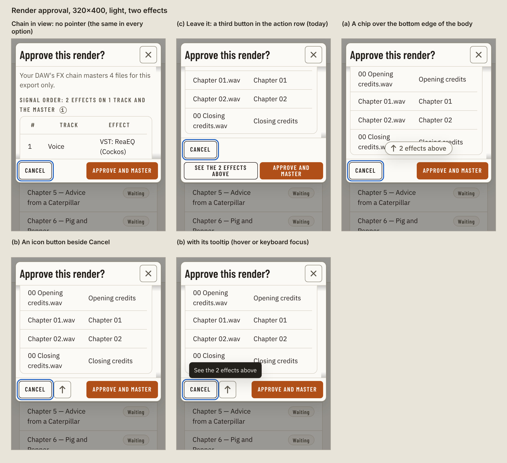
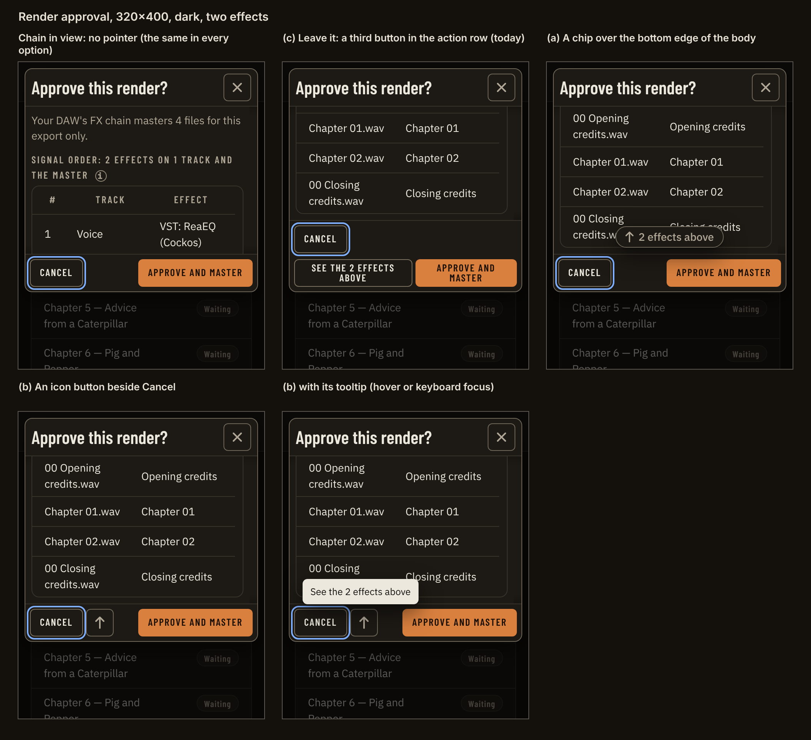
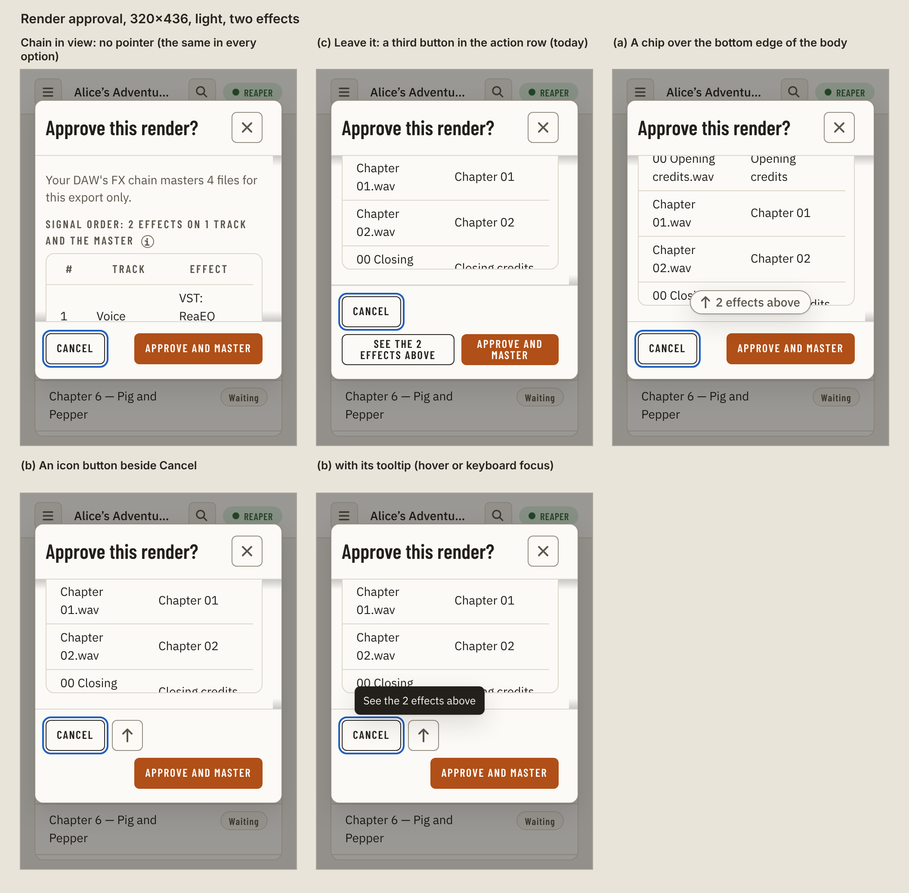
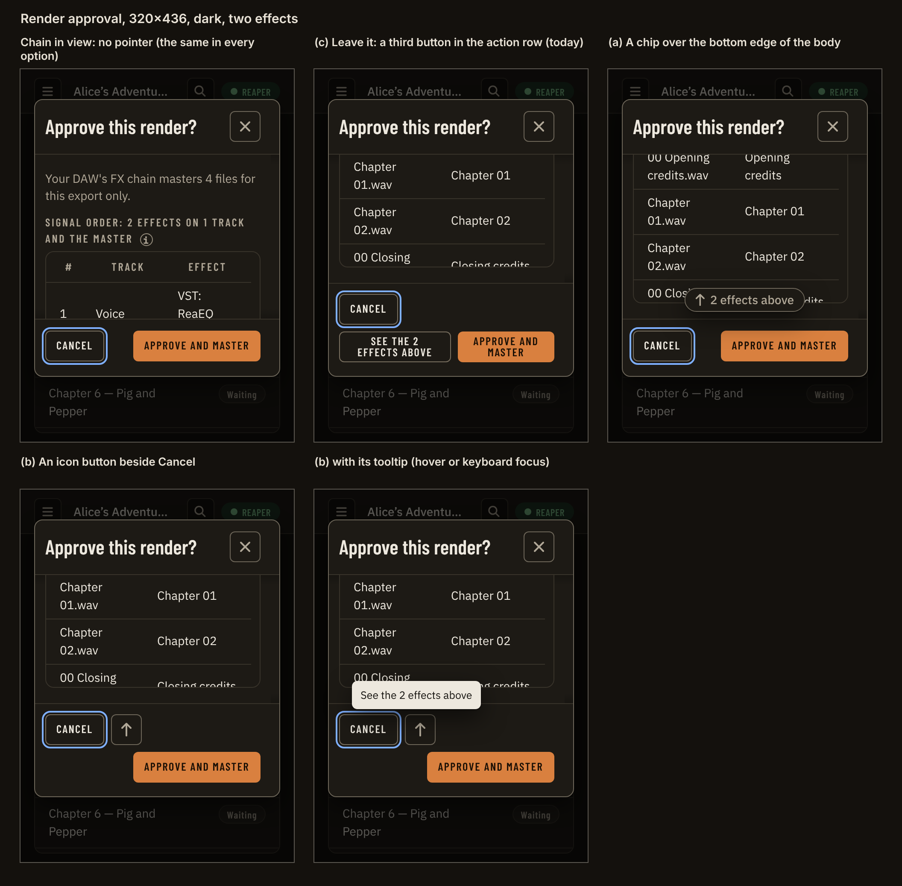
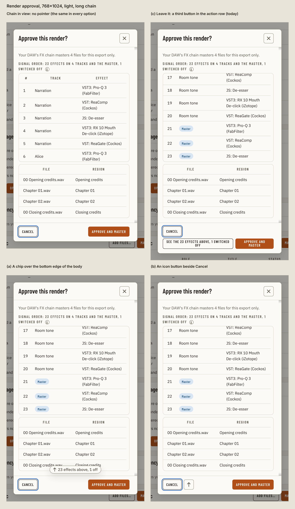
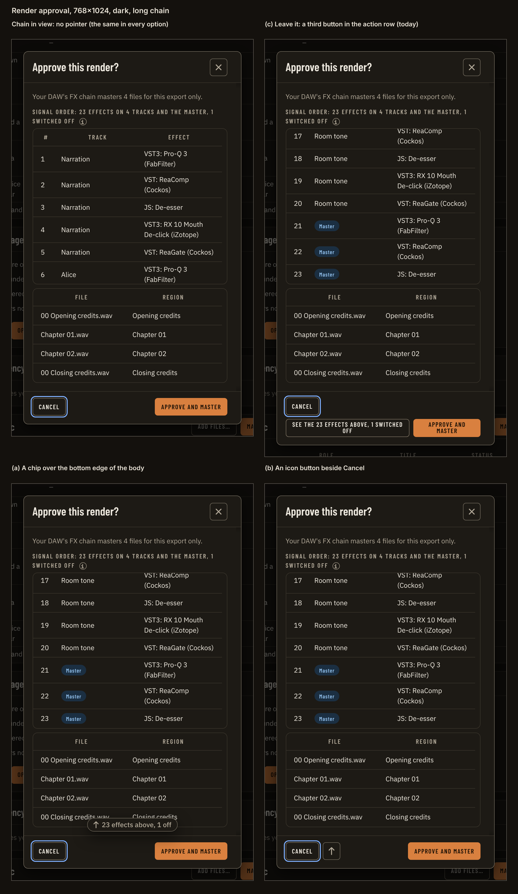
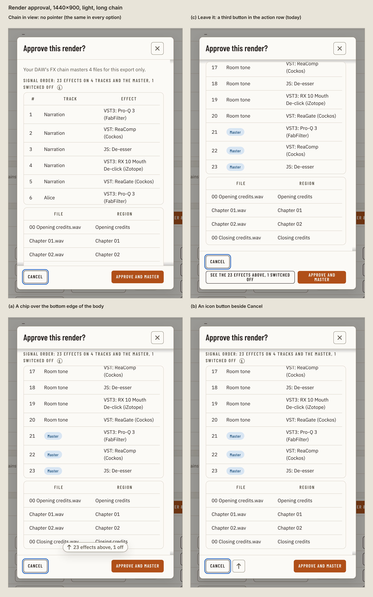
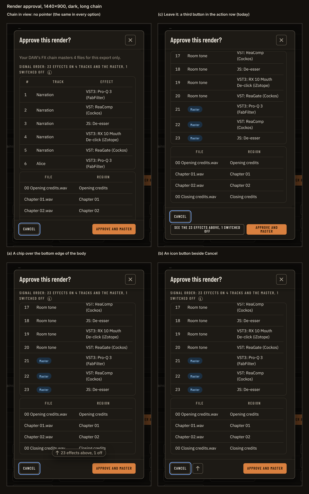

# Approval chain pointer: mock

**Status:** draft for [#3605](https://github.com/countrymanprime/narration-studio/issues/3605) item 4, awaiting the owner's choice between three options. Nothing is built.

In Master's render approval, a pointer appears when the FX chain's first effect is out of view: today it is a third button in the action row, **See the 2 effects above**. At 320 px wide that button puts the action row on two lines (67 to 109 px) and the body loses 42 px. With the two-effect chain this happens by itself as the window passes 422 px of height, because that is where the first effect leaves the view.

`shots.mjs` draws each option over the real app (the mock-backend build, driven to the approval) by editing the page after it has loaded; it holds no app code. Option (c) is the app as it is. `shots/metrics.json` holds the measured action row and body heights of every frame.

## Options

| Option | What the narrator sees |
| --- | --- |
| (a) A chip over the body | A small **↑ 2 effects above** chip floats over the bottom of the scrolling body while the first effect is out of view. The action row and the body keep their size at every window size. The chip covers part of the body's last visible line until the narrator scrolls or presses it, and it is 28 px tall where the buttons are 36 px. |
| (b) An icon button | An up arrow beside Cancel; its words are only in its tooltip, so a touch screen never shows them. The row stays on one line at 1440, at 768 and at 320x400. At 320 px wide and more than 400 px tall (drawn at 320x436) the row is 6 px too narrow, Approve drops to a second line and the 67 to 109 px step is still there, unless the row's padding or gap is also made smaller. |
| (c) Leave it | The words stay in a third button. The action row is two lines whenever the pointer shows in a narrow dialog (67 to 109 px, or 49 to 93 px at 400 px tall) and the body gives up 42 to 44 px. With a long chain the label (**See the 23 effects above, 1 switched off**) wraps the row at 1440 and 768 too. |

With the chain in view no option draws anything: the first frame of each sheet is the same for all three.

## Frames

Each size is drawn light and dark. `shots/sheet-<size>-<theme>.png` puts the frames of one size side by side; `shots/<variant>-<size>-<theme>.png` are the whole windows (`none`, `a`, `b`, `c`, and `b-hint` for the tooltip at 320 wide).

| Size | Chain | How the first effect leaves the view |
| --- | --- | --- |
| 1440x900 | 23 effects | The chain's list is scrolled to its end |
| 768x1024 | 23 effects | The chain's list is scrolled to its end |
| 320x436 | 2 effects | The dialog's body is scrolled to the files |
| 320x400 | 2 effects | The dialog's body is scrolled to the files |

A two-effect chain never leaves the view at 1440x900 or 768x1024, so those sizes use the long chain (`?mockMasterChain=long`). 320x436 is added to the sizes asked for because the reported step is just above 400 px of height, where the dialog has wider margins than at 400 px.

| Light | Dark |
| --- | --- |
|  |  |
|  |  |
|  |  |
|  |  |

## Primitives for a real build

| Element | Primitive |
| --- | --- |
| (a) the chip | `Pill` with the `filter` look, placed over the dialog body, with the tooltip's shadow; it needs an icon slot `Pill` does not have |
| (b) the icon button | `IconButton` with `TooltipTarget` (rule 1), and a new up-arrow entry in `icons.catalog.ts` |
| (c) the button | `ConfirmDialog`'s secondary action, as built |

## Redrawing

```sh
pnpm --dir src/studio/ui run build:mock
pnpm --dir src/studio/ui exec vite preview --outDir node_modules/.cache/mock-build --port 4173 --strictPort &
CHROMIUM=<the installed headless shell> node docs/research/mockups/approval-chain-pointer/shots.mjs
```

## Lifecycle

Delete this folder in the pull request that builds the chosen option, or when the owner chooses (c).
