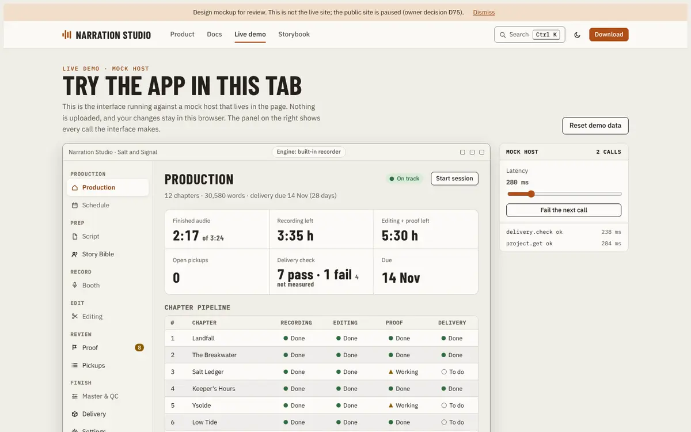
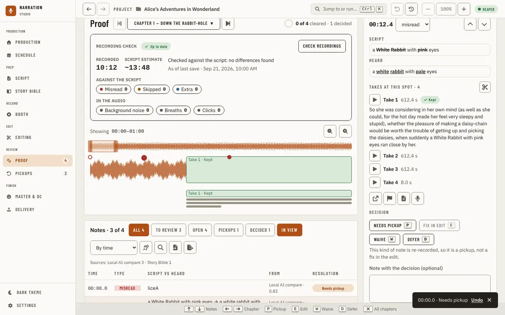
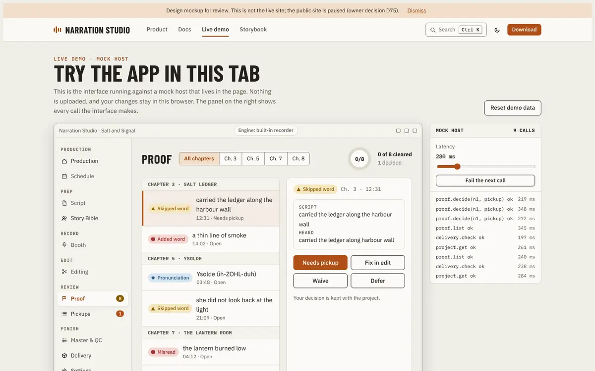
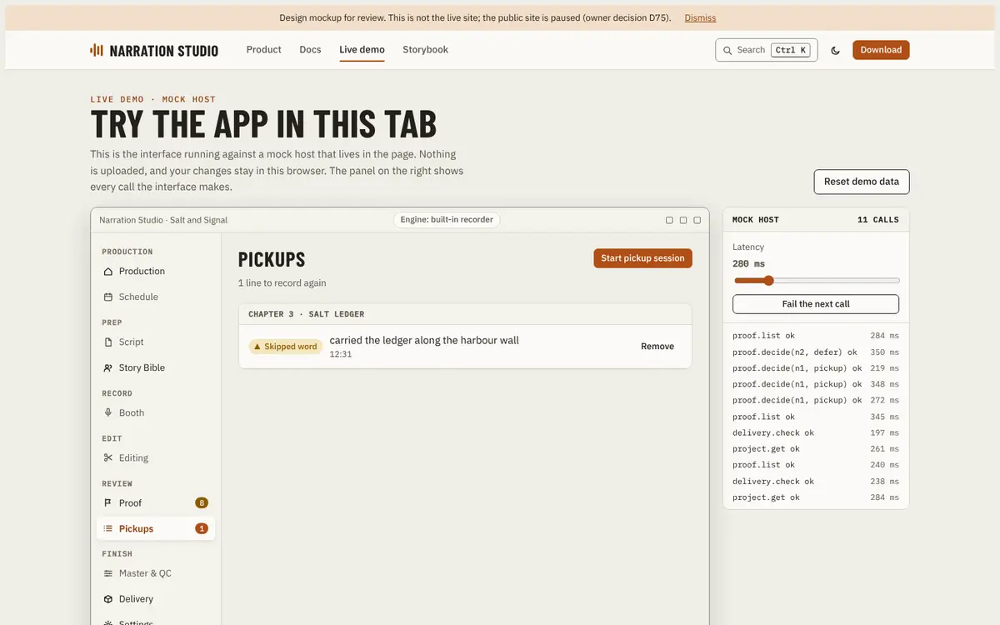
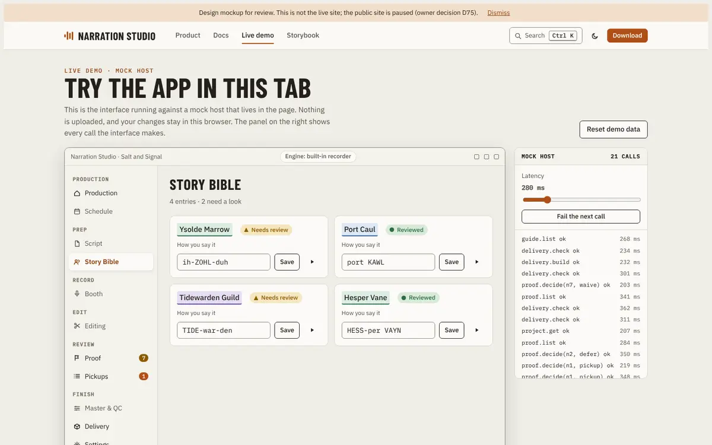
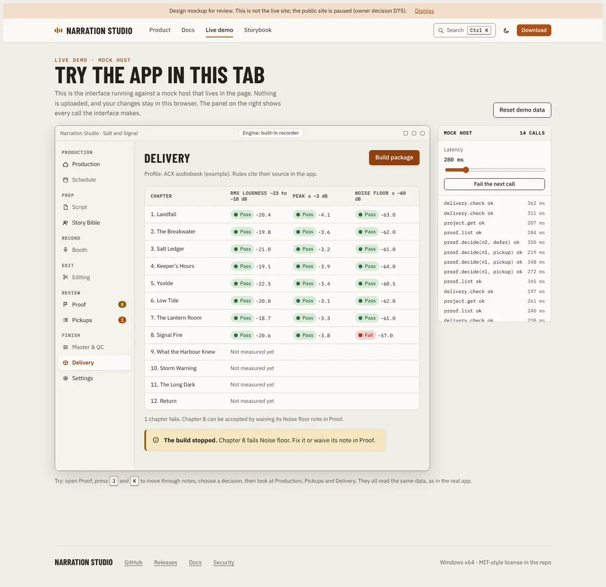
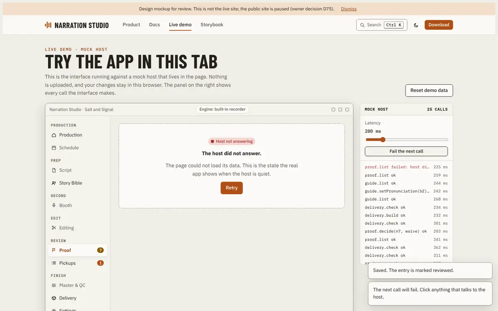
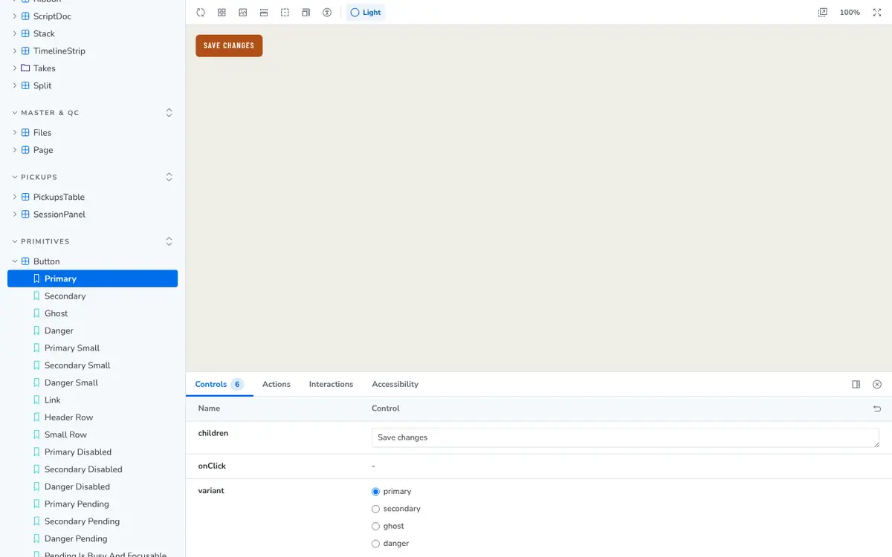
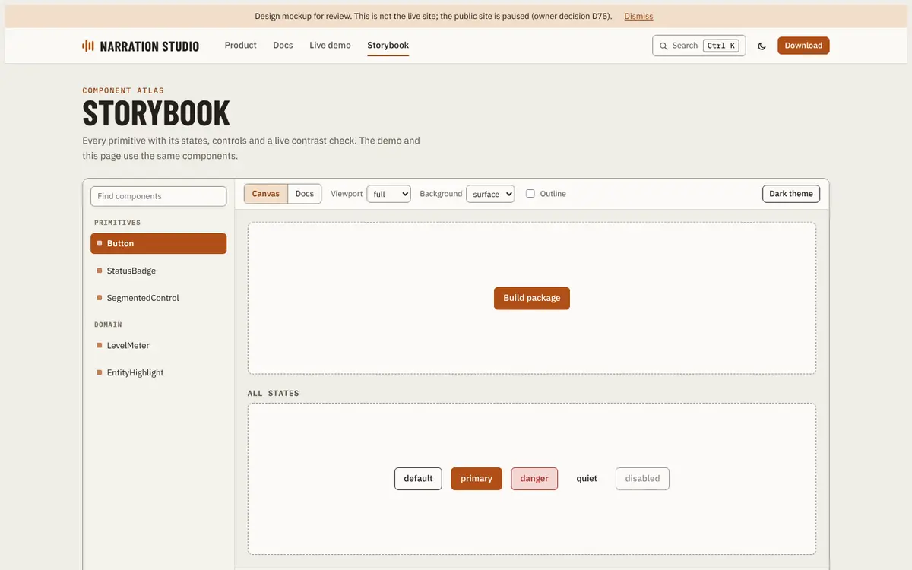

# Public site demo against the real app

**Date:** 2026-10-18. **Status:** evidence for the owner; nothing here is decided or built. **Answers:** where the mockup demo of [PR #1825](https://github.com/countrymanprime/narration-studio/pull/1825) differs from the real app and the Studio Next mock, and which differences are improvements worth taking. **Compared:** [the mockup](mockups/public-site/index.html) (`docs/research/mockups/public-site/index.html`), [its research note](public-site-benchmark.md), the real UI in `src/studio/ui`, the Studio Next mock in `docs/research/mockups/studio-next/` and the guides in `docs/guides/using-the-app/`.

## How this was checked

- **Real app, run.** The Playwright visual suite ran against the real UI on its mock host, light theme: `pnpm --dir src/studio/ui visual:page production proof pickups` (92 states, all passed), `delivery` (all passed) and a partial run of `storybible`, `shell` and `master`, which I stopped before its dark pass. I read the PNGs under `src/studio/ui/screenshots/targeted/light/` (gitignored, not committed) and drove the mock build (`vite build --mode mock`) with a script to test decisions, keys and counts. Findings from that script are marked **live**.
- **Real Storybook, run.** `pnpm --dir src/studio/ui run build-storybook` built, and I opened the static build in a browser.
- **Mockup, run.** I opened `index.html` in headless Chromium and drove every demo page, the Storybook view and the Ctrl+K search. Findings are marked **live**. Others come from reading the file and are cited by line.
- **Studio Next mock, read** from source (`docs/research/mockups/studio-next/src/`). I installed its dependencies and started its dev server but compared source and the committed screenshots, not live states.
- **Not run:** the MkDocs build, the real desktop host, dark theme of the real pages, and a pixel comparison. See [What could not be verified](#what-could-not-be-verified).

**Rules that applied.** [Which mocks are the spec](../design/design-system.md#which-mocks-are-the-spec) says the Studio Next mock is the only spec for every page it covers and that nothing is built that it lacks. The ADRs 0585, 0740 and 0760 named in the brief are no longer in `docs/adr/`: the folder holds only 0001 (Go) and 0002 (local models), and their content moved to that design-system section and to [verification tooling](../operations/verification-tooling.md#mock-match) (`docs/research/docs-placement-audit.md`, rows 0585, 0740, 0760). So no change below conflicts with an Accepted ADR; the gate for every "Studio mock first" item is the design-system rule, and the way to open the gate is a change to the Studio mock.

**Verdict codes.** **C** mock site should conform. **A** app should move toward the mock site. **S** Studio mock should be updated first. **F** fine either way or not comparable.

## Summary

### Counts

| Verdict | Count |
| --- | --- |
| C: mock site should conform | 14 |
| A: app should move toward the mock site | 5 |
| S: Studio mock should be updated first | 6 |
| F: fine either way or not comparable | 26 |

Fifty-one differences in all (the IDs in the tables below). Most of what the owner likes in the mockup is already in the real app: the six-figure card, the pressed decision buttons, the ring and "N of M cleared · K decided", the key legend, the Script against Heard diff with struck and underlined words, the grouped sidebar, and a Pickups empty state that says what to do. The mockup draws them with approximate sizes and, in places, wrong behavior.

### The five highest-value findings for the app

1. **Proof and Production have no Retry when their data cannot load** (A, A1 below). Proof shows a transient error toast over an empty page (`src/studio/ui/src/components/proof/ProofPage.tsx:181`). Production shows a bare red line (`src/studio/ui/src/components/production/ProductionPage.tsx:376`). Story Bible and Script already use `LoadError` with a Retry button, and Pickups and Delivery have "Check again". Reusing `LoadError` is small.
2. **A failed action cannot offer Retry** (A, A2). The toast already takes one action button (`src/studio/ui/src/components/primitives/Toast.tsx:9`), used only for Undo; every failure is a sticky error toast with no way to try again from it.
3. **Delivery says how many chapters fail but not which rule** (S, S3). `Fails 2 checks` and `0 failing, 8 not ready` (`src/studio/ui/src/components/delivery/page/chapterStates.ts:35`, `:61`) send the narrator to Master & QC to learn what failed. The mockup's "Chapter 8 fails Noise floor" is the better sentence; Production's Next up already writes the same kind of sentence with value and limit.
4. **Editing a pronunciation takes Edit, type, Save, then Mark reviewed** (S, S1). The mockup edits it in place. This is the commonest Story Bible fix, so a faster path would be felt, but the Studio mock keeps pronunciations read-only until Edit.
5. **The real mock host cannot yet carry the demo's cross-page story** (demo plan, not a UI change). Marking a Proof note Needs pickup leaves Pickups, the rail and Production unchanged on the real mock host (**live**; `findingsMock.ts` has no pickup reference), so a public demo of the real UI would lose the behavior the owner liked most in the mockup. Section [Running the real UI on a mock host](#running-the-real-ui-on-a-mock-host) lists what that needs.

## Production (`#demo-production`)

Real: `ProductionPage.tsx`, [production guide](../guides/using-the-app/production.md), `docs/images/ui/production-home.webp`. Studio: `pages/Production.tsx`, `pages/production/PipelineTable.tsx`.

| ID | Item | Real app | Studio mock | Mock site | Verdict | Evidence |
| --- | --- | --- | --- | --- | --- | --- |
| P1 | Six figures as one card, each opens the page it counts | Same. One card of six figures, each a link | `.kpis` buttons that call `prodAct` | Same idea; the Due figure opens Schedule | F | `production.md#the-figures`; screenshot `production/on-pace/desktop.png` |
| P2 | Pipeline state as shape plus a word | A tick, a half circle or a dash, a count in Pickups, "PASS" or "FAIL" in QC. The word is the accessible name (`Chapter 1: Record done`, `pipelineRows.ts:193`) and the tooltip, not visible text | Tick, percent while under way, dash; word in `title` | An icon plus a visible word in every cell: Done, Working, To do, Fails | S | `PipelineTable.tsx:46-58`; mock `PipelineTable.tsx` `stage()` |
| P3 | Clicking a pipeline cell opens Proof | Each cell opens its own stage for that chapter: Script, Booth, Proof (with the chapter in the address), Pickups, Master & QC | `cellAct(action)` routes by cell | Every cell, including Recording, Editing and Delivery, goes to Proof and clears the chapter filter (**live**: hash `#demo-proof`, all chapters) | C | `production.md` "Chapter pipeline"; mock `state/commands/production.ts` `cellAct`; site line 976 |
| P4 | Start session when the engine cannot record | Opens the Booth on the chapter being recorded, or is off with the reason beside it ("Experimental: switched off in Settings.") | `disabled={!record.ok}` | Always enabled and always shows "The Booth needs the desktop app", while the header says "Engine: built-in recorder" (**live**) | C | `production-home` screenshot; mock `Production.tsx:86`; site line 977 |
| P5 | Header verdict and figures | Computed from the schedule ("On track · at 1.5 h/day done Oct 4"); opens Schedule | `VerdictPill` | "On track", "28 days" and 14 Nov are literals; the hours are a fixed 150 wpm formula | C | site lines 906-912; `PageHeader.tsx` |

## Proof (`#demo-proof`)

Real: `src/studio/ui/src/components/proof/`, [proof guide](../guides/using-the-app/proof.md), `docs/images/ui/proof-default.webp`. Studio: `pages/Proof.tsx`, `pages/proof/Inspector.tsx`.

| ID | Item | Real app | Studio mock | Mock site | Verdict | Evidence |
| --- | --- | --- | --- | --- | --- | --- |
| R1 | Notes queue grouped by chapter | A table: Time, Type, Script vs heard, From, Resolution; grouped by chapter with each chapter's open count; chips, sort, find, waveform | Same | A list of tall rows (86 px measured) with the type badge, the script line and "time · state"; no sort, filter or waveform | F | `NotesTable.tsx`; mock `NotesTable.tsx`. Simplification the benchmark note already admits |
| R2 | Evidence diff: struck script, inserted heard words | Script shows missed words struck, Heard shows extra words underlined, word by word | Same markup (`<del>`, `<ins>`) | A Skipped word note shows the two sentences with no mark at all (**live**: `<small>Script</small>she did not look back at the light` against `…at light`). Other kinds strike the whole script phrase and underline the whole heard phrase. The regex that should mark words does nothing | C | `inspector/evidenceQuotes.ts`; `proof-default` and live screenshot (`a White Rabbit with pink eyes` struck "White Rabbit", "pink"); site line 937 |
| R3 | Four decisions as a pressed state that can be toggled off | Four buttons with key caps P, E, W, D and `aria-pressed`. Pressing the pressed one again does not toggle it off: the real app saves the same decision again, toasts and moves to the next note (**live**). Reopen and the Undo toast put a note back | Same buttons; pressing the same decision again is a no-op with no toast (`state/commands/proof.ts:132`); Reopen and Undo | A second press toggles the decision off silently (**live**) | F | `inspector/DecisionButtons.tsx:51`; see [observation 1](#observations-outside-the-mockups-scope) |
| R4 | Feedback after a decision | Saved at once, next note selected, toast "00:00.0 · Needs pickup" with Undo | Same | The selection stays; the counters and rail update; no Undo | C | **live**; mock `proof.ts:135-141`; site line 981 |
| R5 | Ring and "N of M cleared · K decided" | Same words; cleared means waived, decided includes deferred and waiting pickups | Same (`noteProgress`) | Same words and rule; the ring also prints "0/8" inside | F | `proof.md` "All chapters or one chapter"; site line 933 |
| R6 | Chapter stepper as a segmented control | A stepper: previous and next buttons around a menu of every chapter and credits; Left and Right keys; the chapter is in the address (`?chapter=`) | `ChapterBar` | A segmented control of "All chapters" and only the four chapters that have notes. It cannot reach a chapter without notes and does not scale to a 12-chapter book | C | `frame/ProofHeader.tsx`; site line 939 |
| R7 | J, K and Esc with a key legend | Up, Down, J, K, Left, Right, P, E, W, D, Esc, Ctrl+F; legend along the bottom, rebindable in Settings | `KeyHints` with the same keys plus Space and Ctrl+Z | J, K and Esc only; P, E, W and D do nothing (**live**); the legend lists three keys | C | `proof.md` "Keys"; mock `Proof.tsx` `registerKeys`; site lines 945, 993-999 |

## Pickups (`#demo-pickups`)

Real: `src/studio/ui/src/components/pickups/`, [pickups guide](../guides/using-the-app/pickups.md), `docs/images/ui/pickups-list.webp`, `pickups-empty.webp`. Studio: `pages/Pickups.tsx`.

| ID | Item | Real app | Studio mock | Mock site | Verdict | Evidence |
| --- | --- | --- | --- | --- | --- | --- |
| K1 | Pickups derived from Proof decisions | Four sources: Speech, Proof note, Audio, You, read from the host. On the real **mock host** a Proof decision does not reach Pickups, the rail or Production (**live**) | Derived in the mock's store | Derived: Needs pickup adds a line, and the rail and Production tile update | F | `pickups.md` "Where the lines come from"; `findingsMock.ts` (no pickup code). The gap is the host's, see [the demo section](#running-the-real-ui-on-a-mock-host) |
| K2 | Empty state that says what to do | "No pickups queued", the sentence, and an icon-only arrow named "Go to Proof" | Same | The same sentence and a labelled **Open Proof** button | S | `list/PickupsTable.tsx:297-299`; mock `Pickups.tsx:142` |
| K3 | Remove action | "Remove from pickups" hides the line from the list only; its note keeps its decision. A line added by hand can be undone | Same | Remove sets the Proof decision back to open, so the line and the decision both go | C | `pickups.md` "The list"; site line 982 |
| K4 | Start pickup session | Opens the Booth on the included lines | Same | A toast that the Booth needs the desktop app | F | A browser demo cannot record |

## Story Bible (`#demo-story-bible`)

Real: `src/studio/ui/src/components/storybible/`, [story bible guide](../guides/using-the-app/story-bible.md), screenshots `storybible/entry-needs-review/desktop.png`, `entry-pronunciation-missing/desktop.png`. Studio: `pages/Bible.tsx`, `pages/bible/EntryEditor.tsx`.

| ID | Item | Real app | Studio mock | Mock site | Verdict | Evidence |
| --- | --- | --- | --- | --- | --- | --- |
| B1 | Inline editable pronunciation per entry with Save | A pronunciation is read-only until the entry's Edit; in Edit each name has a field, a source tag and a reference clip; Save commits | Same (`editing ? <Input data-say> : `) | Always-editable field and a Save button on each card | S | `EntryEditor.tsx:55-58`; site line 956 |
| B2 | Save marks the entry reviewed | Reviewed is its own action: **Mark reviewed** in the header and per name; the mock disables it until suggestions are verified ("Verify its suggestions first") | Same | Saving a pronunciation sets Reviewed (**live**) | C | `EntryEditor.tsx:61,149`; site line 862 |
| B3 | "Needs review" badge | A **Review** pill in the list, **Needs review** in the header, and a "Needs review · N" filter chip | Same | A badge on the card; no filter | F | `story-bible.md`; screenshot `entry-needs-review` |
| B4 | Play preview | Speaks the name with the local preview voice; dimmed with a hint when no pronunciation exists; asks before downloading the voice | A toast | A toast ("Voice preview uses local Piper in the desktop app") | F | `story-bible.md` "Hearing a name" |
| B5 | Layout | Master-detail: searchable list, kind and review filters, a detail panel, a Series tab | Same | Four cards in a grid | F | Sample data and a simplification |

## Delivery (`#demo-delivery`)

Real: `src/studio/ui/src/components/delivery/`, [delivery guide](../guides/using-the-app/delivery.md), [Master & QC guide](../guides/using-the-app/master-and-qc.md), screenshots `delivery/measured`, `delivery/build-failed`. Studio: `pages/Delivery.tsx`.

| ID | Item | Real app | Studio mock | Mock site | Verdict | Evidence |
| --- | --- | --- | --- | --- | --- | --- |
| D1 | Per-chapter rules grid with the measured value | Delivery lists limits once and, per chapter, **Pass**, **Fails N checks** or **Not mastered**. The per-rule values and "Why it fails" are on Master & QC | Same split | A rules grid on Delivery: Pass or Fail and the measured value for each rule of each chapter | S | `chapterStates.ts:30-36`; `master-and-qc.md:36-48`; site line 962. The value beside the rule is the improvement; see S3 |
| D2 | Pass shown for a waived rule | A rule is met or not met from the measurement | Same | After waiving, chapter 8 reads **Pass** next to −57.0 dB against a limit of −60 (**live**) | C | site line 870 |
| D3 | Build that stops with a reason naming the chapter and rule | Build is off until every chapter passes and is mastered; the sentence beside it counts ("0 failing, 8 not ready"). Host refusals show under the button and as a sticky toast | Same (`disabled={!ready}`, `bad + ' failing, ' + wait + ' not ready'`) | Build is always on and fails when pressed: "Chapter 8 fails Noise floor. Fix it or waive its note in Proof." | S | `chapterStates.ts:55-61`; mock `Delivery.tsx:80-83`; site line 864 |
| D4 | Waiving the related Proof note makes the build pass | A Delivery check note's decision "changes nothing but your decision: not the profile and not the measurement"; no code path in `delivery/page` reads decisions | Same | Waiving chapter 8's Noise floor note makes Delivery pass and the build succeed (**live**) | C | `proof.md` "Delivery checks"; `chapterStates.ts` (no waive input); site line 869 |
| D5 | Accepting a failing chapter at all | Not offered. A narrator fixes and re-renders, or uses a custom profile with other limits | Same | Offered through D4 | S | Proposal only; see section 3 |

## Cross-page consistency

| ID | Item | Real app | Studio mock | Mock site | Verdict | Evidence |
| --- | --- | --- | --- | --- | --- | --- |
| X1 | Sidebar counts and Production tiles read the same data | Proof's count is `proofProgress(...).open`, Pickups' is `openPickups(...)`, "the same count Production and Schedule use"; a matrix test pins the seams | Same | `openN()` and `pickupN()` feed the rail and the tiles | F | `layout/useNavCounts.ts`; `crossPage.matrix.test.tsx`; site lines 873-874 |
| X2 | Counts move as you decide | The rail re-reads on a page move only (`useNavCounts.ts`, effect keyed on `pathname`); it read PROOF 4 before and after Waive on Proof (**live**) | Updates in the store | Updates at once | A | `useNavCounts.ts:29-55`; site line 981 |

## Failure and loading states

| ID | Item | Real app | Studio mock | Mock site | Verdict | Evidence |
| --- | --- | --- | --- | --- | --- | --- |
| L1 | Skeleton placeholders while a page loads | None (`Skeleton` matches no file in `src/studio/ui/src`). Production prints "Reading the production log…". Every Go call is tier 1, under 10 ms | A `.skeleton` only in Settings | Skeleton on every page, over a 280 ms simulated latency | F | `interaction-feedback.md:22`; `ProductionPage.tsx:371`; mock `styles/settings.css:57` |
| L2 | "Host not answering" panel with Retry | Present on Story Bible and Script (`LoadError`), Pickups and Delivery ("Check again"). Absent on Proof (toast only) and Production (red line, no button) | Delivery draws a quiet-host state; Production and Editing a DAW Retry | Panel with Retry on any page | A | `layout/LoadError.tsx`; `PickupsTable.tsx:193-196`; `ProofPage.tsx:181`; `ProductionPage.tsx:376-380` |
| L3 | Toast with Retry when an action fails | Failure toasts are sticky and have no action; the toast supports one action button | Toasts with Undo only | Error toast with Retry that repeats the click | A | `Toast.tsx:9`, `hooks/useToasts.ts:29`; site line 991 |
| L4 | Latency slider, fail-next-call switch, request log | None in the mock host (no latency or failure code in `src/studio/ui/src/api/mockHost`) | Mock states panel | A panel beside the demo | F | Demo tooling, not the app; see the demo section |

## Navigation

| ID | Item | Real app | Studio mock | Mock site | Verdict | Evidence |
| --- | --- | --- | --- | --- | --- | --- |
| N1 | Grouped sidebar | Production, Prep, Record, Edit, Review, Finish, then Dark theme and Settings | Same | Same groups and order | F | `docs/images/ui/nav-sidebar-desktop.webp` |
| N2 | Icon-only and phone layouts | The rail collapses to icons below 1360 px, a drawer below 1180 px; the window's minimum is 960 px; the visual suite has no phone viewport | Same widths | A phone layout: the demo nav becomes a scrolling strip at 390 px (**live**) | F | `layoutBreakpoints.ts:8-14`; `design-system.md:49,145` |
| N3 | Pages that need the desktop app as an explained stub | A page without a manuscript is off with a lock and the reason; the mock build renders Booth and Editing fully | Same | A "Not in this demo" page with a link to the guide | F | `nav-off-note.webp`; site line 902 |

## Storybook view (`#storybook-button`)

Real: `src/studio/ui/.storybook/`, the static build, [`docs/ui/atlas/`](../ui/atlas/index.md).

| ID | Item | Real app | Studio mock | Mock site | Verdict | Evidence |
| --- | --- | --- | --- | --- | --- | --- |
| SB1 | Controls | Controls panel with the component's props (Button: 6) | Not covered | A hand-written controls panel for five stories | F | **live** |
| SB2 | Actions log | Actions and Interactions tabs | Not covered | An actions tab | F | **live** |
| SB3 | Accessibility tab measured in the current theme | `@storybook/addon-a11y` (axe: Violations, Passes, Inconclusive); `a11y: { test: 'error' }` and the atlas runs axe in both themes | Not covered | Text contrast only, with a race: measured 50 to 100 ms after a theme switch it reports Fail AA for every button (1.84:1, 1.15:1); after the 150 ms transition settles every row passes (14.20:1, 6.38:1) (**live**) | C | `.storybook/preview.tsx`; site lines 1087-1094 |
| SB4 | Viewport, background, outline | Toolbar: background, grid, measure, outline, viewport, vision filter, theme | Not covered | Viewport, background, outline, theme | F | **live** |
| SB5 | "All states" grid and a Docs tab with a props table and "used by" | One story per state in the sidebar (Button: 19) and no combined view; no Docs tab (`index.json` holds 1010 entries, all of type story, none tagged autodocs). "Used by" is in the generated `docs/ui/atlas/Button.md` | Not covered | An all-states grid and a Docs tab; its "used by" lines are typed by hand and invented for the demo | A | `storybook-static/index.json`; `docs/ui/atlas/Button.md`; site lines 1045-1048 |

## Docs view (`#docs`)

Real: [`tools/docs-site/mkdocs.yml`](../../tools/docs-site/mkdocs.yml), [the public docs site](../operations/ci-and-releases.md#the-public-docs-site). Not built here.

| ID | Item | Real site | Mock site | Verdict | Evidence |
| --- | --- | --- | --- | --- | --- |
| O1 | Diátaxis grouping | Navigation is generated from folders; the guides are by page. `docs-style` already requires one Diátaxis type per page | Tutorial, how-to, reference, explanation | F | `mkdocs.yml` `nav_titles`; `docs-style` rule 3. The benchmark note lists this as an open decision |
| O2 | Table of contents that follows scroll | Material's page contents list; its active-heading behavior was not checked | An observer highlights the heading in view | F | Unverified |
| O3 | "Edit this page on GitHub" | Not configured: no `edit_uri`, and `repo_url` is left unset on purpose so Material does not call `api.github.com` | A link on every page | A | `mkdocs.yml:33-34`. Whether Material shows an edit button without `repo_url` needs a build to settle |
| O4 | Ctrl+K search | Material's local search; its default keys are not Ctrl+K | One palette over docs, demo pages, components and actions | F | Docs and Storybook are separate builds, so one index is not free |
| O5 | Copy buttons, previous and next links, helpfulness widget | Copy buttons are on (`content.code.copy`). Previous and next need `navigation.footer`. The feedback widget needs an analytics provider | All three | F | A widget that reports to a provider would break "asks no third-party service" |
| O6 | Fonts | The app bundles its fonts and the docs site sets `font: false`; neither contacts a font host | Loads Barlow Condensed and IBM Plex from Google Fonts | C | `fonts.ts:1-4`; `mkdocs.yml:35`; site lines 4-5 |

## Look

| ID | Item | Real app | Mock site | Verdict | Evidence |
| --- | --- | --- | --- | --- | --- |
| V1 | Palette, both themes | `src/studio/ui/src/styles.css` tokens | Identical values. A script comparing every shared token found only `--shadow` and `--shadow-lg` different, and only in the light theme | F | Script run over both files, 2026-10-18 |
| V2 | Type and sizes | Barlow Condensed throughout: buttons 32 px high, 13.12 px, uppercase; h1 28 px at weight 600; rail 215 px wide (**live**) | Buttons in IBM Plex Sans, 36 px, 14 px, sentence case; h2 30 px at weight 700; sidebar 188 px; rows 86 px | C | **live** computed styles; `StatusBadge.tsx` |
| V3 | Badges with distinct shapes per tone | A pill, tag, booth or cell shape by role, tone by colour, and always a word | A glyph per tone (▲ warn, ◆ info, ■ danger, ● ok) plus the word | F | `StatusBadge.tsx:11-22`; the label already carries the state |
| V4 | Focus ring | 2 px outline, 2 px offset, blue | Same | F | `styles.css:39`; site `:focus-visible` |
| V5 | Dark theme | Token set in `styles.css` | Same tokens | F | V1 |

## Side-by-side images

Left: the real app (committed guide screenshots in `docs/images/ui/`, or a live capture marked so). Right: the mockup, captured in headless Chromium at 1440 px on 2026-10-18 and stored in `docs/research/images/public-site-comparison/`. The mockup captures show the state after the steps named in each caption.

### Production (P1 to P5)

| Real app | Mockup |
| --- | --- |
|  |  |

### Proof evidence and decisions (R2 to R4)

| Real app (live capture, after pressing Needs pickup) | Mockup (Skipped word note, after one decision) |
| --- | --- |
|  |  |

### Pickups (K1 to K3)

| Real app | Mockup (after marking one note Needs pickup) |
| --- | --- |
|  |  |

### Story Bible (B1 to B3)

| Real app | Mockup |
| --- | --- |
|  |  |

### Delivery (D1 to D4)

| Real app (Build off, count sentence beside it) | Mockup (rules grid, Build stopped with chapter and rule) |
| --- | --- |
|  |  |

### Failure state (L2)

The real app has no Proof or Production counterpart to capture: Proof shows an error toast over the page and Production a red line (`ProofPage.tsx:181`, `ProductionPage.tsx:376`).

| Mockup: Proof after "Fail the next call" |
| --- |
|  |

### Storybook (SB1 to SB5)

| Real Storybook (live capture of the static build) | Mockup Storybook view |
| --- | --- |
|  |  |

## App should move toward the mock site

Ranked by what the narrator gains. None is built; no Accepted ADR is in the way (only ADR 0001 and 0002 remain). The first two add a state the Studio mock does not draw; the design-system rule says to add it to the mock in the same change, so the owner may prefer to treat them as **S**.

1. **A1. A retry for a page that could not load, on Proof and Production.**
   - **Narrator benefit:** today a failed Proof load leaves an empty page and an error toast that can be dismissed, with no way to try again short of leaving the page. With `LoadError` the page keeps its title, says what happened and offers Retry.
   - **Touches:** `components/proof/ProofPage.tsx` (the two `.catch` sites at `:153`, `:181`), `components/production/ProductionPage.tsx:376`, reuse of `components/layout/LoadError.tsx`; a state row in `tests/visual/catalog/proof.ts` and `production.ts`; the Proof and Production guides.
   - **ADR conflict:** none. **Size:** small.
2. **A2. A Retry on a failed action's toast.**
   - **Narrator benefit:** a refused build or a failed save can be repeated from the message that reports it, instead of finding the control again. The mockup does it for any action.
   - **Touches:** `components/primitives/Toast.tsx` already takes `action`; the sites that call `notify(describeApiError(error), 'error')` pass one only where repeating is safe (build, save, check); `interactionFeedback/*.ts` rows for those sites.
   - **ADR conflict:** none. **Size:** medium, because each site must be judged for whether a repeat is safe.
3. **A3. A rail count that moves as you decide.**
   - **Narrator benefit:** the Proof and Pickups badges change when a note is decided, not after leaving the page, so the number beside the ring and the number in the rail agree.
   - **Touches:** `components/layout/useNavCounts.ts` (subscribe to the findings change, as it already does for pickups through `subscribePickups`).
   - **ADR conflict:** none. **Size:** small. Low value: the page's own ring already moves.
4. **A4. An "all states" and docs page per primitive in Storybook.**
   - **Narrator benefit:** none directly. A reviewer compares a primitive with the Studio mock on one page instead of opening 19 Button stories.
   - **Touches:** `.storybook/main.ts` (add `@storybook/addon-docs`), a `tags: ['autodocs']` or a docs template; the atlas generator `scripts/atlas-docs.mjs` already lists "Used by".
   - **ADR conflict:** none. **Size:** small to medium; dependency and atlas-runner effects were not checked.
5. **A5. An "Edit this page on GitHub" link on the public docs site.**
   - **Narrator benefit:** a reader who finds a wrong sentence in a guide can open the file to fix it. The mockup puts one on every page.
   - **Touches:** `tools/docs-site/mkdocs.yml`, `tools/docs-site/hooks.py`; the link must stay a plain link, not Material's repository widget, which calls `api.github.com`.
   - **ADR conflict:** none. **Size:** small; the docs site is paused (D75).

## Studio mock should be updated first

Proposals for the owner, not bugs. Each needs a change to the Studio mock before the app follows; none supersedes an Accepted ADR, since the rule lives in [`design-system.md`](../design/design-system.md#which-mocks-are-the-spec).

- **S1. Edit a pronunciation without entering Edit mode** (B1). One field per name, committed on Enter or on leaving the field, with the source tag beside it. Touches `EntryEditor.tsx` in the mock and `components/storybible/` in the app. Medium. Keep Mark reviewed separate (B2).
- **S2. A labelled action in the Pickups empty state** (K2). Replace the icon-only arrow with a text button, "Open Proof". Touches `pages/Pickups.tsx` and `list/PickupsTable.tsx:299`. Small.
- **S3. Name the failing rule and value on Delivery** (D1, D3). Turn "Fails 2 checks" and "0 failing, 8 not ready" into the first failing chapter, rule, value and limit ("Chapter 8: noise floor −57 dB, limit −60 dB"), keeping Build off. Touches `delivery/page/chapterStates.ts`, `DeliveryPage.tsx`, the mock's `Delivery.tsx`. Small to medium. This keeps the disabled-button design, which stops a press that cannot succeed, and takes the mockup's sentence.
- **S4. A visible word in pipeline cells** (P2). Needs the column width the mock gives each stage (80 px) to hold "Working". Touches `StageGrid` and `PipelineTable.tsx`. Small, low value: the app already names each cell for assistive technology.
- **S5. Accepting a failing chapter** (D5). The mockup lets a waived note pass Delivery. The app and its guide say the profile is a measurement and a decision changes nothing about it, so this changes what Delivery means. It needs an owner decision and a design: for example a "Waived" state that still shows the measured value and that the built package lists. Large; not recommended until the owner decides.

Five proposals cover the six S rows: S3 answers both D1 and D3.

## Mock site fixes

Changes the mockup needs to conform. Do not edit it in this session.

1. **Pipeline cells** open their own stage for that chapter; Recording opens the Booth stub, Proof opens that chapter (P3).
2. **Start session** is off with the reason when the engine cannot record, and the "Engine" chip and the button agree (P4).
3. **Header verdict, due date and hours** come from the same data as the tiles, not literals (P5).
4. **Script against Heard** marks words: a missed word struck in Script, an extra word underlined in Heard, for every note kind including Skipped word (R2).
5. **Decision buttons** keep a pressed state. Choose one repeat behavior to match the Studio mock (no-op with Reopen), advance to the next note after a decision and show an Undo toast (R3, R4).
6. **Chapter stepper**: previous and next buttons around a menu of every chapter, not a segmented control of the chapters that have notes (R6).
7. **Keys**: add P, E, W and D, and list them in the legend (R7).
8. **Pickups Remove** hides the line from the list only; it must not reopen the note (K3).
9. **Story Bible**: saving a pronunciation does not mark the entry reviewed; add an explicit Mark reviewed (B2).
10. **Delivery**: do not show Pass for a waived rule, and do not let waiving a Proof note change the verdict or let Build pass (D2, D4). Show an off Build with the count sentence the app uses, or label the stop as a proposal.
11. **Storybook accessibility tab**: wait for the transition to end before measuring, or read colors with transitions off (SB3). In production this tab is the real Storybook's.
12. **Fonts**: load them from the page, not Google Fonts (O6).
13. **Sizes**: buttons 32 px in Barlow Condensed uppercase, h1 28 px at weight 600, rail 215 px, table rows of one line, shadows from `styles.css` (V2, V1).
14. **Docs "used by" and Storybook copy** that claim which pages use a primitive are typed by hand; derive them or drop them (SB5).

## Running the real UI on a mock host

The real app already has a demo build: `VITE_DEMO=1` shows `DemoBanner`, and `createMockApi` serves the same fixtures as Storybook and the visual suite (`src/studio/ui/src/components/layout/DemoBanner.tsx`, `src/studio/ui/src/api/mockApi.ts`). If the public demo becomes that build, these mockup behaviors are missing or different:

- **Cross-page derivation.** A Proof decision does not create, change or count a pickup on the mock host (**live**). The mockup's best moment, mark a pickup and see the rail, Pickups and Production move together, needs the mock host's findings and pickups to share state. Files: `api/findingsMock.ts`, `api/mockHost/reaperActions.ts:571-600`, `api/mockHost/proofing.ts`. Medium.
- **Delivery.** The real Delivery gets its verdict from fixture measurements, so waive-to-pass (D4) will not happen there, which is the app's behavior. If the demo script says otherwise, the demo is wrong, not the build.
- **Latency, a forced failure and a request log.** The mockup's panel has no counterpart. A wrapper around `NarrationApi` in the demo build could add them. It is what would show Retry (A1, A2) to a visitor. Small to medium.
- **Phone width.** The app has a 960 px minimum window and no phone viewport (`design-system.md:49,145`). The demo needs a "best on a larger screen" screen or a phone layout of its own.
- **Fonts.** The app bundles them (`src/studio/ui/src/fonts.ts`); keep the demo free of a font host.
- **Pages that cannot work in a browser.** The mock build draws Booth and Editing against fixtures, so the mockup's "Not in this demo" stubs are not needed, but the demo should say that nothing records.
- **Mockup wording that would mislead a visitor:** "This is the state the real app shows when the host is quiet" on every page (only some pages have it), waive-to-pass on Delivery, an always-on Build button, Pickups Remove that reopens a note, saving a pronunciation marking an entry reviewed, "Pass" beside a failing value, and P, E, W, D missing from Proof.

## Observations outside the mockup's scope

1. **The real app and the Studio mock disagree on a repeat decision.** Studio: pressing the decision a note already has, with no typed note, does nothing (`state/commands/proof.ts:132`). Real: it saves again, shows another Undo toast and selects the next note (**live**, `inspector/Inspector.tsx:92-98`, `DecisionButtons.tsx:51`). Not a mockup finding; the owner may want the real app brought back to the Studio mock.
2. **`LoadError` is exported to two pages only.** Script and Story Bible import it; the production overview and Proof do not (A1).

## What could not be verified

- **MkDocs.** I did not build the docs site, so O2 (active heading in the contents list), O3 (whether an edit button needs `repo_url`) and O5 (previous and next) rest on `mkdocs.yml` and the Material features it lists, not on a page.
- **Dark theme of the real pages.** The dark pass of the visual run was stopped. V1 and V5 compare token values, not drawn pages.
- **Studio Next mock, live.** I read its source and the committed screenshots in `docs/images/ui/` but compared no live Studio state.
- **Real desktop host.** K1 and X2 describe the mock host; with the Go host the guide says Proof notes marked Needs pickup appear on Pickups, and I did not run it.
- **Row heights.** "86 px" is the mockup's measured note row; I did not measure the real table's rows, so R1 and V2 quote the real sizes only where I measured them live (button, h1, rail).
- **Pipeline cell words (P2).** The in-progress cell in the real pipeline shows a percent in the Studio mock; I did not drive a real in-progress state.
- **Master & QC states.** The partial run reached Master & QC only to confirm where the per-rule table lives; I did not review its states.
- **Images.** The real-app images are the committed guide screenshots, which show the fixtures of the guide and not exactly the state the mockup was driven to, except the two marked live. The live captures and the mockup captures are stored under `docs/research/images/public-site-comparison/`, an exception to the rule that UI images live in the guides (CONTRIBUTING.md, "UI PRs update the how-to guide"), made at the owner's request; they are dated captures and are not kept current.
