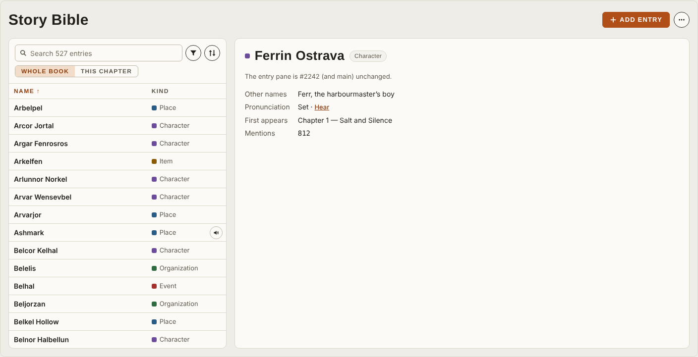

# Story Bible entry list

Research, 2026-10-23. Covers what the Story Bible's left pane (the entry list and its search, filter and sort) is for, a review of PR #2242 (head `894719b`) against that, and a redesign drawn as a draft mock in [mockups/story-bible-entry-list](mockups/story-bible-entry-list/README.md). Refs #2251 (items 16, 17, 19, 21, 23, 24). Nothing here is built. The mock is a draft pending the owner's review.

Paths marked *(#2242)* exist only on that PR's branch, `story-bible-left-pane`.

## The data

- **Size.** The rules-only scan of an 88,000-word book built 527 entries with 9,905 occurrences ([story-bible-mutation-path.md](story-bible-mutation-path.md)), about 19 mentions per entry on average. The Alice fixture builds 48 ([studio-next-gliner-spike.md](studio-next-gliner-spike.md)). The scan keeps a "Needs Review" entity only at 3 or more occurrences (`docs/architecture/story-bible-entity-accuracy.md`, "Build filter"). No one has measured the spread of mentions per entry. The long tail of one-off names comes from the scan's design (it keeps every multi-word name it classifies), not from a count.
- **What a row can draw.** `GuideEntity` in `apps/ui/src/api/contracts/storyBible.ts` carries the name, aliases, category, `occurrence_count`, `appearances` (chapter per mention), `pronunciation` (`ipa`, `source`, `chosen`, `status`), `review`, `review_state` and `locked`. The Script page already has the entries in chapter order (`entriesInChapter`, `apps/ui/src/components/script/page/data/script.selectors.ts`).

## Jobs to be done

What a narrator does in this pane, roughly from most to least often:

1. **Find a name and hear how it is said.** Mid-prep or between takes. They type part of a name or a nickname. The answer is the pronunciation, not the entry's text.
2. **Prepare a chapter.** Before recording a chapter: who and what is in it, which names are new in it, and which have no pronunciation yet.
3. **Work through what is missing.** Every character and place with no pronunciation, every entry that needs review, every suggestion to verify. They step through the list, fixing one entry after another.
4. **Fix an entry.** Set a pronunciation, a kind, a description. This happens in the entry pane, which #2242 leaves unchanged.
5. **Spot duplicates.** "Teodric Vane" and "Captain Vane" listed as two entries. Today the narrator merges from the entry (`GuideDetail.merge.test.tsx`). The list's job is to put near-duplicates side by side, and a name sort does that.

## Where a plain table fails

- **The long tail buries the cast.** In an A–Z list of 527 entries the twenty characters who carry the book sit among hundreds of names said once. Name sort is right for finding a name you can spell. It is wrong for "who matters" and for "what comes next in the book".
- **A search that matches what it does not draw.** If an alias or a hidden column matches, the row shows no reason why it is there.
- **Filters that take room all the time.** Two selects (or nine chips) cost height on every visit. Most visits use none of them.
- **Kind as a sort.** Sorting by kind repeats the kind filter. In a two-column table it is the only sort besides the name.
- **No pronunciation signal.** Job 1 and job 3 hinge on whether a name has a pronunciation. A Name and Kind table cannot answer that.
- **No chapter scope.** Job 2 means leaving for the Script page's rail. That rail is a different list with different rows (#2251 item 17).
- **Keyboard.** A table with one tab stop and arrow keys works, but the narrator also has to get from the search into the rows (Down), and Ctrl+F has to find entries.

## How other tools show a large list

Patterns common to editors and production tools, kept to the ones that change a decision here:

- **Search first, filter second.** Code editors' quick-open and symbol pickers, and mail clients, put a search box over the list, mark the matched letters, and narrow the list as you type. Filters live in a menu, and the active ones show as removable chips or tokens.
- **The audiobook pronunciation guide is a sheet of name, how it is said, and where it first appears**, sorted by first appearance or by name. Narrators prep a chapter by its new names. Book order is the sort that matches that.
- **Group or fold the tail.** Long lists of uneven weight fold minor items under a count (for example, "show N more") rather than listing everything at full weight.

## Review of #2242

PR #2242 replaces the 320 px list of two-line rows with a Name and Kind table (`EntryTable.tsx` *(#2242)*), moves Scan, Import and Voice data behind **More actions**, turns the chips into **Kind** and **Show** selects, and removes the Series tab. The owner asked for the table (SNB-D1) and ruled out the Series tab (SNB-D2). CI is green except the Test ratchet, which needs the owner's label for the deleted `SeriesTab.test.tsx`.

### What it gets right

- **One tab stop, arrows, Home and End, and windowing after 100 rows** with `aria-rowcount` and a focused row kept drawn (`EntryTable.tsx` *(#2242)*, lines 13-18 and 69-127). Tested at 500 and 3,000 entries. The redesign keeps all of it.
- **The table primitive gains `navigable`, `tabStop`, `rowIndex`, `rowCount` and `TableSpacer`.** These are reusable for the Script rail.
- **One primary action and one icon button for the rare actions** (#2251 item 19).
- **No always-visible instruction** (#2251 item 21). The only sentence is the empty book's ("No entries yet. Add one, or scan the manuscript from More actions."), an empty state like the Script rail's.
- **The empty, no-match (with Clear filters), loading, error and scan states** carry over from main.

### What it misses

- **No pronunciation in the row.** The owner's item 16 says the play button is what matters. #2259 puts a Hear button on the Script rail's rows. #2242's rows have none.
- **No chapter scope, and no link to the Script page's "In this chapter".** The PR body says the Script rail's list "shares no control with the old pane". Item 17 asks for one presentation of that list. #2259 builds it on the Script side (`InThisChapter.tsx` on #2259's branch). #2242 does not use it.
- **No way to bring the main cast up.** Only Name and Kind sort. `entryTable.ts` *(#2242)* knows `mentions`, `chapters` and `status` sorts (lines 10 and 29) but keeps them only to read a sort an earlier version saved.
- **Ctrl+F finds nothing on this page.** Ctrl+F opens the jump menu scoped to the page (`apps/ui/src/input/commands.catalog.ts`, `jump.page`). The Story Bible registers no page items, so its entries are listed there only while the Script page is mounted (`apps/ui/src/components/script/page/registry/useScriptRegistry.ts`). #2242 predates item 23 and does not address it.
- **No step from the search to the rows.** Down in the search does not move to the first row.

### What it gets wrong

- **The search matches text the row does not draw.** `rowText` *(#2242 `entryTable.ts`, lines 111-112)* searches the name, the kind, the aliases and the status label ("Verify · 2", "Review", "Locked"). The table draws only the name and kind. Typing "locked" or "verify" lists entries with nothing in the row to show why. The guide on the branch says the search finds by "its name, any of its other names or its kind" and does not mention the status words.
- **The pane width disagrees with its own record.** SNB-D1, the PR body and the rewritten guide say "at most 45%". The code is `lg:grid-cols-[minmax(16rem,30%)_minmax(0,1fr)]` (`Guide.tsx` *(#2242)*, line 322), after commit `1bbd2a9` narrowed it.
- **Stale text.** The types-failed notice still says "The kind chips are hidden" (`Guide.tsx` *(#2242)*, line 366), but the chips are now a select. The PR body lists three columns (Name, Kind, Aliases). Commit `78b0e4d` dropped Aliases.
- **Two selects always drawn.** **Kind** and **Show** take a full row on every visit. **Kind** keeps one kind only, so "characters and places" cannot be shown together.
- **Scope.** The Series removal (a ruling, deleted files and a ratchet label) rides in the same PR as the list. It is why the PR waits on the owner's label. It would have been easier to review on its own.

### Owner findings it should honour

| #2251 item | #2242 |
| - | - |
| 17, one "In this chapter" | Not addressed; the redesign's This chapter scope uses #2259's row |
| 19, icon buttons where it matters | Met for More actions; Kind and Show are selects |
| 21, no always-visible instruction | Met |
| 23, Ctrl+F opens the jump menu | The key works; the page offers nothing to find |
| 24, one chapter-name format | Met: the list draws no chapter names, and Appears in uses `chapterName()` (`apps/ui/src/chapterName.ts`) |

### Verdict

**Change before merge, then iterate.** The table, the keyboard model, the windowing and the action menu are the right base, and replacing them would throw away tested work. Before merge, three small changes on #2242 itself, for whoever owns it:

1. Search only the name and the aliases: drop the kind and the status label from `rowText`. The guide line then needs no change for kind, but it should drop "or its kind".
2. Make the width, SNB-D1, the PR body and the guide agree (30% as built, or 45%).
3. Fix the "kind chips are hidden" notice and the PR body's column list.

Everything else in the redesign below is additive and lands as follow-up PRs.

## The redesign

Drawn in [the draft mock](mockups/story-bible-entry-list/README.md), also published privately at `claude.ai/artifact/QrJn3U34RaTizV6ti1ccsf`. Screenshots are in `mockups/story-bible-entry-list/shots/`. Tags in the mock mark what is new, changed or kept against #2242.

- **Columns: Name, Kind, and an unlabelled Hear column** (new). A Hear button shows only when the entry has a pronunciation, as on #2259's rail. **Space** on a row plays it. Below about 320 px of pane width, Kind keeps only its colour dot.
- **Search** (changed): name and aliases only. A row found by an alias shows "also “the Archivist”". Matched letters are marked. The placeholder carries the count ("Search 527 entries"). **Down** moves to the first row and **Esc** clears.
- **Filter** (changed): one icon button with a count badge opens a menu. **Kind** offers several kinds at once. **Pronunciation** (new) offers Any, None yet and Has one. **Show** offers All, Needs review and Needs verification, offered while some exist, as in #2242. The active filters show as removable chips with **Clear all**, and only while a filter is on.
- **Sort** (new menu): Name, Kind, **Book order** (by the chapter of first appearance, from `appearances`) and **Most mentioned** (from `occurrence_count`). No count column is drawn: #2242's PR body records that the owner did not want counts on rows. The Name and Kind headers still sort.
- **Minor fold** (new): when the whole-book list is not narrowed and is sorted by name or kind, entries with 2 mentions or fewer fold into a **Minor · N** row at the end. A search or filter shows them inline.
- **Whole book / This chapter** (new): This chapter lists the entries mentioned in the chosen chapter in order of first mention, with "first here" on the entries new in it. The row is #2259's `InThisChapter` row (name, kind, detail, Hear). The picker names chapters with `chapterName()` in full form, and a row's detail uses the short form. Sort is off in this scope.
- **Ctrl+F** (new): the Story Bible registers its entries as page items, so the page-scoped jump menu lists them with the alias that matched. Enter opens the entry.
- **Kept from #2242:** the right-click menu, loose suggestion rows under Needs verification, scan progress under the controls (Cancel becomes an icon button), the skeleton, and the empty, no-match and error text.

### The Script page

PR #2259 makes `InThisChapter` the one list for the rail's Words and Story Bible tabs. The redesign's This chapter scope draws the same row, so the two places read alike (item 17). The rail has no search, filter or sort. The page adds them on top. Neither shows a status pill or phonetic text (item 16).

## Open questions

Each has a recommended answer.

1. **Fold minor entries, and where is the line?** Recommended: yes, at 2 mentions or fewer. Measure the spread on the 88,000-word book first (`occurrence_count` over its 527 entries). If the fold hides more than about 60% of entries, or fewer than 20%, move the line.
2. **Show a mark when a name has no pronunciation?** Recommended: no. The empty Hear cell matches #2259, and the **Pronunciation: None yet** filter covers the triage job.
3. **Default sort?** Recommended: Name, as #2242 builds it. It is predictable and puts near-duplicates side by side. Book order is one click away.
4. **Which chapter does This chapter open on?** Recommended: the chapter last open in Script or the Booth, else Chapter 1. The source of "last open" needs checking against the Booth's resume place (#2251 item 2).
5. **Multi-select to merge duplicates from the list?** Recommended: not now. Merge from the entry works. Revisit if the narrator walkthrough shows duplicates are common.
6. **Keep the Kind column when one kind is filtered?** Recommended: keep it. Hiding it moves the Hear column, and it is cheap at 7.5 rem.
7. **Does the This chapter scope keep the page's search and filters?** Recommended: yes, the same controls with Sort off. A chapter rarely has more than about 30 entries, so the search is seldom needed, but one control set is simpler than two.

## Build plan

Each PR is small, updates `docs/guides/using-the-app/story-bible.md` and its screenshots, and lands after #2242 and #2259 merge. The first also records the redesign as a PRD line (SNB-D3 in `docs/prds/studio-next-script-and-story-bible.prd.md`) once the owner approves the mock.

| PR | Scope | Files |
| - | - | - |
| 1 | Search on name and aliases, alias shown, marked letters, count placeholder, Down and Esc | `storybible/entryTable.ts`, `storybible/EntryTable.tsx`, `storybible/Guide.tsx`, `primitives/SearchField.tsx` (if Down needs a hook), their tests, the PRD line |
| 2 | Ctrl+F lists entries on the Story Bible page | a page-items hook beside `Guide.tsx` reusing the shape in `script/page/registry/useScriptRegistry.ts`, `docs/guides/using-the-app/navigation.md` ("On this page" table), tests |
| 3 | Hear column and Space; one row shared with the Script rail | `script/page/rail/InThisChapter.tsx` (#2259) split into a row component both use, `storybible/EntryTable.tsx`, tests, `script.md` if the rail changes |
| 4 | Filter menu with multi-kind and Pronunciation, chips; the Kind and Show selects go | new `storybible/FilterMenu.tsx`, `storybible/entryTable.ts` (`EntryFilter.kinds[]`, `pron`), `storybible/Guide.tsx`, `tests/visual/catalog/storybible.ts` and its driver, tests |
| 5 | Sort menu with Book order and Most mentioned; drop the dead `aliases` and `status` sort keys | `storybible/entryTable.ts`, `storybible/EntryTable.tsx`, new `storybible/SortMenu.tsx`, tests |
| 6 | Minor fold (after question 1 is measured) | `storybible/EntryTable.tsx`, `storybible/entryTable.ts`, tests, visual catalog |
| 7 | Whole book / This chapter with the chapter picker | `storybible/Guide.tsx`, `storybible/EntryTable.tsx`, a selector shared with `script.selectors.ts` `entriesInChapter`, `chapterName.ts` callers, tests, visual catalog |

All paths are under `apps/ui/src/components/` unless they start with `apps/`, `docs/` or `tests/` (`tests/` is `apps/ui/tests/`). PRs 1 and 2 are independent of the rest. PR 3 needs #2259. PRs 4 to 7 touch the same files and go in order.

## Not checked

- No narrator walkthrough of #2242 or of the mock.
- #2242 was read from its diff and its guide screenshots, not run.
- The mock's screenshots use system fonts, not IBM Plex and Barlow, as the voice-samples mock does.
