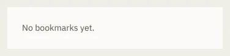

# BookmarksTab

Storybook title: `Script/BookmarksTab`. Source: `src/components/script/bookmarks/ui/BookmarksTab.tsx`.

## Stories

- Empty
- Several Chapters
- Current Bookmark
- Stale One

## Used by

- `src/components/script/page/ScriptPage.tsx`
