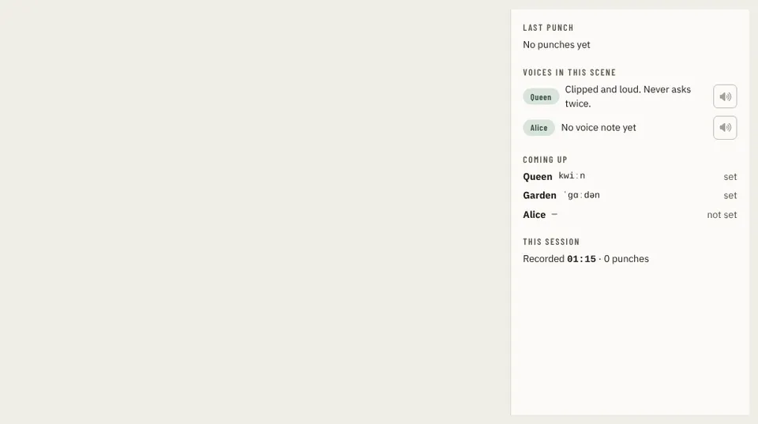

# BoothSidePanel

Storybook title: `Booth/BoothSidePanel`. Source: `src/components/booth/side/BoothSidePanel.tsx`.

## Stories

- Sections
- Reference Character
- Reference Place
- Reference Note
- Drawer
- Drawer Closed

## Used by

- `src/components/booth/page/BoothNextPage.tsx`
