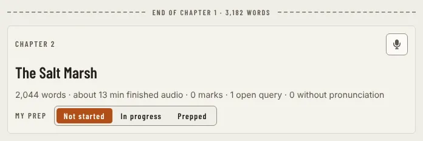

# ChapterCard

Storybook title: `Script/ChapterCard`. Source: `src/components/script/page/chapters/ChapterCard.tsx`.

## Stories

- Not Started
- In Progress
- Prepped
- Credits
- No Record Button
- Review Banner

## Used by

- `src/components/script/page/ScriptPage.tsx`
