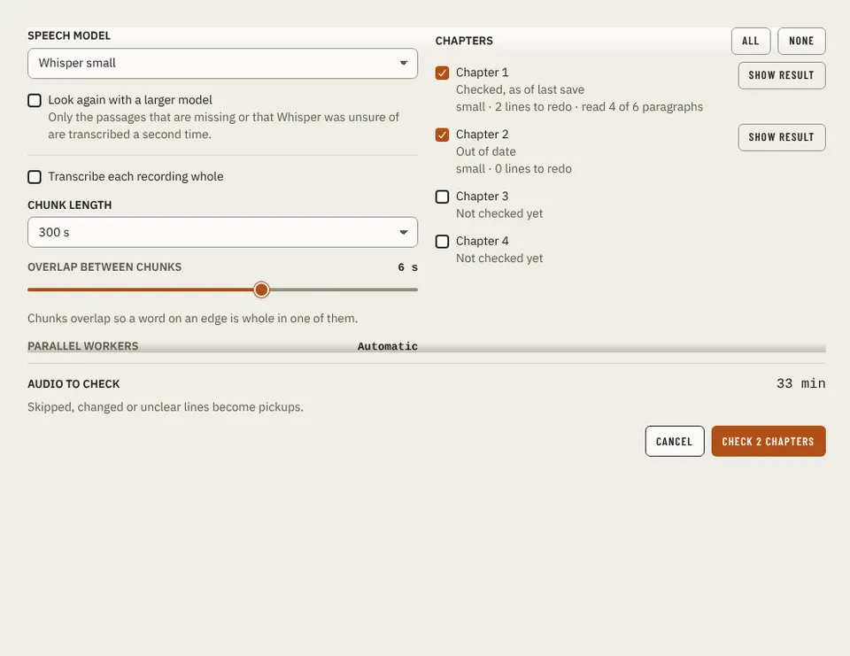

# CheckRecordingsDialog

Storybook title: `RecordingCheck/CheckRecordingsDialog`. Source: `src/components/recordingcheck/CheckRecordingsDialog.tsx`.

## Stories

- Idle With States
- Running Two Chapters
- Refused Chapter
- Credits Row Chapter
- No Recorded Chapters
- Second Look With Parallel Chunks
- Whole Recording
- Chunk Length Settings Do Not Offer

## Used by

- `src/components/recordingcheck/openCheckRecordings.tsx`
