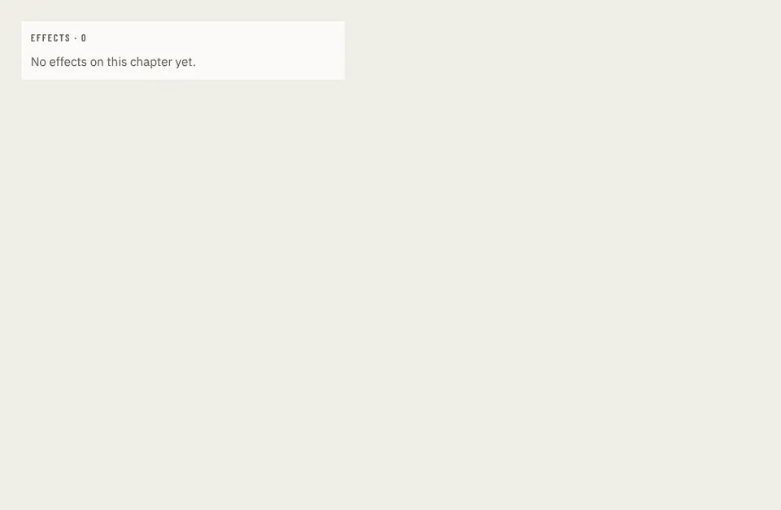

# Effects

Storybook title: `Editing/Effects`. Source: `src/components/editing/effects/Effects.stories.tsx`.

## Stories

- List None
- List One
- List Many
- List Over Cap
- List Narrow
- Strip None
- Strip Within
- Strip Over
- Strip Far Over
- Strip Narrow
- Strip Cap Lowered
- Strip Cap Read Only
- On Words Many
- Inspector Reaper
- Inspector Settings
- Inspector Bypassed
- Inspector Settings Narrow
- Inspector Recorder
- Inspector Narrow
- Add No Selection
- Add With Selection
- Add Over Cap
- Add Far Over Cap
- Add Daw Cannot
- Add With Favourites
- Add Favourites Refused
- Tab

## Used by

- nothing outside its own stories and tests yet
