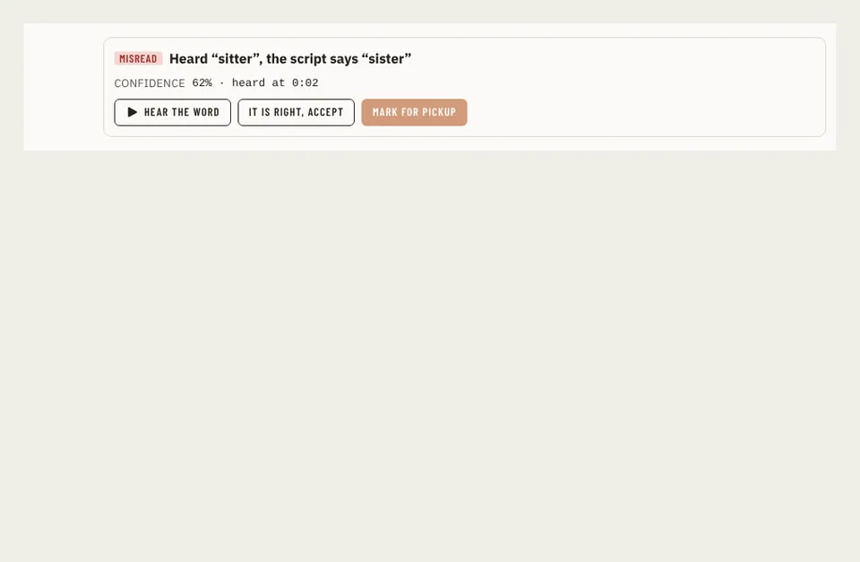

# Flags

Storybook title: `Editing/Flags`. Source: `src/components/editing/flags/Flags.stories.tsx`.

## Stories

- Misread
- Not Read
- Low Confidence
- Not In The Script
- Read Twice
- No Audio
- Not Scored
- Legend Wide
- Legend Narrow
- Legend Not Transcribed

## Used by

- nothing outside its own stories and tests yet
