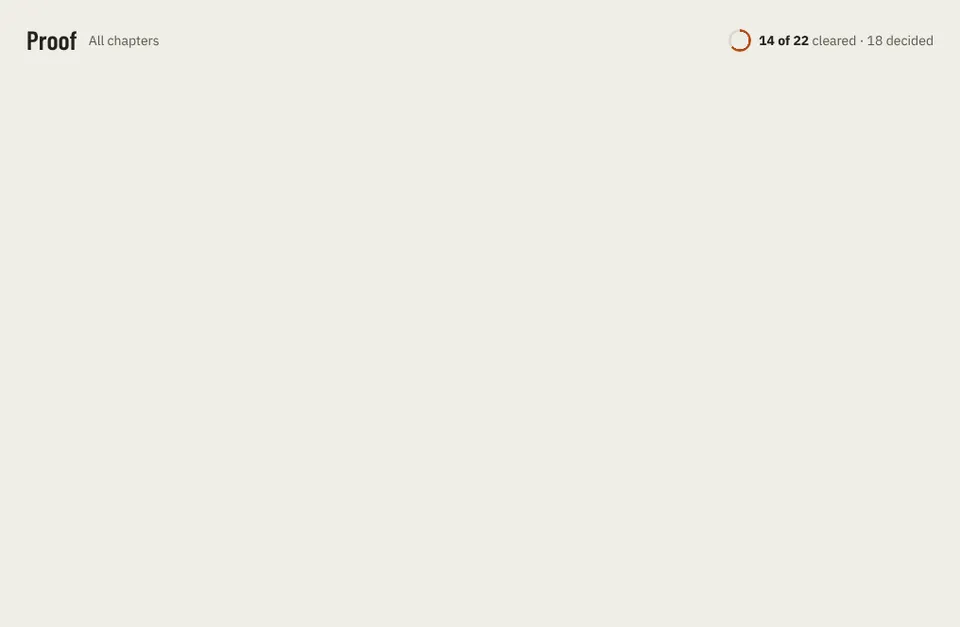

# Frame

Storybook title: `Proof/Frame`. Source: `src/components/proof/frame/Frame.stories.tsx`.

## Stories

- Header
- Header Without Notes
- Strip Sparse
- Strip Dense
- Chapter At 30 Seconds
- Chapter At 2 Minutes
- Whole Chapter
- Pins Merged
- Selected Pin
- Item With No Peaks

## Used by

- nothing outside its own stories and tests yet
