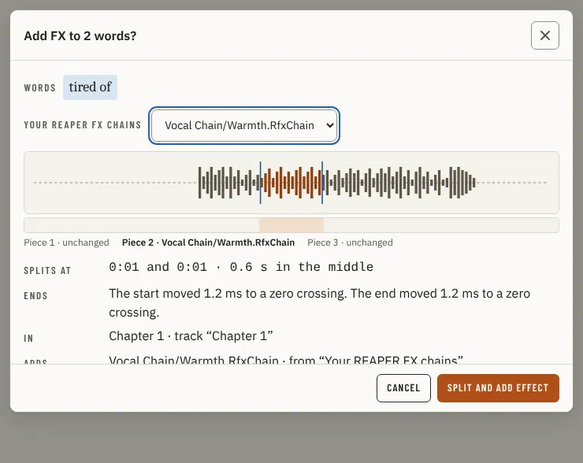

# FxDialog

Storybook title: `Editing/FxDialog`. Source: `src/components/editing/range/fx/FxDialog.stories.tsx`.

## Stories

- Preview
- Over The Cap
- Audacity
- Recorder
- Menu
- Refused
- No Chains
- Marker

## Used by

- `src/components/editing/range/fx/useFxWords.tsx`
