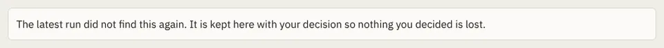

# InsetCard

Storybook title: `Primitives/InsetCard`. Source: `src/components/primitives/InsetCard.tsx`.

## Stories

- Default
- Filled
- Dashed
- Tones
- List In A Panel
- Named Section

## Used by

- `src/components/booth/CompanionShell.tsx`
- `src/components/booth/ResumePrompt.tsx`
- `src/components/booth/pickups/PickupSession.tsx`
- `src/components/booth/suspected/SuspectedLines.tsx`
- `src/components/editing/EditingCheckPanel.tsx`
- `src/components/editing/range/common/Strips.tsx`
- `src/components/editing/range/fx/FxPieces.tsx`
- `src/components/engine/ChapterSyncPanel.tsx`
- `src/components/engine/EnginePanel.tsx`
- `src/components/engine/ToolResult.tsx`
- `src/components/layout/StartupScreen.tsx`
- `src/components/production/ChapterTrackPanel.tsx`
- `src/components/production/RecordingCheckReport.tsx`
- `src/components/production/RemovedFromRecordingList.tsx`
- `src/components/production/readiness/ReadinessPanel.tsx`
- `src/components/proof/PreviewPanel.tsx`
- `src/components/recordingcheck/CheckResult.tsx`
- `src/components/script/page/chapters/ChapterCard.tsx`
- `src/components/script/page/chapters/CreditsSection.tsx`
- `src/components/script/page/rail/words/DefinitionBlock.tsx`
- `src/components/script/page/rail/words/WordCard.tsx`
- `src/components/settings/KeyboardPanel.tsx`
- `src/components/settings/controls/AppearanceBodies.tsx`
- `src/components/settings/controls/CreditsBody.tsx`
- `src/components/settings/controls/EngineBody.tsx`
- `src/components/settings/page/ModelsPane.tsx`
- `src/components/settings/page/ReaderTextPanel.tsx`
- `src/components/settings/page/SettingsPage.tsx`
- `src/components/stages/StageEvidence.tsx`
- `src/components/storybible/DialogueCueAttribution.tsx`
- `src/components/storybible/VoiceReferencesSection.tsx`
- `src/components/storybible/suggested/row/SuggestionRow.tsx`
- `src/components/storybible/voicesamples/VoiceSampleRow.tsx`
