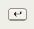

# KeyCap

Storybook title: `Primitives/KeyCap`. Source: `src/components/primitives/KeyCap.tsx`.

## Stories

- Glyph
- Every Key
- Booth Size
- Other Spellings
- Glyph Keeps Its Name

## Used by

- `src/components/engine/VoicesCard.tsx`
- `src/components/help/ShortcutSheet.tsx`
- `src/components/layout/AppShell.tsx`
- `src/components/layout/HistoryPanel.tsx`
- `src/components/layout/JumpMenu.tsx`
- `src/components/primitives/ContextMenu.tsx`
- `src/components/primitives/KeyHint.tsx`
- `src/components/primitives/KeyHints.tsx`
- `src/components/proof/inspector/DecisionButtons.tsx`
