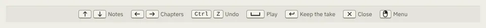

# KeyHints

Storybook title: `Primitives/KeyHints`. Source: `src/components/primitives/KeyHints.tsx`.

## Stories

- Default
- Few Hints
- Is A Note Region

## Used by

- `src/components/booth/frame/BoothFooter.tsx`
- `src/components/editing/keys/editingKeyHints.ts`
- `src/components/editing/page/EditingBody.tsx`
- `src/components/proof/ProofPage.tsx`
- `src/components/script/page/ScriptPage.tsx`
- `src/components/script/page/layout/scriptKeyHints.ts`
- `src/input/hints.ts`
