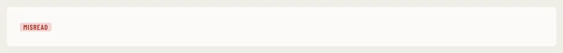

# KindChip

Storybook title: `Primitives/KindChip`. Source: `src/components/primitives/KindChip.tsx`.

## Stories

- Misread
- Long Silence
- Breath
- Pronunciation
- Unknown Speaker
- Every Kind
- Every Entity Colour
- Clickable

## Used by

- `src/components/booth/side/Reference.tsx`
- `src/components/booth/side/VoicesNearby.tsx`
- `src/components/editing/drawer/FoundList.tsx`
- `src/components/editing/flags/FlagCard.tsx`
- `src/components/manuscript/EntitySummary.tsx`
- `src/components/pickups/list/PickupsTable.tsx`
- `src/components/proof/checkcard/FindingRow.tsx`
- `src/components/proof/notes/NotesTable.tsx`
- `src/components/script/page/rail/bible/EntryCard.tsx`
