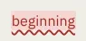

# KindMark

Storybook title: `Primitives/KindMark`. Source: `src/components/primitives/KindMark.tsx`.

## Stories

- Misread
- Missing
- Extra
- Repeat
- Low Confidence
- Pronunciation
- Find Hit
- Entity Needs Review
- Every Marked Kind
- Every Entity Colour
- Kind Without Mark
- Activatable

## Used by

- `src/components/booth/ReaderKey.tsx`
- `src/components/booth/ReaderText.tsx`
- `src/components/editing/flags/Legend.tsx`
- `src/components/manuscript/EntitySummary.tsx`
- `src/components/script/page/chapters/CreditsSection.tsx`
