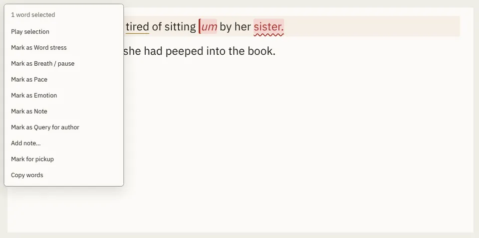

# MarkMenu

Storybook title: `Editing/MarkMenu`. Source: `src/components/editing/menu/marks/MarkMenu.stories.tsx`.

## Stories

- Mark As Kinds
- Only Said Words
- Note Dialog Empty

## Used by

- `src/components/script/page/tools/select/SelectionTool.tsx`
