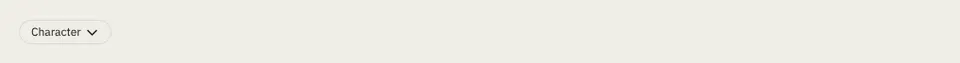

# Menu

Storybook title: `Primitives/Menu`. Source: `src/components/primitives/Menu.tsx`.

## Stories

- Closed
- Disabled
- Icon Only Trigger
- Opens On Press
- Keyboard Chooses An Item
- Sections That Choose

## Used by

- `src/components/editing/range/fx/FxButtons.tsx`
- `src/components/engine/ChapterLinksTable.tsx`
- `src/components/script/page/rail/bible/BiblePanel.tsx`
- `src/components/script/page/tools/select/KindMenu.tsx`
- `src/components/script/page/tools/select/MarkMenu.tsx`
- `src/components/storybible/ActionsMenu.tsx`
- `src/components/storybible/FilterMenu.tsx`
- `src/components/storybible/GuideDetail.tsx`
- `src/components/storybible/SortMenu.tsx`
- `src/components/storybible/voicesamples/VoiceSampleRow.tsx`
