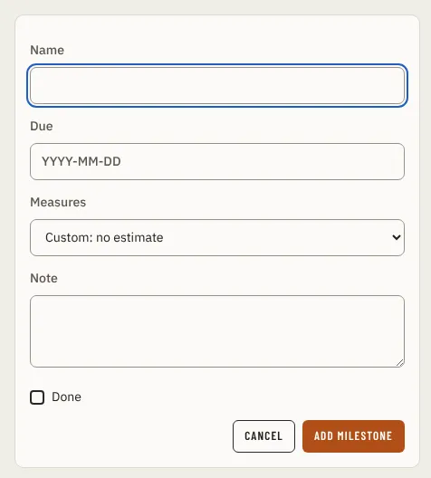

# MilestoneDialog

Storybook title: `Schedule/MilestoneDialog`. Source: `src/components/schedule/MilestoneDialog.tsx`.

## Stories

- Add
- Edit With Chapter Count
- Stored Measure The Profile Does Not Offer
- Refused

## Used by

- `src/components/schedule/openMilestoneDialog.tsx`
